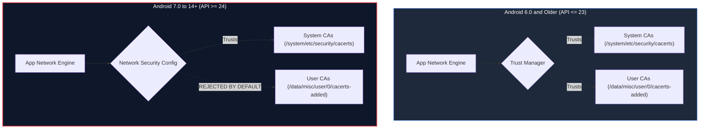
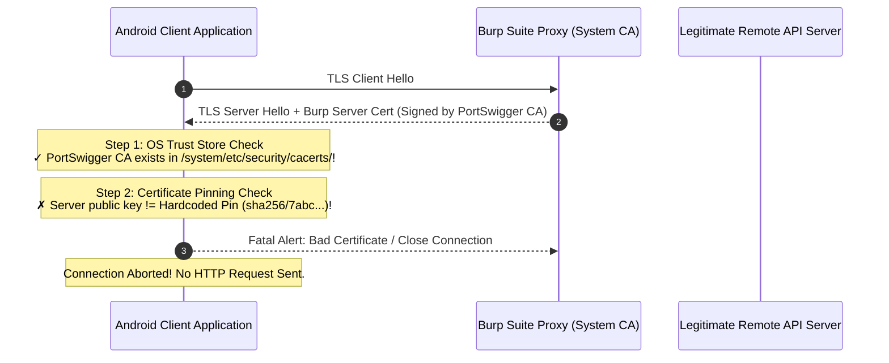
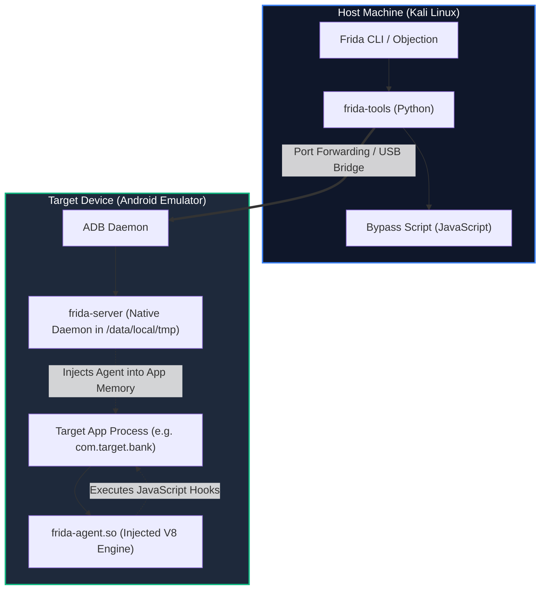
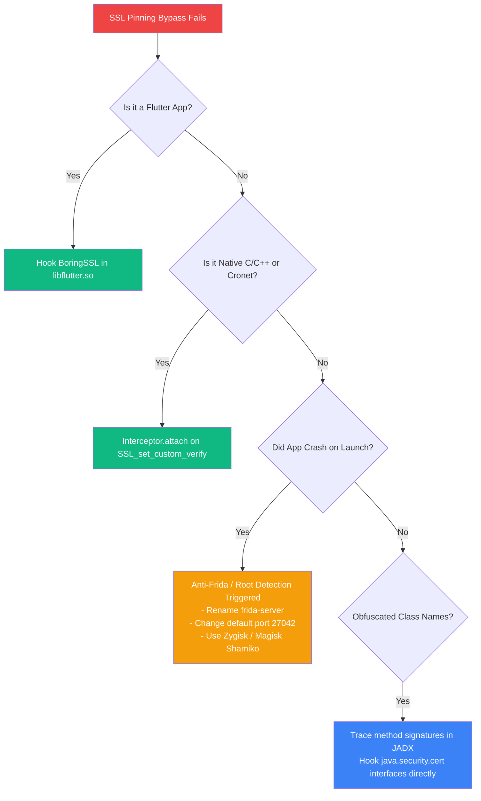
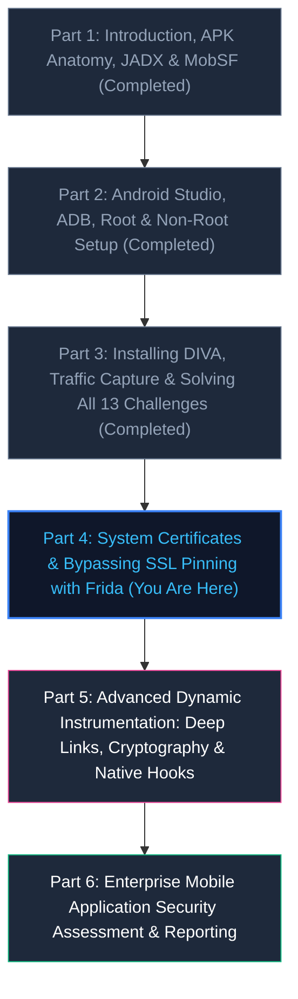

# Android Pentesting — Part 4: System Certificates, Rooted Interception and Bypassing SSL Pinning with Frida

> **Category:** Mobile Application Security | **Series:** Android Pentesting 101 | **Level:** Intermediate to Advanced  
> **Prerequisites:** [Part 3 Guide](../Android%20Pentesting%20Part%203%20Installing%20DIVA,%20Capturing%20Traffic%20and%20Solving%20All%2013%20Challenges/README.md) complete, Burp CA exported, rooted AVD running.  
> **Estimated Time:** ≈ 120–180 minutes

---

## Executive Overview

In **[Part 3](../Android%20Pentesting%20Part%203%20Installing%20DIVA,%20Capturing%20Traffic%20and%20Solving%20All%2013%20Challenges/README.md)**, we installed DIVA, routed traffic to Burp Suite, and systematically audited 13 common Android vulnerability categories. While Burp Suite intercepted DIVA’s HTTP and HTTPS communication effortlessly, there was an underlying reason for that simplicity: **DIVA targeted Android API level 23 (Android 6.0 Marshmallow)**.

When you point Burp Suite at a modern commercial application—whether a banking app, an e-commerce platform, or a social network built against **Android 7.0 (API 24) through Android 14+ (API 34)**—the environment behaves completely differently:
1. **User-Installed Certificates are Ignored:** The operating system completely disregards any CA certificate installed via the standard Android Settings UI.
2. **Silent Connection Failures or TLS Aborts:** The application either refuses to connect entirely or throws immediate TLS handshake exceptions (`CertPathValidatorException`).
3. **Certificate Pinning Blocks System CAs:** Even if you force the operating system to trust Burp Suite system-wide, the application's internal code checks the server's public key against a hardcoded pin, terminating the connection if a mismatch occurs.

In this guide, we bridge the gap between legacy targets and modern enterprise mobile defense. We will configure a **rooted, writable-system emulator**, defeat Android’s `dm-verity` verified boot to install Burp’s CA directly into the **system root store**, identify certificate pinning mechanisms, and dynamically neutralize TLS security controls at runtime using **Objection** and custom **Frida** instrumentation scripts.

```text
+---------------------------------------------------------------------------------------------------+
|                            Modern Android Network Interception Pipeline                           |
+--------------------------+------------------------------------+-----------------------------------+
|  1. Operating System     |  2. Network Security Config        |  3. Application Code Layer        |
|  - System Trust Store    |  - Default: System CAs Only        |  - OkHttp CertificatePinner       |
|  - /system/etc/security/ |  - Ignores User-Installed CAs      |  - Custom X509TrustManager        |
|  - Writable System Mount |  - Defeated by System Injection    |  - Native Pinning (BoringSSL)     |
|  - dm-verity Disabled    |    into System Cert Directory      |  - Defeated by Frida & Objection  |
+--------------------------+------------------------------------+-----------------------------------+
```

> [!IMPORTANT]
> **Legal & Ethical Notice:** The techniques, commands, and dynamic instrumentation scripts demonstrated in this guide are provided strictly for authorized penetration testing, security auditing, and defensive research. Never intercept traffic or tamper with application runtime logic without explicit, documented authorization from the application and infrastructure owners.

---

# 1. Why Part 3's Setup Is Not Enough

In older Android versions (API level 23 and below), Android treated user-installed CA certificates and pre-installed system CA certificates identically. If a security analyst navigated to **Settings -> Security -> Install from storage** and added Burp’s certificate, every application on the device trusted Burp as a valid Certificate Authority for HTTPS connections.

### The Android 7.0 (API 24) Trust Boundary Shift

Starting in Android 7.0 (Nougat, API 24), Google introduced the **Network Security Configuration** framework. The default trust policy was overhauled to protect end users against rogue Wi-Fi hotspots, compromised corporate proxies, and malicious CAs:



Unless an application's `res/xml/network_security_config.xml` explicitly opts in with the following syntax, user certificates are discarded:

```xml
<!-- Production applications almost NEVER include this block -->
<network-security-config>
    <base-config>
        <trust-anchors>
            <certificates src="system" />
            <certificates src="user" /> <!-- Only found in debug builds -->
        </trust-anchors>
    </base-config>
</network-security-config>
```

### The Resulting Failure State

When you configure proxy settings on a modern Android device and attempt to intercept traffic from an app targeting API 24+ using only a user-installed certificate:
1. The app initiates a TLS handshake with Burp Suite.
2. Burp responds with its dynamically generated certificate signed by the PortSwigger CA.
3. The Android TLS stack checks the CA against `/system/etc/security/cacerts/`.
4. The CA is not found in the system store; the user store is not consulted.
5. The handshake terminates abruptly with:
   ```text
   javax.net.ssl.SSLHandshakeException: java.security.cert.CertPathValidatorException: 
   Trust anchor for certification path not found.
   ```
6. **In Burp Suite:** The HTTP history shows nothing, or the Dashboard event log reports:
   ```text
   The client failed to negotiate a TLS connection to api.target.com:443: 
   Received fatal alert: certificate_unknown
   ```

**The Conclusion:** We cannot rely on app-level configuration. We must elevate our lab environment to install our proxy CA directly into the **operating system's system certificate store**.

---

# 2. A Rooted, Writable-System Emulator

In Part 2, we established an Android Virtual Device (AVD) using a **Google APIs (userdebug)** system image. While running `adb root` provides a root shell, the `/system` partition on modern Android emulators remains mounted as **read-only** (`ro`) and is cryptographically locked by **`dm-verity`** (Android Verified Boot).

If you attempt to write to `/system` directly:
```bash
adb shell "mount -o rw,remount /system"
# Returns: mount: '/system' not in /proc/mounts OR Read-only file system
```

To make `/system` writable, we must boot the emulator with specific flags and disable kernel-level verified boot verification.


---

### Step 2.1: Enumerate Available Virtual Devices

From your Kali Linux terminal, list your configured AVDs:

```bash
emulator -list-avds
```

*Example output:*
```text
Pixel_6_API_33_Google_APIs
Pixel_7_API_34_Google_APIs
```

> [!WARNING]
> Remember from Part 2: The virtual device **must** be built with a **Google APIs** or **AOSP** image. If your AVD was provisioned with a **Google Play** image, `adb root` is blocked by design, and `/system` cannot be modified.

---

### Step 2.2: Launch the Emulator in Writable-System Mode

Close any currently running emulator instances and start your AVD with the `-writable-system` flag:

* **[WINDOWS HOST] (PowerShell):**
  ```powershell
  # Launch from Windows SDK emulator directory
  & "$env:LOCALAPPDATA\Android\Sdk\emulator\emulator.exe" -avd Pixel_6_API_33_Google_APIs -writable-system -no-snapshot-load
  ```

* **[KALI LINUX VM] (Bash):**
  ```bash
  # Start the emulator with a writable system overlay in background
  emulator -avd Pixel_6_API_33_Google_APIs -writable-system -no-snapshot-load &
  ```

*Flag Breakdown:*
* `-writable-system`: Allocates a temporary overlay file allowing modifications to `/system`, `/vendor`, and `/product`.
* `-no-snapshot-load`: Prevents the emulator from resuming an old frozen snapshot that might overwrite storage states.

---

### Step 2.3: Disable dm-verity & Remount Filesystem

Once the emulator completes its boot sequence:

```bash
# 1. Restart ADB daemon with root privileges
adb root

# 2. Disable Android Verified Boot (dm-verity)
adb disable-verity
```

*Expected output:*
```text
Verity disabled on /system
Verity disabled on /vendor
Verity disabled on /product
Now reboot your device for settings to take effect
```

Reboot the emulator to commit the verification state:

```bash
# 3. Reboot the emulator
adb reboot
```

Wait approximately 30–45 seconds for the operating system to finish loading, then execute the remount command:

```bash
# 4. Re-elevate ADB to root
adb root

# 5. Remount all system partitions as read-write
adb remount
```

*Expected output on a successful remount:*
```text
remount succeeded
```

Your emulator's `/system` partition is now fully writable.

---

# 3. Install the Certificate System-Wide

Now that `/system` is read-write, we can install the Burp Suite CA certificate directly into the Android system trust store located at:
`/system/etc/security/cacerts/`

```text
+-------------------------------------------------------------------------------+
|                        Android System Trust Store Format                      |
+-------------------------------------------------------------------------------+
| Path:        /system/etc/security/cacerts/                                    |
| Filename:    <subject_hash_old>.0                                             |
| Example:     9a5ba575.0                                                       |
| Encoding:    PEM format (Base64) with certificate header and footer           |
| Permissions: 644 (rw-r--r--), owned by root:root                             |
| Context:     u:object_r:system_file:s0                                        |
+-------------------------------------------------------------------------------+
```

---

### Step 3.1: Export the CA Certificate from Burp Suite

1. Open **Burp Suite** on Kali Linux.
2. Navigate to **Settings -> Tools -> Proxy -> Import / export CA certificate**.
3. Select **Certificate in DER format** and click **Next**.
4. Save the file to your working directory as `cacert.der`.

---

### Step 3.2: Convert Format & Compute Android Subject Hash

Android names system certificates using an 8-character hexadecimal string representing the old OpenSSL hash of the certificate’s `Subject` line (`subject_hash_old`):

```bash
# 1. Convert DER format to PEM format
openssl x509 -inform DER -in cacert.der -out burp.pem

# 2. Compute the 8-character subject hash (OpenSSL 1.0 format)
HASH=$(openssl x509 -inform PEM -subject_hash_old -in burp.pem | head -n 1)

echo "Calculated Certificate Hash: ${HASH}"
```

*Typical default hash for PortSwigger CA:*
```text
Calculated Certificate Hash: 9a5ba575
```

Create the final certificate file using the `<hash>.0` naming convention:

```bash
# 3. Create the properly named system certificate
cp burp.pem ${HASH}.0

# Optional: Append the certificate text details to the file (standard Android convention)
openssl x509 -inform PEM -text -in burp.pem -out /dev/null >> ${HASH}.0
```

---

### Step 3.3: Push Certificate to the System Store

Deploy the certificate directly into `/system/etc/security/cacerts/`:

```bash
# Push the hashed certificate to the system trust directory
adb push ${HASH}.0 /system/etc/security/cacerts/

# Set strict standard permissions: readable by all, writable only by root
adb shell chmod 644 /system/etc/security/cacerts/${HASH}.0

# Set appropriate SELinux security context
adb shell chcon u:object_r:system_file:s0 /system/etc/security/cacerts/${HASH}.0
```

Verify that the certificate is present in the filesystem:

```bash
adb shell ls -la /system/etc/security/cacerts/${HASH}.0
```

*Expected output:*
```text
-rw-r--r-- 1 root root 1375 2026-10-19 17:15 /system/etc/security/cacerts/9a5ba575.0
```

---

### Step 3.4: Alternative Method: Magisk Module (Systemless Injection)

If you are testing on a modern physical device or an image where `/system` cannot be remounted read-write, you can use the **MagiskTrustUserCerts** module:

1. Install Burp's certificate normally via Android Settings as a standard user certificate.
2. The user certificate lands in `/data/misc/user/0/cacerts-added/`.
3. Install the **AlwaysTrustUserCerts** or **MagiskTrustUserCerts** module via Magisk.
4. Upon every boot, the Magisk module automatically binds a systemless overlay from the user certificate store into `/system/etc/security/cacerts/`, achieving identical system-wide trust without touching the underlying system partition!

---

# 4. Verify Against a Modern Target

With the certificate installed system-wide, we must verify that modern Android applications trust our proxy.

### Step 4.1: Configure Global Network Proxy via ADB

Direct the emulator’s network traffic through Burp Suite running on your Kali host:

```bash
# 10.0.2.2 routes directly to Kali's loopback interface
adb shell settings put global http_proxy 10.0.2.2:8080
```

Ensure your Burp Proxy Listener is configured to listen on **All interfaces** on port `8080`.

---

### Step 4.2: Confirm System CA Registration

On the emulator:
1. Open **Settings -> Security -> Encryption & credentials -> Trusted credentials**.
2. Select the **System** tab (not the User tab).
3. Scroll through the alphabetically organized authorities until you find:
   **PortSwigger** (PortSwigger CA).

```text
+-------------------------------------------------------------+
|                     Trusted Credentials                     |
+-----------------------------+-------------------------------+
| System                      | User                          |
+-----------------------------+-------------------------------+
| [...]                       |                               |
| OpenSSL (OIS)               | (No user certs needed!)       |
| PortSwigger                 |                               |
|   PortSwigger CA            |                               |
| QuoVadis Trustlink          |                               |
| [...]                       |                               |
+-----------------------------+-------------------------------+
```

---

### Step 4.3: Test Modern App Interception (Google Chrome)

Modern Google Chrome on Android strictly enforces modern TLS policies and targets current Android APIs:

1. Launch Google Chrome inside the emulator.
2. Navigate to any modern HTTPS website:
   ```text
   https://httpbin.org/ip
   https://example.com
   ```
3. Observe Chrome: The page loads cleanly with a valid green/gray padlock. There are **zero SSL warnings** and **no untrusted certificate screens**.
4. Observe Burp Suite: In **Proxy -> HTTP history**, the complete HTTPS GET request and the server's JSON response appear fully decrypted!

```http
GET /ip HTTP/1.1
Host: httpbin.org
User-Agent: Mozilla/5.0 (Linux; Android 13; Pixel 6) AppleWebKit/537.36
Accept: text/html,application/xhtml+xml,application/xml;q=0.9,*/*;q=0.8

HTTP/1.1 200 OK
Content-Type: application/json
Content-Length: 32

{
  "origin": "198.51.100.42"
}
```

Any standard modern application that relies on the operating system’s default trust store can now be fully intercepted.

---

# 5. What Certificate Pinning Is, and Spotting It

Now we arrive at the core challenge of modern mobile penetration testing: **Certificate Pinning**.

### The Problem Certificate Pinning Solves (For Developers)

Even with system CAs, an application remains vulnerable if an attacker can compromise *any* single Certificate Authority in the global trust store (or if a pentester installs a rogue system CA as we did above).

To eliminate this trust, developers implement **Certificate Pinning** (also known as SSL Pinning or Public Key Pinning). Instead of delegating trust to the operating system, the application embeds a cryptographic signature of the expected server certificate, intermediate CA, or public key (SPKI) directly into the client code.



---

### Common Implementation Patterns

Developers implement pinning in three primary ways:

#### Pattern 1: Android Network Security Config (`network_security_config.xml`)
The declarative Android framework approach:
```xml
<network-security-config>
    <domain-config>
        <domain includeSubdomains="true">api.targetbank.com</domain>
        <pin-set expiration="2027-01-01">
            <pin digest="SHA-256">7HIpactkIAq2Y49orFOOQKurWxmmSFZhBCoQYcRhJ3Y=</pin>
            <!-- Backup Pin -->
            <pin digest="SHA-256">k2ErWTvE4xRupaJDrJUdUmink8eW5NnSovTmOdaf360=</pin>
        </pin-set>
    </domain-config>
</network-security-config>
```

#### Pattern 2: Square's OkHttp `CertificatePinner`
The most common programmatic implementation in modern Android apps:
```java
// Java / Kotlin OkHttp Implementation
CertificatePinner certificatePinner = new CertificatePinner.Builder()
    .add("api.targetbank.com", "sha256/7HIpactkIAq2Y49orFOOQKurWxmmSFZhBCoQYcRhJ3Y=")
    .build();

OkHttpClient client = new OkHttpClient.Builder()
    .certificatePinner(certificatePinner)
    .build();
```

#### Pattern 3: Custom `X509TrustManager` Implementation
Overriding the platform trust manager to perform manual certificate verification:
```java
public class CustomTrustManager implements X509TrustManager {
    @Override
    public void checkServerTrusted(X509Certificate[] chain, String authType) throws CertificateException {
        // Custom logic verifying certificate thumbprint against hardcoded string
        byte[] expectedFingerprint = getExpectedPin();
        if (!Arrays.equals(chain[0].getPublicKey().getEncoded(), expectedFingerprint)) {
            throw new CertificateException("Certificate pin verification failed!");
        }
    }
}
```

---

### How to Spot Certificate Pinning During an Assessment

When an application implements certificate pinning, you will notice distinct operational signatures:

#### 1. In Burp Suite: Dashboard Event Log
You will see repetitive connection drops whenever the app attempts to sync:
```text
The client failed to negotiate a TLS connection to api.targetbank.com:443: 
Received fatal alert: certificate_unknown
```
Or:
```text
Received fatal alert: bad_certificate
```

#### 2. In Android Logcat: Cleartext Pin Verification Exceptions
Stream Logcat while interacting with the application:
```bash
adb logcat | grep -E "CertificatePinner|SSLHandshakeException|CertPathValidatorException"
```

*Example Logcat trace:*
```text
javax.net.ssl.SSLPeerUnverifiedException: Certificate pinning failure!
  Peer certificate chain:
    sha256/WoiWRFYSo2adUnHuYi8NN6WKJNqwht56J3+AbHNpkUE=: CN=api.targetbank.com
  Pinned certificates for api.targetbank.com:
    sha256/7HIpactkIAq2Y49orFOOQKurWxmmSFZhBCoQYcRhJ3Y=
    at okhttp3.CertificatePinner.check(CertificatePinner.kt:184)
```

#### 3. Static Audit with JADX
Search your decompiled codebase for keywords:
* `CertificatePinner`
* `checkServerTrusted`
* `pin-set`
* `TrustKit`

Once identified, our path is clear: **we must hook and bypass the pinning logic at runtime**.

---

# 6. Install frida-server and Frida

To bypass certificate pinning dynamically, we use **Frida**—the industry-standard dynamic binary instrumentation toolkit. Frida injects a Google V8 JavaScript engine directly into the target app's memory space, allowing us to hook Java methods, inspect function arguments, alter return values, and replace validation routines on the fly.



---

### Step 6.1: Install Frida & Objection on Kali Linux

Install the Frida command-line tools and Objection via Python’s package manager:

```bash
# Install Frida core, tools, and Objection
pip install --upgrade frida frida-tools objection

# Verify host installation
frida --version
objection version-check
```

---

### Step 6.2: Determine Target Emulator Architecture

The `frida-server` binary running on Android must strictly match the target device's CPU architecture:

```bash
# Query emulator CPU ABI
adb shell getprop ro.product.cpu.abi
```

*Common Architectures:*
* `x86_64` (Standard for modern Android Studio emulators on 64-bit PCs)
* `x86` (Older 32-bit emulators)
* `arm64-v8a` (Modern physical Android phones or Apple Silicon emulators)
* `armeabi-v7a` (Older 32-bit physical phones)

---

### Step 6.3: Deploy and Execute `frida-server`

1. Match the exact version returned by `frida --version` on your Kali host (e.g., `16.5.9`).
2. Download the matching server binary release from official Frida GitHub releases:
   `https://github.com/frida/frida/releases`
   File format: `frida-server-<version>-android-<arch>.xz`

3. Decompress the archive and deploy it to the emulator:

```bash
# Decompress archive
unxz frida-server-*-android-x86_64.xz

# Rename for simplicity
mv frida-server-*-android-x86_64 frida-server

# Push to /data/local/tmp (the standard writable, executable Android scratch directory)
adb push frida-server /data/local/tmp/

# Set executable permissions
adb shell chmod 755 /data/local/tmp/frida-server
```

4. Launch `frida-server` as a root background daemon:

```bash
# Start frida-server in background
adb shell "su -c '/data/local/tmp/frida-server > /dev/null 2>&1 &'"
```

---

### Step 6.4: Test Frida Connectivity

Verify that your host machine can communicate with the injected Frida server:

```bash
# List all running processes on the connected Android device
frida-ps -U
```

*Expected output snippet:*
```text
  PID  Name
-----  --------------------------------------------------
 1421  com.android.systemui
 3218  com.google.android.gms
 7812  com.targetbank.mobile
```

If you see the active process table, your runtime instrumentation bridge is fully operational.

---

# 7. Bypass with Objection

**Objection** (created by SensePost) is an automated runtime exploration toolkit powered by Frida. It packages dozens of common hooking routines into simple, high-level commands. For 80% of standard Android applications, Objection can defeat certificate pinning in a single command.

```text
+-------------------------------------------------------------+
|               Objection Mobile Runtime Explorer             |
+-------------------------------------------------------------+
| Command:   android sslpinning disable                       |
| Strategy:  Automated multi-library reflection hook          |
| Targets:   OkHttp3, TrustManagerImpl, Conscrypt, PhoneGap,  |
|            TrustKit, Appcelerator, NetworkSecurityConfig   |
+-------------------------------------------------------------+
```

---

### Step 7.1: Launch Objection Against Target Package

You can launch Objection by spawning the target application from scratch (which ensures early network requests are intercepted) or by attaching to an existing process:

```bash
# Spawn application fresh and inject Objection agent
objection --gadget "com.targetbank.mobile" explore
```

*Terminal output:*
```text
Using USB device `emulator-5554`
Agent injected and responsive!
[com.targetbank.mobile] #
```

---

### Step 7.2: Execute `android sslpinning disable`

Inside the interactive Objection console, issue the automated unpinning command:

```text
[com.targetbank.mobile] # android sslpinning disable
```

*Watch the live hook output scroll across your terminal:*
```text
(agent) Registering Jobs...
(agent) Job: 284729 - okhttp3.CertificatePinner.check(java.lang.String, java.util.List)
(agent) Job: 198273 - com.android.org.conscrypt.TrustManagerImpl.checkTrustedRecursive
(agent) Job: 928374 - javax.net.ssl.X509TrustManager.checkServerTrusted
(agent) Job: 384719 - okhttp.CertificatePinner.check(java.lang.String, java.security.cert.Certificate[])
(agent) Job: 472819 - android.security.net.config.NetworkSecurityTrustManager.checkServerTrusted
[+] SSL Pinning bypass hooks installed across 12 targets!
```

---

### Step 7.3: Observe Traffic in Burp Suite

Now, interact with the application on your emulator:
1. Tap the login or account sync button.
2. In the Objection console, you will see hooks actively intercepting verification attempts:
   ```text
   (agent) [okhttp3.CertificatePinner] Bypassing check for domain: api.targetbank.com
   (agent) [TrustManagerImpl] Bypassing checkTrustedRecursive for api.targetbank.com
   ```
3. Look at **Burp Suite -> Proxy -> HTTP history**:
   The previously blocked HTTPS requests now flow continuously into Burp Suite, completely decrypted and editable in Repeater!

---

# 8. Bypass with a Raw Frida Script

While Objection is powerful, it is essentially an abstraction layer. In modern security assessments, applications frequently use custom pinning implementations, obfuscated class names, or specific combinations of OkHttp where generic toolkits fail.

Writing and executing a **raw Frida script** gives you absolute visibility into the Dalvik/ART runtime, allowing you to selectively neuter validation routines.

---

### Step 8.1: The Universal SSL Pinning Bypass Script

Create a file named `universal_ssl_pinning_bypass.js` on your Kali machine. This script uses Frida’s `Java.perform()` API to hook the core platform trust anchors and common third-party networking engines:

```javascript
/*
 * Universal Android SSL Pinning Bypass
 * Designed for Android 7.0 - 14+ (API 24 - 34)
 */

Java.perform(function () {
    console.log("[*] Initializing Universal Android SSL Pinning Bypass...");

    // ------------------------------------------------------------------------
    // Hook 1: Universal TrustManager (checkServerTrusted)
    // Overwrite the core X509TrustManager interface to accept all certificates
    // ------------------------------------------------------------------------
    try {
        var X509TrustManager = Java.use('javax.net.ssl.X509TrustManager');
        var SSLContext = Java.use('javax.net.ssl.SSLContext');

        var TrustManager = Java.registerClass({
            name: 'com.antigravity.TrustAllManager',
            implements: [X509TrustManager],
            methods: {
                checkClientTrusted: function (chain, authType) {},
                checkServerTrusted: function (chain, authType) {
                    console.log("[+] Intercepted and bypassed checkServerTrusted()");
                },
                getAcceptedIssuers: function () {
                    return [];
                }
            }
        });

        var TrustManagers = [TrustManager.$new()];
        var SSLContext_init = SSLContext.init.overload(
            '[Ljavax.net.ssl.KeyManager;', 
            '[Ljavax.net.ssl.TrustManager;', 
            'java.security.SecureRandom'
        );

        SSLContext_init.implementation = function (keyManager, trustManager, secureRandom) {
            console.log("[+] Overriding SSLContext.init() with permissive TrustManager");
            SSLContext_init.call(this, keyManager, TrustManagers, secureRandom);
        };
    } catch (err) {
        console.log("[-] Error hooking standard TrustManager: " + err);
    }

    // ------------------------------------------------------------------------
    // Hook 2: Android Conscrypt / TrustManagerImpl (checkTrustedRecursive)
    // The core validation routine powering Android 7.0+ system trust checks
    // ------------------------------------------------------------------------
    try {
        var TrustManagerImpl = Java.use('com.android.org.conscrypt.TrustManagerImpl');
        var ArrayList = Java.use("java.util.ArrayList");

        TrustManagerImpl.checkTrustedRecursive.implementation = function (certs, host, clientAuth, untrustedChain, trustAnchorChain, used) {
            console.log("[+] Bypassing Conscrypt TrustManagerImpl.checkTrustedRecursive() for host: " + host);
            return ArrayList.$new();
        };
    } catch (err) {
        console.log("[-] Error hooking Conscrypt TrustManagerImpl: " + err);
    }

    // ------------------------------------------------------------------------
    // Hook 3: Square OkHttp3 CertificatePinner
    // Nullify the CertificatePinner.check() routine
    // ------------------------------------------------------------------------
    try {
        var CertificatePinner = Java.use('okhttp3.CertificatePinner');
        
        // Overload 1: check(String, List)
        CertificatePinner.check.overload('java.lang.String', 'java.util.List').implementation = function (hostname, peerCertificates) {
            console.log("[+] Bypassing OkHttp3 CertificatePinner.check(String, List) for: " + hostname);
            return;
        };

        // Overload 2: check(String, Certificate[])
        CertificatePinner.check.overload('java.lang.String', '[Ljava.security.cert.Certificate;').implementation = function (hostname, peerCertificates) {
            console.log("[+] Bypassing OkHttp3 CertificatePinner.check(String, Cert[]) for: " + hostname);
            return;
        };
    } catch (err) {
        console.log("[-] Error hooking OkHttp3 CertificatePinner: " + err);
    }

    // ------------------------------------------------------------------------
    // Hook 4: Android Network Security Config (NetworkSecurityTrustManager)
    // ------------------------------------------------------------------------
    try {
        var NetworkSecurityTrustManager = Java.use('android.security.net.config.NetworkSecurityTrustManager');
        NetworkSecurityTrustManager.checkPins.implementation = function (pins) {
            console.log("[+] Bypassing NetworkSecurityTrustManager.checkPins()");
            return;
        };
    } catch (err) {
        console.log("[-] Error hooking NetworkSecurityTrustManager: " + err);
    }

    console.log("[*] All SSL Pinning hooks successfully applied!");
});
```

---

### Step 8.2: Execute the Script with Frida CLI

We launch Frida using the spawn flag (`-f`), which pauses the target process before its main entry point runs, injects our script, and resumes execution (`--no-pause`). This guarantees that early initialization network calls are caught before pinning can execute:

```bash
frida -U -f com.targetbank.mobile -l universal_ssl_pinning_bypass.js --no-pause
```

*Interactive Terminal Output:*
```text
     ____
    / _  |   Frida 16.5.9 - A world-class dynamic instrumentation toolkit
   /_/ |_|   Commands: help, resume, quit
   
Spawned `com.targetbank.mobile`. Resuming main thread...
[Android Emulator::com.targetbank.mobile] -> 
[*] Initializing Universal Android SSL Pinning Bypass...
[+] Overriding SSLContext.init() with permissive TrustManager
[+] Bypassing Conscrypt TrustManagerImpl.checkTrustedRecursive() for host: api.targetbank.com
[+] Bypassing OkHttp3 CertificatePinner.check(String, List) for: api.targetbank.com
[*] All SSL Pinning hooks successfully applied!
```

---

### Step 8.3: Verify Pinning Neutralization

With the hooks active:
1. Trigger an authenticated network call in the app (e.g. check balance or submit a form).
2. The terminal displays real-time bypass confirmations whenever `checkServerTrusted()` or `check()` are called.
3. In Burp Suite, the requests appear instantly in decrypted cleartext.
4. You can now modify parameters, test for Broken Object Level Authorization (BOLA), tamper with JSON schemas, and evaluate backend API security seamlessly.

---

# 9. When It Does Not Work: Edge Cases & Advanced Defenses

While the techniques above resolve the vast majority of mobile assessments, enterprise-grade applications frequently employ non-standard network stacks, multi-platform engines, and anti-tamper mechanisms.



---

### Case 1: Flutter Applications (`libflutter.so`)

**The Challenge:** Flutter applications do not use Java or Android’s system networking stack. Flutter compiles to native ARM/x86 code and packages its own compiled instance of **BoringSSL**. It completely ignores both `/system/etc/security/cacerts/` and Java-level hooks like `OkHttp` or `TrustManager`.

**The Solution:** You must hook the native C function responsible for certificate verification inside `libflutter.so`.
In BoringSSL, this function is `session_verify_cert_chain()`.

Using a specialized native Frida script:
```javascript
// Native Hook for Flutter BoringSSL
var m = Process.findModuleByName("libflutter.so");
Interceptor.attach(m.base.add(0x123456), { // Offset varies by Flutter engine build
    onLeave: function (retval) {
        console.log("[+] Overriding Flutter BoringSSL verify return value to 1 (SUCCESS)");
        retval.replace(1);
    }
});
```

> [!TIP]
> Use automated tools like **reFlutter** or community Frida scripts (`frida--flutter-ssl-pinning-bypass`) that dynamically scan `libflutter.so` memory patterns to locate the verification offset across differing Flutter engine versions.

---

### Case 2: Native C/C++ Network Stacks (Cronet, OpenSSL, cURL)

Applications using **Google Cronet** (common in Google apps), raw OpenSSL shared objects, or embedded cURL libraries perform TLS handshakes in native C space.

To bypass native pinning:
1. Identify the loaded shared library (`libcronet.so`, `libcrypto.so`, `libssl.so`) using `Process.enumerateModules()`.
2. Hook `SSL_CTX_set_custom_verify` or `SSL_set_custom_verify`:
```javascript
var ssl_set_custom_verify = Module.findExportByName("libssl.so", "SSL_set_custom_verify");
if (ssl_set_custom_verify) {
    Interceptor.attach(ssl_set_custom_verify, {
        onEnter: function (args) {
            console.log("[+] Neutralizing SSL_set_custom_verify callback");
            args[1] = ptr(0); // Set SSL_VERIFY_NONE
        }
    });
}
```

---

### Case 3: Anti-Frida & Root Detection Defenses

If the application terminates immediately when Frida connects, it is employing **Anti-Instrumentation / Anti-Hooking Checks**:

| Detection Vector | How the App Detects Frida | Pentester Countermeasure |
| :--- | :--- | :--- |
| **TCP Port Scan** | Scans localhost for default Frida port `27042` | Bind server to a custom port: `./frida-server -l 127.0.0.1:49152 &` |
| **Binary Process Scan** | Scans running processes for `frida-server` | Rename the binary: `mv frida-server srv_daemon` |
| **Filesystem Artifacts** | Checks for named pipes and `/data/local/tmp/` | Run from `/data/data/<debug_pkg>/` or use Magisk **Zygisk-Frida** |
| **`/proc/self/maps`** | Scans process memory maps for `frida-agent.so` | Patch memory scan strings or use Frida script hiding libraries |
| **`ptrace` Anti-Debugging** | Calls `ptrace(PTRACE_TRACEME)` to prevent attachment | Hook `ptrace()` in `libc.so` and return `0` |

---

### Case 4: Code Obfuscation (ProGuard / DexGuard / R8)

If an application is heavily obfuscated, class names like `okhttp3.CertificatePinner` will be renamed to `a.b.c.d`.

**Countermeasures:**
1. **Hook Platform Classes:** Obfuscators cannot rename Android platform classes. Always prioritize hooking `javax.net.ssl.SSLContext`, `javax.net.ssl.TrustManager`, and `com.android.org.conscrypt.TrustManagerImpl`.
2. **Signature-Based Matching:** Use Frida to search memory for classes implementing the `javax.net.ssl.X509TrustManager` interface, regardless of their obfuscated names:
   ```javascript
   Java.enumerateLoadedClasses({
       onMatch: function(className) {
           if (className.indexOf("javax.net.ssl") === -1) {
               try {
                   var clazz = Java.use(className);
                   var interfaces = clazz.class.getInterfaces();
                   for (var i = 0; i < interfaces.length; i++) {
                       if (interfaces[i].getName() === "javax.net.ssl.X509TrustManager") {
                           console.log("[+] Found obfuscated TrustManager: " + className);
                           // Hook checkServerTrusted on this class
                       }
                   }
               } catch (e) {}
           }
       },
       onComplete: function() {}
   });
   ```

---

# 10. Summary & Master Troubleshooting Checklist

You now possess the foundational methodology required to intercept, decrypt, and manipulate traffic from modern, enterprise-hardened Android applications.

```text
Interception & Unpinning Workflow:
 [✓] Writable-System Rooted Emulator Configured (-writable-system & dm-verity disabled)
 [✓] Burp CA Hashed and Installed into /system/etc/security/cacerts/<hash>.0
 [✓] Global HTTP Proxy Directed to Host Interception Bridge (10.0.2.2:8080)
 [✓] Baseline Interception Verified with Modern Target (Chrome / API 34)
 [✓] Pinning Behavior Diagnosed in Logcat & Burp Event Logs
 [✓] frida-server Deployed to /data/local/tmp/ Matching Host Architecture
 [✓] Level 1 Bypass: Automated Unpinning via Objection (android sslpinning disable)
 [✓] Level 2 Bypass: Custom Runtime Instrumentation Script (universal_ssl_pinning_bypass.js)
 [✓] Level 3 Bypass: Native & Multi-Platform Countermeasures (Flutter, Cronet, Anti-Frida)
```

---

### Diagnostic Decision Flowchart

When network interception fails, use this diagnostic matrix:

```text
+------------------------------------+-------------------------------------------+-----------------------------------------------+
| Symptom                            | Root Cause                                | Exact Resolution                              |
+------------------------------------+-------------------------------------------+-----------------------------------------------+
| App loads, but Burp is empty       | App uses non-HTTP socket OR proxy bypass  | Set iptables transparent redirect via ADB     |
+------------------------------------+-------------------------------------------+-----------------------------------------------+
| CertPathValidatorException in logs | Cert is in User Store, not System Store   | Remount /system and copy cert to cacerts/<h>.0|
+------------------------------------+-------------------------------------------+-----------------------------------------------+
| Fatal alert: certificate_unknown   | App implements standard SSL Pinning       | Run objection: android sslpinning disable     |
+------------------------------------+-------------------------------------------+-----------------------------------------------+
| Objection reports success, still 0 | Obfuscated OkHttp or custom TrustManager  | Deploy universal_ssl_pinning_bypass.js        |
+------------------------------------+-------------------------------------------+-----------------------------------------------+
| App crashes immediately with Frida | Anti-Frida / Root Detection active        | Rename frida-server, change port, hook ptrace |
+------------------------------------+-------------------------------------------+-----------------------------------------------+
| Zero logs, HTTPS fails completely  | Target is Flutter / Native BoringSSL      | Hook session_verify_cert_chain in libflutter  |
+------------------------------------+-------------------------------------------+-----------------------------------------------+
```

---

### Course Curriculum Roadmap



* **Part 1:** [Introduction, APK Analysis, JADX & MobSF](../Introduction,%20APK%20Analysis,%20JADX%20&%20MobSF/README.md)
* **Part 2:** [Android Studio, ADB, Root & Non-Root Lab Setup](../Android%20Studio,%20ADB,%20Root%20&%20Non-Root%20Lab%20Setup/README.md)
* **Part 3:** [Installing DIVA, Capturing Traffic & Solving All 13 Challenges](../Android%20Pentesting%20Part%203%20Installing%20DIVA,%20Capturing%20Traffic%20and%20Solving%20All%2013%20Challenges/README.md)
* **Part 4:** System Certificates, Rooted Interception and Bypassing SSL Pinning with Frida *(Current Guide)*

---

# 11. Knowledge Check Questions

Validate your understanding of modern Android TLS interception and dynamic hooking:

### Question 1
**At which Android API level did Google modify the default trust model to ignore user-installed certificates for non-debuggable applications?**
* A) Android 5.0 (API 21)
* B) Android 7.0 (API 24)
* C) Android 9.0 (API 28)
* D) Android 11.0 (API 30)

<details>
<summary>View Answer & Explanation</summary>

**Correct Answer: B**  
**Explanation:** Android 7.0 (Nougat, API 24) introduced the Network Security Configuration and restricted application trust to the system CA store (`/system/etc/security/cacerts/`) by default, ignoring certificates added through user settings unless explicitly configured.
</details>

---

### Question 2
**What filesystem naming format does Android require for CA certificates installed into `/system/etc/security/cacerts/`?**
* A) `<certificate_name>.crt`
* B) `<subject_hash_old>.0`
* C) `cacert.pem`
* D) `truststore.bks`

<details>
<summary>View Answer & Explanation</summary>

**Correct Answer: B**  
**Explanation:** Android system certificates are indexed by the 8-character hexadecimal old subject hash computed via OpenSSL (`openssl x509 -inform PEM -subject_hash_old -in cert.pem | head -1`), followed by `.0` (e.g., `9a5ccb57.0`).
</details>

---

### Question 3
**What does `adb disable-verity` do on a Google APIs emulator image?**
* A) It turns off Google Play Protect.
* B) It disables kernel dm-verity verified boot, allowing the `/system` block device to be remounted in read-write mode.
* C) It clears application sandboxes.
* D) It installs the Magisk daemon.

<details>
<summary>View Answer & Explanation</summary>

**Correct Answer: B**  
**Explanation:** `dm-verity` uses cryptographic Merkle trees to verify that the block device has not been tampered with. Disabling verity allows the emulator to mount `/system` read-write (`adb remount`) so custom CA certificates can be injected.
</details>

---

### Question 4
**Why does a standard Java-level SSL pinning bypass (such as hooking `X509TrustManager.checkServerTrusted`) fail on Flutter applications?**
* A) Flutter applications run in a separate virtual machine that does not support internet access.
* B) Flutter does not use the Android Java runtime for network communication; it compiles statically against C++ BoringSSL (`libflutter.so`), bypassing Java trust managers and proxy settings entirely.
* C) Flutter enforces hardware TPM authentication on every connection.
* D) Flutter only communicates via WebSockets.

<details>
<summary>View Answer & Explanation</summary>

**Correct Answer: B**  
**Explanation:** Flutter compiles into native machine code utilizing statically linked BoringSSL inside `libflutter.so`. It ignores system proxy settings and Java trust managers, requiring native assembly hooks (e.g., patching `session_verify_cert_chain`) to intercept.
</details>

---

### Question 5
**What command with Objection attaches to a running Android process and applies universal SSL pinning bypass hooks?**
* A) `objection -g com.target.app explore -s "android sslpinning disable"`
* B) `objection hook disable-ssl`
* C) `objection --bypass-all`
* D) `frida -f com.target.app --disable-pinning`

<details>
<summary>View Answer & Explanation</summary>

**Correct Answer: A**  
**Explanation:** `objection -g <package> explore -s "android sslpinning disable"` connects to `frida-server`, injects into the target process, and executes the built-in universal pinning bypass command upon startup.
</details>

---

# 12. Practical Hands-On Challenge

### Objective
Install the Burp Suite CA certificate system-wide and defeat pinning on a modern target:

1. **System Certificate Preparation**: Convert `cacert.der` to `<hash>.0` using OpenSSL.
2. **Inject System Certificate**: Push `<hash>.0` to `/system/etc/security/cacerts/` and set permissions to `chmod 644`.
3. **Verify CA Trust**: Open the Android browser on the emulator and navigate to an HTTPS site; confirm no SSL warnings appear in Burp Suite.
4. **Deploy Frida Server**: Push matching `frida-server` binary to `/data/local/tmp/` and execute as root.
5. **Execute Pinning Bypass**: Launch Objection with `android sslpinning disable` and successfully intercept HTTPS API calls from an API 28+ pinned application.

---

## 🔗 Series Navigation

* ⬅️ **Previous Lab:** [Part 3 — Installing DIVA, Capturing Traffic & 13 Challenges](../Android%20Pentesting%20Part%203%20Installing%20DIVA,%20Capturing%20Traffic%20and%20Solving%20All%2013%20Challenges/README.md)
* 📘 **Companion Theory:** [Module 09 — OWASP MASVS v2.0 Compliance Guide](../docs/modules/09_masvs_testing_guide.md)
* 🏁 **Capstone Assessment:** [Module 12 — Capstone Penetration Test Simulation](../docs/modules/12_capstone_assessment.md)

