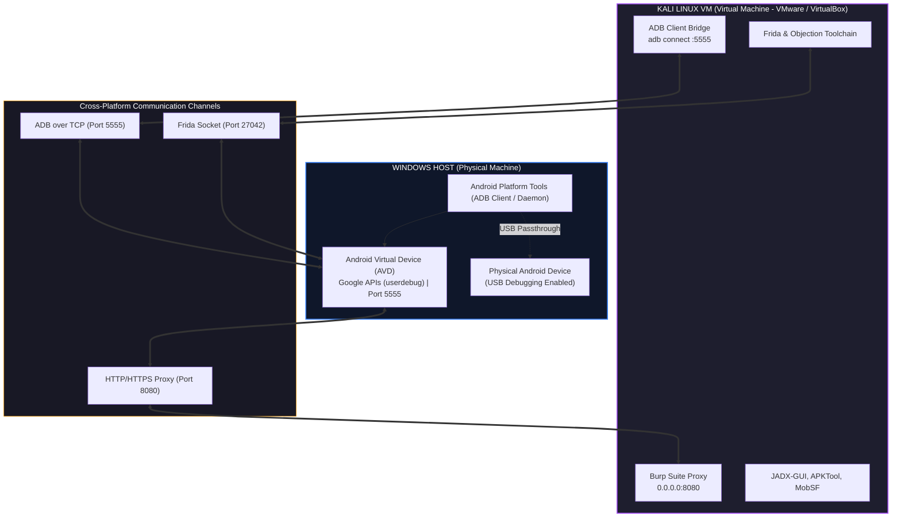

# 📱 Android Application Penetration Testing & Mobile Security: Cross-Platform Practical Course

> **Course Track:** Mobile Application Security & Penetration Testing  
> **Target Environment:** Windows Host + Kali Linux VM + Android Virtual Device (AVD) / Physical Device  
> **Skill Level:** Beginner to Advanced | **Standards Alignment:** OWASP MASVS v2.0 & OWASP MASTG

---

## 🏛️ Executive Course Overview

Welcome to the **Android Application Security & Penetration Testing** comprehensive learning course. This repository provides an end-to-end, battle-tested curriculum designed to take you from foundational mobile operating system internals to advanced dynamic runtime manipulation, network traffic decryption, and professional vulnerability reporting.

Unlike legacy training material that assumes a single Linux machine, this course is engineered specifically for **cross-platform security practitioners**:
* **Windows Host:** Runs the **Android Virtual Device (AVD)** emulator with native hardware acceleration (WHPX / Hyper-V) for 60 FPS fluidity, low latency, and direct USB connectivity.
* **Kali Linux VM:** Hosts the **security assessment toolchain**—Burp Suite Community, JADX, MobSF, Frida, Objection, and APKTool—in an isolated Linux environment.
* **Target Devices:** Deliberately vulnerable targets (such as **DIVA - Damn Insecure and Vulnerable App**) and production-grade Android 13/14+ targets.



---

## 🏷️ Standard Cross-Platform Environment Labels

Every command in this course explicitly indicates where and how it must be executed:

| Environment Label | Description & Host Scope | Execution Shell |
| :--- | :--- | :--- |
| **`[WINDOWS HOST]`** | Commands executed on the physical Windows workstation | Windows PowerShell (or CMD when noted) |
| **`[KALI LINUX VM]`** | Commands executed inside the security testing virtual machine | Kali Linux Bash / Zsh |
| **`[ANDROID EMULATOR]`** | Commands executed within the Android target shell | Android Toybox / Linux Shell (`adb shell`) |
| **`[ANDROID DEVICE]`** | Actions performed on an authorized physical Android phone | Device Settings / Touchscreen UI |
| **`[WINDOWS BROWSER]`** | Browser interfaces, web dashboards, or proxy settings | Chrome / Edge / Firefox on Windows |

---

## 📑 12-Module Progressive Course Curriculum

Explore the full curriculum with learning pathways and prerequisites in the [**Course Modules Directory**](./docs/modules/README.md).

```text
+---------------------------------------------------------------------------------------------------+
|                                 Course Curriculum & Learning Progression                          |
+----+--------------------------------------------+-----------------------+-------------------------+
| #  | Module Name                                | Core Competency Focus | Reference & Lab Guide   |
+----+--------------------------------------------+-----------------------+-------------------------+
| 01 | Android Security Fundamentals              | Architecture & Sandboxing | [Module 01 Guide](./docs/modules/01_android_fundamentals.md) |
| 02 | Lab Setup & Toolchain                      | Windows + Kali Bridge | [Part 2 Guide](./Android%20Studio,%20ADB,%20Root%20&%20Non-Root%20Lab%20Setup/README.md) |
| 03 | Android Reconnaissance                     | Package & Manifest Recon | [Module 03 Guide](./docs/modules/03_android_reconnaissance.md) |
| 04 | Static App Security Testing (SAST)         | JADX, Bytecode & MobSF| [Part 1 Guide](./Introduction,%20APK%20Analysis,%20JADX%20&%20MobSF/README.md) |
| 05 | Static Security Analysis Deep-Dive         | Decompilation & Patterns | [Module 05 Guide](./docs/modules/05_static_analysis.md) |
| 06 | Android Network Security                   | TLS, Proxy & Cleartext| [Module 06 Guide](./docs/modules/06_network_security.md) |
| 07 | Storage & Data Protection                  | SQLite, Prefs, Cache  | [Part 3 Storage](./Android%20Pentesting%20Part%203%20Installing%20DIVA,%20Capturing%20Traffic%20and%20Solving%20All%2013%20Challenges/README.md#challenge-3-insecure-data-storage-part-1-sharedpreferences) |
| 08 | Application Components & IPC               | Intents & Providers   | [Part 3 Access](./Android%20Pentesting%20Part%203%20Installing%20DIVA,%20Capturing%20Traffic%20and%20Solving%20All%2013%20Challenges/README.md#challenge-9-access-control-part-1-exported-activity) |
| 09 | OWASP MASVS v2.0 Compliance Guide          | MASVS Standards & Matrix| [Module 09 Guide](./docs/modules/09_masvs_testing_guide.md) |
| 10 | Hands-On Vulnerable App Labs (DIVA)        | 13 Challenge Walkthrough | [Part 3 Walkthrough](./Android%20Pentesting%20Part%203%20Installing%20DIVA,%20Capturing%20Traffic%20and%20Solving%20All%2013%20Challenges/README.md) |
| 11 | System CA & Bypassing SSL Pinning with Frida| Runtime Instrumentation| [Part 4 Guide](./Android%20Pentesting%20Part%204%20System%20Certificates,%20Rooted%20Interception%20and%20Bypassing%20SSL%20Pinning%20with%20Frida/README.md) |
| 12 | Capstone Penetration Test Simulation        | End-to-End Pentest Report| [Module 12 Guide](./docs/modules/12_capstone_assessment.md) |
+----+--------------------------------------------+-----------------------+-------------------------+
```

---

## 🔬 Core Learning Modules & Laboratory Guides

### [Part 1: APK Reverse Engineering, JADX & MobSF](./Introduction,%20APK%20Analysis,%20JADX%20&%20MobSF/README.md)
* **APK Container Architecture:** Unpacking `.apk` archives, analyzing `classes.dex`, `AndroidManifest.xml`, `resources.arsc`, and native shared objects (`/lib/`).
* **Cross-Platform Decompilation:** Converting Dalvik Bytecode into Java using **JADX** on Windows and Kali Linux, analyzing disassembly in **Smali**.
* **Automated Static Scanning:** Deploying **MobSF (Mobile Security Framework)** via Docker Desktop on Windows or Docker Engine on Kali Linux.
* **Component Surface Auditing:** Hunting for vulnerable Exported Activities, Broadcast Receivers, Content Providers (SQL Injection / Path Traversal), and Service bindings.

### [Part 2: Laboratory Environment & Device Instrumentation](./Android%20Studio,%20ADB,%20Root%20&%20Non-Root%20Lab%20Setup/README.md)
* **Virtualization & Device Orchestration:** Provisioning root-capable Android Virtual Devices (AVD) using Google APIs system images.
* **Cross-Platform ADB Bridge:** Connecting Kali Linux tools to Windows-hosted emulators over TCP port 5555 (`adb connect <WIN_HOST>:5555`).
* **Root Architecture:** Understanding Android UID isolation, Zygote process injection, Magisk systemless rooting, and root vs non-root testing tradeoffs.
* **ADB Command Mastery:** Mastering package inspection, file transfers (`push`/`pull`), activity management (`am`), and SQLite debugging.

### [Part 3: Installing DIVA, Capturing Traffic & Solving All 13 Challenges](./Android%20Pentesting%20Part%203%20Installing%20DIVA,%20Capturing%20Traffic%20and%20Solving%20All%2013%20Challenges/README.md)
* **Target Application Deployment:** Installing DIVA (Damn Insecure and Vulnerable App) using ADB, resolving Android 14+ target SDK restrictions.
* **Network Traffic Interception:** Routing QEMU emulator traffic (`10.0.2.2`) through Burp Suite Community on Kali Linux and inspecting API payloads.
* **13 Hands-On Exploitation Labs:** Complete walkthrough with decompiled Java code, ADB exploit commands, and secure remediations:
  * Insecure Logging (Credit cards in Logcat)
  * Hardcoded Vendor Keys (Static decompilation)
  * Insecure Storage Parts 1-4 (SharedPreferences, SQLite databases, Temporary files, World-readable SD card)
  * Input Validation Parts 1-2 (SQL Injection, WebView local file traversal)
  * Access Control Parts 1-3 (Exported Activities, Intent parameter spoofing, Content Provider data leaks)
  * Native Code Auditing & Buffer Overflows (Reversing `libdivajni.so` strings, triggering native stack corruption crashes).

### [Part 4: System Certificates, Rooted Interception and Bypassing SSL Pinning with Frida](./Android%20Pentesting%20Part%204%20System%20Certificates,%20Rooted%20Interception%20and%20Bypassing%20SSL%20Pinning%20with%20Frida/README.md)
* **The Android 7.0+ (API 24+) Trust Boundary:** Why modern apps ignore user-installed certificates and how Network Security Configuration operates.
* **Writable-System Rooted Emulator:** Booting AVDs with `-writable-system`, disabling kernel `dm-verity` verified boot, and mounting `/system` read-write.
* **System CA Store Injection:** Hashing Burp Suite CA certificates (`openssl x509 -subject_hash_old`) and installing into `/system/etc/security/cacerts/<hash>.0`.
* **Spotting Certificate Pinning:** Identifying TLS handshake failures and `CertPathValidatorException` in Logcat and Burp event logs.
* **Dynamic Instrumentation Toolchain:** Deploying matching `frida-server` to `/data/local/tmp/` and verifying connectivity over USB/TCP bridge.
* **Automated & Custom Bypasses:** Defeating OkHttp, Conscrypt, and TrustManager pinning using **Objection** (`android sslpinning disable`) and raw custom Frida scripts (`universal_ssl_pinning_bypass.js`).
* **Advanced Edge Cases:** Bypassing compiled BoringSSL in Flutter applications (`libflutter.so`), native Cronet C++ stacks, and anti-Frida detection hooks.

---

## 🛠️ Dedicated Setup Guides, References & Toolkits

Access the companion documentation in the [`docs/`](./docs/) directory:

### Laboratory Setup Guides
* 📘 **[Windows Host Setup Guide](./docs/setup/WINDOWS_HOST_SETUP.md):** Android SDK Platform-Tools installation, environment variables, PowerShell vs CMD, Android Studio AVD, WHPX virtualization, firewall rules, and USB debugging.
* 📗 **[Kali Linux VM Setup Guide](./docs/setup/KALI_VM_SETUP.md):** Kali package dependencies, isolated Python virtual environments (`venv`), JADX, APKTool, MobSF Docker deployment, and cross-VM ADB network bridging.
* 📙 **[Cross-Platform Lab Architecture Blueprint](./docs/setup/CROSS_PLATFORM_LAB_ARCHITECTURE.md):** Network topology, bridged vs NAT modes, host-to-guest port routing (`5555`, `8080`, `27042`), and multi-environment diagnostics.

### Reference Library & Troubleshooting
* 📑 **[Cross-Platform Command Reference & Syntax Rosetta Stone](./docs/reference/CROSS_PLATFORM_COMMAND_REFERENCE.md):** Side-by-side comparison tables across PowerShell, CMD, Kali Bash, and Android Toybox Shell for file management, ADB commands, logcat filtering, and intent exploitation.
* 🩺 **[Troubleshooting Knowledge Base](./docs/reference/TROUBLESHOOTING_KNOWLEDGE_BASE.md):** 20+ diagnostic scenarios covering unauthorized ADB devices, emulator crashes, KVM errors, read-only `/system`, Burp proxy failures, Frida version mismatches, and anti-root crashes.
* 📖 **[Glossary & Terminology Guide](./docs/reference/GLOSSARY_AND_TERMINOLOGY.md):** Beginner-friendly definitions of Android internals (DEX, ART, Zygote, UIDs, IPC, Content Providers, Keystore, Pinning, Smali).
* 🌐 **[Official References & Authoritative Sources](./docs/reference/OFFICIAL_REFERENCES.md):** Curated links to OWASP MASVS, MASTG, Android Developer specifications, Frida, Burp Suite, and vulnerable training grounds.

### Automated Lab Environment Verification Scripts
* 🩺 **[Windows Host Verification Script (`verify-lab-env.ps1`)](./scripts/verify-lab-env.ps1):** Automated PowerShell health check verifying ADB, Java, Android SDK, WHPX virtualization, and emulator status.
* 🩺 **[Kali Linux VM Verification Script (`verify-lab-env.sh`)](./scripts/verify-lab-env.sh):** Automated Bash health check validating Python virtual environments, Frida, Objection, JADX, APKTool, and Burp Suite connectivity.

---

## 🤝 Contributing & Community

We welcome contributions to expand coverage, update commands for newer Android API levels, and add test cases! Please review our [**Contributor Guidelines & Style Guide**](./CONTRIBUTING.md) for environment labeling rules, code block formatting, and PR submission criteria.

---

## ⚖️ Lab Safety, Legal & Ethical Boundaries

> [!IMPORTANT]
> **Strict Authorization Policy:** All testing, reverse engineering, dynamic instrumentation, and network proxying demonstrated in this course must be conducted exclusively against:
> 1. Intentionally vulnerable training applications (e.g., DIVA, InsecureBankv2, Allsafe).
> 2. Applications and backend environments for which you have explicit, documented, and signed authorization from the asset owner.
> 
> Never intercept, decompile, or tamper with third-party mobile applications without permission. Dual-use security tools (Frida, Burp Suite, ADB) must be utilized strictly for defensive security research, vulnerability remediation, and authorized penetration testing.
