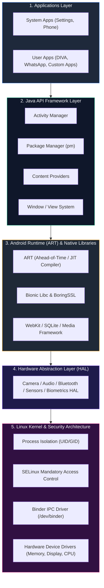
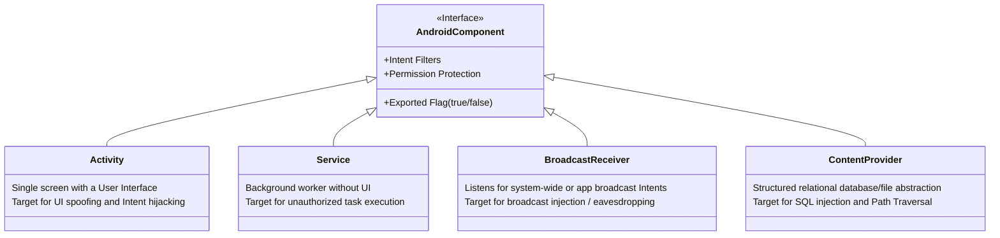
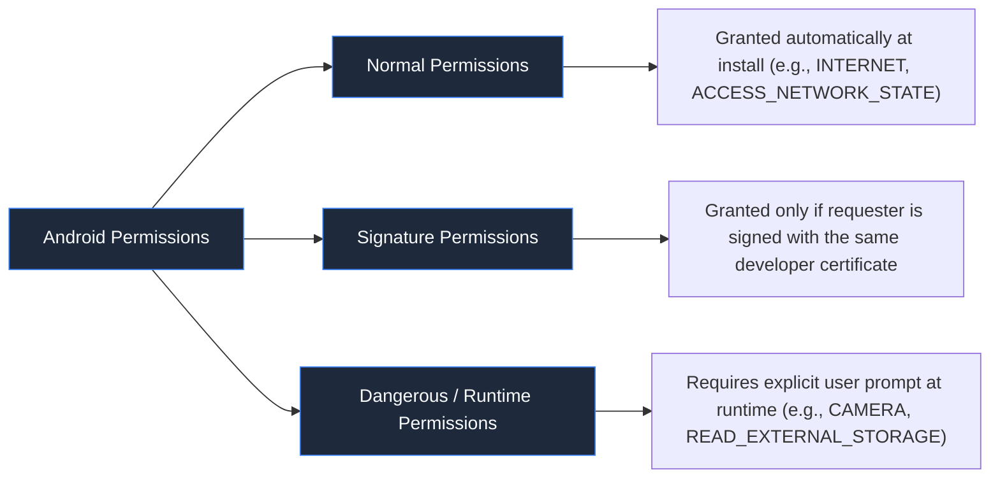

# Module 01 — Android Security Fundamentals & Sandboxing

> **Prerequisites:** None — Foundational module.  
> **Estimated Reading Time:** 45 minutes  
> **Target Audience:** Security engineers, penetration testers, and Android developers.

---

## 🎯 Learning Objectives

By the end of this module, you will be able to:

1. **Deconstruct the Android OS Architecture**: Understand how user applications interact with the Android Runtime (ART), native libraries, the Linux kernel, and hardware abstraction layers.
2. **Analyze the Application Sandbox**: Explain how Android isolates applications using distinct Linux User IDs (UIDs), SELinux mandatory access controls, and the Binder Inter-Process Communication (IPC) framework.
3. **Inspect APK Packaging & Code Compilation**: Explain the internal structure of an APK file, Dalvik Executable (DEX) bytecode, and differences between Ahead-of-Time (AOT) and Just-in-Time (JIT) compilation in ART.
4. **Evaluate Android Core Components**: Distinguish between Activities, Services, Broadcast Receivers, and Content Providers, pinpointing common security exposure risks (e.g., unintentionally exported components).
5. **Map Attack Surfaces to OWASP MASVS**: Categorize vulnerabilities across storage, cryptography, authentication, network, platform interaction, and code resilience.

---

## 1. Android Operating System Architecture

Android is built on top of a modified Linux kernel, but it differs fundamentally from standard desktop Linux distributions. Rather than using GNU C libraries (`glibc`) and standard X11/Wayland display servers, Android utilizes its own lightweight C library (**Bionic**), runtime environment (**ART**), and modular system services.



### Layer Breakdown

1. **Linux Kernel**: Serves as the foundation for hardware drivers, memory management, process management, and core security mechanisms (UID segregation, discretionary access controls, and SELinux).
2. **Hardware Abstraction Layer (HAL)**: Exposes standardized interfaces (e.g., Camera, Audio, Biometrics) to the higher Java API framework without exposing device-specific driver intricacies.
3. **Android Runtime (ART) & Native Libraries**: Runs application code compiled into DEX bytecode. Core native libraries written in C/C++ (such as SQLite, BoringSSL, and libjpeg) provide accelerated processing.
4. **Java API Framework**: Provides the modular APIs used by Android applications (e.g., `ActivityManager`, `PackageManager`, `NotificationManager`).
5. **System & User Applications**: The top-level software running within individual sandboxes.

---

## 2. Application Packaging & Compilation (APK & ART)

### Binary Anatomy of an APK
An Android Package (`.apk`) is technically a standard ZIP archive containing compiled code, assets, resources, and cryptographic signatures.

| Component | Description | Security Significance |
| :--- | :--- | :--- |
| `classes.dex` | Dalvik Executable bytecode compiled from Java/Kotlin source. Multi-dex apps contain `classes2.dex`, etc. | Target for static decompilation via JADX / Baksmali. |
| `AndroidManifest.xml` | Binary XML document defining package name, permissions, components, and security flags. | Reveals exported surfaces, debug flags, and backup policies. |
| `resources.arsc` | Compiled binary resources (strings, layouts, IDs). | Contains embedded strings, developer comments, and server URLs. |
| `res/` | Uncompiled/compiled visual resources (XML layouts, drawables). | Layout files reveal hidden fields and UI workflows. |
| `assets/` | Raw unstructured assets packaged with the app. | Often contains embedded databases, certificates, or configuration files. |
| `lib/` | Architecture-specific native shared objects (`.so`) (`arm64-v8a`, `armeabi-v7a`, `x86_64`). | Native reverse engineering target (Ghidra, IDA Pro) for C/C++ buffer overflows. |
| `META-INF/` | APK signature block, manifest hashes (`MANIFEST.MF`), and certificate chains. | Protects APK code integrity; analyzed during tampering detection. |

### ART vs. Dalvik: The Execution Model
* **Dalvik (Android < 5.0)**: Executed bytecode using JIT (Just-in-Time) compilation. Every app launch required runtime translation, causing higher latency.
* **ART (Android 5.0+)**:
  * **AOT (Ahead-of-Time) Compilation (`dex2oat`)**: Converts DEX bytecode into native ELF machine code (`.oat` / `.art`) during app installation or idle background maintenance.
  * **Profile-Guided Compilation (Android 7.0+)**: Hybrid model combining JIT interpretation with background AOT optimization for hot code paths.
  * **Security Implications**: Modern hook frameworks (like Frida) interact directly with ART runtime structures (such as `art::ArtMethod`) in memory to intercept methods dynamically.

### APK Signing Schemes

Android enforces cryptographic signature verification before allowing an application to install or upgrade:

1. **v1 Scheme (JAR Signing)**: Signs individual files inside the ZIP archive. Vulnerable to ZIP header metadata manipulation (Janus vulnerability, CVE-2017-13156).
2. **v2 Scheme (Android 7.0+)**: Full-file binary signature verifying the entire ZIP contents. Any byte modification invalidates the signature.
3. **v3 Scheme (Android 9.0+)**: Introduces key rotation history within the APK signature block.
4. **v4 Scheme (Android 11+)**: Streaming-compatible signature scheme using Merkle trees for incremental installation.

---

## 3. The Android Sandbox: Isolation & Access Control

Unlike multi-user Linux where multiple applications share the same UID of the logged-in user, Android treats **every installed application as a distinct Linux user**.

```
Linux Desktop Model:           Android Security Sandbox Model:
User: "alice" (UID 1000)       App A (Browser)   --> UID 10145 (u0_a145)
 ├── Terminal                  App B (Banking)   --> UID 10146 (u0_a146)
 ├── Browser                   App C (Malware)   --> UID 10147 (u0_a147)
 └── Game                      (Files in /data/data/<pkg> are chmod 700 to UID)
```

### Sandbox Tenets:
1. **Linux UID/GID Segregation**: When `com.example.bank` is installed, Android assigns it an exclusive system UID (e.g., `u0_a146` or `10146`). Its private directory `/data/data/com.example.bank/` is owned strictly by that UID. No other application can read or execute files within it without root privileges.
2. **SELinux (Security-Enhanced Linux)**: Enforces Mandatory Access Control (MAC). Even if a process runs with root permissions (`UID 0`), SELinux policies restrict what domains, files, and sockets that process can access.
3. **Binder IPC**: All inter-application communication passes through the kernel-space `/dev/binder` driver. The Binder framework inspects the caller's PID/UID on every call, allowing destination components to enforce permission checks before returning data.
4. **What Does "Rooting" Change?**:
   * Rooting installs a `su` binary and modifies SELinux policies (or switches it to `permissive`).
   * It disables kernel-enforced sandboxing, granting any authorized root process arbitrary access to `/data/data/` of any target application.

---

## 4. Android Core Application Components

Android applications do not have a single `main()` entrypoint. Instead, the OS instantiates independent **components** declared in the `AndroidManifest.xml`.



### Component Security Matrix

| Component | Purpose | Primary Attack Vector | Verification Standard |
| :--- | :--- | :--- | :--- |
| **Activity** | Presents visual UI screens to the user. | **Exported Activity Bypass**: Forcing navigation into authenticated internal screens directly using `am start`. | MASVS-PLATFORM-1 |
| **Service** | Executes prolonged background tasks without UI. | **Unauthorized Service Invocation**: Triggering sensitive background workers (e.g., syncing, downloading). | MASVS-PLATFORM-1 |
| **Broadcast Receiver** | Subscribes to broadcast messages (`Intents`). | **Broadcast Injection**: Sending spoofed system/app events or sniffing unencrypted broadcasts. | MASVS-PLATFORM-1 |
| **Content Provider** | Shares relational data or files across apps. | **SQL Injection & Path Traversal**: Querying `content://` URIs without sanitization or permission boundaries. | MASVS-PLATFORM-1, MASVS-CODE-4 |

### The `android:exported` Attribute
* If `android:exported="true"`, any other application on the device can invoke that component.
* If an `<intent-filter>` is declared and `android:exported` is omitted on API < 31, the component **defaults to `true`**.
* Starting in Android 12 (API 31), apps must explicitly declare `android:exported` for any component that defines an intent filter.

---

## 5. Android Permissions Architecture

Permissions restrict access to sensitive device APIs (camera, location, contacts) and private components.

### Permission Levels



* **Install-Time (Normal) Permissions**: Automatically granted upon installation. Do not require runtime approval (e.g., `android.permission.INTERNET`).
* **Runtime (Dangerous) Permissions**: Access private user data (e.g., `READ_CONTACTS`, `ACCESS_FINE_LOCATION`, `RECORD_AUDIO`). Applications must check and prompt for permission at runtime using `requestPermissions()`.
* **Signature Permissions**: The requesting application must be signed with the same cryptographic key as the application declaring the permission. This provides secure, private inter-app communication between apps from the same vendor.

---

## 6. Android Storage Architecture

Understanding where an application stores data is critical for identifying vulnerabilities related to insecure data storage (**MASVS-STORAGE**).

```
Internal Storage (Sandboxed)       External Storage (Shared)
/data/user/0/<package>/            /sdcard/Android/data/<package>/
 ├── shared_prefs/ (XML files)     └── cache/
 ├── databases/ (SQLite DBs)       
 ├── files/ (Private files)        Public Shared Directories (Scoped)
 └── cache/                        /sdcard/Documents, Download, DCIM
```

### Storage Security Comparison

| Location | Path | Isolation / Access | Risk |
| :--- | :--- | :--- | :--- |
| **Internal Storage** | `/data/data/<package>/` | Accessible **only** by application UID and root. | Insecure if device is rooted, or if world-readable flags (`MODE_WORLD_READABLE`) are used. |
| **Shared Preferences** | `.../shared_prefs/*.xml` | Key-value store within internal storage. | Unencrypted credentials, tokens, or PII stored in plain XML. |
| **SQLite Databases** | `.../databases/*.db` | Relational tables within internal storage. | Sensitive records stored without SQLCipher encryption. |
| **Scoped Storage (API 29+)** | `MediaStore` & Storage Access Framework (SAF) | Replaced broad `/sdcard` read access. Apps can only access their own external directories without SAF. | Leaking data to world-readable external folders. |

---

## 7. Network Communication Fundamentals

Android applications communicate with backend REST APIs, WebSockets, and third-party services.

### Core Network Controls:
1. **Cleartext Traffic Policy**:
   * Android 9 (API 28+) blocks unencrypted HTTP traffic by default.
   * If `android:usesCleartextTraffic="true"` is declared in the manifest, the app allows cleartext HTTP communication across the entire application.
2. **Network Security Configuration (`network_security_config.xml`)**:
   * Introduced in Android 7 (API 24).
   * Defines trust anchors (system CAs, user CAs, custom pinned certificates).
   * By default, apps targeting API 24+ **ignore user-installed CA certificates**, blocking standard Burp Suite interception unless explicitly configured or bypassed via root/Frida.

---

## 8. Threat Modeling & OWASP MASVS v2.0

The **Open Worldwide Application Security Project (OWASP)** defines the **Mobile Application Security Verification Standard (MASVS)** and its companion testing guide (**MASTG**).

```mermaid
quadrantChart
    title Mobile Threat Landscape (Impact vs Exploitability)
    x-axis Low Exploitability --> High Exploitability
    y-axis Low Impact --> High Impact
    quadrant-1 High Risk: Urgent Action
    quadrant-2 Critical Architecture Flaws
    quadrant-3 Low Risk: Hardening Needed
    quadrant-4 Opportunistic Vulnerabilities
    "Insecure Logging": [0.85, 0.40]
    "Exported Content Provider SQLi": [0.75, 0.90]
    "Hardcoded API Secrets": [0.90, 0.65]
    "Lack of Certificate Pinning": [0.45, 0.60]
    "Cleartext HTTP Transmission": [0.80, 0.85]
    "Native Memory Corruption": [0.25, 0.95]
```

### OWASP MASVS v2.0 Control Groups
* **MASVS-STORAGE**: Secure storage of sensitive data (credentials, keys, tokens).
* **MASVS-CRYPTO**: Proper implementation of cryptographic primitives and key management.
* **MASVS-AUTH**: Secure authentication, authorization, and session handling.
* **MASVS-NETWORK**: Protection of data in transit across networks.
* **MASVS-PLATFORM**: Secure IPC, intent filters, permissions, and platform interactions.
* **MASVS-CODE**: Software quality, compiler hardening, and anti-tampering resilience.

---

## 🧠 Knowledge Check

Test your understanding of Android security fundamentals with these questions:

### Question 1
**Why can't App A read files located in `/data/data/com.example.appb/` on a non-rooted device?**
* A) App B's files are encrypted using hardware AES keys by default.
* B) App A and App B run under different Linux UIDs, and Linux kernel file permissions restrict access to the file's owner.
* C) SELinux prevents all applications from accessing the `/data` partition.
* D) Android Runtime (ART) validates an application's digital signature before reading files.

<details>
<summary>View Answer & Explanation</summary>

**Correct Answer: B**  
**Explanation:** Android assigns each installed app a unique Linux UID (e.g., `10145`). The application directory `/data/data/<package>/` is created with permissions `0700` (`rwx------`) owned by that specific UID. Standard Linux discretionary access control prevents any process with a different UID from accessing those files.
</details>

---

### Question 2
**What is the security consequence of declaring `<activity android:name=".AdminActivity">` with an `<intent-filter>` on Android 11 (API 30) without specifying `android:exported`?**
* A) The app will fail to compile.
* B) The activity will default to `android:exported="false"`.
* C) The activity defaults to `android:exported="true"`, allowing any third-party app to launch `.AdminActivity`.
* D) The activity is only callable by the system.

<details>
<summary>View Answer & Explanation</summary>

**Correct Answer: C**  
**Explanation:** On Android versions prior to API 31, if a component declares an `<intent-filter>` and omits `android:exported`, Android defaults `android:exported` to `true`. This exposes the component to third-party invocation unless explicitly protected by permissions or set to `exported="false"`.
</details>

---

### Question 3
**Which compilation mechanism does modern Android Runtime (ART) use to optimize performance and battery life?**
* A) Pure Dalvik Bytecode JIT interpretation exclusively.
* B) Profile-guided compilation combining JIT interpretation with background AOT (Ahead-of-Time) compilation.
* C) Native C++ translation during download from Google Play.
* D) Real-time WebAssembly emulation.

<details>
<summary>View Answer & Explanation</summary>

**Correct Answer: B**  
**Explanation:** Android 7.0 introduced profile-guided compilation. Apps start out using JIT interpretation for fast installation, while profiling identifies frequently executed "hot" methods. During device idle charging states, `dex2oat` compiles hot methods Ahead-of-Time into native code.
</details>

---

### Question 4
**An application declares `android:usesCleartextTraffic="true"` in its `AndroidManifest.xml`. What security risk does this introduce?**
* A) The application communicates with Bluetooth devices without pairing.
* B) The application bypasses the Android lock screen.
* C) The application is permitted to transmit unencrypted HTTP traffic across the network, making it vulnerable to Man-in-the-Middle (MitM) eavesdropping.
* D) The application disables SSL certificate pinning for all HTTPS connections.

<details>
<summary>View Answer & Explanation</summary>

**Correct Answer: C**  
**Explanation:** By default, Android 9+ enforces HTTPS. Setting `android:usesCleartextTraffic="true"` disables this platform defense, allowing unencrypted plain-text HTTP requests that can be intercepted or manipulated by an attacker on the same Wi-Fi network.
</details>

---

### Question 5
**What is the difference between a Normal permission and a Dangerous permission in Android?**
* A) Normal permissions require biometric authentication; Dangerous permissions require a password.
* B) Normal permissions are granted automatically at installation; Dangerous permissions require explicit runtime consent from the user.
* C) Normal permissions apply to system apps; Dangerous permissions apply to user apps.
* D) Dangerous permissions can only be granted to rooted devices.

<details>
<summary>View Answer & Explanation</summary>

**Correct Answer: B**  
**Explanation:** Normal permissions present minimal risk to user privacy or device operation (e.g., `INTERNET`) and are granted at install time. Dangerous permissions access private user data (e.g., contacts, microphone, camera) and require user interaction via a runtime authorization dialog.
</details>

---

## 🔬 Practical Exercise

### Objective
Inspect the sandbox UID and directory permissions of an installed application on your test emulator.

1. **Start your rooted AVD** or connect your test device.
2. Open a terminal and check the process UID:
   ```bash
   adb shell ps -A | grep -i diva
   ```
3. Inspect directory ownership:
   ```bash
   adb shell ls -ld /data/data/jakhar.aseem.diva
   ```
4. Observe that the owner matches `u0_aXXX` and permissions are set strictly to `drwx------`.
5. Try reading that directory using a non-root context vs. a root context (`adb shell su -c "ls -la /data/data/jakhar.aseem.diva"`).

---

## 🔗 Next Steps & Navigation

* ⬅️ **Previous:** [Curriculum Overview](./README.md)
* ➡️ **Next Module:** [Module 03 — Android Reconnaissance & Attack Surface](./03_android_reconnaissance.md)
* 🛠️ **Practical Lab:** [Part 1 — APK Analysis, JADX & MobSF](../../Introduction,%20APK%20Analysis,%20JADX%20&%20MobSF/Android_pentest_part-1.MD)
