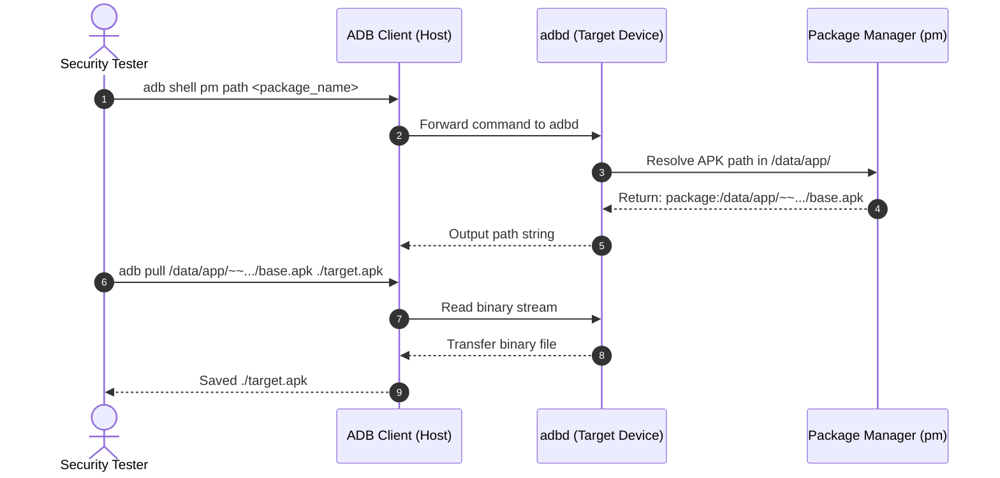
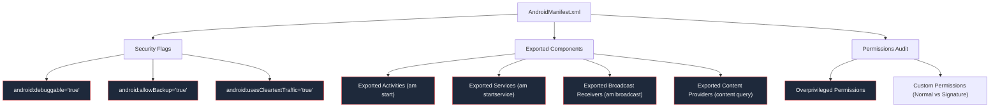

# Module 03 — Android Reconnaissance & Attack Surface Mapping

> **Prerequisites:** [Module 01 — Android Fundamentals](./01_android_fundamentals.md), [Part 2 — Lab Setup & ADB](../../Android%20Studio,%20ADB,%20Root%20&%20Non-Root%20Lab%20Setup/Android_Pentest_Part_2.md)  
> **Estimated Reading Time:** 40 minutes  
> **Target Audience:** Penetration testers, vulnerability researchers, security auditors.

---

<div align="center">


</div>

---

## 🎯 Learning Objectives

By completing this module, you will master:

1. **Acquiring Target APKs Legally**: Extract installed application binaries directly from physical or emulated devices using standard ADB workflows.
2. **Cryptographic Fingerprinting**: Generate and record cryptographically sound hashes (SHA-256) across Windows and Kali Linux to maintain chain-of-custody.
3. **Automated Manifest & Package Triage**: Extract package details, SDK versions, intent filters, and exported components using `aapt2` and ADB package manager (`pm`).
4. **Attack Surface Identification**: Enumerate entry points (Activities, Services, Broadcast Receivers, Content Providers) that accept untrusted external input.
5. **System Property & Target Profiling**: Query device hardware characteristics, security patch levels, and runtime properties via `getprop`.

---

## 1. Authorized APK Acquisition

Before testing, you must acquire the target application package. In a professional mobile penetration test, clients typically provide testing builds directly. When testing an existing installed application on an authorized test device, extract the APK directly via ADB.



### Locating & Extracting the APK

**Step 1: List installed packages to identify the exact package identifier:**

**[WINDOWS HOST]**
```powershell
adb shell pm list packages | Select-String "diva"
```

**[KALI LINUX VM]**
```bash
adb shell pm list packages | grep "diva"
```
*Expected Output:* `package:jakhar.aseem.diva`

**Step 2: Obtain the absolute filesystem path of the APK on the device:**

**[WINDOWS HOST]** or **[KALI LINUX VM]**
```bash
adb shell pm path jakhar.aseem.diva
```
*Expected Output:* `package:/data/app/jakhar.aseem.diva-1/base.apk` (or similar hash-suffixed path on API 28+)

**Step 3: Pull the APK file to your local analysis workstation:**

**[WINDOWS HOST]**
```powershell
adb pull /data/app/jakhar.aseem.diva-1/base.apk .\diva-target.apk
```

**[KALI LINUX VM]**
```bash
adb pull /data/app/jakhar.aseem.diva-1/base.apk ./diva-target.apk
```
*Expected Output:*
```text
/data/app/jakhar.aseem.diva-1/base.apk: 1 file pulled, 0 skipped. 18.4 MB/s (1342177 bytes in 0.069s)
```

> [!NOTE]
> **Split APKs / App Bundles**: Modern apps downloaded from Google Play are frequently delivered as Split APKs (e.g., `base.apk`, `split_config.arm64_v8a.apk`, `split_config.xxhdpi.apk`). When pulling, pull all splits into a dedicated directory using the loop shown in [Part 1](../../Introduction,%20APK%20Analysis,%20JADX%20&%20MobSF/Android_pentest_part-1.MD#pulling-split-apks).

---

## 2. Binary Identification & Evidence Integrity

Maintaining an immutable record of the tested artifact is mandatory under standard assessment methodologies. Calculate the SHA-256 hash immediately upon acquisition.

**[WINDOWS HOST]**
```powershell
Get-FileHash -Algorithm SHA256 .\diva-target.apk
```
*Alternative (Command Prompt):*
```cmd
certutil -hashfile diva-target.apk SHA256
```

**[KALI LINUX VM]**
```bash
sha256sum ./diva-target.apk
```

Record this value directly into your [Evidence Collection Checklist](../templates/EVIDENCE_COLLECTION_CHECKLIST.md) before conducting static or dynamic analysis.

---

## 3. Package & Manifest Reconnaissance with `aapt2`

The Android Asset Packaging Tool (`aapt2`) parses binary XML and resources without needing a full decompiler.

### Quick Metadata Extraction via `aapt2 dump badging`

**[WINDOWS HOST]**
```powershell
& "$env:ANDROID_HOME\build-tools\34.0.0\aapt2.exe" dump badging .\diva-target.apk
```

**[KALI LINUX VM]**
```bash
aapt2 dump badging ./diva-target.apk
```

### Critical Metadata Fields to Inspect

```text
package: name='jakhar.aseem.diva' versionCode='1' versionName='1.0' compileSdkVersion='23'
sdkVersion:'15'
targetSdkVersion:'23'
uses-permission: name='android.permission.WRITE_EXTERNAL_STORAGE'
application-label:'DIVA'
application-icon-120:'res/drawable-ldpi-v4/ic_launcher.png'
launchable-activity: name='jakhar.aseem.diva.MainActivity'
```

| Field | Security Interpretation |
| :--- | :--- |
| `targetSdkVersion` | **Critical**. If `< 24`, the app trusts user-installed CA certificates by default (Part 3). If `< 28`, cleartext HTTP is permitted by default. If `< 31`, omitted `android:exported` flags default to `true` when intent filters exist. |
| `minSdkVersion` | Dictates legacy compatibility. If the minimum SDK is low (e.g., API 15), older cryptographic or storage weaknesses might be tolerated. |
| `uses-permission` | Enumerates requested permissions. Review against expected functionality (e.g., why does a calculator need `RECORD_AUDIO`?). |
| `launchable-activity` | Primary GUI entry point when the user taps the app icon. |

---

## 4. Manifest Attack Surface Analysis

The `AndroidManifest.xml` file is the master blueprint of the app's attack surface.



### High-Risk Manifest Flags

1. `android:debuggable="true"`:
   * **Vulnerability**: Allows any user to attach `jdb` (Java Debug Wire Protocol) to the process without root, execute arbitrary code, and inspect memory contents.
   * **Verification**:
     ```bash
     aapt2 dump xmltree diva-target.apk --file AndroidManifest.xml | grep -i "debuggable"
     ```
2. `android:allowBackup="true"`:
   * **Vulnerability**: Allows extraction of the entire private sandbox (`/data/data/<package>/`) via `adb backup` without root.
3. `android:networkSecurityConfig`:
   * Points to XML defining TLS pinning, trust anchors, and cleartext policies.

---

## 5. Component Enumeration & In-Depth Profiling

### Enumerating Exported Components via ADB

Query the live package manager subsystem to list components and check their exported status:

**[WINDOWS HOST]** or **[KALI LINUX VM]**
```bash
adb shell dumpsys package jakhar.aseem.diva
```

To isolate exported activities, content providers, and receivers:

**[KALI LINUX VM]**
```bash
# Extract Activities
adb shell dumpsys package jakhar.aseem.diva | grep -A 20 "Activity Resolver Table"

# Extract Content Providers
adb shell dumpsys package jakhar.aseem.diva | grep -A 10 "Provider Resolver Table"
```

**[WINDOWS HOST]**
```powershell
# Extract Activities
(adb shell dumpsys package jakhar.aseem.diva) | Select-String "Activity Resolver Table" -Context 0,20
```

### Probing Exported Activities via Activity Manager (`am`)

When an Activity is exported without permission barriers, an external process can launch it directly:

**[WINDOWS HOST]** or **[KALI LINUX VM]**
```bash
adb shell am start -n jakhar.aseem.diva/.APICredsActivity
```
*If successful, the target screen displays on the emulator immediately, bypassing login screens or preliminary checks.*

---

## 6. Device & Operating System Reconnaissance

Gather target environment details before beginning dynamic testing:

| Command | Purpose | Target Information |
| :--- | :--- | :--- |
| `adb shell getprop ro.build.version.release` | Android Version | Identifies whether modern controls (Scoped Storage, NSC) are enforced. |
| `adb shell getprop ro.build.version.sdk` | API Level | Numeric API version (e.g., `30` = Android 11, `34` = Android 14). |
| `adb shell getprop ro.product.cpu.abi` | CPU Architecture | Vital for selecting the correct `frida-server` binary (`x86_64`, `arm64-v8a`). |
| `adb shell getprop ro.build.type` | Build Type | `user` vs `userdebug` (determines `adb root` capability). |
| `adb shell getprop ro.debuggable` | Kernel Debug Flag | `1` indicates `adb root` is supported directly. |

---

## 7. Systematic Evidence Documentation

Structured evidence collection ensures reproducible findings:

1. Create a project workspace directory:
   ```bash
   mkdir -p ./evidence/{static,dynamic,screenshots,network}
   ```
2. Save raw package dumps for reporting:
   ```bash
   adb shell dumpsys package <pkg> > ./evidence/static/dumpsys_package.txt
   aapt2 dump badging <apk> > ./evidence/static/aapt2_badging.txt
   ```
3. Capture visual verification of accessible exported screens:
   ```bash
   adb exec-out screencap -p > ./evidence/screenshots/exported_activity_bypass.png
   ```

---

## 🧠 Knowledge Check

Test your understanding of Android reconnaissance:

### Question 1
**Why is identifying the `targetSdkVersion` of an APK critical during initial reconnaissance?**
* A) It specifies the exact Android Studio version used to build the APK.
* B) It determines whether modern OS security features (like strict user-CA rejection and cleartext traffic blocking) are enforced by default.
* C) It determines the CPU instruction set required to run the application.
* D) It indicates whether the application is signed with a v1 or v2 signature scheme.

<details>
<summary>View Answer & Explanation</summary>

**Correct Answer: B**  
**Explanation:** Android enforces backward-compatibility behaviors based on `targetSdkVersion`. For example, apps targeting API 23 or lower automatically trust user-installed CA certificates and permit cleartext HTTP, whereas apps targeting API 28+ block cleartext by default.
</details>

---

### Question 2
**What command extracts the file path of an installed APK directly from the Android device?**
* A) `adb pull /system/app/<package>`
* B) `adb shell getprop ro.package.path`
* C) `adb shell pm path <package_name>`
* D) `adb shell am path <package_name>`

<details>
<summary>View Answer & Explanation</summary>

**Correct Answer: C**  
**Explanation:** `pm path <package_name>` is the Android Package Manager command that returns the exact filesystem path of the installed base APK and any associated split APKs.
</details>

---

### Question 3
**If an application manifest includes `android:debuggable="true"`, what risk does this expose?**
* A) The application cannot be installed on production devices.
* B) Attackers with physical access or ADB access can attach a debugger (JDWP) and execute arbitrary code within the app's context.
* C) The application's source code is automatically published online.
* D) The application disables all TLS encryption.

<details>
<summary>View Answer & Explanation</summary>

**Correct Answer: B**  
**Explanation:** Setting `android:debuggable="true"` enables the Java Debug Wire Protocol (JDWP). Anyone who can connect via ADB can attach a debugger to inspect variables, set breakpoints, dump memory, or invoke arbitrary methods without needing a rooted device.
</details>

---

### Question 4
**What command identifies the CPU architecture of a connected Android device or emulator?**
* A) `adb shell getprop ro.product.cpu.abi`
* B) `adb shell arch -v`
* C) `adb shell uname -cpu`
* D) `adb shell cat /proc/cpu_type`

<details>
<summary>View Answer & Explanation</summary>

**Correct Answer: A**  
**Explanation:** The system property `ro.product.cpu.abi` outputs the primary application binary interface (ABI), such as `x86_64`, `arm64-v8a`, or `armeabi-v7a`. This is essential for matching native tools and the Frida server.
</details>

---

### Question 5
**What is the security hazard of leaving `android:allowBackup="true"` on an enterprise banking app?**
* A) Google Play automatically backs up user credentials to public Google Drive shares.
* B) An attacker with physical access and ADB enabled can extract application private data using `adb backup`.
* C) The application database is automatically decrypted.
* D) It enables the app to read other applications' backup archives.

<details>
<summary>View Answer & Explanation</summary>

**Correct Answer: B**  
**Explanation:** `android:allowBackup="true"` permits the device to include the application's internal data sandbox in an ADB backup archive (`adb backup -f backup.ab <pkg>`), allowing complete extraction of shared preferences, local databases, and cached tokens without root.
</details>

---

## 🔬 Practical Exercise

### Objective
Perform end-to-end reconnaissance on the DIVA application:

1. **Pull the APK**: Locate and extract the DIVA APK from your lab emulator.
2. **Hash Verification**: Compute its SHA-256 hash on your host machine and log it.
3. **Dump Badging**: Run `aapt2 dump badging` and note the `targetSdkVersion` and permissions.
4. **Enumerate Exported Activities**: Identify at least one activity that does not require permissions to launch.
5. **Force Launch**: Use `adb shell am start` to trigger the exported activity directly, verifying that it loads on the emulator screen.

---

## 🔗 Next Steps & Navigation

* ⬅️ **Previous Module:** [Module 01 — Android Fundamentals](./01_android_fundamentals.md)
* 🛠️ **Practical Lab:** [Part 1 — APK Analysis, JADX & MobSF](../../Introduction,%20APK%20Analysis,%20JADX%20&%20MobSF/Android_pentest_part-1.MD)
* ➡️ **Next Module:** [Module 05 — Static Security Testing (SAST)](./05_static_analysis.md)
