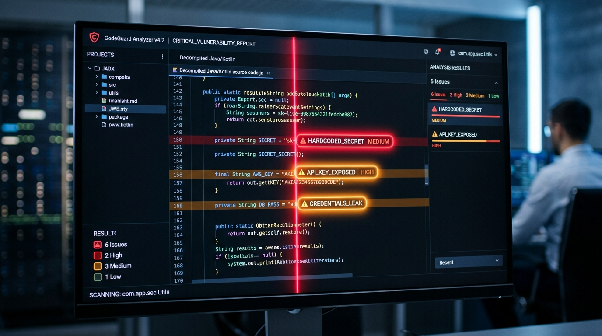
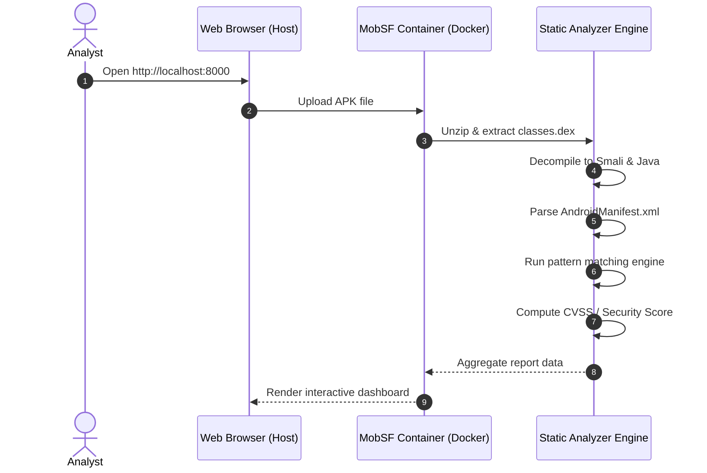

# Module 05 — Static Application Security Testing (SAST)

> **Prerequisites:** [Module 03 — Android Reconnaissance](./03_android_reconnaissance.md), [Part 1 — JADX & MobSF](../../Introduction,%20APK%20Analysis,%20JADX%20&%20MobSF/Android_pentest_part-1.MD)  
> **Estimated Reading Time:** 50 minutes  
> **Target Audience:** Security researchers, code auditors, mobile penetration testers.

---

<div align="center">



</div>

---

## 🎯 Learning Objectives

By the end of this module, you will be able to:

1. **Differentiate SAST & DAST**: Understand the distinct advantages, limitations, and operational timing of Static vs. Dynamic Application Security Testing.
2. **Execute Full Decompilation Pipelines**: Convert Dalvik Executable (DEX) bytecode back into readable Java using JADX and disassemble resources into Smali using APKTool.
3. **Automate Secret & Credential Hunting**: Implement high-confidence regex patterns across Windows PowerShell and Kali Linux to uncover hardcoded API keys, bearer tokens, AWS credentials, and Firebase database endpoints.
4. **Audit Cryptographic & Storage Implementations**: Identify insecure algorithms (DES, MD5, SHA-1, ECB mode) and insecure storage calls directly within source code.
5. **Operationalize MobSF Static Scans**: Interpret automated MobSF vulnerability scorecards, filter false positives, and validate issues against OWASP MASVS benchmarks.

---

## 1. SAST vs. DAST in Mobile Security

```mermaid
flowchart LR
    subgraph SAST["Static Analysis (SAST)"]
        S1["Source Code & Bytecode"]
        S2["Analyzes app at rest"]
        S3["100% Code Coverage possible"]
        S4["Finds hardcoded secrets, logic flaws, weak crypto"]
        S5["Limitation: Obfuscation & dead code false positives"]
    end

    subgraph DAST["Dynamic Analysis (DAST)"]
        D1["Running Application on Device"]
        D2["Analyzes app in motion"]
        D3["Covers executed workflows only"]
        D4["Finds runtime leaks, MITM flaws, IPC injection"]
        D5["Limitation: Dependent on test path coverage"]
    end

    SAST -.->|Informs test cases for| DAST
    DAST -.->|Confirms exploitability of| SAST

    classDef sastStyle fill:#1e293b,stroke:#3b82f6,stroke-width:2px,color:#f8fafc;
    classDef dastStyle fill:#0f172a,stroke:#10b981,stroke-width:2px,color:#f8fafc;

    class S1,S2,S3,S4,S5 sastStyle;
    class D1,D2,D3,D4,D5 dastStyle;
```



* **SAST (Static Analysis)**: Inspects the application without executing it. Uncovers latent logic, buried API endpoints, hardcoded credentials, and architectural configurations.
* **DAST (Dynamic Analysis)**: Evaluates the application during runtime. Validates whether static vulnerabilities are genuinely exploitable within the live Android sandbox and OS environment.

---

## 2. Decompilation Toolchain: JADX vs. APKTool

An APK contains compiled bytecode (`.dex`), not Java source files. Reverse engineering relies on two distinct classes of tools:

```
                  ┌───────────────┐
                  │ Target .APK   │
                  └───────┬───────┘
          ┌───────────────┴───────────────┐
          ▼                               ▼
   ┌─────────────┐                 ┌─────────────┐
   │    JADX     │                 │   APKTool   │
   └──────┬──────┘                 └──────┬──────┘
          ▼                               ▼
┌───────────────────┐             ┌───────────────────┐
│ High-Level Java   │             │ Smali Bytecode    │
│ Source Code       │             │ Decoded XML & Res │
│ (Audit / Reading) │             │ (Mod & Recompile) │
└───────────────────┘             └───────────────────┘
```

### JADX: High-Level Java Reconstruction
JADX converts DEX bytecode directly back into human-readable Java class files.

**[WINDOWS HOST] — JADX GUI**
* Launch `jadx-gui.bat`.
* Open target APK.
* Use `Navigation` -> `Text Search` (`Ctrl + Shift + F`) to search strings across the entire codebase simultaneously.

**[KALI LINUX VM] — JADX Command-Line Automation**
```bash
jadx -d ./decompiled_output/ --deobf ./diva-target.apk
```
* The `--deobf` flag automatically renames obfuscated classes (`a.class`, `b.class`) into structured, traceable identifiers.

### APKTool: Disassembly & Binary Patching
APKTool decodes compiled binary XML files (`AndroidManifest.xml`, `resources.arsc`) and converts DEX to assembly-level Smali representation.

**[KALI LINUX VM]** or **[WINDOWS HOST]**
```bash
apktool d diva-target.apk -o ./apktool_output/
```

Use APKTool when you need to:
1. View human-readable `AndroidManifest.xml` without decompilation artifacts.
2. Modify Smali code to bypass client-side checks, then rebuild with `apktool b`.

---

## 3. Secret Hunting & Pattern Matching

Developers frequently embed sensitive credentials directly into mobile binaries, assuming decompilation is difficult. Automated regex searches uncover these secrets rapidly.

### High-Value Detection Patterns

| Category | Regex / Target String | Severity | OWASP Control |
| :--- | :--- | :--- | :--- |
| **AWS Access Key** | `AKIA[0-9A-Z]{16}` | High / Critical | MASVS-STORAGE-2 |
| **Google / Firebase API Key** | `AIza[0-9A-Za-z\\-_]{35}` | Medium / High | MASVS-STORAGE-2 |
| **Firebase Realtime DB** | `[a-z0-9.-]+\.firebaseio\.com` | Critical (if open rules) | MASVS-STORAGE-2 |
| **Generic Passwords** | `(?i)(password\|passwd\|secret\|private_key)\s*[:=]` | Variable | MASVS-STORAGE-2 |
| **Bearer Tokens** | `(?i)bearer\s+[a-zA-Z0-9_\-\.]{20,}` | High | MASVS-STORAGE-2 |
| **Private Keys** | `-----BEGIN (RSA\|EC\|DSA\|OPENSSH) PRIVATE KEY-----` | Critical | MASVS-CRYPTO-1 |

### Executing Secret Searches

**[WINDOWS HOST] (PowerShell)**
```powershell
# Search decompiled JADX source directory for API keys
Get-ChildItem -Recurse -Include *.java,*.xml .\decompiled_output\ | 
    Select-String -Pattern "AIza[0-9A-Za-z\\-_]{35}" | 
    Select-Object Path, LineNumber, Line
```

**[KALI LINUX VM] (Ripgrep / Grep)**
```bash
# High-speed ripgrep search
rg -i "AIza[0-9A-Za-z\-_]{35}" ./decompiled_output/

# Search for AWS Access Keys
grep -Ero "AKIA[0-9A-Z]{16}" ./decompiled_output/
```

---

## 4. Auditing Cryptographic Implementations

Static code inspection reveals broken, deprecated, or custom cryptographic primitives (**MASVS-CRYPTO**).

### Vulnerable Implementation Patterns

#### Pattern A: Broken Ciphers (DES / 3DES / Blowfish)
```java
// VULNERABLE: DES provides only 56-bit key space; trivially cracked.
Cipher cipher = Cipher.getInstance("DES/ECB/PKCS5Padding");
```
* **Remediation**: Use `AES/GCM/NoPadding` with a 256-bit key.

#### Pattern B: Electronic Codebook (ECB) Mode
```java
// VULNERABLE: ECB mode does not use an Initialization Vector (IV).
// Identical plaintext blocks produce identical ciphertext blocks, leaking structural patterns.
Cipher cipher = Cipher.getInstance("AES/ECB/PKCS5Padding");
```
* **Remediation**: Use authenticated Galois/Counter Mode (`AES/GCM/NoPadding`) or CBC mode with a cryptographically secure random IV (`SecureRandom`).

#### Pattern C: Insecure Hashing (MD5 / SHA-1)
```java
// VULNERABLE: MD5 is vulnerable to collision attacks. Never use for passwords or integrity.
MessageDigest md = MessageDigest.getInstance("MD5");
```
* **Remediation**: Use `SHA-256`, `SHA-3`, or password-hashing schemes (`PBKDF2`, `Argon2`).

#### Pattern D: Hardcoded Cryptographic Keys & Static IVs
```java
// VULNERABLE: Hardcoded key embedded directly in bytecode.
byte[] keyBytes = "MySuperSecretKey".getBytes();
SecretKeySpec key = new SecretKeySpec(keyBytes, "AES");
```
* **Remediation**: Generate and store cryptographic keys inside the hardware-backed **Android KeyStore**.

---

## 5. Automated Scanning with MobSF

The **Mobile Security Framework (MobSF)** automates static analysis, computing risk scores, parsing the manifest, and surfacing CVE/CWE mappings.



### Running MobSF via Docker

**[WINDOWS HOST]** or **[KALI LINUX VM]**
```bash
docker run -it --rm -p 8000:8000 opensecurity/mobsf:latest
```

### Navigating the MobSF Report
1. **Information Section**: Displays package name, version, file hashes, and target SDK level.
2. **Security Score**: Overall security score (0–100) based on identified vulnerabilities.
3. **App Security**:
   * *Critical*: Debuggable flag enabled, cleartext traffic permitted, insecure cryptography.
   * *High*: Hardcoded credentials, vulnerable exported activities.
   * *Medium*: Missing tapjacking protection, broad permissions.
4. **PDF / JSON Report**: Export complete findings for reporting pipelines.

---

## 6. Triage & False-Positive Elimination

Automated SAST scanners report many false positives. Apply these triage rules:

1. **Dead Code Elimination**: Scanners often flag secrets or vulnerabilities in unused third-party test libraries or deprecated classes. Trace references from entry-point activities to confirm the code path is reachable.
2. **Public API Keys vs. Private Secrets**: A Google Maps Android API key (`AIza...`) restricted by package name and SHA-1 certificate fingerprint is **by design** embedded in the app. Only flag it if it lacks HTTP/package restrictions in Google Cloud Console.
3. **Mock Data in Unit Tests**: Scanners flag test strings (e.g., `test_password_123`). Confirm whether the class is included in the production APK or belongs to a test suite.

---

## 🧠 Knowledge Check

Test your understanding of static application security testing:

### Question 1
**Why is Electronic Codebook (ECB) mode considered fundamentally insecure for AES encryption?**
* A) AES cannot run in ECB mode on Android devices.
* B) ECB mode requires keys longer than 512 bits.
* C) ECB mode does not use an Initialization Vector (IV); identical plaintext blocks result in identical ciphertext blocks, exposing data patterns.
* D) ECB mode transmits the key in cleartext across the network.

<details>
<summary>View Answer & Explanation</summary>

**Correct Answer: C**  
**Explanation:** ECB mode encrypts each 16-byte block independently with the exact same key. As a result, repeating patterns in the input data appear as repeating patterns in the ciphertext. Modern mobile applications must use authenticated encryption like `AES/GCM/NoPadding`.
</details>

---

### Question 2
**What does JADX do that APKTool cannot do on its own?**
* A) Decode the `AndroidManifest.xml` file.
* B) Decompile Dalvik bytecode back into structured, readable Java source code classes.
* C) Disassemble DEX bytecode into Smali assembly.
* D) Repackage and resign an APK for deployment.

<details>
<summary>View Answer & Explanation</summary>

**Correct Answer: B**  
**Explanation:** JADX decompiles Dalvik bytecode directly into Java source code. APKTool disassembles DEX into Smali assembly representation, which is ideal for binary patching and rebuilding, but harder to read during audit workflows.
</details>

---

### Question 3
**Where should cryptographic keys be generated and stored on a modern Android device to prevent extraction via static analysis?**
* A) Inside the `assets/` directory in a password-protected zip file.
* B) Inside `SharedPreferences` encoded with Base64.
* C) Inside the hardware-backed **Android KeyStore** provider.
* D) Inside `BuildConfig.java` as a static constant.

<details>
<summary>View Answer & Explanation</summary>

**Correct Answer: C**  
**Explanation:** The Android KeyStore lets applications generate and use cryptographic keys in hardware-backed secure enclaves (TEE or StrongBox). The raw key material is never exposed in user space or bytecode, preventing extraction even on rooted devices.
</details>

---

### Question 4
**An automated MobSF scan flags a Google Maps API Key (`AIza...`) as a high-severity credential leak. How should you triage this?**
* A) Immediately report it as Critical without further verification.
* B) Confirm whether the key has package name and certificate fingerprint restrictions configured in Google Cloud Console. If properly restricted, it is low risk.
* C) Delete the key from the APK to test if the app crashes.
* D) Change the API key in the APK to your personal key.

<details>
<summary>View Answer & Explanation</summary>

**Correct Answer: B**  
**Explanation:** Client-side Google Maps keys must be embedded in the app by design. The security control is enforcing application restrictions (matching the app's package name and SHA-1 signing certificate fingerprint) and API restrictions in Google Cloud Console.
</details>

---

### Question 5
**What command-line tool allows high-speed regular expression searching across decompiled Java code on Kali Linux?**
* A) `adb grep`
* B) `ripgrep` (`rg`) or `grep`
* C) `aapt2 regex`
* D) `apktool search`

<details>
<summary>View Answer & Explanation</summary>

**Correct Answer: B**  
**Explanation:** `ripgrep` (`rg`) is an ultra-fast recursive search utility that searches thousands of decompiled files in milliseconds, making it ideal for mobile secret hunting.
</details>

---

## 🔬 Practical Exercise

### Objective
Uncover hardcoded secrets inside the DIVA application using static analysis:

1. **Decompile DIVA**: Run JADX-GUI or `jadx` CLI against the DIVA APK.
2. **Execute Secret Search**: Search for hardcoding challenge classes:
   * Look for `HardcodeActivity.java` and `Hardcode2Activity.java`.
3. **Inspect Implementation**:
   * Identify how the developer stored the vendor secret key in Challenge 2.
   * Trace how the native library (`libdiva.so`) stores the key in Challenge 12.
4. **Document**: Record your findings using the [Vulnerability Report Template](../templates/VULNERABILITY_REPORT_TEMPLATE.md), citing `MASVS-STORAGE-2` and `CWE-798`.

---

## 🔗 Next Steps & Navigation

* ⬅️ **Previous Module:** [Module 03 — Android Reconnaissance](./03_android_reconnaissance.md)
* 🛠️ **Practical Lab:** [Part 3 — DIVA Exploitation & Traffic Interception](../../Android%20Pentesting%20Part%203%20Installing%20DIVA,%20Capturing%20Traffic%20and%20Solving%20All%2013%20Challenges/Android_Pentest_Part_3.md)
* ➡️ **Next Module:** [Module 06 — Android Network Security](./06_network_security.md)
