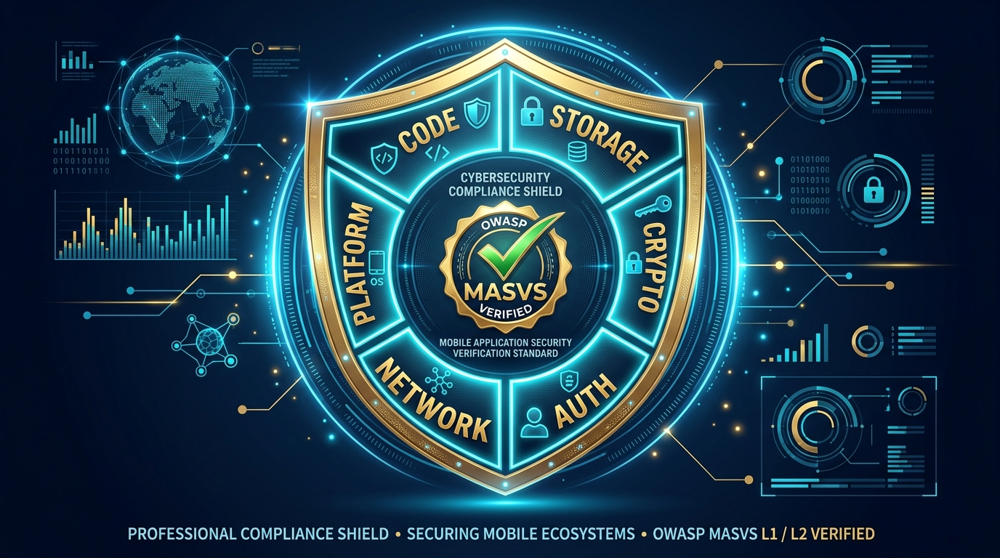
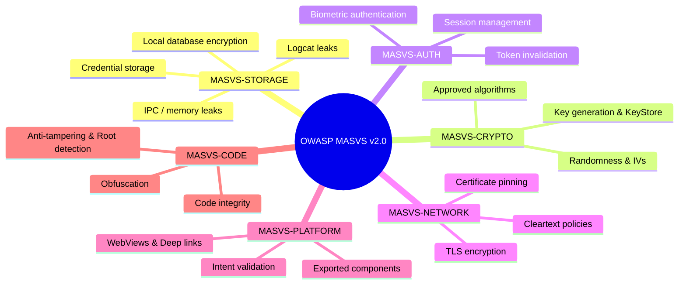
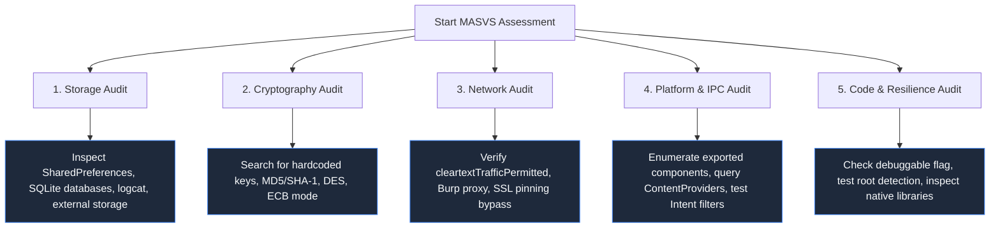

# Module 09 — OWASP MASVS v2.0 Compliance & Testing Guide

> **Prerequisites:** Modules 01–06, Parts 1–4  
> **Estimated Reading Time:** 35 minutes  
> **Target Audience:** Security auditors, compliance engineers, lead penetration testers.

---

<div align="center">



</div>

---

## 🎯 Learning Objectives

By completing this guide, you will master:

1. **The OWASP MASVS v2.0 Standard**: Understand the 6 core control families and how they modernize mobile security compliance.
2. **Security Verification Profiles (MASVS-L1 vs. MASVS-L2)**: Distinguish between baseline application hygiene (L1) and defense-in-depth requirements for high-risk applications (L2).
3. **Control Mapping**: Map identified vulnerabilities directly to MASVS controls, MASTG test procedures, and Common Weakness Enumeration (CWE) entries.
4. **Scoring Vulnerabilities with CVSS v3.1**: Accurately score mobile findings considering local vs. network attack vectors and execution context.
5. **Systematic Test Execution**: Execute structured, repeatable audit workflows aligned with industry-standard reporting practices.

---

## 1. OWASP MASVS v2.0 Architecture

The **Mobile Application Security Verification Standard (MASVS)** establishes baseline security requirements for mobile applications across six core domains.



### Verification Profiles

| Profile | Target Application Profile | Focus |
| :--- | :--- | :--- |
| **MASVS-L1: Standard Security** | All mobile applications. | Baseline security best practices: proper data storage, correct permissions, TLS enforcement, and secure compiler options. |
| **MASVS-L2: Defense-in-Depth** | Financial, banking, healthcare, and enterprise apps handling sensitive PII/IP. | Threat-modeled defense: hardware-backed key storage, certificate pinning, biometric step-up, and strict session limits. |
| **MASVS-R: Resilience** | Apps protecting intellectual property or resisting reverse engineering (gaming, DRM, fintech). | Anti-tampering, root/jailbreak detection, code obfuscation, and runtime integrity validation. |

---

## 2. Master MASVS Cross-Reference Matrix

This matrix maps every major MASVS v2.0 control to its corresponding practical lab in this course, associated testing tools, and CWE numbers.

| MASVS Control | Requirement Description | Course Module / Lab | Primary Tools | CWE Identifier |
| :--- | :--- | :--- | :--- | :--- |
| **MASVS-STORAGE-1** | The app securely stores sensitive data (internal storage, databases). | [Part 3 (Ch 3-6)](../../Android%20Pentesting%20Part%203%20Installing%20DIVA,%20Capturing%20Traffic%20and%20Solving%20All%2013%20Challenges/Android_Pentest_Part_3.md), [Mod 01](./01_android_fundamentals.md) | `adb shell`, SQLite3 | [CWE-312](https://cwe.mitre.org/data/definitions/312.html) |
| **MASVS-STORAGE-2** | The app prevents leakage of sensitive data via logs, caches, and backups. | [Part 3 (Ch 1)](../../Android%20Pentesting%20Part%203%20Installing%20DIVA,%20Capturing%20Traffic%20and%20Solving%20All%2013%20Challenges/Android_Pentest_Part_3.md), [Mod 03](./03_android_reconnaissance.md) | `logcat`, `adb backup` | [CWE-532](https://cwe.mitre.org/data/definitions/532.html) |
| **MASVS-CRYPTO-1** | The app uses proven, modern cryptographic algorithms and configurations. | [Module 05](./05_static_analysis.md), [Part 1](../../Introduction,%20APK%20Analysis,%20JADX%20&%20MobSF/Android_pentest_part-1.MD) | JADX, MobSF | [CWE-327](https://cwe.mitre.org/data/definitions/327.html) |
| **MASVS-CRYPTO-2** | Cryptographic keys are generated securely and managed inside the KeyStore. | [Module 05](./05_static_analysis.md) | JADX, Frida | [CWE-321](https://cwe.mitre.org/data/definitions/321.html) |
| **MASVS-AUTH-1** | The app enforces secure local authentication (biometrics, PIN). | [Part 3 (Ch 9-11)](../../Android%20Pentesting%20Part%203%20Installing%20DIVA,%20Capturing%20Traffic%20and%20Solving%20All%2013%20Challenges/Android_Pentest_Part_3.md) | Frida, Objection | [CWE-287](https://cwe.mitre.org/data/definitions/287.html) |
| **MASVS-NETWORK-1** | The app encrypts all network traffic using strong TLS ciphers. | [Module 06](./06_network_security.md), [Part 3](../../Android%20Pentesting%20Part%203%20Installing%20DIVA,%20Capturing%20Traffic%20and%20Solving%20All%2013%20Challenges/Android_Pentest_Part_3.md) | Burp Suite, `tcpdump` | [CWE-319](https://cwe.mitre.org/data/definitions/319.html) |
| **MASVS-NETWORK-2** | The app validates the remote TLS certificate chain and enforces pinning. | [Part 4](../../Android%20Pentesting%20Part%204%20System%20Certificates,%20Rooted%20Interception%20and%20Bypassing%20SSL%20Pinning%20with%20Frida/Android_Pentest_Part_4.md), [Mod 06](./06_network_security.md) | Burp, Frida, Objection | [CWE-295](https://cwe.mitre.org/data/definitions/295.html) |
| **MASVS-PLATFORM-1** | The app safely configures IPC components, intent filters, and permissions. | [Part 3 (Ch 7-11)](../../Android%20Pentesting%20Part%203%20Installing%20DIVA,%20Capturing%20Traffic%20and%20Solving%20All%2013%20Challenges/Android_Pentest_Part_3.md), [Mod 03](./03_android_reconnaissance.md) | `am`, `pm`, Drozer | [CWE-926](https://cwe.mitre.org/data/definitions/926.html) |
| **MASVS-CODE-1** | The app is signed, verified, and free from debugging interfaces. | [Module 03](./03_android_reconnaissance.md), [Part 1](../../Introduction,%20APK%20Analysis,%20JADX%20&%20MobSF/Android_pentest_part-1.MD) | `aapt2`, `apksigner` | [CWE-489](https://cwe.mitre.org/data/definitions/489.html) |
| **MASVS-CODE-2** | The app does not embed hardcoded secrets, keys, or internal credentials. | [Part 3 (Ch 2, 12)](../../Android%20Pentesting%20Part%203%20Installing%20DIVA,%20Capturing%20Traffic%20and%20Solving%20All%2013%20Challenges/Android_Pentest_Part_3.md), [Mod 05](./05_static_analysis.md) | JADX, Ripgrep | [CWE-798](https://cwe.mitre.org/data/definitions/798.html) |

---

## 3. Domain Testing Methodology



### 3.1 Data Storage Testing (MASVS-STORAGE)
* **Logcat Eavesdropping**: Monitor `adb logcat` while performing authentication and financial operations. Sensitive credentials, session cookies, or PII should never appear in system logs.
* **Sandbox Inspection**: Access `/data/data/<package>/` on a rooted emulator. Verify that databases use SQLCipher encryption and shared preferences do not store plain-text secrets.

### 3.2 Network Communication Testing (MASVS-NETWORK)
* **Cleartext Check**: Verify no plain-text HTTP connections are allowed (`android:usesCleartextTraffic="false"`).
* **Certificate Pinning Verification**: Route traffic through Burp Suite with a system CA installed. If the app fails to connect, certificate pinning is present. Confirm that pinning can be bypassed using Objection or Frida to prove testing was thorough.

### 3.3 Platform & IPC Testing (MASVS-PLATFORM)
* **Exported Activity Access**: Verify whether restricted internal screens can be launched directly using `am start`.
* **Content Provider Injection**: Test `content://` URIs for SQL injection using `' OR 1=1--` payloads via `adb shell content query`.

---

## 4. CVSS v3.1 Scoring for Mobile Findings

When reporting vulnerabilities, compute a **Common Vulnerability Scoring System (CVSS v3.1)** score to establish risk severity:

```
CVSS:3.1/AV:L/AC:L/PR:N/UI:N/S:U/C:H/I:H/A:N (Base Score: 7.7 - HIGH)
```

### Mobile Vector Considerations

| CVSS Metric | Typical Mobile Assessment Context |
| :--- | :--- |
| **Attack Vector (AV)** | **Local (AV:L)**: Requires physical access, local ADB shell, or a malicious app installed on the same device.  <br>**Network (AV:N)**: Remotely exploitable via unauthenticated API endpoints, deep links, or network-level MitM. |
| **Attack Complexity (AC)** | **Low (AC:L)**: No special conditions required (e.g., world-readable file, exported activity). <br>**High (AC:H)**: Requires defeating complex ASLR or race conditions. |
| **Privileges Required (PR)** | **None (PR:N)**: An unprivileged rogue app or casual user can exploit the vulnerability. <br>**High (PR:H)**: Requires root privileges on the device. |
| **User Interaction (UI)** | **None (UI:N)**: Exploitation occurs silently in the background. <br>**Required (UI:R)**: Requires the victim to click a phishing link or approve a dialog. |

---

## 🧠 Knowledge Check

Test your understanding of OWASP MASVS compliance:

### Question 1
**What is the core difference between MASVS-L1 and MASVS-L2 verification?**
* A) L1 applies only to iOS; L2 applies to Android.
* B) L1 covers general security best practices for all apps; L2 adds defense-in-depth requirements (hardware key storage, pinning) for sensitive apps.
* C) L1 is an automated scan; L2 is a manual review.
* D) L1 requires root access; L2 does not.

<details>
<summary>View Answer & Explanation</summary>

**Correct Answer: B**  
**Explanation:** MASVS-L1 establishes foundational application hygiene for all mobile applications. MASVS-L2 defines defense-in-depth controls required for high-risk applications (e.g., banking, healthcare) where compromise carries significant regulatory or financial consequences.
</details>

---

### Question 2
**Under MASVS-STORAGE-2, which of the following is considered a vulnerability?**
* A) Storing an encrypted database key inside the Android KeyStore.
* B) Logging user credit card numbers and session tokens to the system `logcat` stream.
* C) Saving application configuration settings in a private shared preference file.
* D) Storing temporary image files in `/data/data/<package>/cache/`.

<details>
<summary>View Answer & Explanation</summary>

**Correct Answer: B**  
**Explanation:** Writing sensitive credentials, session tokens, or financial records to `logcat` violates MASVS-STORAGE-2 (CWE-532). Logcat output can be read by any application with the `READ_LOGS` permission on older devices, or by anyone with physical ADB access.
</details>

---

### Question 3
**An exported Activity allows unauthenticated users to bypass the PIN login screen. Which MASVS control does this violate?**
* A) MASVS-NETWORK-1
* B) MASVS-CRYPTO-2
* C) MASVS-PLATFORM-1
* D) MASVS-CODE-3

<details>
<summary>View Answer & Explanation</summary>

**Correct Answer: C**  
**Explanation:** MASVS-PLATFORM-1 requires applications to use platform components securely. Leaving sensitive activities exported without proper authorization checks allows arbitrary invocation via the Activity Manager.
</details>

---

### Question 4
**Which CWE identifier specifically corresponds to hardcoded cryptographic keys or passwords embedded in application bytecode?**
* A) CWE-89 (SQL Injection)
* B) CWE-798 (Use of Hard-coded Credentials)
* C) CWE-319 (Cleartext Transmission)
* D) CWE-200 (Information Exposure)

<details>
<summary>View Answer & Explanation</summary>

**Correct Answer: B**  
**Explanation:** CWE-798 refers explicitly to the use of hardcoded credentials, such as API tokens, private keys, or passwords embedded directly in the application source code or resources.
</details>

---

### Question 5
**What CVSS Attack Vector (AV) should be assigned to an exported Content Provider that can be queried by any other app on the device?**
* A) Network (AV:N)
* B) Adjacent (AV:A)
* C) Local (AV:L)
* D) Physical (AV:P)

<details>
<summary>View Answer & Explanation</summary>

**Correct Answer: C**  
**Explanation:** Inter-Process Communication (IPC) vulnerabilities that require a malicious app installed on the same device have an Attack Vector of Local (AV:L).
</details>

---

## 🔬 Practical Exercise

### Objective
Create a complete MASVS audit matrix for the DIVA application:

1. Review all 13 challenges in [Part 3](../../Android%20Pentesting%20Part%203%20Installing%20DIVA,%20Capturing%20Traffic%20and%20Solving%20All%2013%20Challenges/Android_Pentest_Part_3.md).
2. Map each challenge to its corresponding:
   * **MASVS Control** (e.g., Challenge 1 -> MASVS-STORAGE-2)
   * **CWE Number** (e.g., Challenge 1 -> CWE-532)
   * **Severity Level** (Low, Medium, High, Critical)
3. Check your mappings against the [Vulnerability Report Template](../templates/VULNERABILITY_REPORT_TEMPLATE.md).

---

## 🔗 Next Steps & Navigation

* ⬅️ **Previous Module:** [Module 06 — Android Network Security](./06_network_security.md)
* 📋 **Audit Reference:** [Master Course Reference](../reference/OFFICIAL_REFERENCES.md)
* ➡️ **Next Module:** [Module 12 — Capstone Penetration Test Simulation](./12_capstone_assessment.md)
