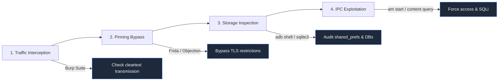

# Module 12 — Capstone Penetration Testing Simulation

> **Prerequisites:** Completion of all preceding modules (01–09) and practical lab guides (Parts 1–4).  
> **Estimated Execution Time:** 90–120 minutes active assessment.  
> **Target Audience:** Assessment candidates, security auditors, penetration testers.

---

## 🎯 Capstone Objectives

This capstone project tests your ability to conduct a complete, professional Android mobile application penetration test. You will execute an end-to-end assessment following the OWASP MASTG methodology:

```
Reconnaissance ──▶ Static Audit (SAST) ──▶ Dynamic Testing (DAST) ──▶ Exploitation ──▶ Professional Reporting
```

1. **Scope & Authorize**: Define formal assessment boundaries and maintain chain-of-custody.
2. **Execute Reconnaissance**: Profile the target package, manifest flags, and exported components.
3. **Perform Static Analysis**: Decompile the bytecode, uncover hidden secrets, and identify cryptographic weaknesses.
4. **Conduct Dynamic Testing**: Intercept network traffic, bypass certificate validation with Frida, and inspect runtime data storage.
5. **Compile an Executive & Technical Report**: Produce an audit report complete with CVSS v3.1 scores, reproduction steps, and developer remediation guidance.

---

## 1. Target Application & Rules of Engagement

### Target Selection
Choose one of the following authorized, intentionally vulnerable applications:
* **Option A (Standard)**: **DIVA (Damn Insecure and Vulnerable App)** (`jakhar.aseem.diva`) — Used throughout Parts 1–4.
* **Option B (Advanced)**: **AndroGoat** or **InsecureBankv2** — For advanced runtime API testing.

> [!IMPORTANT]
> **Rules of Engagement**:
> * All testing must be conducted strictly on your local emulated or authorized hardware device.
> * Never test third-party production applications or services without explicit, written authorization.
> * Ensure your network proxy (Burp Suite) intercepts traffic only from the designated test emulator.

---

## 2. Assessment Scope Definition

```
================================================================================
PENETRATION TESTING SCOPE SPECIFICATION
================================================================================
Target Name:           DIVA (Damn Insecure and Vulnerable App)
Package Identifier:    jakhar.aseem.diva
Target Version:        1.0 (Build 1)
SHA-256 Hash:          (Compute and record during Phase 1)
Platform / API Target: Android 11 (API 30) Google APIs System Image

IN-SCOPE:
  - Local application binary reverse engineering & static bytecode audit.
  - Runtime application storage inspection (/data/data/jakhar.aseem.diva/).
  - Inter-Process Communication (IPC) interfaces & exported components.
  - Client-side cryptographic and input validation implementations.
  - Network traffic interception between emulator and proxy.

OUT-OF-SCOPE:
  - Denial of Service (DoS) attacks against host OS or hypervisor.
  - Attacking non-target infrastructure or third-party cloud services.
  - Social engineering or physical security attacks.
================================================================================
```

---

## 3. Phase 1 — Reconnaissance & Asset Profiling

Complete the reconnaissance checklist and record system properties:

**[WINDOWS HOST]** or **[KALI LINUX VM]**
```bash
# 1. Pull target binary
adb shell pm path jakhar.aseem.diva
adb pull <path_from_above> ./capstone/diva.apk

# 2. Compute cryptographic fingerprint
# Windows: Get-FileHash -Algorithm SHA256 .\capstone\diva.apk
# Kali:    sha256sum ./capstone/diva.apk

# 3. Extract SDK and permission properties
aapt2 dump badging ./capstone/diva.apk > ./capstone/recon_badging.txt

# 4. Enumerate components via dumpsys
adb shell dumpsys package jakhar.aseem.diva > ./capstone/recon_dumpsys.txt
```

### Reconnaissance Evidence Checklist
* [ ] SHA-256 fingerprint recorded.
* [ ] `targetSdkVersion` and `minSdkVersion` identified.
* [ ] Full list of requested permissions documented.
* [ ] All exported Activities, Services, and Content Providers mapped.

---

## 4. Phase 2 — Static Application Security Testing (SAST)

Decompile the binary and perform secret hunting and manifest review:

1. **Automated Scanning**:
   * Upload `diva.apk` to MobSF (`http://localhost:8000`).
   * Export the generated PDF/JSON report to `./capstone/mobsf_report.pdf`.
2. **Manual Code Audit in JADX**:
   * Open the APK in JADX-GUI.
   * Search for high-value terms: `secret`, `key`, `password`, `token`, `DES`, `AES/ECB`.
   * Review `AndroidManifest.xml` for `android:debuggable` and `android:allowBackup`.
3. **Secret Verification**:
   * Confirm whether discovered strings are live credentials or benign constants.

---

## 5. Phase 3 — Dynamic Application Security Testing (DAST)

Execute runtime testing on your rooted emulator:



### Required Test Procedures
1. **Logcat Monitoring**:
   * Run `adb logcat | grep -i diva` while interacting with user inputs.
   * Document any sensitive strings emitted to the system log.
2. **Storage Audit**:
   * Inspect `/data/data/jakhar.aseem.diva/shared_prefs/` and `databases/`.
   * Dump SQLite tables and check whether sensitive fields are encrypted.
3. **IPC Exploitation**:
   * Launch unexported or exported activities with `am start`.
   * Inject SQL payloads into content providers using `adb shell content query`.

---

## 6. Phase 4 — Vulnerability Reporting

You must document **at least three distinct findings** using the formal [Vulnerability Report Template](../templates/VULNERABILITY_REPORT_TEMPLATE.md).

### Required Finding Attributes
Each finding must contain:
1. **Title & Vulnerability Type**: Clear description with CWE and MASVS mapping.
2. **Severity Rating**: CVSS v3.1 vector string and calculated base score.
3. **Detailed Description**: Root cause and impact analysis.
4. **Step-by-Step Reproduction Steps**: Exact commands and parameters so the developer can reproduce the issue.
5. **Proof of Concept (PoC)**: Screenshots, terminal logs, or raw HTTP requests.
6. **Remediation Code**: Actionable code snippet showing the secure implementation.

---

## 7. Capstone Self-Assessment Rubric

Use this rubric to evaluate the quality and completeness of your assessment:

| Evaluation Dimension | Maximum Points | Passing Standard (70%) | Score |
| :--- | :---: | :--- | :---: |
| **Phase 1: Reconnaissance** | 15 | Accurate hashes, full component mapping, SDK analysis. | /15 |
| **Phase 2: Static Audit** | 20 | MobSF triage, manual JADX decompilation, secret discovery. | /20 |
| **Phase 3: Dynamic Audit** | 25 | Logcat monitoring, storage dumps, runtime exploitation. | /25 |
| **Phase 4: Vulnerability Quality** | 25 | 3+ valid findings with correct CVSS v3.1 and MASVS mapping. | /25 |
| **Phase 5: Remediation Quality** | 15 | Concrete, secure Java/XML remediation code provided. | /15 |
| **Total** | **100** | **Minimum Passing: 70 Points** | **/100** |

---

## 8. Sample Assessment Finding Reference

Here is a reference finding to illustrate the expected quality and depth:

```markdown
### Finding SEC-01: Insecure Sensitive Data Storage in Logcat Output

* **Severity**: Medium (CVSS:3.1/AV:L/AC:L/PR:N/UI:N/S:U/C:H/I:N/A:N - 6.2)
* **OWASP MASVS**: MASVS-STORAGE-2 (Data Leak Prevention)
* **CWE**: CWE-532 (Insertion of Sensitive Information into Log File)

#### 1. Vulnerability Summary
During user credit card registration, the application logs the user's plain-text credit card number and CVV code to the Android system log (`logcat`). Any application holding `READ_LOGS` on legacy versions, or any actor with physical device/ADB access, can read these credentials in plain text.

#### 2. Steps to Reproduce
1. Start logcat stream: `adb logcat | grep -i diva`
2. Open DIVA and navigate to "1. Insecure Logging".
3. Enter credit card number `4111 2222 3333 4444` and click "Check out".
4. Observe the plain-text credit card number in the terminal output.

#### 3. Secure Remediation
Remove all debugging log calls before building release binaries. In `LogActivity.java`:
```java
// INSECURE:
Log.d("diva-log", "CC: " + creditCardInput.getText().toString());

// REMEDIATION:
// Remove logging entirely, or use ProGuard/R8 to strip Log.d calls in release builds:
// -assumenosideeffects class android.util.Log {
//     public static boolean isLoggable(java.lang.String, int);
//     public static int d(...);
// }
```
```

---

## 9. Final Submission & Completion Checklist

Before concluding your capstone assessment:

* [ ] Target APK cryptographic hash verified against initial record.
* [ ] All 3+ vulnerability findings documented with CVSS v3.1 scores.
* [ ] Clear reproduction steps and proof-of-concept screenshots included.
* [ ] Developer remediation snippets provided for every finding.
* [ ] Temporary testing artifacts (extracted databases, modified files) cleaned up.
* [ ] Self-assessment score calculated using the rubric above.

---

## 🔗 Course Completion & Navigation

* ⬅️ **Previous Module:** [Module 09 — OWASP MASVS v2.0 Guide](./09_masvs_testing_guide.md)
* 📑 **Report Template:** [Vulnerability Report Template](../templates/VULNERABILITY_REPORT_TEMPLATE.md)
* 🏠 **Course Home:** [Master Course Portal](../../README.md)
