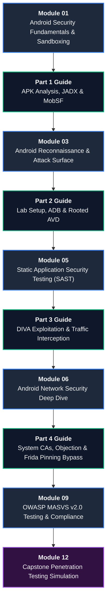

# Android Application Penetration Testing — Course Modules & Learning Path

Welcome to the comprehensive module curriculum for the **Android Application Penetration Testing Course**. This directory hosts standalone modules designed to complement the hands-on lab series, providing deep theoretical foundations, structured methodology, command execution blueprints, and verification exercises.

---

## 🗺️ Curriculum Learning Path

---

## 📚 Complete Module Directory

| Module | Title | Target File | Est. Time | Prerequisites | Primary MASVS Controls |
| :--- | :--- | :--- | :---: | :--- | :--- |
| **01** | **Android Security Fundamentals** | [01_android_fundamentals.md](./01_android_fundamentals.md) | 45 min | None (Foundational) | MASVS-STORAGE, MASVS-PLATFORM |
| **02** | **Lab Setup & Toolchain** | [Part 2 Guide](../../Android%20Studio,%20ADB,%20Root%20&%20Non-Root%20Lab%20Setup/Android_Pentest_Part_2.md) | 120 min | Module 01, Windows/Kali host | MASVS-PLATFORM-1 |
| **03** | **Android Reconnaissance** | [03_android_reconnaissance.md](./03_android_reconnaissance.md) | 40 min | Module 01, Part 2 (ADB setup) | MASVS-CODE-2, MASVS-PLATFORM |
| **04** | **Reconnaissance to Decompilation** | [Part 1 Guide](../../Introduction,%20APK%20Analysis,%20JADX%20&%20MobSF/Android_pentest_part-1.MD) | 90 min | Module 01, JADX / MobSF | MASVS-CODE-1, MASVS-CODE-2 |
| **05** | **Static Security Testing (SAST)** | [05_static_analysis.md](./05_static_analysis.md) | 50 min | Module 03, Part 1 | MASVS-CODE, MASVS-STORAGE |
| **06** | **Android Network Security** | [06_network_security.md](./06_network_security.md) | 45 min | Part 3 (Burp capture), Part 4 | MASVS-NETWORK-1, MASVS-NETWORK-2 |
| **07** | **Dynamic Interception & Vulnerability Lab** | [Part 3 Guide](../../Android%20Pentesting%20Part%203%20Installing%20DIVA,%20Capturing%20Traffic%20and%20Solving%20All%2013%20Challenges/Android_Pentest_Part_3.md) | 240 min | Part 2, Burp Suite, DIVA | MASVS-STORAGE, MASVS-CODE |
| **08** | **Runtime Hooking & SSL Pinning Bypass** | [Part 4 Guide](../../Android%20Pentesting%20Part%204%20System%20Certificates,%20Rooted%20Interception%20and%20Bypassing%20SSL%20Pinning%20with%20Frida/Android_Pentest_Part_4.md) | 180 min | Part 3, Frida, Objection | MASVS-NETWORK-2, MASVS-RESILIENCE |
| **09** | **OWASP MASVS v2.0 Compliance Guide** | [09_masvs_testing_guide.md](./09_masvs_testing_guide.md) | 35 min | Modules 01–06, Parts 1–4 | MASVS-STORAGE, NETWORK, CODE, etc. |
| **10** | **Evidence Collection & Reporting** | [Report Template](../templates/VULNERABILITY_REPORT_TEMPLATE.md) | 45 min | Practical test execution | MASTG Quality Standards |
| **11** | **Troubleshooting & Diagnostics** | [Knowledge Base](../reference/TROUBLESHOOTING_KNOWLEDGE_BASE.md) | Ongoing | Active lab issues | All Environments |
| **12** | **Capstone Penetration Test Simulation** | [12_capstone_assessment.md](./12_capstone_assessment.md) | 90 min | All preceding modules | Full MASVS Verification L1 |

---

## 🏷️ Standardized Environment Labels

Across all module documentation and practical walkthroughs, commands are strictly labeled with their execution context:

* **`**[WINDOWS HOST]**`** — Commands executed within Windows PowerShell or Command Prompt (e.g., hypervisor management, Windows AVD launches, local ADB port forwarders).
* **`**[KALI LINUX VM]**`** — Commands executed within the Kali Linux guest terminal (e.g., Python `venv`, Objection, Frida scripts, Burp Suite, JADX-CLI).
* **`**[ANDROID EMULATOR]**`** — Operations running inside the Android target system shell via `adb shell` or root interactive sessions.
* **`**[ANDROID DEVICE]**`** — Physical hardware device configurations, OEM unlocking, and hardware USB debugging.
* **`**[WINDOWS BROWSER]**`** — Web-based administrative panels, MobSF dashboards, or local browser proxy configurations.

---

## 🎯 Pedagogical Framework

Each standalone module in this directory is built with a consistent, learner-centric anatomy:

1. **Learning Objectives**: Clear capabilities students will acquire upon completion.
2. **Technical Deep-Dive**: Underlying architecture, memory models, protocols, and Android OS internals.
3. **Cross-Platform Hands-on Lab**: Dual-platform command syntax with verification steps and expected outputs.
4. **Defensive Guidance & Remediation**: Concrete secure coding patterns and configuration hardening instructions.
5. **Knowledge Check Questions**: 5 technical multiple-choice or short-answer questions to validate understanding.
6. **Practical Exercises**: Hands-on challenge tasks connecting theory to applied exploitation.

---

## 🔗 Quick Navigation

* 🏠 [Master Course Portal](../../README.md)
* 📐 [Cross-Platform Lab Architecture](../setup/CROSS_PLATFORM_LAB_ARCHITECTURE.md)
* 🪟 [Windows Host Setup Guide](../setup/WINDOWS_HOST_SETUP.md)
* 🐉 [Kali Linux VM Setup Guide](../setup/KALI_VM_SETUP.md)
* 📖 [Cross-Platform Command Reference](../reference/CROSS_PLATFORM_COMMAND_REFERENCE.md)
* 📑 [Vulnerability Report Template](../templates/VULNERABILITY_REPORT_TEMPLATE.md)
