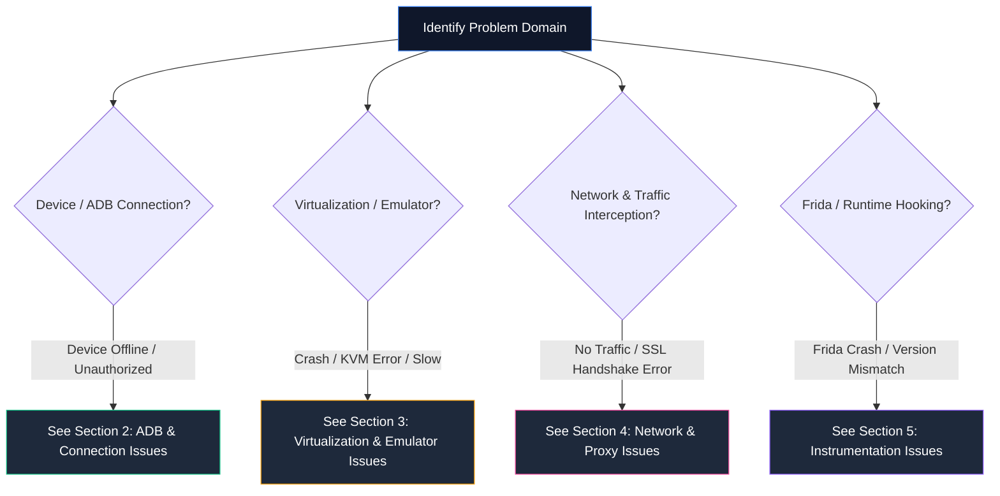

# Troubleshooting Knowledge Base: Mobile Pentest Laboratory

> **Diagnostic Field Guide:** 20+ Common Android Pentesting, ADB, VM, Network & Instrumentation Failures  
> **Course Track:** Mobile Security Reference | **Level:** All Levels

---

## 1. Quick Diagnostic Decision Tree



---

## 2. ADB & Device Connection Issues

### Issue 2.1: `adb: command not found` (or `'adb' is not recognized`)
* **Symptoms:** Terminal throws command-not-found error whenever typing `adb`.
* **Likely Causes:** The `platform-tools` directory is missing from the system's `PATH` environment variable.
* **Diagnostic Check:**
  * `[WINDOWS HOST]`: Run `Get-Command adb -ErrorAction SilentlyContinue`.
  * `[KALI LINUX VM]`: Run `which adb`.
* **Safe Corrective Steps:**
  * `[WINDOWS HOST]`: Add `C:\Android\platform-tools` to User PATH via System Properties or run:
    ```powershell
    [Environment]::SetEnvironmentVariable("Path", $env:Path + ";C:\Android\platform-tools", [EnvironmentVariableTarget]::User)
    ```
  * `[KALI LINUX VM]`: Install platform-tools or append to `.bashrc`:
    ```bash
    sudo apt install -y adb
    ```
* **Verification:** Open a new terminal and execute `adb version`.

---

### Issue 2.2: Device Shows as `unauthorized`
* **Symptoms:** `adb devices` returns `<serial_number>   unauthorized`.
* **Likely Causes:** The Android device has not accepted the computer's RSA public key fingerprint, or the prompt was dismissed.
* **Diagnostic Check:** Check device screen while connected via USB or during initial boot.
* **Safe Corrective Steps:**
  1. Revoke existing authorizations: On the Android device, go to **Settings -> Developer Options -> Revoke USB debugging authorizations**.
  2. Kill and restart ADB on the host:
     ```bash
     adb kill-server
     rm -rf ~/.android/adbkey ~/.android/adbkey.pub  # On Windows: C:\Users\<User>\.android\
     adb start-server
     ```
  3. Reconnect the device or reboot the emulator.
  4. Unlock screen and check **Always allow from this computer**, then tap **Allow**.
* **Verification:** `adb devices` now displays `<serial_number>   device`.

---

### Issue 2.3: Device Shows as `offline`
* **Symptoms:** `adb devices` lists the target as `offline`.
* **Likely Causes:** Communication breakdown between `adbd` on the device and the host ADB server; emulator hung during boot.
* **Diagnostic Check:** `adb get-state` returns `offline`.
* **Safe Corrective Steps:**
  1. Restart ADB server: `adb kill-server && adb start-server`.
  2. If using an emulator, perform a **Cold Boot**:
     - Android Studio -> Device Manager -> Click down-arrow on AVD -> **Cold Boot Now**.
* **Verification:** Run `adb devices` and verify status changes to `device`.

---

### Issue 2.4: `more than one device/emulator` Error
* **Symptoms:** `adb shell` fails with `error: more than one device/emulator`.
* **Likely Causes:** Multiple AVDs, physical phones, or TCP bridge connections are active simultaneously.
* **Diagnostic Check:** Run `adb devices`. Observe multiple lines in output.
* **Safe Corrective Steps:**
  * Specify the target device serial number using the `-s` flag:
    ```bash
    adb -s emulator-5554 shell
    # Or for a TCP target:
    adb -s 192.168.1.100:5555 shell
    ```
  * Or disconnect unused TCP targets: `adb disconnect <IP>:5555`.
* **Verification:** Command executes exclusively on the specified target.

---

### Issue 2.5: `INSTALL_FAILED_DEPRECATED_SDK_VERSION`
* **Symptoms:** Installing legacy vulnerable targets (e.g., DIVA) on modern Android (API 34+) fails with:
  `Failure [INSTALL_FAILED_DEPRECATED_SDK_VERSION: App is built for an older version of Android...]`.
* **Likely Causes:** Android 14+ blocks installation of applications targeting API 22 or lower to prevent malware from evading modern runtime permissions.
* **Safe Corrective Steps:**
  Pass the low target SDK bypass flag during installation:
  ```bash
  adb install --bypass-low-target-sdk-block -r target.apk
  ```
* **Verification:** `Success` is returned and `pm list packages | grep <pkg>` confirms registration.

---

## 3. Virtualization & Emulator Issues

### Issue 3.1: Hardware Virtualization Error (`/dev/kvm permission denied` or KVM Not Available)
* **Symptoms:** Emulator fails to start on Linux with `emulator: ERROR: KVM is not installed or available`.
* **Likely Causes:** Virtualization disabled in BIOS, or the current user is not in the `kvm` system group.
* **Diagnostic Check:** `ls -la /dev/kvm` and `egrep -c '(vmx|svm)' /proc/cpuinfo`.
* **Safe Corrective Steps:**
  ```bash
  # [KALI LINUX VM] Add user to kvm group and reload
  sudo apt install -y qemu-kvm
  sudo usermod -aG kvm $USER
  newgrp kvm
  ```
* **Verification:** `emulator -accel-check` returns `accel: 0` (KVM acceleration available).

---

### Issue 3.2: Emulator Black Screen or Freezing at Google Logo
* **Symptoms:** The emulator window opens but hangs indefinitely on the startup logo.
* **Likely Causes:** Corrupted snapshot cache, insufficient RAM allocation, or OpenGL rendering failure.
* **Diagnostic Check:** Check emulator terminal logs: `emulator -avd <NAME> -verbose`.
* **Safe Corrective Steps:**
  1. Launch with cold boot: `emulator -avd <NAME> -no-snapshot-load`.
  2. Force software GPU rendering if host GPU drivers fail:
     `emulator -avd <NAME> -gpu swiftshader_indirect`.
  3. Increase RAM in AVD settings: Set `hw.ramSize = 4096` in `~/.android/avd/<NAME>.avd/config.ini`.
* **Verification:** Emulator loads into the home launcher within 60 seconds.

---

### Issue 3.3: `adbd cannot run as root in production builds`
* **Symptoms:** Executing `adb root` fails with:
  `adbd cannot run as root in production builds`.
* **Likely Causes:** The AVD was provisioned using a **Google Play** system image (a sealed consumer build).
* **Diagnostic Check:** Run `adb shell getprop ro.build.type`. Returns `user` instead of `userdebug`.
* **Safe Corrective Steps:**
  1. Open Android Studio **Virtual Device Manager**.
  2. Create a new AVD.
  3. Under the **x86 Images** tab, select an image labeled **Google APIs** (NOT Google Play).
  4. Boot the new AVD and execute `adb root`.
* **Verification:** `adb root` outputs `restarting adbd as root`.

---

### Issue 3.4: `/system` Mount Fails: `Read-only file system`
* **Symptoms:** Pushing certificates or editing `/system` fails even after `adb root`.
* **Likely Causes:** `dm-verity` verified boot is active and the emulator was started without `-writable-system`.
* **Safe Corrective Steps:**
  1. Close running emulator instances.
  2. Start from command line:
     ```bash
     emulator -avd <AVD_NAME> -writable-system -no-snapshot-load &
     ```
  3. Disable verity and remount:
     ```bash
     adb root
     adb disable-verity
     adb reboot
     # Wait 30 seconds...
     adb root
     adb remount
     ```
* **Verification:** `adb remount` outputs `remount succeeded`.

---

## 4. Network & Proxy Interception Issues

### Issue 4.1: Kali VM Unable to Ping Windows Host
* **Symptoms:** `ping 192.168.1.100` from Kali times out or returns `Destination Host Unreachable`.
* **Likely Causes:** Windows Defender Firewall blocks ICMP Echo Requests by default, or VM network adapter is set to Host-Only while Windows is on Wi-Fi.
* **Diagnostic Check:** Verify VM IP via `ip -br a` and Windows IP via `ipconfig`.
* **Safe Corrective Steps:**
  * Allow ICMP in Windows Firewall via PowerShell:
    ```powershell
    # [WINDOWS HOST] Enable ICMP Echo (Ping)
    New-NetFirewallRule -DisplayName "Allow ICMPv4-In" -Protocol ICMPv4 -IcmpType 8 -Action Allow
    ```
  * Switch VM network adapter in VMware/VirtualBox to **Bridged**.
* **Verification:** `ping -c 3 <WINDOWS_HOST_IP>` returns 0% packet loss.

---

### Issue 4.2: Android Emulator Has No Internet Connection When Proxy is Configured
* **Symptoms:** Emulator displays Wi-Fi exclamation mark (`AndroidWifi has no internet access`); web pages fail to load.
* **Likely Causes:** Burp Suite is not running, or Burp’s proxy listener is only bound to `127.0.0.1` instead of `0.0.0.0`.
* **Diagnostic Check:** Look at Burp: **Proxy -> Proxy settings -> Proxy Listeners**. Check interface column.
* **Safe Corrective Steps:**
  1. Edit Burp Listener: Change **Bind to address** from `127.0.0.1` to **All interfaces** (`0.0.0.0`).
  2. Ensure the port (`8080`) matches the emulator proxy setting (`10.0.2.2:8080`).
  3. Test connectivity from emulator browser to `http://burp`.
* **Verification:** Burp CA download landing page renders successfully inside the emulator.

---

### Issue 4.3: `CertPathValidatorException: Trust anchor for certification path not found`
* **Symptoms:** App crashes or refuses to load over HTTPS; Logcat reports `CertPathValidatorException`.
* **Likely Causes:** The application targets Android 7.0+ (API 24+) and does not trust user-installed certificates.
* **Safe Corrective Steps:**
  * Move the certificate to the system certificate store `/system/etc/security/cacerts/<hash>.0` (see Part 4).
  * Or install the **MagiskTrustUserCerts** module on rooted devices.
* **Verification:** Navigate to **Settings -> Security -> Trusted credentials -> System** and confirm PortSwigger CA is listed.

---

## 5. Dynamic Instrumentation (Frida & Objection) Issues

### Issue 5.1: `Failed to spawn: unable to find process`
* **Symptoms:** `objection --gadget com.target.app explore` or `frida -f com.target.app` fails.
* **Likely Causes:** Package name is misspelled, target application is not installed on the active device, or multiple devices are connected without targeting.
* **Diagnostic Check:** Run `adb shell pm list packages | grep <name>` to verify exact package name.
* **Safe Corrective Steps:**
  * Verify package name:
    ```bash
    frida-ps -Uai | grep -i target
    ```
  * Explicitly target device serial:
    ```bash
    objection -N -d -s emulator-5554 --gadget com.target.app explore
    ```
* **Verification:** Application launches on device and drops into Objection interactive prompt.

---

### Issue 5.2: `Frida server / client version mismatch`
* **Symptoms:** `frida-ps -U` returns `Server terminated` or `Protocol version mismatch`.
* **Likely Causes:** The version of `frida-tools` on Kali differs significantly from the `frida-server` binary on Android.
* **Diagnostic Check:**
  * `[KALI LINUX VM]`: Run `frida --version` (e.g. `16.5.9`).
  * `[ANDROID EMULATOR]`: Run `adb shell /data/local/tmp/frida-server --version`.
* **Safe Corrective Steps:**
  Download and deploy the exact matching release of `frida-server` from GitHub:
  `https://github.com/frida/frida/releases/tag/<YOUR_FRIDA_VERSION>`
* **Verification:** `frida-ps -U` cleanly lists running processes without errors.

---

### Issue 5.3: Application Terminates Immediately Upon Hooking (Anti-Frida)
* **Symptoms:** App crashes within 1 second of Frida injection; running without Frida succeeds.
* **Likely Causes:** Application detects `/data/local/tmp/frida-server`, open TCP port `27042`, or `frida-agent.so` in `/proc/self/maps`.
* **Diagnostic Check:** Check crash trace in Logcat: `adb logcat | grep -i frida`.
* **Safe Corrective Steps:**
  1. Rename server binary: `mv frida-server sys_daemon`.
  2. Bind to a random TCP port:
     ```bash
     adb shell "su -c '/data/local/tmp/sys_daemon -l 127.0.0.1:44999 &'"
     adb forward tcp:44999 tcp:44999
     frida -H 127.0.0.1:44999 -f com.target.app -l bypass.js
     ```
  3. Deploy Magisk **ZygiskFrida** or Shamiko to isolate process injection from root detection routines.
* **Verification:** App remains running and responsive with hooks attached.
