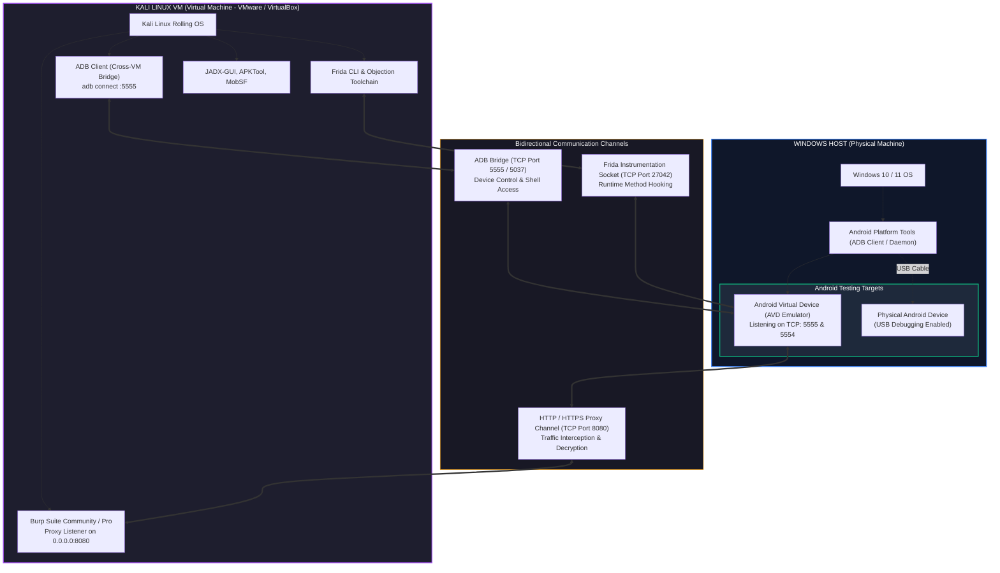

# Cross-Platform Android Pentesting Lab Architecture: Windows Host & Kali Linux VM

> **Environment Blueprint:** Windows Host + Kali Linux Virtual Machine + Android Target (AVD / Physical)  
> **Course Track:** Mobile Security Laboratory Setup | **Difficulty:** Beginner to Intermediate

---

## 1. Executive Summary & Architecture Blueprint

A major stumbling block for aspiring mobile security analysts is configuring a stable, high-performance testing laboratory across different operating systems. Many tutorials assume you run Linux directly on bare metal or attempt to run the Android Emulator *inside* a virtual machine—a setup that frequently crashes or suffers from poor performance due to hypervisor conflicts and nested virtualization issues.

The industry-standard approach leverages the strengths of both operating systems:
1. **Windows Host:** Runs the **Android Virtual Device (AVD)** emulator natively using Windows Hypervisor Platform (WHPX) or HAXM hardware acceleration, providing smooth 60 FPS performance, low latency, and direct USB access.
2. **Kali Linux VM:** Operates the **security toolchain**—Burp Suite, JADX, MobSF, Frida, Objection, APKTool, and specialized Python scripts—isolated inside a clean Linux virtual environment.
3. **Network & ADB Bridge:** Connects the Kali security tools to the Windows-hosted Android emulator or physical device over a secure TCP/IP network bridge.



---

## 2. Communication & Port Routing Matrix

To prevent connection drops, firewall blocks, and routing confusion, maintain this port assignment reference:

| Service / Channel | Direction | Port | Protocol | Purpose | Configuration Requirement |
| :--- | :--- | :--- | :--- | :--- | :--- |
| **ADB Network Bridge** | Kali VM ➔ Windows Host / AVD | `5555` | TCP | Android Debug Bridge network shell & package management | Emulator listening on `5555`; Windows Firewall allows port |
| **ADB Server Port** | Local Host ➔ ADB Daemon | `5037` | TCP | Internal ADB client-to-server IPC socket | Default internal socket for `adb start-server` |
| **Burp Suite Proxy** | AVD / Device ➔ Kali VM | `8080` | TCP / TLS | Interception of HTTP / HTTPS web and API traffic | Burp Listener bound to **All interfaces** (`0.0.0.0`) |
| **Frida Instrumentation** | Kali VM ➔ Android Device | `27042` | TCP | Runtime Dalvik/ART and native function hooking | `frida-server` bound to `0.0.0.0:27042` or ADB forwarded |
| **Emulator Control** | Host ➔ AVD Console | `5554` | TCP | QEMU / AVD management console (geo, battery, network) | Used by Android Studio and automated emulator CLI |
| **MobSF Dashboard** | Windows Browser ➔ Kali VM | `8000` | HTTP | Mobile Security Framework web interface | MobSF bound to `0.0.0.0:8000` inside Kali or Docker |

---

## 3. Virtual Machine Networking Modes: Deep Comparison

Configuring the virtual machine's network adapter properly determines whether your Kali tools can reach the Android emulator and vice versa.

```text
+---------------------------------------------------------------------------------------------------+
|                               Virtual Machine Network Topology Comparison                         |
+--------------------------+------------------------------------+-----------------------------------+
| Mode                     | Connectivity Characteristics       | Pentest Lab Recommendation        |
+--------------------------+------------------------------------+-----------------------------------+
| 1. NAT (Default)         | - VM shares Host public IP         | [ACCEPTABLE WITH PORT FORWARD]    |
|                          | - Host cannot reach VM directly    | Requires explicit port forwards   |
|                          | - VM can reach Host gateway IP     | for Burp (8080) and MobSF (8000)  |
+--------------------------+------------------------------------+-----------------------------------+
| 2. Bridged Adapter       | - VM appears as physical device    | [RECOMMENDED FOR LOCAL WI-FI]     |
|                          | - VM receives dedicated router IP  | Direct two-way routing between    |
|                          | - Host & VM on same subnet         | Windows Host, Kali VM, and Phone  |
+--------------------------+------------------------------------+-----------------------------------+
| 3. Host-Only Adapter     | - Isolated internal network        | [BEST FOR AIR-GAPPED LABS]        |
|                          | - Zero external internet access    | Complete malware safety, but      |
|                          | - Direct Host-to-VM communication  | requires manual DNS / offline PKG |
+--------------------------+------------------------------------+-----------------------------------+
```

### Recommended Setup: Bridged Mode or NAT with Port Forwarding

* **Option A (Bridged Networking — Easiest):**  
  Configure your Kali VM network adapter to **Bridged**. Both Windows (`192.168.1.100`) and Kali (`192.168.1.150`) reside on the same local subnet. The Android emulator running on Windows can reach Burp Suite directly at `http://192.168.1.150:8080`.

* **Option B (NAT with Host Gateway — Most Portable):**  
  If you are on an enterprise Wi-Fi network that blocks device-to-device communication, keep Kali on **NAT**.  
  - From Kali, the Windows host is reachable at the VM's default gateway IP (typically `192.168.x.1` or `10.0.2.2`).  
  - To route emulator traffic from Windows into Kali's Burp Suite, configure a Port Forwarding rule in VMware / VirtualBox:  
    `Host Port 8080 ➔ Guest Port 8080 (TCP)`.  
  - The Android emulator on Windows then sets its proxy to `127.0.0.1:8080`.

---

## 4. Cross-Platform Workflow Architectures

Depending on your physical hardware, choose one of three validated architectures:

### Architecture 1: Windows Host Emulator + Kali VM Tools (Recommended)
* **Emulator Location:** Windows Host (Hardware accelerated via WHPX/Hyper-V).
* **Tools Location:** Kali Linux VM (Burp, Frida, JADX, MobSF).
* **Pros:** Maximum emulator rendering speed (60 FPS), zero nested virtualization strain, host stability.
* **Bridge Mechanism:** ADB TCP port `5555` and Burp TCP port `8080`.

### Architecture 2: Pure Kali Linux (Direct Bare-Metal or Nested AVD)
* **Emulator Location:** Inside Kali Linux.
* **Tools Location:** Inside Kali Linux.
* **Prerequisite:** Intel VT-x / AMD-V enabled in BIOS **and** Nested Virtualization enabled in your VM hypervisor settings (`Virtualize Intel VT-x/EPT`).
* **Pros:** All tools and targets reside on a single filesystem; no cross-VM port routing required.
* **Cons:** Noticeable emulator lag if nested virtualization acceleration is unsupported by the host GPU/CPU.

### Architecture 3: Physical Android Device + Kali Linux VM
* **Target:** Authorized physical Android smartphone connected via USB.
* **Host Role:** Windows detects USB device and passes it directly to Kali using VM **USB Passthrough**.
* **Pros:** 100% authentic hardware attack surface; tests ARM64 native binaries without translation layers; realistic biometrics and sensor testing.
* **Cons:** Requires a dedicated physical device (preferably unlocked/rooted).

---

## 5. Environment Verification Checklist

Before commencing active practical exercises, complete this diagnostic checklist across both operating systems:

```text
Cross-Platform Lab Health Checklist:
 [ ] [WINDOWS HOST] Hardware virtualization (VT-x / AMD-V) enabled in BIOS/UEFI.
 [ ] [WINDOWS HOST] Android SDK Platform-Tools installed and added to Windows PATH.
 [ ] [WINDOWS HOST] Android Studio AVD launches smoothly and passes "adb devices".
 [ ] [WINDOWS HOST] Windows Defender Firewall allows inbound traffic on TCP 5555 and 8080.
 [ ] [KALI LINUX VM] Virtual machine network adapter configured (Bridged or NAT with forwards).
 [ ] [KALI LINUX VM] "adb version" returns 1.0.41 or higher.
 [ ] [KALI LINUX VM] Bidirectional ping succeeds between Kali VM and Windows Host IP.
 [ ] [KALI LINUX VM] Burp Suite Community proxy listener bound to "All interfaces" (0.0.0.0:8080).
 [ ] [KALI LINUX VM] Python 3, pip, frida-tools, and objection successfully installed.
 [ ] [CROSS-BRIDGE] "adb connect <WINDOWS_IP>:5555" in Kali returns "connected to <WINDOWS_IP>:5555".
```
