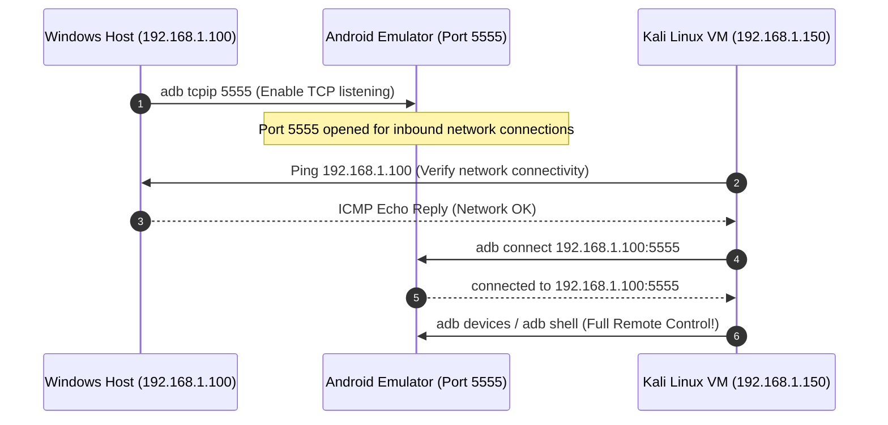

# Kali Linux VM Lab Setup: Mobile Security Toolchain & Cross-VM Bridge

> **Environment Target:** `[KALI LINUX VM]` (VMware Workstation / VirtualBox)  
> **Course Track:** Mobile Security Laboratory Setup | **Difficulty:** Beginner to Intermediate

---

## 1. Operating System Preparation & Package Updates

To maintain a reliable testing environment, update Kali Linux and install the core toolchains required for decompilation, bytecode analysis, traffic proxying, and runtime hooking.

```bash
# [KALI LINUX VM] Update system repositories and packages
sudo apt update && sudo apt upgrade -y

# [KALI LINUX VM] Install essential Android testing utilities
sudo apt install -y adb fastboot openjdk-17-jdk python3 python3-pip python3-venv \
    git curl wget unzip sqlite3 radare2 libxml2-utils
```

Verify that the core Java and ADB runtimes are functional:

```bash
# [KALI LINUX VM] Verify Java runtime (JDK 17 or higher required for JADX & MobSF)
java -version

# [KALI LINUX VM] Verify ADB on Kali
adb version
```

---

## 2. Dedicated Python Virtual Environment (`venv`)

Modern Kali Linux enforces **PEP 668 (externally-managed-environment)**, preventing direct global execution of `pip install` to avoid breaking system-level Python packages. We create a dedicated virtual environment for our mobile security tools (`frida`, `objection`, `mitmproxy`):

```bash
# [KALI LINUX VM] Create directory for mobile tooling
mkdir -p ~/mobile-pentest/tools
cd ~/mobile-pentest/tools

# [KALI LINUX VM] Create Python virtual environment
python3 -m venv mobile-venv

# [KALI LINUX VM] Activate the virtual environment
source mobile-venv/bin/activate
```

Install Frida and Objection inside the active virtual environment:

```bash
# [KALI LINUX VM] Install Frida tools and Objection
pip install --upgrade pip
pip install frida frida-tools objection
```

Verify tool execution:

```bash
# [KALI LINUX VM] Check versions
frida --version
objection version-check
```

### Making the Environment Easily Accessible via Aliases
Add an alias to `~/.bashrc` or `~/.zshrc` so you can drop into your mobile pentesting environment instantly:

```bash
# [KALI LINUX VM] Append activation shortcut to shell profile
echo "alias mobile-env='source ~/mobile-pentest/tools/mobile-venv/bin/activate'" >> ~/.zshrc
echo "alias mobile-env='source ~/mobile-pentest/tools/mobile-venv/bin/activate'" >> ~/.bashrc
```

Whenever you open a new terminal in Kali, simply execute `mobile-env` to activate your testing toolchain.

---

## 3. Installing Static Analysis Tools (JADX & APKTool)

### Step 3.1: Install APKTool
APKTool disassembles Dalvik bytecode into Smali assembly and reconstructs resources and `AndroidManifest.xml` into human-readable plaintext.

```bash
# [KALI LINUX VM] Install APKTool via apt
sudo apt install -y apktool

# Verify version (2.8+ recommended)
apktool --version
```

---

### Step 3.2: Install JADX (Java Decompiler GUI & CLI)
JADX converts `.dex` and `.apk` files directly into human-readable Java source code.

```bash
# [KALI LINUX VM] Install JADX via Kali repositories
sudo apt install -y jadx

# Verify JADX CLI
jadx --version
```

To launch the graphical interface from terminal:
```bash
# [KALI LINUX VM] Launch JADX Graphical Decompiler
jadx-gui &
```

---

## 4. Deploying Mobile Security Framework (MobSF)

MobSF performs automated static analysis, permission audits, manifest reviews, and hardcoded secret detection. Running MobSF via **Docker** isolates dependencies and ensures rapid, reproducible scans.

### Method A: Docker Deployment (Recommended)

1. Ensure Docker is installed and running on Kali:
   ```bash
   # [KALI LINUX VM] Install and start Docker service
   sudo apt install -y docker.io
   sudo systemctl enable --now docker
   sudo usermod -aG docker $USER
   ```
2. Pull and execute the official MobSF container:
   ```bash
   # [KALI LINUX VM] Run MobSF container bound to port 8000
   docker run -it --rm -p 8000:8000 opensecurity/mobsf:latest
   ```
3. Open your browser on Windows or Kali and navigate to:  
   `http://localhost:8000` (inside Kali) or `http://<KALI_IP>:8000` (from Windows).

---

## 5. Establishing the Cross-VM ADB Network Bridge

When the Android emulator runs on your Windows host, connect to it from your Kali VM over the virtual network:



### Execution Steps:
1. Identify your Kali VM's IP address:
   ```bash
   # [KALI LINUX VM] Check network address
   ip -br a
   ```
   *Assume Kali IP is `192.168.1.150` and Windows Host IP is `192.168.1.100`.*

2. Connect Kali’s ADB client to the Windows-hosted emulator:
   ```bash
   # [KALI LINUX VM] Connect over TCP port 5555
   adb connect 192.168.1.100:5555
   ```

*Expected Terminal Output:*
```text
connected to 192.168.1.100:5555
```

3. Verify device connection:
   ```bash
   # [KALI LINUX VM] List connected targets
   adb devices
   ```

*Expected Output:*
```text
List of devices attached
192.168.1.100:5555    device
```

4. Drop into the remote Android shell from your Kali terminal:
   ```bash
   # [KALI LINUX VM] Open Android root shell
   adb -s 192.168.1.100:5555 shell
   ```

You now have direct command-line and filesystem access to the Android target from your Kali Linux workstation.

---

## 6. Shared Folders & File Transfer (Windows ⟷ Kali)

Transferring APKs, decompiled source trees, and captured databases between Windows and Kali is essential during assessments.

### Method A: Native VM Shared Folders (Fastest)
* **VMware Workstation:** Navigate to **VM -> Settings -> Options -> Shared Folders -> Always Enabled**. Add your Windows pentest folder (e.g., `C:\Cyber-Blog\Android_pentest`).  
  Inside Kali, the folder automatically mounts under:  
  `/mnt/hgfs/Android_pentest`
* **VirtualBox:** Navigate to **Devices -> Shared Folders -> Add Folder**. Mounts under:  
  `/media/sf_<folder_name>`

### Method B: Python HTTP Quick-Server (No VM Additions Required)
If shared folders fail, serve files instantly over HTTP:

```powershell
# [WINDOWS HOST] Serve current directory on port 8000
python -m http.server 8000
```

From Kali, download the target file directly using `wget`:
```bash
# [KALI LINUX VM] Download APK from Windows host
wget http://192.168.1.100:8000/diva-beta.apk
```

---

## 7. USB Passthrough for Physical Android Devices

If connecting a physical phone to test native ARM64 binaries:

1. Connect the phone to your Windows PC via USB.
2. In your VM software:
   * **VMware:** Click **VM -> Removable Devices -> Select Your Phone (e.g. Google Pixel / Samsung) -> Connect (Disconnect from host)**.
   * **VirtualBox:** Click **Devices -> USB -> Check your Android device**. Ensure USB 3.0 (xHCI) Controller is selected in VM settings.
3. Verify detection inside Kali Linux:
   ```bash
   # [KALI LINUX VM] Check USB bus enumeration
   lsusb
   ```
   *Verify your device manufacturer appears in the list (e.g. `Google Inc.` or `Samsung Electronics`).*
4. Run `adb devices` in Kali:
   ```bash
   # [KALI LINUX VM] Check ADB enumeration
   adb devices
   # Expected: <SERIAL_NUMBER>   device
   ```

---

## 8. Automated Environment Health Check

To verify your complete Kali Linux toolchain with a single automated diagnostic:

**[KALI LINUX VM]**
```bash
chmod +x ../../scripts/verify-lab-env.sh
../../scripts/verify-lab-env.sh --windows-ip <WINDOWS_HOST_IP>
```
*This checks ADB, Java, Python 3, active virtual environment, Frida CLI, Objection, JADX, APKTool, and Burp Suite port 8080.*

---

## 9. Knowledge Check Questions

### Question 1
**Why does modern Kali Linux (Debian 12+) require a Python virtual environment (`venv`) to install Frida and Objection?**
* A) Debian 12 disables Python permanently.
* B) PEP 668 marks the global Python installation as `externally-managed` to prevent `pip` from corrupting apt-managed system packages.
* C) Frida and Objection only compile inside Docker containers.
* D) Root privileges cannot run pip commands.

<details>
<summary>View Answer & Explanation</summary>

**Correct Answer: B**  
**Explanation:** Under PEP 668, running `pip install` globally throws an error. Security tools must be installed inside an isolated virtual environment (`python3 -m venv mobile-venv`) to avoid breaking system dependencies.
</details>

---

### Question 2
**Which VM network adapter mode allows the Kali VM to connect directly to the Windows host's ADB port 5555 without complex port forwarding?**
* A) Host-Only or Bridged Network Adapter.
* B) NAT Network with no port forwarding.
* C) Internal Network with no gateway.
* D) Air-gapped / Isolated Mode.

<details>
<summary>View Answer & Explanation</summary>

**Correct Answer: A**  
**Explanation:** In Bridged mode, Kali obtains an IP on your home router's LAN. In Host-Only mode, Windows and Kali share a dedicated private subnet (`VMnet1` / `vboxnet0`). Both modes allow direct TCP communication between Kali and the Windows host IP.
</details>

---

### Question 3
**How do you connect the Kali Linux ADB client to an emulator running on the Windows host?**
* A) `adb bridge-start`
* B) `adb connect <WINDOWS_HOST_IP>:5555`
* C) `adb forward tcp:5555`
* D) `adb attach win-emulator`

<details>
<summary>View Answer & Explanation</summary>

**Correct Answer: B**  
**Explanation:** The command `adb connect <IP>:5555` instructs the local ADB client in Kali to open a TCP debugging session with the ADB daemon running on the remote Windows machine.
</details>

---

## 🔗 Quick Navigation

* 🏠 [Master Course Portal](../../README.md)
* 🪟 [Windows Host Setup Guide](./WINDOWS_HOST_SETUP.md)
* 📐 [Cross-Platform Architecture](./CROSS_PLATFORM_LAB_ARCHITECTURE.md)
* 📖 [Command Reference](../reference/CROSS_PLATFORM_COMMAND_REFERENCE.md)

