<div align="center">

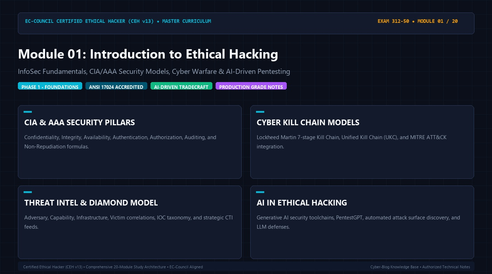

# 🛡️ CEH v13 — Module 01: Introduction to Ethical Hacking
### Certified Ethical Hacker (CEH) Exam Notes • Information Security Fundamentals • Attack Methodologies • Cyber Kill Chains • CTI & AI

[-0078D4?style=for-the-badge&logo=shield)](https://www.eccouncil.org/programs/certified-ethical-hacker-ceh/)
[](https://www.eccouncil.org/)
[](../README.md)
[](./README.md)

<p align="center">
  <b>Authoritative, exam-oriented study guide and reference architecture for CEH v13 Module 01: Introduction to Ethical Hacking. Covers InfoSec principles, CIA/AAA models, threat taxonomy, warfare, adversary profiling, kill chains, risk management, threat intelligence, and AI-assisted security engineering.</b>
</p>

[📖 Module Hub](../README.md) • [📋 PDF Reference](./CEHv13%20-%20Module%2001%20-%20Introduction%20to%20Ethical%20Hacking.pdf) • [🗺️ Knowledge Base Index](../../README.md)

</div>

---

## 📋 Table of Contents

- [1. Introduction to Ethical Hacking](#1-introduction-to-ethical-hacking)
  - [Core Objective](#core-objective)
  - [The Ethical Hacking Process Flow](#the-ethical-hacking-process-flow)
  - [Legal & Operational Boundaries](#legal--operational-boundaries)
- [1.1 Information Security (InfoSec)](#11-information-security-infosec)
  - [Forms of Information](#forms-of-information)
  - [Data vs. Information](#data-vs-information)
- [1.2 The Security Pillars: CIA Triad, AAA Model & Attack Dynamics](#12-the-security-pillars-cia-triad-aaa-model--attack-dynamics)
  - [The CIA Triad](#the-cia-triad)
  - [The AAA Security Model](#the-aaa-security-model)
  - [Non-Repudiation](#non-repudiation)
  - [The Comprehensive Attack Formula](#the-comprehensive-attack-formula)
- [1.3 Classification of Cyber Attacks](#13-classification-of-cyber-attacks)
- [1.4 Information Warfare (IW)](#14-information-warfare-iw)
  - [Defensive Information Warfare Pipeline](#defensive-information-warfare-pipeline)
  - [Offensive Information Warfare Domains](#offensive-information-warfare-domains)
- [1.5 Hacker Profiling & Security Team Taxonomy](#15-hacker-profiling--security-team-taxonomy)
  - [Hacker Classification (Hat Colors)](#hacker-classification-hat-colors)
  - [Security Team Operational Roles](#security-team-operational-roles)
- [1.6 The Professional Ethical Hacking Mandate](#16-the-professional-ethical-hacking-mandate)
- [1.7 The AI-Powered Ethical Hacker](#17-the-ai-powered-ethical-hacker)
- [1.8 AI-Driven GPT Security Toolchains](#18-ai-driven-gpt-security-toolchains)
- [1.9 Attack Frameworks: Kill Chains & Cybersecurity Lifecycle](#19-attack-frameworks-kill-chains--cybersecurity-lifecycle)
  - [Lockheed Martin Cyber Kill Chain®](#lockheed-martin-cyber-kill-chain)
  - [The Unified Kill Chain (UKC)](#the-unified-kill-chain-ukc)
  - [Cybersecurity Lifecycle (NIST Aligned)](#cybersecurity-lifecycle-nist-aligned)
- [1.10 The Diamond Model of Intrusion Analysis](#110-the-diamond-model-of-intrusion-analysis)
- [1.11 Security Assurance: Protect, Detect, Respond, Predict](#111-security-assurance-protect-detect-respond-predict)
- [1.12 Defense-in-Depth: Security Layers Architecture](#112-defense-in-depth-security-layers-architecture)
- [1.13 Risk Fundamentals: Threats, Vulnerabilities & Scoring](#113-risk-fundamentals-threats-vulnerabilities--scoring)
  - [The Core Risk Formula](#the-core-risk-formula)
  - [CVE vs. CVSS: Identification vs. Scoring](#cve-vs-cvss-identification-vs-scoring)
- [1.14 Enterprise Risk Management Lifecycle](#114-enterprise-risk-management-lifecycle)
- [1.15 Cyber Threat Intelligence (CTI)](#115-cyber-threat-intelligence-cti)
  - [The Threat Intelligence Lifecycle](#the-threat-intelligence-lifecycle)
- [1.16 Artificial Intelligence & Machine Learning in Cybersecurity](#116-artificial-intelligence--machine-learning-in-cybersecurity)
- [🧠 Master CEH Mental Model](#-master-ceh-mental-model)
- [🎯 High-Value CEH Exam Distinctions to Memorize](#-high-value-ceh-exam-distinctions-to-memorize)

---

# 1. Introduction to Ethical Hacking

**Ethical hacking** is the authorized, structured practice of identifying, validating, exploiting, and documenting security weaknesses across systems, networks, applications, IoT/OT devices, and human personnel within an organization.

## Core Objective

The true mission of an ethical hacker extends far beyond achieving code execution or obtaining a root shell. It provides structured adversarial visibility to answer four fundamental business and operational questions:

$$\text{What can be attacked?} \longrightarrow \text{How can it be attacked?} \longrightarrow \text{What impact will it cause?} \longrightarrow \text{How can it be prevented?}$$

## The Ethical Hacking Process Flow

A standard, repeatable ethical hacking engagement adheres to an 8-stage operational methodology:


| Phase | Operational Focus | Primary Deliverables / Actions |
|---|---|---|
| **1. Reconnaissance** | Passive & active footprinting | Domain records, OSINT, IP ranges, personnel profiles, technology stack |
| **2. Scanning** | Network & port discovery | Live host detection (ICMP/ARP), open TCP/UDP ports, service banner grabs |
| **3. Enumeration** | Direct interrogation | Usernames, shares (SMB), DNS zone transfers, SNMP trees, RPC endpoints |
| **4. Vulnerability Analysis** | Flaw discovery & classification | Automated scanners (Nessus/Qualys), CVE matching, misconfiguration triage |
| **5. Exploitation** | Controlled weaponization | Proof-of-concept (PoC) execution, bypassing auth, executing payloads |
| **6. Post-Exploitation** | Value & privilege assessment | Privilege escalation, credential dumping, lateral movement, data discovery |
| **7. Reporting** | Executive & technical documentation | Finding severity, reproduction steps, evidence artifacts, risk scoring |
| **8. Remediation** | Defense validation & retesting | Patching guidance, architectural fixes, verification scanning |

## Legal & Operational Boundaries

> [!IMPORTANT]
> The single decisive factor that distinguishes ethical hacking from cybercrime is **explicit, written authorization**.

Ethical hacking must strictly operate within four non-negotiable boundaries:
1. **Scope:** Defined target assets (IPs, CIDRs, domains, APIs). Any action against out-of-scope targets is illegal.
2. **Written Authorization:** Signed Letter of Attestation / Permission to Test before issuing any packets.
3. **Rules of Engagement (RoE):** Defined testing windows, forbidden techniques (e.g., destructive DoS), and communication chains of command for reporting critical zero-days.
4. **Legal Frameworks:** Compliance with regional and international cyber statutes (e.g., CFAA 18 U.S.C. § 1030 in the US, UK Computer Misuse Act 1990, GDPR Article 32, Indian IT Act 2000).

---

# 1.1 Information Security (InfoSec)

**Information Security (InfoSec)** is the universal discipline of protecting information and information systems from unauthorized access, use, disclosure, disruption, modification, inspection, recording, or destruction.

## Forms of Information

Information exists in three distinct states across enterprise ecosystems:

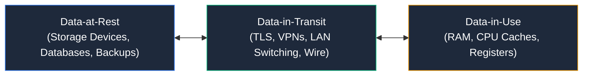

* **Digital Files:** File systems, cloud storage (AWS S3, Azure Blob, GCS).
* **Databases:** Relational (PostgreSQL, Oracle) and NoSQL (MongoDB, Redis) datastores.
* **Communications:** Emails, instant messages, video conferences, VoIP streams.
* **Credentials:** Cleartext/hashed passwords, private SSH keys, Kerberos tickets, API tokens.
* **System Telemetry:** Operating system logs, SIEM indices, firewall audit trails.
* **Source Code & IP:** Git repositories, proprietary algorithms, trade secrets, patents.
* **Personal & Financial Data:** PII (Personally Identifiable Information), PHI (Protected Health Information), PCI DSS cardholder records.

## Data vs. Information

* **Data:** Unorganized, raw facts, numbers, or symbols lacking contextual meaning.
* **Information:** Processed, structured, and contextualized data that provides utility, meaning, and actionable insight.

```text
[Raw Data]
User: admin | Salt: 8f9a2e | Hash: e3b0c44298fc1c149afbf4c8996fb924 | IP: 192.168.1.10:443

                                  │
                          (Context & Analysis)
                                  ▼

[Information]
"Privileged administrative account 'admin' logged into the internal core firewall from
 internal management subnet workstation 192.168.1.10 over an encrypted TLS 1.3 session."
```

---

# 1.2 The Security Pillars: CIA Triad, AAA Model & Attack Dynamics

## The CIA Triad

The **CIA Triad** is the foundational bedrock of all information security governance and offensive/defensive tradecraft.

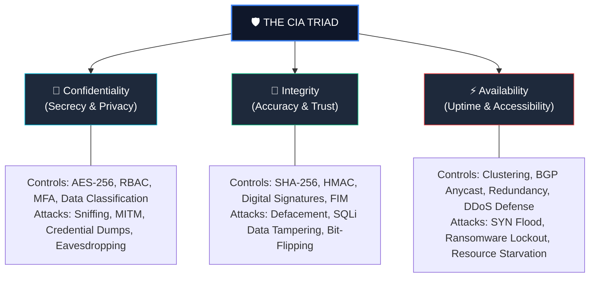

### 1. Confidentiality
Ensures information is disclosed solely to authorized individuals, entities, or processes.
* **Primary Controls:** Symmetric/Asymmetric encryption, Access Control Lists (ACLs), multi-factor authentication, physical isolation, least privilege.
* **Attacks Violating Confidentiality:** Network sniffing, privilege escalation, memory scraping, sensitive data exposure, unauthorized database dumps.

### 2. Integrity
Guarantees information remains strictly accurate, unaltered, authentic, and complete throughout its entire lifecycle.
* **Primary Controls:** Cryptographic hashing (SHA-2, SHA-3), Message Authentication Codes (HMAC), digital signatures, File Integrity Monitoring (FIM), database constraints.
* **Attacks Violating Integrity:** Website defacement, payload injection into transit packets (MITM), database parameter tampering, unauthorized file modification by rootkits.

### 3. Availability
Ensures authorized entities obtain uninterrupted, dependable access to critical information and computing resources whenever requested.
* **Primary Controls:** Redundant power supplies (UPS), server clustering, load balancers, geographic failover, automated data backups, high-capacity anti-DDoS scrubbing.
* **Attacks Violating Availability:** Denial-of-Service (DoS), Distributed DoS (DDoS), ransomware encryption of hypervisors, server room heating disruption, physical destruction of storage media.

---

## The AAA Security Model

> [!NOTE]
> **Exam Tip:** CEH distinguishes heavily between the **CIA Triad** (the attributes of secured data) and the **AAA Model** (the transactional identity and access control workflow).

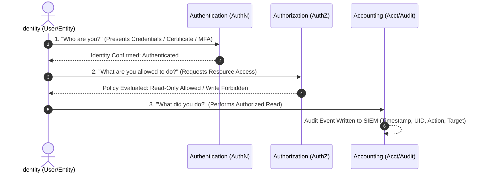

1. **Authentication (AuthN) — "Who are you?":** Verification of a claimed identity.
   * *Mechanisms:* Passwords, FIDO2 WebAuthn tokens, biometric fingerprints, smart cards (CAC), X.509 PKI certificates.
2. **Authorization (AuthZ) — "What can you do?":** Granting access rights based on proven identity and policy.
   * *Mechanisms:* Role-Based Access Control (RBAC), Attribute-Based Access Control (ABAC), Mandatory Access Control (MAC), Discretionary Access Control (DAC).
3. **Accounting / Auditing — "What did you do?":** Measuring and logging resource consumption and user actions.
   * *Mechanisms:* Syslog, Windows Security Event Logs (EID 4624/4625), SIEM telemetry, proxy logs, non-repudiable audit trails.

---

## Non-Repudiation

**Non-repudiation** provides undeniable cryptographic proof of the integrity and origin of data, ensuring that an individual or system cannot credibly deny having originated, received, or authorized a specific transaction.

```
[ Alice (Sender) ] ──(Private Key Signing)──► [ Document + Digital Signature ] ──► [ Bob (Verifier) ]
                                                                                           │
                                                                                 (Verifies with Alice's Public Key)
                                                                                           │
                                                                                           ▼
                                                                           "Alice undeniably signed this document."
```

* **Core Mechanisms:** Asymmetric cryptography (Public Key Infrastructure), cryptographic timestamping authorities (RFC 3161), immutable write-once-read-many (WORM) storage, verified blockchain ledgers.
* **Real-World Impact:** E-commerce transactions, contract signing, non-repudiable admin command auditing.

---

## The Comprehensive Attack Formula

In professional adversary emulation and CEH threat analysis, an attack is formalized as:

$$\mathbf{Attack} = \mathbf{Goal} + \mathbf{TTP} + \mathbf{Vulnerability} + \mathbf{Opportunity}$$

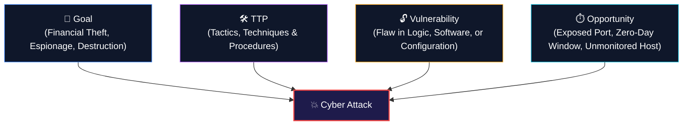

* **Goal (Objective):** What the adversary desires (e.g., steal proprietary CAD blueprints, deploy ransomware, establish long-term espionage persistence).
* **TTPs (Tactics, Techniques, and Procedures):** The behavioral pattern of the adversary:
  * *Tactic:* High-level objective (e.g., Credential Access - MITRE TA0006).
  * *Technique:* Specific method used (e.g., Password Spraying - MITRE T1110.003).
  * *Procedure:* Exact execution syntax, custom scripts, or payloads used by the actor.
* **Vulnerability (Weakness):** The specific design, implementation, or human error that can be exploited (e.g., CVE-2024-6387 OpenSSH RCE, weak AD password policy).
* **Opportunity:** The tactical environment facilitating exploitation (e.g., public internet exposure without MFA, weekend unmonitored maintenance windows).

---

# 1.3 Classification of Cyber Attacks

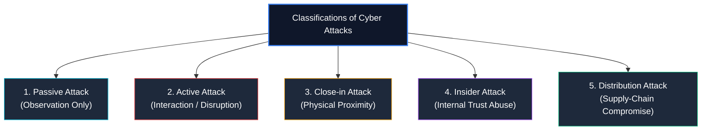

### 1. Passive Attack
* **Definition:** The adversary observes, monitors, and collects data without modifying or directly injecting packets into the target system.
* **Primary Threat:** Violates **Confidentiality**.
* **Tactics:** Sniffing cleartext traffic (Wireshark), passive OSINT, RF eavesdropping, DNS query harvesting.
* **Defensive Challenge:** Virtually impossible to detect directly on target hosts because system state remains unaltered.

### 2. Active Attack
* **Definition:** The adversary interacts with, injects into, alters, or disrupts the target system, communications, or operations.
* **Primary Threat:** Violates **Integrity** and **Availability** (and often Confidentiality).
* **Tactics:** Exploitation of web servers, DoS/DDoS attacks, session hijacking, malware execution, lateral movement, man-in-the-middle packet modification.

### 3. Close-in Attack
* **Definition:** The attacker attains physical or direct wireless proximity to organizational facilities or personnel to circumvent network perimeter controls.
* **Tactics:** Dumpster diving, shoulder surfing, rogue wireless access points (Evil Twin), physical plant infiltration, covert USB keystroke loggers (Rubber Ducky).

### 4. Insider Attack
* **Definition:** An attack initiated by an employee, contractor, or partner holding legitimate credentials and network access.
* **Sub-Classifications:**
  * **Malicious Insider:** Intentionally sabotages systems, steals IP, or extorts the company for financial gain or revenge.
  * **Negligent Insider:** Accidentally exposes data through misconfigurations, falls for phishing emails, or bypasses security policies for convenience.
  * **Compromised Insider:** An innocent employee whose identity or endpoint has been co-opted by an external advanced persistent threat (APT).

### 5. Distribution (Supply Chain) Attack
* **Definition:** The attacker tampers with software, firmware, hardware, or third-party packages **before** delivery to the target organization.
* **Real-World Archetypes:** SolarWinds Orion supply chain trojan (SUNBURST), malicious npm/PyPI dependency poisoning, backdoored hardware network switches.

---

# 1.4 Information Warfare (IW)

**Information Warfare (IW)** encompasses the coordinated use of information, communication technologies, and cyberspace to influence, manipulate, degrade, disrupt, or destroy an adversary's capabilities while defending friendly systems and decision-making.

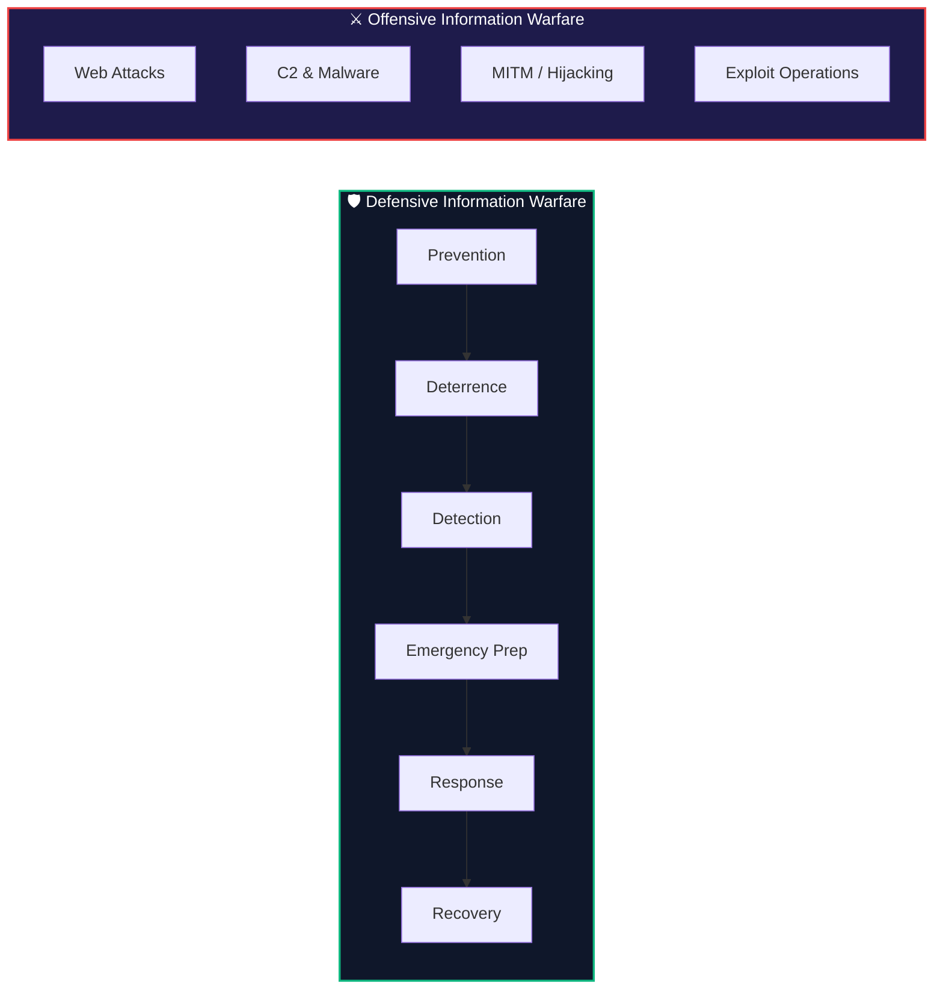

## Defensive Information Warfare Pipeline

Defensive IW provides continuous assurance against information disruption through six structured stages:

1. **Prevention:** Hardening defenses before an assault (firewalls, least privilege, zero-trust network segmentation, MFA, vulnerability patching).
2. **Deterrence:** Elevating adversary cost and attribution certainty (legal penalties, active defense honeypots, public threat attribution).
3. **Detection:** Real-time identification of anomalous signals (SIEM correlation, EDR behavior monitoring, NDR heuristics, YARA memory scans).
4. **Emergency Preparedness:** Operational readiness to survive catastrophe (immutable backups, CSIRT playbooks, tabletop simulation exercises).
5. **Response:** Coordinated incident containment, eradication, and evidence preservation following established incident response workflows.
6. **Recovery:** Restoring systems to clean operational baselines, rotating keys, and integrating post-incident lessons learned into defenses.

## Offensive Information Warfare Domains

Conducted in authorized military/intelligence cyber commands or simulated by Red Teams:
* **Web Operations:** Targeted defacement, distributed application outages, injection attacks.
* **Infrastructure Disruption:** Malware deployments, wiper payloads, industrial control system (SCADA/ICS) manipulation.
* **Communication Degradation:** Man-in-the-middle interception, BGP route hijacking, satellite telemetry spoofing.

---

# 1.5 Hacker Profiling & Security Team Taxonomy

## Hacker Classification (Hat Colors)

| Hacker Profile | Legal Status | Core Intent / Objective | Typical Targets & Methodologies |
|---|:---:|---|---|
| **White Hat** | Fully Authorized | Discover and remediate vulnerabilities within legal scope | Penetration testing, vulnerability research, red teaming, security audits |
| **Black Hat** | Unauthorized / Illegal | Personal profit, extortion, espionage, destruction | Malware development, zero-day exploitation, ransomware, data theft |
| **Gray Hat** | Unauthorized | Discovers bugs without permission, often demands reward or discloses publicly | Internet-wide scanning, uninvited bug bounties; operates outside legal authorization |
| **Script Kiddie** | Unauthorized | Notoriety, trolling, superficial disruption | Relies on pre-compiled point-and-click exploits without understanding underlying code |
| **State-Sponsored** | Nation-State Backed | Geopolitical advantage, national intelligence, cyber warfare | Advanced Persistent Threats (APTs), custom zero-days, highly resilient C2 |
| **Hacktivist** | Unauthorized | Promote political, ideological, or social agendas | Website defacement, DDoS, leaking controversial emails (e.g., Anonymous) |
| **Cyber Terrorist** | Illegal / Terrorist | Cause widespread panic, physical destruction, or loss of life | Targeting critical infrastructure: energy grids, water treatment, hospitals |
| **Corporate Spy** | Unauthorized | Steal commercial trade secrets and market intelligence | Insider theft, targeted spearphishing, intellectual property exfiltration |

> [!WARNING]
> **Exam Warning:** EC-Council tests the nuance of **Gray Hat** hackers frequently. Regardless of whether a researcher's motives are "benign" or "helpful", scanning or testing a target without explicit prior written authorization is **illegal** under law.

## Security Team Operational Roles

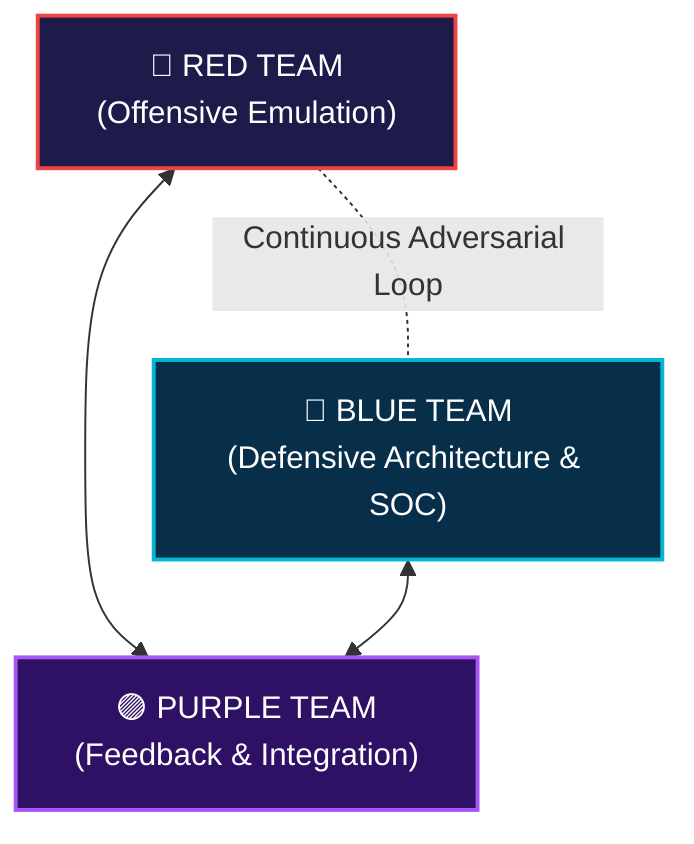

* **Blue Team (Defense):** Focuses on continuous monitoring, SIEM detection rules, EDR sensor management, incident triage, threat hunting, and infrastructure hardening.
* **Red Team (Offense):** Emulates realistic adversary behaviors (TTPs), stress-tests defensive sensors, validates assumed-breach scenarios, and demonstrates tangible business impact.
* **Purple Team (Collaboration):** The operational bridge ensuring Red and Blue teams maximize efficiency. Rather than working in silos, Purple exercises execute atomic attacks while tuning defensive SIEM/EDR detection rules in real time.
* **Green Hat:** A novice or aspiring security practitioner dedicated to learning ethical hacking, defensive engineering, and security tools.

---

# 1.6 The Professional Ethical Hacking Mandate

Ethical hacking is **authorized security testing** designed to uncover vulnerabilities before malicious actors exploit them.

### The 7 Core Responsibilities of an Ethical Hacker:
1. **Discover:** Uncover hidden attack vectors and software/configuration flaws.
2. **Validate:** Confirm vulnerabilities to eliminate false positives.
3. **Quantify Impact:** Demonstrate real-world business risks (e.g., data theft, service failure).
4. **Map Attack Chains:** Identify lateral movement paths leading to crown jewels.
5. **Preserve Evidence:** Maintain strict, tamper-proof audit trails and logs during testing.
6. **Remediate:** Deliver actionable, developer-friendly defensive recommendations.
7. **Verify:** Perform post-remediation retesting to ensure patches completely resolve the issue.

### The Fundamental Differentiator:
$$\text{Ethical Hacking} \iff \mathbf{Scope} + \mathbf{Written\ Authorization} + \mathbf{Rules\ of\ Engagement}$$

---

# 1.7 The AI-Powered Ethical Hacker

In modern cybersecurity operations (CEH v13), Artificial Intelligence functions as an indispensable **force multiplier** rather than an autonomous decision-maker.

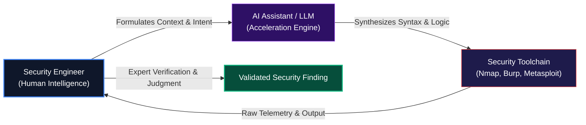

### High-Efficiency AI Security Applications
* **Reconnaissance Aggregation:** Correlating OSINT data and identifying relationships across massive threat feeds.
* **Telemetry & Log Analysis:** Parsing gigabytes of web server logs, auth events, and NetFlow streams for anomalous patterns.
* **Static Code Review:** Spotting insecure deserialization, SQL injection, and cryptographic missteps in application code.
* **Detection Engineering:** Accelerating creation of Sigma, YARA, and Snort detection rules from raw exploit PoCs.
* **Automated Threat Modeling:** Parsing architecture documents to pinpoint trust boundary violations and potential attack paths.

> [!CAUTION]
> **The Hallucination Hazard:** A security professional must **never** accept AI-generated output as authoritative without human verification. Always validate exploit syntax, CVSS assertions, and remediation scripts in a sandboxed environment before applying them to production systems.

---

# 1.8 AI-Driven GPT Security Toolchains

While Large Language Models (LLMs) provide advanced reasoning, they do **not** execute raw network operations independently. They act as **orchestrators** and **interpreters** driving proven security utilities:

```
[ LLM Orchestration Layer (PentestGPT, HackerGPT, SGPT) ]
                             │
            (Generates commands, parses responses)
                             │
                             ▼
[ Native Technical Tooling (Execution & Probing) ]
  ├── Network Discovery:    Nmap, Masscan, Wireshark, Zeek
  ├── Web Application:      Burp Suite, OWASP ZAP, Gobuster, Nuclei, SQLMap
  ├── Exploitation & AD:    Metasploit Framework, BloodHound, Impacket
  └── Source Code Analysis: Semgrep, CodeQL, SonarQube
```

| Security GPT / Assistant | Primary Operational Use Case |
|---|---|
| **PentestGPT** | Guides structured penetration testing steps through an interactive reasoning loop. |
| **HackerGPT** | Modular offensive security assistant utilizing curated security prompts and CVE databases. |
| **ShellGPT (`sgpt`)** | Translates natural language queries directly into validated terminal commands on Linux/macOS. |
| **Bug Hunter GPT** | Scans web application response snippets to generate targeted burp test payloads and bug bounty triage notes. |

---

# 1.9 Attack Frameworks: Kill Chains & Cybersecurity Lifecycle

## Lockheed Martin Cyber Kill Chain®

The Cyber Kill Chain models the sequential stages of an external attack on an enterprise perimeter:


1. **Reconnaissance:** Harvesting email addresses, public IPs, and exposed tech stacks.
2. **Weaponization:** Coupling an exploit with a backdoor into an executable payload (e.g., infected PDF).
3. **Delivery:** Transmitting the payload to the victim (phishing email, USB drop, watering-hole web attack).
4. **Exploitation:** Triggering vulnerability execution (e.g., buffer overflow, macro activation).
5. **Installation:** Establishing persistence on the host (registry run keys, services, webshells).
6. **Command & Control (C2):** Establishing an encrypted covert communication channel back to the attacker.
7. **Actions on Objectives:** Fulfilling the mission (data exfiltration, encryption, credential extraction).

> [!TIP]
> **Defensive Value:** The Cyber Kill Chain proves that defenders hold an asymmetric advantage: **breaking any single link in the chain halts the attack entirely.**

## The Unified Kill Chain (UKC)

Developed by Paul Pols, the **Unified Kill Chain** unifies Lockheed Martin's model with MITRE ATT&CK into an 18-stage framework structured across three core phases:

```
[ Phase 1: Infiltration ] ──► [ Phase 2: Propagation ] ──► [ Phase 3: Action ]
 (Initial Footprint)           (Lateral Pivot & Pivoting)   (Mission Fulfillment)
```

## Cybersecurity Lifecycle (NIST Aligned)

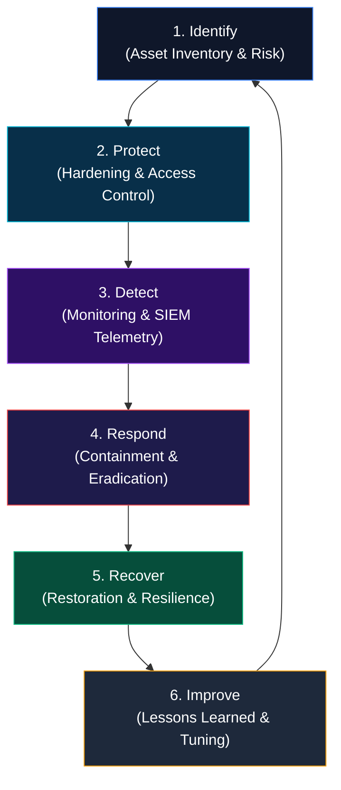

---

# 1.10 The Diamond Model of Intrusion Analysis

The **Diamond Model** establishes relationships between four core nodes of every intrusion event:

```
                     [ ADVERSARY ]
                 (Threat Actor / Group)
                          /\
                         /  \
                        /    \
                       /      \
      [ CAPABILITY ] ──────────── [ INFRASTRUCTURE ]
   (Exploits, Malware, TTPs)     (C2 Servers, IPs, Domains)
                       \      /
                        \    /
                         \  /
                          \/
                      [ VICTIM ]
                 (Target Host, User, Org)
```

1. **Adversary:** The threat actor driving the campaign (e.g., APT29, FIN7).
2. **Capability:** The tools, payloads, and software techniques employed (e.g., Cobalt Strike, Mimikatz).
3. **Infrastructure:** The physical or virtual command nodes used to deliver and control attacks (e.g., compromised VPS, fast-flux DNS, bulletproof hosting).
4. **Victim:** The target organization, employee, domain, or networked computing device.

*Meta-Features:* Every Diamond Model event incorporates **Timestamp, Phase, Result, Direction,** and **Trust Environment**.

---

# 1.11 Security Assurance: Protect, Detect, Respond, Predict

A robust security posture operates as an integrated, continuous assurance loop:

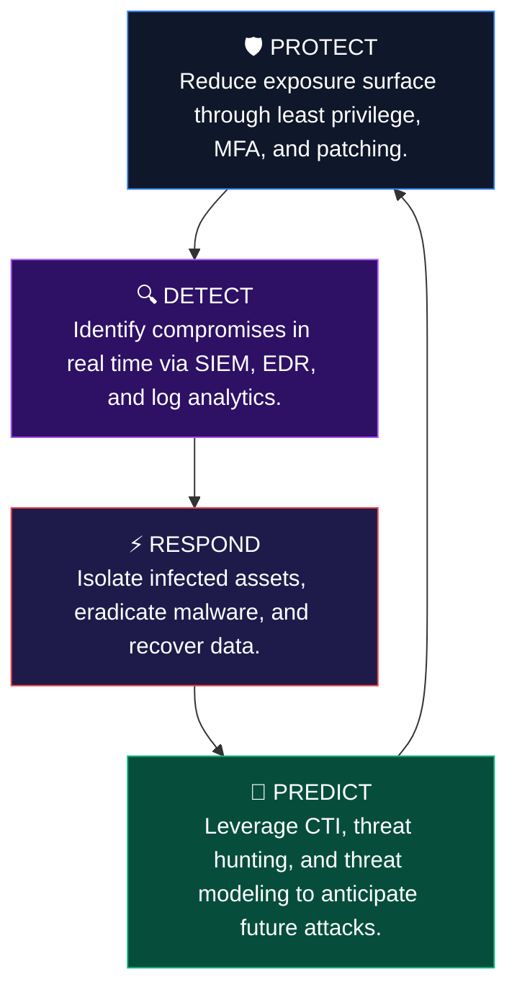

---

# 1.12 Defense-in-Depth: Security Layers Architecture

Defense-in-depth enforces security through layered, redundant defensive mechanisms across the enterprise:

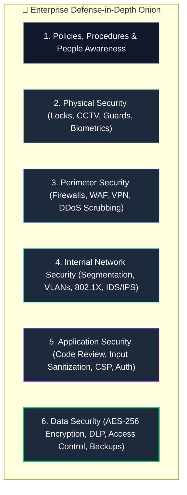

> [!NOTE]
> **The Zero Trust Principle:** Modern security no longer assumes internal networks are safe. **Zero Trust Architecture (ZTA)** enforces: *"Never Trust, Always Verify"* across all layers.

---

# 1.13 Risk Fundamentals: Threats, Vulnerabilities & Scoring

## The Core Risk Formula

$$\mathbf{Risk} = \mathbf{Threat} \times \mathbf{Vulnerability} \times \mathbf{Impact}$$

* **Threat:** A potential external or internal circumstance or event capable of causing harm (e.g., an active ransomware syndicate, an earthquake).
* **Vulnerability:** A weakness or flaw in software, hardware, procedure, or design that can be exploited by a threat (e.g., unpatched Apache Struts).
* **Impact (Consequence):** The magnitude of business, financial, legal, or operational damage realized if the vulnerability is successfully exploited.

## CVE vs. CVSS: Identification vs. Scoring

> [!IMPORTANT]
> **Core Exam Rule:**  
> **CVE** answers: *"What specific vulnerability is this?"*  
> **CVSS** answers: *"How technically severe is this vulnerability?"*

### 1. Common Vulnerabilities and Exposures (CVE)
Managed by MITRE and the National Vulnerability Database (NVD). Provides a standardized identifier:
$$\text{Format: } \mathbf{CVE\text{-}YYYY\text{-}NNNNN} \quad (\text{e.g., CVE-2021-44228 Log4Shell})$$

### 2. Common Vulnerability Scoring System (CVSS)
Maintained by FIRST, CVSS scores vulnerabilities from `0.0` to `10.0` based on **Base**, **Temporal**, and **Environmental** metrics:

| CVSS v3.1 / v4.0 Score | Severity Rating | Typical SLA / Response Strategy |
|:---:|:---:|---|
| **0.0** | None | No vulnerability or informational finding |
| **0.1 – 3.9** | **Low** | Routine patching cycle (30–90 days) |
| **4.0 – 6.9** | **Medium** | Scheduled remediation sprint (14–30 days) |
| **7.0 – 8.9** | **High** | Prioritized urgent patching (7–14 days) |
| **9.0 – 10.0** | **Critical** | Immediate emergency response (24–48 hours) |

---

# 1.14 Enterprise Risk Management Lifecycle

Risk management is a continuous governance cycle that balances security controls against business objectives:

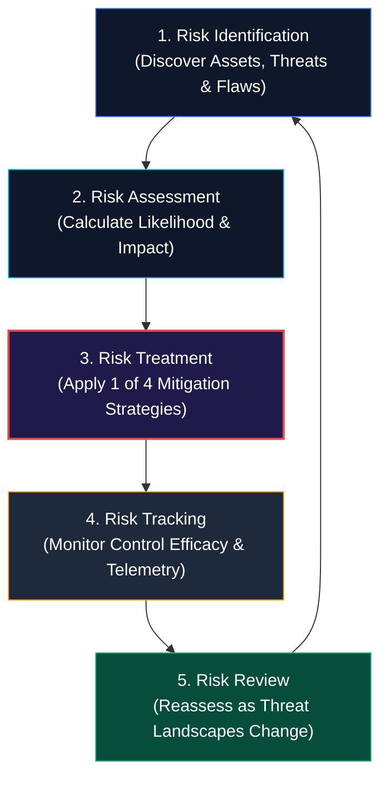

### The 4 Pillars of Risk Treatment:
1. **Avoid (Avoidance):** Terminate the risky activity entirely (e.g., decommissioning an insecure, unpatchable legacy server).
2. **Mitigate (Reduction):** Deploy technical or procedural controls to reduce likelihood or impact (e.g., implementing MFA, network segmentation).
3. **Transfer (Transference):** Shift financial liability to a third party (e.g., purchasing cyber insurance policies, outsourcing hosting to compliant cloud providers).
4. **Accept (Acceptance):** Formally acknowledge and accept the risk when the cost of mitigation exceeds the potential loss, provided it falls within organizational risk tolerance.

---

# 1.15 Cyber Threat Intelligence (CTI)

**Cyber Threat Intelligence (CTI)** is evidence-based security knowledge—including context, mechanisms, indicators, and actionable implications—regarding existing or emerging hazards to assets.

$$\text{Raw Telemetry} \longrightarrow \text{Information} \longrightarrow \mathbf{Analyzed\ Intelligence} \longrightarrow \mathbf{Informed\ Strategic\ Decision}$$

## The Threat Intelligence Lifecycle

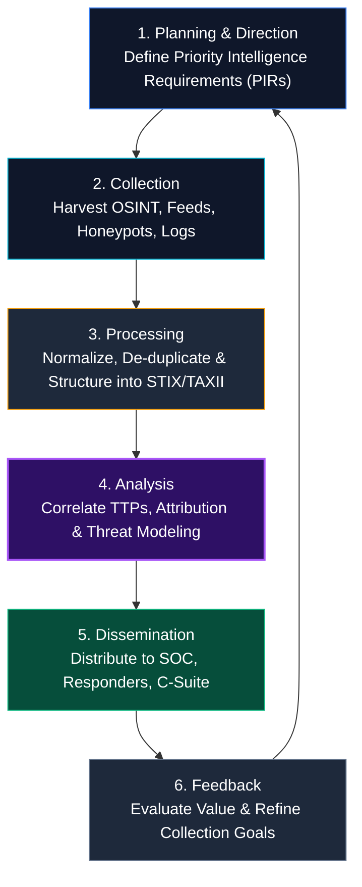

### The Three Tiers of Threat Intelligence:
* **Strategic Intelligence:** High-level trends, financial impact, and geopolitical motivations intended for CISOs and board members.
* **Operational Intelligence:** Details regarding specific campaigns, actor TTPs, and impending attacks intended for incident responders and threat hunters.
* **Tactical Intelligence:** Technical machine-readable indicators of compromise (IOCs)—IPs, file hashes, domains—ingested directly by firewalls and SIEMs.

---

# 1.16 Artificial Intelligence & Machine Learning in Cybersecurity

AI and ML algorithms process telemetry at machine speeds, enabling proactive detection of unknown variants and stealthy attacks:

| ML Application Domain | Mechanism & Behavioral Focus | Defensive Advantage |
|---|---|---|
| **Anomaly Detection** | Establishes mathematical baselines of normal behavior; alerts on standard deviation outliers | Detects zero-day attacks and unauthorized credential usage without existing signatures |
| **User & Entity Behavior Analytics (UEBA)** | Tracks entity actions (login hours, geographic coordinates, access volume) | Flags compromised internal accounts and insider threat exfiltration |
| **Malware Family Classification** | Vectorizes PE byte-sequences, opcode frequencies, and entropy | Detects polymorphic and metamorphic malware payloads |
| **Phishing & NLP Detection** | Evaluates semantic tone, urgency markers, brand lookalikes, and sender header authenticity | Blocks novel social engineering emails before reaching the inbox |
| **Automated SOAR Triage** | Natural language summarization and risk scoring of raw SIEM alerts | Reduces alert fatigue for Tier 1 SOC analysts by 60–80% |

---

# 🧠 Master CEH Mental Model

Connect all Module 01 concepts into a unified operational worldview:

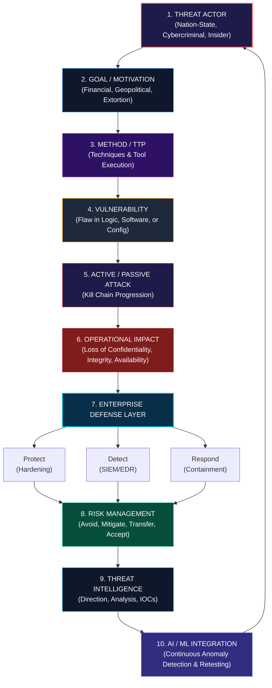

---

# 🎯 High-Value CEH Exam Distinctions to Memorize

| Concept Pair / Term | Key Exam Takeaway |
|---|---|
| **CIA Triad** | **Confidentiality** (secrecy), **Integrity** (trust/accuracy), **Availability** (uptime). |
| **AAA Model** | **Authentication** (identity proof), **Authorization** (permissions), **Accounting** (audit logging). |
| **Non-Repudiation** | Proves transaction origin using digital signatures and PKI so sender cannot deny the action. |
| **CVE vs. CVSS** | **CVE** assigns a unique ID to a vulnerability; **CVSS** calculates its severity score (0.0–10.0). |
| **Threat vs. Vulnerability vs. Risk** | **Threat** is the danger agent; **Vulnerability** is the flaw; **Risk** is the calculated likelihood $\times$ impact. |
| **TTP** | **Tactics** (what), **Techniques** (how), **Procedures** (specific operational execution steps). |
| **Diamond Model** | Models intrusions across 4 vertices: **Adversary**, **Capability**, **Infrastructure**, **Victim**. |
| **Passive vs. Active Attacks** | **Passive** only monitors/observes (violates Confidentiality); **Active** alters/disrupts data or flows. |
| **White vs. Black vs. Gray Hat** | **White** is authorized; **Black** is malicious/unauthorized; **Gray** tests without permission (still illegal!). |
| **Script Kiddie** | Inexperienced actor using automated scripts without low-level conceptual comprehension. |
| **Cyber Kill Chain** | 7-stage Lockheed Martin model; defenders stop an attack by disrupting **any single link**. |
| **Risk Treatments** | **Avoid** (cancel), **Mitigate** (reduce), **Transfer** (insure/outsource), **Accept** (retain within tolerance). |
| **CTI Flow** | Data $\longrightarrow$ Information $\longrightarrow$ Intelligence $\longrightarrow$ Actionable Decision. |
| **Zero Trust** | Replaces perimeter trust; enforces *"Never Trust, Always Verify"* across every session and device. |

---

<div align="center">

<b>Next Module: [Module 02 — Footprinting and Reconnaissance](../README.md)</b>  
*Cyber-Blog • Production-Grade Security Knowledge Base*

</div>
