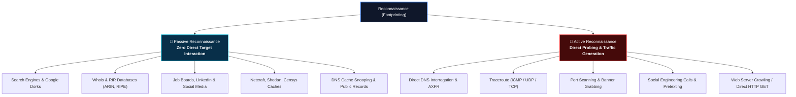
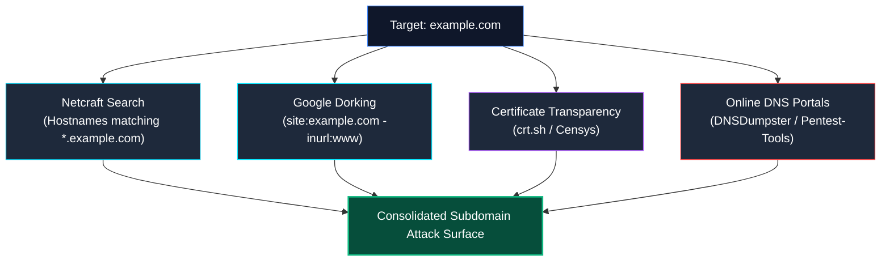
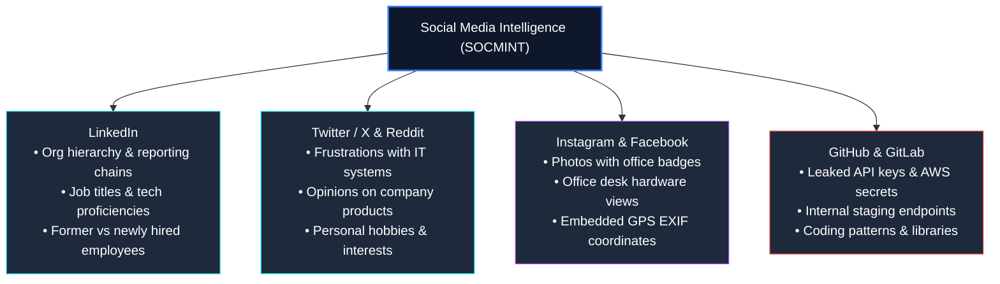
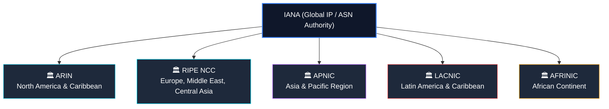
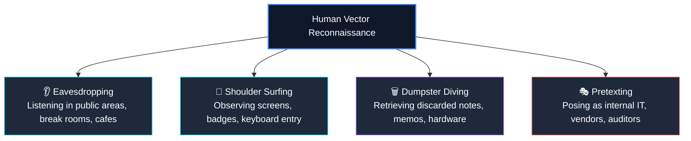
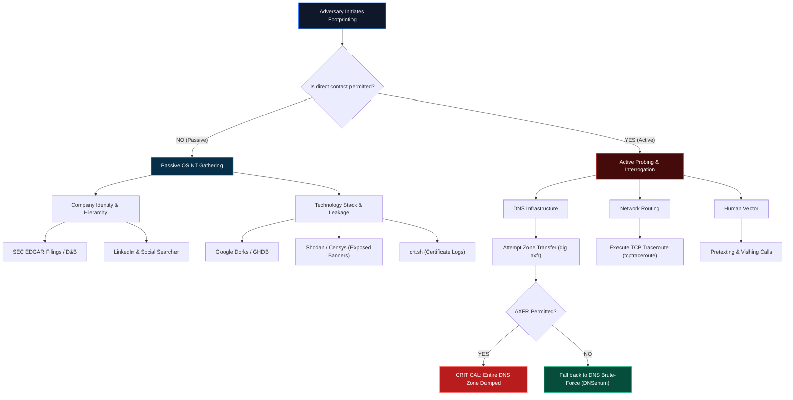

<div align="center">

# 🛡️ CEH v13 — Module 02: Footprinting and Reconnaissance
### Certified Ethical Hacker (CEH) Exam Notes • OSINT Frameworks • Google Dorking • DNS & Whois Interrogation • Network Range Discovery • Email Tracking • AI-Driven Recon

[-0078D4?style=for-the-badge&logo=shield)](https://www.eccouncil.org/programs/certified-ethical-hacker-ceh/)
[](https://www.eccouncil.org/)
[](../README.md)
[](./README.md)

<p align="center">
  <b>Authoritative, exam-oriented study guide and reference architecture for CEH v13 Module 02: Footprinting and Reconnaissance. Covers passive and active reconnaissance methodologies, advanced Google hacking (GHDB), search engine intelligence (Shodan, Censys), web service footprinting, social networking OSINT, Whois & RIR allocations, DNS architecture and AXFR zone transfers, traceroute TTL mechanics, email header forensic analysis, social engineering vectors, automated tooling (Maltego, Recon-ng, theHarvester, FOCA), AI-assisted reconnaissance, and enterprise defensive countermeasures.</b>
</p>

[📖 Module Hub](../README.md) • [📋 PDF Reference](./CEHv13%20-%20Module%2002%20-%20Footprinting%20and%20Reconnaissance.pdf) • [🔎 OSINT Masterclass](../../OSINT/Over%20all%20OSINT/README.md) • [🗺️ Knowledge Base Index](../../README.md)

</div>

---

## 📋 Table of Contents

- [1. Footprinting Fundamentals & Reconnaissance Concepts](#1-footprinting-fundamentals--reconnaissance-concepts)
  - [Definition & The "Security Blueprint"](#definition--the-security-blueprint)
  - [Passive Reconnaissance vs. Active Reconnaissance](#passive-reconnaissance-vs-active-reconnaissance)
  - [Information Categories Harvested During Footprinting](#information-categories-harvested-during-footprinting)
  - [Threats Posed by Footprinting](#threats-posed-by-footprinting)
  - [The CEH Footprinting Methodology Workflow](#the-ceh-footprinting-methodology-workflow)
- [2. Footprinting Through Search Engines & Google Hacking](#2-footprinting-through-search-engines--google-hacking)
  - [Search Engine Intelligence Gathering](#search-engine-intelligence-gathering)
  - [Advanced Google Search Operators (Google Dorks)](#advanced-google-search-operators-google-dorks)
  - [The Google Hacking Database (GHDB)](#the-google-hacking-database-ghdb)
  - [Footprinting VPNs, VoIP, and Critical Infrastructure Portals](#footprinting-vpns-voip-and-critical-infrastructure-portals)
  - [Reverse Image & Video Metadata Footprinting](#reverse-image--video-metadata-footprinting)
  - [Meta Search Engines & Privacy Proxies](#meta-search-engines--privacy-proxies)
  - [Specialized Search Engines: Shodan & Censys](#specialized-search-engines-shodan--censys)
- [3. Footprinting Through Web Services & Internet Resources](#3-footprinting-through-web-services--internet-resources)
  - [Top-Level Domains (TLDs) & Subdomain Discovery](#top-level-domains-tlds--subdomain-discovery)
  - [Netcraft Intelligence & Server Profiling](#netcraft-intelligence--server-profiling)
  - [Geographic & Physical Security Reconnaissance (GEOINT)](#geographic--physical-security-reconnaissance-geoint)
  - [People Search & Background Dossier Engines](#people-search--background-dossier-engines)
  - [Financial Filings, Corporate Intelligence & Regulatory Databases](#financial-filings-corporate-intelligence--regulatory-databases)
  - [Job Postings & Technical Stack Fingerprinting](#job-postings--technical-stack-fingerprinting)
  - [Deep Web, Dark Web & Credential Leak Monitoring](#deep-web-dark-web--credential-leak-monitoring)
  - [Website Mirroring & Source Code Inspection](#website-mirroring--source-code-inspection)
- [4. Footprinting Through Social Networking Sites](#4-footprinting-through-social-networking-sites)
  - [Social Media Intelligence (SOCMINT) Vectors](#social-media-intelligence-socmint-vectors)
  - [LinkedIn Corporate Reconnaissance & Org Charting](#linkedin-corporate-reconnaissance--org-charting)
  - [Public Code Repositories & Secret Leakage (GitHub/GitLab)](#public-code-repositories--secret-leakage-githubgitlab)
  - [Document Metadata Extraction (FOCA, ExifTool)](#document-metadata-extraction-foca-exiftool)
- [5. Whois Interrogation & Regional Internet Registries (RIRs)](#5-whois-interrogation--regional-internet-registries-rirs)
  - [The Whois Protocol (RFC 3912 / TCP 43)](#the-whois-protocol-rfc-3912--tcp-43)
  - [The 5 Regional Internet Registries (RIRs)](#the-5-regional-internet-registries-rirs)
  - [Analyzing Whois Records & Extracting Target Data](#analyzing-whois-records--extracting-target-data)
  - [Whois Privacy, Proxy Services & GDPR Impact](#whois-privacy-proxy-services--gdpr-impact)
- [6. DNS Interrogation & Zone Transfer (AXFR)](#6-dns-interrogation--zone-transfer-axfr)
  - [DNS Resolution Mechanics & Core Record Types](#dns-resolution-mechanics--core-record-types)
  - [Interactive DNS Queries with `nslookup`, `dig`, and `host`](#interactive-dns-queries-with-nslookup-dig-and-host)
  - [DNS Zone Transfer (AXFR) Exploitation & Vulnerability](#dns-zone-transfer-axfr-exploitation--vulnerability)
  - [Automated DNS Interrogation Frameworks](#automated-dns-interrogation-frameworks)
- [7. Network & Email Footprinting](#7-network--email-footprinting)
  - [Network Range Determination & Subnet Masking](#network-range-determination--subnet-masking)
  - [Traceroute Mechanics & The IP TTL Field](#traceroute-mechanics--the-ip-ttl-field)
  - [ICMP vs. UDP vs. TCP Traceroute Protocols](#icmp-vs-udp-vs-tcp-traceroute-protocols)
  - [Email Header Forensic Analysis & Origin IP Tracking](#email-header-forensic-analysis--origin-ip-tracking)
  - [Email Authentication Frameworks: SPF, DKIM, and DMARC](#email-authentication-frameworks-spf-dkim-and-dmarc)
  - [Email Tracking Systems & Web Bugs](#email-tracking-systems--web-bugs)
- [8. Footprinting Through Social Engineering](#8-footprinting-through-social-engineering)
  - [Human Reconnaissance Principles](#human-reconnaissance-principles)
  - [Eavesdropping & Shoulder Surfing](#eavesdropping--shoulder-surfing)
  - [Dumpster Diving & Physical Trash Inspection](#dumpster-diving--physical-trash-inspection)
  - [Pretexting & Impersonation Scenarios](#pretexting--impersonation-scenarios)
- [9. Automated Footprinting Tools & AI Integration](#9-automated-footprinting-tools--ai-integration)
  - [Reconnaissance Frameworks (Maltego, Recon-ng, theHarvester, SpiderFoot)](#reconnaissance-frameworks-maltego-recon-ng-theharvester-spiderfoot)
  - [Subdomain Enumeration Engines (`subfinder`, `amass`)](#subdomain-enumeration-engines-subfinder-amass)
  - [AI-Driven OSINT Platforms (Taranis AI, Cylect.io, TiDB Cloud)](#ai-driven-osint-platforms-taranis-ai-cylectio-tidb-cloud)
  - [Automating Reconnaissance via Shell AI (`sgpt`) & Python](#automating-reconnaissance-via-shell-ai-sgpt--python)
- [10. Footprinting Countermeasures & Defensive Engineering](#10-footprinting-countermeasures--defensive-engineering)
  - [Search Engine & Leak Mitigation](#search-engine--leak-mitigation)
  - [DNS Architecture Hardening: Split-Horizon DNS & Zone Restrictions](#dns-architecture-hardening-split-horizon-dns--zone-restrictions)
  - [Web Server & Mail Infrastructure Defenses](#web-server--mail-infrastructure-defenses)
  - [Administrative, Physical & Human Countermeasures](#administrative-physical--human-countermeasures)
- [🧠 Master CEH Footprinting Decision Tree](#-master-ceh-footprinting-decision-tree)
- [🎯 High-Value CEH Exam Distinctions to Memorize](#-high-value-ceh-exam-distinctions-to-memorize)

---

# 1. Footprinting Fundamentals & Reconnaissance Concepts

## Definition & The "Security Blueprint"

**Footprinting** (also known as **Reconnaissance**) is the first and most critical phase of the ethical hacking process. It refers to the systematic, preparatory accumulation of data regarding a target organization, its technological infrastructure, physical perimeter, and personnel prior to launching any intrusive scan or active exploit.

The ultimate objective of footprinting is to assemble a comprehensive **security profile blueprint** of the target:

$$\text{Target Information Aggregation} \longrightarrow \text{Attack Surface Reduction} \longrightarrow \text{Security Blueprint Formulation} \longrightarrow \text{Vulnerability Mapping}$$

```
┌──────────────────────────────────────────────────────────────────────────────────┐
│                          TARGET SECURITY BLUEPRINT FORMULATION                    │
├──────────────────────────────────────────────────────────────────────────────────┤
│                                                                                  │
│   [ORGANIZATIONAL PROFILE]        [NETWORK INFRASTRUCTURE]     [SYSTEM TARGETS]  │
│   ├── Corporate Structure         ├── IP Range / CIDR Blocks    ├── OS Versions  │
│   ├── Subsidiaries & M&As         ├── BGP Autonomous System (AS)├── Web Daemons  │
│   ├── Employee Phone & Emails     ├── External / Internal DNS   ├── Application  │
│   └── Physical Office Addresses   └── Ingress Firewalls / VPNs  └── Cloud Stacks │
│                                                                                  │
└────────────────────────────────────────┬─────────────────────────────────────────┘
                                         ▼
                 Adversary Selection of Weakest Link & Vector
```

---

## Passive Reconnaissance vs. Active Reconnaissance

In CEH, reconnaissance techniques are classified into two operational categories:



| Dimension | Passive Reconnaissance | Active Reconnaissance |
|---|---|---|
| **Interaction Level** | **No packets or queries sent** directly to target infrastructure. | Packets, queries, or voice calls are transmitted **directly to the target**. |
| **Detection Probability** | **Near Zero**; invisible to target EDR, SIEM, and firewalls. | **High**; logged by target firewalls, IDS/IPS, WAFs, and mail gateways. |
| **Data Sources** | Third-party caches, search engines, public registries, social media. | Target DNS servers, network gateways, boundary firewalls, employees. |
| **Primary Techniques** | Google dorking, Shodan lookups, Whois, Edgar filings, job postings. | DNS zone transfer attempts, ICMP/TCP traceroute, banner grabbing. |
| **Legal / Engagement Risk**| Lawful public research; completely non-invasive. | May trigger security alerts, incident response, or violate scope if unapproved. |

> [!IMPORTANT]
> **CEH Exam Distinctions:**
> * Looking up an organization on **Shodan** or **Censys** is **Passive** because the search engine scanned the host previously; you are querying Shodan's database, not the target.
> * Sending a DNS query directly to the **target's authoritative nameserver** is **Active**.
> * Inspecting **Google's cached snapshot** of a website is **Passive**; browsing to the live website with a browser is **Active**.

---

## Information Categories Harvested During Footprinting

CEH categorizes footprinting intelligence into three domains:

```
                                  FOOTPRINTING SCOPE
                                          │
         ┌────────────────────────────────┼────────────────────────────────┐
         ▼                                ▼                                ▼
┌──────────────────┐            ┌──────────────────┐            ┌──────────────────┐
│  ORGANIZATIONAL  │            │     NETWORK      │            │      SYSTEM      │
├──────────────────┤            ├──────────────────┤            ├──────────────────┤
│• Employee lists  │            │• IP address space│            │• OS architecture │
│• Phone numbers   │            │• Domain & sub-dom│            │• Web server type │
│• Physical plants │            │• DNS records     │            │• Open ports/svcs │
│• News & mergers  │            │• Network topology│            │• Service banners │
│• Vendor contracts│            │• Routing protocols│           │• App frameworks  │
│• Financials/SEC  │            │• VPN / Access pt │            │• System usernames│
└──────────────────┘            └──────────────────┘            └──────────────────┘
```

---

## Threats Posed by Footprinting

1. **Social Engineering:** Attackers use employee names, job titles, and internal jargon gleaned from LinkedIn to craft credible spear-phishing or pretexting attacks.
2. **System & Network Intrusions:** Identifying unpatched external services, legacy VPN portals, or misconfigured cloud buckets allows adversaries to pinpoint exploitable entryways.
3. **Information Leakage:** Publicly accessible documents containing metadata disclose internal usernames, software versions, network share paths, and printer IP addresses.
4. **Privacy Loss & Corporate Espionage:** Aggregating patent applications, executive calendars, and hiring postings reveals proprietary business strategies to competitors.

---

## The CEH Footprinting Methodology Workflow

The standardized EC-Council footprinting methodology flows through sequential phases:

```mermaid
flowchart LR
    S1["1. Search Engines<br>(Google, Shodan)"] --> S2["2. Web Services<br>(Netcraft, People)"]
    S2 --> S3["3. Social Media<br>(LinkedIn, GitHub)"]
    S3 --> S4["4. Whois Recon<br>(ARIN, Registrars)"]
    S4 --> S5["5. DNS Recon<br>(SOA, MX, AXFR)"]
    S5 --> S6["6. Network Recon<br>(Traceroute, IP)"]
    S6 --> S7["7. Social Eng.<br>(Human Vector)"]
    S7 --> S8["8. Tool Automation<br>(Maltego, AI)"]

    style S1 fill:#0f172a,stroke:#3b82f6,color:#fff
    style S2 fill:#0f172a,stroke:#06b6d4,color:#fff
    style S3 fill:#0f172a,stroke:#00e5ff,color:#fff
    style S4 fill:#0f172a,stroke:#a855f7,color:#fff
    style S5 fill:#1e1b4b,stroke:#ef4444,stroke-width:2px,color:#fff
    style S6 fill:#1e1b4b,stroke:#f59e0b,color:#fff
    style S7 fill:#064e3b,stroke:#10b981,color:#fff
    style S8 fill:#064e3b,stroke:#22c55e,stroke-width:2px,color:#fff
```



---

# 2. Footprinting Through Search Engines & Google Hacking

## Search Engine Intelligence Gathering

Search engines index public web content using crawlers (spiders) that recursively traverse hyperlinks. Attackers leverage search engines not only to identify corporate websites, but to discover unlinked staging portals, configuration files, exposed backups, and intranet subdomains.

Key search engines utilized in CEH reconnaissance:
* **General Web:** Google, Bing, Yahoo, DuckDuckGo, Baidu (China focus), Yandex (Eastern Europe focus).
* **FTP & File Repositories:** NAPALM FTP Indexer, FileSearch.
* **IoT & Exposed Devices:** Shodan, Censys, ZoomEye, BinaryEdge.

---

## Advanced Google Search Operators (Google Dorks)

Google hacking involves crafting advanced queries combining specialized boolean and location operators to locate exposed data that was never intended for public indexing.

| Operator | Syntax | Purpose / Scope | Exam Example |
|---|---|---|---|
| `site:` | `site:target.com` | Restricts search results to a specific domain or TLD. | `site:microsoft.com` |
| `inurl:` | `inurl:admin` | Restricts results to pages containing the keyword in the URL. | `inurl:login.php` |
| `allinurl:` | `allinurl:login admin` | Restricts results to pages containing all specified words in the URL. | `allinurl:admin portal vpn` |
| `intitle:` | `intitle:"index of /"` | Restricts results to pages containing the keyword in the HTML `<title>` tag. | `intitle:"Dashboard"` |
| `allintitle:`| `allintitle:admin access` | Requires all search terms to be in the title. | `allintitle:network router status` |
| `intext:` | `intext:"password"` | Searches for occurrences of the keyword in the page body text. | `intext:"confidential"` |
| `allintext:` | `allintext:user pass` | Requires all words in the page body text. | `allintext:root password hash` |
| `filetype:` / `ext:` | `filetype:pdf` | Restricts search results to specific file extensions. | `filetype:sql "dump"` |
| `link:` | `link:target.com` | Lists websites that contain hyperlinks pointing to the target URL. | `link:target.com` |
| `cache:` | `cache:target.com` | Displays Google's cached snapshot of the target web page. | `cache:target.com` |
| `related:` | `related:target.com` | Finds websites that Google considers similar to the specified target. | `related:target.com` |
| `-` (Exclusion)| `site:target.com -www` | Negates or excludes specific keywords or subdomains from results. | `site:target.com -inurl:www` |

### Critical Real-World Google Dork Combinations

```text
# 1. Directory Traversal & Exposed Open Indexes
intitle:"index of /" +intext:"parent directory"
intitle:"index of" "backup" OR "dump"

# 2. Exposed Database Dumps & Configuration Files
filetype:sql "INSERT INTO" "password"
filetype:env "DB_PASSWORD" OR "APP_KEY"
filetype:conf inurl:ldap.conf
filetype:ini inurl:php.ini

# 3. Locating Subdomains (Excluding Main WWW Portal)
site:target.com -inurl:www

# 4. VPN and Remote Access Portals
intitle:"Cisco AnyConnect" inurl:+CSCOE+/logon.html
intitle:"Pulse Connect Secure" inurl:dana-na
intitle:"GlobalProtect Portal" inurl:global-protect

# 5. Sensitive Organizational & HR Intranets
intitle:intranet inurl:intranet +intext:"human resources"
site:target.com inurl:gitlab OR inurl:jira
```

---

## The Google Hacking Database (GHDB)

Maintained by **Exploit-DB** (originally created by Johnny Long), the **Google Hacking Database (GHDB)** is an authoritative public repository of crowd-sourced Google Dorks categorized by reconnaissance vector:

```
                                  GHDB CATEGORIES
                                         │
     ┌───────────────────────┬───────────┴───────────┬───────────────────────┐
     ▼                       ▼                       ▼                       ▼
┌──────────────┐     ┌──────────────┐     ┌──────────────┐     ┌──────────────┐
│  Advisories  │     │ Pages with   │     │ Sensitive    │     │ Files with   │
│ & Vulnerable │     │ Login Portals│     │ Directories  │     │ Passwords    │
│   Servers    │     │              │     │ ("Index of") │     │ (.env, .sql) │
└──────────────┘     └──────────────┘     └──────────────┘     └──────────────┘
```

1. **Footholds:** Identifying exposed shells, webshells, or default server landing pages.
2. **Files Containing Usernames & Passwords:** Locating `.env`, `wp-config.php`, `.htpasswd`, or plain-text credentials.
3. **Sensitive Directories:** Open file shares, `/.git/`, `/storage/logs/`.
4. **Web Server Detection:** Software banners disclosing Apache, Nginx, or IIS versions.
5. **Vulnerable Devices:** Printers, VoIP PBX consoles, IP surveillance cameras, and SCADA endpoints.

---

## Footprinting VPNs, VoIP, and Critical Infrastructure Portals

Attackers specifically target remote access gateways:
* **VPN Footprinting:** Google dorks search for trademarked titles and URL paths of enterprise VPN gateways (e.g., `inurl:/+CSCOE+/` for Cisco ASA, `inurl:dana-na/auth/url_default/welcome.cgi` for Ivanti/Pulse Secure).
* **VoIP Footprinting:** VoIP PBX servers (Asterisk, FreePBX, Cisco Unified Communications) often expose web interfaces. Dorks like `intitle:"FreePBX Administration"` or `inurl:8080 intitle:"VoIP"` reveal phone directory extensions, voicemail systems, and SIP trunking credentials.

---

## Reverse Image & Video Metadata Footprinting

* **Reverse Image Search:** Searching an executive's headshot or badge photo across Google Images (`google.com/imghp`), **TinEye**, or **Yandex** reveals:
  * Alternative social media profiles.
  * Real identity behind pseudonym/sock-puppet accounts.
  * Company affiliations, personal blogs, or conferences attended.
* **YouTube & Video Intelligence:**
  * Analyzing corporate webinars or office tour videos reveals physical layout, whiteboard notes, and computer brand badges.
  * Tools such as **MattW YouTube Metadata** (`mattw.io/youtube-metadata`) extract video upload IP geolocations, exact upload timestamps, and raw tag data.

---

## Meta Search Engines & Privacy Proxies

A **meta search engine** submits user queries to multiple distinct search engines (Google, Bing, Yahoo, Ask) simultaneously and synthesizes the aggregated results into a unified list.

* **Examples:** Dogpile, MetaGer, Startpage.
* **Reconnaissance Advantage:** Meta search engines obscure the ethical hacker's identity and origin IP address, preventing the target organization or search engine algorithms from profiling the scanning pattern.

---

## Specialized Search Engines: Shodan & Censys

Unlike web search engines that crawl HTML hypermedia, **device search engines** scan the entire IPv4/IPv6 address space continuously, grabbing layer-4 service banners from open ports:

```
┌──────────────────────────────────────────────────────────────────────────────────┐
│                             SHODAN SEARCH ENGINE TOPOLOGY                         │
├──────────────────────────────────────────────────────────────────────────────────┤
│                                                                                  │
│   [SHODAN CRAWLERS] ────(SYN / Banner Grab)────► [INTERNET-FACING HOSTS]         │
│          │                                        ├── Port 22 (SSH OpenSSH 8.2)  │
│          ▼                                        ├── Port 80 (Apache 2.4.41)    │
│   [INDEX DATABASE]                                ├── Port 443 (SSL Cert SANs)   │
│          ▲                                        ├── Port 502 (Modbus ICS/SCADA)│
│          │                                        └── Port 3389 (Microsoft RDP)  │
│   [ATTACKER QUERY]                                                               │
│   "org:Target net:198.51.100.0/24 port:3389"                                     │
│                                                                                  │
└──────────────────────────────────────────────────────────────────────────────────┘
```

### Essential Shodan Search Filters for the CEH Exam

| Shodan Filter | Description | Example Query |
|---|---|---|
| `net:` | Restricts search to a specific CIDR subnet block. | `net:198.51.100.0/24` |
| `hostname:` | Searches for matching text in hostname. | `hostname:target.com` |
| `org:` | Filters by the registered autonomous organization name. | `org:"Target Corporation"` |
| `port:` | Limits results to devices exposing a specific TCP/UDP port. | `port:21,22,3389,8080` |
| `city:` / `country:` | Isolates assets by geographical region. | `country:"US" city:"Chicago"` |
| `os:` | Searches for specific operating system signatures. | `os:"Windows Server 2016"` |
| `product:` | Filters by specific software daemon in the banner. | `product:"Apache httpd"` |

* **Censys (`censys.io`):** Excels in indexing X.509 SSL/TLS certificates. Attackers search for a company's name in certificate Subject Alternative Names (SANs) to uncover internal staging domains and origin server IPs hidden behind Cloudflare or Akamai CDNs.

---

# 3. Footprinting Through Web Services & Internet Resources

## Top-Level Domains (TLDs) & Subdomain Discovery

Organizations frequently operate multiple Top-Level Domains (`.com`, `.org`, `.co.uk`, `.io`) and dozens of subdomains (`dev.target.com`, `vpn.target.com`, `mail.target.com`). Subdomains frequently point to testing, staging, or legacy infrastructure lacking enterprise WAF or MFA protections.

### Subdomain Enumeration Methodology



* **Certificate Transparency Logs (`crt.sh`):** Whenever a Certificate Authority issues an SSL certificate for `anything.target.com`, it is logged publicly to an append-only cryptographic ledger. Querying `https://crt.sh/?q=%.target.com` instantly extracts historical and active subdomains.

---

## Netcraft Intelligence & Server Profiling

**Netcraft** (`netcraft.com`) is one of the oldest and most respected internet research platforms in the CEH curriculum:

* **What Netcraft Exposes:**
  * **Netblock & Autonomous System:** Upstream ISP, hosting provider, and IP delegation.
  * **Operating System Fingerprint:** Underlying kernel/OS (e.g., Linux, Windows Server).
  * **Web Server Version:** Apache, Nginx, Microsoft-IIS.
  * **SSL/TLS History:** Historical certificate revocations, cryptographic ciphers supported.
  * **Uptime & Reboot History:** Extended uptimes indicate unpatched kernels requiring reboots.

---

## Geographic & Physical Security Reconnaissance (GEOINT)

Satellite and street-level imagery tools (**Google Earth**, **Google Maps**, **Wikimapia**) allow ethical hackers to assess physical security before an on-site red team or social engineering assessment:
* Physical perimeter fences, gates, and vehicle barriers.
* Locations of security guard kiosks and reception desks.
* Placement and blind spots of external CCTV surveillance cameras.
* Proximity of employee smoking gazebos and exterior break areas (prime targets for tailgating and eavesdropping).
* Rooftop HVAC and industrial chillers (targets for physical access or SCADA sabotage).

---

## People Search & Background Dossier Engines

Online people lookup engines aggregate public records, voter registrations, court dockets, real estate deeds, and social media registries:
* **Engines:** Spokeo, Whitepages, Pipl, Intelius, BeenVerified, PeekYou.
* **Information Harvested:** Personal cell phone numbers, home addresses, personal email accounts, family relatives, criminal history, and previous residences.
* **Use in Exploitation:** Attackers correlate personal emails to breached password dumps (e.g., HaveIBeenPwned) or use personal details to answer password-reset security questions ("What was the name of your first pet / street you grew up on?").

---

## Financial Filings, Corporate Intelligence & Regulatory Databases

Publicly traded organizations must disclose significant operational risks and business relationships in government regulatory filings:
* **SEC EDGAR (Electronic Data Gathering, Analysis, and Retrieval System):**
  * **Form 10-K (Annual Report):** Discloses supply chain dependencies, major cloud service providers (AWS, Azure), software vendors, pending security lawsuits, and cybersecurity risk factors.
  * **Form 10-Q (Quarterly Report):** Material updates to executive leadership or recent cybersecurity incidents.
  * **Form 8-K:** Unscheduled material events, including corporate acquisitions or major data breach notifications.
* **Business Information Portals:** Dun & Bradstreet (D&B), Hoover's, Crunchbase (tracks venture capital funding, executive leadership, technological acquisitions).

---

## Job Postings & Technical Stack Fingerprinting

One of the most effective passive reconnaissance techniques involves scrutinizing target job postings on **LinkedIn**, **Indeed**, **Dice**, and **Monster**:

```
┌──────────────────────────────────────────────────────────────────────────────────┐
│                   TARGET JOB POSTING FORENSIC DECONSTRUCTION                     │
├──────────────────────────────────────────────────────────────────────────────────┤
│                                                                                  │
│   "Senior Security Engineer Wanted - Acme Corp"                                  │
│                                                                                  │
│   Requirements:                                                                  │
│   • 3+ years managing Palo Alto PA-5200 Next-Gen Firewalls ──► [PERIMETER HW]    │
│   • Deep experience with Cisco AnyConnect VPN & Duo MFA    ──► [REMOTE ACCESS]   │
│   • Hands-on administration of Splunk Enterprise & Falcon  ──► [SIEM & EDR]      │
│   • Maintaining Active Directory on Windows Server 2016    ──► [INTERNAL OS]     │
│   • Administering AWS Kubernetes (EKS) & Docker containers ──► [CLOUD INFRA]     │
│                                                                                  │
└──────────────────────────────────────────────────────────────────────────────────┘
```

From this single posting, an attacker maps the organization's perimeter defense, VPN software, authentication tier, monitoring systems, and cloud infrastructure without transmitting a single probe packet.

---

## Deep Web, Dark Web & Credential Leak Monitoring

* **Surface Web vs. Deep Web vs. Dark Web:**
  * **Surface Web:** Content indexed by standard search engines (Google, Bing).
  * **Deep Web:** Non-indexed content protected behind paywalls, login screens, or dynamic database queries (academic journals, medical records, corporate intranets).
  * **Dark Web:** Encrypted overlay networks accessible only via specialized routing protocols like **Tor** (`.onion` services) and **I2P**.
* **Dark Web Footprinting:** Attackers search dark web marketplaces, criminal forums, and Tor search engines (Ahmia, Torch, The Hidden Wiki) for:
  * Compromised corporate credentials (stealer logs from RedLine, Vidar, Raccoon).
  * Leaked internal source code and database backups.
  * Insider access brokers auctioning active Active Directory credentials.

---

## Website Mirroring & Source Code Inspection

Website mirroring downloads an exact duplicate of a target's web application to a local workstation, permitting comprehensive, offline, and silent analysis.

* **Mirroring Tools:** **HTTrack**, **GNU Wget** (`wget --mirror --convert-links --adjust-extension -p`), **Cyotek WebCopy**.
* **Offline Inspection Targets:**
  * **HTML Comments (`<!-- TODO: Remove staging API endpoint -->`):** Disclosing developer notes, credentials, internal server names.
  * **Client-Side JavaScript Files:** Hardcoded API keys, JWT tokens, AWS S3 bucket URLs, hidden API routes.
  * **Client-Side Validation Routines:** Form parameters that can be tampered with in Burp Suite.
  * **Directory Paths & File Naming Conventions:** Inconsistencies that reveal internal naming schemes.

---

# 4. Footprinting Through Social Networking Sites

## Social Media Intelligence (SOCMINT) Vectors

Social media platforms are premier sources of human vector reconnaissance:



---

## LinkedIn Corporate Reconnaissance & Org Charting

LinkedIn provides high-fidelity insight into corporate organizational hierarchies:
1. **Target Profiling:** Searching by company reveals all registered employees.
2. **Department Isolation:** Attackers segment employees into Executive Leadership, Finance/Accounting (targets for Business Email Compromise / CEO fraud), Human Resources (targets for malicious PDF resumes), and IT/DevOps (targets for technical credential theft).
3. **Badge Phishing:** Newly onboarded employees often celebrate on LinkedIn by posting photographs wearing their employee identification badges. High-resolution zoom allows attackers to duplicate barcodes, magnetic stripe formats, or RFID proximity card numbers.

---

## Public Code Repositories & Secret Leakage (GitHub/GitLab)

Developers inadvertently commit proprietary code, hardcoded credentials, and infrastructure blueprints to public GitHub repositories:

* **Secret Detection Engines:** **GitLeaks**, **TruffleHog**, **Git-hound**.
* **Target Artifacts:**
  * `.git` commit history (where credentials were added in commit 1 and "deleted" in commit 2, but remain in the object database).
  * AWS Access Key IDs (`AKIA...`), SSH private keys (`id_rsa`), database connection strings.
  * Internal domain names and API gateway endpoints.

---

## Document Metadata Extraction (FOCA, ExifTool)

Documents published on corporate websites (`.pdf`, `.docx`, `.xlsx`, `.pptx`) store extensive metadata generated automatically by desktop applications:

```
┌──────────────────────────────────────────────────────────────────────────────────┐
│                   METADATA EXTRACTION FORENSIC TOPOLOGY                          │
├──────────────────────────────────────────────────────────────────────────────────┤
│                                                                                  │
│   Target PDF Document ────► [ExifTool / FOCA]                                    │
│                                  │                                               │
│                                  ├── Author:           jdoe (System Username)    │
│                                  ├── Operating System: Windows 10 Pro Build 19044│
│                                  ├── Software:         Microsoft Word 2016       │
│                                  ├── Printer Name:     \\CORP-PRINT01\HP-Laser   │
│                                  ├── Internal Path:    C:\Users\jdoe\Finance\... │
│                                  └── Creation Date:    2026-03-12 14:22:01 UTC   │
│                                                                                  │
└──────────────────────────────────────────────────────────────────────────────────┘
```

* **FOCA (Fingerprinting Organizations with Collected Archives):** Automatically searches Google, Bing, and DuckDuckGo for documents on the target domain, downloads them, extracts metadata, and maps internal usernames, local network folders, printer queues, and operating systems.
* **ExifTool Command:**
  ```bash
  exiftool -all target_document.pdf
  ```

---

# 5. Whois Interrogation & Regional Internet Registries (RIRs)

## The Whois Protocol (RFC 3912 / TCP 43)

**Whois** is a query-response protocol operating over **TCP port 43** that looks up the registered users or assignees of an Internet resource (such as a domain name or IP address block).

Whois records disclose:
* **Domain Registrar:** The commercial entity that registered the domain (e.g., GoDaddy, Namecheap).
* **Important Dates:** Domain creation date, updated date, and expiration date (expired domains can be bought by attackers to hijack traffic).
* **Contact Information:** Registrant name, organization, physical mailing address, administrative contact, technical contact email, and phone numbers.
* **Name Servers:** Authoritative DNS servers managing the domain.

---

## The 5 Regional Internet Registries (RIRs)

The **Internet Assigned Numbers Authority (IANA)** delegates the global allocation of IPv4 and IPv6 address blocks and Autonomous System Numbers (ASNs) to five **Regional Internet Registries (RIRs)**:



> [!IMPORTANT]
> **Must-Know CEH Exam Rule:**
> If you are footprinting an IP address belonging to an enterprise based in London, you query **RIPE NCC**. If based in Chicago, query **ARIN**. If based in Tokyo, query **APNIC**.

---

## Analyzing Whois Records & Extracting Target Data

### Command-Line Whois Query
```bash
# Query domain registration
whois certifiedhacker.com

# Query specific IP network allocation block
whois 198.51.100.1
```

### Whois Output Analysis
```text
Domain Name: CERTIFIEDHACKER.COM
Registry Domain ID: 15634521_DOMAIN_COM-VRSN
Registrar WHOIS Server: whois.godaddy.com
Registrar: GoDaddy.com, LLC
Creation Date: 2001-09-14T05:00:00Z
Registry Expiry Date: 2027-09-14T05:00:00Z
Registrant Organization: EC-Council
Registrant State/Province: New Mexico
Registrant Country: US
Name Server: NS1.BLUEHOST.COM
Name Server: NS2.BLUEHOST.COM
DNSSEC: unsigned
```

---

## Whois Privacy, Proxy Services & GDPR Impact

* **Whois Privacy Services (WhoisGuard, DomainsByProxy):** Mask the registrant's identity behind a third-party proxy entity.
* **GDPR Redaction:** ICANN's implementation of the European Union's General Data Protection Regulation (GDPR) has redacted personal contact data (emails, phone numbers) from public Whois lookups across European registries.
* **Bypassing Whois Privacy:** Attackers inspect **historical Whois databases** (DomainTools, Whoxy) to review records created *before* privacy services were enabled or before the domain was renewed.

---

# 6. DNS Interrogation & Zone Transfer (AXFR)

## DNS Resolution Mechanics & Core Record Types

The **Domain Name System (DNS)** translates human-readable hostnames into machine-routable IP addresses. It operates on **UDP port 53** for standard queries and **TCP port 53** for zone transfers or responses exceeding 512 bytes (extended DNS / EDNS0).

```
                                 CORE CEH DNS RECORD TYPES
                                             │
      ┌──────────────┬──────────────┬────────┼──────────────┬──────────────┐
      ▼              ▼              ▼        ▼              ▼              ▼
┌───────────┐  ┌───────────┐  ┌───────────┐┌───────────┐  ┌───────────┐  ┌───────────┐
│     A     │  │   AAAA    │  │    MX     ││    NS     │  │   CNAME   │  │    SOA    │
├───────────┤  ├───────────┤  ├───────────┤├───────────┤  ├───────────┤  ├───────────┤
│Maps host  │  │Maps host  │  │Mail Exch. ││Authorita- │  │Canonical  │  │Start of   │
│to IPv4    │  │to IPv6    │  │Points to  ││tive Name  │  │Name. Alias│  │Authority. │
│32-bit addr│  │128-bit    │  │SMTP server││Server for │  │to another │  │Admin email│
│           │  │address    │  │& priority ││the zone   │  │hostname   │  │& serial # │
└───────────┘  └───────────┘  └───────────┘└───────────┘  └───────────┘  └───────────┘
```

* **`PTR` (Pointer):** Reverse DNS record mapping an IP address back to a hostname.
* **`TXT` (Text Record):** Stores arbitrary text; crucial in CEH for email security frameworks (**SPF**, **DKIM**, **DMARC**) and domain ownership verification.
* **`SRV` (Service Record):** Identifies the hostname and port number of specific enterprise servers (e.g., SIP, LDAP, Active Directory Kerberos domain controllers `_kerberos._tcp.dc._msdcs.domain.com`).

---

## Interactive DNS Queries with `nslookup`, `dig`, and `host`

### 1. `nslookup` (Cross-Platform)
```text
# Interactive mode
nslookup
> set type=MX
> certifiedhacker.com
Server:  1.1.1.1
Address: 1.1.1.1#53

Non-authoritative answer:
certifiedhacker.com    mail exchanger = 10 mail.certifiedhacker.com.
```

### 2. `dig` (Domain Information Groper - Linux/Unix Standard)
```bash
# Query any record type from a specific nameserver
dig @8.8.8.8 certifiedhacker.com ANY

# Reverse DNS lookup (PTR)
dig -x 198.51.100.25

# Query Mail Exchange (MX) records only
dig certifiedhacker.com MX +short
```

---

## DNS Zone Transfer (AXFR) Exploitation & Vulnerability

A **DNS Zone Transfer** is the process by which a secondary (slave) DNS server synchronizes its entire zone database from the primary (master) DNS server. This synchronization occurs over **TCP port 53**.

### The Vulnerability: Unrestricted Zone Transfers
If a DNS administrator fails to configure access controls (`allow-transfer { none; };` or specific secondary IP addresses), an unauthorized external attacker can request an **AXFR (Authoritative Transfer)**. The primary DNS server will comply by transmitting its entire database—revealing every internal server, subdomain, private IP address, and network topology mapping.

```
┌──────────────────────────────────────────────────────────────────────────────────┐
│                      DNS ZONE TRANSFER (AXFR) ATTACK SEQUENCE                    │
├──────────────────────────────────────────────────────────────────────────────────┤
│                                                                                  │
│   [ATTACKER]                                          [AUTHORITATIVE DNS]        │
│        │                                                      │                  │
│        │──── 1. TCP 3-Way Handshake (Port 53) ───────────────►│                  │
│        │◄─── 2. Handshake Completed ──────────────────────────│                  │
│        │                                                      │                  │
│        │──── 3. DNS AXFR Query: "target.com" ────────────────►│                  │
│        │                                                      │                  │
│        │◄─── 4. FULL ZONE DUMP TRANSMITTED (Unrestricted!) ───│                  │
│        │        ├── SOA Record                                │                  │
│        │        ├── dev.target.com      -> 10.0.1.5 (INTERNAL)│                  │
│        │        ├── vpn.target.com      -> 198.51.100.10      │                  │
│        │        ├── sql01.target.com    -> 10.0.2.10          │                  │
│        │        └── mail.target.com     -> 198.51.100.25      │                  │
│                                                                                  │
└──────────────────────────────────────────────────────────────────────────────────┘
```

### Zone Transfer Execution Commands

#### Method A: Using `dig`
```bash
dig axfr @ns1.target.com target.com
```

#### Method B: Using `host`
```bash
host -l target.com ns1.target.com
```

#### Method C: Using `nslookup`
```text
nslookup
> server ns1.target.com
> ls -d target.com
```

> [!WARNING]
> **CEH Exam Alert:**
> * If a zone transfer succeeds, it is classified as a **critical information disclosure vulnerability**.
> * AXFR occurs over **TCP port 53** (never UDP).
> * The proper defense is to configure nameservers to allow zone transfers **only to authorized secondary nameserver IP addresses** or restrict it completely.

---

## Automated DNS Interrogation Frameworks

* **`DNSenum`:** Multithreaded Perl script that queries Google for subdomains, attempts AXFR transfers, performs reverse lookups, and executes dictionary brute-force attacks against subdomains.
* **`DNSRecon`:** Python tool checking for wildcard DNS resolution, PTR records, MX mail servers, SRV records, and cache snooping.
* **`Fierce`:** Lightweight reconnaissance tool designed specifically to scan non-contiguous IP spaces and locate unlinked subdomains.

---

# 7. Network & Email Footprinting

## Network Range Determination & Subnet Masking

To identify the perimeter boundaries of a target enterprise, ethical hackers determine its assigned IP address blocks. Querying Regional Internet Registry (RIR) databases returns the Autonomous System Number (ASN) and network range in **Classless Inter-Domain Routing (CIDR)** notation.

| CIDR Prefix | Subnet Mask | Usable Host IPs | Target Class / Scale |
|---|---|---|---|
| `/24` | `255.255.255.0` | 254 | Small branch office / Single server VLAN |
| `/20` | `255.255.240.0` | 4,094 | Mid-sized enterprise campus |
| `/16` | `255.255.0.0` | 65,534 | Large multinational / University network |
| `/8` | `255.0.0.0` | 16,777,214 | Major ISP / Government infrastructure |

---

## Traceroute Mechanics & The IP TTL Field

**Traceroute** maps the layer-3 routing hops across the internet between the attacker's workstation and the target host. It operates by exploiting the **Time-to-Live (TTL)** field in the IPv4 packet header (or Hop Limit in IPv6).

```
┌──────────────────────────────────────────────────────────────────────────────────┐
│                      TRACEROUTE TTL MECHANICS & HOP DISCOVERY                    │
├──────────────────────────────────────────────────────────────────────────────────┤
│                                                                                  │
│   [ATTACKER]           [ROUTER 1]            [ROUTER 2]           [TARGET]       │
│        │                   │                     │                    │          │
│   Probe 1 (TTL=1) ────────►│ (TTL decremented=0) │                    │          │
│        │◄── ICMP Type 11 ──│ [Time Exceeded]     │                    │          │
│        │    (Router 1 IP)  │                     │                    │          │
│        │                   │                     │                    │          │
│   Probe 2 (TTL=2) ─────────┼────────────────────►│ (TTL=0)            │          │
│        │◄── ICMP Type 11 ──┼─────────────────────│ [Time Exceeded]    │          │
│        │    (Router 2 IP)  │                     │                    │          │
│        │                   │                     │                    │          │
│   Probe 3 (TTL=3) ─────────┼─────────────────────┼───────────────────►│ (Dest!)  │
│        │◄── ICMP Type 0 ───┼─────────────────────┼────────────────────│          │
│        │    [Echo Reply]   │                     │                    │          │
│                                                                                  │
└──────────────────────────────────────────────────────────────────────────────────┘
```

1. The sender transmits a packet with **`TTL = 1`**.
2. The first gateway router decrements the TTL: $1 - 1 = 0$.
3. Because TTL has expired, the router discards the packet and transmits an **`ICMP Type 11 (Time Exceeded in Transit)`** packet back to the sender. The sender records Router 1's IP address.
4. The sender transmits a second packet with **`TTL = 2`**. Router 1 decrements to 1; Router 2 decrements to 0, drops the packet, and returns `ICMP Type 11`.
5. This sequence increments iteratively until the packet reaches the target destination, which replies with `ICMP Echo Reply` (or `ICMP Port Unreachable`).

---

## ICMP vs. UDP vs. TCP Traceroute Protocols

Different operating systems utilize different layer-4 protocols to implement traceroute:

| Operating System | Command | Layer 4 Protocol | Probe Target / Mechanics |
|---|---|---|---|
| **Microsoft Windows** | `tracert <target>` | **ICMP** | Transmits **ICMP Echo Request** (`Type 8, Code 0`) packets. |
| **Linux / Unix** | `traceroute <target>` | **UDP** | Transmits **UDP datagrams** targeted at high, unallocated ports (`33434` to `33534`). Destination responds with `ICMP Type 3, Code 3 (Port Unreachable)`. |
| **Firewall Evasion** | `tcptraceroute <target>` | **TCP** | Transmits **TCP SYN** packets (typically port `80` or `443`). Bypasses firewalls that filter ICMP and UDP probes. |

* **Pathping (Windows Utility):** Combines `tracert` and `ping`. Over a prolonged interval (typically 5–10 minutes), it measures packet loss percentage and latency at each individual intermediate hop.
* **Traceroute Tools:** **PingPlotter**, **Traceroute NG**, **VisualRoute**, **NetScanTools Pro**.

---

## Email Header Forensic Analysis & Origin IP Tracking

Email headers contain cryptographic and routing footprints that document the journey of a message from the sender's client (Mail User Agent - MUA) across intermediate relay servers (Mail Transfer Agents - MTAs) to the recipient.

```
┌──────────────────────────────────────────────────────────────────────────────────┐
│                          EMAIL HEADER ROUTING PARSER                             │
├──────────────────────────────────────────────────────────────────────────────────┤
│                                                                                  │
│   [Received: from mail.target.com (198.51.100.25)]  ◄── 3. Destination Ingress   │
│       by mx.google.com with ESMTPS                                               │
│                                                                                  │
│   [Received: from relay01.corp.internal (10.0.1.5)] ◄── 2. Internal Relay MTA    │
│       by mail.target.com with ESMTP                                              │
│                                                                                  │
│   [Received: from workstation-14 (192.168.10.45)]   ◄── 1. Originating MUA Host │
│       by relay01.corp.internal with SMTP                                         │
│                                                                                  │
│   [X-Originating-IP: 203.0.113.88]                  ◄── Sender's Real Origin IP │
│   [X-Mailer: Microsoft Outlook 16.0]                 ◄── Client Application      │
│                                                                                  │
└──────────────────────────────────────────────────────────────────────────────────┘
```

> [!NOTE]
> **Reading Email Headers:**
> Email `Received:` headers are prepended sequentially. To reconstruct the chronological path of an email, **read the `Received:` headers from the bottom up**.

---

## Email Authentication Frameworks: SPF, DKIM, and DMARC

Modern organizations configure three DNS text records to prevent email spoofing:

1. **SPF (Sender Policy Framework - RFC 7208):**
   * Stored as a DNS `TXT` record.
   * Lists all authorized IP addresses and mail servers allowed to transmit emails on behalf of the domain.
   * Example: `v=spf1 ip4:198.51.100.0/24 include:_spf.google.com ~all` (`-all` = hard fail; `~all` = soft fail).
2. **DKIM (DomainKeys Identified Mail - RFC 6376):**
   * Provides cryptographic authentication via digital signatures.
   * The sending MTA hashes the email body and headers and signs it with a private key. The public key is published in the sender's DNS (`TXT` record under selector `._domainkey.domain.com`).
3. **DMARC (Domain-based Message Authentication, Reporting, and Conformance - RFC 7489):**
   * Dictates what receiving mail servers should do if SPF or DKIM fails.
   * Policies: `p=none` (monitor only), `p=quarantine` (deliver to spam folder), `p=reject` (drop message immediately).

---

## Email Tracking Systems & Web Bugs

Email tracking monitors whether, when, and where a recipient opened an email:
* **Web Bug (1x1 Tracking Pixel):** An invisible, transparent $1 \times 1$ pixel image embedded into the email HTML body (``).
* When the victim opens the email, their email client automatically sends an HTTP `GET` request to the tracking server.
* **Data Harvested by Tracking Pixels:**
  * Recipient's public IP address and geolocation.
  * Exact date, time, and frequency the email was accessed.
  * Device type, operating system, and email client application (via `User-Agent`).
  * Whether the email was forwarded to another colleague.
* **Tracking Tools:** **eMailTrackerPro**, **PoliteMail**, **Yesware**.

---

# 8. Footprinting Through Social Engineering

## Human Reconnaissance Principles

Social engineering bypasses technological controls by exploiting human psychology, cognitive biases, and organizational trust. In the reconnaissance phase, attackers leverage social engineering to map internal organizational structures, gather telephone directories, identify project code names, and acquire employee credentials.



---

## Eavesdropping & Shoulder Surfing

* **Eavesdropping:** An attacker intercepts verbal communications without the participants' consent. Conducted in airport lounges, executive dining rooms, hotels, and cafes near corporate headquarters.
* **Shoulder Surfing:** Covertly observing an individual's screen or keyboard entry from behind their back or through optical aids (binoculars, high-zoom smartphone cameras). Used to capture PIN codes at ATMs, access badges at turnstiles, and passwords entered at login screens.

---

## Dumpster Diving & Physical Trash Inspection

**Dumpster diving** is the practice of sifting through corporate waste containers, recycling bins, and trash compactors located outside target office premises.

### Valued Intelligence Uncovered in Trash
* Discarded telephone directories and organization charts.
* Printed emails containing confidential project details.
* Sticky notes with passwords, usernames, and server hostnames.
* Financial statements, invoices, and purchase orders identifying software vendors.
* Discarded hardware (USB drives, old backup tapes, scratched CD-ROMs, un-wiped decommissioned hard drives).

---

## Pretexting & Impersonation Scenarios

**Pretexting** involves creating an invented scenario (a pretext) to persuade a targeted employee to release information or perform an action they would not otherwise do.

* **Scenario A: Impersonating IT Support:** The attacker calls a remote worker claiming to be from the corporate helpdesk, stating: *"We've detected anomalous synchronization errors on your Microsoft 365 account. I need you to verify your one-time code to avoid account suspension."*
* **Scenario B: Impersonating a Third-Party Auditor:** The attacker contacts an executive assistant requesting the latest organizational hierarchy and department contact list for compliance certification.

---

# 9. Automated Footprinting Tools & AI Integration

## Reconnaissance Frameworks

Instead of manually executing dozens of CLI commands, ethical hackers employ automated reconnaissance frameworks that query multiple public sources simultaneously and correlate findings.

```
┌──────────────────────────────────────────────────────────────────────────────────┐
│                   ENTERPRISE RECONNAISSANCE TOOL ECOSYSTEM                       │
├──────────────────────────────────────────────────────────────────────────────────┤
│                                                                                  │
│   [RECON FRAMEWORKS]       [DATA EXTRACTORS]         [AUTOMATION & AI]           │
│   ├── Maltego              ├── theHarvester          ├── Shell GPT (sgpt)        │
│   ├── Recon-ng             ├── FOCA                  ├── Taranis AI              │
│   ├── SpiderFoot           ├── subfinder             ├── Cylect.io               │
│   └── BillCipher           └── Amass                 └── Custom Python Scripts   │
│                                                                                  │
└──────────────────────────────────────────────────────────────────────────────────┘
```

### 1. Maltego
* **Architecture:** Java-based graphical intelligence and OSINT visualization platform.
* **Core Concept:** Uses **Transforms** (automated library scripts) to query data sources and generate directed graph nodes representing relationships between:
  * Domain names $\longleftrightarrow$ DNS servers $\longleftrightarrow$ Netblocks $\longleftrightarrow$ IP addresses.
  * Individuals $\longleftrightarrow$ Email addresses $\longleftrightarrow$ Social media accounts $\longleftrightarrow$ Affiliations.

### 2. Recon-ng
* **Architecture:** Python-based CLI framework with an interface mimicking Metasploit.
* **Organization:** Organizes data into modular workspaces backed by an internal SQLite database.
* **Modules:** Segregated into `recon/domains-hosts`, `recon/hosts-hosts`, `recon/contacts-credentials`. Supports automated API integrations with Shodan, Censys, HaveIBeenPwned, and Whois databases.

### 3. theHarvester
* **Purpose:** Rapid passive harvesting of public emails, employee names, subdomains, open ports, and banners.
* **Search Vectors:** Google, Bing, DuckDuckGo, Yahoo, Baidu, PGP key servers, Shodan, and LinkedIn.
* **Command Syntax:**
  ```bash
  theHarvester -d target.com -b google,bing,shodan -l 500
  ```

### 4. SpiderFoot
* **Purpose:** Highly automated OSINT reconnaissance platform accessible via web UI or CLI.
* **Features:** Continuously scans over 100 public data sources, tracking threat intelligence feeds, blacklists, data breaches, and public cloud bucket exposures.

---

## Subdomain Enumeration Engines (`subfinder`, `amass`)

* **`subfinder`:** Fast, passive subdomain discovery tool written in Go that gathers subdomains by querying passive APIs (VirusTotal, Censys, Shodan, crt.sh) without generating active network traffic to the target.
  ```bash
  subfinder -d certifiedhacker.com -o subdomains.txt
  ```
* **OWASP Amass:** The industry standard for attack surface mapping. Combines passive scraping, certificate transparency logs, active DNS brute-forcing, and DNS permutation generation.

---

## AI-Driven OSINT Platforms

The CEH v13 curriculum incorporates Artificial Intelligence and Machine Learning into open-source intelligence collection:

* **Taranis AI:** Automated open-source threat intelligence harvester that scours multi-lingual news feeds, social platforms, and technical blogs, using Natural Language Processing (NLP) to extract entity indicators and emerging vulnerabilities.
* **Cylect.io:** Advanced AI-powered OSINT search engine that correlates people, companies, and threat groups across unstructured internet data.
* **TiDB Cloud / GitHub Data Explorer:** Utilizes generative AI to run natural language SQL queries across real-time global GitHub repository event streams to discover trending technologies, developer leaks, and infrastructure modifications.

---

## Automating Reconnaissance via Shell AI (`sgpt`) & Python

CEH v13 demonstrates utilizing command-line LLM utilities such as **Shell GPT (`sgpt`)** and custom Python scripts to accelerate footprinting:

```bash
# Querying Shell GPT to generate passive reconnaissance workflows
sgpt --chat footprint --shell "Extract all subdomains for target.com using dig and passive crt.sh query"
```

### Automated Multi-Vector Python Footprinting Script
```python
import subprocess
import json
import requests

def whois_lookup(domain):
    """Execute CLI whois and capture output."""
    try:
        res = subprocess.check_output(["whois", domain], text=True)
        return res[:500]  # Return top lines
    except Exception as e:
        return str(e)

def crtsh_subdomains(domain):
    """Extract subdomains passively from Certificate Transparency logs."""
    url = f"https://crt.sh/?q=%.{domain}&output=json"
    subdomains = set()
    try:
        resp = requests.get(url, timeout=10)
        if resp.status_code == 200:
            entries = resp.json()
            for entry in entries:
                subdomains.add(entry['name_value'])
    except Exception as e:
        pass
    return sorted(list(subdomains))

if __name__ == "__main__":
    target = "certifiedhacker.com"
    print(f"[*] Footprinting Target: {target}")
    print("[+] Passive Certificate Transparency Subdomains:")
    subs = crtsh_subdomains(target)
    for s in subs[:10]:
        print(f"    └── {s}")
```

---

# 10. Footprinting Countermeasures & Defensive Engineering

Security engineering teams implement defensive controls across four tiers to mitigate footprinting:

```
                                  DEFENSIVE COUNTERMEASURES
                                             │
      ┌──────────────────────┬───────────────┴───────────────┬──────────────────────┐
      ▼                      ▼                               ▼                      ▼
┌─────────────┐        ┌─────────────┐                 ┌─────────────┐        ┌─────────────┐
│ SEARCH & LEAK│       │     DNS     │                 │ WEB SERVER  │        │  POLICIES & │
│ MITIGATION  │        │ HARDENING   │                 │ HARDENING   │        │   TRAINING  │
├─────────────┤        ├─────────────┤                 ├─────────────┤        ├─────────────┤
│• Google DMCA│        │• Split-DNS  │                 │• Disable Dir│        │• Clean Desk │
│  removal req│        │• Restrict   │                 │  browsing   │        │• Shredding  │
│• GitLeaks CI│        │  AXFR zone  │                 │• Strip HTTP │        │• Social Eng.│
│• Secrets mgmt│       │• DNSSEC     │                 │  banners    │        │  Simulations│
└─────────────┘        └─────────────┘                 └─────────────┘        └─────────────┘
```

---

## Search Engine & Leak Mitigation

1. **Google Removal Requests:** Organizations submit requests via Google Search Console to remove cached web pages containing leaked confidential records or personal identification information (PII).
2. **Automated Secrets Scanning in CI/CD:** Implement pre-commit hooks (`gitleaks`, `trufflehog`) in developer workflows to block commits containing private keys, AWS tokens, or database passwords before they reach GitHub.
3. **Robots.txt Cautions:** While `robots.txt` instructs well-behaved crawlers which directories to ignore (`Disallow: /admin/`), attackers inspect `robots.txt` precisely to find hidden administrative paths. Sensitive portals must be secured via authentication, not security-by-obscurity in `robots.txt`.

---

## DNS Architecture Hardening: Split-Horizon DNS & Zone Restrictions

### 1. Disabling Unrestricted Zone Transfers (AXFR)
Configure the primary authoritative nameserver (e.g., BIND) to prohibit zone transfers to unapproved IP addresses:
```text
// /etc/named.conf
zone "target.com" {
    type master;
    file "target.com.zone";
    allow-transfer { 198.51.100.2; }; // Only secondary DNS IP
};
```

### 2. Implementing Split-Horizon DNS (Split-Brain DNS)
Split-Horizon DNS separates internal network resolution from external public internet resolution:

```
┌──────────────────────────────────────────────────────────────────────────────────┐
│                          SPLIT-HORIZON DNS ARCHITECTURE                          │
├──────────────────────────────────────────────────────────────────────────────────┤
│                                                                                  │
│   [EXTERNAL CLIENTS / ATTACKERS]                  [INTERNAL CORPORATE USERS]     │
│                 │                                               │                │
│                 ▼                                               ▼                │
│      [EXTERNAL PUBLIC DNS]                           [INTERNAL ENTERPRISE DNS]   │
│      Only exposes public IPs:                        Resolves private RFC 1918:  │
│      ├── www.target.com  -> 198.51.100.10            ├── file01.internal -> 10.0 │
│      └── mail.target.com -> 198.51.100.25            ├── dc01.internal   -> 10.0 │
│                                                      └── erp.internal    -> 10.0 │
│                                                                                  │
└──────────────────────────────────────────────────────────────────────────────────┘
```

---

## Web Server & Mail Infrastructure Defenses

1. **Disable Directory Browsing:** Ensure web server configuration files (Apache `Options -Indexes`, IIS `Directory Browsing = Disabled`) prevent open directory indexing.
2. **Suppress Server Identification Banners:**
   * Apache: Set `ServerTokens Prod` and `ServerSignature Off`.
   * Nginx: Set `server_tokens off;`.
   * Microsoft IIS: Remove `Server` and `X-Powered-By` response headers.
3. **Enforce Strict DMARC Policies:** Migrate DMARC from `p=none` to `p=reject` to protect corporate domains from email spoofing.

---

## Administrative, Physical & Human Countermeasures

1. **Whois Privacy:** Subscribe to privacy-guard proxy services for all public domain registrations to shield employee identities and personal contact numbers.
2. **Clean Desk & Shredding Policies:** Enforce cross-cut shredding for all discarded paper documents and mandate locked trash bins across corporate offices.
3. **Continuous Social Engineering Awareness Training:** Subject personnel across all departments (HR, Finance, IT) to periodic, unannounced spear-phishing and phone vishing simulations to build a security-aware culture.

---

# 🧠 Master CEH Footprinting Decision Tree



---

# 🎯 High-Value CEH Exam Distinctions to Memorize

| Question / Concept | Correct Answer / Key Insight | Common Exam Distractor (Trap) |
|---|---|---|
| **Difference between Passive & Active Recon** | Passive sends **no packets** to the target; Active **transmits direct probes**. | "Querying Shodan is active reconnaissance" (False! Shodan is passive). |
| **Protocol & Port for DNS Zone Transfer** | **TCP port 53** (Transfer of state/zone database). | UDP port 53 (Used for standard client DNS queries, not AXFR). |
| **Regional Registry for Chicago / US** | **ARIN** (American Registry for Internet Numbers). | RIPE (Europe) or APNIC (Asia-Pacific). |
| **TTL Behavior in Traceroute** | Each gateway router **decrements TTL by 1**; returns **ICMP Type 11** when TTL=0. | "The router increments TTL by 1" (False!). |
| **Windows vs. Linux Traceroute Protocol** | Windows `tracert` uses **ICMP Echo Request**; Linux `traceroute` uses **UDP**. | Confusing the two; or assuming both use ICMP by default. |
| **Google Dork to find subdomains** | `site:target.com -inurl:www` | `site:target.com inurl:subdomain` |
| **Email Received: Headers Order** | Process chronologically by reading **from the bottom up**. | Reading from top to bottom (Top is the final delivery hop!). |
| **DMARC `p=reject` Policy** | Mandates destination MTAs to **completely drop** failing emails. | `p=none` (only generates reports, does not block spoofed emails). |
| **Best Defense Against Zone Transfer** | Restrict AXFR to **explicit authorized secondary nameserver IPs**. | "Disable TCP port 53 completely" (Breaks large DNS responses!). |
| **Split-Horizon DNS Purpose** | Resolves internal hosts to private RFC 1918 IPs internally and public IPs externally. | "Encrypting DNS queries with TLS" (That is DoT/DoH). |

---

<div align="center">

<b>Next Module: [Module 03 — Scanning Networks](../Module%2003/README.md)</b> • <b>Previous Module: [Module 01 — Introduction to Ethical Hacking](../Module%2001/README.md)</b>

</div>
