<div align="center">

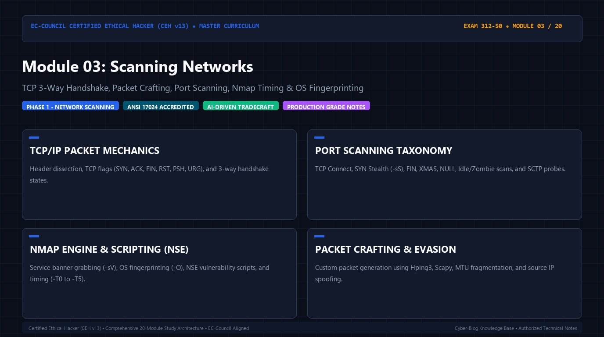

# 🛡️ CEH v13 — Module 03: Scanning Networks
### Certified Ethical Hacker (CEH) Exam Notes • TCP/IP Mechanics • Nmap & Hping3 • Stealth & Idle Scanning • Packet Crafting

[-0078D4?style=for-the-badge&logo=shield)](https://www.eccouncil.org/programs/certified-ethical-hacker-ceh/)
[](https://www.eccouncil.org/)
[](../README.md)
[](./README.md)

<p align="center">
  <b>Authoritative, exam-oriented study guide and reference architecture for CEH v13 Module 03: Scanning Networks. Covers host discovery, TCP flag mechanics, port states, SYN/Connect/Inverse scans, Nmap & Hping3 tradecraft, Idle (Zombie) scanning with IP ID tracking, routing manipulation, TCP checksum calculation, and firewall evasion.</b>
</p>

[📖 Module Hub](../README.md) • [📋 PDF Reference](./CEHv13%20-%20Module%2003%20-%20Scanning%20Networks.pdf) • [🧰 Nmap Masterclass](../../tools/Nmap/README.md) • [🗺️ Knowledge Base Index](../../README.md)

</div>

---

## 📋 Table of Contents

- [1. What is Network Scanning?](#1-what-is-network-scanning)
  - [Core Objectives of Scanning](#core-objectives-of-scanning)
  - [The Network Scanning Decision Engine](#the-network-scanning-decision-engine)
- [2. Deep Dive: TCP Flags & The TCP Header](#2-deep-dive-tcp-flags--the-tcp-header)
  - [The 6 Core TCP Flags](#the-6-core-tcp-flags)
  - [Flag Combinations vs. Individual Flags](#flag-combinations-vs-individual-flags)
- [3. SYN (Synchronize)](#3-syn-synchronize)
- [4. SYN-ACK (Synchronize + Acknowledge)](#4-syn-ack-synchronize--acknowledge)
- [5. ACK (Acknowledgment) & The 3-Way Handshake](#5-ack-acknowledgment--the-3-way-handshake)
- [6. FIN (Finish) & Graceful Teardown](#6-fin-finish--graceful-teardown)
- [7. RST (Reset) & Immediate Abort](#7-rst-reset--immediate-abort)
- [8. PSH (Push) & Data Delivery](#8-psh-push--data-delivery)
- [9. URG (Urgent) & The Urgent Pointer](#9-urg-urgent--the-urgent-pointer)
- [10. TCP Responses & Port State Determinations](#10-tcp-responses--port-state-determinations)
  - [Open Port Response](#open-port-response)
  - [Closed Port Response](#closed-port-response)
  - [Filtered Port Response](#filtered-port-response)
  - [Summary of Core Port States](#summary-of-core-port-states)
- [11. Nmap: The De Facto Network Scanner](#11-nmap-the-de-facto-network-scanner)
  - [Core Nmap Scanning Methodologies](#core-nmap-scanning-methodologies)
  - [Why `-sS` is Called a Stealth / Half-Open Scan](#why--ss-is-called-a-stealth--half-open-scan)
  - [TCP Connect Scan (`-sT`) vs. SYN Scan (`-sS`)](#tcp-connect-scan--st-vs-syn-scan--ss)
  - [Inverse TCP Scans (Xmas, FIN, Null) & RFC 793 Rule](#inverse-tcp-scans-xmas-fin-null--rfc-793-rule)
  - [ACK Flag Scan (`-sA`) & Firewall Rule Mapping](#ack-flag-scan--sa--firewall-rule-mapping)
  - [UDP Port Scanning (`-sU`)](#udp-port-scanning--su)
  - [Nmap Timing Templates (`-T0` to `-T5`)](#nmap-timing-templates--t0-to--t5)
- [12. Hping3: Advanced Packet Crafting & Layer-4 Auditing](#12-hping3-advanced-packet-crafting--layer-4-auditing)
  - [Capabilities & Real-World Crafting Commands](#capabilities--real-world-crafting-commands)
- [13. Scanning Tools Ecosystem: NetScanTools Pro & Enterprise Scanners](#13-scanning-tools-ecosystem-netscantools-pro--enterprise-scanners)
- [14. Probe Mechanics & Packet Signatures](#14-probe-mechanics--packet-signatures)
- [15. Idle Scan / Zombie Scan (`-sI`)](#15-idle-scan--zombie-scan--si)
  - [What is a Zombie Host?](#what-is-a-zombie-host)
  - [Why Perform an Idle Scan?](#why-perform-an-idle-scan)
- [16. IP ID Mechanics & Idle Scanning Algorithm](#16-ip-id-mechanics--idle-scanning-algorithm)
  - [The 3-Step Idle Scanning Exchange](#the-3-step-idle-scanning-exchange)
  - [Scenario A: Target Port is OPEN](#scenario-a-target-port-is-open)
  - [Scenario B: Target Port is CLOSED](#scenario-b-target-port-is-closed)
  - [Modern Limitations of Idle Scanning](#modern-limitations-of-idle-scanning)
- [17. Routing Manipulation & Path Redirection](#17-routing-manipulation--path-redirection)
  - [Mechanisms & Threat Vectors](#mechanisms--threat-vectors)
  - [Source Routing in CEH](#source-routing-in-ceh)
- [18. TCP/IP Checksum Calculation & Integrity Validation](#18-tcpip-checksum-calculation--integrity-validation)
  - [The TCP Pseudo-Header](#the-tcp-pseudo-header)
  - [Receiver Validation Decision Tree](#receiver-validation-decision-tree)
- [19. Why Checksum Matters in Packet Crafting & Evasion](#19-why-checksum-matters-in-packet-crafting--evasion)
  - [Bad Checksums for IDS/IPS Evasion](#bad-checksums-for-idsips-evasion)
- [20. Scanning Countermeasures & Defensive Engineering](#20-scanning-countermeasures--defensive-engineering)
- [🧠 Master CEH Scanning Flowchart](#-master-ceh-scanning-flowchart)
- [🎯 High-Value CEH Exam Distinctions to Memorize](#-high-value-ceh-exam-distinctions-to-memorize)

---

# 1. What is Network Scanning?

**Network scanning** represents the second active phase of the ethical hacking methodology (following Footprinting and Reconnaissance). It involves sending crafted network packets (probes) across Layer 2 (Data Link), Layer 3 (Network), and Layer 4 (Transport) to interrogate target IP spaces.

## Core Objectives of Scanning

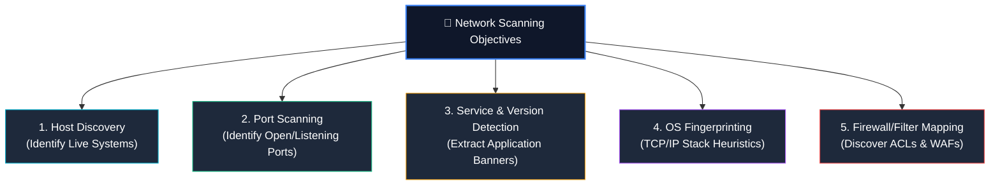

Through deliberate packet generation, scanners systematically determine:
* **Live Hosts:** Which systems on an IP range or subnet are currently powered on and reachable.
* **Open Ports:** Which Layer-4 TCP and UDP communication endpoints are accepting inbound traffic.
* **Running Services & Versions:** The precise software listening behind each port (e.g., Apache `2.4.52`, OpenSSH `8.9p1`).
* **Operating System (OS):** The host OS kernel and build version inferred from TCP window sizes, TTL values, and packet option behaviors.
* **Firewall & Filtering Architecture:** Whether stateful or stateless packet filters, IDS/IPS sensors, or application-level proxies reside between the scanner and the target.

## The Network Scanning Decision Engine

Every port scan fundamentally executes a stimulus-response transaction:

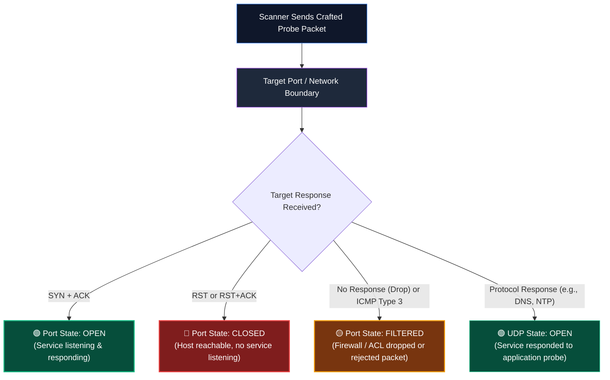

---

# 2. Deep Dive: TCP Flags & The TCP Header

Transmission Control Protocol (TCP) operates at **Layer 4 (Transport Layer)** of the OSI model, providing connection-oriented, ordered, and error-checked delivery of byte streams.

The TCP header is 20 to 60 bytes in size. Offset at byte 12–13 are the **Control Bits (Flags)**—single-bit binary switches that instruct the receiving operating system's network stack on how to process the segment.

```
 0                   1                   2                   3
 0 1 2 3 4 5 6 7 8 9 0 1 2 3 4 5 6 7 8 9 0 1 2 3 4 5 6 7 8 9 0 1
+-+-+-+-+-+-+-+-+-+-+-+-+-+-+-+-+-+-+-+-+-+-+-+-+-+-+-+-+-+-+-+-+
|          Source Port          |       Destination Port        |
+-+-+-+-+-+-+-+-+-+-+-+-+-+-+-+-+-+-+-+-+-+-+-+-+-+-+-+-+-+-+-+-+
|                        Sequence Number                        |
+-+-+-+-+-+-+-+-+-+-+-+-+-+-+-+-+-+-+-+-+-+-+-+-+-+-+-+-+-+-+-+-+
|                    Acknowledgment Number                      |
+-+-+-+-+-+-+-+-+-+-+-+-+-+-+-+-+-+-+-+-+-+-+-+-+-+-+-+-+-+-+-+-+
|  Data |           |U|A|P|R|S|F|                               |
| Offset| Reserved  |R|C|S|S|Y|I|            Window             |
|       |           |G|K|H|T|N|N|                               |
+-+-+-+-+-+-+-+-+-+-+-+-+-+-+-+-+-+-+-+-+-+-+-+-+-+-+-+-+-+-+-+-+
|           Checksum            |        Urgent Pointer         |
+-+-+-+-+-+-+-+-+-+-+-+-+-+-+-+-+-+-+-+-+-+-+-+-+-+-+-+-+-+-+-+-+
|                    Options                    |    Padding    |
+-+-+-+-+-+-+-+-+-+-+-+-+-+-+-+-+-+-+-+-+-+-+-+-+-+-+-+-+-+-+-+-+
```

## The 6 Core TCP Flags

| Flag | Name | Bit Position | Primary Function | CEH Operational Relevance |
|:---:|:---|:---:|---|---|
| **SYN** | Synchronize | `0x02` | Initiates a TCP connection by synchronizing Sequence Numbers (`ISN`). | Foundation for TCP 3-way handshake and SYN Stealth Scans (`-sS`). |
| **ACK** | Acknowledgment | `0x10` | Confirms receipt of transmitted data and indicates next expected byte. | Used in ACK scanning (`-sA`) to map stateful vs. stateless firewall rules. |
| **FIN** | Finish | `0x01` | Initiates a controlled, orderly graceful termination of a TCP connection. | Used in FIN scan (`-sF`) and Xmas scan (`-sX`) for RFC 793 evasion. |
| **RST** | Reset | `0x04` | Immediately aborts and resets an invalid, unexpected, or refused connection. | Sent by closed ports to reject connections; sent by scanners to tear down SYN scans. |
| **PSH** | Push | `0x08` | Directs the TCP stack to immediately flush buffers to the application layer. | Part of Xmas scan (`-sX`); forces immediate application data handling. |
| **URG** | Urgent | `0x20` | Signifies that incoming data is prioritized; references the Urgent Pointer. | Part of Xmas scan (`-sX`); handles out-of-band data streams (e.g., Telnet Ctrl+C). |

> [!NOTE]
> Modern TCP RFCs (RFC 3168) define two additional congestion-notification flags: **ECE (Explicit Congestion Notification Echo)** (`0x40`) and **CWR (Congestion Window Reduced)** (`0x80`). However, for the CEH exam, focus primarily on the **6 classic control flags (URG, ACK, PSH, RST, SYN, FIN)**.

## Flag Combinations vs. Individual Flags

> [!IMPORTANT]
> **Core Exam Clarification:**  
> Terms like **SYN-ACK** and **FIN-ACK** are **NOT** distinct single flags. They represent **simultaneous combinations of flags** asserted in the same TCP header:
> * `SYN-ACK` = Bit `0x02` (SYN) + Bit `0x10` (ACK) asserted together.
> * `FIN-ACK` = Bit `0x01` (FIN) + Bit `0x10` (ACK) asserted together.
> * `RST-ACK` = Bit `0x04` (RST) + Bit `0x10` (ACK) asserted together.

---

# 3. SYN (Synchronize)

**SYN = Synchronize Sequence Numbers (`0x02`)**

The **SYN** flag establishes the initial synchronization between two hosts attempting to communicate over TCP.

```text
Client (Scanner)                                Target Server
       │                                              │
       │───────────── TCP SYN (Seq=X) ───────────────►│
       │                                              │
```

### Protocol Mechanics
* When a client initiates a connection, it generates a pseudo-random 32-bit integer called the **Initial Sequence Number (ISN)** ($X$).
* The client asserts `SYN=1` and transmits the segment to the target port.
* The client is stating: *"I wish to establish a new reliable connection with you; my starting sequence number is $X$."*

---

# 4. SYN-ACK (Synchronize + Acknowledge)

When a server receives a SYN on an open port listening for connections, it returns a segment with **both SYN and ACK flags enabled (`SYN+ACK`)**:

```text
Client (Scanner)                                Target Server
       │                                              │
       │◄───────── TCP SYN+ACK (Seq=Y, Ack=X+1) ──────│
       │                                              │
```

### Protocol Mechanics
* **ACK Flag (`0x10`):** Confirms receipt of the client's SYN by acknowledging `Ack = X + 1`.
* **SYN Flag (`0x02`):** Generates the server's own Initial Sequence Number ($Y$).
* The server is stating: *"I received your connection request (acknowledged at $X+1$), and I agree to connect; my starting sequence number is $Y$."*

---

# 5. ACK (Acknowledgment) & The 3-Way Handshake

**ACK = Acknowledgment Field Significant (`0x10`)**

Once established, every subsequent packet in a TCP session (except the initial SYN) carries the **ACK** bit asserted.

### The Complete TCP Three-Way Handshake

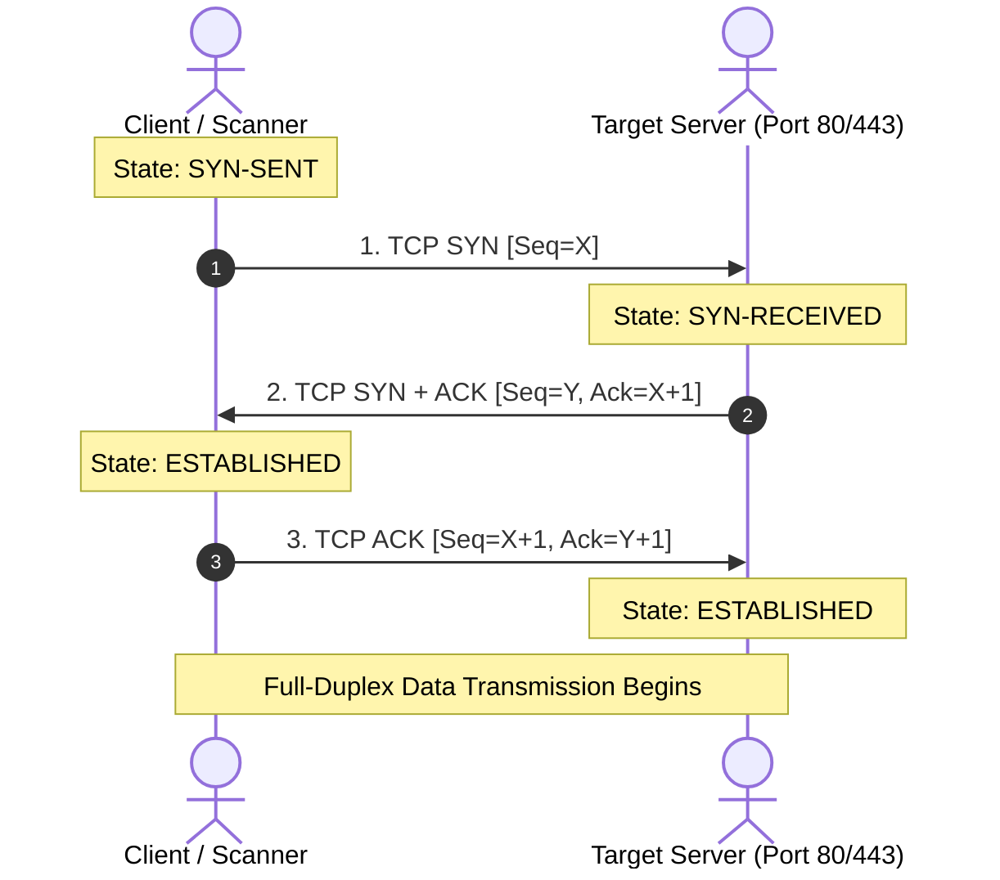

$$\mathbf{SYN} \longrightarrow \mathbf{SYN\text{+}ACK} \longrightarrow \mathbf{ACK}$$

This 3-way sequence ensures both endpoints have verified each other's presence, agreed on sequence numbers, and allocated memory buffers for the session.

---

# 6. FIN (Finish) & Graceful Teardown

**FIN = No More Data from Sender (`0x01`)**

The **FIN** flag initiates a graceful, orderly connection closure when an application has finished transmitting data:

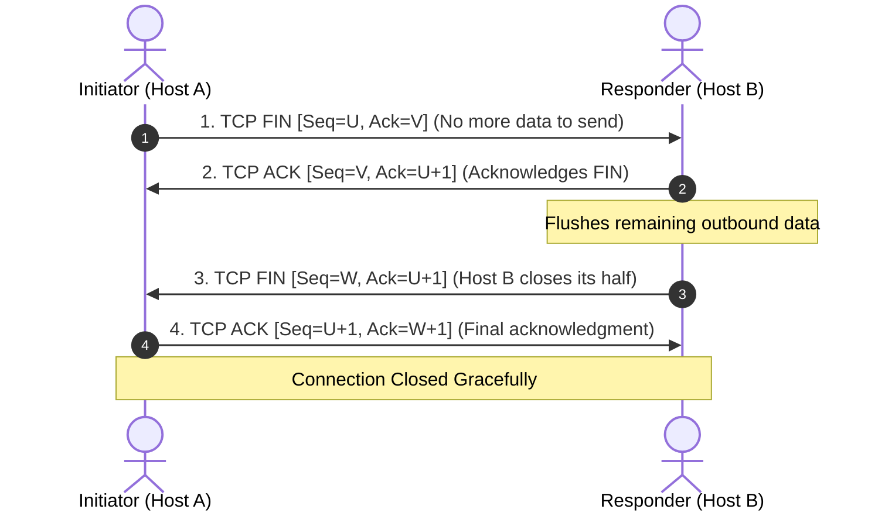

* Unlike RST, FIN is **cooperative and polite**.
* Both halves of the full-duplex connection must close independently, which is why a standard teardown requires a **4-packet FIN/ACK/FIN/ACK exchange**.

---

# 7. RST (Reset) & Immediate Abort

**RST = Reset the Connection (`0x04`)**

The **RST** flag is unceremonious and non-negotiable. It instantly terminates a connection or rejects an unauthorized or unexpected packet.

```text
Client (Scanner)                                Target Server
       │                                              │
       │───────────── TCP Packet / SYN ──────────────►│
       │                                              │
       │◄──────────── TCP RST or RST+ACK ─────────────│
       │                                              │
```

### When is RST Generated?
1. **Closed Ports:** When a host receives a SYN on a port where **no application is listening**, the operating system's kernel generates an immediate `RST+ACK` to notify the sender not to retry.
2. **Abrupt Teardown by Scanners:** In a SYN Stealth Scan (`-sS`), once the scanner receives a `SYN+ACK`, it sends an immediate `RST` to terminate the handshake before an application session is registered.
3. **Firewall / IPS Intervention:** Stateful firewalls or intrusion prevention systems inject forged RST packets into TCP streams to forcefully sever unauthorized connections.

| Dimension | FIN (Finish) | RST (Reset) |
|---|---|---|
| **Nature** | Graceful, cooperative termination | Immediate, ungraceful abort or rejection |
| **Buffer Handling** | In-flight buffers are delivered and flushed | All pending data in buffers is dumped/discarded |
| **Packet Sequence** | Multi-step 4-way handshake (`FIN → ACK → FIN → ACK`) | Single one-way packet transmission |
| **Port State Indication** | Indicates normal session termination | Indicates **Closed Port**, invalid state, or firewall reset |

---

# 8. PSH (Push) & Data Delivery

**PSH = Push Function (`0x08`)**

Normally, operating system TCP stacks optimize bandwidth by buffering incoming and outgoing data until an entire **Maximum Segment Size (MSS)** packet is filled before notifying the application.

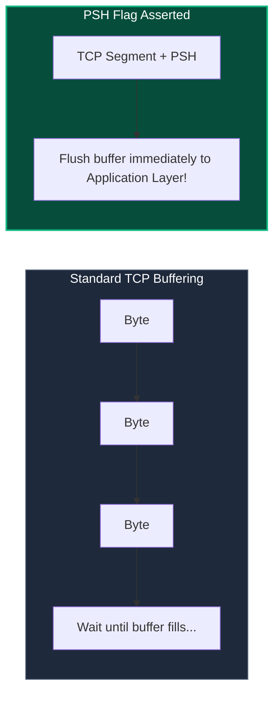

* **Purpose:** Instructs the receiving TCP stack to bypass buffering and immediately forward all accumulated data directly to the listening application.
* **Common Use Cases:** Interactive real-time streams like SSH terminal keystrokes, Telnet commands, and HTTP transaction boundaries.
* **CEH Scanning Relevance:** Combined with FIN and URG in the **Xmas Scan** (`-sX`).

---

# 9. URG (Urgent) & The Urgent Pointer

**URG = Urgent Pointer Field Significant (`0x20`)**

The **URG** flag notifies the receiver that the segment contains data of high priority that must be processed out-of-band before normal sequence-ordered data is delivered.

```
TCP Header:
[ Flags: ... | URG=1 | ... ]
[ Urgent Pointer: 0x001A ]  ──► Points to the exact end byte of urgent data
```

* When `URG=1`, the 16-bit **Urgent Pointer field** in the TCP header becomes active. It contains an offset pointing to the last byte of urgent data within the payload.
* **Common Use Cases:** Interrupt signals sent over interactive protocols (e.g., typing `Ctrl+C` over a Telnet or FTP control session to cancel a file transfer).
* **CEH Scanning Relevance:** Part of the classic **Xmas Tree Scan** (`-sX`).

---

# 10. TCP Responses & Port State Determinations

Understanding how operating system TCP stacks react to crafted probes is the single most tested concept in CEH Module 3.

## Open Port Response

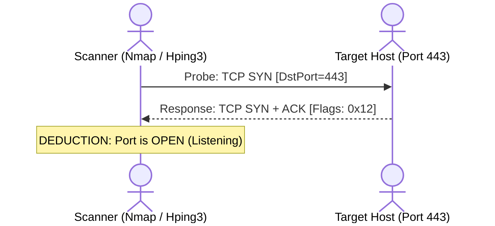

## Closed Port Response

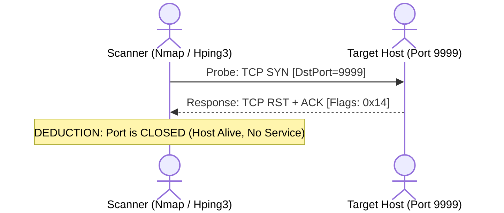

## Filtered Port Response

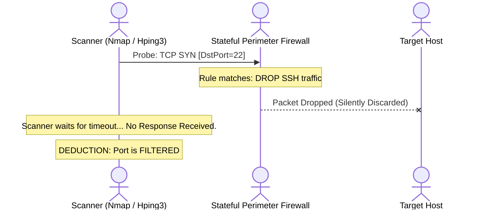

*Alternatively*, a filtering device may actively return an ICMP error:
* `ICMP Type 3, Code 1` (Host Unreachable)
* `ICMP Type 3, Code 2` (Protocol Unreachable)
* `ICMP Type 3, Code 3` (Port Unreachable)
* `ICMP Type 3, Code 9` (Communication with Destination Host Administratively Prohibited)
* `ICMP Type 3, Code 10` (Communication with Destination Network Administratively Prohibited)
* `ICMP Type 3, Code 13` (Communication Administratively Prohibited)

## Summary of Core Port States

| Port State | Technical Meaning | Typical Target Response to SYN Probe |
|---|---|---|
| **Open** | An application is actively accepting connections on this port. | `SYN + ACK` received. |
| **Closed** | Port is accessible (host is alive), but no application is listening. | `RST + ACK` (or `RST`) received. |
| **Filtered** | A firewall, filter, or network issue is blocking probe delivery. | **No response** (timeout drop) or **ICMP Type 3 Unreachable error**. |
| **Unfiltered** | Port is accessible, but scanner cannot determine if it is open or closed (seen in ACK scans). | `RST` received in response to an `ACK` probe. |
| **Open \| Filtered** | Scanner cannot distinguish whether the port is open or filtered (seen in UDP, FIN, Null, Xmas scans). | **No response** received from the target. |

---

# 11. Nmap: The De Facto Network Scanner

**Network Mapper (Nmap)**, developed by Gordon Lyon (Fyodor), is the premier open-source network discovery and vulnerability scanning tool used across penetration testing and CEH evaluations.

```bash
# General Syntax
nmap [Scan Types] [Options] {Target Specification}
```

## Core Nmap Scanning Methodologies

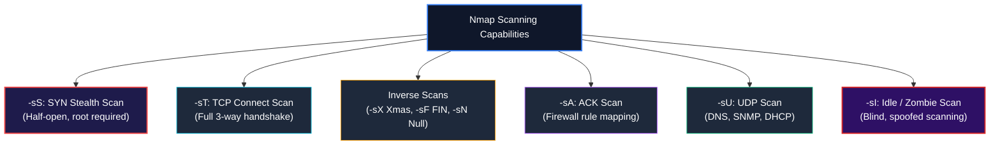

## Why `-sS` is Called a Stealth / Half-Open Scan

The **SYN Scan (`-sS`)** is the default and most popular scan in Nmap because it is fast, scans thousands of ports per second, and is stealthier than a full connection scan.

```mermaid
sequenceDiagram
    actor Nmap as Nmap Scanner
    actor Target as Target Host (Port 80)

    Nmap->>Target: 1. TCP SYN
    Target-->>Nmap: 2. TCP SYN + ACK (Port Open!)
    Note over Nmap: Nmap deduces port is OPEN
    Nmap->>Target: 3. TCP RST (Forceful Abort!)
    Note over Target: Handshake never completed; Application never registers connection!
```

### Why is it called "Half-Open"?
Because the scanner **never completes the 3-way handshake**. As soon as the server's `SYN+ACK` confirms the port is open, Nmap transmits an immediate `RST` packet.
* Because the handshake never establishes, the connection is never handed off to the application layer.
* In older systems, this prevented the connection from appearing in application access logs (e.g., Apache `access.log`), hence the name **Stealth Scan**.

## TCP Connect Scan (`-sT`) vs. SYN Scan (`-sS`)

| Metric / Dimension | TCP SYN Scan (`-sS`) | TCP Connect Scan (`-sT`) |
|---|---|---|
| **Privileges Required** | Requires **Root / Administrator** (raw socket creation). | Operates as **Unprivileged user** (uses OS `connect()` API). |
| **Handshake State** | **Half-Open** (`SYN → SYN/ACK → RST`). | **Full Handshake** (`SYN → SYN/ACK → ACK → RST/FIN`). |
| **Speed** | Extremely fast; handles drops asynchronously. | Slower; incurs OS socket connection overhead. |
| **Log Footprint** | Bypasses simple application-level logs. | Readily logged by target applications and services. |
| **Firewall Evasion** | Highly effective against legacy packet filters. | Low evasion; easily detected by modern stateful firewalls. |

## Inverse TCP Scans (Xmas, FIN, Null) & RFC 793 Rule

Inverse TCP scans attempt to bypass stateless firewalls and packet filters by transmitting crafted segments that violate standard TCP state machines:

```bash
nmap -sF 192.168.1.10   # FIN Scan (Only FIN flag set)
nmap -sN 192.168.1.10   # Null Scan (No flags set: 0x00)
nmap -sX 192.168.1.10   # Xmas Scan (FIN + PSH + URG flags asserted: 0x29)
```

### The RFC 793 Governing Principle:
According to RFC 793 (Page 65):
* If a closed port receives a segment that does not contain a RST, it **MUST send a RST in response**.
* If an open port receives an unexpected segment without SYN, RST, or ACK, it **MUST silently drop/ignore the packet**.

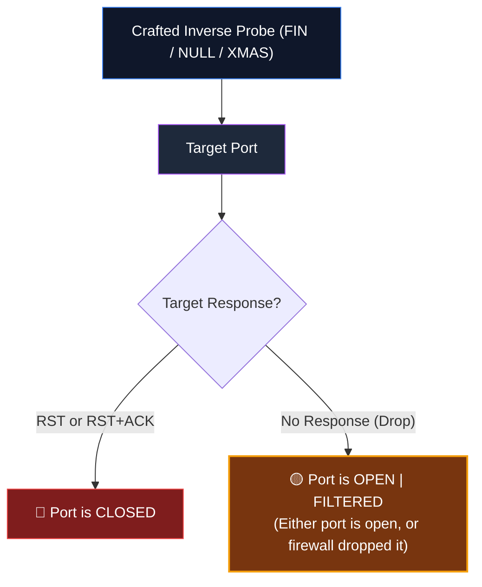

> [!WARNING]
> **The Microsoft Windows Non-Compliance Exception:**  
> Microsoft Windows, Cisco devices, and IBM OS/400 **do not strictly comply with RFC 793**. They reply with a `RST` to *any* invalid packet regardless of whether the port is open or closed.  
> **Exam Rule:** If an Xmas, FIN, or Null scan reports **all ports closed** on a machine known to be running web services, the target is running **Microsoft Windows**.

## ACK Flag Scan (`-sA`) & Firewall Rule Mapping

The **ACK Scan (`-sA`)** does **not** determine whether a port is open or closed. It is used exclusively to discover **firewall rule sets and filter architectures**.

```bash
nmap -sA 192.168.1.10
```

* An unestablished `ACK` packet sent into a network violates TCP state logic.
* **If Filtered:** A stateful firewall tracking connections drops the out-of-order ACK, resulting in **No Response** (or an ICMP error).
* **If Unfiltered:** A target host (or stateless filter allowing the packet) generates a **`RST`** because no corresponding connection exists.
* **Result:** Informs the tester whether ports are blocked by a stateful firewall.

## UDP Port Scanning (`-sU`)

UDP is connectionless, making UDP scanning notoriously slow and challenging:

```bash
nmap -sU -p 53,67,69,123,161 192.168.1.10
```

* **Target Port Open:** Service responds with a protocol-specific UDP response (e.g., DNS reply on port 53, SNMP reply on 161), OR no response is received (marked `open|filtered`).
* **Target Port Closed:** Target operating system kernel returns an **ICMP Type 3, Code 3 (Destination Port Unreachable)** error.
* **Why UDP is Slow:** RFC 1812 mandates rate-limiting on ICMP error generation (e.g., Linux limits ICMP unreachable generation to 1 packet per second).

## Nmap Timing Templates (`-T0` to `-T5`)

Nmap provides six timing templates to balance speed against detection evasion:

| Template | Name | Packet Delay | Primary Use Case |
|:---:|:---|:---:|---|
| **`-T0`** | **Paranoid** | 5 minutes | Evading IDS/IPS thresholds; serial scanning across hours/days. |
| **`-T1`** | **Sneaky** | 15 seconds | Bypassing historical network intrusion detection heuristics. |
| **`-T2`** | **Polite** | 0.4 seconds | Minimizes bandwidth usage; prevents host service crashes. |
| **`-T3`** | **Normal** | Dynamic (default) | Standard adaptive timing based on target latency and jitter. |
| **`-T4`** | **Aggressive** | Capped at 1.25s | Fast, reliable networks; standard for authorized pentesting labs. |
| **`-T5`** | **Insane** | Capped at 0.3s | Extremely fast; sacrifices accuracy on congested networks. |

---

# 12. Hping3: Advanced Packet Crafting & Layer-4 Auditing

While Nmap automates large-scale port sweeps, **Hping3** is a raw packet-crafting and testing tool that provides granular, bit-level control over every field in IP, TCP, UDP, and ICMP headers.

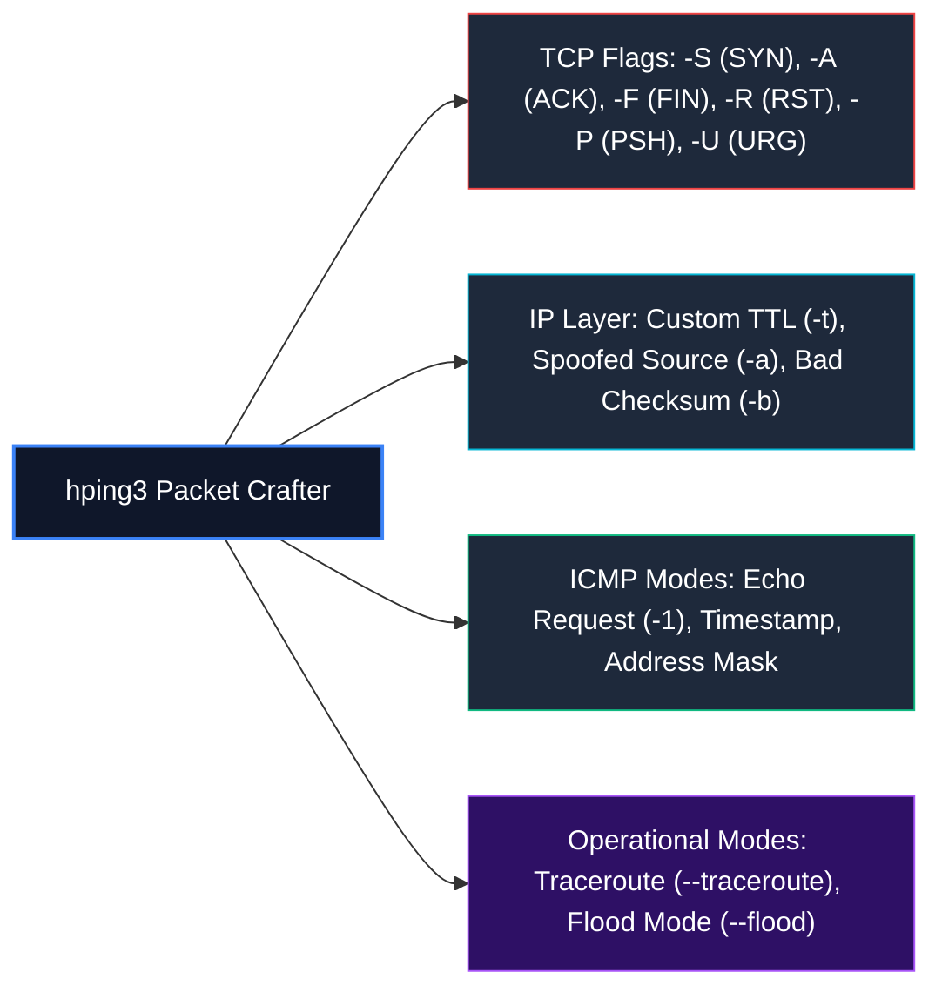

## Capabilities & Real-World Crafting Commands

### 1. SYN Packet Generation (Manual Port Audit)
```bash
# Send 3 SYN packets to port 80 of target
hping3 -S 192.168.1.10 -p 80 -c 3
```
* If target replies with `flags=SA` (`SYN+ACK`): Port 80 is **OPEN**.
* If target replies with `flags=RA` (`RST+ACK`): Port 80 is **CLOSED**.

### 2. ACK Packet Generation (Firewall Testing)
```bash
# Send ACK packet to port 22 to test firewall rules
hping3 -A 192.168.1.10 -p 22 -c 1
```

### 3. Source IP Spoofing
```bash
# Spoof source IP address as 10.0.0.1
hping3 -S 192.168.1.10 -p 443 -a 10.0.0.1
```

### 4. Custom Flag Combinations (Xmas Emulation)
```bash
# Assert FIN, PSH, and URG flags simultaneously
hping3 -F -P -U 192.168.1.10 -p 80 -c 1
```

---

# 13. Scanning Tools Ecosystem: NetScanTools Pro & Enterprise Scanners

CEH curricula emphasize that security analysts must be conversant with commercial, GUI-driven, and enterprise network discovery toolkits alongside CLI tools:

```
┌────────────────────────────────────────────────────────────────────────────────────────┐
│                        CEH NETWORK DISCOVERY & SCANNING TOOLKIT                         │
├────────────────────────────┬───────────────────────────────────────────────────────────┤
│ Tool Category              │ Representative Utilities                                  │
├────────────────────────────┼───────────────────────────────────────────────────────────┤
│ CLI Scanners               │ Nmap, Masscan, Hping3, ZMap                               │
│ Windows GUI Scanners       │ NetScanTools Pro, Angry IP Scanner, MegaPing, SolarWinds  │
│ Mobile Network Scanners    │ Fing (Android/iOS), Network Analyzer                      │
│ Banner Grabbers            │ Netcat (`nc`), Telnet, Curl, Nmap (`-sV`)                 │
└────────────────────────────┴───────────────────────────────────────────────────────────┘
```

### NetScanTools Pro
An integrated suite of network discovery tools for Windows incorporating Ping, Traceroute, Port Scanning, Whois, DNS interrogation, and SNMP enumeration into a single workspace.

> [!TIP]
> **Exam Tip:** On the CEH exam, when presented with tool names like **MegaPing**, **NetScanTools Pro**, or **Angry IP Scanner**, remember their shared objective: **Host discovery, ping sweeps, and open port identification**. Focus on the underlying protocol methodology rather than GUI differences.

---

# 14. Probe Mechanics & Packet Signatures

A **probe** is a deliberately formatted network transaction dispatched to a target to extract structural or configuration insights from the resulting response.

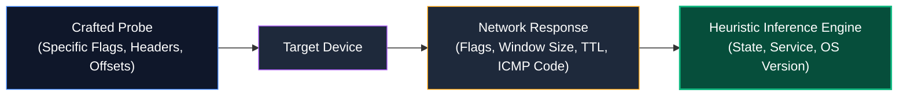

### Probe Taxonomies in CEH:
1. **ICMP Probes:**
   * **Echo Request (`Type 8`):** Standard ping (`-PE`).
   * **Timestamp Request (`Type 13`):** Queries system clocks; bypasses basic ICMP Echo filters (`-PP`).
   * **Address Mask Request (`Type 17`):** Interrogates subnet masks (`-PM`).
2. **TCP Layer-4 Probes:**
   * **SYN Probes:** Interrogates listening services.
   * **ACK Probes:** Maps firewall statefulness.
3. **Application Layer Probes:**
   * Service banner grabs sending null strings, HTTP `HEAD /` requests, or SSL/TLS Client Hellos.

---

# 15. Idle Scan / Zombie Scan (`-sI`)

The **TCP Idle Scan (`-sI`)**, pioneered by Antirez (Salvatore Sanfilippo), is one of the most intellectually elegant and stealthy scanning techniques in ethical hacking.

## What is a Zombie Host?

A **zombie host** is an intermediary, idle third-party system on the network that possesses two mandatory characteristics:
1. **Completely Idle Traffic:** No other network traffic is arriving at or departing from the host during the scan window.
2. **Predictable IP ID Incrementation:** The host assigns its **IPv4 Identification (IP ID)** field incrementally (e.g., $+1$ for every packet generated).

## Why Perform an Idle Scan?

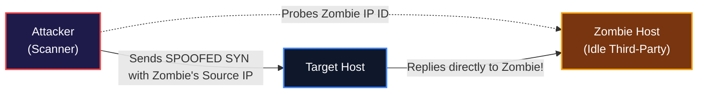

* **Complete Anonymity:** The target machine's intrusion detection systems (IDS) and firewall logs record **only the IP address of the zombie host**. The attacker's true IP never sends a single packet to the target!
* **Bypassing Ingress Filtering:** Enables mapping firewall trust relationships between the zombie and the target (e.g., if a firewall permits traffic from the zombie's IP).

---

# 16. IP ID Mechanics & Idle Scanning Algorithm

Every IPv4 packet header contains a 16-bit **Identification (IP ID)** field used by receiving operating systems to reassemble fragmented packets:

$$\text{Header Field: } \mathbf{IP\ ID} \quad (0 \text{ to } 65,535)$$

## The 3-Step Idle Scanning Exchange

### Step 1: Probe the Zombie's Initial IP ID
The attacker sends a `SYN+ACK` to the zombie. Because the zombie never initiated a handshake, it returns a `RST` containing its current IP ID ($IPID_1 = 31337$).

```text
Attacker ─────── SYN+ACK ───────► Zombie
Attacker ◄─────── RST (IPID=31337) ── Zombie
```

### Step 2: Send a Spoofed SYN to the Target
The attacker crafts a `SYN` packet addressed to the target port, but **spoofs the source IP address to appear as the Zombie**.

```text
Attacker (Spoofing Zombie IP) ─────── SYN ───────► Target
```

Now, two possible scenarios occur at the target:

---

## Scenario A: Target Port is OPEN

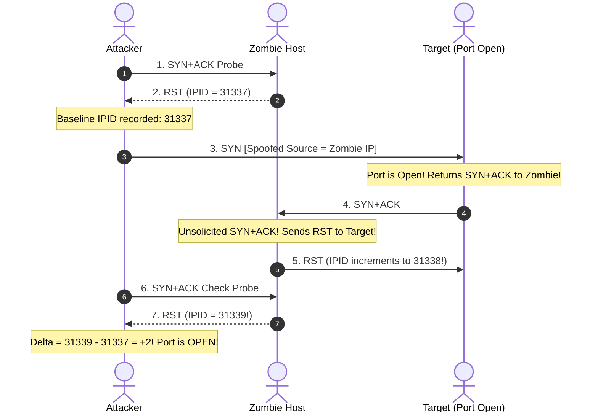

1. Target receives SYN and sends `SYN+ACK` to the **Zombie**.
2. Zombie receives an unsolicited `SYN+ACK` and sends a `RST` back to the target. **The Zombie's IP ID increments by 1** ($31338$).
3. Attacker sends a final probe to the Zombie. Zombie replies with `RST` ($IPID_2 = 31339$).
4. **Attacker Calculation:**
   $$\Delta \text{IPID} = IPID_2 - IPID_1 = 31339 - 31337 = \mathbf{+2} \implies \mathbf{PORT\ IS\ OPEN}$$

---

## Scenario B: Target Port is CLOSED

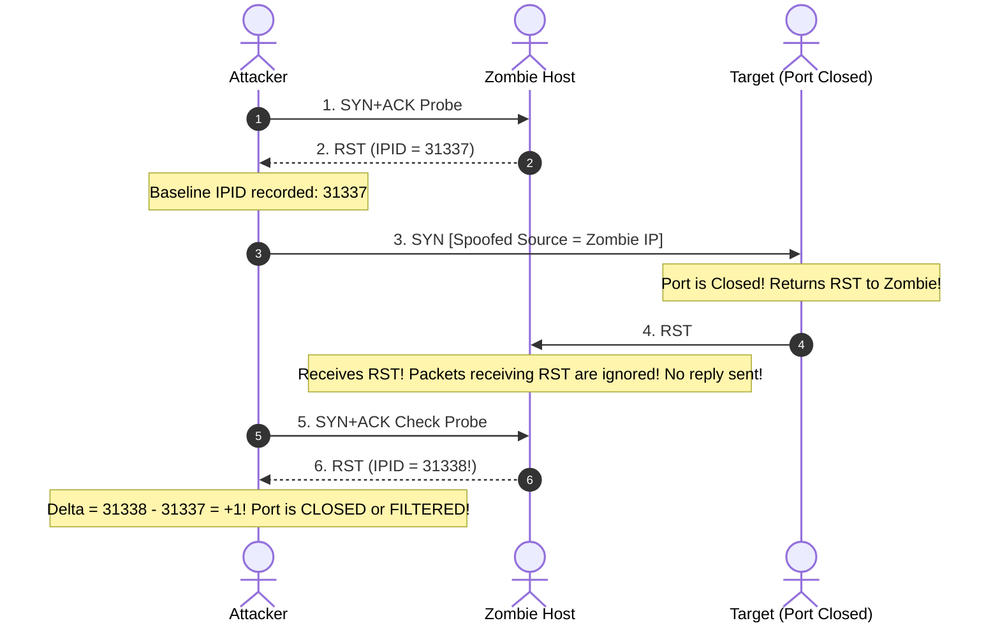

1. Target receives SYN on a closed port and returns a `RST` to the **Zombie**.
2. In TCP logic, incoming RST packets do **not** generate replies. The Zombie remains silent. **Its IP ID does NOT increment**.
3. Attacker sends a final probe to the Zombie. Zombie replies with `RST` ($IPID_2 = 31338$).
4. **Attacker Calculation:**
   $$\Delta \text{IPID} = IPID_2 - IPID_1 = 31338 - 31337 = \mathbf{+1} \implies \mathbf{PORT\ IS\ CLOSED\ OR\ FILTERED}$$

---

## Summary of Idle Scan IP ID Deltas

| Observed $\Delta \text{IPID}$ on Zombie | Deduced Target Port State | Technical Reason |
|:---:|:---:|---|
| **$+2$** | **OPEN** | Zombie was forced to send a RST to the target's `SYN+ACK`, incrementing its IP ID an extra time. |
| **$+1$** | **CLOSED / FILTERED** | Target dropped packet (filtered) or returned RST (closed); Zombie never transmitted to target. |
| **$> +2$** | **UNRELIABLE** | Zombie is not truly idle; external traffic is interacting with the host during testing. |

## Modern Limitations of Idle Scanning
* **Randomized IP ID:** Modern operating systems (Windows 10/11, modern Linux kernels, macOS) implement randomized IP ID generation or per-connection hash generators (RFC 7739), preventing simple linear delta prediction.
* **Egress Filtering:** Modern ISP edge routers drop packets whose source IP does not match the customer's subnet (BCP 38 / RFC 2827), preventing spoofed packets from reaching the target.

---

# 17. Routing Manipulation & Path Redirection

Routing manipulation encompasses offensive tradecraft aimed at diverting network packets away from their authorized paths through intermediary adversary-controlled inspection or injection points.

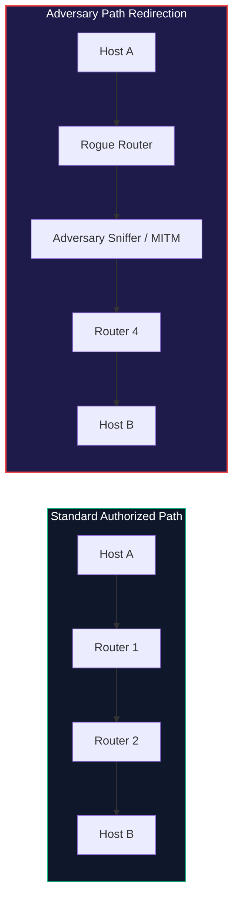

## Mechanisms & Threat Vectors

* **Source Routing Abuse:** The sender specifies the exact sequence of router IP hops in the IP header options, bypassing firewall checkpoints.
* **BGP Route Hijacking:** Forging Border Gateway Protocol (BGP) Autonomous System (AS) path announcements to redirect global internet transit traffic through rogue telecommunication providers.
* **ICMP Redirect Attacks:** Emitting forged `ICMP Type 5` redirect packets to trick local endpoints into updating their default gateway to an attacker's rogue machine.
* **OSPF / RIP Route Poisoning:** Injecting fraudulent routing table updates with lower metric costs into internal network routing protocols.

## Source Routing in CEH

IPv4 includes two optional flags inside the Options field:
1. **Loose Source Routing (LSR):** Specifies a list of required IP hops the packet must traverse, but allows intermediary unlisted routers.
2. **Strict Source Routing (SSR):** Specifies the exact, unbroken sequence of router hops; if any next hop cannot be reached directly, the packet is discarded.

> [!NOTE]
> Modern enterprise routers disable IP Source Routing by default (`no ip source-route` on Cisco IOS) because it facilitates perimeter firewall bypass and session interception.

---

# 18. TCP/IP Checksum Calculation & Integrity Validation

A **checksum** is a 16-bit mathematical value placed in packet headers to detect corruption, transmission errors, or unauthorized in-transit packet tampering.

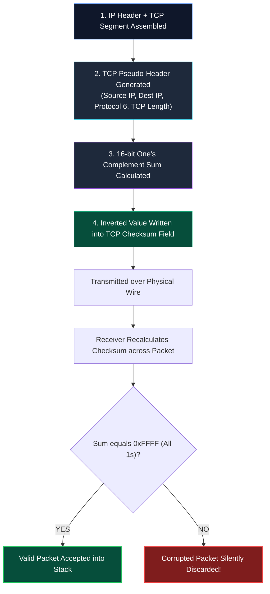

## The TCP Pseudo-Header

To ensure the packet arrived at the intended Layer-3 address, the TCP checksum calculation incorporates a **12-byte IP Pseudo-Header**:

```
 0                   1                   2                   3
 0 1 2 3 4 5 6 7 8 9 0 1 2 3 4 5 6 7 8 9 0 1 2 3 4 5 6 7 8 9 0 1
+-+-+-+-+-+-+-+-+-+-+-+-+-+-+-+-+-+-+-+-+-+-+-+-+-+-+-+-+-+-+-+-+
|                       Source IP Address                       |
+-+-+-+-+-+-+-+-+-+-+-+-+-+-+-+-+-+-+-+-+-+-+-+-+-+-+-+-+-+-+-+-+
|                    Destination IP Address                     |
+-+-+-+-+-+-+-+-+-+-+-+-+-+-+-+-+-+-+-+-+-+-+-+-+-+-+-+-+-+-+-+-+
|     Zero      |    Protocol   |           TCP Length          |
+-+-+-+-+-+-+-+-+-+-+-+-+-+-+-+-+-+-+-+-+-+-+-+-+-+-+-+-+-+-+-+-+
```

## Receiver Validation Decision Tree
1. The receiving operating system receives the IP packet and TCP segment.
2. It reconstructs the pseudo-header from the IP fields and runs the 16-bit one's complement sum algorithm across the entire structure.
3. If valid, the packet is forwarded to the application socket.
4. If invalid, the packet is **silently discarded without generating any error response**.

---

# 19. Why Checksum Matters in Packet Crafting & Evasion

When using automated scanners, the underlying network driver or operating system kernel computes valid checksums automatically.

However, during manual packet crafting with **Hping3**, **Scapy**, or raw C sockets, improper field manipulation can corrupt the checksum:

```
[ Custom Packet Construction ]
  ├── IP Layer:   Modified Source IP / TTL / IP ID
  └── TCP Layer:  Modified Sequence Number / Flags
        │
        ▼
  (Did you recalculate the Checksum?)
        ├── YES: Packet accepted by target operating system.
        └── NO:  Packet instantly dropped by kernel before inspection!
```

## Bad Checksums for IDS/IPS Evasion

Security researchers leverage intentional checksum corruption to identify inline security devices:

```bash
# Nmap bad checksum scan
nmap --badsum 192.168.1.10
```

* **Target Host Behavior:** The operating system kernel of the target host verifies the TCP checksum. Seeing an invalid sum, it **silently drops the packet** and never replies.
* **Inline IDS/IPS Behavior:** Incomplete or misconfigured network intrusion systems may inspect the payload and trigger an alert or return a response without validating Layer-4 checksum integrity.
* **Deduction:** If a packet with an invalid checksum generates an alert or reply, an **intermediary IDS, IPS, or WAF is present**.

---

# 20. Scanning Countermeasures & Defensive Engineering

Enterprise defenders deploy layered countermeasures to neutralize network scanning:

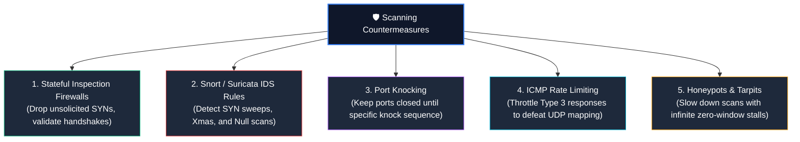

### Defensive Hardening Techniques:
1. **Disable ICMP Responses:** Configure core firewalls to drop inbound `ICMP Type 8` (Echo), `Type 13` (Timestamp), and `Type 17` (Address Mask).
2. **Snort Rule for Xmas Scan Detection:**
   ```snort
   alert tcp any any -> $HOME_NET any (msg:"SCAN Xmas Attack Detected"; flags:FPU; sid:1000001; rev:1;)
   ```
3. **Snort Rule for Null Scan Detection:**
   ```snort
   alert tcp any any -> $HOME_NET any (msg:"SCAN Null Attack Detected"; flags:0; sid:1000002; rev:1;)
   ```
4. **Deploying Port Tarpits (e.g., LaBrea):** Tarpits accept TCP connections and set the window size to zero, trapping automated port scanners in endless transmission stalls.

---

# 🧠 Master CEH Scanning Flowchart

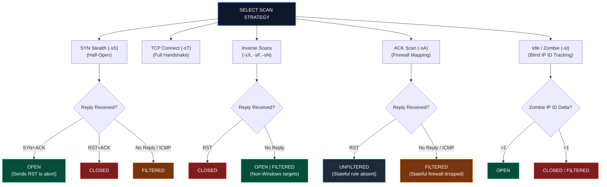

---

# 🎯 High-Value CEH Exam Distinctions to Memorize

| Concept / Technique | Key Exam Takeaway |
|---|---|
| **SYN Scan (`-sS`)** | Half-open scan; sends `SYN`, receives `SYN+ACK`, immediately sends `RST`. Never establishes connection. |
| **TCP Connect (`-sT`)** | Completes full 3-way handshake (`SYN → SYN/ACK → ACK`); works without root privileges; highly logged. |
| **Xmas Scan (`-sX`)** | Sets **FIN, PSH, and URG** flags (`0x29`). Open ports ignore it; closed ports reply with `RST`. |
| **Null Scan (`-sN`)** | No flags set (`0x00`). Open ports ignore it; closed ports reply with `RST`. |
| **FIN Scan (`-sF`)** | Only **FIN** flag set (`0x01`). Open ports ignore it; closed ports reply with `RST`. |
| **Windows RFC 793 Flaw** | Windows sends `RST` to *any* invalid packet (FIN, Xmas, Null), falsely showing all ports closed. |
| **ACK Scan (`-sA`)** | Used to map **firewall rules**, NOT port states. `RST` = Unfiltered; No response = Filtered. |
| **UDP Scan (`-sU`)** | Connectionless. Closed ports return `ICMP Type 3, Code 3` (Port Unreachable); Open ports return data or no reply. |
| **Idle Scan (`-sI`)** | Blind scan using a zombie host. Target only logs zombie IP. Relies on predictable sequential **IP ID**. |
| **Idle Scan Deltas** | **$\Delta = +2$**: Target port is **OPEN**; **$\Delta = +1$**: Target port is **CLOSED/FILTERED**. |
| **Hping3** | Raw packet-crafting tool; allows arbitrary flag setting (`-S`, `-A`, `-F`, `-R`), TTL control, and spoofing (`-a`). |
| **SYN-ACK / FIN-ACK** | These are **flag combinations**, not separate flags. |
| **TCP Checksum** | 16-bit one's complement sum calculated over TCP header, data, and 12-byte **IP Pseudo-Header**. |
| **Bad Checksum (`--badsum`)** | Target OS kernels drop bad checksums; replies indicate an intervening IDS/IPS or WAF. |
| **Timing `-T0` to `-T5`** | `-T0` (Paranoid) to `-T5` (Insane). `-T4` is standard aggressive lab setting. |

---

<div align="center">

<b>Previous Module: [Module 01 — Introduction to Ethical Hacking](../Module%2001/README.md)</b> • <b>Next Module: [Module 04 — Enumeration](../README.md)</b>  
*Cyber-Blog • Production-Grade Security Knowledge Base*

</div>
