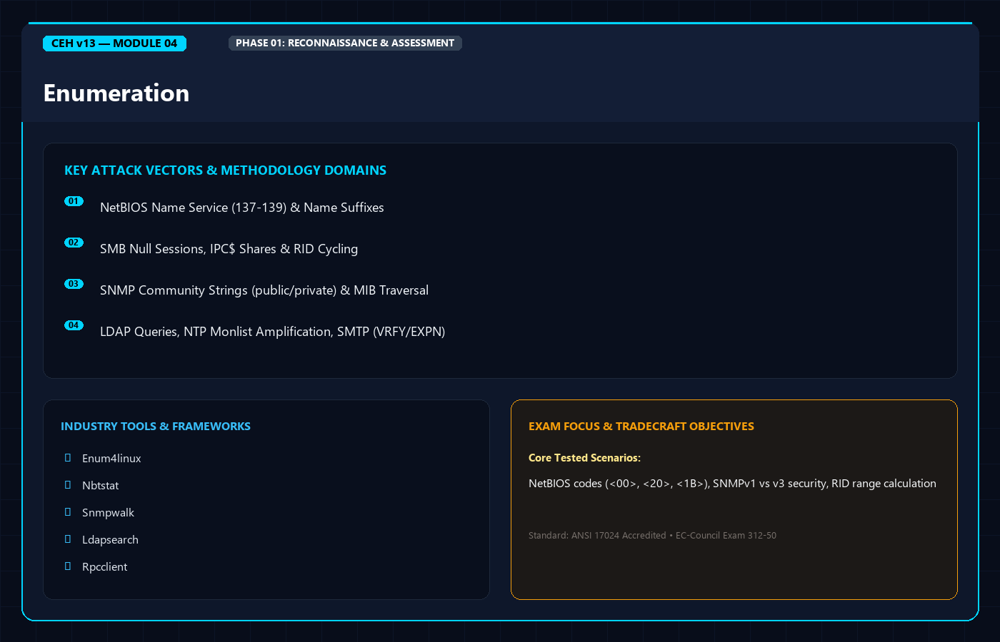
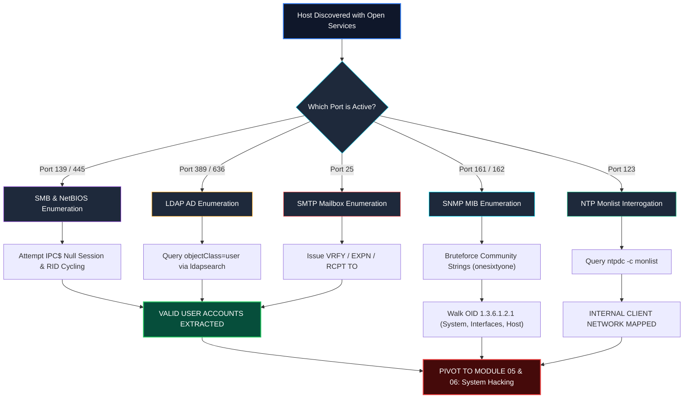

<div align="center">




# 🛡️ CEH v13 — Module 04: Enumeration
### Certified Ethical Hacker (CEH) Exam Notes • Protocol Interrogation • NetBIOS & SMB • SNMP & LDAP • NTP & NFS • SMTP & DNS • RID Cycling & Defense

[-0078D4?style=for-the-badge&logo=shield)](https://www.eccouncil.org/programs/certified-ethical-hacker-ceh/)
[](https://www.eccouncil.org/)
[](../README.md)
[](./README.md)

<p align="center">
  <b>Authoritative, exam-oriented study guide and reference architecture for CEH v13 Module 04: Enumeration. Covers point-to-point service interrogation, NetBIOS suffixes and name resolution, SMB null sessions and RID cycling, SNMP MIB tree traversal (v1/v2c vs. v3), LDAP directory queries, NTP monlist amplification recon, NFS exports, SMTP user validation (VRFY, EXPN, RCPT), IPsec IKE scanning, RPC and VoIP interrogation, automated enumeration frameworks, and protocol-level hardening countermeasures.</b>
</p>

[📖 Module Hub](../README.md) • [📋 PDF Reference](./CEHv13%20-%20Module%2004%20-%20Enumeration.pdf) • [🧰 Nmap Masterclass](../../tools/Nmap/README.md) • [🗺️ Knowledge Base Index](../../README.md)

</div>

---

## 📋 Table of Contents

- [1. Enumeration Fundamentals](#1-enumeration-fundamentals)
  - [Definition & The Scanning-to-Enumeration Pivot](#definition--the-scanning-to-enumeration-pivot)
  - [What Information is Extracted During Enumeration?](#what-information-is-extracted-during-enumeration)
  - [Core Protocols Subject to Enumeration](#core-protocols-subject-to-enumeration)
- [2. NetBIOS Enumeration](#2-netbios-enumeration)
  - [NetBIOS Architecture & Port Usage (Ports 137, 138, 139)](#netbios-architecture--port-usage-ports-137-138-139)
  - [The NetBIOS Name Suffixes Table (Must-Know CEH Codes)](#the-netbios-name-suffixes-table-must-know-ceh-codes)
  - [NetBIOS Interrogation Tools: `nbtstat`, NetBIOS Enumerator](#netbios-interrogation-tools-nbtstat-netbios-enumerator)
- [3. SMB & Windows RPC Enumeration](#3-smb--windows-rpc-enumeration)
  - [SMB Architecture (Port 445 vs. Port 139)](#smb-architecture-port-445-vs-port-139)
  - [Null Sessions (IPC$ Exploitation) & Mechanics](#null-sessions-ipc-exploitation--mechanics)
  - [RID Cycling & User Account Extraction](#rid-cycling--user-account-extraction)
  - [SMB Toolchains: `enum4linux-ng`, `smbclient`, `crackmapexec`, `rpcclient`](#smb-toolchains-enum4linux-ng-smbclient-crackmapexec-rpcclient)
- [4. SNMP Enumeration](#4-snmp-enumeration)
  - [SNMP Architecture & Ports (Port 161 vs. Port 162)](#snmp-architecture--ports-port-161-vs-port-162)
  - [Community Strings: The Flaw of Plaintext Secrets](#community-strings-the-flaw-of-plaintext-secrets)
  - [Management Information Base (MIB) & Object Identifiers (OIDs)](#management-information-base-mib--object-identifiers-oids)
  - [SNMPv1/v2c vs. SNMPv3 Security Models](#snmpv1v2c-vs-snmpv3-security-models)
  - [SNMP Toolchains: `snmpwalk`, `snmp-check`, `onesixtyone`](#snmp-toolchains-snmpwalk-snmp-check-onesixtyone)
- [5. LDAP Enumeration](#5-ldap-enumeration)
  - [LDAP Architecture & Active Directory Integration (Ports 389, 636, 3268)](#ldap-architecture--active-directory-integration-ports-389-636-3268)
  - [Query Syntax & Distinguished Names (DN, CN, OU, DC)](#query-syntax--distinguished-names-dn-cn-ou-dc)
  - [LDAP Query Tools: `ldapsearch`, AD Explorer, Python-LDAP](#ldap-query-tools-ldapsearch-ad-explorer-python-ldap)
- [6. NTP & NFS Enumeration](#6-ntp--nfs-enumeration)
  - [NTP Architecture (UDP Port 123) & The `monlist` Threat](#ntp-architecture-udp-port-123--the-monlist-threat)
  - [NTP Interrogation: `ntpq`, `ntpdate`](#ntp-interrogation-ntpq-ntpdate)
  - [NFS Architecture (TCP/UDP Port 2049 & RPC Portmapper 111)](#nfs-architecture-tcpudp-port-2049--rpc-portmapper-111)
  - [NFS Export Discovery: `showmount -e` & Remote Mounting](#nfs-export-discovery-showmount--e--remote-mounting)
- [7. SMTP & DNS Enumeration](#7-smtp--dns-enumeration)
  - [SMTP Architecture (TCP Port 25, 587)](#smtp-architecture-tcp-port-25-587)
  - [SMTP User Enumeration Commands: `VRFY`, `EXPN`, and `RCPT TO`](#smtp-user-enumeration-commands-vrfy-expn-and-rcpt-to)
  - [Automating SMTP Reconnaissance: `smtp-user-enum`](#automating-smtp-reconnaissance-smtp-user-enum)
  - [DNS Cache Snooping & Forward/Reverse Mapping](#dns-cache-snooping--forwardreverse-mapping)
- [8. Specialized Enumeration: IPsec, VoIP, and Unix/Linux](#8-specialized-enumeration-ipsec-voip-and-unixlinux)
  - [IPsec IKE Enumeration (UDP Port 500) & `ike-scan`](#ipsec-ike-enumeration-udp-port-500--ike-scan)
  - [VoIP SIP Enumeration (UDP/TCP Ports 5060, 5061) & `svmap`](#voip-sip-enumeration-udptcp-ports-5060-5061--svmap)
  - [Unix/Linux RPC Enumeration: `rpcinfo`, `rusers`, `finger`](#unixlinux-rpc-enumeration-rpcinfo-rusers-finger)
- [9. Enumeration Countermeasures & Defensive Hardening](#9-enumeration-countermeasures--defensive-hardening)
  - [Windows & SMB Defenses: RestrictAnonymous & SMB Signing](#windows--smb-defenses-restrictanonymous--smb-signing)
  - [SNMPv3 Migration & Community String Hardening](#snmpv3-migration--community-string-hardening)
  - [LDAP Signing & Channel Binding](#ldap-signing--channel-binding)
  - [NTP, SMTP, and NFS Hardening Rules](#ntp-smtp-and-nfs-hardening-rules)
- [🧠 Master CEH Enumeration Decision Flowchart](#-master-ceh-enumeration-decision-flowchart)
- [🎯 High-Value CEH Exam Distinctions to Memorize](#-high-value-ceh-exam-distinctions-to-memorize)

---

# 1. Enumeration Fundamentals

## Definition & The Scanning-to-Enumeration Pivot

**Enumeration** is the first phase of ethical hacking where the attacker transitions from **network perimeter discovery** into **active, point-to-point application-layer interrogation**. While scanning discovers live hosts and open listening ports (Layer 3 and 4), enumeration establishes direct application-level connections (Layer 7) to extract valid user accounts, group memberships, network shares, routing tables, service configurations, and machine names.

$$\text{Reconnaissance (Passive/Active)} \longrightarrow \text{Scanning (Open Ports)} \longrightarrow \mathbf{Enumeration\ (System\ Blueprints)} \longrightarrow \text{Vulnerability Analysis} \longrightarrow \text{Exploitation}$$

```
┌──────────────────────────────────────────────────────────────────────────────────┐
│                   SCANNING VS. ENUMERATION: THE TECHNICAL PIVOT                  │
├──────────────────────────────────────────────────────────────────────────────────┤
│                                                                                  │
│   SCANNING (Layer 4 Probing):                                                    │
│   Attacker ───(TCP SYN Port 445)───► Target ───(SYN/ACK)───► [Port 445 is OPEN]  │
│                                                                                  │
│   ENUMERATION (Layer 7 Interrogation):                                           │
│   Attacker ───(SMB Session Setup / IPC$ Null Session)──────────────────────────► │
│   Target   ◄──(SMB Tree Connect / SAMR RPC Pipe Query)───────────────────────────│
│   Target   ───(Dumps list of domain usernames, RIDs, shares, password policy)──► │
│                                                                                  │
└──────────────────────────────────────────────────────────────────────────────────┘
```

---

## What Information is Extracted During Enumeration?

1. **User Accounts & Groups:** Valid domain and local usernames, administrative groups, service accounts.
2. **Network Shares & Permissions:** Read/write accessible file shares (`SYSVOL`, `NETLOGON`, departmental shares).
3. **Machine Names & Architecture:** NetBIOS names, fully qualified domain names (FQDN), Active Directory Domain Controllers.
4. **Service Configurations & Banners:** Specific daemon versions, loaded modules, unpatched internal features.
5. **Routing Tables & SNMP Walk Data:** Internal interface IP addresses, routing gateways, hardware vendor serial numbers.
6. **Password & Audit Policies:** Minimum password length, lockout thresholds, account expiration parameters.

---

## Core Protocols Subject to Enumeration

| Protocol | Default Port(s) | Layer 4 Protocol | Information Harvested |
|---|---|---|---|
| **NetBIOS Name Service** | 137 | UDP | Computer name, workgroup/domain, logged-on users. |
| **NetBIOS Session Service** | 139 | TCP | File/printer sharing, local null sessions. |
| **SMB (Server Message Block)** | 445 | TCP | User accounts, shares, policies, OS build, RID cycling. |
| **SNMP (Simple Network Mgmt)** | 161 (Agent), 162 (Trap) | UDP | Device interfaces, routing tables, software, usernames. |
| **LDAP (Lightweight Directory Access)** | 389 (Clear), 636 (SSL), 3268 (GC) | TCP / UDP | Active Directory schema, users, groups, computers, OUs. |
| **NTP (Network Time Protocol)** | 123 | UDP | Synchronized clients, internal IP disclosure, monlist reflection. |
| **NFS (Network File System)** | 2049, 111 (RPCbind) | TCP / UDP | Exported directory paths, client mount permissions. |
| **SMTP (Simple Mail Transfer)** | 25, 465, 587 | TCP | User verification (`VRFY`), mailing lists (`EXPN`). |
| **DNS (Domain Name System)** | 53 | TCP / UDP | Zone transfers (AXFR), cached external queries (snooping). |
| **IPsec (Internet Protocol Security)** | 500 (IKE), 4500 (NAT-T) | UDP | Encryption ciphers, VPN gateways, aggressive mode hashes. |
| **RPC (Remote Procedure Call)** | 135 | TCP | Registered RPC endpoints, DCOM services, interface UUIDs. |

---

# 2. NetBIOS Enumeration

## NetBIOS Architecture & Port Usage (Ports 137, 138, 139)

**Network Basic Input/Output System (NetBIOS)** is a networking API that allows applications on separate computers to communicate across a local area network (LAN). In Windows environments, NetBIOS operates over TCP/IP (NetBT):
* **Port 137 (UDP):** NetBIOS Name Service (NBNS) — name registration and resolution.
* **Port 138 (UDP):** NetBIOS Datagram Service — connectionless communication.
* **Port 139 (TCP):** NetBIOS Session Service — connection-oriented file/print sharing.

A NetBIOS name consists of **16 characters**: the first 15 characters represent the computer or domain name, and the **16th character (the suffix)** specifies the service or role.

---

## The NetBIOS Name Suffixes Table (Must-Know CEH Codes)

```
┌──────────────────────────────────────────────────────────────────────────────────┐
│                     NETBIOS 16TH-BYTE RECORD SUFFIX STRUCTURE                    │
├──────────────────────────────────────────────────────────────────────────────────┤
│                                                                                  │
│   [ W O R K S T A T I O N 0 1 ]  [ < 0 0 > ]                                     │
│   ├───────────────────────────┤  ├─────────┤                                     │
│     15-Byte Host Identifier       16th Byte: Suffix designating Service Type     │
│                                                                                  │
└──────────────────────────────────────────────────────────────────────────────────┘
```

| NetBIOS Suffix | Record Type | Service / Role | Practical Significance |
|:---:|:---:|---|---|
| **`<00>`** | Unique | **Workstation Service** | Identifies the client machine name or domain name. |
| **`<00>`** | Group | **Domain / Workgroup Name** | Identifies the workgroup or domain the machine belongs to. |
| **`<03>`** | Unique | **Messenger Service** | Registered by the logged-in user to receive winpopup messages. |
| **`<06>`** | Unique | **RAS Server Service** | Indicates a Remote Access Service (dial-up/VPN) server. |
| **`<1B>`** | Unique | **Domain Master Browser** | **Primary Domain Controller (PDC)** managing the master browser list. |
| **`<1C>`** | Group | **Domain Controllers** | Designates an authenticating Domain Controller group. |
| **`<1D>`** | Unique | **Master Browser** | The designated local subnet Master Browser server. |
| **`<1E>`** | Group | **Browser Service Elections** | Group name used to conduct browser election announcements. |
| **`<20>`** | Unique | **Server Service (File Sharing)** | **File and Print Sharing is ACTIVE** (Target exposes shares). |

> [!IMPORTANT]
> **High-Yield CEH Exam Question:**
> * If you see **`<20>` Unique**, it means **File and Print Sharing** is running; you can attempt SMB enumeration or share access.
> * If you see **`<1B>` Unique**, the host is the **Domain Master Browser (PDC)**.
> * If you see **`<03>` Unique**, the name listed is the **currently logged-in username**.

---

## NetBIOS Interrogation Tools: `nbtstat`, NetBIOS Enumerator

### Windows Native `nbtstat`
```cmd
:: Display NetBIOS name table of remote host
nbtstat -A 192.168.1.50

:: Display NetBIOS name table using computer name
nbtstat -a TARGETHOST

:: View local NetBIOS name cache
nbtstat -c
```

### Sample `nbtstat -A` Output Breakdown
```text
NetBIOS Remote Machine Name Table

       Name               Type         Status
    ---------------------------------------------
    CORP-DC01      <00>  UNIQUE      Registered
    ACME           <00>  GROUP       Registered
    CORP-DC01      <20>  UNIQUE      Registered   <-- File Sharing Enabled!
    ACME           <1B>  UNIQUE      Registered   <-- Domain Master Browser (PDC)!
    ACME           <1C>  GROUP       Registered   <-- Domain Controller!
    JDOE           <03>  UNIQUE      Registered   <-- Logged-in user is 'jdoe'!

    MAC Address = 00-0C-29-4F-8E-12
```

---

# 3. SMB & Windows RPC Enumeration

## SMB Architecture (Port 445 vs. Port 139)

* **SMB over NetBIOS (Port 139 TCP):** Legacy transport requiring NetBIOS encapsulation over NBT.
* **Direct Hosted SMB (Port 445 TCP):** Modern transport sending raw SMB packets directly over TCP without NetBIOS framing.

---

## Null Sessions (IPC$ Exploitation) & Mechanics

A **Null Session** is an unauthenticated connection to the Windows hidden Inter-Process Communication share (`IPC$`) using an empty username and empty password:

```cmd
net use \\192.168.1.50\IPC$ "" /u:""
```

When permitted (default in Windows NT/2000, and present in misconfigured modern systems), a null session grants an anonymous caller access to Named Pipes (e.g., `\PIPE\samr`, `\PIPE\lsarpc`), allowing the attacker to dump domain accounts, security identifiers (SIDs), and password policies.

```
┌──────────────────────────────────────────────────────────────────────────────────┐
│                        SMB NULL SESSION ATTACK SEQUENCE                          │
├──────────────────────────────────────────────────────────────────────────────────┤
│                                                                                  │
│   [ATTACKER]                                          [TARGET WINDOWS SERVER]    │
│        │                                                        │                │
│        │─── 1. SMB Negotiate Protocol Request ─────────────────►│                │
│        │◄── 2. SMB Negotiate Protocol Response (NTLM/SMB2) ─────│                │
│        │                                                        │                │
│        │─── 3. Session Setup: User="", Pass="" ────────────────►│                │
│        │◄── 4. Session Setup Success (Anonymous / Guest) ───────│                │
│        │                                                        │                │
│        │─── 5. Tree Connect: \\TARGET\IPC$ ────────────────────►│                │
│        │◄── 6. Tree Connect Granted! ───────────────────────────│                │
│        │                                                        │                │
│        │─── 7. Open Named Pipe \PIPE\samr (Query Users) ───────►│                │
│        │◄── 8. User list, groups, and domain policies returned ─│                │
│                                                                                  │
└──────────────────────────────────────────────────────────────────────────────────┘
```

---

## RID Cycling & User Account Extraction

A **Security Identifier (SID)** uniquely identifies a security principal (user, group, computer) in Windows:
$$\text{S-1-5-21-3623811015-3361044348-30300820-500}$$
* The prefix identifies the issuing authority and domain.
* The trailing integer is the **Relative Identifier (RID)**.

### Standard Fixed RIDs to Memorize for the Exam
* **`500`:** Built-in Local **Administrator** account.
* **`501`:** Built-in **Guest** account.
* **`502`:** KRBTGT account (Key Distribution Center service account).
* **`512`:** Domain Admins group.
* **`513`:** Domain Users group.
* **`1000+`:** Custom created domain and local user accounts.

**RID Cycling Attack:** An attacker connects via an anonymous or low-privilege session and sequentially increments RIDs from `1000` to `5000`, sending RPC `QueryUserInfo` requests. The target server resolves each RID to its corresponding username (e.g., `1001 = jsmith`, `1002 = bwayne`), completely revealing all user accounts even if anonymous user listing is blocked.

---

## SMB Toolchains: `enum4linux-ng`, `smbclient`, `crackmapexec`, `rpcclient`

### 1. `enum4linux-ng` (Next-Generation Enumerator)
```bash
# Comprehensive null session and SMB audit
enum4linux-ng -A 192.168.1.50 -oA enum_report
```

### 2. `rpcclient` Interactive Interrogation
```bash
# Connect with null session
rpcclient -U "" -N 192.168.1.50

# Core rpcclient Commands:
rpcclient $> enumdomusers          # Dump all domain usernames
rpcclient $> enumdomgroups          # Dump domain groups
rpcclient $> queryuser 0x1f4        # Query details for RID 500 (Admin)
rpcclient $> lookupnames administrator # Resolve name to SID
rpcclient $> querydominfo           # Display domain password policies
```

### 3. `crackmapexec` (CME) / `NetExec`
```bash
# Null session share discovery across an entire subnet
crackmapexec smb 192.168.1.0/24 -u '' -p '' --shares
```

---

# 4. SNMP Enumeration

## SNMP Architecture & Ports (Port 161 vs. Port 162)

The **Simple Network Management Protocol (SNMP)** monitors and configures network hardware (routers, switches, firewalls, printers, servers).
* **Port 161 (UDP):** SNMP Agent — receives queries (`GetRequest`, `GetNextRequest`, `SetRequest`) from the management console.
* **Port 162 (UDP):** SNMP Trap — receives unsolicited alert notifications sent by agents to the SNMP Trap manager.

---

## Community Strings: The Flaw of Plaintext Secrets

In SNMPv1 and SNMPv2c, authentication is handled via a **Community String**, which functions as an unencrypted, plaintext shared password transmitted in every packet:
* **`public` (Default Read-Only):** Permits querying device configuration, interface metrics, and running processes.
* **`private` (Default Read-Write):** Permits altering device configuration, updating routing tables, and shutting down interfaces.

---

## Management Information Base (MIB) & Object Identifiers (OIDs)

The **Management Information Base (MIB)** is a hierarchical, tree-structured database of managed objects maintained on each device. Each parameter is addressed by a dotted sequence of numbers called an **Object Identifier (OID)**:

```
                                      ISO (1)
                                         │
                                      ORG (3)
                                         │
                                      DOD (6)
                                         │
                                    INTERNET (1)
                                         │
                       ┌─────────────────┴─────────────────┐
                       ▼                                   ▼
                  mgmt (2)                            private (4)
                       │                                   │
                    mib-2 (1)                        enterprises (1)
                       │
     ┌──────────┬──────┴───┬──────────┬──────────┐
     ▼          ▼          ▼          ▼          ▼
system (1)  interfaces (2) ip (4)    tcp (6)   snmp (11)
```

### High-Yield CEH MIB Top-Level OIDs
* **`1.3.6.1.2.1.1` (`system`):** Host operating system, system uptime, contact email, device name.
* **`1.3.6.1.2.1.2` (`interfaces`):** Physical network interfaces, MAC addresses, port speeds.
* **`1.3.6.1.2.1.4` (`ip`):** IP routing table, local IP addresses, ARP cache.
* **`1.3.6.1.2.1.25` (`host` - Host Resources MIB):** Installed software, running processes, mounted disk volumes, system storage.

---

## SNMPv1/v2c vs. SNMPv3 Security Models

| Feature | SNMPv1 | SNMPv2c | SNMPv3 |
|---|---|---|---|
| **Authentication** | Plaintext Community String | Plaintext Community String | Cryptographic User-based Security Model (**USM**) |
| **Confidentiality**| None (Cleartext) | None (Cleartext) | **AES / DES Encryption** |
| **Integrity** | None | None | **HMAC-SHA / HMAC-MD5** hashing |
| **Security Levels**| Unsecured | Unsecured | `noAuthNoPriv`, `authNoPriv`, `authPriv` |

> [!IMPORTANT]
> **SNMPv3 Security Levels for the Exam:**
> 1. **`noAuthNoPriv`:** Username match only, no password hash, no encryption.
> 2. **`authNoPriv`:** Authenticated via HMAC-MD5 or HMAC-SHA password hash; payload is unencrypted.
> 3. **`authPriv`:** Highest security; authenticated via HMAC-SHA/MD5 **AND encrypted with AES/DES**.

---

## SNMP Toolchains: `snmpwalk`, `snmp-check`, `onesixtyone`

```bash
# 1. Bruteforcing Community Strings with onesixtyone
onesixtyone -c dict.txt 192.168.1.50

# 2. Walking the entire MIB tree using snmpwalk
snmpwalk -v2c -c public 192.168.1.50

# 3. Querying system description directly
snmpget -v2c -c public 192.168.1.50 1.3.6.1.2.1.1.1.0

# 4. Automated audit using snmp-check
snmp-check 192.168.1.50 -c public
```

---

# 5. LDAP Enumeration

## LDAP Architecture & Active Directory Integration (Ports 389, 636, 3268)

The **Lightweight Directory Access Protocol (LDAP)** is an application protocol for querying and modifying directory services running over TCP/IP:
* **Port 389 (TCP/UDP):** Standard plaintext LDAP communication.
* **Port 636 (TCP):** LDAPS (LDAP over SSL/TLS).
* **Port 3268 (TCP):** Microsoft Global Catalog (GC) directory queries across forest domains.
* **Port 3269 (TCP):** Global Catalog over SSL.

Active Directory Domain Controllers use LDAP as their primary query interface. Anonymous LDAP binding allows unauthenticated attackers to query all user objects, group memberships, and computer accounts.

---

## Query Syntax & Distinguished Names (DN, CN, OU, DC)

LDAP objects are organized hierarchically:

```
┌──────────────────────────────────────────────────────────────────────────────────┐
│                         LDAP HIERARCHICAL NAMING MODEL                           │
├──────────────────────────────────────────────────────────────────────────────────┤
│                                                                                  │
│   CN=John Doe, OU=Security, OU=IT, DC=acme, DC=corp                              │
│   ├── CN (Common Name):         "John Doe" (Object identifier)                   │
│   ├── OU (Organizational Unit): "Security", within parent OU "IT"                │
│   └── DC (Domain Component):    "acme.corp"                                      │
│                                                                                  │
└──────────────────────────────────────────────────────────────────────────────────┘
```

---

## LDAP Query Tools: `ldapsearch`, AD Explorer, Python-LDAP

```bash
# Query Active Directory anonymously via ldapsearch
ldapsearch -x -H ldap://192.168.1.10 -b "dc=acme,dc=corp" "(objectClass=user)" sAMAccountName mail
```

---

# 6. NTP & NFS Enumeration

## NTP Architecture (UDP Port 123) & The `monlist` Threat

The **Network Time Protocol (NTP)** synchronizes computer system clocks over **UDP port 123**.
* **The `monlist` Query:** An administrative monitoring command that causes the NTP server to respond with a list of the **last 600 client IP addresses** that synchronized with the server.
* **Security Threat:**
  1. **Internal IP Enumeration:** Reveals private corporate internal workstation and server IP addresses.
  2. **NTP Amplification DDoS:** An attacker spoofs the victim's source IP and sends a tiny 8-byte `monlist` request; the NTP server returns up to 100 large packets, achieving an amplification factor of **over 500x**.

```bash
# Querying NTP server using ntpq
ntpq -c readlist 192.168.1.50
ntpq -c "rv" 192.168.1.50
ntpdc -c monlist 192.168.1.50
```

---

## NFS Architecture (TCP/UDP Port 2049 & RPC Portmapper 111)

**Network File System (NFS)** enables client machines to mount remote directory shares over the network:
* **Port 2049 (TCP/UDP):** NFS file service.
* **Port 111 (TCP/UDP):** RPCbind / Portmapper — directs clients to dynamic RPC ports.

```bash
# 1. Query remote NFS server for exported shares
showmount -e 192.168.1.50

# 2. Mount vulnerable share locally with root privileges
mkdir /mnt/nfs_target
mount -t nfs 192.168.1.50:/var/share /mnt/nfs_target -o nolock
```

---

# 7. SMTP & DNS Enumeration

## SMTP Architecture (TCP Port 25, 587)

The **Simple Mail Transfer Protocol (SMTP)** routes electronic mail. In the enumeration phase, attackers connect directly to port 25 to harvest valid usernames using built-in command primitives.

---

## SMTP User Enumeration Commands: `VRFY`, `EXPN`, and `RCPT TO`

```
┌──────────────────────────────────────────────────────────────────────────────────┐
│                     SMTP USER ENUMERATION PROTOCOL EXCHANGE                      │
├──────────────────────────────────────────────────────────────────────────────────┤
│                                                                                  │
│   Attacker ───► VRFY root                                                        │
│   Target   ◄─── 250 2.1.5 root <root@acme.corp>        (User exists!)           │
│                                                                                  │
│   Attacker ───► VRFY nonexistent_user                                            │
│   Target   ◄─── 550 5.1.1 User unknown                  (User does NOT exist)    │
│                                                                                  │
│   Attacker ───► EXPN sysadmins                                                   │
│   Target   ◄─── 250-jdoe@acme.corp                      (Expands mailing list)   │
│                 250-admin@acme.corp                                              │
│                                                                                  │
│   Attacker ───► MAIL FROM:<test@attacker.com>                                    │
│   Attacker ───► RCPT TO:<finance@acme.corp>                                      │
│   Target   ◄─── 250 Recipient OK                        (Valid internal inbox)   │
│                                                                                  │
└──────────────────────────────────────────────────────────────────────────────────┘
```

* **`VRFY <user>`:** Requests the server to verify whether a specific mailbox username exists.
* **`EXPN <list>`:** Requests the server to expand a mailing list and display its individual member email addresses.
* **`RCPT TO:<email>`:** Evaluates delivery acceptance for a recipient address during mail composition.

```bash
# Automating SMTP username harvesting
smtp-user-enum -M VRFY -U usernames.txt -t 192.168.1.25
```

---

## DNS Cache Snooping & Forward/Reverse Mapping

**DNS Cache Snooping** checks whether an intermediate recursive DNS resolver currently has a specific domain cached in memory without requesting the resolver to resolve it externally (`RD=0`, Recursion Desired bit set to zero).
* **If cached:** It proves an internal employee recently visited that website.
* **Adversary Utility:** Identifies which specific external cloud providers, banks, or security portals the target's employees utilize, revealing targets for watering-hole attacks.

---

# 8. Specialized Enumeration: IPsec, VoIP, and Unix/Linux

## IPsec IKE Enumeration (UDP Port 500) & `ike-scan`

**Internet Key Exchange (IKE)** negotiates security associations (SAs) for IPsec VPN tunnels:
* **Aggressive Mode vs. Main Mode:** In IKE Aggressive Mode, the authentication hash containing the pre-shared key (PSK) hash is transmitted in the response packet. Attackers capture this hash and crack it offline with Hashcat.

```bash
# Discover IPsec VPN gateways and aggressive mode hashes
ike-scan -A -M 192.168.1.1 --pskcrack=psk.txt
```

---

## VoIP SIP Enumeration (UDP/TCP Ports 5060, 5061) & `svmap`

The **Session Initiation Protocol (SIP)** coordinates voice and video over IP calls:
* Attackers query SIP servers with **`svmap`** (part of SIPVicious) to identify active PBX systems, extension numbers, and user agents.

```bash
# Scan PBX extensions
svmap 192.168.1.0/24
```

---

## Unix/Linux RPC Enumeration: `rpcinfo`, `rusers`, `finger`

* **`rpcinfo -p <target>`:** Lists all registered Remote Procedure Call (RPC) services, program IDs, and ports on Unix/Linux systems (NFS, mountd, rquotad).
* **`finger` (TCP Port 79):** Legacy daemon displaying logged-in users, home directories, and idle times.
* **`rusers -l <target>` (TCP Port 514):** Displays list of all logged-on users across local Unix network.

---

# 9. Enumeration Countermeasures & Defensive Hardening

```
                                 ENUMERATION COUNTERMEASURES
                                             │
      ┌──────────────────────┬───────────────┴───────────────┬──────────────────────┐
      ▼                      ▼                               ▼                      ▼
┌─────────────┐        ┌─────────────┐                 ┌─────────────┐        ┌─────────────┐
│  SMB & IPC  │        │    SNMP     │                 │    LDAP     │        │  NTP & SMTP │
├─────────────┤        ├─────────────┤                 ├─────────────┤        ├─────────────┤
│• Restrict-  │        │• Migrate to │                 │• Mandate    │        │• Disable    │
│  Anonymous=2│        │  SNMPv3     │                 │  LDAP       │          monlist     │
│• Enforce SMB│        │• Use auth-  │                 │  Signing    │        │• Disable    │
│  Signing    │        │  Priv (AES) │                 │• Block Anon │          VRFY/EXPN   │
└─────────────┘        └─────────────┘                 └─────────────┘        └─────────────┘
```

1. **Windows SMB & Null Session Defense:**
   * Set registry key `HKLM\SYSTEM\CurrentControlSet\Control\Lsa\RestrictAnonymous = 2` (prohibits anonymous enumeration of SAM accounts and shares).
   * Require SMB Signing (`RequireSecuritySignature = True`) to prevent man-in-the-middle RID manipulation.
   * Completely disable SMBv1 across the enterprise.
2. **SNMP Hardening:**
   * Remove default community strings (`public`, `private`).
   * Upgrade legacy SNMPv1/v2c systems to **SNMPv3** configured with `authPriv` (SHA authentication + AES-256 payload encryption).
   * Block UDP port 161/162 at enterprise perimeter firewalls.
3. **LDAP Hardening:**
   * Require **LDAP Signing and Channel Binding** to eliminate unauthenticated NTLM relay and anonymous binds.
   * Restrict LDAPS queries to authenticated domain users.
4. **NTP & Mail Infrastructure:**
   * Add `disable monitor` in `ntp.conf` to disable `monlist` response.
   * Disable `VRFY` and `EXPN` commands in SMTP server configurations (Postfix, Microsoft Exchange, Sendmail).

---

# 🧠 Master CEH Enumeration Decision Flowchart



---

# 🎯 High-Value CEH Exam Distinctions to Memorize

| Question / Concept | Correct Answer / Key Insight | Common Exam Distractor (Trap) |
|---|---|---|
| **NetBIOS code for File Sharing** | **`<20>` Unique** (Server service is running). | `<00>` (Workstation service, not file sharing). |
| **NetBIOS code for Primary Domain Controller** | **`<1B>` Unique** (Domain Master Browser). | `<1D>` (Subnet Master Browser, not Domain Master). |
| **RID for Built-in Administrator** | **`500`** (Fixed relative identifier). | `501` (That is Guest) or `1000` (First user created). |
| **SNMP Port vs. Trap Port** | Query agent is **UDP 161**; Trap listener is **UDP 162**. | Confusing 161 and 162; or claiming SNMP uses TCP. |
| **SNMPv3 Maximum Security Level** | **`authPriv`** (Authenticates with SHA/MD5 and encrypts with AES). | `authNoPriv` (Authenticates but payload is unencrypted!). |
| **Top-level MIB OID for Host Resources** | **`1.3.6.1.2.1.25`** (Running software, storage, processes). | `1.3.6.1.2.1.1` (System description only). |
| **SMTP Command to verify username** | **`VRFY`** (Verifies specific user inbox existence). | `RCPT` (Used during mail creation; VRFY is direct). |
| **NTP Monlist Vulnerability** | Returns **last 600 client IPs** and enables **500x DDoS amplification**. | "NTP allows remote arbitrary code execution" (False!). |
| **Null Session Command** | `net use \\target\IPC$ "" /u:""` | `net use \\target\C$ "" /u:""` (C$ requires admin rights!). |
| **Defense against anonymous SMB enum** | Set **`RestrictAnonymous = 2`** in Windows Registry. | `RestrictAnonymous = 0` (Permits complete access!). |

---

<div align="center">

<b>Next Module: [Module 05 — Vulnerability Analysis](../Module%2005/README.md)</b> • <b>Previous Module: [Module 03 — Scanning Networks](../Module%2003/README.md)</b>

</div>
