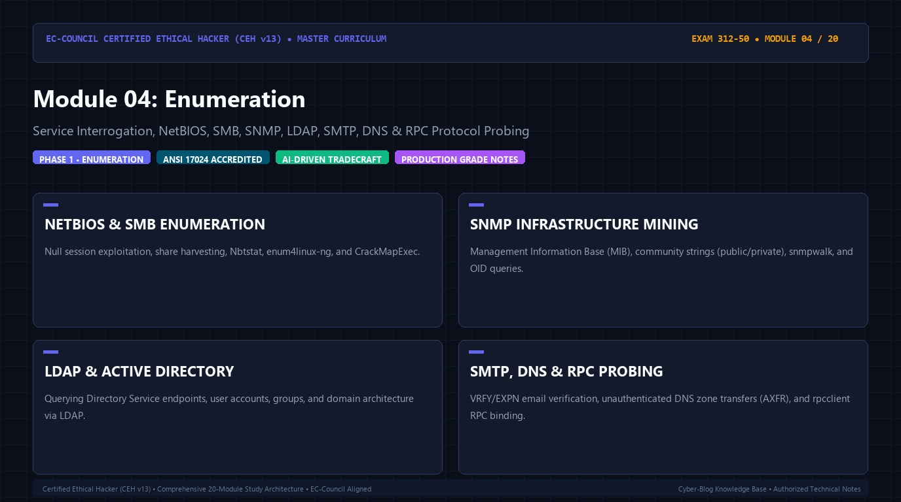
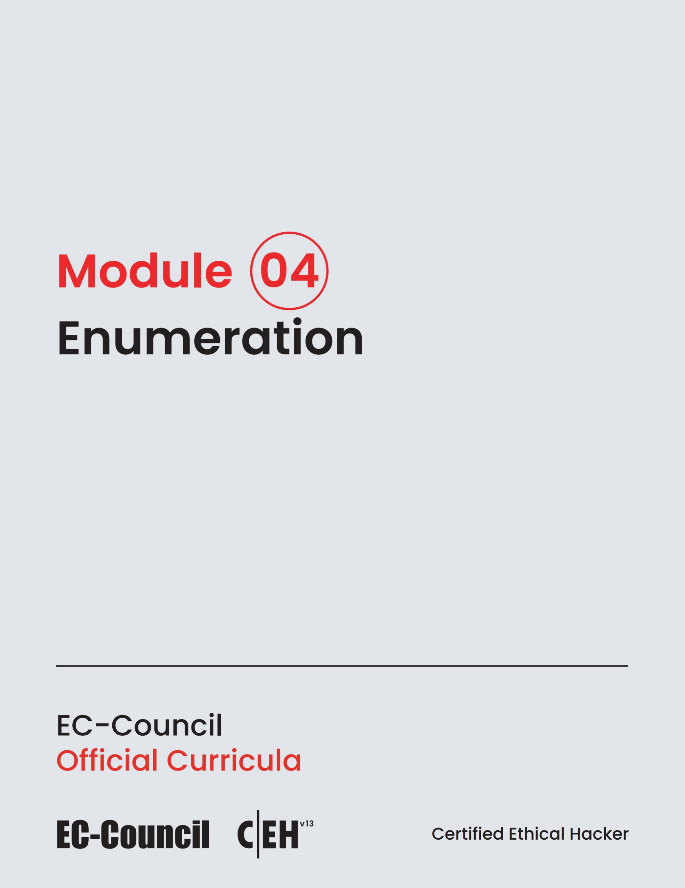

# 🛡️ CEH v13 — Module 04: Enumeration
### Certified Ethical Hacker (CEH v13) Exam Notes • Phase 1: Foundations & Reconnaissance • Technical Study Architecture

[-0078D4?style=for-the-badge&logo=shield)](https://www.eccouncil.org/programs/certified-ethical-hacker-ceh/)

  <b>Authoritative, exam-oriented study guide and reference architecture for CEH v13 Module 04: Enumeration. Covers service interrogation, netbios, smb, snmp, ldap, smtp, dns & rpc protocol probing, attack methodologies, automated tooling, MITRE ATT&CK alignment, and enterprise defensive engineering.</b>

[📖 Module Hub](../README.md) • [📋 PDF Reference](./CEHv13%20-%20Module%2004%20-%20Enumeration.pdf) • [🗺️ Knowledge Base Index](../../README.md)

---

### 📖 Official Courseware Slide Deck

*EC-Council Certified Ethical Hacker (CEH v13) Official Course Slide Deck Reference*

---

## 📋 Module Overview & Exam Objectives

In the **EC-Council Certified Ethical Hacker (CEH v13)** certification exam (Exam 312-50), **Module 04: Enumeration** represents a fundamental domain within **Phase 1: Foundations & Reconnaissance**. Candidates are tested on both theoretical protocol knowledge and hands-on operational commands used to discover, analyze, exploit, and remediate vulnerabilities across modern networked environments.

### Core Learning Domains:
* **NETBIOS & SMB ENUMERATION:** Null session exploitation, share harvesting, Nbtstat, enum4linux-ng, and CrackMapExec.
* **SNMP INFRASTRUCTURE MINING:** Management Information Base (MIB), community strings (public/private), snmpwalk, and OID queries.
* **LDAP & ACTIVE DIRECTORY:** Querying Directory Service endpoints, user accounts, groups, and domain architecture via LDAP.
* **SMTP, DNS & RPC PROBING:** VRFY/EXPN email verification, unauthenticated DNS zone transfers (AXFR), and rpcclient RPC binding.

---

## 🔬 In-Depth Technical Breakdown

### 1. NETBIOS & SMB ENUMERATION

Null session exploitation, share harvesting, Nbtstat, enum4linux-ng, and CrackMapExec.

* **Core Operational Theory:** Candidates must understand both how threat actors leverage these techniques during offensive operations and how enterprise defenders monitor and detect anomalous behavior.
* **Key Attack Artifacts:** Exam scenarios frequently present command-line strings, configuration files, packet captures, and network connection parameters requiring precise identification of adversary behavior.
* **Exam Relevance:** Directly tested across multiple-choice questions on CEH Exam 312-50.

### 2. SNMP INFRASTRUCTURE MINING

Management Information Base (MIB), community strings (public/private), snmpwalk, and OID queries.

* **Core Operational Theory:** Candidates must understand both how threat actors leverage these techniques during offensive operations and how enterprise defenders monitor and detect anomalous behavior.
* **Key Attack Artifacts:** Exam scenarios frequently present command-line strings, configuration files, packet captures, and network connection parameters requiring precise identification of adversary behavior.
* **Exam Relevance:** Directly tested across multiple-choice questions on CEH Exam 312-50.

### 3. LDAP & ACTIVE DIRECTORY

Querying Directory Service endpoints, user accounts, groups, and domain architecture via LDAP.

* **Core Operational Theory:** Candidates must understand both how threat actors leverage these techniques during offensive operations and how enterprise defenders monitor and detect anomalous behavior.
* **Key Attack Artifacts:** Exam scenarios frequently present command-line strings, configuration files, packet captures, and network connection parameters requiring precise identification of adversary behavior.
* **Exam Relevance:** Directly tested across multiple-choice questions on CEH Exam 312-50.

### 4. SMTP, DNS & RPC PROBING

VRFY/EXPN email verification, unauthenticated DNS zone transfers (AXFR), and rpcclient RPC binding.

* **Core Operational Theory:** Candidates must understand both how threat actors leverage these techniques during offensive operations and how enterprise defenders monitor and detect anomalous behavior.
* **Key Attack Artifacts:** Exam scenarios frequently present command-line strings, configuration files, packet captures, and network connection parameters requiring precise identification of adversary behavior.
* **Exam Relevance:** Directly tested across multiple-choice questions on CEH Exam 312-50.

---

## 🛠️ Tooling & Command Reference Matrix

| Tool / Technology | Category | Primary Function | Exam Utility / Key Syntax |
| :--- | :--- | :--- | :--- |
| **enum4linux-ng** | SMB Enumeration | Automated Windows/Samba enumeration | ``enum4linux-ng -A 10.10.10.10`` |
| **nbtstat** | NetBIOS Tool | Local/remote NetBIOS name resolution | ``nbtstat -A 10.10.10.10`` |
| **snmpwalk** | SNMP Utility | MIB tree walking via community strings | ``snmpwalk -v2c -c public 10.10.10.10`` |
| **ldapsearch** | LDAP Client | Active Directory / OpenLDAP queries | ``ldapsearch -x -H ldap://10.10.10.10 -b 'dc=corp,dc=local'`` |
| **rpcclient** | MSRPC Tool | Executing MSRPC functions via SMB pipe | ``rpcclient -U '' -N 10.10.10.10`` |

---

## 🛡️ Enterprise Countermeasures & Hardening Guidelines

1. **Principle of Least Privilege:** Enforce strict role-based access control (RBAC) and minimize attack surfaces across network daemons.
2. **Defensive Telemetry & Logging:** Centralize event logging (SIEM) with real-time alerting on anomalous spikes, connection retries, and unauthorized protocol commands.
3. **Continuous Auditing & Patching:** Regularly scan infrastructure using automated vulnerability scanners and enforce strict SLA timelines for critical and high vulnerabilities.
4. **Network Segmentation & Zero Trust:** Isolate sensitive subnets, database tiers, and management interfaces behind stateful firewalls and intrusion prevention systems (IPS).

---

## 📚 Official References & Study Resources

* [EC-Council Official CEH v13 Program](https://www.eccouncil.org/programs/certified-ethical-hacker-ceh/)
* [CEH v13 Master Curriculum Index](../README.md)
* [National Vulnerability Database (NVD)](https://nvd.nist.gov/)
* [MITRE ATT&CK Framework](https://attack.mitre.org/)
