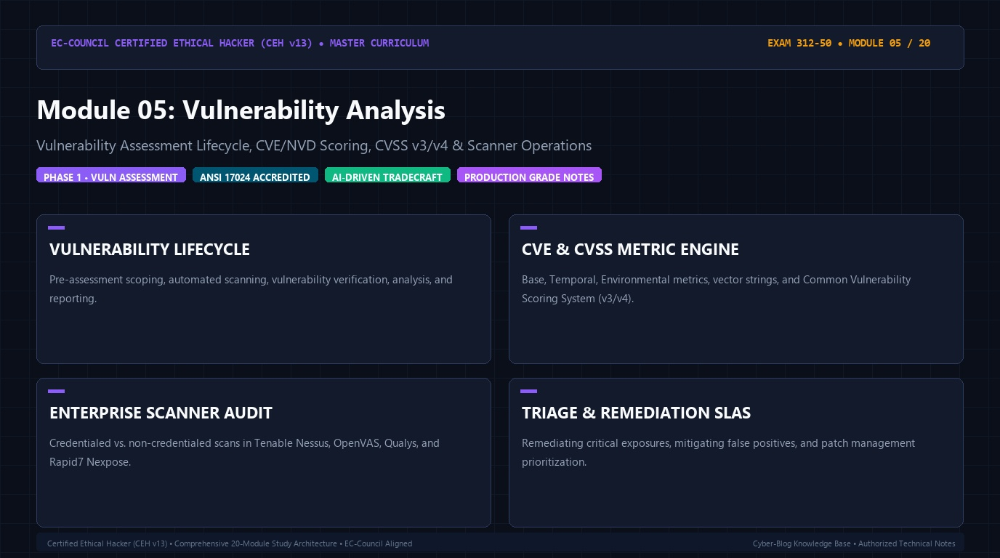
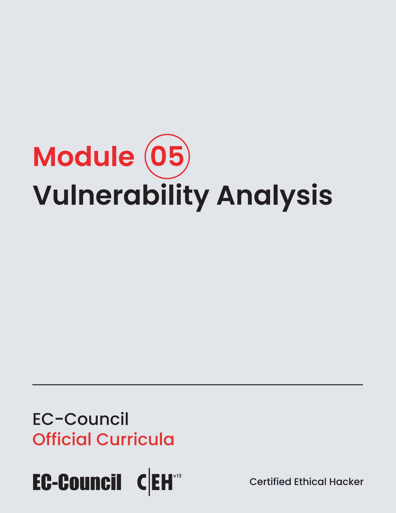

# 🛡️ CEH v13 — Module 05: Vulnerability Analysis
### Certified Ethical Hacker (CEH v13) Exam Notes • Phase 1: Foundations & Reconnaissance • Technical Study Architecture

[-0078D4?style=for-the-badge&logo=shield)](https://www.eccouncil.org/programs/certified-ethical-hacker-ceh/)

  <b>Authoritative, exam-oriented study guide and reference architecture for CEH v13 Module 05: Vulnerability Analysis. Covers vulnerability assessment lifecycle, cve/nvd scoring, cvss v3/v4 & scanner operations, attack methodologies, automated tooling, MITRE ATT&CK alignment, and enterprise defensive engineering.</b>

[📖 Module Hub](../README.md) • [📋 PDF Reference](./CEHv13%20-%20Module%2005%20-%20Vulnerability%20Analysis.pdf) • [🗺️ Knowledge Base Index](../../README.md)

---

### 📖 Official Courseware Slide Deck

*EC-Council Certified Ethical Hacker (CEH v13) Official Course Slide Deck Reference*

---

## 📋 Module Overview & Exam Objectives

In the **EC-Council Certified Ethical Hacker (CEH v13)** certification exam (Exam 312-50), **Module 05: Vulnerability Analysis** represents a fundamental domain within **Phase 1: Foundations & Reconnaissance**. Candidates are tested on both theoretical protocol knowledge and hands-on operational commands used to discover, analyze, exploit, and remediate vulnerabilities across modern networked environments.

### Core Learning Domains:
* **VULNERABILITY LIFECYCLE:** Pre-assessment scoping, automated scanning, vulnerability verification, analysis, and reporting.
* **CVE & CVSS METRIC ENGINE:** Base, Temporal, Environmental metrics, vector strings, and Common Vulnerability Scoring System (v3/v4).
* **ENTERPRISE SCANNER AUDIT:** Credentialed vs. non-credentialed scans in Tenable Nessus, OpenVAS, Qualys, and Rapid7 Nexpose.
* **TRIAGE & REMEDIATION SLAS:** Remediating critical exposures, mitigating false positives, and patch management prioritization.

---

## 🔬 In-Depth Technical Breakdown

### 1. VULNERABILITY LIFECYCLE

Pre-assessment scoping, automated scanning, vulnerability verification, analysis, and reporting.

* **Core Operational Theory:** Candidates must understand both how threat actors leverage these techniques during offensive operations and how enterprise defenders monitor and detect anomalous behavior.
* **Key Attack Artifacts:** Exam scenarios frequently present command-line strings, configuration files, packet captures, and network connection parameters requiring precise identification of adversary behavior.
* **Exam Relevance:** Directly tested across multiple-choice questions on CEH Exam 312-50.

### 2. CVE & CVSS METRIC ENGINE

Base, Temporal, Environmental metrics, vector strings, and Common Vulnerability Scoring System (v3/v4).

* **Core Operational Theory:** Candidates must understand both how threat actors leverage these techniques during offensive operations and how enterprise defenders monitor and detect anomalous behavior.
* **Key Attack Artifacts:** Exam scenarios frequently present command-line strings, configuration files, packet captures, and network connection parameters requiring precise identification of adversary behavior.
* **Exam Relevance:** Directly tested across multiple-choice questions on CEH Exam 312-50.

### 3. ENTERPRISE SCANNER AUDIT

Credentialed vs. non-credentialed scans in Tenable Nessus, OpenVAS, Qualys, and Rapid7 Nexpose.

* **Core Operational Theory:** Candidates must understand both how threat actors leverage these techniques during offensive operations and how enterprise defenders monitor and detect anomalous behavior.
* **Key Attack Artifacts:** Exam scenarios frequently present command-line strings, configuration files, packet captures, and network connection parameters requiring precise identification of adversary behavior.
* **Exam Relevance:** Directly tested across multiple-choice questions on CEH Exam 312-50.

### 4. TRIAGE & REMEDIATION SLAS

Remediating critical exposures, mitigating false positives, and patch management prioritization.

* **Core Operational Theory:** Candidates must understand both how threat actors leverage these techniques during offensive operations and how enterprise defenders monitor and detect anomalous behavior.
* **Key Attack Artifacts:** Exam scenarios frequently present command-line strings, configuration files, packet captures, and network connection parameters requiring precise identification of adversary behavior.
* **Exam Relevance:** Directly tested across multiple-choice questions on CEH Exam 312-50.

---

## 🛠️ Tooling & Command Reference Matrix

| Tool / Technology | Category | Primary Function | Exam Utility / Key Syntax |
| :--- | :--- | :--- | :--- |
| **Tenable Nessus** | Enterprise Scanner | Vulnerability assessment & policy compliance | `Plugin-based vulnerability auditing` |
| **OpenVAS (GVM)** | Open Source Scanner | Network vulnerability discovery | `Greenbone Vulnerability Management suite` |
| **Qualys VMDR** | Cloud Vulnerability Mgmt | Asset inventory & continuous triage | `Cloud agent telemetry & risk scoring` |
| **CVSS Calculator** | Scoring Standard | Base, Temporal, Environmental metrics | `CVSS v3.1 / v4.0 vector string calculation` |

---

## 🛡️ Enterprise Countermeasures & Hardening Guidelines

1. **Principle of Least Privilege:** Enforce strict role-based access control (RBAC) and minimize attack surfaces across network daemons.
2. **Defensive Telemetry & Logging:** Centralize event logging (SIEM) with real-time alerting on anomalous spikes, connection retries, and unauthorized protocol commands.
3. **Continuous Auditing & Patching:** Regularly scan infrastructure using automated vulnerability scanners and enforce strict SLA timelines for critical and high vulnerabilities.
4. **Network Segmentation & Zero Trust:** Isolate sensitive subnets, database tiers, and management interfaces behind stateful firewalls and intrusion prevention systems (IPS).

---

## 📚 Official References & Study Resources

* [EC-Council Official CEH v13 Program](https://www.eccouncil.org/programs/certified-ethical-hacker-ceh/)
* [CEH v13 Master Curriculum Index](../README.md)
* [National Vulnerability Database (NVD)](https://nvd.nist.gov/)
* [MITRE ATT&CK Framework](https://attack.mitre.org/)
