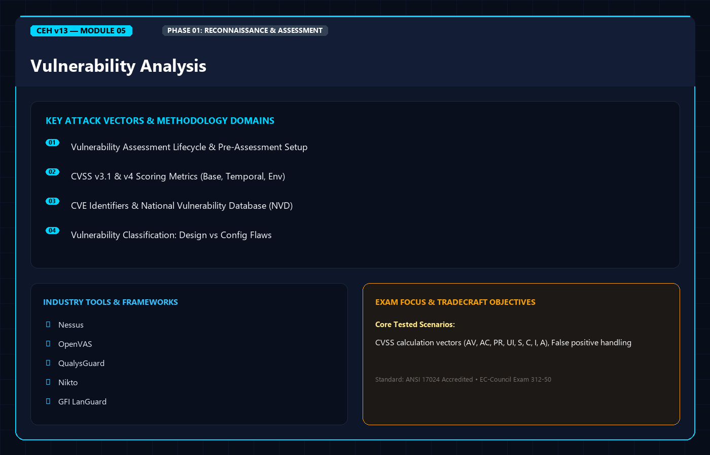
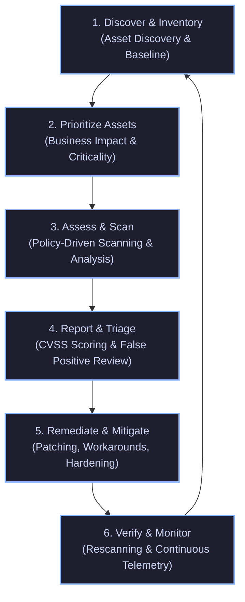
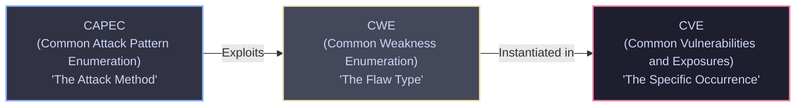
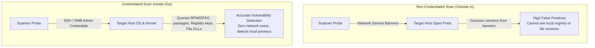
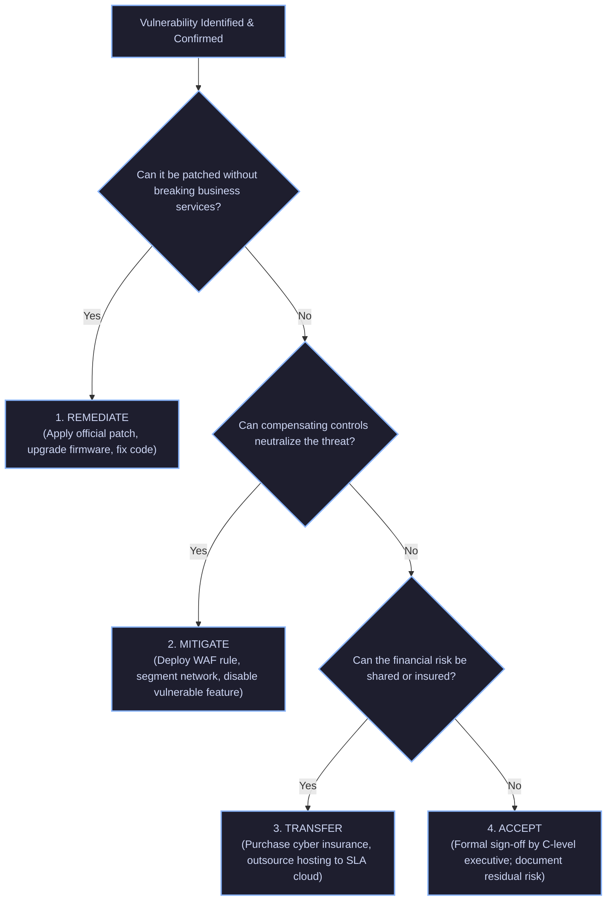

<div align="center">




# 🛡️ CEH v13 — Module 05: Vulnerability Analysis
### Certified Ethical Hacker (CEH) Exam Notes • Vulnerability Management Lifecycle • CVSS v3.1 & v4.0 Metrics • Assessment Solutions • Scanning Methodologies • Industry Toolchains • Reporting & Remediation

[-0078D4?style=for-the-badge&logo=shield)](https://www.eccouncil.org/programs/certified-ethical-hacker-ceh/)
[](https://www.eccouncil.org/)
[](../README.md)
[](./README.md)

<p align="center">
  <b>Authoritative, exam-oriented study guide and reference architecture for CEH v13 Module 05: Vulnerability Analysis. Covers the complete Vulnerability Management Lifecycle, assessment classifications, CVSS v3.1 and CVSS v4.0 quantitative scoring models, vulnerability research databases (CVE, NVD, CWE, CAPEC), scanner architectures (Tree-based vs. Inference-based), credentialed vs. non-credentialed interrogation, enterprise scanner toolchains (Nessus, OpenVAS, Qualys), false positive mitigation, and defensive remediation strategies.</b>
</p>

[📖 Module Hub](../README.md) • [📋 PDF Reference](./CEHv13%20-%20Module%2005%20-%20Vulnerability%20Analysis.pdf) • [🧰 Nmap Masterclass](../../tools/Nmap/README.md) • [🗺️ Knowledge Base Index](../../README.md)

</div>

---

## 📋 Table of Contents

- [1. Vulnerability Assessment Fundamentals](#1-vulnerability-assessment-fundamentals)
  - [Definitions: Vulnerability vs. Threat vs. Risk](#definitions-vulnerability-vs-threat-vs-risk)
  - [The Vulnerability Management Lifecycle (6 Critical Phases)](#the-vulnerability-management-lifecycle-6-critical-phases)
  - [Vulnerability Research: Sources and Taxonomies](#vulnerability-research-sources-and-taxonomies)
- [2. Vulnerability Classification & Root Causes](#2-vulnerability-classification--root-causes)
  - [Root Causes of Vulnerabilities](#root-causes-of-vulnerabilities)
  - [Vulnerability Classifications](#vulnerability-classifications)
- [3. Vulnerability Scoring & Standards (CVSS, CVE, CWE, CAPEC)](#3-vulnerability-scoring--standards-cvss-cve-cwe-capec)
  - [Common Vulnerability Scoring System (CVSS v3.1 Architecture)](#common-vulnerability-scoring-system-cvss-v31-architecture)
  - [CVSS v4.0 Evolution: The Next Generation Framework](#cvss-v40-evolution-the-next-generation-framework)
  - [CVE, CWE, and CAPEC: The Golden Triangle](#cve-cwe-and-capec-the-golden-triangle)
  - [National Vulnerability Database (NVD) & Exploit-DB](#national-vulnerability-database-nvd--exploit-db)
- [4. Vulnerability Assessment Solutions & Architecture](#4-vulnerability-assessment-solutions--architecture)
  - [Product-Based vs. Service-Based Solutions](#product-based-vs-service-based-solutions)
  - [Tree-Based vs. Inference-Based Scanners (High-Yield Exam Concept)](#tree-based-vs-inference-based-scanners-high-yield-exam-concept)
  - [Location & Placement: Internal vs. External Scanners](#location--placement-internal-vs-external-scanners)
  - [Active vs. Passive Assessment Approaches](#active-vs-passive-assessment-approaches)
- [5. Scanning Methodologies & Implementation](#5-scanning-methodologies--implementation)
  - [Credentialed (Authenticated) vs. Non-Credentialed (Unauthenticated)](#credentialed-authenticated-vs-non-credentialed-unauthenticated)
  - [Host-Based vs. Network-Based Scans](#host-based-vs-network-based-scans)
  - [Application, Database, and Wireless Scans](#application-database-and-wireless-scans)
- [6. Industry Vulnerability Assessment Toolchains](#6-industry-vulnerability-assessment-toolchains)
  - [Tenable Nessus & The NASL Engine](#tenable-nessus--the-nasl-engine)
  - [OpenVAS / Greenbone Community Edition](#openvas--greenbone-community-edition)
  - [Qualys Cloud Platform & Rapid7 Nexpose/InsightVM](#qualys-cloud-platform--rapid7-nexposeinsightvm)
  - [Specialized Web & Infrastructure Scanners: Nikto, GFI LanGuard](#specialized-web--infrastructure-scanners-nikto-gfi-languard)
- [7. Reporting, Risk Prioritization, & Remediation](#7-reporting-risk-prioritization--remediation)
  - [Analyzing Vulnerability Reports & Trend Analysis](#analyzing-vulnerability-reports--trend-analysis)
  - [False Positives vs. False Negatives](#false-positives-vs-false-negatives)
  - [The Remediation Triage: Remediate, Mitigate, Accept, Transfer](#the-remediation-triage-remediate-mitigate-accept-transfer)
  - [Patch Management Lifecycle & Compensating Controls](#patch-management-lifecycle--compensating-controls)
- [8. Vulnerability Management Architecture & Flow](#8-vulnerability-management-architecture--flow)
- [9. CEH v13 Exam Essentials & Distinction Matrix](#9-ceh-v13-exam-essentials--distinction-matrix)

---

## 1. Vulnerability Assessment Fundamentals

### Definitions: Vulnerability vs. Threat vs. Risk

In the EC-Council CEH taxonomy, distinguishing between vulnerability, threat, and risk is fundamental to defensive and offensive postures:

$$\text{Risk} = \text{Threat} \times \text{Vulnerability} \times \text{Asset Value}$$

```
+--------------------------------------------------------------------------+
|                       CORE INFORMATION SECURITY TRIAD                    |
+--------------------------------------------------------------------------+
|  VULNERABILITY: A flaw, weakness, or software bug in system design,      |
|  implementation, or configuration that can be exploited by an adversary. |
|  (e.g., Unquoted service path, missing MS17-010 patch, default password) |
+--------------------------------------------------------------------------+
|  THREAT: Any circumstance, event, or entity with the potential to cause   |
|  harm to a system by exploiting a vulnerability.                         |
|  (e.g., An APT group, ransomware operator, insider, malicious script)   |
+--------------------------------------------------------------------------+
|  EXPLOIT: A defined sequence of commands, malicious payload, or tool     |
|  specifically crafted to take advantage of a vulnerability.             |
|  (e.g., EternalBlue binary, Metasploit payload, SQL injection string)    |
+--------------------------------------------------------------------------+
|  RISK: The probability that a threat agent will successfully exploit     |
|  a vulnerability, resulting in business impact or asset loss.            |
+--------------------------------------------------------------------------+
```

### The Vulnerability Management Lifecycle (6 Critical Phases)

A mature Vulnerability Management Lifecycle is **continuous, recursive, and cyclic**, never a one-off audit:



1. **Discover & Catalog Assets**: Continuous discovery of active hosts, operating systems, cloud instances, microservices, and applications across the enterprise IP space.
2. **Prioritize Assets**: Classify systems based on sensitivity, regulatory requirements (PCI-DSS, HIPAA), business criticality, and exposure (public DMZ vs. isolated air-gapped core).
3. **Assess & Interrogate**: Execute automated, policy-based scans using credentialed and non-credentialed engines to detect missing patches, misconfigurations, and vulnerable service libraries.
4. **Report & Analyze**: Synthesize raw scanner results into actionable technical reports and executive dashboards, applying CVSS scoring metrics and removing benign artifacts.
5. **Remediate**: Apply official vendor security updates, configuration changes, or compensating perimeter controls.
6. **Verify & Audit**: Rescan patched targets to ensure the vulnerability is eradicated and no regressions or broken service dependencies were introduced.

---

## 2. Vulnerability Classification & Root Causes

### Root Causes of Vulnerabilities

Vulnerabilities do not appear in isolation; EC-Council categorizes their genesis into four primary operational domains:

| Vulnerability Root Cause | Mechanism & Contributing Factors | Real-World Exam Examples |
| :--- | :--- | :--- |
| **Design Flaws** | Architectural weaknesses inherent to the protocol or system specification itself before any code is written. | WEP 24-bit IV size, DNS amplification via UDP, NTLM challenge-response relay. |
| **Implementation Bugs** | Software coding mistakes, memory management errors, or lack of input sanitization introduced during development. | Buffer overflows (`strcpy`), Integer overflows, SQL injection, Log4Shell (JNDI lookup). |
| **Misconfigurations** | Deployment failures where secure defaults are altered, unnecessary services are active, or administrative controls are neglected. | Default credentials (`admin:admin`), Telnet enabled, S3 bucket public permissions, debugging left active. |
| **Human / Operational** | Inadequate patch cycles, weak password choices, lack of change control, or social engineering susceptibility. | Systems running unpatched Windows Server 2008 R2, employees reusing corporate passwords. |

---

## 3. Vulnerability Scoring & Standards (CVSS, CVE, CWE, CAPEC)

### Common Vulnerability Scoring System (CVSS v3.1 Architecture)

The CVSS v3.1 specification maintained by FIRST (Forum of Incident Response and Security Teams) divides vulnerability metrics into **three distinct metric groups**:

```
+------------------------------------------------------------------------------------+
|                         CVSS v3.1 METRIC ARCHITECTURE                              |
+------------------------------------------------------------------------------------+
|  1. BASE METRIC GROUP (Mandatory, Constant Over Time & Environments)               |
|     - Exploitability Metrics:                                                      |
|       * Attack Vector (AV): Network (N) | Adjacent (A) | Local (L) | Physical (P) |
|       * Attack Complexity (AC): Low (L) | High (H)                                 |
|       * Privileges Required (PR): None (N) | Low (L) | High (H)                    |
|       * User Interaction (UI): None (N) | Required (R)                             |
|     - Scope (S): Unchanged (U) | Changed (C)                                       |
|     - Impact Metrics:                                                              |
|       * Confidentiality (C): High (H) | Low (L) | None (N)                         |
|       * Integrity (I): High (H) | Low (L) | None (N)                               |
|       * Availability (A): High (H) | Low (L) | None (N)                            |
+------------------------------------------------------------------------------------+
|  2. TEMPORAL METRIC GROUP (Changes Over Time as Exploits/Patches Emerge)          |
|     - Exploit Code Maturity (E): Not Defined (X) | High (H) | Functional (F) | POC |
|     - Remediation Level (RL): Official Fix (O) | Temporary Fix (T) | Workaround (W)|
|     - Report Confidence (RC): Confirmed (C) | Reasonable (R) | Unknown (U)         |
+------------------------------------------------------------------------------------+
|  3. ENVIRONMENTAL METRIC GROUP (Customized for a Specific Target Organization)     |
|     - Modified Base Metrics (CR, IR, AR: Low, Medium, High)                        |
|     - Modified Impact Metrics (MAV, MAC, MPR, MUI, MS, MC, MI, MA)                 |
+------------------------------------------------------------------------------------+
```

#### CVSS v3.1 Severity Rating Scale

| Severity Band | CVSS v3.1 Base Score Range | Typical Real-World Scenario |
| :--- | :--- | :--- |
| **None** | `0.0` | Informational findings, open ports with no service banners. |
| **Low** | `0.1 – 3.9` | Information disclosure of non-sensitive version banners. |
| **Medium** | `4.0 – 6.9` | Denial of Service requiring local access or non-sensitive data leak. |
| **High** | `7.0 – 8.9` | Remote code execution requiring user interaction, or unauthenticated local root. |
| **Critical** | `9.0 – 10.0` | Remote wormable code execution requiring zero authentication (e.g., EternalBlue, Log4Shell). |

#### Anatomy of a CVSS v3.1 Vector String

$$\text{CVSS:3.1/AV:N/AC:L/PR:N/UI:N/S:C/C:H/I:H/A:H}$$

* **AV:N**: Exploitable remotely over the Internet (Network).
* **AC:L**: No specialized conditions or timing dependencies (Low complexity).
* **PR:N**: Attacker requires no credentials or privileges (None).
* **UI:N**: No user interaction required (Zero victim assistance).
* **S:C**: Scope changed — vulnerability in one component impacts resources beyond its security boundary (e.g., hypervisor escape, container breakout).
* **C:H / I:H / A:H**: Total loss of Confidentiality, Integrity, and Availability.
* **Calculated Score**: `10.0 Critical`!

---

### CVSS v4.0 Evolution: The Next Generation Framework

Published by FIRST in late 2023 and integrated into CEH v13, **CVSS v4.0** refines scoring accuracy to prevent metric inflation:

```
+--------------------------------------------------------------------------+
|                       CVSS v4.0 NEW NOMENCLATURE                         |
+--------------------------------------------------------------------------+
|  CVSS-B   : Base Metrics alone.                                          |
|  CVSS-BT  : Base + Threat (replaces "Temporal") Metrics.                 |
|  CVSS-BE  : Base + Environmental Metrics.                                |
|  CVSS-BTE : Base + Threat + Environmental Combined.                      |
+--------------------------------------------------------------------------+
```

* **Attack Requirements (AT)**: Introduced in v4.0 to split the old Attack Complexity metric. Measures deployment or environmental prerequisites (e.g., race conditions, MitM position).
* **User Interaction (UI)**: Expanded into `None (N)`, `Passive (P)` (victim merely visits page), and `Active (A)` (victim must execute manual steps or override security warnings).
* **Explicit OT/Safety Metrics**: Incorporates physical safety and operational impacts directly into the scoring engine.

---

### CVE, CWE, and CAPEC: The Golden Triangle



* **CWE (Common Weakness Enumeration)**: Maintained by MITRE. A dictionary of underlying software weakness types (e.g., `CWE-89: SQL Injection`, `CWE-79: Cross-Site Scripting`, `CWE-119: Memory Buffer Errors`).
* **CVE (Common Vulnerabilities and Exposures)**: Standardized, unique identifier assigned to a specific instance of a vulnerability in a released product (e.g., `CVE-2021-44228` for Log4Shell). Formatted as `CVE-YYYY-NNNNN`.
* **CAPEC (Common Attack Pattern Enumeration and Classification)**: Catalog of attack mechanisms employed by adversaries to exploit weaknesses (e.g., `CAPEC-66: SQL Injection via SOAP Parameter Tampering`).

---

## 4. Vulnerability Assessment Solutions & Architecture

Vulnerability scanners vary by deployment model, architectural logic, and network vantage point:

### Product-Based vs. Service-Based Solutions

* **Product-Based Solutions**: Installed directly on the organization's private corporate intranet or local server. The scanner engine resides behind the perimeter firewall.
  * *Advantage*: Scanner can perform high-bandwidth internal scans without bandwidth constraints; scan data never leaves the corporate boundary.
  * *Disadvantage*: High administrative overhead for maintenance, updating signature feeds, and provisioning hardware.
* **Service-Based Solutions**: Hosted in the cloud by a third-party vendor (SaaS model, e.g., Qualys Cloud Platform).
  * *Advantage*: Zero hardware overhead, automatically updated signature feeds, continuous perimeter monitoring.
  * *Disadvantage*: Sensitive corporate vulnerability data is hosted externally; requires ingress firewall exceptions or cloud agents deployed internally.

---

### Tree-Based vs. Inference-Based Scanners (High-Yield Exam Concept)

```
+--------------------------------------------------------------------------+
|        TREE-BASED SCANNER             vs.         INFERENCE-BASED SCANNER|
+--------------------------------------------------------------------------+
|  Follows a rigid, predetermined          Dynamically alters its scanning |
|  decision tree based on host responses.  path based on real-time service |
|                                          fingerprinting and discoveries.  |
|                                                                          |
|  1. Ping Host (Is it up?)                1. Send probe to Port 80        |
|     |--> Yes: Scan Port 80               2. Banner reveals Apache Tomcat |
|     |--> No: Terminate scan                 3. Dynamically SUPPRESS IIS  |
|                                                tests and INJECT Java/    |
|  If a branch returns False, entire             Tomcat-specific checks!   |
|  subsequent sub-trees are skipped.                                       |
|                                          Drastically optimizes bandwidth |
|  Fast, but rigid. Can miss services      and reduces scan completion time|
|  running on unconventional ports.        by eliminating irrelevant tests.|
+--------------------------------------------------------------------------+
```

> [!IMPORTANT]
> **CEH Exam Tip**: If an exam question asks: *"Which scanner adjusts its scanning path dynamically based on information collected from previous probes during the scan?"* The answer is strictly **Inference-based Scanner**.

---

### Location & Placement: Internal vs. External Scanners

* **External Scans**: The scanner resides outside the perimeter firewall (on the public Internet).
  * *Perspective*: Simulates an untrusted external attacker.
  * *Objective*: Evaluates public-facing perimeter defenses, DMZ exposures, open firewall ports, and web application entry points.
* **Internal Scans**: The scanner resides inside the internal corporate local area network (behind firewalls).
  * *Perspective*: Simulates a malicious insider, rogue contractor, or an attacker who has already breached the perimeter via phishing.
  * *Objective*: Identifies lateral movement vectors, missing internal patches, insecure file shares, and unhardened workstations.

---

## 5. Scanning Methodologies & Implementation

### Credentialed (Authenticated) vs. Non-Credentialed (Unauthenticated)



| Dimension | Non-Credentialed (Unauthenticated) | Credentialed (Authenticated) |
| :--- | :--- | :--- |
| **Access Method** | Network probes, banner grabbing, port sweeps. | SSH (Linux/Unix), WinRM/SMB/WMI (Windows) with service credentials. |
| **System Impact** | Can cause high network utilization, firewall alerts. | Negligible network overhead; light CPU hit on target OS during registry reads. |
| **Depth of Vision** | Superficial (sees only listening network services). | Deep (inspects installed hotfixes, DLL versions, local user rights, registry keys). |
| **False Positive Rate** | **High** (infers vulnerability based solely on exposed banners). | **Very Low** (verifies presence of exact patch or file hash on disk). |
| **Firewall Sensitivity** | High (packets may be dropped or rate-limited by IDS/IPS). | Low (once authenticated, data queries are executed locally). |

---

## 6. Industry Vulnerability Assessment Toolchains

### Tenable Nessus & The NASL Engine

**Nessus** is one of the most widely referenced enterprise vulnerability scanners on the CEH exam.
* **NASL (Nessus Attack Scripting Language)**: Proprietary scripting language used by Tenable to write vulnerability checks and custom security plugins.
* **Plugin Architecture**: Each CVE check is encapsulated in a discrete `.nasl` plugin script containing metadata, vulnerability criteria, and CVSS vector definitions.
* **Scan Policies**:
  * *Basic Network Scan*: Full port and service discovery without credentials.
  * *Advanced Scan*: Custom plugin selection and fine-tuned throttling.
  * *Compliance & Audit*: Verifies target against CIS Benchmarks using administrative credentials.

```bash
# Example Nessus CLI plugin query (Tenable Core / Linux CLI)
/opt/nessus/bin/nasl -t 192.168.1.50 /opt/nessus/lib/nessus/plugins/smb_ms17-010.nasl
```

---

### OpenVAS / Greenbone Community Edition

**OpenVAS** (Open Vulnerability Assessment System) is the primary open-source enterprise scanner.
* Maintained by Greenbone Networks under the Greenbone Vulnerability Management (GVM) framework.
* **NVTs (Network Vulnerability Tests)**: The OpenVAS equivalent of Nessus plugins, updated daily via the Greenbone Community Feed.
* **Engine Architecture**: OpenVAS scanner daemon (`openvas`), GVM management daemon (`gvmd`), and web GUI (`gsad`).

```bash
# Updating the OpenVAS / Greenbone Feed from the terminal
greenbone-nvt-sync
gvmd --rebuild-gvmd-data=all
```

---

### Specialized Web & Infrastructure Scanners

* **Nikto**: Open-source web server scanner. Tests for over 6,700 dangerous files/CGIs, outdated server software, and configuration errors (e.g., `TRACE` method enabled).
  ```bash
  # Basic Nikto web vulnerability scan
  nikto -h http://192.168.1.100 -p 80,443 -C all
  ```
* **Qualys Cloud Platform**: Enterprise SaaS scanner utilizing lightweight agents deployed across endpoints, combined with virtual scanner appliances deployed in private subnets.
* **GFI LanGuard**: Commercial patch management and vulnerability scanner focused heavily on Windows environments, auditing missing hotfixes, and pushing patches remotely.

---

## 7. Reporting, Risk Prioritization, & Remediation

### False Positives vs. False Negatives

```
+--------------------------------------------------------------------------+
|                       THE ERROR METRIC MATRIX                            |
+--------------------------------------------------------------------------+
|  FALSE POSITIVE (Type I Error):                                          |
|  The scanner reports that a vulnerability exists, but in reality,        |
|  the system is NOT vulnerable.                                           |
|  - Cause: Banner grabbing outdated software where backported patches     |
|    have been applied (e.g., Debian/Red Hat backporting security fixes).  |
|  - Impact: Wasted analyst time investigating non-existent flaws.         |
+--------------------------------------------------------------------------+
|  FALSE NEGATIVE (Type II Error) -- THE MOST DANGEROUS CONDITION:         |
|  The scanner fails to identify a vulnerability that DOES exist.          |
|  - Cause: Firewall packet dropping, non-credentialed scan skipping local |
|    flaws, signature out of date, customized non-standard port.          |
|  - Impact: Severe blind spot leading to catastrophic breach.             |
+--------------------------------------------------------------------------+
```

---

### The Remediation Triage: The 4 Paths

When a vulnerability report is finalized, organizations must categorize each finding into one of four response strategies:



1. **Remediation**: The permanent eradication of the vulnerability (e.g., updating Apache to the latest patched version).
2. **Mitigation**: Reducing the likelihood or impact through compensating controls when a direct patch cannot be deployed immediately (e.g., blocking vulnerable ports at the border firewall, applying virtual patching in a WAF).
3. **Risk Transfer**: Shifting financial liability to a third party (e.g., cyber risk insurance policies, outsourcing hosting to a certified vendor with strict SLAs).
4. **Risk Acceptance**: A conscious decision by business leadership to accept the residual risk when the cost of remediation exceeds the asset value or operational downtime (must be formally documented and approved).

---

## 8. Vulnerability Management Architecture & Flow

```
                      +-----------------------------+
                      |   ASSET DISCOVERY ENGINE    |
                      | (ARP / ICMP / TCP Syn-Scan) |
                      +--------------+--------------+
                                     |
                                     v
                      +-----------------------------+
                      |   PORT & SERVICE PROFILING  |
                      |   (Banner Grabbing, nmap)   |
                      +--------------+--------------+
                                     |
                 +-------------------+-------------------+
                 |                                       |
                 v                                       v
    +-------------------------+             +-------------------------+
    | NON-CREDENTIALED SCAN   |             | CREDENTIALED SCAN       |
    | - Banner comparisons    |             | - OS Registry inspect   |
    | - Flaw inference        |             | - Package version audit |
    | - High False Positives  |             | - Low False Positives   |
    +------------+------------+             +------------+------------+
                 |                                       |
                 +-------------------+-------------------+
                                     |
                                     v
                      +-----------------------------+
                      |   VULNERABILITY EVALUATION  |
                      |   (CVSS v3.1 / v4.0 Engine) |
                      +--------------+--------------+
                                     |
                                     v
                      +-----------------------------+
                      |      TRIAGE & REPORTING     |
                      | - Eliminate False Positives |
                      | - Assign Business Risk Tier |
                      +--------------+--------------+
                                     |
                                     v
                      +-----------------------------+
                      | REMEDIATION & RESCAN VERIFY |
                      +-----------------------------+
```

---

## 9. CEH v13 Exam Essentials & Distinction Matrix

### Must-Know Exam Traps

| Concept | The Trap / Distractor | The Truth / Verified Answer |
| :--- | :--- | :--- |
| **Scanner Path Logic** | Believing all scanners follow the same linear checklist. | **Inference-based** scanners dynamically change their path based on prior responses; **Tree-based** follow a rigid hierarchical decision tree. |
| **Credentialed Scans** | Thinking credentialed scans generate more network noise. | Credentialed scans create **less** network traffic because checks are executed directly on the host via administrative APIs (SSH/WMI). |
| **CVSS Base Metrics** | Confusing `Scope` with `Attack Vector`. | `Scope (S)` measures whether a flaw in one component impacts resources governed by a **different security authority** (e.g., VM escape). |
| **False Positives vs. Negatives** | Assuming False Positives are the most dangerous. | **False Negatives** are catastrophic because a real, exploitable vulnerability remains invisible to defenders. |
| **NASL Engine** | Assuming NASL is a generic open-source standard. | **NASL** is specifically the proprietary scripting engine developed and used by **Tenable Nessus**. |
| **CVSS v4.0 Metric Name** | Expecting "Temporal" metrics in CVSS v4.0. | CVSS v4.0 replaced the Temporal Metric Group with the **Threat Metric Group (CVSS-BT)**. |

---

<div align="center">

[⬅️ Previous: Module 04 — Enumeration](../Module%2004/README.md) • [Next: Module 06 — System Hacking ➡️](../Module%2006/README.md)

</div>
