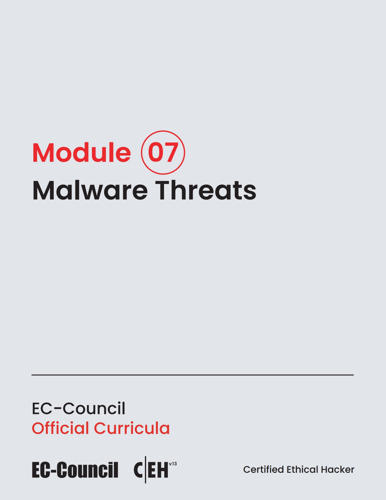

# 🛡️ CEH v13 — Module 07: Malware Threats
### Certified Ethical Hacker (CEH v13) Exam Notes • Phase 2: Network & Host Hacking • Technical Study Architecture

[-0078D4?style=for-the-badge&logo=shield)](https://www.eccouncil.org/programs/certified-ethical-hacker-ceh/)

  <b>Authoritative, exam-oriented study guide and reference architecture for CEH v13 Module 07: Malware Threats. Covers trojans, ransomware, worms, polymorphic crypters & dynamic sandboxing analysis, attack methodologies, automated tooling, MITRE ATT&CK alignment, and enterprise defensive engineering.</b>

[📖 Module Hub](../README.md) • [📋 PDF Part 1](./CEHv13%20-%20Module%2007%20-%20Malware%20Threats%20Part%201.pdf) • [📋 PDF Part 2](./CEHv13%20-%20Module%2007%20-%20Malware%20Threats%20Part%202.pdf) • [🗺️ Knowledge Base Index](../../README.md)

---

### 📖 Official Courseware Slide Deck

*EC-Council Certified Ethical Hacker (CEH v13) Official Course Slide Deck Reference*

---

## 📋 Module Overview & Exam Objectives

In the **EC-Council Certified Ethical Hacker (CEH v13)** certification exam (Exam 312-50), **Module 07: Malware Threats** represents a fundamental domain within **Phase 2: Network & Host Hacking**. Candidates are tested on both theoretical protocol knowledge and hands-on operational commands used to discover, analyze, exploit, and remediate vulnerabilities across modern networked environments.

### Core Learning Domains:
* **MALWARE TAXONOMY & ANATOMY:** Droppers, loaders, banking trojans, RATs, worms, botnets, and Command-and-Control architectures.
* **RANSOMWARE OPERATIONS:** Asymmetric file encryption, Volume Shadow Copy destruction, payment portals, and double extortion.
* **EVASION & CODE OBFUSCATION:** Packers, polymorphic crypters, in-memory execution, anti-VM checks, and anti-debugging tricks.
* **STATIC & DYNAMIC TRIAGE:** PE header analysis, section entropy, string harvesting, and automated Cuckoo/REMnux sandboxing.

---

## 🔬 In-Depth Technical Breakdown

### 1. MALWARE TAXONOMY & ANATOMY

Droppers, loaders, banking trojans, RATs, worms, botnets, and Command-and-Control architectures.

* **Core Operational Theory:** Candidates must understand both how threat actors leverage these techniques during offensive operations and how enterprise defenders monitor and detect anomalous behavior.
* **Key Attack Artifacts:** Exam scenarios frequently present command-line strings, configuration files, packet captures, and network connection parameters requiring precise identification of adversary behavior.
* **Exam Relevance:** Directly tested across multiple-choice questions on CEH Exam 312-50.

### 2. RANSOMWARE OPERATIONS

Asymmetric file encryption, Volume Shadow Copy destruction, payment portals, and double extortion.

* **Core Operational Theory:** Candidates must understand both how threat actors leverage these techniques during offensive operations and how enterprise defenders monitor and detect anomalous behavior.
* **Key Attack Artifacts:** Exam scenarios frequently present command-line strings, configuration files, packet captures, and network connection parameters requiring precise identification of adversary behavior.
* **Exam Relevance:** Directly tested across multiple-choice questions on CEH Exam 312-50.

### 3. EVASION & CODE OBFUSCATION

Packers, polymorphic crypters, in-memory execution, anti-VM checks, and anti-debugging tricks.

* **Core Operational Theory:** Candidates must understand both how threat actors leverage these techniques during offensive operations and how enterprise defenders monitor and detect anomalous behavior.
* **Key Attack Artifacts:** Exam scenarios frequently present command-line strings, configuration files, packet captures, and network connection parameters requiring precise identification of adversary behavior.
* **Exam Relevance:** Directly tested across multiple-choice questions on CEH Exam 312-50.

### 4. STATIC & DYNAMIC TRIAGE

PE header analysis, section entropy, string harvesting, and automated Cuckoo/REMnux sandboxing.

* **Core Operational Theory:** Candidates must understand both how threat actors leverage these techniques during offensive operations and how enterprise defenders monitor and detect anomalous behavior.
* **Key Attack Artifacts:** Exam scenarios frequently present command-line strings, configuration files, packet captures, and network connection parameters requiring precise identification of adversary behavior.
* **Exam Relevance:** Directly tested across multiple-choice questions on CEH Exam 312-50.

---

## 🛠️ Tooling & Command Reference Matrix

| Tool / Technology | Category | Primary Function | Exam Utility / Key Syntax |
| :--- | :--- | :--- | :--- |
| **PE-Tree** | PE Static Analysis | PE structure & anomaly tree visualization | `Analyzing sections, imports, and exports` |
| **BinText** | String Extraction | Extracting ASCII and Unicode strings | `Searching for C2 domains, registry keys, IPs` |
| **Cuckoo Sandbox** | Dynamic Sandboxing | Automated malware detonation & triage | `Behavioral graph, API hooking, packet dumps` |
| **YARA** | Rule Engine | Signature-based malware classification | ``yara -r malware_rules.yar /samples`` |

---

## 🛡️ Enterprise Countermeasures & Hardening Guidelines

1. **Principle of Least Privilege:** Enforce strict role-based access control (RBAC) and minimize attack surfaces across network daemons.
2. **Defensive Telemetry & Logging:** Centralize event logging (SIEM) with real-time alerting on anomalous spikes, connection retries, and unauthorized protocol commands.
3. **Continuous Auditing & Patching:** Regularly scan infrastructure using automated vulnerability scanners and enforce strict SLA timelines for critical and high vulnerabilities.
4. **Network Segmentation & Zero Trust:** Isolate sensitive subnets, database tiers, and management interfaces behind stateful firewalls and intrusion prevention systems (IPS).

---

## 📚 Official References & Study Resources

* [EC-Council Official CEH v13 Program](https://www.eccouncil.org/programs/certified-ethical-hacker-ceh/)
* [CEH v13 Master Curriculum Index](../README.md)
* [National Vulnerability Database (NVD)](https://nvd.nist.gov/)
* [MITRE ATT&CK Framework](https://attack.mitre.org/)
