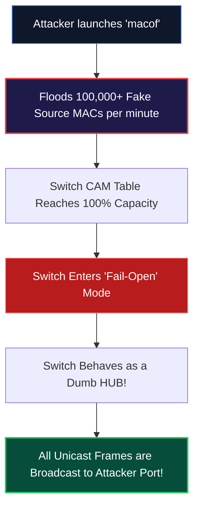
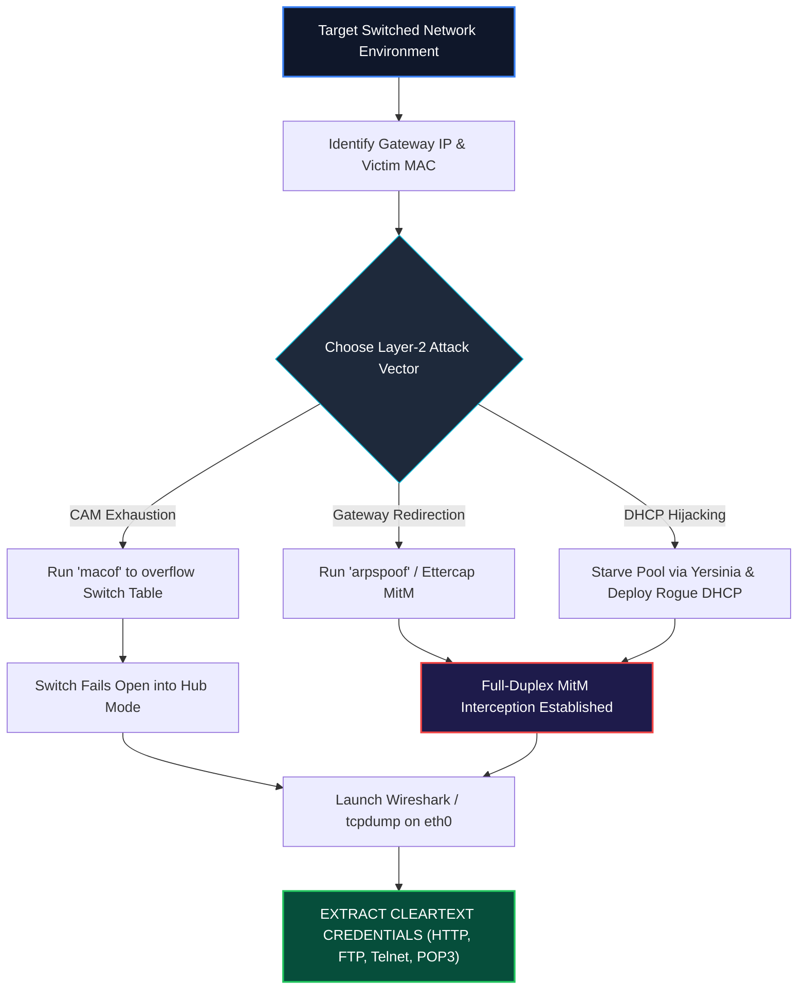

<div align="center">

# 🛡️ CEH v13 — Module 08: Sniffing
### Certified Ethical Hacker (CEH) Exam Notes • Passive vs. Active Sniffing • CAM Flooding • ARP Poisoning • DHCP Starvation • Wireshark Tradecraft • DAI & Port Security

[-0078D4?style=for-the-badge&logo=shield)](https://www.eccouncil.org/programs/certified-ethical-hacker-ceh/)
[](https://www.eccouncil.org/)
[](../README.md)
[](./README.md)

<p align="center">
  <b>Authoritative, exam-oriented study guide and reference architecture for CEH v13 Module 08: Sniffing. Covers layer-2 network mechanics, collision vs. broadcast domains, promiscuous mode detection, MAC attacks (CAM table flooding via macof), DHCP starvation and rogue gateway injection, ARP cache poisoning (Ettercap/Bettercap), DNS spoofing, Wireshark and tcpdump filtering tradecraft, and enterprise switch hardening (Port Security, DHCP Snooping, Dynamic ARP Inspection).</b>
</p>

[📖 Module Hub](../README.md) • [📋 PDF Reference](./CEHv13%20-%20Module%2008%20-%20Sniffing.pdf) • [🧰 Wireshark & PCAP Analysis](../../INE%20lab/PCAP%20Analysis%20With%20Zeek/README.md) • [🗺️ Knowledge Base Index](../../README.md)

</div>

---

## 📋 Table of Contents

- [1. Sniffing Fundamentals & Layer-2 Mechanics](#1-sniffing-fundamentals--layer-2-mechanics)
  - [Definition & The Promiscuous Mode Mechanism](#definition--the-promiscuous-mode-mechanism)
  - [Passive Sniffing (Hubs) vs. Active Sniffing (Switches)](#passive-sniffing-hubs-vs-active-sniffing-switches)
  - [Collision Domains vs. Broadcast Domains](#collision-domains-vs-broadcast-domains)
- [2. Active Sniffing Attack Vectors](#2-active-sniffing-attack-vectors)
  - [MAC Flooding & CAM Table Exhaustion (`macof`)](#mac-flooding--cam-table-exhaustion-macof)
  - [DHCP Starvation & Rogue DHCP Server Injection (`yersinia`)](#dhcp-starvation--rogue-dhcp-server-injection-yersinia)
  - [ARP Poisoning & Man-in-the-Middle (MitM) Architecture](#arp-poisoning--man-in-the-middle-mitm-architecture)
  - [DNS Spoofing & Cache Poisoning](#dns-spoofing--cache-poisoning)
- [3. Sniffing Toolchains & Protocol Analysis](#3-sniffing-toolchains--protocol-analysis)
  - [Wireshark: Advanced Display Filters & TCP Stream Reassembly](#wireshark-advanced-display-filters--tcp-stream-reassembly)
  - [Command-Line Packet Capture: `tcpdump`](#command-line-packet-capture-tcpdump)
  - [Automated MitM Toolchains: Bettercap & Ettercap](#automated-mitm-toolchains-bettercap--ettercap)
- [4. Sniffer Detection Techniques](#4-sniffer-detection-techniques)
  - [Detecting Promiscuous NICs: The Ping Method](#detecting-promiscuous-nics-the-ping-method)
  - [The ARP & DNS Reverse Lookup Test](#the-arp--dns-reverse-lookup-test)
- [5. Sniffing Countermeasures & Layer-2 Hardening](#5-sniffing-countermeasures--layer-2-hardening)
  - [Switch Port Security Configuration](#switch-port-security-configuration)
  - [DHCP Snooping Architecture](#dhcp-snooping-architecture)
  - [Dynamic ARP Inspection (DAI)](#dynamic-arp-inspection-dai)
- [🧠 Master CEH Sniffing & MitM Flowchart](#-master-ceh-sniffing--mitm-flowchart)
- [🎯 High-Value CEH Exam Distinctions to Memorize](#-high-value-ceh-exam-distinctions-to-memorize)

---

# 1. Sniffing Fundamentals & Layer-2 Mechanics

## Definition & The Promiscuous Mode Mechanism

A **packet sniffer** is a software program or hardware appliance that intercepts and logs data traffic passing over a digital network.
* **Standard NIC Mode:** Under normal operation, a Network Interface Card (NIC) inspects the destination MAC address of incoming Ethernet frames. If the destination MAC matches its own burned-in MAC address (or a broadcast/multicast address), it passes the frame up the OS network stack. All other frames are discarded by hardware.
* **Promiscuous Mode:** The NIC disables its hardware MAC address filtering, capturing and passing **every single frame present on the physical wire** to the operating system, regardless of the intended destination.

---

## Passive Sniffing (Hubs) vs. Active Sniffing (Switches)

```
┌──────────────────────────────────────────────────────────────────────────────────┐
│                   PASSIVE VS. ACTIVE SNIFFING TOPOLOGY                           │
├──────────────────────────────────────────────────────────────────────────────────┤
│                                                                                  │
│   [PASSIVE SNIFFING - LEGACY HUB]                                                │
│   Host A ──(Frame)──► [HUB] ──► Broadcasts to Host A, Host B, and Sniffer!      │
│   • Hub operates at Layer 1; lacks forwarding logic. Sniffing is 100% passive.   │
│                                                                                  │
│   [ACTIVE SNIFFING - MODERN SWITCH]                                              │
│   Host A ──(Frame)──► [SWITCH] ──► Unicasts solely to Host B (based on CAM table)│
│   • Switch operates at Layer 2; sniffer sees zero traffic between Host A & B!     │
│   • Attacker MUST perform active manipulation (CAM flood, ARP poison) to sniff.  │
│                                                                                  │
└──────────────────────────────────────────────────────────────────────────────────┘
```

---

# 2. Active Sniffing Attack Vectors

## MAC Flooding & CAM Table Exhaustion (`macof`)

A switch maintains a **Content Addressable Memory (CAM) table** that maps physical switch ports to connected MAC addresses. The CAM table has a fixed, finite hardware memory capacity (e.g., 8,192 entries).



* **Attack Tool:** `macof` (part of the `dsniff` suite).
* **Command Syntax:**
  ```bash
  macof -i eth0 -n 100000
  ```

---

## DHCP Starvation & Rogue DHCP Server Injection

* **DHCP Starvation:** The attacker floods the local broadcast domain with thousands of `DHCPDISCOVER` packets, each bearing a randomly forged MAC address. The DHCP server allocates its entire pool of available IP leases, leaving zero valid addresses for legitimate clients (Denial of Service).
  * *Tools:* **Yersinia**, `dhcpstarv`.
* **Rogue DHCP Server Injection:** Once the legitimate DHCP server is starved, the attacker launches a rogue DHCP server on their machine. When new clients request network settings, the rogue server responds, assigning the **attacker's IP address as the Default Gateway and Primary DNS server**, placing the attacker in a complete Man-in-the-Middle position.

---

## ARP Poisoning & Man-in-the-Middle (MitM) Architecture

The **Address Resolution Protocol (ARP)** maps IP addresses to physical MAC addresses. Because ARP is stateless and inherently lacks authentication, operating systems accept unsolicited **Gratuitous ARP** replies without verification.

```
┌──────────────────────────────────────────────────────────────────────────────────┐
│                    ARP CACHE POISONING MAN-IN-THE-MIDDLE SEQUENCE                │
├──────────────────────────────────────────────────────────────────────────────────┤
│                                                                                  │
│   [VICTIM WORKSTATION]                               [DEFAULT GATEWAY]           │
│   IP: 192.168.1.100                                  IP: 192.168.1.1             │
│   MAC: AA:AA:AA:AA:AA:AA                             MAC: CC:CC:CC:CC:CC:CC      │
│            ▲                                                    ▲                │
│            │                                                    │                │
│   "192.168.1.1 is at BB:BB"                            "192.168.1.100 is at BB"  │
│            │                                                    │                │
│            └───────────────────────┬────────────────────────────┘                │
│                                    │                                             │
│                        [ATTACKER INTERCEPTOR]                                    │
│                        IP: 192.168.1.50                                          │
│                        MAC: BB:BB:BB:BB:BB:BB                                    │
│                        (Kernel Packet Forwarding Enabled: ip_forward=1)          │
│                                                                                  │
└──────────────────────────────────────────────────────────────────────────────────┘
```

```bash
# Enable IP forwarding in Linux kernel
echo 1 > /proc/sys/net/ipv4/ip_forward

# Poison victim (tell victim gateway is attacker)
arpspoof -i eth0 -t 192.168.1.100 192.168.1.1

# Poison gateway (tell gateway victim is attacker)
arpspoof -i eth0 -t 192.168.1.1 192.168.1.100
```

---

# 3. Sniffing Toolchains & Protocol Analysis

## Wireshark: Advanced Display Filters

| Filter Objective | Wireshark Display Filter Syntax |
|---|---|
| **Filter by Specific IP** | `ip.addr == 192.168.1.50` |
| **Filter by Subnet** | `ip.addr == 192.168.1.0/24` |
| **Detect SYN Packets Only** | `tcp.flags.syn == 1 and tcp.flags.ack == 0` |
| **Extract Cleartext HTTP POSTs**| `http.request.method == "POST"` |
| **Locate DNS Lookups for Domain**| `dns.qry.name contains "acme.corp"` |
| **Isolate Cleartext Passwords** | `frame contains "password" or frame contains "USER"` |

---

## Command-Line Packet Capture: `tcpdump`

```bash
# Capture full packets (-s 0) on eth0, filter port 80, write to pcap (-w)
tcpdump -i eth0 -nn -s 0 -w http_traffic.pcap port 80

# Read pcap in ASCII and Hex
tcpdump -X -r http_traffic.pcap
```

---

# 4. Sniffer Detection Techniques

An ethical hacker or security engineer can actively detect whether a rogue host on the subnet is running in promiscuous mode:

1. **The Ping (ICMP) Latency / Bogus MAC Method:**
   * The auditor transmits an **ICMP Echo Request** containing the **correct IP address** of the suspect machine, but with a **bogus, non-existent destination MAC address**.
   * *Normal Host:* The hardware NIC inspects the destination MAC, sees it does not match its own, and drops the packet. No ping response is returned.
   * *Sniffer in Promiscuous Mode:* The hardware filter is off! The packet is passed to the OS kernel. The kernel inspects the IP header, sees its own IP, and transmits an **ICMP Echo Reply**! Answering a ping sent to a wrong MAC address exposes the sniffer immediately.
2. **The DNS Reverse Lookup Method:**
   * Many sniffer tools (like Wireshark) automatically perform reverse DNS lookups on every IP seen on the wire. The auditor transmits packets to fake IP addresses and monitors the local DNS server; if the suspect host suddenly sends DNS requests for those fake IPs, it is running a sniffer.

---

# 5. Sniffing Countermeasures & Layer-2 Hardening

```
                                 LAYER-2 HARDENING SUITE
                                            │
         ┌──────────────────────────────────┼──────────────────────────────────┐
         ▼                                  ▼                                  ▼
┌──────────────────┐               ┌──────────────────┐               ┌──────────────────┐
│  PORT SECURITY   │               │  DHCP SNOOPING   │               │   DYNAMIC ARP    │
├──────────────────┤               ├──────────────────┤               ├──────────────────┤
│Blocks CAM table  │               │Blocks rogue DHCP │               │Inspects all ARP  │
│flooding by       │               │offers by marking │               │packets against   │
│limiting MACs     │               │uplinks as trusted│               │snooping database │
└──────────────────┘               └──────────────────┘               └──────────────────┘
```

1. **Cisco Switch Port Security:**
   ```text
   interface GigabitEthernet0/1
    switchport mode access
    switchport port-security
    switchport port-security maximum 2
    switchport port-security violation shutdown
   ```
2. **DHCP Snooping & Dynamic ARP Inspection (DAI):**
   * **DHCP Snooping:** Designates specific ports as "trusted" (connected to legitimate DHCP servers). All untrusted access ports dropping unauthorized DHCP server responses (`DHCPOFFER`, `DHCPACK`).
   * **Dynamic ARP Inspection (DAI):** Cross-references every intercepted ARP packet with the DHCP Snooping Binding Database. If the sender MAC and IP do not match the valid lease, the ARP frame is dropped.

---

# 🧠 Master CEH Sniffing & MitM Flowchart



---

# 🎯 High-Value CEH Exam Distinctions to Memorize

| Question / Concept | Correct Answer / Key Insight | Common Exam Distractor (Trap) |
|---|---|---|
| **What happens when a switch CAM table overflows?** | The switch **fails open and behaves like a hub**, broadcasting all traffic. | "The switch shuts down completely" (False!). |
| **Tool used to execute CAM table flooding** | **`macof`** | `arpspoof` or `nmap`. |
| **Detecting a Promiscuous Sniffer via Ping** | Send ICMP Request with **victim's IP but fake MAC**; if it replies, it's sniffing! | Sending a standard broadcast ping. |
| **Switch security against ARP poisoning** | **Dynamic ARP Inspection (DAI)** | Port Security (Port security limits MAC count, doesn't validate ARP). |
| **Switch security against Rogue DHCP** | **DHCP Snooping** (Trusts only authorized uplink ports). | 802.1Q VLAN trunking. |
| **Promiscuous Mode Definition** | NIC passes **all frames on the wire** to OS regardless of MAC. | "NIC spoofing its IP address". |
| **Command to enable Linux kernel routing** | `echo 1 > /proc/sys/net/ipv4/ip_forward` | `ip route add default`. |

---

<div align="center">

<b>Next Module: [Module 09 — Social Engineering](../Module%2009/README.md)</b> • <b>Previous Module: [Module 07 — Malware Threats](../Module%2007/README.md)</b>

</div>
