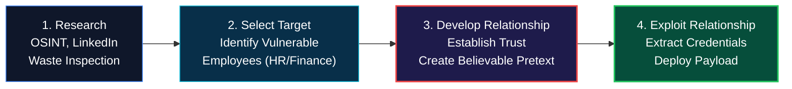
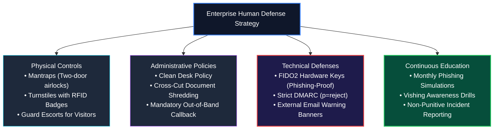
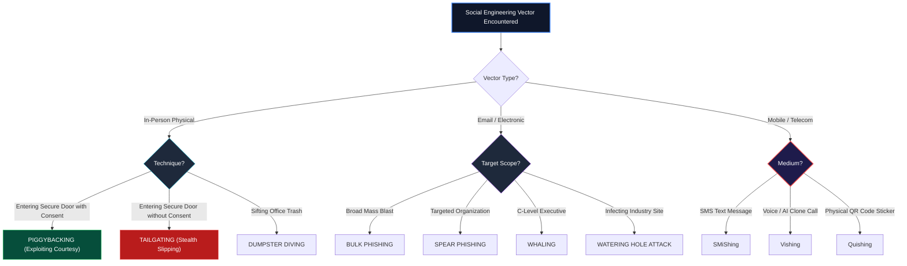

<div align="center">

# 🛡️ CEH v13 — Module 09: Social Engineering
### Certified Ethical Hacker (CEH) Exam Notes • Human Vector Exploitation • Phishing & Whaling • BEC & Quishing • Deepfake Vishing • Enterprise Defense

[-0078D4?style=for-the-badge&logo=shield)](https://www.eccouncil.org/programs/certified-ethical-hacker-ceh/)
[](https://www.eccouncil.org/)
[](../README.md)
[](./README.md)

<p align="center">
  <b>Authoritative, exam-oriented study guide and reference architecture for CEH v13 Module 09: Social Engineering. Covers cognitive psychology triggers (Authority, Scarcity, Urgency), human-based attacks (tailgating vs. piggybacking, dumpster diving, eavesdropping), computer-based attacks (spear phishing, whaling, watering hole attacks, Business Email Compromise), mobile-based vectors (SMiShing, Quishing, AI deepfake voice cloning vishing), insider threat profiling, and multi-layered organizational defenses.</b>
</p>

[📖 Module Hub](../README.md) • [📋 PDF Reference](./CEHv13%20-%20Module%2009%20-%20Social%20Engineering.pdf) • [🍪 Case Study: Session Hijacking](../../Case%20Study/Genesis%20Market/README.md) • [🗺️ Knowledge Base Index](../../README.md)

</div>

---

## 📋 Table of Contents

- [1. Social Engineering Fundamentals & Cognitive Triggers](#1-social-engineering-fundamentals--cognitive-triggers)
  - [Definition & The Human Vulnerability Factor](#definition--the-human-vulnerability-factor)
  - [The 6 Core Principles of Influence (Cialdini's Model)](#the-6-core-principles-of-influence-cialdinis-model)
  - [The 4 Phases of a Social Engineering Attack](#the-4-phases-of-a-social-engineering-attack)
  - [Insider Threat Profiling: Malicious vs. Negligent Insiders](#insider-threat-profiling-malicious-vs-negligent-insiders)
- [2. Human-Based Social Engineering Techniques](#2-human-based-social-engineering-techniques)
  - [Pretexting & Impersonation Scenarios](#pretexting--impersonation-scenarios)
  - [Tailgating vs. Piggybacking: The Critical CEH Distinction](#tailgating-vs-piggybacking-the-critical-ceh-distinction)
  - [Eavesdropping & Shoulder Surfing](#eavesdropping--shoulder-surfing)
  - [Dumpster Diving & Physical Trash Forensics](#dumpster-diving--physical-trash-forensics)
- [3. Computer-Based Social Engineering Techniques](#3-computer-based-social-engineering-techniques)
  - [Phishing Taxonomy: Bulk, Spear Phishing, and Whaling](#phishing-taxonomy-bulk-spear-phishing-and-whaling)
  - [Business Email Compromise (BEC): CEO Fraud & Invoice Diversion](#business-email-compromise-bec-ceo-fraud--invoice-diversion)
  - [Watering Hole Attacks](#watering-hole-attacks)
  - [Clone Phishing & Rogue Pop-ups](#clone-phishing--rogue-pop-ups)
- [4. Mobile-Based & Emerging AI Social Engineering](#4-mobile-based--emerging-ai-social-engineering)
  - [SMiShing (SMS Phishing) Attack Workflows](#smishing-sms-phishing-attack-workflows)
  - [Vishing (Voice Phishing) & AI Deepfake Voice Cloning](#vishing-voice-phishing--ai-deepfake-voice-cloning)
  - [Quishing: QR Code Manipulation & Evasion](#quishing-qr-code-manipulation--evasion)
- [5. Social Engineering Countermeasures & Organizational Policies](#5-social-engineering-countermeasures--organizational-policies)
  - [Physical Security Engineering: Mantraps & Turnstiles](#physical-security-engineering-mantraps--turnstiles)
  - [Administrative Security Policies (Clean Desk, Shredding)](#administrative-security-policies-clean-desk-shredding)
  - [Technical Controls: FIDO2 / WebAuthn & DMARC](#technical-controls-fido2--webauthn--dmarc)
  - [Security Awareness & Phishing Simulation Frameworks](#security-awareness--phishing-simulation-frameworks)
- [🧠 Master CEH Social Engineering Taxonomy Flowchart](#-master-ceh-social-engineering-taxonomy-flowchart)
- [🎯 High-Value CEH Exam Distinctions to Memorize](#-high-value-ceh-exam-distinctions-to-memorize)

---

# 1. Social Engineering Fundamentals & Cognitive Triggers

## Definition & The Human Vulnerability Factor

**Social Engineering** is the art of manipulating individuals into performing actions or divulging confidential information by exploiting human psychology, cognitive biases, and social trust. While perimeter firewalls, EDR agents, and encryption algorithms can be mathematically verified, the **human element represents the weakest link** in enterprise cybersecurity.

$$\text{Attacker Intent} + \text{Cognitive Trigger (Authority / Urgency)} + \text{Plausible Pretext} \longrightarrow \text{Security Policy Bypass}$$

---

## The 6 Core Principles of Influence (Cialdini's Model)

Adversaries structure social engineering pretexts using six well-documented psychological levers:

| Psychological Trigger | Core Human Bias Exploited | Real-World Attack Scenario |
|---|---|---|
| **1. Authority** | Tendency to comply with individuals perceived to possess legitimate power. | Impersonating a senior executive, FBI agent, or lead corporate auditor. |
| **2. Scarcity** | Perception that an opportunity or resource is limited and must be acted upon immediately. | *"Only 2 slots remaining to verify your account before your pension is frozen!"* |
| **3. Urgency** | Inducing panic to impair analytical cognitive processing. | *"Your laptop is actively beaconing to ransomware; provide password within 5 minutes."* |
| **4. Social Proof / Consensus** | Looking to the actions of peers to determine appropriate behavior. | *"Everyone else on the accounting team has already submitted their password update."* |
| **5. Likability / Flattery** | Inclination to assist individuals who are charismatic, attractive, or pleasant. | Attacker builds rapport over social media before requesting internal org charts. |
| **6. Reciprocation** | Feeling obligated to return a favor or concession. | Attacker "assists" an employee with a minor IT issue, then asks for credentials in return. |

---

## The 4 Phases of a Social Engineering Attack



---

# 2. Human-Based Social Engineering Techniques

## Tailgating vs. Piggybacking: The Critical CEH Distinction

The distinction between tailgating and piggybacking is one of the most heavily tested concepts in the CEH exam:

```
┌──────────────────────────────────────────────────────────────────────────────────┐
│                   TAILGATING VS. PIGGYBACKING OPERATIONAL MECHANICS              │
├──────────────────────────────────────────────────────────────────────────────────┤
│                                                                                  │
│   TAILGATING (Without Consent / Stealth):                                        │
│   Authorized employee badging in ──► Attacker quickly slips through the closing  │
│                                      door behind them WITHOUT their knowledge    │
│                                      or permission.                              │
│                                                                                  │
│   PIGGYBACKING (With Consent / Exploiting Politeness):                           │
│   Attacker approaches carrying heavy boxes or on crutches:                       │
│   "Could you hold the door for me?" ──► Authorized employee willfully holds open │
│                                         the secure door, enabling entry.         │
│                                                                                  │
└──────────────────────────────────────────────────────────────────────────────────┘
```

---

## Dumpster Diving & Physical Trash Forensics

**Dumpster diving** is the retrieval of sensitive records, discarded storage media, and corporate memoranda from exterior trash bins, recycling compactors, or recycling containers.
* **Valued Assets:** Printed organization directories, financial statements, source code printouts, sticky notes with passwords, old magnetic tapes, and employee identification cards.

---

# 3. Computer-Based Social Engineering Techniques

```
                                COMPUTER PHISHING TAXONOMY
                                             │
      ┌──────────────────────┬───────────────┴───────────────┬──────────────────────┐
      ▼                      ▼                               ▼                      ▼
┌─────────────┐        ┌─────────────┐                 ┌─────────────┐        ┌─────────────┐
│MASS PHISHING│        │SPEARPHISHING│                 │   WHALING   │        │WATERING HOLE│
├─────────────┤        ├─────────────┤                 ├─────────────┤        ├─────────────┤
│Broad, un-   │        │Customized,  │                 │Directly     │        │Compromises  │
│targeted spam│        │targeted to a│                 │targets C-   │        │industry     │
│campaigns    │        │specific org │                 │Suite execs  │        │websites     │
│(spray & pray│        │or person    │                 │(CEO, CFO)   │        │visited by   │
└─────────────┘        └─────────────┘                 └─────────────┘        │target org   │
                                                                              └─────────────┘
```

* **Whaling:** Highly tailored spear phishing directed specifically at C-level executives (CEO, CFO, CISO) or high-net-worth board members to authorize major wire transfers or approve sensitive corporate acquisitions.
* **Watering Hole Attack:** The adversary discovers which legitimate websites a target group frequently visits (e.g., industry forums, regional catering portals), compromises that website, and embeds a drive-by zero-day exploit to infect target employees visiting the site.
* **Business Email Compromise (BEC):** The attacker compromises or spoofs a CEO or executive's email account and instructs the finance department to execute an emergency wire transfer to an attacker-controlled bank account.

---

# 4. Mobile-Based & Emerging AI Social Engineering

* **SMiShing (SMS Phishing):** Phishing conducted via SMS text messaging (e.g., spoofed banking alerts, package delivery notifications with bit.ly links).
* **Vishing (Voice Phishing) & AI Deepfakes:** Phone fraud. In CEH v13, adversaries use **generative neural voice cloning** to synthesize the voice of a CEO, calling a branch manager to bypass secondary security authorizations.
* **Quishing (QR Code Phishing):** Attackers paste physical stickers containing malicious QR codes over legitimate parking meter or restaurant menu QR codes. When scanned, the smartphone browser redirects to credential harvesting portals.

---

# 5. Social Engineering Countermeasures & Organizational Policies



* **Mantraps (Access Portals):** A specialized physical security vestibule with two interlocking doors. Door 2 cannot open until Door 1 is completely closed and authenticated, making tailgating physically impossible.
* **FIDO2 / WebAuthn Hardware Tokens:** Cryptographic public-key authentication bound to the browser's origin domain. Even if a user enters their credentials into a phishing landing page, the hardware token will refuse to authenticate against the spoofed domain.

---

# 🧠 Master CEH Social Engineering Taxonomy Flowchart



---

# 🎯 High-Value CEH Exam Distinctions to Memorize

| Question / Concept | Correct Answer / Key Insight | Common Exam Distractor (Trap) |
|---|---|---|
| **Tailgating vs Piggybacking** | **Piggybacking involves consent/asking**; Tailgating is **without knowledge/permission**. | Treating both terms as identical. |
| **Phishing targeting the CEO** | **Whaling** | Spear phishing (Whaling is the specific term for C-level). |
| **Compromising a site visited by target** | **Watering Hole Attack** | Island Hopping or Spear phishing. |
| **Physical control preventing tailgating** | **Mantrap** (Two interlocking doors). | Revolving doors or standard turnstiles. |
| **Phishing via SMS text message** | **SMiShing** | Vishing (Voice) or Quishing (QR Code). |
| **Cialdini's "Limited time only" bias** | **Scarcity / Urgency** | Authority or Reciprocity. |
| **Phishing-resistant MFA technology** | **FIDO2 / WebAuthn Hardware Tokens** | SMS OTP (Easily intercepted via SIM swapping/phishing!). |

---

<div align="center">

<b>Next Module: [Module 10 — Denial-of-Service](../Module%2010/README.md)</b> • <b>Previous Module: [Module 08 — Sniffing](../Module%2008/README.md)</b>

</div>
