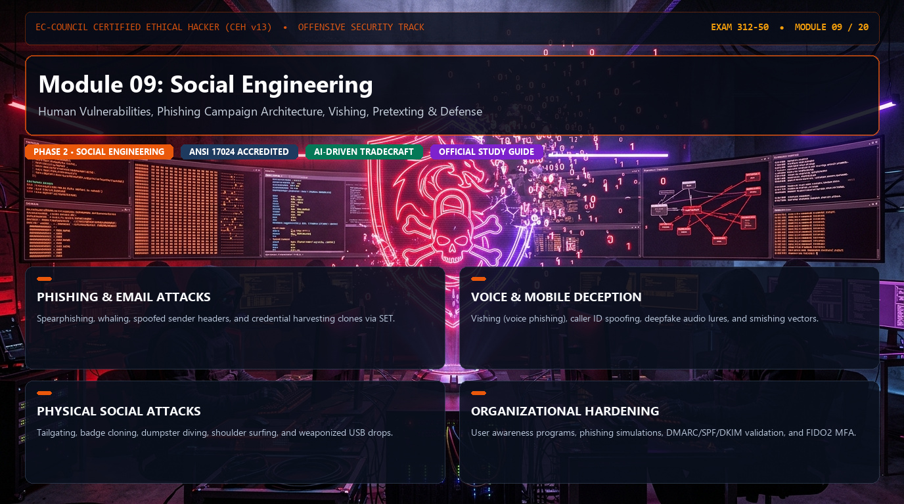
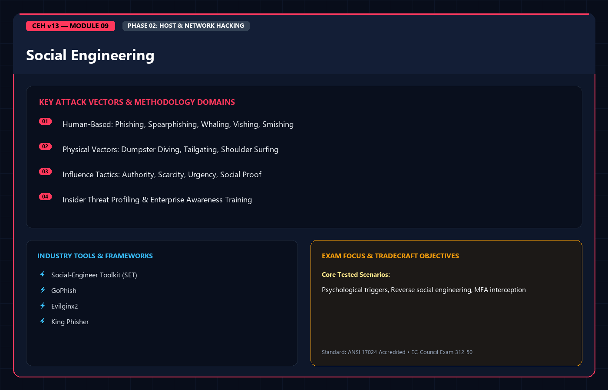
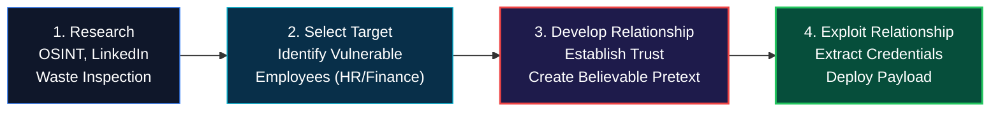
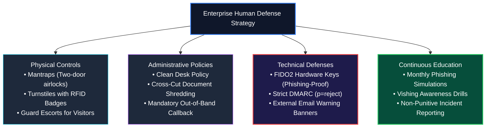
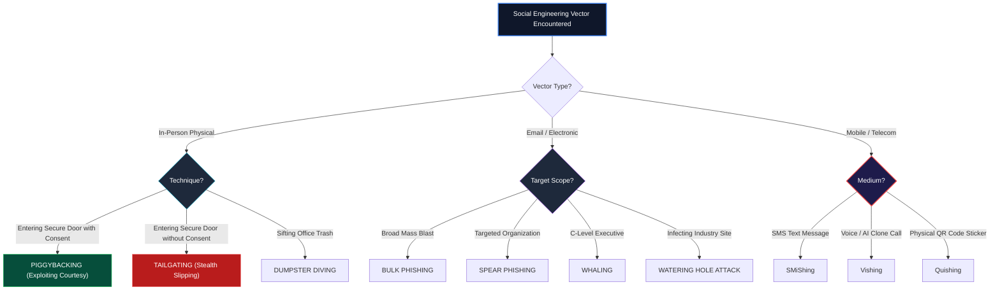

<div align="center">




# 🛡️ CEH v13 — Module 09: Social Engineering
### Certified Ethical Hacker (CEH) Exam Notes • Human Vector Exploitation • Phishing & Whaling • BEC & Quishing • Deepfake Vishing • Enterprise Defense

[-0078D4?style=for-the-badge&logo=shield)](https://www.eccouncil.org/programs/certified-ethical-hacker-ceh/)
[](https://www.eccouncil.org/)
[](../README.md)
[](./README.md)

<p align="center">
  <b>Authoritative, exam-oriented study guide and reference architecture for CEH v13 Module 09: Social Engineering. Covers cognitive psychology triggers (Authority, Scarcity, Urgency), human-based attacks (tailgating vs. piggybacking, dumpster diving, eavesdropping), computer-based attacks (spear phishing, whaling, watering hole attacks, Business Email Compromise), mobile-based vectors (SMiShing, Quishing, AI deepfake voice cloning vishing), insider threat profiling, and multi-layered organizational defenses.</b>
</p>

[📖 Module Hub](../README.md) • [📋 PDF Reference](./CEHv13%20-%20Module%2009%20-%20Social%20Engineering.pdf) • [🍪 Case Study: Session Hijacking](../../Case%20Study/Genesis%20Market/README.md) • [🗺️ Knowledge Base Index](../../README.md)

</div>

---

## 📋 Table of Contents

- [1. Social Engineering Fundamentals & Cognitive Triggers](#1-social-engineering-fundamentals--cognitive-triggers)
  - [Definition & The Human Vulnerability Factor](#definition--the-human-vulnerability-factor)
  - [The 6 Core Principles of Influence (Cialdini's Model)](#the-6-core-principles-of-influence-cialdinis-model)
  - [The 4 Phases of a Social Engineering Attack](#the-4-phases-of-a-social-engineering-attack)
  - [Insider Threat Profiling: Malicious vs. Negligent Insiders](#insider-threat-profiling-malicious-vs-negligent-insiders)
- [2. Human-Based Social Engineering Techniques](#2-human-based-social-engineering-techniques)
  - [Pretexting & Impersonation Scenarios](#pretexting--impersonation-scenarios)
  - [Tailgating vs. Piggybacking: The Critical CEH Distinction](#tailgating-vs-piggybacking-the-critical-ceh-distinction)
  - [Eavesdropping & Shoulder Surfing](#eavesdropping--shoulder-surfing)
  - [Dumpster Diving & Physical Trash Forensics](#dumpster-diving--physical-trash-forensics)
- [3. Computer-Based Social Engineering Techniques](#3-computer-based-social-engineering-techniques)
  - [Phishing Taxonomy: Bulk, Spear Phishing, and Whaling](#phishing-taxonomy-bulk-spear-phishing-and-whaling)
  - [Business Email Compromise (BEC): CEO Fraud & Invoice Diversion](#business-email-compromise-bec-ceo-fraud--invoice-diversion)
  - [Watering Hole Attacks](#watering-hole-attacks)
  - [Clone Phishing & Rogue Pop-ups](#clone-phishing--rogue-pop-ups)
- [4. Mobile-Based & Emerging AI Social Engineering](#4-mobile-based--emerging-ai-social-engineering)
  - [SMiShing (SMS Phishing) Attack Workflows](#smishing-sms-phishing-attack-workflows)
  - [Vishing (Voice Phishing) & AI Deepfake Voice Cloning](#vishing-voice-phishing--ai-deepfake-voice-cloning)
  - [Quishing: QR Code Manipulation & Evasion](#quishing-qr-code-manipulation--evasion)
- [5. Social Engineering Countermeasures & Organizational Policies](#5-social-engineering-countermeasures--organizational-policies)
  - [Physical Security Engineering: Mantraps & Turnstiles](#physical-security-engineering-mantraps--turnstiles)
  - [Administrative Security Policies (Clean Desk, Shredding)](#administrative-security-policies-clean-desk-shredding)
  - [Technical Controls: FIDO2 / WebAuthn & DMARC](#technical-controls-fido2--webauthn--dmarc)
  - [Security Awareness & Phishing Simulation Frameworks](#security-awareness--phishing-simulation-frameworks)
- [🧠 Master CEH Social Engineering Taxonomy Flowchart](#-master-ceh-social-engineering-taxonomy-flowchart)
- [🎯 High-Value CEH Exam Distinctions to Memorize](#-high-value-ceh-exam-distinctions-to-memorize)

---

> [!TIP]
> **💡 In Simple Words — What Module 09 Is Really About:**  
> You can buy a \$500,000 titanium vault door, and an attacker can still walk right in simply by calling the receptionist and convincing them to hold the door open! **Social Engineering** hacks **human psychology** (fear, urgency, politeness, authority) instead of software code.  
> - **Tailgating vs. Piggybacking (Exam Favorite!):** **Tailgating** = sneaking through the door behind someone *without* them knowing. **Piggybacking** = carrying heavy boxes so someone *politely opens* the door for you (with consent!).  
> - **Phishing Types:** **Bulk Phishing** = spam sent to millions; **Spear Phishing** = customized email to one employee; **Whaling** = targeting the CEO/CFO ("Big Fish"); **Quishing** = fake QR codes; **Vishing** = voice/deepfake phone calls.

# 1. Social Engineering Fundamentals & Cognitive Triggers

## Definition & The Human Vulnerability Factor

**Social Engineering** is the art of manipulating individuals into performing actions or divulging confidential information by exploiting human psychology, cognitive biases, and social trust. While perimeter firewalls, EDR agents, and encryption algorithms can be mathematically verified, the **human element represents the weakest link** in enterprise cybersecurity.

$$\text{Attacker Intent} + \text{Cognitive Trigger (Authority / Urgency)} + \text{Plausible Pretext} \longrightarrow \text{Security Policy Bypass}$$

---

## The 6 Core Principles of Influence (Cialdini's Model)

Adversaries structure social engineering pretexts using six well-documented psychological levers:

| Psychological Trigger | Core Human Bias Exploited | Real-World Attack Scenario |
|---|---|---|
| **1. Authority** | Tendency to comply with individuals perceived to possess legitimate power. | Impersonating a senior executive, FBI agent, or lead corporate auditor. |
| **2. Scarcity** | Perception that an opportunity or resource is limited and must be acted upon immediately. | *"Only 2 slots remaining to verify your account before your pension is frozen!"* |
| **3. Urgency** | Inducing panic to impair analytical cognitive processing. | *"Your laptop is actively beaconing to ransomware; provide password within 5 minutes."* |
| **4. Social Proof / Consensus** | Looking to the actions of peers to determine appropriate behavior. | *"Everyone else on the accounting team has already submitted their password update."* |
| **5. Likability / Flattery** | Inclination to assist individuals who are charismatic, attractive, or pleasant. | Attacker builds rapport over social media before requesting internal org charts. |
| **6. Reciprocation** | Feeling obligated to return a favor or concession. | Attacker "assists" an employee with a minor IT issue, then asks for credentials in return. |

---

## The 4 Phases of a Social Engineering Attack



---

## Insider Threat Profiling: Malicious vs. Negligent Insiders
Not all human threats come from outside the building:
* **Malicious Insider (Intentional):** Disgruntled employee, bribed administrator, or planted corporate spy purposefully stealing IP or sabotaging systems.
* **Negligent Insider (Accidental):** Well-meaning worker who accidentally emails sensitive spreadsheets to the wrong address, clicks a phishing link, or leaves an unlocked laptop at a coffee shop.
* **Compromised Insider:** Legitimate employee whose valid credentials/device have been secretly hijacked by an external attacker.

---

# 2. Human-Based Social Engineering Techniques

## Pretexting & Impersonation Scenarios
**Pretexting** is inventing a believable false identity or urgent story (e.g., calling as IT Helpdesk, an external auditor, or FedEx courier) so targets gladly hand over passwords, badge details, or system access.

## Tailgating vs. Piggybacking: The Critical CEH Distinction

The distinction between tailgating and piggybacking is one of the most heavily tested concepts in the CEH exam:

```
┌──────────────────────────────────────────────────────────────────────────────────┐
│                   TAILGATING VS. PIGGYBACKING OPERATIONAL MECHANICS              │
├──────────────────────────────────────────────────────────────────────────────────┤
│                                                                                  │
│   TAILGATING (Without Consent / Stealth):                                        │
│   Authorized employee badging in ──► Attacker quickly slips through the closing  │
│                                      door behind them WITHOUT their knowledge    │
│                                      or permission.                              │
│                                                                                  │
│   PIGGYBACKING (With Consent / Exploiting Politeness):                           │
│   Attacker approaches carrying heavy boxes or on crutches:                       │
│   "Could you hold the door for me?" ──► Authorized employee willfully holds open │
│                                         the secure door, enabling entry.         │
│                                                                                  │
└──────────────────────────────────────────────────────────────────────────────────┘
```

---

## Eavesdropping & Shoulder Surfing
* **Eavesdropping:** Secretly listening to spoken conversations in cafés, elevators, airport lounges, or conference rooms near corporate offices.
* **Shoulder Surfing:** Looking over someone's shoulder (or using telephoto smartphone zoom / hidden reflections) to watch PIN codes, Wi-Fi passwords, or corporate login credentials being typed.

---

## Dumpster Diving & Physical Trash Forensics

**Dumpster diving** is the retrieval of sensitive records, discarded storage media, and corporate memoranda from exterior trash bins, recycling compactors, or recycling containers.
* **Valued Assets:** Printed organization directories, financial statements, source code printouts, sticky notes with passwords, old magnetic tapes, and employee identification cards.

---

# 3. Computer-Based Social Engineering Techniques

## Phishing Taxonomy: Bulk, Spear Phishing, and Whaling

```
                                COMPUTER PHISHING TAXONOMY
                                             │
      ┌──────────────────────┬───────────────┴───────────────┬──────────────────────┐
      ▼                      ▼                               ▼                      ▼
┌─────────────┐        ┌─────────────┐                 ┌─────────────┐        ┌─────────────┐
│MASS PHISHING│        │SPEARPHISHING│                 │   WHALING   │        │WATERING HOLE│
├─────────────┤        ├─────────────┤                 ├─────────────┤        ├─────────────┤
│Broad, un-   │        │Customized,  │                 │Directly     │        │Compromises  │
│targeted spam│        │targeted to a│                 │targets C-   │        │industry     │
│campaigns    │        │specific org │                 │Suite execs  │        │websites     │
│(spray & pray│        │or person    │                 │(CEO, CFO)   │        │visited by   │
└─────────────┘        └─────────────┘                 └─────────────┘        │target org   │
                                                                              └─────────────┘
```

## Business Email Compromise (BEC): CEO Fraud & Invoice Diversion
The attacker compromises or spoofs a CEO, CFO, or trusted supplier email account and instructs the finance department to execute an urgent wire transfer or redirect vendor invoice payments to an attacker-controlled bank account.

## Watering Hole Attacks
The adversary identifies legitimate websites that employees of the target organization frequently visit (e.g., an industry engineering forum or local union portal), compromises that site, and injects a drive-by exploit to infect target employees when they browse there.

## Clone Phishing & Rogue Pop-ups
* **Clone Phishing:** Attacker copies a real legitimate email previously received by the victim (same branding, layout, and signature), replaces its safe attachment or link with a malicious lookalike, and resends it claiming *"Here is an updated copy."*
* **Rogue Pop-ups & Scareware:** Fake browser overlays alerting *"CRITICAL VIRUS DETECTED — Call Microsoft Support Now"* tricking users into installing remote access software.

---

# 4. Mobile-Based & Emerging AI Social Engineering

## SMiShing (SMS Phishing) Attack Workflows
Phishing conducted over SMS/text messaging (e.g., fake bank fraud alerts, toll unpaid notices, or parcel delivery links pointing to credential harvesters or malicious Android `.apk` downloads).

## Vishing (Voice Phishing) & AI Deepfake Voice Cloning
Voice fraud over phone or VoIP calls. Modern attackers leverage Caller ID spoofing combined with **CEH v13 AI generative voice cloning** trained on a few seconds of a CEO's earnings-call audio to authorize emergency transfers.

## Quishing: QR Code Manipulation & Evasion
Attackers print malicious QR code stickers and paste them over real parking meters or send QR codes embedded inside PDFs/images — bypassing traditional email URL scanners because security gateways cannot inspect links encoded inside pixels!

---

# 5. Social Engineering Countermeasures & Organizational Policies



## Physical Security Engineering: Mantraps & Turnstiles
* **Mantraps (Access Portals):** Two interlocking doors inside a physical vestibule where Door 2 cannot unlock until Door 1 closes and verifies a single badge — physically neutralizing tailgating and piggybacking.
* **Optical Turnstiles & Guard Escorts:** Enforce one-badge-per-person entry across lobbies.

## Administrative Security Policies (Clean Desk, Shredding)
* **Clean Desk Policy & Cross-Cut Shredding:** Ensures sticky-note passwords aren't visible and discarded paper documents cannot be reassembled during dumpster diving.
* **Mandatory Out-of-Band Callback:** Requires finance teams to verify wire changes by dialing a previously known phone number rather than replying to the email thread.

## Technical Controls: FIDO2 / WebAuthn & DMARC
* **FIDO2 / WebAuthn Hardware Tokens:** Cryptographic public-key MFA bound strictly to the genuine origin domain — making MFA completely **phishing-resistant** even against Evilginx proxy sites.
* **Strict DMARC (`p=reject`) + SPF + DKIM:** Instructs receiving mail servers to drop spoofed executive lookalike emails automatically.

## Security Awareness & Phishing Simulation Frameworks
Using platforms like **GoPhish** and KnowBe4 to run regular realistic phishing/vishing drills paired with blame-free one-click *"Report Phish"* buttons.

---

# 🧠 Master CEH Social Engineering Taxonomy Flowchart



---

# 🎯 High-Value CEH Exam Distinctions to Memorize

| Question / Concept | Correct Answer / Key Insight | Common Exam Distractor (Trap) |
|---|---|---|
| **Tailgating vs Piggybacking** | **Piggybacking involves consent/asking**; Tailgating is **without knowledge/permission**. | Treating both terms as identical. |
| **Phishing targeting the CEO** | **Whaling** | Spear phishing (Whaling is the specific term for C-level). |
| **Compromising a site visited by target** | **Watering Hole Attack** | Island Hopping or Spear phishing. |
| **Physical control preventing tailgating** | **Mantrap** (Two interlocking doors). | Revolving doors or standard turnstiles. |
| **Phishing via SMS text message** | **SMiShing** | Vishing (Voice) or Quishing (QR Code). |
| **Cialdini's "Limited time only" bias** | **Scarcity / Urgency** | Authority or Reciprocity. |
| **Phishing-resistant MFA technology** | **FIDO2 / WebAuthn Hardware Tokens** | SMS OTP (Easily intercepted via SIM swapping/phishing!). |

---

<div align="center">

<b>Next Module: [Module 10 — Denial-of-Service](../Module%2010/README.md)</b> • <b>Previous Module: [Module 08 — Sniffing](../Module%2008/README.md)</b>

</div>
