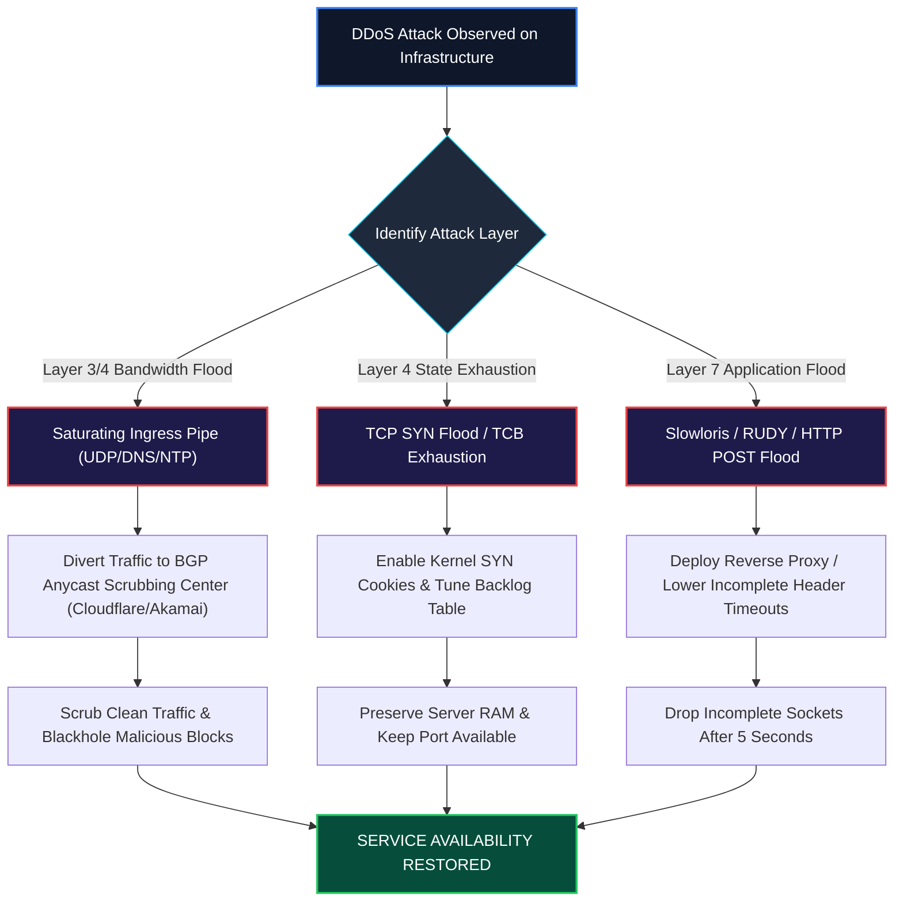

<div align="center">

# 🛡️ CEH v13 — Module 10: Denial-of-Service
### Certified Ethical Hacker (CEH) Exam Notes • DoS vs. DDoS • SYN Flooding & TCB Exhaustion • Smurf & Fraggle • Amplification (DNS/NTP/Memcached) • Slowloris • SYN Cookies & Scrubbing

[-0078D4?style=for-the-badge&logo=shield)](https://www.eccouncil.org/programs/certified-ethical-hacker-ceh/)
[](https://www.eccouncil.org/)
[](../README.md)
[](./README.md)

<p align="center">
  <b>Authoritative, exam-oriented study guide and reference architecture for CEH v13 Module 10: Denial-of-Service. Covers volumetric, protocol, and application-layer DoS/DDoS classifications, TCP SYN flood state exhaustion and Transmission Control Block (TCB) mechanics, packet fragmentation attacks (Ping of Death, Teardrop), broadcast reflection (Smurf and Fraggle), massive UDP amplification vectors (DNS, NTP monlist, Memcached), low-and-slow Layer-7 exhaustion (Slowloris, RUDY), and enterprise mitigation architectures (SYN Cookies, BCP 38, BGP Anycast scrubbing).</b>
</p>

[📖 Module Hub](../README.md) • [📋 PDF Reference](./CEHv13%20-%20Module%2010%20-%20Denial-of-Service.pdf) • [🛡️ SOC Incident Playbooks](../../SOC/README.md) • [🗺️ Knowledge Base Index](../../README.md)

</div>

---

## 📋 Table of Contents

- [1. DoS / DDoS Fundamentals & Attack Classifications](#1-dos--ddos-fundamentals--attack-classifications)
  - [Definition & The Availability Pillar](#definition--the-availability-pillar)
  - [DoS vs. DDoS: Architectural Distinctions](#dos-vs-ddos-architectural-distinctions)
  - [The 3 DoS Attack Categories: Volumetric, Protocol, and Application-Layer](#the-3-dos-attack-categories-volumetric-protocol-and-application-layer)
  - [Botnet Architectures: Centralized C2 vs. Peer-to-Peer (P2P)](#botnet-architectures-centralized-c2-vs-peer-to-peer-p2p)
- [2. Protocol & State Exhaustion Attacks](#2-protocol--state-exhaustion-attacks)
  - [TCP SYN Flood & Transmission Control Block (TCB) Starvation](#tcp-syn-flood--transmission-control-block-tcb-starvation)
  - [Fragmented IP Attacks: Ping of Death & Teardrop](#fragmented-ip-attacks-ping-of-death--teardrop)
- [3. Volumetric & Broadcast Amplification Attacks](#3-volumetric--broadcast-amplification-attacks)
  - [Smurf Attack (ICMP Broadcast Amplification)](#smurf-attack-icmp-broadcast-amplification)
  - [Fraggle Attack (UDP Echo / Chargen Amplification)](#fraggle-attack-udp-echo--chargen-amplification)
  - [DNS Amplification Attacks (EDNS0 & Recursive Resolvers)](#dns-amplification-attacks-edns0--recursive-resolvers)
  - [NTP Monlist Amplification Attacks](#ntp-monlist-amplification-attacks)
  - [Memcached Amplification (50,000x Factor)](#memcached-amplification-50000x-factor)
- [4. Application-Layer (Layer 7) Low-and-Slow Attacks](#4-application-layer-layer-7-low-and-slow-attacks)
  - [HTTP GET / POST Flooding](#http-get--post-flooding)
  - [Slowloris: Thread Starvation via Incomplete Headers](#slowloris-thread-starvation-via-incomplete-headers)
  - [R-U-Dead-Yet (RUDY): Slow POST Data Starvation](#r-u-dead-yet-rudy-slow-post-data-starvation)
- [5. Denial-of-Service Countermeasures & Defensive Engineering](#5-denial-of-service-countermeasures--defensive-engineering)
  - [Defeating SYN Floods: SYN Cookies Algorithm](#defeating-syn-floods-syn-cookies-algorithm)
  - [Egress Anti-Spoofing: BCP 38 / RFC 2827](#egress-anti-spoofing-bcp-38--rfc-2827)
  - [Architectural Resilience: BGP Anycast & Scrubbing Centers](#architectural-resilience-bgp-anycast--scrubbing-centers)
  - [Remediation: Blackholing & Sinkholing](#remediation-blackholing--sinkholing)
- [🧠 Master CEH Denial-of-Service Decision Flowchart](#-master-ceh-denial-of-service-decision-flowchart)
- [🎯 High-Value CEH Exam Distinctions to Memorize](#-high-value-ceh-exam-distinctions-to-memorize)

---

# 1. DoS / DDoS Fundamentals & Attack Classifications

## Definition & The Availability Pillar

A **Denial-of-Service (DoS)** attack is an explicit attempt by an adversary to render a computer, network service, or infrastructure component unavailable to its intended legitimate users, directly degrading the **Availability** pillar of the CIA Triad.

```
┌──────────────────────────────────────────────────────────────────────────────────┐
│                   DOS VS. DDOS ARCHITECTURAL TOPOLOGY                            │
├──────────────────────────────────────────────────────────────────────────────────┤
│                                                                                  │
│   [DENIAL-OF-SERVICE (DoS)]                                                      │
│   Single Attacker Host ───────────(Direct Flood)───────────► [Victim Server]     │
│   • Easily mitigated by blocking the single source IP address at the firewall.   │
│                                                                                  │
│   [DISTRIBUTED DENIAL-OF-SERVICE (DDoS)]                                         │
│   Attacker C2 Master ──────► [Command & Control Server]                          │
│                                      │                                           │
│       ┌──────────────────────────────┼──────────────────────────────┐            │
│       ▼                              ▼                              ▼            │
│   [Zombie / Bot 1]             [Zombie / Bot 2]             [Zombie / Bot 3]     │
│       │                              │                              │            │
│       └──────────────────────────────┼──────────────────────────────┘            │
│                                      ▼                                           │
│                       [VICTIM ENTERPRISE INFRASTRUCTURE]                         │
│   • Millions of distinct IP addresses; impossible to block via simple IP bans!   │
│                                                                                  │
└──────────────────────────────────────────────────────────────────────────────────┘
```

---

## The 3 DoS Attack Categories

| Category | Primary Metric | Target of Exhaustion | Representative Attacks |
|---|:---:|---|---|
| **1. Volumetric Attacks** | **Bits per Second (bps)** | Network pipe bandwidth; saturates ingress transit link. | UDP Flood, ICMP Flood, DNS Amplification, NTP Reflection. |
| **2. Protocol Attacks** | **Packets per Second (pps)** | State tables of intermediate appliances (Firewalls, Load Balancers, OS TCP queues). | TCP SYN Flood, Ping of Death, Smurf, Teardrop. |
| **3. Application-Layer Attacks** | **Requests per Second (rps)** | Web server threads, CPU processing, database connection pools. | Slowloris, RUDY, HTTP GET Floods, ReDoS. |

---

# 2. Protocol & State Exhaustion Attacks

## TCP SYN Flood & Transmission Control Block (TCB) Starvation

In a standard TCP 3-way handshake, when a server receives a `SYN` packet, it allocates a dedicated memory structure called a **Transmission Control Block (TCB)** in its connection backlog table, responds with `SYN-ACK`, and enters the **`SYN-RECEIVED`** half-open state, waiting for the client's final `ACK`.

```
┌──────────────────────────────────────────────────────────────────────────────────┐
│                     TCP SYN FLOOD TCB EXHAUSTION ANATOMY                         │
├──────────────────────────────────────────────────────────────────────────────────┤
│                                                                                  │
│   Attacker ───► SYN (Spoofed Source IP 1) ───► Server (Allocates TCB 1 in RAM)   │
│   Server   ───► SYN/ACK to Spoofed IP 1 (Sent into the void, no reply ever!)     │
│                                                                                  │
│   Attacker ───► SYN (Spoofed Source IP 2) ───► Server (Allocates TCB 2 in RAM)   │
│   Attacker ───► SYN (Spoofed Source IP 3) ───► Server (Allocates TCB 3 in RAM)   │
│   ... (100,000 SYN packets per second)                                           │
│                                                                                  │
│   RESULT: Server's SYN Backlog Queue reaches 100% capacity!                      │
│   Legitimate Client ───► SYN ───► Server (DROPS PACKET! Host Unavailable!)       │
│                                                                                  │
└──────────────────────────────────────────────────────────────────────────────────┘
```

---

## Fragmented IP Attacks: Ping of Death & Teardrop

* **Ping of Death (PoD):** The IPv4 maximum packet size is **65,535 bytes**. An attacker creates an ICMP packet larger than 65,535 bytes and breaks it into IP fragments. When the victim reassembles the fragments, the total size exceeds the maximum buffer limit, causing a 32-bit kernel integer overflow or crash (Blue Screen of Death).
* **Teardrop Attack:** The attacker transmits fragmented IP packets where the **Fragment Offset fields overlap** each other (e.g., Fragment 1 has bytes 0–100; Fragment 2 has bytes 50–150). When the destination reassembly algorithm attempts to stitch the corrupted overlapping offsets together, the kernel crashes.

---

# 3. Volumetric & Broadcast Amplification Attacks

## Smurf Attack (ICMP Broadcast Amplification)

A **Smurf attack** amplifies traffic by exploiting misconfigured routers that permit Directed Broadcasts:

```
┌──────────────────────────────────────────────────────────────────────────────────┐
│                        SMURF ATTACK AMPLIFICATION SEQUENCE                       │
├──────────────────────────────────────────────────────────────────────────────────┤
│                                                                                  │
│   Attacker transmits ICMP Echo Request:                                          │
│   • Source IP:      192.168.1.50 (SPOOFED IP OF THE VICTIM!)                     │
│   • Destination IP: 10.0.0.255 (BROADCAST ADDRESS OF AN INTERMEDIARY NETWORK!)   │
│                                                                                  │
│                         [INTERMEDIARY BROADCAST NETWORK]                         │
│                         ├── Host 1 (10.0.0.1)  ──► ICMP Echo Reply ──┐           │
│                         ├── Host 2 (10.0.0.2)  ──► ICMP Echo Reply ──┤           │
│                         ├── Host 3 (10.0.0.3)  ──► ICMP Echo Reply ──┼──► VICTIM │
│                         └── Host 100 (10.0.0.100)► ICMP Echo Reply ──┘           │
│                                                                                  │
│   All 100 hosts simultaneously blast ICMP Echo Replies to the innocent VICTIM!  │
│                                                                                  │
└──────────────────────────────────────────────────────────────────────────────────┘
```

* **Fraggle Attack:** Conceptually identical to Smurf, but utilizes **UDP packets** instead of ICMP. The attacker sends spoofed UDP packets to **port 7 (Echo)** or **port 19 (Chargen)** on an intermediary broadcast network.

---

## UDP Amplification Vectors: DNS, NTP & Memcached

Amplification relies on protocols operating over connectionless UDP where the response packet size is orders of magnitude larger than the query:

$$\mathbf{Amplification\ Factor} = \frac{\text{Response Payload Size}}{\text{Request Payload Size}}$$

```
┌──────────────────────────────────────────────────────────────────────────────────┐
│                     AMPLIFICATION ATTACK FACTORS COMPARED                        │
├──────────────────────────────────────────────────────────────────────────────────┤
│                                                                                  │
│   DNS Amplification (EDNS0):             ~50x to 70x Amplification               │
│   NTP Monlist Amplification:             ~500x Amplification                     │
│   Memcached (UDP Port 11211):            ~10,000x to 51,000x Amplification!      │
│                                                                                  │
└──────────────────────────────────────────────────────────────────────────────────┘
```

---

# 4. Application-Layer (Layer 7) Low-and-Slow Attacks

## Slowloris: Thread Starvation via Incomplete Headers

**Slowloris** is a highly stealthy Layer-7 attack that brings down web servers (especially thread-based servers like Apache) using minimal bandwidth:

```
┌──────────────────────────────────────────────────────────────────────────────────┐
│                         SLOWLORIS ATTACK ARCHITECTURE                            │
├──────────────────────────────────────────────────────────────────────────────────┤
│                                                                                  │
│   1. Attacker opens 1,000 valid TCP connections to web server on port 80.        │
│                                                                                  │
│   2. Attacker sends incomplete HTTP request headers:                             │
│      "GET / HTTP/1.1\r\n"                                                        │
│      "Host: target.com\r\n"                                                      │
│      "User-Agent: Mozilla/5.0\r\n"                                               │
│      (NEVER SENDS THE TERMINATING "\r\n\r\n" SEQUENCE!)                          │
│                                                                                  │
│   3. Every 10 seconds, attacker sends another bogus header to keep socket open:  │
│      "X-Custom-Header: keepalive\r\n"                                            │
│                                                                                  │
│   4. Server holds all worker threads open in memory, waiting for header end.     │
│      Apache thread pool reaches MaxClients! Server rejects legitimate users!     │
│                                                                                  │
└──────────────────────────────────────────────────────────────────────────────────┘
```

* **R-U-Dead-Yet (RUDY):** Attacks web form submissions by setting a massive `Content-Length` header (e.g., 1,000,000 bytes) and transmitting the POST data body **one single byte every 10 seconds**, completely starving server sockets.

---

# 5. Denial-of-Service Countermeasures & Defensive Engineering

## Defeating SYN Floods: SYN Cookies Algorithm

**SYN Cookies** (RFC 4987) completely eliminates the vulnerability of TCB memory exhaustion:
1. When a `SYN` arrives, the server **does NOT allocate any TCB memory** in the backlog table.
2. Instead, the server cryptographically encodes the connection parameters (client IP, client port, secret server salt, timestamp) into the 32-bit **Initial Sequence Number (ISN)** of its `SYN-ACK` response packet.
3. If the client is legitimate, it returns an `ACK` where the acknowledgment number equals $\text{ISN} + 1$.
4. The server subtracts 1 from the acknowledgment number, cryptographically validates the cookie, and **only then allocates memory for the connection**. Fake spoofed SYNs consume **zero RAM**.

---

## Egress Anti-Spoofing: BCP 38 / RFC 2827

**Best Current Practice 38 (BCP 38)** mandates that Internet Service Providers (ISPs) implement **egress filtering** on customer routers:
* If a customer transmits a packet whose source IP address does not belong to that customer's allocated CIDR block, the router drops the packet immediately.
* **Impact:** Completely eliminates IP address spoofing, dismantling Smurf, Fraggle, and UDP amplification attacks.

---

# 🧠 Master CEH Denial-of-Service Decision Flowchart



---

# 🎯 High-Value CEH Exam Distinctions to Memorize

| Question / Concept | Correct Answer / Key Insight | Common Exam Distractor (Trap) |
|---|---|---|
| **Smurf vs Fraggle Attack** | **Smurf uses ICMP**; **Fraggle uses UDP** (port 7 Echo / 19 Chargen). | Confusing the two protocols. |
| **How SYN Cookies Work** | Encodes connection parameters into the **Initial Sequence Number (ISN)**; no TCB allocated! | "Blocks all incoming SYN packets". |
| **Attack sending overlapping fragments** | **Teardrop Attack** | Ping of Death (PoD is oversized packet > 65,535 bytes). |
| **Slowloris Attack Mechanism** | Sends **incomplete HTTP headers slowly**; holds web server sockets open. | Saturating network bandwidth with UDP packets. |
| **Standard Anti-Spoofing Document** | **BCP 38** (Best Current Practice 38 / RFC 2827). | RFC 1918 (Private IP allocation). |
| **Highest UDP Amplification Vector** | **Memcached** (Up to 50,000x amplification factor over port 11211). | NTP (500x) or DNS (70x). |
| **Smurf Attack Amplification Target** | The **broadcast address** of an intermediary third-party network. | The victim's direct IP address. |

---

<div align="center">

<b>Next Module: [Module 11 — Session Hijacking](../Module%2011/README.md)</b> • <b>Previous Module: [Module 09 — Social Engineering](../Module%2009/README.md)</b>

</div>
