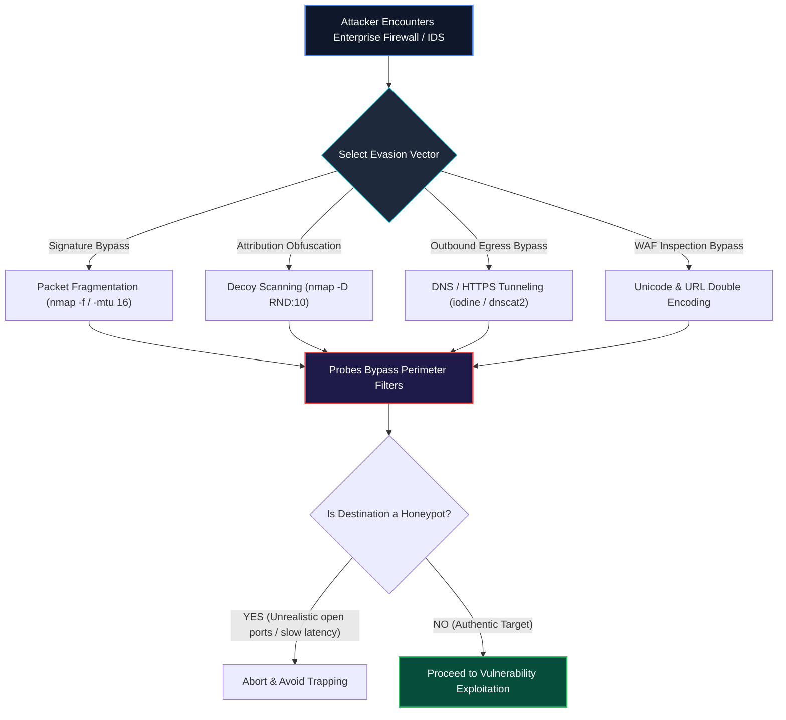

<div align="center">

# 🛡️ CEH v13 — Module 12: Evading IDS, Firewalls, and Honeypots
### Certified Ethical Hacker (CEH) Exam Notes • Intrusion Detection & Prevention • Firewall Architectures • Evasion Tradecraft (Fragmentation, Decoys, Tunneling) • Honeypots & Detection

[-0078D4?style=for-the-badge&logo=shield)](https://www.eccouncil.org/programs/certified-ethical-hacker-ceh/)
[](https://www.eccouncil.org/)
[](../README.md)
[](./README.md)

<p align="center">
  <b>Authoritative, exam-oriented study guide and reference architecture for CEH v13 Module 12: Evading IDS, Firewalls, and Honeypots. Covers intrusion detection/prevention mechanics (Signature vs. Anomaly vs. Heuristic), firewall architectures (Stateless, Stateful, Application Proxy, Next-Gen), advanced perimeter evasion tradecraft (packet fragmentation, decoys, source routing, session splicing, DNS/HTTP tunneling, Unicode obfuscation), 802.1X NAC bypasses, low vs. high-interaction honeypots, honeypot detection heuristics, and traffic normalization defenses.</b>
</p>

[📖 Module Hub](../README.md) • [📋 PDF Reference](./CEHv13%20-%20Module%2012%20-%20Evading%20IDS,%20Firewalls,%20and%20Honeypots.pdf) • [🛡️ SOC & EDR Playbooks](../../SOC/README.md) • [🗺️ Knowledge Base Index](../../README.md)

</div>

---

## 📋 Table of Contents

- [1. IDS, IPS, and Firewall Architectures](#1-ids-ips-and-firewall-architectures)
  - [IDS vs. IPS: In-Line vs. Out-of-Band Operations](#ids-vs-ips-in-line-vs-out-of-band-operations)
  - [Detection Models: Signature-Based vs. Anomaly-Based vs. Heuristics](#detection-models-signature-based-vs-anomaly-based-vs-heuristics)
  - [Firewall Generations & Architecture Types](#firewall-generations--architecture-types)
  - [Next-Generation Firewalls (NGFW) & Deep Packet Inspection (DPI)](#next-generation-firewalls-ngfw--deep-packet-inspection-dpi)
- [2. Enterprise Perimeter Defenses & Deployment Topology](#2-enterprise-perimeter-defenses--deployment-topology)
  - [Screened Subnet (DMZ) Architecture](#screened-subnet-dmz-architecture)
  - [Snort, Suricata, and iptables Rules Engine](#snort-suricata-and-iptables-rules-engine)
- [3. Advanced IDS & Firewall Evasion Techniques](#3-advanced-ids--firewall-evasion-techniques)
  - [Packet Fragmentation & Overlapping Fragments (`nmap -f`, `-mtu`)](#packet-fragmentation--overlapping-fragments-nmap--f--mtu)
  - [Decoy Scanning (`nmap -D`)](#decoy-scanning-nmap--d)
  - [Source Routing: Loose (LSR) vs. Strict (SSR)](#source-routing-loose-lsr-vs-strict-ssr)
  - [Session Splicing & Time-Delay Evasion](#session-splicing--time-delay-evasion)
  - [Tunneling Protocols: DNS Tunneling (`iodine`) & SSH Pivoting](#tunneling-protocols-dns-tunneling-iodine--ssh-pivoting)
  - [Obfuscation, Polymorphism & Unicode Encoding](#obfuscation-polymorphism--unicode-encoding)
- [4. Bypassing Network Access Control (NAC) & Endpoint Security](#4-bypassing-network-access-control-nac--endpoint-security)
  - [802.1X Port Authentication Bypass](#8021x-port-authentication-bypass)
  - [EDR Evasion: Direct Syscalls & API Unhooking](#edr-evasion-direct-syscalls--api-unhooking)
- [5. Honeypot Architectures & Adversary Detection](#5-honeypot-architectures--adversary-detection)
  - [What is a Honeypot? Roles & Classifications](#what-is-a-honeypot-roles--classifications)
  - [Low-Interaction (Honeyd) vs. High-Interaction (Honeynets)](#low-interaction-honeyd-vs-high-interaction-honeynets)
  - [Detecting Honeypots: Latency Probing & Service Fingerprinting](#detecting-honeypots-latency-probing--service-fingerprinting)
- [6. Evasion Countermeasures & Defensive Normalization](#6-evasion-countermeasures--defensive-normalization)
  - [Traffic Normalization & Full Stream Reassembly](#traffic-normalization--full-stream-reassembly)
  - [Egress DNS Filtering & Protocol Strict Enforcement](#egress-dns-filtering--protocol-strict-enforcement)
- [🧠 Master CEH IDS/Firewall Evasion Decision Flowchart](#-master-ceh-idsfirewall-evasion-decision-flowchart)
- [🎯 High-Value CEH Exam Distinctions to Memorize](#-high-value-ceh-exam-distinctions-to-memorize)

---

# 1. IDS, IPS, and Firewall Architectures

## IDS vs. IPS: In-Line vs. Out-of-Band Operations

```
┌──────────────────────────────────────────────────────────────────────────────────┐
│                      IDS (OUT-OF-BAND) VS. IPS (IN-LINE) TOPOLOGY                │
├──────────────────────────────────────────────────────────────────────────────────┤
│                                                                                  │
│   [INTRUSION DETECTION SYSTEM (IDS) - PASSIVE]                                   │
│   External Traffic ────► [Switch SPAN / Mirror Port]                             │
│                                  │                                               │
│                                  ├──► [Protected Internal Server]                │
│                                  └──► [IDS Sensor] (Analyzes copy of packet;     │
│                                                     Sends alert AFTER the fact!) │
│                                                                                  │
│   [INTRUSION PREVENTION SYSTEM (IPS) - ACTIVE]                                   │
│   External Traffic ────► [IN-LINE IPS SENSOR] ────► [Protected Internal Server]  │
│                                   │                                              │
│                                   └── Drops malicious packet BEFORE it reaches!  │
│                                                                                  │
└──────────────────────────────────────────────────────────────────────────────────┘
```

---

## Detection Models

1. **Signature-Based Detection:** Compares incoming packet byte sequences against a static database of known attack signatures (e.g., Snort rules). Extremely fast and accurate for known exploits; completely blind to zero-days.
2. **Anomaly-Based Detection:** Establishes a statistical baseline of "normal" network traffic (bandwidth, protocols, connections). Any activity that deviates significantly from the baseline triggers an alert. Capable of discovering novel zero-day attacks, but prone to **high false-positive rates**.
3. **Heuristic / Behavioral Detection:** Evaluates the behavioral intent and characteristics of code or traffic using expert algorithms.

---

## Firewall Generations & Architecture Types

| Firewall Type | OSI Layer | Operating Mechanism | Key Security Advantage / Limitation |
|---|:---:|---|---|
| **Packet Filtering (Stateless)** | Layer 3 & 4 | Inspects individual packet headers (Source/Dest IP, Port, Protocol). | Extremely fast; vulnerable to spoofing; cannot track connection state. |
| **Stateful Inspection** | Layer 3 & 4 | Maintains a dynamic **State Connection Table**; tracks TCP handshakes. | Only permits inbound packets that match an established outbound session. |
| **Circuit-Level Gateway** | Layer 5 (Session)| Validates TCP handshakes between client and server without inspecting payload. | Operates via SOCKS proxy; low CPU overhead; blind to Layer-7 payloads. |
| **Application-Level Proxy** | Layer 7 | Terminates connection, inspects payload (HTTP, FTP), acts as intermediary. | Highest security; deep inspection; high processing overhead / latency. |
| **Next-Generation (NGFW)** | Layers 2–7 | Integrates deep packet inspection, in-line IPS, user identity, and application awareness. | Identifies evasive applications running over non-standard ports (e.g., Tor over 443). |

---

# 2. Advanced IDS & Firewall Evasion Techniques

```
                                  EVASION TAXONOMY
                                         │
     ┌───────────────────────┬───────────┴───────────┬───────────────────────┐
     ▼                       ▼                       ▼                       ▼
┌──────────────┐     ┌──────────────┐     ┌──────────────┐     ┌──────────────┐
│FRAGMENTATION │     │DECOY SCANNING│     │  TUNNELING   │     │ OBFUSCATION  │
├──────────────┤     ├──────────────┤     ├──────────────┤     ├──────────────┤
│Splits payload│     │Hides real IP │     │Encapsulates  │     │Unicode, URL  │
│into tiny IP  │     │behind dozens │     │payload inside│     │double-encode │
│fragments     │     │of fake hosts │     │DNS / HTTPS   │     │bypasses WAF  │
└──────────────┘     └──────────────┘     └──────────────┘     └──────────────┘
```

---

## Packet Fragmentation & Overlapping Fragments

Attackers break attack payloads into small IP fragments (e.g., 8 or 16 bytes) using `nmap -f` or `nmap --mtu 16`.
* **IDS Failure:** If the IDS does not reassemble fragments before inspection, individual 8-byte fragments bypass string signatures.
* **Overlapping Fragment Attack:** The attacker transmits fragments with overlapping offset values. Different operating system kernels reassemble fragments differently (e.g., Windows favors the original fragment, while Linux favors the latter fragment). The attacker crafts fragments so the IDS sees an innocent string while the target server reconstructs the exploit!

---

## Decoy Scanning (`nmap -D`)

In a decoy scan, the attacker transmits scans from their own real IP address mixed simultaneously among multiple spoofed "decoy" IP addresses:

```bash
nmap -D RND:10,198.51.100.25,ME 192.168.1.50
```

The target's firewall and IDS log 12 distinct machines scanning the port simultaneously, making it impossible for the SOC analyst to determine which IP was the true adversary.

---

## Tunneling Protocols: DNS Tunneling (`iodine`) & SSH Pivoting

* **DNS Tunneling:** Enterprise firewalls strictly permit outbound UDP port 53 (DNS) queries. Tools like **`iodine`** and **`dnscat2`** encapsulate arbitrary TCP traffic (shells, files) into base32/hex-encoded DNS queries sent to an attacker-controlled authoritative nameserver.
* **SSH Tunneling (Dynamic SOCKS Proxy):**
  ```bash
  ssh -D 1080 -N -f user@compromised-jumpbox.corp
  ```

---

## Obfuscation & Unicode Encoding

Web Application Firewalls (WAFs) looking for explicit strings like `/etc/passwd` or `<script>` can be bypassed using alternative encodings:
* **URL Double-Encoding:** `%252e%252e%252f` (Decodes to `%2e%2e%2f`, which decodes to `../`).
* **Unicode / UTF-8 Overlong Encoding:** Encoding characters into multi-byte sequences that the WAF fails to normalize.

---

# 3. Honeypot Architectures & Adversary Detection

A **honeypot** is an isolated, monitored decoy resource deployed within an enterprise network designed to entice, detect, and analyze unauthorized activity:

| Honeypot Classification | Interaction Level | Implementation Details | Pros & Cons |
|---|---|---|---|
| **Low-Interaction** | Simulates only specific daemon banners & ports (e.g., **Honeyd**). | Emulates rudimentary OS responses; no real operating system. | Low maintenance, zero risk of compromise; easily fingerprinted by attackers. |
| **High-Interaction** | Real physical/virtual OS and authentic applications (**Honeynet**). | Attacker interacts with a real system inside an instrumented sandbox. | Captures novel zero-day attacks and malware; high risk if attacker escapes sandbox. |

---

## Detecting Honeypots

Adversaries probe systems before launching exploits to determine if they are interacting with a honeypot:
1. **Unrealistic Port Combinations:** A system presenting open ports for Microsoft IIS, Apache, Sendmail, and Oracle DB simultaneously on a single IP address.
2. **Slow Response Latencies:** Low-interaction honeypots simulating services introduce atypical processing delays.
3. **MAC Address Signatures:** Default virtual MAC prefixes used by Honeyd or virtualization vendors.

---

# 4. Evasion Countermeasures & Defensive Normalization

1. **Traffic Normalization:** The perimeter gateway (Firewall/IPS) reassembles and standardizes all incoming fragmented packets and ambiguous encodings before forwarding them to internal servers.
2. **Deep Packet Inspection (DPI):** Next-Gen firewalls reassemble full TCP streams across Layer 7 to inspect payload content regardless of port.
3. **Egress DNS Filtering:** Restrict internal DNS resolution to authorized corporate DNS servers, dropping unauthorized outbound UDP port 53 traffic to prevent DNS tunneling.

---

# 🧠 Master CEH IDS/Firewall Evasion Decision Flowchart



---

# 🎯 High-Value CEH Exam Distinctions to Memorize

| Question / Concept | Correct Answer / Key Insight | Common Exam Distractor (Trap) |
|---|---|---|
| **IDS vs IPS Difference** | **IPS is in-line and drops traffic**; **IDS is out-of-band and only alerts**. | "IDS can block packets". |
| **Firewall tracking connection state** | **Stateful Inspection Firewall** | Packet Filtering (Stateless). |
| **Nmap Decoy Flag** | **`nmap -D`** | `nmap -sS` or `nmap -f`. |
| **Low-Interaction Honeypot Example** | **Honeyd** (Simulates only banners and ports). | Honeynet (Honeynet is high-interaction!). |
| **Defensive technique fixing overlapping fragments** | **Traffic Normalization** | Application allowlisting. |
| **Protocol abused for stealth outbound data exfil** | **DNS (UDP Port 53)** | Telnet or FTP. |
| **Firewall operating at Layer 7** | **Application Proxy / Next-Gen Firewall** | Circuit-Level Gateway (Layer 5). |

---

<div align="center">

<b>Next Module: [Module 13 — Hacking Web Servers](../Module%2013/README.md)</b> • <b>Previous Module: [Module 11 — Session Hijacking](../Module%2011/README.md)</b>

</div>
