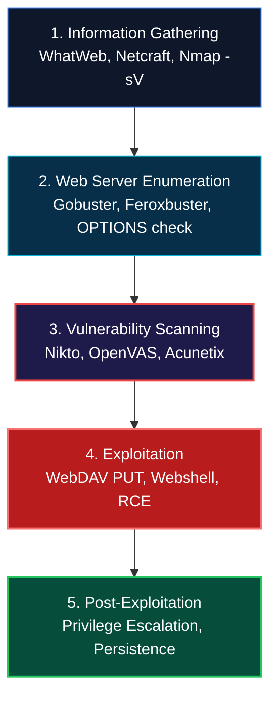
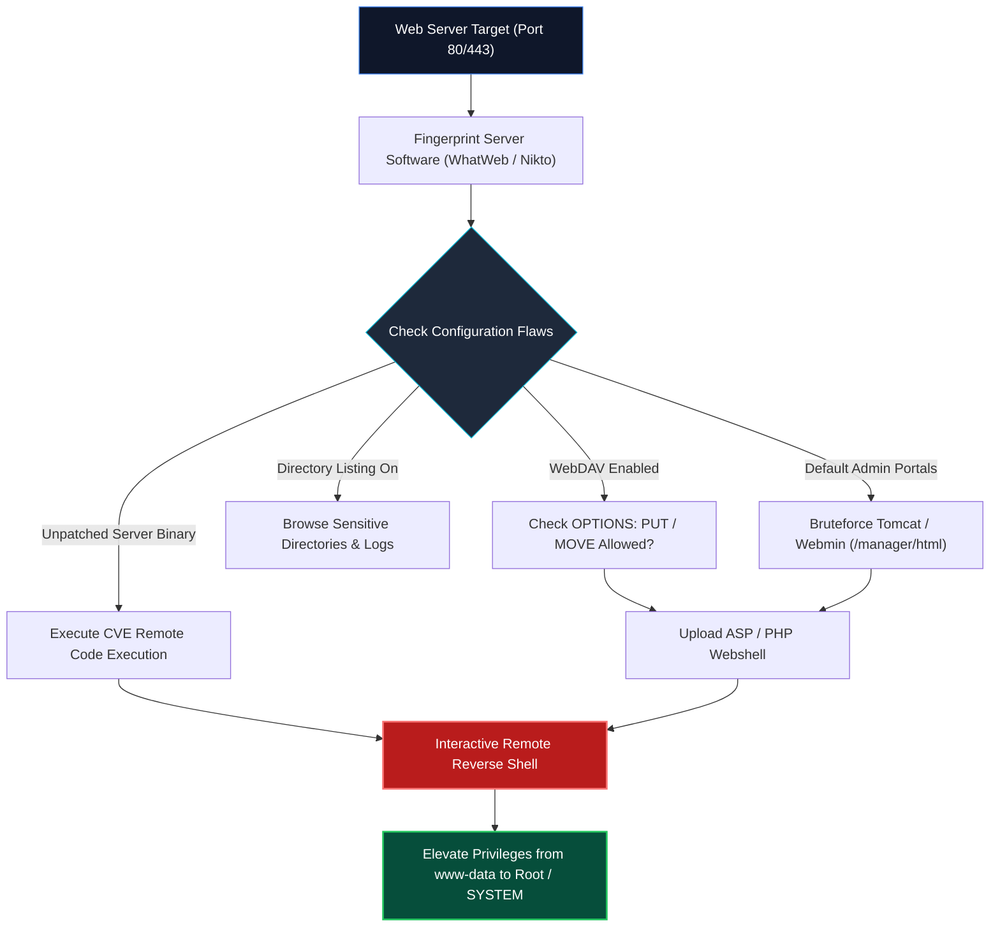

<div align="center">

# 🛡️ CEH v13 — Module 13: Hacking Web Servers
### Certified Ethical Hacker (CEH) Exam Notes • Apache, Nginx & IIS • Misconfiguration Attacks • WebDAV Exploitation • HTTP Request Smuggling • Hardening & DMZ Architecture

[-0078D4?style=for-the-badge&logo=shield)](https://www.eccouncil.org/programs/certified-ethical-hacker-ceh/)
[](https://www.eccouncil.org/)
[](../README.md)
[](./README.md)

<p align="center">
  <b>Authoritative, exam-oriented study guide and reference architecture for CEH v13 Module 13: Hacking Web Servers. Covers web server architecture (Apache, Nginx, Microsoft IIS), web server misconfigurations (directory traversal, exposed management consoles), WebDAV exploitation and dangerous HTTP methods (PUT, DELETE, OPTIONS), HTTP Request Smuggling mechanics (CL.TE / TE.CL desync), web cache poisoning, 5-phase web attack methodology (Nikto, Gobuster, WhatWeb), and enterprise server hardening.</b>
</p>

[📖 Module Hub](../README.md) • [📋 PDF Reference](./CEHv13%20-%20Module%2013%20-%20Hacking%20Web%20Servers.pdf) • [🔒 GitHub Security & DevSecOps](../../GitHub_Security/README.md) • [🗺️ Knowledge Base Index](../../README.md)

</div>

---

## 📋 Table of Contents

- [1. Web Server Architecture & Threat Surface](#1-web-server-architecture--threat-surface)
  - [Web Server Components: Daemons, Document Roots & Connectors](#web-server-components-daemons-document-roots--connectors)
  - [Open Source vs. Proprietary Architectures (Apache, Nginx, IIS)](#open-source-vs-proprietary-architectures-apache-nginx-iis)
  - [Root Causes of Web Server Breaches](#root-causes-of-web-server-breaches)
- [2. Web Server Attack Vectors & Exploitation](#2-web-server-attack-vectors--exploitation)
  - [Web Server Misconfigurations (Directory Listing, Default Creds)](#web-server-misconfigurations-directory-listing-default-creds)
  - [Directory Traversal Attacks (Dot-Dot-Slash `../`)](#directory-traversal-attacks-dot-dot-slash-)
  - [WebDAV Exploitation & Dangerous HTTP Methods (`PUT`, `DELETE`)](#webdav-exploitation--dangerous-http-methods-put-delete)
  - [HTTP Request Smuggling (CL.TE & TE.CL Desynchronization)](#http-request-smuggling-clte--tecl-desynchronization)
  - [Web Cache Poisoning & DNS Server Hijacking](#web-cache-poisoning--dns-server-hijacking)
- [3. The 5-Phase Web Server Attack Methodology](#3-the-5-phase-web-server-attack-methodology)
  - [Phase 1: Information Gathering & Fingerprinting (WhatWeb, Netcraft)](#phase-1-information-gathering--fingerprinting-whatweb-netcraft)
  - [Phase 2: Web Server Enumeration & Directory Busting (Gobuster)](#phase-2-web-server-enumeration--directory-busting-gobuster)
  - [Phase 3: Vulnerability Scanning (Nikto)](#phase-3-vulnerability-scanning-nikto)
  - [Phase 4: Exploitation & Webshell Deployment](#phase-4-exploitation--webshell-deployment)
  - [Phase 5: Post-Exploitation & Privilege Escalation](#phase-5-post-exploitation--privilege-escalation)
- [4. Web Server Hardening & Defensive Engineering](#4-web-server-hardening--defensive-engineering)
  - [Disabling Dangerous HTTP Methods & Directory Indexes](#disabling-dangerous-http-methods--directory-indexes)
  - [Suppressing Server Banners: Apache, Nginx, and IIS](#suppressing-server-banners-apache-nginx-and-iis)
  - [Demilitarized Zone (DMZ) Architecture & Least Privilege Isolation](#demilitarized-zone-dmz-architecture--least-privilege-isolation)
- [🧠 Master CEH Web Server Attack Methodology Flowchart](#-master-ceh-web-server-attack-methodology-flowchart)
- [🎯 High-Value CEH Exam Distinctions to Memorize](#-high-value-ceh-exam-distinctions-to-memorize)

---

# 1. Web Server Architecture & Threat Surface

## Web Server Components: Daemons, Document Roots & Connectors

A web server is a combination of physical hardware, operating system, and software daemon designed to serve hypermedia documents (HTML, CSS, JS, media) and process dynamic server-side scripts over HTTP/HTTPS:

```
┌──────────────────────────────────────────────────────────────────────────────────┐
│                         WEB SERVER ARCHITECTURAL LAYERS                          │
├──────────────────────────────────────────────────────────────────────────────────┤
│                                                                                  │
│   [INTERNET CLIENTS] ──► [PORT 80 / 443 INGRESS]                                 │
│                                │                                                 │
│                                ▼                                                 │
│   ┌──────────────────────────────────────────────────────────────────────────┐   │
│   │ WEB SERVER DAEMON (Apache / Nginx / IIS)                                 │   │
│   │ ├── HTTP Parser & SSL/TLS Termination                                    │   │
│   │ ├── Document Root (/var/www/html or C:\inetpub\wwwroot)                  │   │
│   │ └── Modules (mod_rewrite, mod_ssl, mod_dav)                              │   │
│   └────────────────────────────┬─────────────────────────────────────────────┘   │
│                                │                                                 │
│                                ▼                                                 │
│   ┌──────────────────────────────────────────────────────────────────────────┐   │
│   │ APPLICATION RUNTIME & CONNECTORS (PHP-FPM, Node.js, ASP.NET, Tomcat)     │   │
│   └────────────────────────────┬─────────────────────────────────────────────┘   │
│                                │                                                 │
│                                ▼                                                 │
│   ┌──────────────────────────────────────────────────────────────────────────┐   │
│   │ BACKEND DATABASE TIER (MySQL, PostgreSQL, Microsoft SQL Server)          │   │
│   └──────────────────────────────────────────────────────────────────────────┘   │
│                                                                                  │
└──────────────────────────────────────────────────────────────────────────────────┘
```

---

## Root Causes of Web Server Breaches

1. **Software Vulnerabilities:** Unpatched zero-day or N-day vulnerabilities in the web server binary (e.g., Apache path traversal CVE-2021-41773).
2. **Configuration Errors:** Directory indexing left enabled, debug endpoints exposed, default credentials on management panels (e.g., Tomcat Manager `admin:admin`).
3. **Improper File Permissions:** Web process (`www-data`) granted write permissions to system directories or executing with `root` privileges.

---

# 2. Web Server Attack Vectors & Exploitation

## Directory Traversal Attacks (Dot-Dot-Slash `../`)

Directory traversal exploits insufficient validation of user-supplied input in file path parameters, allowing an attacker to navigate outside the document root into the underlying operating system file system:

```text
# Linux: Retrieve system password hashes
http://target.com/view.php?page=../../../../etc/passwd

# Windows: Retrieve boot configuration
http://target.com/view.php?page=..\..\..\..\boot.ini
```

---

## WebDAV Exploitation & Dangerous HTTP Methods

**Web Distributed Authoring and Versioning (WebDAV)** is an extension to HTTP that permits clients to edit and manage files collaboratively on a remote server.
* **Dangerous HTTP Methods:**
  * **`OPTIONS`:** Informs the client which HTTP methods are supported by the server.
  * **`PUT`:** Allows the client to upload an arbitrary file directly to the web root.
  * **`DELETE`:** Allows the client to delete files from the server.
  * **`MOVE` / `COPY`:** Allows renaming or relocating files on disk.

```
┌──────────────────────────────────────────────────────────────────────────────────┐
│                        WEBDAV WEBSHELL DEPLOYMENT SEQUENCE                       │
├──────────────────────────────────────────────────────────────────────────────────┤
│                                                                                  │
│   1. Attacker queries allowed methods:                                           │
│      curl -i -X OPTIONS http://target.com/webdav/                                │
│      Server replies: Allow: GET, POST, OPTIONS, PUT, DELETE, MOVE                │
│                                                                                  │
│   2. Attacker uploads text file via PUT:                                         │
│      curl -T webshell.txt http://target.com/webdav/webshell.txt                  │
│      Server replies: 201 Created                                                 │
│                                                                                  │
│   3. Attacker renames text file to executable script via MOVE:                   │
│      curl -X MOVE --header "Destination:http://target.com/webdav/shell.php"     │
│           http://target.com/webdav/webshell.txt                                  │
│                                                                                  │
│   4. Attacker navigates to http://target.com/webdav/shell.php -> RCE Shell!      │
│                                                                                  │
└──────────────────────────────────────────────────────────────────────────────────┘
```

---

## HTTP Request Smuggling (CL.TE & TE.CL Desync)

HTTP Request Smuggling occurs when a front-end reverse proxy (e.g., Cloudflare, Nginx) and a back-end web server interpret request boundaries differently when handling ambiguous HTTP headers:
* **`Content-Length` (CL):** Specifies request body size in exact bytes.
* **`Transfer-Encoding: chunked` (TE):** Specifies request body is delivered in chunks.

```
┌──────────────────────────────────────────────────────────────────────────────────┐
│                 HTTP REQUEST SMUGGLING (CL.TE) DESYNCHRONIZATION                 │
├──────────────────────────────────────────────────────────────────────────────────┤
│                                                                                  │
│   [FRONT-END PROXY] (Uses Content-Length):                                       │
│   Reads the entire 13-byte packet and forwards it to backend as 1 request.       │
│                                                                                  │
│   [BACK-END SERVER] (Uses Transfer-Encoding):                                    │
│   Reads the 0-byte terminating chunk... and treats the remaining trailing bytes  │
│   as the BEGINNING OF THE NEXT INCOMING USER'S REQUEST!                          │
│                                                                                  │
│   Attacker steals the next user's session cookies or poisons their cache!        │
│                                                                                  │
└──────────────────────────────────────────────────────────────────────────────────┘
```

---

# 3. The 5-Phase Web Server Attack Methodology



### Essential Tool Commands for the Exam
```bash
# 1. Fingerprint web server technologies
whatweb http://target.com

# 2. Directory brute-forcing using Gobuster
gobuster dir -u http://target.com -w /usr/share/wordlists/dirb/common.txt

# 3. Comprehensive web server vulnerability scan with Nikto
nikto -h http://target.com -Tuning 123bde -o nikto_report.html
```

---

# 4. Web Server Hardening & Defensive Engineering

1. **Disable Dangerous HTTP Methods:** Configure web server to reject `PUT`, `DELETE`, `TRACE`, and `MOVE`:
   ```apache
   # Apache httpd.conf
   <Location "/">
       <LimitExcept GET POST HEAD>
           Require all denied
       </LimitExcept>
   </Location>
   ```
2. **Suppress Server Banners:**
   * **Apache:**
     ```apache
     ServerTokens Prod
     ServerSignature Off
     ```
   * **Nginx:**
     ```nginx
     server_tokens off;
     ```
   * **Microsoft IIS:** Disable directory browsing and install URLScan / Request Filtering to strip the `Server` header.
3. **DMZ Architecture & Principle of Least Privilege:**
   * Isolate web servers in an external Demilitarized Zone (DMZ) separated by dual firewalls from internal corporate LANs and backend databases.
   * Run the web server process under an unprivileged user account (`www-data` or `IIS_IUSRS`) with zero write access to system directories.

---

# 🧠 Master CEH Web Server Attack Methodology Flowchart



---

# 🎯 High-Value CEH Exam Distinctions to Memorize

| Question / Concept | Correct Answer / Key Insight | Common Exam Distractor (Trap) |
|---|---|---|
| **HTTP method used to upload files** | **`PUT`** (Requires WebDAV or upload handler). | `POST` (Standard form submission, not raw file write). |
| **HTTP method querying allowed methods** | **`OPTIONS`** | `GET` or `HEAD`. |
| **Apache directive hiding version** | **`ServerTokens Prod`** and **`ServerSignature Off`**. | `HideServerVersion On`. |
| **Web Server Vulnerability Scanner** | **Nikto** | Nmap (Nmap is port scanner, Nikto specializes in web servers). |
| **Attack exploiting CL and TE headers** | **HTTP Request Smuggling** | Cross-Site Request Forgery (CSRF). |
| **Directory Traversal String** | **`../`** (Linux) or **`..\`** (Windows). | `root/` or `admin/`. |
| **Network isolation zone for Web Servers** | **DMZ (Demilitarized Zone)** | Intranet VLAN. |

---

<div align="center">

<b>Next Module: [Module 14 — Hacking Web Applications](../README.md)</b> • <b>Previous Module: [Module 12 — Evading IDS, Firewalls, and Honeypots](../Module%2012/README.md)</b>

</div>
