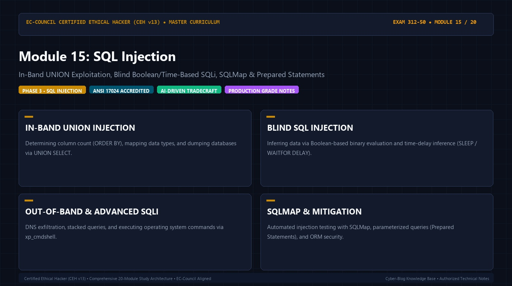

# 🛡️ CEH v13 — Module 15: SQL Injection
### Certified Ethical Hacker (CEH v13) Exam Notes • Phase 3: Web, Wireless & Emerging Tech • Technical Study Architecture

[-0078D4?style=for-the-badge&logo=shield)](https://www.eccouncil.org/programs/certified-ethical-hacker-ceh/)

  <b>Authoritative, exam-oriented study guide and reference architecture for CEH v13 Module 15: SQL Injection. Covers in-band union exploitation, blind boolean/time-based sqli, sqlmap & prepared statements, attack methodologies, automated tooling, MITRE ATT&CK alignment, and enterprise defensive engineering.</b>

[📖 Module Hub](../README.md) • [🗺️ Knowledge Base Index](../../README.md)

---

## 📋 Module Overview & Exam Objectives

In the **EC-Council Certified Ethical Hacker (CEH v13)** certification exam (Exam 312-50), **Module 15: SQL Injection** represents a fundamental domain within **Phase 3: Web, Wireless & Emerging Tech**. Candidates are tested on both theoretical protocol knowledge and hands-on operational commands used to discover, analyze, exploit, and remediate vulnerabilities across modern networked environments.

### Core Learning Domains:
* **IN-BAND UNION INJECTION:** Determining column count (ORDER BY), mapping data types, and dumping databases via UNION SELECT.
* **BLIND SQL INJECTION:** Inferring data via Boolean-based binary evaluation and time-delay inference (SLEEP / WAITFOR DELAY).
* **OUT-OF-BAND & ADVANCED SQLI:** DNS exfiltration, stacked queries, and executing operating system commands via xp_cmdshell.
* **SQLMAP & MITIGATION:** Automated injection testing with SQLMap, parameterized queries (Prepared Statements), and ORM security.

---

## 🔬 In-Depth Technical Breakdown

### 1. IN-BAND UNION INJECTION

Determining column count (ORDER BY), mapping data types, and dumping databases via UNION SELECT.

* **Core Operational Theory:** Candidates must understand both how threat actors leverage these techniques during offensive operations and how enterprise defenders monitor and detect anomalous behavior.
* **Key Attack Artifacts:** Exam scenarios frequently present command-line strings, configuration files, packet captures, and network connection parameters requiring precise identification of adversary behavior.
* **Exam Relevance:** Directly tested across multiple-choice questions on CEH Exam 312-50.

### 2. BLIND SQL INJECTION

Inferring data via Boolean-based binary evaluation and time-delay inference (SLEEP / WAITFOR DELAY).

* **Core Operational Theory:** Candidates must understand both how threat actors leverage these techniques during offensive operations and how enterprise defenders monitor and detect anomalous behavior.
* **Key Attack Artifacts:** Exam scenarios frequently present command-line strings, configuration files, packet captures, and network connection parameters requiring precise identification of adversary behavior.
* **Exam Relevance:** Directly tested across multiple-choice questions on CEH Exam 312-50.

### 3. OUT-OF-BAND & ADVANCED SQLI

DNS exfiltration, stacked queries, and executing operating system commands via xp_cmdshell.

* **Core Operational Theory:** Candidates must understand both how threat actors leverage these techniques during offensive operations and how enterprise defenders monitor and detect anomalous behavior.
* **Key Attack Artifacts:** Exam scenarios frequently present command-line strings, configuration files, packet captures, and network connection parameters requiring precise identification of adversary behavior.
* **Exam Relevance:** Directly tested across multiple-choice questions on CEH Exam 312-50.

### 4. SQLMAP & MITIGATION

Automated injection testing with SQLMap, parameterized queries (Prepared Statements), and ORM security.

* **Core Operational Theory:** Candidates must understand both how threat actors leverage these techniques during offensive operations and how enterprise defenders monitor and detect anomalous behavior.
* **Key Attack Artifacts:** Exam scenarios frequently present command-line strings, configuration files, packet captures, and network connection parameters requiring precise identification of adversary behavior.
* **Exam Relevance:** Directly tested across multiple-choice questions on CEH Exam 312-50.

---

## 🛠️ Tooling & Command Reference Matrix

| Tool / Technology | Category | Primary Function | Exam Utility / Key Syntax |
| :--- | :--- | :--- | :--- |
| **SQLMap** | Automated SQLi | Database fingerprinting, dumping, and shell | ``sqlmap -u 'http://target.com?id=1' --dbs`` |
| **Burp Suite Repeater** | Manual SQLi Triage | Injecting quotes, UNION operators, and SLEEP | `Analyzing differential error messages` |
| **Ghauri** | SQLi Detector | Advanced boolean/time-based injection engine | ``ghauri -u 'http://target.com?id=1'`` |
| **Prepared Statements** | Defensive Control | Parameter binding thwarting SQL syntax injection | ``SELECT * FROM users WHERE id = ?`` |

---

## 🛡️ Enterprise Countermeasures & Hardening Guidelines

1. **Principle of Least Privilege:** Enforce strict role-based access control (RBAC) and minimize attack surfaces across network daemons.
2. **Defensive Telemetry & Logging:** Centralize event logging (SIEM) with real-time alerting on anomalous spikes, connection retries, and unauthorized protocol commands.
3. **Continuous Auditing & Patching:** Regularly scan infrastructure using automated vulnerability scanners and enforce strict SLA timelines for critical and high vulnerabilities.
4. **Network Segmentation & Zero Trust:** Isolate sensitive subnets, database tiers, and management interfaces behind stateful firewalls and intrusion prevention systems (IPS).

---

## 📚 Official References & Study Resources

* [EC-Council Official CEH v13 Program](https://www.eccouncil.org/programs/certified-ethical-hacker-ceh/)
* [CEH v13 Master Curriculum Index](../README.md)
* [National Vulnerability Database (NVD)](https://nvd.nist.gov/)
* [MITRE ATT&CK Framework](https://attack.mitre.org/)
