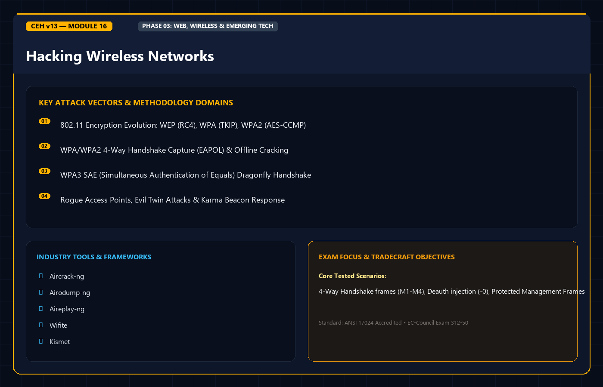
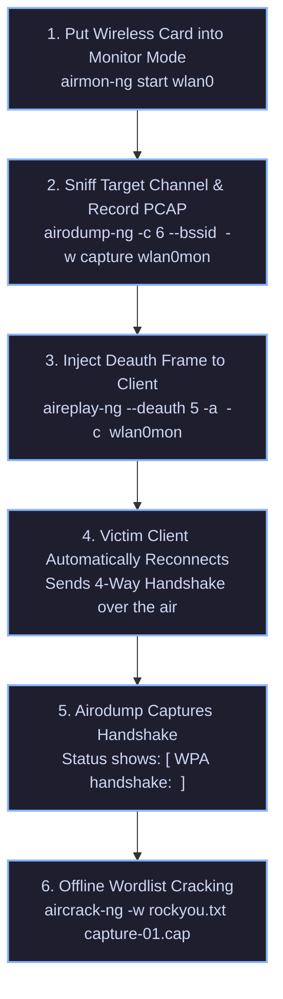

<div align="center">




# 🛡️ CEH v13 — Module 16: Hacking Wireless Networks
### Certified Ethical Hacker (CEH) Exam Notes • 802.11 Standards • WEP/WPA2/WPA3 Encryption • 4-Way Handshake • Aircrack-ng Suite • Rogue AP & Evil Twin • Defense

[-0078D4?style=for-the-badge&logo=shield)](https://www.eccouncil.org/programs/certified-ethical-hacker-ceh/)
[](https://www.eccouncil.org/)
[](../README.md)
[](./README.md)

<p align="center">
  <b>Authoritative, exam-oriented study guide and reference architecture for CEH v13 Module 16: Hacking Wireless Networks. Covers IEEE 802.11 physical standards, channel architectures (1, 6, 11), wireless frame categories (Management, Control, Data), WEP IV reuse vulnerabilities, WPA/WPA2 CCMP mechanics and 4-Way Handshake offline cracking, WPA3 SAE (Dragonfly) forward secrecy, WPS PIN flaws (Reaver/Pixie Dust), Rogue APs and Evil Twin captive portals, the Aircrack-ng offensive suite, Bluetooth attacks (Bluejacking vs. Bluesnarfing vs. Bluebugging), and WIPS defensive hardening.</b>
</p>

[📖 Module Hub](../README.md) • [🧰 Network Analysis Tools](../../tools/README.md) • [🗺️ Knowledge Base Index](../../README.md)

</div>

---

## 📋 Table of Contents

- [1. Wireless Fundamentals & IEEE 802.11 Standards](#1-wireless-fundamentals--ieee-80211-standards)
  - [802.11 Physical Layer Standards Matrix](#80211-physical-layer-standards-matrix)
  - [2.4 GHz vs. 5 GHz Spectrum & Non-Overlapping Channels](#24-ghz-vs-5-ghz-spectrum--non-overlapping-channels)
  - [SSID, BSSID, and ESSID Architectural Terminology](#ssid-bssid-and-essid-architectural-terminology)
  - [The 3 Wireless Frame Types: Management, Control, and Data](#the-3-wireless-frame-types-management-control-and-data)
- [2. Wireless Encryption Protocols & Evolution](#2-wireless-encryption-protocols--evolution)
  - [WEP (Wired Equivalent Privacy): The 24-Bit IV Flaw](#wep-wired-equivalent-privacy-the-24-bit-iv-flaw)
  - [WPA: Temporal Key Integrity Protocol (TKIP)](#wpa-temporal-key-integrity-protocol-tkip)
  - [WPA2: AES-CCMP & The 4-Way Handshake](#wpa2-aes-ccmp--the-4-way-handshake)
  - [WPA3: Simultaneous Authentication of Equals (SAE) & Protected Management Frames](#wpa3-simultaneous-authentication-of-equals-sae--protected-management-frames)
- [3. Wireless Attack Vectors & Methodologies](#3-wireless-attack-vectors--methodologies)
  - [Deauthentication & Disassociation Denial-of-Service](#deauthentication--disassociation-denial-of-service)
  - [Capturing the WPA2 4-Way Handshake](#capturing-the-wpa2-4-way-handshake)
  - [Rogue Access Points & The Evil Twin Attack](#rogue-access-points--the-evil-twin-attack)
  - [WPS PIN Exploitation: Reaver & Pixie Dust Attacks](#wps-pin-exploitation-reaver--pixie-dust-attacks)
  - [KRACK (Key Reinstallation Attack)](#krack-key-reinstallation-attack)
- [4. The Aircrack-ng Offensive Toolchain](#4-the-aircrack-ng-offensive-toolchain)
  - [Workflow: Monitor Mode to Handshake Cracking](#workflow-monitor-mode-to-handshake-cracking)
  - [Toolchain Syntax: airmon-ng, airodump-ng, aireplay-ng, aircrack-ng](#toolchain-syntax-airmon-ng-airodump-ng-aireplay-ng-aircrack-ng)
- [5. Bluetooth Security & Attack Taxonomy](#5-bluetooth-security--attack-taxonomy)
  - [Bluejacking vs. Bluesnarfing vs. Bluebugging vs. Bluesmacking](#bluejacking-vs-bluesnarfing-vs-bluebugging-vs-bluesmacking)
- [6. Wireless Defenses & Enterprise Hardening](#6-wireless-defenses--enterprise-hardening)
  - [WPA3-Enterprise & 802.1X EAP-TLS Authentication](#wpa3-enterprise--8021x-eap-tls-authentication)
  - [Wireless Intrusion Prevention Systems (WIPS)](#wireless-intrusion-prevention-systems-wips)
  - [RF Shielding & Defensive Configurations](#rf-shielding--defensive-configurations)
- [7. Master Decision Tree & Flowchart](#7-master-decision-tree--flowchart)
- [8. CEH v13 Exam Essentials & Distinction Matrix](#8-ceh-v13-exam-essentials--distinction-matrix)

---

## 1. Wireless Fundamentals & IEEE 802.11 Standards

### 802.11 Physical Layer Standards Matrix

| Standard | Frequency Band | Maximum Theoretical Speed | Modulation / Technology |
| :--- | :--- | :--- | :--- |
| **802.11a** | 5 GHz | 54 Mbps | OFDM |
| **802.11b** | 2.4 GHz | 11 Mbps | DSSS / HR-DSSS |
| **802.11g** | 2.4 GHz | 54 Mbps | OFDM |
| **802.11n (Wi-Fi 4)** | 2.4 GHz & 5 GHz | Up to 600 Mbps | MIMO, Channel Bonding (40 MHz) |
| **802.11ac (Wi-Fi 5)**| 5 GHz | Up to 6.9 Gbps | MU-MIMO, 80/160 MHz channels |
| **802.11ax (Wi-Fi 6/6E)**| 2.4 GHz, 5 GHz, 6 GHz | Up to 9.6 Gbps | OFDMA, 1024-QAM, Target Wake Time |

---

### 2.4 GHz Spectrum & Non-Overlapping Channels

The 2.4 GHz ISM band is divided into 11 channels (in North America) or 13/14 channels (internationally), each spaced 5 MHz apart with a 20 MHz or 22 MHz channel width:

```
Channel 1 (2412 MHz)        Channel 6 (2437 MHz)        Channel 11 (2462 MHz)
  /---------------\           /---------------\           /---------------\
 /                 \         /                 \         /                 \
/                   \       /                   \       /                   \
+---+---+---+---+---+---+---+---+---+---+---+---+---+---+---+---+---+---+---+
  1   2   3   4   5   6   7   8   9  10  11  12  13  14
```

> [!IMPORTANT]
> **Must-Know CEH Fact**: In the 2.4 GHz spectrum, the only **three primary non-overlapping channels** are **1, 6, and 11**. Any co-located access points placed on overlapping channels (e.g., channel 1 and channel 3) cause severe adjacent-channel interference.

---

### SSID, BSSID, and ESSID Terminology

* **SSID (Service Set Identifier)**: The human-readable broadcast name of the wireless network (up to 32 alphanumeric characters).
* **BSSID (Basic Service Set Identifier)**: The unique 48-bit physical MAC address of the Access Point's wireless radio chip.
* **ESSID (Extended Service Set Identifier)**: Two or more BSSIDs interconnected across a wired DS (Distribution System) sharing the identical SSID name to facilitate client roaming across a building.

---

### The 3 Wireless Frame Types

```
+--------------------------------------------------------------------------+
|                        802.11 FRAME TAXONOMY                             |
+--------------------------------------------------------------------------+
|  1. MANAGEMENT FRAMES:                                                   |
|  Negotiates and maintains client-to-AP connections. Plaintext in WPA2!   |
|  - Beacon Frames: Broadcast by AP to advertise existence and capabilities.|
|  - Probe Request / Probe Response: Client searches for known networks.   |
|  - Authentication / Deauthentication: Establishes or tears down links.  |
|  - Association / Disassociation: Establishes membership in a BSS.        |
+--------------------------------------------------------------------------+
|  2. CONTROL FRAMES:                                                      |
|  Controls channel access and assists with physical media delivery.       |
|  - RTS (Request to Send) / CTS (Clear to Send): Solves Hidden Node flaw. |
|  - ACK (Acknowledgment): Confirms uncorrupted frame reception.           |
+--------------------------------------------------------------------------+
|  3. DATA FRAMES:                                                         |
|  Encapsulates actual higher-layer payload packets (IP, TCP, UDP).       |
|  Encrypted by WEP, WPA, WPA2, or WPA3.                                   |
+--------------------------------------------------------------------------+
```

---

## 2. Wireless Encryption Protocols & Evolution

### WEP (Wired Equivalent Privacy): The 24-Bit IV Flaw

WEP utilizes the **RC4 stream cipher** combined with an **Initialization Vector (IV)**:
$$\text{Key Stream} = \text{RC4}(\text{IV } [24\text{ bits}] + \text{Pre-Shared Key } [40 \text{ or } 104\text{ bits}])$$

```
+--------------------------------------------------------------------------+
|                         THE FATAL WEP VULNERABILITY                      |
+--------------------------------------------------------------------------+
|  1. The IV is only 24 bits in length (2^24 = 16,777,216 combinations).   |
|  2. On a busy network, IVs repeat within hours, causing KEYSTREAM REUSE. |
|  3. Weak IVs leak secret key bytes via Fluhrer-Mantin-Shamir (FMS) and   |
|     KoreK mathematical cryptanalysis.                                    |
|  4. Attackers inject ARP requests to force the AP to generate millions   |
|     of IVs within minutes, cracking the key with ~40,000 packets (PTW).  |
+--------------------------------------------------------------------------+
```

---

### WPA2: AES-CCMP & The 4-Way Handshake

WPA2 replaces RC4 and TKIP with **CCMP** (Counter Mode Cipher Block Chaining Message Authentication Code Protocol) based on **AES-128**.

#### The WPA2 4-Way Handshake Architecture

The handshake establishes a fresh session key (**PTK - Pairwise Transient Key**) without ever transmitting the pre-shared key (**PSK**) across the air:

```mermaid
sequenceDiagram
    autonumber
    participant AP as Access Point (Authenticator)
    participant Client as Wireless Client (Supplicant)

    Note over AP,Client: Both derive PMK: PMK = PBKDF2(Passphrase, SSID, 4096, 256)
    AP->>Client: Message 1: ANonce (Authenticator Random Nonce)
    Note over Client: Calculates PTK = PRF-512(PMK, ANonce, SNonce, AP MAC, Client MAC)
    Client->>AP: Message 2: SNonce + MIC (Message Integrity Code)
    Note over AP: Verifies MIC; Calculates identical PTK from SNonce
    AP->>Client: Message 3: GTK (Group Temporal Key) + MIC
    Client->>AP: Message 4: ACK
    Note over AP,Client: Secure Encrypted Communication Commences!
```

---

### WPA3: Simultaneous Authentication of Equals (SAE)

WPA3 replaces the vulnerable 4-way PSK derivation with **SAE (Dragonfly Handshake)** based on Zero-Knowledge Proofs:
* **Resistant to Offline Dictionary Attacks**: Eavesdropping on a WPA3 connection handshake reveals zero data that can be brute-forced offline.
* **Forward Secrecy**: Even if the network passphrase is compromised in the future, past recorded encrypted traffic cannot be decrypted.
* **Mandatory Protected Management Frames (PMF / 802.11w)**: Cryptographically signs Management frames, completely neutralizing spoofed deauthentication attacks!

---

## 3. Wireless Attack Vectors & Methodologies

### Deauthentication Denial-of-Service

Because 802.11 Management frames are transmitted unencrypted in WPA and WPA2, an attacker can spoof the MAC address of the Access Point and transmit malicious **Deauthentication frames** (`Type 0x00, Subtype 0x1100`) to any connected client, instantly severing its connection:

```bash
# Sending continuous deauthentication frames to disconnect victim client
sudo aireplay-ng --deauth 20 -a <AP_BSSID> -c <VICTIM_MAC> wlan0mon
```

---

### Capturing the WPA2 4-Way Handshake



---

### Rogue Access Points & The Evil Twin Attack

* **Rogue AP**: An unauthorized physical wireless access point connected directly to an enterprise internal Ethernet switch port by an employee or intruder, bypassing perimeter firewalls.
* **Evil Twin Attack**:
  1. Attacker deploys a software-based Access Point emitting the **exact same SSID name and channel** as the legitimate corporate AP, but transmitting at a significantly higher radio broadcast power ($dBm$).
  2. Attacker floods the legitimate AP with deauthentication packets.
  3. Victim clients automatically roam and associate with the attacker's stronger Evil Twin AP.
  4. Attacker serves a rogue **Captive Portal** phishing page prompting for corporate domain credentials or Wi-Fi keys.

---

### WPS PIN Exploitation: Reaver & Pixie Dust Attacks

Wi-Fi Protected Setup (WPS) uses an **8-digit numeric PIN**:
* The 8th digit is a checksum.
* The Access Point validates the **first 4 digits** ($10^4 = 10,000$ possibilities) and the **last 3 digits** ($10^3 = 1,000$ possibilities) **separately**!
* Reduces the entire search space to just **11,000 total attempts**, cracked in hours via `reaver` or within seconds offline via the **Pixie Dust attack** (`pixiewps`).

---

## 4. The Aircrack-ng Offensive Toolchain

```bash
# 1. Kill interfering background network processes
sudo airmon-ng check kill

# 2. Enable monitor mode on wireless interface
sudo airmon-ng start wlan0
# Creates virtual monitor interface 'wlan0mon'

# 3. Interrogate airspace to identify targets
sudo airodump-ng wlan0mon

# 4. Target specific AP on Channel 6 and log handshake to file
sudo airodump-ng -c 6 --bssid AA:BB:CC:DD:EE:FF -w target_wpa2 wlan0mon

# 5. Inject deauthentication frame to force handshake transmission
sudo aireplay-ng -0 5 -a AA:BB:CC:DD:EE:FF -c 11:22:33:44:55:66 wlan0mon

# 6. Crack captured WPA2 handshake using dictionary wordlist
aircrack-ng -w /usr/share/wordlists/rockyou.txt -b AA:BB:CC:DD:EE:FF target_wpa2-01.cap
```

---

## 5. Bluetooth Security & Attack Taxonomy

Bluetooth operates in the 2.4 GHz ISM band utilizing Frequency-Hopping Spread Spectrum (FHSS):

```
+--------------------------------------------------------------------------+
|                     BLUETOOTH ATTACK TAXONOMY                            |
+--------------------------------------------------------------------------+
|  BLUEJACKING:                                                            |
|  Sending unsolicited text messages, electronic business cards (vCards),  |
|  or images to nearby Bluetooth-enabled devices. No data is stolen!       |
+--------------------------------------------------------------------------+
|  BLUESNARFING:                                                           |
|  Unauthorized theft and exfiltration of sensitive information from the   |
|  victim device (contacts, SMS messages, calendar, photos, IMEI).         |
+--------------------------------------------------------------------------+
|  BLUEBUGGING:                                                            |
|  Taking complete remote control of the target phone. Attacker can eaves- |
|  drop on phone calls, initiate outgoing calls, send texts, and control  |
|  the device via AT modem commands.                                       |
+--------------------------------------------------------------------------+
|  BLUESMACKING:                                                           |
|  Denial-of-Service attack achieved by transmitting an oversized L2CAP    |
|  ping packet to a Bluetooth target, causing memory buffer exhaustion.    |
+--------------------------------------------------------------------------+
```

---

## 6. Wireless Defenses & Enterprise Hardening

### WPA3-Enterprise & 802.1X EAP-TLS Authentication

* **Personal Mode (Pre-Shared Key)**: Shared single password; vulnerable to employee turnover and offline cracking in WPA2.
* **Enterprise Mode (802.1X)**: Individual user credentials validated against a centralized **RADIUS** server.
  * **EAP-TLS**: The most secure implementation; requires mutual certificate authentication (both client and server possess valid X.509 digital certificates). Immune to credential phishing!

### Defensive Recommendations

1. **Mandate WPA3 with Protected Management Frames (802.11w)** to eliminate deauthentication attacks.
2. **Deploy WIPS (Wireless Intrusion Prevention Systems)** to detect and suppress rogue APs and deauth floods.
3. **Disable WPS (Wi-Fi Protected Setup)** across all corporate and guest routers.
4. **Isolate Guest Wi-Fi** using private VLANs with client-to-client isolation enabled.

---

## 7. Master Decision Tree & Flowchart

```
                          [ WIRELESS TARGET AUDIT ]
                                      |
                     What encryption protocol is in use?
                       /              |               \
                    [ WEP ]       [ WPA / WPA2 ]    [ WPA3 ]
                      |               |               |
            Capture IVs via ARP   Is WPS enabled?   Dragonfly (SAE)
            Replay (aireplay -3)     /        \     Resistant to offline
                      |            YES         NO   dictionary cracking;
            Crack with aircrack   Reaver /    Capture 4-Way Handshake
            in ~40,000 packets   Pixie Dust   via deauth (-0);
                                  Attack      Crack offline with Hashcat
```

---

## 8. CEH v13 Exam Essentials & Distinction Matrix

| Term / Technique | Essential CEH Exam Distinction |
| :--- | :--- |
| **Non-Overlapping Channels**| In the 2.4 GHz spectrum, only channels **1, 6, and 11** do not overlap. |
| **WEP Vulnerability** | Uses a tiny **24-bit Initialization Vector (IV)** with RC4, resulting in keystream reuse and mathematical key extraction. |
| **WPA2 Handshake Attack** | Attacker captures the **4-Way Handshake** by sending deauthentication frames, then cracks the PMK offline against a dictionary. |
| **WPA3 Dragonfly (SAE)** | Uses **Simultaneous Authentication of Equals**; eliminates offline dictionary cracking and provides Forward Secrecy. |
| **Bluejacking vs. Bluesnarfing**| **Bluejacking** sends unsolicited messages (no data stolen). **Bluesnarfing** steals data (contacts, SMS). **Bluebugging** takes full remote control. |
| **WPS PIN Flaw** | Validates 8-digit PIN in two halves (first 4 digits, next 3 digits + checksum), reducing keyspace to **11,000 attempts**. |
| **Protected Management Frames (802.11w)** | Cryptographically authenticates Management frames, preventing attackers from forging deauth packets. |

---

<div align="center">

[⬅️ Previous: Module 15 — SQL Injection](../Module%2015/README.md) • [Next: Module 17 — Hacking Mobile Platforms ➡️](../Module%2017/README.md)

</div>
