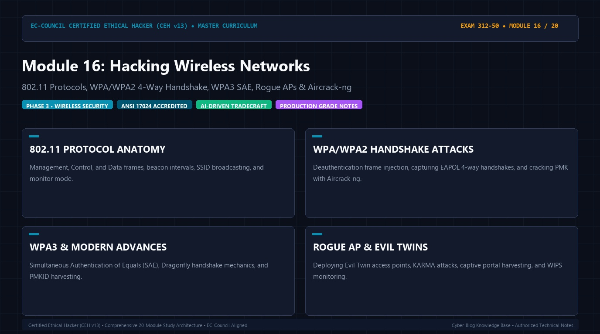

# 🛡️ CEH v13 — Module 16: Hacking Wireless Networks
### Certified Ethical Hacker (CEH v13) Exam Notes • Phase 3: Web, Wireless & Emerging Tech • Technical Study Architecture

[-0078D4?style=for-the-badge&logo=shield)](https://www.eccouncil.org/programs/certified-ethical-hacker-ceh/)

  <b>Authoritative, exam-oriented study guide and reference architecture for CEH v13 Module 16: Hacking Wireless Networks. Covers 802.11 protocols, wpa/wpa2 4-way handshake, wpa3 sae, rogue aps & aircrack-ng, attack methodologies, automated tooling, MITRE ATT&CK alignment, and enterprise defensive engineering.</b>

[📖 Module Hub](../README.md) • [🗺️ Knowledge Base Index](../../README.md)

---

## 📋 Module Overview & Exam Objectives

In the **EC-Council Certified Ethical Hacker (CEH v13)** certification exam (Exam 312-50), **Module 16: Hacking Wireless Networks** represents a fundamental domain within **Phase 3: Web, Wireless & Emerging Tech**. Candidates are tested on both theoretical protocol knowledge and hands-on operational commands used to discover, analyze, exploit, and remediate vulnerabilities across modern networked environments.

### Core Learning Domains:
* **802.11 PROTOCOL ANATOMY:** Management, Control, and Data frames, beacon intervals, SSID broadcasting, and monitor mode.
* **WPA/WPA2 HANDSHAKE ATTACKS:** Deauthentication frame injection, capturing EAPOL 4-way handshakes, and cracking PMK with Aircrack-ng.
* **WPA3 & MODERN ADVANCES:** Simultaneous Authentication of Equals (SAE), Dragonfly handshake mechanics, and PMKID harvesting.
* **ROGUE AP & EVIL TWINS:** Deploying Evil Twin access points, KARMA attacks, captive portal harvesting, and WIPS monitoring.

---

## 🔬 In-Depth Technical Breakdown

### 1. 802.11 PROTOCOL ANATOMY

Management, Control, and Data frames, beacon intervals, SSID broadcasting, and monitor mode.

* **Core Operational Theory:** Candidates must understand both how threat actors leverage these techniques during offensive operations and how enterprise defenders monitor and detect anomalous behavior.
* **Key Attack Artifacts:** Exam scenarios frequently present command-line strings, configuration files, packet captures, and network connection parameters requiring precise identification of adversary behavior.
* **Exam Relevance:** Directly tested across multiple-choice questions on CEH Exam 312-50.

### 2. WPA/WPA2 HANDSHAKE ATTACKS

Deauthentication frame injection, capturing EAPOL 4-way handshakes, and cracking PMK with Aircrack-ng.

* **Core Operational Theory:** Candidates must understand both how threat actors leverage these techniques during offensive operations and how enterprise defenders monitor and detect anomalous behavior.
* **Key Attack Artifacts:** Exam scenarios frequently present command-line strings, configuration files, packet captures, and network connection parameters requiring precise identification of adversary behavior.
* **Exam Relevance:** Directly tested across multiple-choice questions on CEH Exam 312-50.

### 3. WPA3 & MODERN ADVANCES

Simultaneous Authentication of Equals (SAE), Dragonfly handshake mechanics, and PMKID harvesting.

* **Core Operational Theory:** Candidates must understand both how threat actors leverage these techniques during offensive operations and how enterprise defenders monitor and detect anomalous behavior.
* **Key Attack Artifacts:** Exam scenarios frequently present command-line strings, configuration files, packet captures, and network connection parameters requiring precise identification of adversary behavior.
* **Exam Relevance:** Directly tested across multiple-choice questions on CEH Exam 312-50.

### 4. ROGUE AP & EVIL TWINS

Deploying Evil Twin access points, KARMA attacks, captive portal harvesting, and WIPS monitoring.

* **Core Operational Theory:** Candidates must understand both how threat actors leverage these techniques during offensive operations and how enterprise defenders monitor and detect anomalous behavior.
* **Key Attack Artifacts:** Exam scenarios frequently present command-line strings, configuration files, packet captures, and network connection parameters requiring precise identification of adversary behavior.
* **Exam Relevance:** Directly tested across multiple-choice questions on CEH Exam 312-50.

---

## 🛠️ Tooling & Command Reference Matrix

| Tool / Technology | Category | Primary Function | Exam Utility / Key Syntax |
| :--- | :--- | :--- | :--- |
| **Aircrack-ng** | 802.11 Suite | WPA/WPA2 handshake cracking & capture | ``aircrack-ng -w wordlist.txt capture.cap`` |
| **Airodump-ng** | Wireless Sniffer | Displaying BSSID, channel, encryption, clients | ``airodump-ng -c 6 --bssid 00:11:22:33:44:55 wlan0mon`` |
| **Aireplay-ng** | Frame Injector | Deauthentication frame attacks for handshakes | ``aireplay-ng --deauth 10 -a 00:11:22:33:44:55 wlan0mon`` |
| **Kismet** | Wireless Sensor | Passive RF detection, wardriving & IDS | `Detecting rogue APs and anomalous RF spikes` |

---

## 🛡️ Enterprise Countermeasures & Hardening Guidelines

1. **Principle of Least Privilege:** Enforce strict role-based access control (RBAC) and minimize attack surfaces across network daemons.
2. **Defensive Telemetry & Logging:** Centralize event logging (SIEM) with real-time alerting on anomalous spikes, connection retries, and unauthorized protocol commands.
3. **Continuous Auditing & Patching:** Regularly scan infrastructure using automated vulnerability scanners and enforce strict SLA timelines for critical and high vulnerabilities.
4. **Network Segmentation & Zero Trust:** Isolate sensitive subnets, database tiers, and management interfaces behind stateful firewalls and intrusion prevention systems (IPS).

---

## 📚 Official References & Study Resources

* [EC-Council Official CEH v13 Program](https://www.eccouncil.org/programs/certified-ethical-hacker-ceh/)
* [CEH v13 Master Curriculum Index](../README.md)
* [National Vulnerability Database (NVD)](https://nvd.nist.gov/)
* [MITRE ATT&CK Framework](https://attack.mitre.org/)
