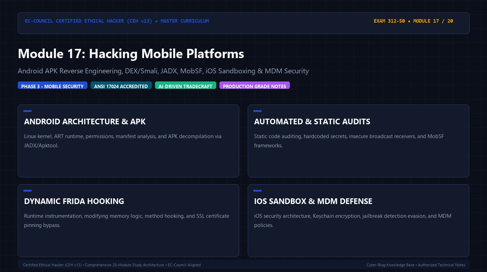

# 🛡️ CEH v13 — Module 17: Hacking Mobile Platforms
### Certified Ethical Hacker (CEH v13) Exam Notes • Phase 3: Web, Wireless & Emerging Tech • Technical Study Architecture

[-0078D4?style=for-the-badge&logo=shield)](https://www.eccouncil.org/programs/certified-ethical-hacker-ceh/)

  <b>Authoritative, exam-oriented study guide and reference architecture for CEH v13 Module 17: Hacking Mobile Platforms. Covers android apk reverse engineering, dex/smali, jadx, mobsf, ios sandboxing & mdm security, attack methodologies, automated tooling, MITRE ATT&CK alignment, and enterprise defensive engineering.</b>

[📖 Module Hub](../README.md) • [🗺️ Knowledge Base Index](../../README.md)

---

## 📋 Module Overview & Exam Objectives

In the **EC-Council Certified Ethical Hacker (CEH v13)** certification exam (Exam 312-50), **Module 17: Hacking Mobile Platforms** represents a fundamental domain within **Phase 3: Web, Wireless & Emerging Tech**. Candidates are tested on both theoretical protocol knowledge and hands-on operational commands used to discover, analyze, exploit, and remediate vulnerabilities across modern networked environments.

### Core Learning Domains:
* **ANDROID ARCHITECTURE & APK:** Linux kernel, ART runtime, permissions, manifest analysis, and APK decompilation via JADX/Apktool.
* **AUTOMATED & STATIC AUDITS:** Static code auditing, hardcoded secrets, insecure broadcast receivers, and MobSF frameworks.
* **DYNAMIC FRIDA HOOKING:** Runtime instrumentation, modifying memory logic, method hooking, and SSL certificate pinning bypass.
* **IOS SANDBOX & MDM DEFENSE:** iOS security architecture, Keychain encryption, jailbreak detection evasion, and MDM policies.

---

## 🔬 In-Depth Technical Breakdown

### 1. ANDROID ARCHITECTURE & APK

Linux kernel, ART runtime, permissions, manifest analysis, and APK decompilation via JADX/Apktool.

* **Core Operational Theory:** Candidates must understand both how threat actors leverage these techniques during offensive operations and how enterprise defenders monitor and detect anomalous behavior.
* **Key Attack Artifacts:** Exam scenarios frequently present command-line strings, configuration files, packet captures, and network connection parameters requiring precise identification of adversary behavior.
* **Exam Relevance:** Directly tested across multiple-choice questions on CEH Exam 312-50.

### 2. AUTOMATED & STATIC AUDITS

Static code auditing, hardcoded secrets, insecure broadcast receivers, and MobSF frameworks.

* **Core Operational Theory:** Candidates must understand both how threat actors leverage these techniques during offensive operations and how enterprise defenders monitor and detect anomalous behavior.
* **Key Attack Artifacts:** Exam scenarios frequently present command-line strings, configuration files, packet captures, and network connection parameters requiring precise identification of adversary behavior.
* **Exam Relevance:** Directly tested across multiple-choice questions on CEH Exam 312-50.

### 3. DYNAMIC FRIDA HOOKING

Runtime instrumentation, modifying memory logic, method hooking, and SSL certificate pinning bypass.

* **Core Operational Theory:** Candidates must understand both how threat actors leverage these techniques during offensive operations and how enterprise defenders monitor and detect anomalous behavior.
* **Key Attack Artifacts:** Exam scenarios frequently present command-line strings, configuration files, packet captures, and network connection parameters requiring precise identification of adversary behavior.
* **Exam Relevance:** Directly tested across multiple-choice questions on CEH Exam 312-50.

### 4. IOS SANDBOX & MDM DEFENSE

iOS security architecture, Keychain encryption, jailbreak detection evasion, and MDM policies.

* **Core Operational Theory:** Candidates must understand both how threat actors leverage these techniques during offensive operations and how enterprise defenders monitor and detect anomalous behavior.
* **Key Attack Artifacts:** Exam scenarios frequently present command-line strings, configuration files, packet captures, and network connection parameters requiring precise identification of adversary behavior.
* **Exam Relevance:** Directly tested across multiple-choice questions on CEH Exam 312-50.

---

## 🛠️ Tooling & Command Reference Matrix

| Tool / Technology | Category | Primary Function | Exam Utility / Key Syntax |
| :--- | :--- | :--- | :--- |
| **JADX-GUI** | DEX Decompiler | Decompiling Dalvik bytecode to readable Java | `Inspecting decompiled Android manifests & classes` |
| **MobSF** | Mobile Security | Automated static & dynamic security framework | `CVSS scoring of Android & iOS application binaries` |
| **Frida** | Dynamic Instrumentation | JavaScript-based memory hooking & tampering | ``frida -U -f com.app.target -l bypass_ssl.js`` |
| **Apktool** | Reverse Engineering | Disassembling APK to Smali & rebuilding | ``apktool d target.apk -o output_dir`` |

---

## 🛡️ Enterprise Countermeasures & Hardening Guidelines

1. **Principle of Least Privilege:** Enforce strict role-based access control (RBAC) and minimize attack surfaces across network daemons.
2. **Defensive Telemetry & Logging:** Centralize event logging (SIEM) with real-time alerting on anomalous spikes, connection retries, and unauthorized protocol commands.
3. **Continuous Auditing & Patching:** Regularly scan infrastructure using automated vulnerability scanners and enforce strict SLA timelines for critical and high vulnerabilities.
4. **Network Segmentation & Zero Trust:** Isolate sensitive subnets, database tiers, and management interfaces behind stateful firewalls and intrusion prevention systems (IPS).

---

## 📚 Official References & Study Resources

* [EC-Council Official CEH v13 Program](https://www.eccouncil.org/programs/certified-ethical-hacker-ceh/)
* [CEH v13 Master Curriculum Index](../README.md)
* [National Vulnerability Database (NVD)](https://nvd.nist.gov/)
* [MITRE ATT&CK Framework](https://attack.mitre.org/)
