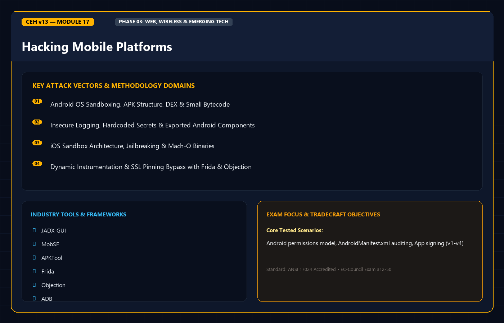
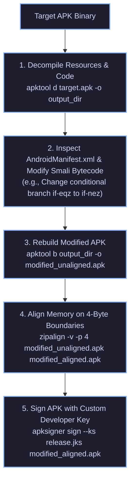

<div align="center">




# 🛡️ CEH v13 — Module 17: Hacking Mobile Platforms
### Certified Ethical Hacker (CEH) Exam Notes • Android Architecture & APK Reversing • iOS Jailbreaking & Checkm8 • Drozer & Frida • Mobile Security Framework (MobSF) • MDM & Defense

[-0078D4?style=for-the-badge&logo=shield)](https://www.eccouncil.org/programs/certified-ethical-hacker-ceh/)
[](https://www.eccouncil.org/)
[](../README.md)
[](./README.md)

<p align="center">
  <b>Authoritative, exam-oriented study guide and reference architecture for CEH v13 Module 17: Hacking Mobile Platforms. Covers Android OS architecture (Linux Kernel, ART, DEX bytecode) and iOS system defenses (Darwin kernel, FairPlay DRM, sandboxing), APK decompilation and Smali tampering (apktool, jadx, apksigner), iOS jailbreak mechanics (Checkm8 BootROM exploit), IPC interrogation with Drozer, runtime hooking and SSL pinning bypass via Frida and Objection, automated mobile auditing with MobSF, and enterprise MDM controls.</b>
</p>

[📖 Module Hub](../README.md) • [🧰 Mobile Pentesting Tools](../../tools/README.md) • [🗺️ Knowledge Base Index](../../README.md)

</div>

---

## 📋 Table of Contents

- [1. Mobile Platform Architecture & Threat Landscape](#1-mobile-platform-architecture--threat-landscape)
  - [Mobile Attack Vectors (Smishing, Malicious Apps, Rogue Profiles)](#mobile-attack-vectors-smishing-malicious-apps-rogue-profiles)
  - [Android Architecture Stack (Linux Kernel to Applications)](#android-architecture-stack-linux-kernel-to-applications)
  - [iOS Security Architecture (Secure Enclave, Sandbox, FairPlay DRM)](#ios-security-architecture-secure-enclave-sandbox-fairplay-drm)
- [2. Android Platform Hacking & Reverse Engineering](#2-android-platform-hacking--reverse-engineering)
  - [Anatomy of an APK (DEX, AndroidManifest, Resources, META-INF)](#anatomy-of-an-apk-dex-androidmanifest-resources-meta-inf)
  - [Reverse Engineering Workflow: Decompiling with `apktool` and `jadx`](#reverse-engineering-workflow-decompiling-with-apktool-and-jadx)
  - [Modifying Smali Bytecode, Repackaging, and Aligning](#modifying-smali-bytecode-repackaging-and-aligning)
  - [Android Rooting Mechanisms: Systemless Root & Magisk](#android-rooting-mechanisms-systemless-root--magisk)
- [3. Android IPC Component Interrogation with Drozer](#3-android-ipc-component-interrogation-with-drozer)
  - [Exported Activities, Broadcast Receivers, and Content Providers](#exported-activities-broadcast-receivers-and-content-providers)
  - [Exploiting Insecure Content Providers (SQLi & Directory Traversal)](#exploiting-insecure-content-providers-sqli--directory-traversal)
- [4. iOS Platform Hacking & Jailbreaking](#4-ios-platform-hacking--jailbreaking)
  - [Jailbreaking Taxonomy: Untethered, Semi-Untethered, Tethered](#jailbreaking-taxonomy-untethered-semi-untethered-tethered)
  - [Hardware BootROM Exploits: The Checkm8 Vulnerability](#hardware-bootrom-exploits-the-checkm8-vulnerability)
  - [IPA Structure & Decrypting Binaries (`frida-ios-dump`)](#ipa-structure--decrypting-binaries-frida-ios-dump)
- [5. Dynamic Instrumentation & Hooking: Frida & Objection](#5-dynamic-instrumentation--hooking-frida--objection)
  - [Frida JavaScript Injection & Function Hooking](#frida-javascript-injection--function-hooking)
  - [Bypassing SSL Certificate Pinning & Root/Jailbreak Checks](#bypassing-ssl-certificate-pinning--rootjailbreak-checks)
- [6. Automated Auditing: Mobile Security Framework (MobSF)](#6-automated-auditing-mobile-security-framework-mobsf)
  - [MobSF Static Analysis (Manifest permissions, hardcoded secrets)](#mobsf-static-analysis-manifest-permissions-hardcoded-secrets)
  - [MobSF Dynamic Sandboxing](#mobsf-dynamic-sandboxing)
- [7. Enterprise Mobile Security & Mobile Device Management (MDM)](#7-enterprise-mobile-security--mobile-device-management-mdm)
  - [MDM Policies, Containerization, and Remote Wiping](#mdm-policies-containerization-and-remote-wiping)
  - [BYOD Risks & OWASP Mobile Top 10 Mapping](#byod-risks--owasp-mobile-top-10-mapping)
- [8. Master Decision Tree & Flowchart](#8-master-decision-tree--flowchart)
- [9. CEH v13 Exam Essentials & Distinction Matrix](#9-ceh-v13-exam-essentials--distinction-matrix)

---

## 1. Mobile Platform Architecture & Threat Landscape

### Mobile Attack Vectors

Mobile devices introduce unique hardware and radio vulnerabilities absent in traditional desktop environments:
* **Smishing (SMS Phishing)**: Fraudulent text messages containing deceptive URLs or fake 2FA verification prompts.
* **Malicious App Stores & Sideloading**: Unverified third-party repositories hosting trojanized apps that request excessive permissions.
* **Malicious Configuration Profiles**: In iOS, enterprise `.mobileconfig` profiles injected via phishing can alter device APNs, force traffic through rogue VPNs, or install untrusted root CA certificates.
* **SIM Swapping**: Socially engineering cellular carriers into transferring a victim's phone number to an attacker's SIM card to intercept SMS 2FA codes.

---

### Android Architecture Stack

Android is an open-source operating system built on top of a modified **Linux Kernel**:

```
+--------------------------------------------------------------------------+
|                     ANDROID SYSTEM ARCHITECTURE                          |
+--------------------------------------------------------------------------+
|  SYSTEM APPS: Dial, SMS, Browser, Camera, Third-Party User Apps          |
+--------------------------------------------------------------------------+
|  JAVA API APPLICATION FRAMEWORK:                                         |
|  Activity Manager, Content Providers, Resource Manager, Notification Mgr |
+--------------------------------------------------------------------------+
|  ANDROD RUNTIME (ART) / HAL:                                             |
|  - Ahead-of-Time (AOT) and Just-in-Time (JIT) compilation.               |
|  - Executes DEX bytecode; manages memory, garbage collection, sandboxing.|
|  - Hardware Abstraction Layer (HAL): Camera, Bluetooth, Sensors, Audio.  |
+--------------------------------------------------------------------------+
|  NATIVE C / C++ LIBRARIES: WebKit, SQLite, OpenSSL/BoringSSL, Libc       |
+--------------------------------------------------------------------------+
|  LINUX KERNEL: Drivers (Wi-Fi, Display, IPC Binder), Process Management   |
+--------------------------------------------------------------------------+
```

---

### iOS Security Architecture

Apple iOS is built upon the **Darwin (Mach-based)** kernel and enforces strict security controls:
* **Hardware Root of Trust**: Boot code burned directly into read-only memory (BootROM) during silicon manufacturing.
* **Secure Enclave Processor (SEP)**: Dedicated coprocessor managing cryptographic operations, biometric authentication (Touch ID / Face ID), and hardware key storage isolated from the main application processor.
* **Mandatory Code Signing**: The kernel refuses to execute any binary that lacks a valid cryptographic digital signature issued by Apple or an authorized developer certificate.
* **App Sandbox**: Every application resides in an isolated container directory; cannot access system files, kernel structures, or memory of other apps.

---

## 2. Android Platform Hacking & Reverse Engineering

### Anatomy of an APK (Android Package)

An APK is simply a compressed `.zip` archive containing application assets:

```
app.apk (ZIP Archive)
├── AndroidManifest.xml    # Declares permissions, package name, exported components
├── classes.dex            # Compiled Java/Kotlin code in Dalvik Executable format
├── res/                   # Application resources (XML layouts, strings, icons)
├── resources.arsc         # Pre-compiled binary XML resources
├── lib/                   # Native architecture libraries (armeabi-v7a, arm64-v8a, x86)
└── META-INF/              # Cryptographic signatures and checksums
    ├── MANIFEST.MF        # SHA-256 hashes of all individual files in the APK
    ├── CERT.SF            # Signature file hashing the manifest lines
    └── CERT.RSA           # Developer's digital certificate and RSA signature
```

---

### Reverse Engineering Workflow: Decompiling & Modifying



```bash
# 1. Decompile human-readable Java source using jadx
jadx-gui target.apk

# 2. Decompile to Smali assembly and decode resources with apktool
apktool d target.apk -o decompiled_app

# 3. Rebuild modified APK
apktool b decompiled_app -o app_rebuilt.apk

# 4. Align memory boundaries
zipalign -v -p 4 app_rebuilt.apk app_aligned.apk

# 5. Sign the modified APK with a self-generated keystore
keytool -genkey -v -keystore evil.keystore -alias evil -keyalg RSA -keysize 2048 -validity 10000
apksigner sign --ks evil.keystore --ks-key-alias evil app_aligned.apk
```

---

## 3. Android IPC Component Interrogation with Drozer

### Exported Activities, Services, and Content Providers

In `AndroidManifest.xml`, if a component defines `android:exported="true"`, any third-party app installed on the device can invoke that component without requiring permissions:

```xml
<!-- Insecure Exported Activity -->
<activity android:name=".AdminDashboardActivity" android:exported="true" />

<!-- Insecure Content Provider leaking internal database -->
<provider android:name=".UserDataProvider" 
          android:authorities="com.target.provider" 
          android:exported="true" />
```

### Exploiting Content Providers with Drozer

**Drozer** is the premier framework for assessing Android IPC surfaces:

```bash
# 1. Forward Drozer agent port from Android device / emulator
adb forward tcp:31415 tcp:31415

# 2. Launch interactive Drozer console
drozer console connect

# 3. Find the attack surface of the target package
dz> run app.package.attacksurface com.target.vulnerableapp

# 4. Query vulnerable Content Provider URI
dz> run app.provider.query content://com.target.provider/accounts/

# 5. Test for SQL Injection inside Content Provider
dz> run app.provider.query content://com.target.provider/accounts/ --selection "1=1"
dz> run app.provider.read content://com.target.provider/../../../../etc/hosts
```

---

## 4. iOS Platform Hacking & Jailbreaking

### Jailbreaking Taxonomy

Jailbreaking removes Apple's mandatory kernel sandbox and code-signing restrictions, granting `root` access to the filesystem:

```
+--------------------------------------------------------------------------+
|                        JAILBREAK CLASSIFICATIONS                         |
+--------------------------------------------------------------------------+
|  UNTETHERED:                                                             |
|  The holy grail of jailbreaks. Exploits persist permanently across reboots|
|  without requiring any computer connection or helper app.                |
+--------------------------------------------------------------------------+
|  SEMI-UNTETHERED:                                                        |
|  Device boots into normal non-jailbroken state upon reboot. User runs a  |
|  sideloaded app on the device (e.g., unc0ver, Taurine) to re-jailbreak   |
|  without needing a computer.                                             |
+--------------------------------------------------------------------------+
|  TETHERED:                                                               |
|  Device cannot boot at all on its own if powered down. Must be connected |
|  to a computer running an exploit tool (e.g., via USB) to execute the    |
|  boot sequence.                                                          |
+--------------------------------------------------------------------------+
```

---

### Hardware BootROM Exploits: The Checkm8 Vulnerability

* **Checkm8**: An unpatchable, permanent vulnerability residing in the **read-only BootROM memory** of Apple devices running chips from **A5 to A11** (iPhone 4S through iPhone X).
* **High-Yield Exam Point**: Because BootROM code is physically burned into the silicon during fabrication, **Apple cannot patch Checkm8 via software updates**!

---

## 5. Dynamic Instrumentation & Hooking: Frida & Objection

### Frida JavaScript Injection

**Frida** injects Google's V8 JavaScript engine into a running process's memory space, allowing penetration testers to hook native functions, rewrite return values, and inspect variables at runtime:

```javascript
// Frida script: Overriding Android Root Detection
Java.perform(function() {
    var RootDetectionClass = Java.use("com.target.app.SecurityUtils");
    
    // Intercept isDeviceRooted() and force it to always return false!
    RootDetectionClass.isDeviceRooted.implementation = function() {
        console.log("[*] Root detection hooked! Bypassing check...");
        return false;
    };
});
```

```bash
# Executing Frida script against running Android app
frida -U -f com.target.app -l bypass_root.js --no-pause
```

### Objection: Runtime Mobile Assessment

```bash
# Explore mobile application runtime with Objection
objection --gadget com.target.app explore

# Bypassing SSL Pinning with a single command
android sslpinning disable
ios sslpinning disable

# Dumping memory and SQLite databases live
memory dump all
sqlite sync
```

---

## 6. Automated Auditing: Mobile Security Framework (MobSF)

**MobSF** is an all-in-one automated framework supporting Android, iOS, and Windows mobile apps:
* **Static Analysis**: Decompiles APK/IPA, flags dangerous permissions (e.g., `READ_SMS`, `ACCESS_FINE_LOCATION`), detects hardcoded API keys and AWS tokens, identifies insecure encryption modes (`AES/ECB`).
* **Dynamic Analysis**: Automatically deploys the app to an emulator, monitors network traffic via MITM proxy, executes runtime API hooks, and generates compliance reports (OWASP Mobile Top 10).

---

## 7. Enterprise Mobile Security & Mobile Device Management (MDM)

### MDM Controls & Containerization

* **Mobile Device Management (MDM)**: Centralized enterprise platforms (Microsoft Intune, VMware Workspace ONE) enforcing security policies on employee devices:
  * Enforcing complex lock-screen PINs / biometrics.
  * Enforcing hardware full-disk encryption.
  * Disabling USB debugging (`adb`) and developer options.
  * **Remote Wipe**: Erasing corporate data or performing a complete factory reset if a phone is lost or stolen.
* **Containerization**: Isolating corporate email, documents, and business apps within an encrypted, sandboxed partition completely segregated from personal apps.

---

## 8. Master Decision Tree & Flowchart

```
                          [ MOBILE APPLICATION AUDIT ]
                                       |
                     What is the target platform?
                       /                       \
                 [ ANDROID ]                 [ iOS ]
                      |                         |
              Decompile via apktool      Inspect Info.plist & Mach-O;
              and jadx-gui               Decrypt via frida-ios-dump
                      |                         |
              Audit AndroidManifest:     Is device running A5-A11 chip?
              Check exported components        /              \
                      |                      YES               NO
              Test IPC with Drozer         Checkm8        Semi-untethered
                      |                    BootROM        app jailbreak
              Hook runtime via Frida       Exploit
              (Bypass root & SSL pin)
```

---

## 9. CEH v13 Exam Essentials & Distinction Matrix

| Concept / Technique | Essential CEH Exam Distinction |
| :--- | :--- |
| **Checkm8 Vulnerability** | An unpatchable hardware **BootROM exploit** affecting Apple chips **A5 through A11** (cannot be fixed via iOS firmware updates). |
| **Android IPC Attack Surface**| Components configured with **`android:exported="true"`** can be invoked by any untrusted application on the device. |
| **Apktool vs. Jadx** | **`apktool`** decompiles resources and produces **Smali assembly** (used for modifying & rebuilding); **`jadx`** produces human-readable **Java source code** (used for code review). |
| **Smali Code Modification** | Tampered APKs must be rebuilt with `apktool b`, aligned with **`zipalign`**, and signed with **`apksigner`** before Android will execute them. |
| **Frida Framework** | Dynamic binary instrumentation framework used to inject JavaScript to **bypass SSL certificate pinning** and **root detection**. |
| **Drozer** | Dedicated assessment framework used to test Android Inter-Process Communication (IPC) and exploit vulnerable Content Providers. |
| **SIM Swapping** | Social engineering attack against cellular carriers to hijack phone numbers and intercept SMS 2FA tokens. |

---

<div align="center">

[⬅️ Previous: Module 16 — Hacking Wireless Networks](../Module%2016/README.md) • [Next: Module 18 — IoT & OT Hacking ➡️](../Module%2018/README.md)

</div>
