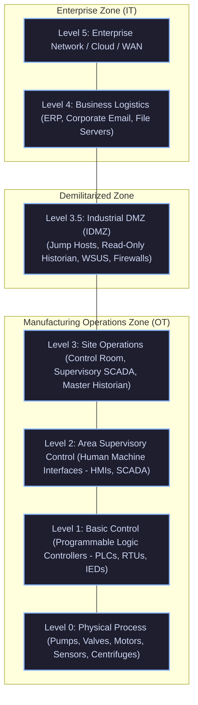

<div align="center">

# 🛡️ CEH v13 — Module 18: IoT and OT Hacking
### Certified Ethical Hacker (CEH) Exam Notes • IoT Architecture & MQTT • Hardware Debugging (UART/JTAG) • Firmware Reversing (Binwalk) • Purdue Model & SCADA • Modbus • Defense

[-0078D4?style=for-the-badge&logo=shield)](https://www.eccouncil.org/programs/certified-ethical-hacker-ceh/)
[](https://www.eccouncil.org/)
[](../README.md)
[](./README.md)

<p align="center">
  <b>Authoritative, exam-oriented study guide and reference architecture for CEH v13 Module 18: IoT and OT Hacking. Covers IoT architecture models, telemetry protocols (MQTT topic interception, CoAP, Zigbee), physical hardware hacking (UART pin discovery, JTAG flash dumping, I2C/SPI), firmware extraction and SquashFS reverse engineering using binwalk, Operational Technology (OT) and SCADA systems, the Purdue Enterprise Reference Model (Levels 0–5), industrial protocols (Modbus TCP Port 502), cyber-physical attacks (Stuxnet, Industroyer, Triton), and industrial defense with Data Diodes.</b>
</p>

[📖 Module Hub](../README.md) • [🧰 Hardware & IoT Pentest Tools](../../tools/README.md) • [🗺️ Knowledge Base Index](../../README.md)

</div>

---

## 📋 Table of Contents

- [1. IoT Concepts & Architectural Frameworks](#1-iot-concepts--architectural-frameworks)
  - [The Multi-Layer IoT Architecture](#the-multi-layer-iot-architecture)
  - [IoT Attack Surfaces & OWASP IoT Top 10](#iot-attack-surfaces--owasp-iot-top-10)
- [2. IoT Communication Protocols & Exploitation](#2-iot-communication-protocols--exploitation)
  - [MQTT Protocol Deep-Dive (Broker, Topics, Port 1883/8883)](#mqtt-protocol-deep-dive-broker-topics-port-18838883)
  - [CoAP (Constrained Application Protocol)](#coap-constrained-application-protocol)
  - [Zigbee, Z-Wave, and Bluetooth Low Energy (BLE)](#zigbee-z-wave-and-bluetooth-low-energy-ble)
- [3. Hardware Hacking & Physical Interface Interrogation](#3-hardware-hacking--physical-interface-interrogation)
  - [UART (Universal Asynchronous Receiver-Transmitter)](#uart-universal-asynchronous-receiver-transmitter)
  - [JTAG (Joint Test Action Group) & SWD](#jtag-joint-test-action-group--swd)
  - [I2C and SPI EEPROM Flash Memory Snooping](#i2c-and-spi-eeprom-flash-memory-snooping)
- [4. Firmware Analysis & Reverse Engineering](#4-firmware-analysis--reverse-engineering)
  - [Extracting Filesystems with Binwalk](#extracting-filesystems-with-binwalk)
  - [Modifying SquashFS & Repackaging with Firmware Mod Kit](#modifying-squashfs--repackaging-with-firmware-mod-kit)
  - [Hunting Hardcoded Secrets, Passwords, and Private Keys](#hunting-hardcoded-secrets-passwords-and-private-keys)
- [5. Operational Technology (OT) & ICS/SCADA Systems](#5-operational-technology-ot--icsscada-systems)
  - [IT vs. OT: The Inverted Security Triad (AIC vs. CIA)](#it-vs-ot-the-inverted-security-triad-aic-vs-cia)
  - [The Purdue Enterprise Reference Architecture (Purdue Model Levels 0–5)](#the-purdue-enterprise-reference-architecture-purdue-model-levels-05)
  - [Industrial Components: PLCs, RTUs, HMIs, and Historians](#industrial-components-plcs-rtus-hmis-and-historians)
- [6. Industrial Protocols & Exploitation](#6-industrial-protocols--exploitation)
  - [Modbus Protocol (TCP Port 502) & Coil Manipulation](#modbus-protocol-tcp-port-502--coil-manipulation)
  - [DNP3, Profinet, EtherNet/IP, and BACnet](#dnp3-profinet-ethernetip-and-bacnet)
  - [Historic Cyber-Physical Attacks: Stuxnet, Industroyer, Triton](#historic-cyber-physical-attacks-stuxnet-industroyer-triton)
- [7. IoT and OT Defensive Hardening](#7-iot-and-ot-defensive-hardening)
  - [Strict Purdue Network Segmentation & The Industrial DMZ (IDMZ)](#strict-purdue-network-segmentation--the-industrial-dmz-idmz)
  - [Unidirectional Security Gateways (Data Diodes)](#unidirectional-security-gateways-data-diodes)
  - [Passive Monitoring vs. Active Scanning Risks](#passive-monitoring-vs-active-scanning-risks)
- [8. Master Decision Tree & Flowchart](#8-master-decision-tree--flowchart)
- [9. CEH v13 Exam Essentials & Distinction Matrix](#9-ceh-v13-exam-essentials--distinction-matrix)

---

## 1. IoT Concepts & Architectural Frameworks

### The Multi-Layer IoT Architecture

Internet of Things (IoT) systems bridge the physical and digital worlds across five defined layers:

```
+--------------------------------------------------------------------------+
|                        THE 5-LAYER IoT ARCHITECTURE                      |
+--------------------------------------------------------------------------+
|  5. BUSINESS / ENTERPRISE LAYER: Big data analytics, business graphs    |
+--------------------------------------------------------------------------+
|  4. APPLICATION LAYER: Mobile apps, web portals, cloud dashboards        |
+--------------------------------------------------------------------------+
|  3. PROCESSING / MIDDLEWARE LAYER: Cloud databases, message brokers (MQTT)|
+--------------------------------------------------------------------------+
|  2. NETWORK / TRANSPORT LAYER: Wi-Fi, 4G/5G, Zigbee, LoRaWAN, BLE, IPv6  |
+--------------------------------------------------------------------------+
|  1. PERCEPTION / EDGE LAYER: Physical sensors, actuators, microchips     |
+--------------------------------------------------------------------------+
```

---

## 2. IoT Communication Protocols & Exploitation

### MQTT Protocol Deep-Dive (Port 1883 / 8883)

MQTT (Message Queuing Telemetry Transport) is a lightweight, publish-subscribe messaging protocol designed for constrained networks:
* **The Broker**: The central server that distributes messages between publishers and subscribers.
* **Ports**: **TCP Port 1883** (Unencrypted Plaintext) and **TCP Port 8883** (MQTT over TLS).
* **Topic Wildcards**:
  * `+`: Single-level wildcard (e.g., `factory/+/temperature`).
  * `#`: Multi-level wildcard matching all sub-topics (e.g., `#` matches every message passing through the broker!).

```bash
# Eavesdropping on an unauthenticated MQTT broker using wildcard topic '#'
mosquitto_sub -h 192.168.1.50 -p 1883 -t "#" -v

# Injecting rogue command to toggle an industrial smart relay / actuator
mosquitto_pub -h 192.168.1.50 -p 1883 -t "factory/relays/valve1" -m "OPEN"
```

---

### CoAP (Constrained Application Protocol)

* Operates over **UDP (Port 5683 / 5684 with DTLS)**.
* Translates HTTP REST semantics (`GET`, `POST`, `PUT`, `DELETE`) into lightweight binary datagrams suitable for low-power microcontroller nodes.

---

## 3. Hardware Hacking & Physical Interface Interrogation

### UART (Universal Asynchronous Receiver-Transmitter)

UART is an asynchronous serial interface widely used for microcontroller debugging and bootloader consoles:

```
+--------------------------------------------------------------------------+
|                        UART PINOUT & VOLTAGE                             |
+--------------------------------------------------------------------------+
|  Pin 1: VCC (Power - Do NOT connect to USB adapter!)                     |
|  Pin 2: GND (Ground - Common reference voltage)                          |
|  Pin 3: TX  (Transmit Data from IoT device -> Connects to Adapter RX)   |
|  Pin 4: RX  (Receive Data to IoT device   -> Connects to Adapter TX)     |
+--------------------------------------------------------------------------+
```

* **Hunting UART Pins**: Using a digital multimeter (continuity mode to locate GND) and a logic analyzer to detect the fluctuating voltage on the TX line during bootup.
* **Baud Rate**: Common speeds are `9600`, `38400`, or **`115200`** baud. Connecting via `screen` or `minicom` often spawns an **unauthenticated root BusyBox Linux shell**!

```bash
# Connecting to UART console over USB adapter at 115200 baud
screen /dev/ttyUSB0 115200
```

---

### JTAG (Joint Test Action Group) & SWD

* **JTAG**: Hardware boundary-scan testing protocol defined by IEEE 1149.1.
* **Core Pins**: **TDI** (Test Data In), **TDO** (Test Data Out), **TCK** (Test Clock), **TMS** (Test Mode Select), **TRST** (Test Reset).
* **Offensive Value**: Allows testers to halt the microcontroller CPU, step through execution, read/write internal CPU registers, and **dump the entire flash memory chip directly to disk** using OpenOCD.

---

## 4. Firmware Analysis & Reverse Engineering

### Extracting Filesystems with Binwalk

Firmware update files (`.bin`, `.img`) are typically compressed composite archives containing bootloaders (U-Boot), Linux kernels, and compressed filesystems (SquashFS):

```bash
# 1. Scan binary image for magic bytes and signatures
binwalk firmware.bin

# 2. Automatically extract all embedded file structures recursively
binwalk -e -M firmware.bin
```

---

### Modifying SquashFS & Repackaging

Using the **Firmware Mod Kit (FMK)**:

```bash
# 1. Unpack firmware
./unsquash_firmware.sh firmware.bin

# 2. Navigate to extracted root filesystem
cd fmk/rootfs/

# 3. Modify root password or inject reverse shell into /etc/init.d/rcS
echo "root:password123" | chpasswd

# 4. Repack firmware into new weaponized image
./build_firmware.sh
```

---

## 5. Operational Technology (OT) & ICS/SCADA Systems

### IT vs. OT: The Inverted Security Triad

```
+--------------------------------------------------------------------------+
|                 ENTERPRISE IT      vs.        OPERATIONAL TECHNOLOGY     |
+--------------------------------------------------------------------------+
|  PRIMARY GOAL: Data Protection                PRIMARY GOAL: Human Safety &|
|                                               Physical Availability      |
|                                                                          |
|  TRIAD PRIORITY:                              TRIAD PRIORITY:            |
|  1. Confidentiality                           1. Availability            |
|  2. Integrity                                 2. Integrity               |
|  3. Availability                              3. Confidentiality         |
|                                                                          |
|  PATCH FREQUENCY: Weekly / Monthly            PATCH FREQUENCY: Rare /    |
|  (Reboots tolerated during maintenance)       Scheduled outages every    |
|                                               1 to 5 years!              |
|                                                                          |
|  LIFECYCLE: 3 to 5 years                      LIFECYCLE: 15 to 30 years  |
+--------------------------------------------------------------------------+
```

---

### The Purdue Enterprise Reference Architecture (Purdue Model)

The Purdue Model establishes mandatory zoning boundaries for industrial automation:



---

## 6. Industrial Protocols & Exploitation

### Modbus Protocol (TCP Port 502)

Modbus is the most common industrial protocol. Originally designed in 1979 for serial lines, Modbus TCP operates over **TCP Port 502** with **zero encryption and zero authentication**:

```
+--------------------------------------------------------------------------+
|                       MODBUS FUNCTION CODES                              |
+--------------------------------------------------------------------------+
|  Code 01 (0x01): Read Coils (Read binary On/Off state of digital outputs)|
|  Code 02 (0x02): Read Discrete Inputs (Read binary state of inputs)      |
|  Code 03 (0x03): Read Holding Registers (Read analog numerical values)   |
|  Code 05 (0x05): Write Single Coil (Force a valve/relay Open or Closed!) |
|  Code 06 (0x06): Write Single Register (Modify analog setpoint/pressure) |
|  Code 16 (0x10): Write Multiple Registers                                |
+--------------------------------------------------------------------------+
```

```bash
# Modbus reconnaissance using Nmap NSE
nmap -p 502 --script modbus-discover 192.168.1.100

# Overwriting Modbus coil 1 to force open a physical valve
python3 -c "
from pymodbus.client import ModbusTcpClient
client = ModbusTcpClient('192.168.1.100', port=502)
client.write_coil(1, True)
client.close()
"
```

---

### Historic Cyber-Physical Attacks

* **Stuxnet (2010)**: Sophisticated nation-state malware targeting Siemens S7-300 PLCs controlling Iranian uranium enrichment centrifuges. Altered centrifuge rotational speeds while replaying normal telemetry to operators.
* **Industroyer / CrashOverride (2016)**: Attacked Ukrainian electric substations; natively spoke industrial protocols (IEC 60870-5-104, IEC 61850) to directly open circuit breakers and cut power.
* **Triton / TRISIS (2017)**: Targeted Schneider Electric Triconex Safety Instrumented Systems (SIS), designed to disable emergency shutdown safety controls in a petrochemical refinery.

---

## 7. IoT and OT Defensive Hardening

### Defensive Principles

1. **Strict Purdue Segmentation via IDMZ (Level 3.5)**: No direct IP communication must ever occur between Enterprise IT (Level 4) and Industrial Operations (Level 3).
2. **Unidirectional Security Gateways (Data Diodes)**: Hardware-enforced physical data diodes (using fiber-optic LEDs and photodiodes) that physically permit data transmission in **one direction only** (e.g., from OT Historian outward to Enterprise IT), making remote inbound hacking physically impossible!
3. **Passive Network Monitoring**: Active port scanners (like aggressive Nmap scans) can **crash delicate legacy PLCs** and cause physical damage. OT networks must be monitored exclusively via **passive TAP/SPAN ports** using industrial IDS platforms (Dragos, Claroty, Nozomi Networks).

---

## 8. Master Decision Tree & Flowchart

```
                          [ HARDWARE / OT TARGET AUDIT ]
                                        |
                      Is it physical hardware or network?
                        /                             \
                [ HARDWARE ]                      [ NETWORK ]
                     |                                 |
           Locate debug interfaces            Is it IoT or Industrial OT?
            /             \                     /                     \
       [ UART ]         [ JTAG ]            [ IoT ]                 [ OT ]
          |                |                   |                       |
     Find TX/RX/GND   Halt CPU with       Audit MQTT Port 1883   Inspect Modbus (502)
     at 115200 baud;  OpenOCD; dump       (Check wildcard '#');  Check Purdue Model
     spawn Busybox    flash firmware      Review CoAP (5683)     Level 3.5 IDMZ
```

---

## 9. CEH v13 Exam Essentials & Distinction Matrix

| Concept / Technique | Essential CEH Exam Distinction |
| :--- | :--- |
| **IT vs. OT Security Triad** | IT prioritizes **Confidentiality** (CIA). OT prioritizes **Availability** (AIC) and human safety. |
| **Purdue Model Level 3.5** | The **Industrial DMZ (IDMZ)** that strictly separates Enterprise IT from Industrial Operations. |
| **Data Diode** | Hardware security device that physically enforces **unidirectional** data flow via hardware optics. |
| **UART Pinout** | Consists of **TX, RX, GND, and VCC**. Connects to host via USB-to-UART serial adapter at baud rates like **115200**. |
| **Binwalk** | Specialized CLI tool used to search binary firmware images and extract embedded compressed filesystems (SquashFS). |
| **MQTT Wildcard '#'** | Subscribing to the topic **`#`** on an unauthenticated MQTT broker intercepts **all** messages and telemetry across the network. |
| **Modbus Protocol** | Runs on **TCP Port 502**; lacks any authentication or encryption. Function code **05** writes single coils. |
| **Stuxnet Target** | Specifically targeted **Siemens S7-300 PLCs** to physically manipulate uranium centrifuges. |

---

<div align="center">

[⬅️ Previous: Module 17 — Hacking Mobile Platforms](../Module%2017/README.md) • [Next: Module 19 — Cloud Computing ➡️](../Module%2019/README.md)

</div>
