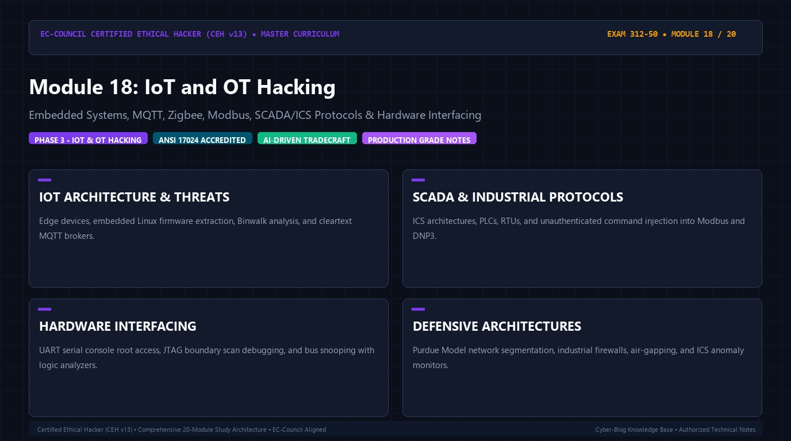

# 🛡️ CEH v13 — Module 18: IoT and OT Hacking
### Certified Ethical Hacker (CEH v13) Exam Notes • Phase 3: Web, Wireless & Emerging Tech • Technical Study Architecture

[-0078D4?style=for-the-badge&logo=shield)](https://www.eccouncil.org/programs/certified-ethical-hacker-ceh/)

  <b>Authoritative, exam-oriented study guide and reference architecture for CEH v13 Module 18: IoT and OT Hacking. Covers embedded systems, mqtt, zigbee, modbus, scada/ics protocols & hardware interfacing, attack methodologies, automated tooling, MITRE ATT&CK alignment, and enterprise defensive engineering.</b>

[📖 Module Hub](../README.md) • [🗺️ Knowledge Base Index](../../README.md)

---

## 📋 Module Overview & Exam Objectives

In the **EC-Council Certified Ethical Hacker (CEH v13)** certification exam (Exam 312-50), **Module 18: IoT and OT Hacking** represents a fundamental domain within **Phase 3: Web, Wireless & Emerging Tech**. Candidates are tested on both theoretical protocol knowledge and hands-on operational commands used to discover, analyze, exploit, and remediate vulnerabilities across modern networked environments.

### Core Learning Domains:
* **IOT ARCHITECTURE & THREATS:** Edge devices, embedded Linux firmware extraction, Binwalk analysis, and cleartext MQTT brokers.
* **SCADA & INDUSTRIAL PROTOCOLS:** ICS architectures, PLCs, RTUs, and unauthenticated command injection into Modbus and DNP3.
* **HARDWARE INTERFACING:** UART serial console root access, JTAG boundary scan debugging, and bus snooping with logic analyzers.
* **DEFENSIVE ARCHITECTURES:** Purdue Model network segmentation, industrial firewalls, air-gapping, and ICS anomaly monitors.

---

## 🔬 In-Depth Technical Breakdown

### 1. IOT ARCHITECTURE & THREATS

Edge devices, embedded Linux firmware extraction, Binwalk analysis, and cleartext MQTT brokers.

* **Core Operational Theory:** Candidates must understand both how threat actors leverage these techniques during offensive operations and how enterprise defenders monitor and detect anomalous behavior.
* **Key Attack Artifacts:** Exam scenarios frequently present command-line strings, configuration files, packet captures, and network connection parameters requiring precise identification of adversary behavior.
* **Exam Relevance:** Directly tested across multiple-choice questions on CEH Exam 312-50.

### 2. SCADA & INDUSTRIAL PROTOCOLS

ICS architectures, PLCs, RTUs, and unauthenticated command injection into Modbus and DNP3.

* **Core Operational Theory:** Candidates must understand both how threat actors leverage these techniques during offensive operations and how enterprise defenders monitor and detect anomalous behavior.
* **Key Attack Artifacts:** Exam scenarios frequently present command-line strings, configuration files, packet captures, and network connection parameters requiring precise identification of adversary behavior.
* **Exam Relevance:** Directly tested across multiple-choice questions on CEH Exam 312-50.

### 3. HARDWARE INTERFACING

UART serial console root access, JTAG boundary scan debugging, and bus snooping with logic analyzers.

* **Core Operational Theory:** Candidates must understand both how threat actors leverage these techniques during offensive operations and how enterprise defenders monitor and detect anomalous behavior.
* **Key Attack Artifacts:** Exam scenarios frequently present command-line strings, configuration files, packet captures, and network connection parameters requiring precise identification of adversary behavior.
* **Exam Relevance:** Directly tested across multiple-choice questions on CEH Exam 312-50.

### 4. DEFENSIVE ARCHITECTURES

Purdue Model network segmentation, industrial firewalls, air-gapping, and ICS anomaly monitors.

* **Core Operational Theory:** Candidates must understand both how threat actors leverage these techniques during offensive operations and how enterprise defenders monitor and detect anomalous behavior.
* **Key Attack Artifacts:** Exam scenarios frequently present command-line strings, configuration files, packet captures, and network connection parameters requiring precise identification of adversary behavior.
* **Exam Relevance:** Directly tested across multiple-choice questions on CEH Exam 312-50.

---

## 🛠️ Tooling & Command Reference Matrix

| Tool / Technology | Category | Primary Function | Exam Utility / Key Syntax |
| :--- | :--- | :--- | :--- |
| **Binwalk** | Firmware Extraction | Analyzing firmware images, compression, headers | ``binwalk -e firmware.bin`` |
| **MQTT.fx / mosquitto** | MQTT Clients | Subscribing to telemetry topics & publishing commands | ``mosquitto_sub -h 10.0.0.1 -t '#'`` |
| **Modscan / Smod** | SCADA Pentesting | Modbus protocol diagnostic & command injection | `Reading/writing holding registers on PLCs` |
| **Bus Pirate** | Hardware Interfacing | Communicating over JTAG, I2C, SPI, and UART | `Hardware chip extraction & memory dumping` |

---

## 🛡️ Enterprise Countermeasures & Hardening Guidelines

1. **Principle of Least Privilege:** Enforce strict role-based access control (RBAC) and minimize attack surfaces across network daemons.
2. **Defensive Telemetry & Logging:** Centralize event logging (SIEM) with real-time alerting on anomalous spikes, connection retries, and unauthorized protocol commands.
3. **Continuous Auditing & Patching:** Regularly scan infrastructure using automated vulnerability scanners and enforce strict SLA timelines for critical and high vulnerabilities.
4. **Network Segmentation & Zero Trust:** Isolate sensitive subnets, database tiers, and management interfaces behind stateful firewalls and intrusion prevention systems (IPS).

---

## 📚 Official References & Study Resources

* [EC-Council Official CEH v13 Program](https://www.eccouncil.org/programs/certified-ethical-hacker-ceh/)
* [CEH v13 Master Curriculum Index](../README.md)
* [National Vulnerability Database (NVD)](https://nvd.nist.gov/)
* [MITRE ATT&CK Framework](https://attack.mitre.org/)
