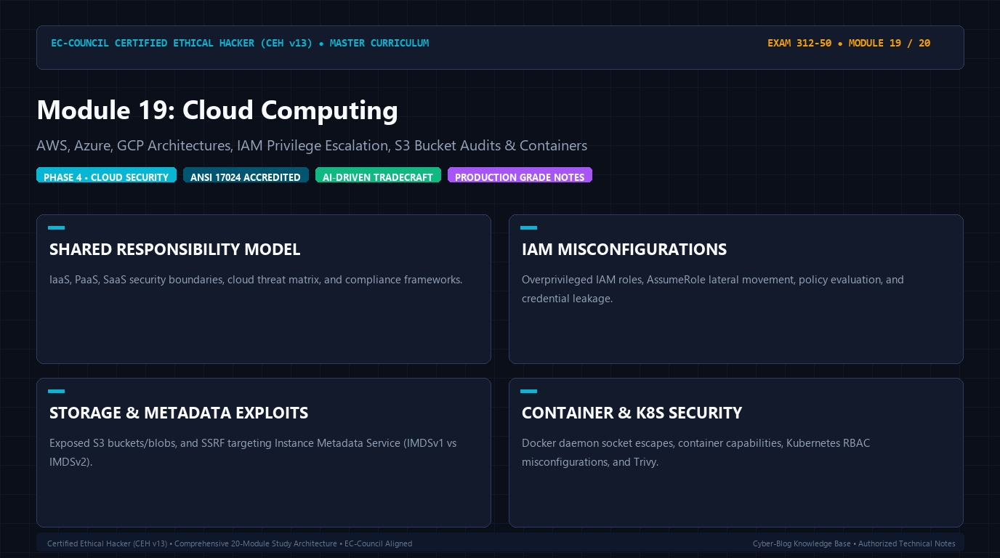

# 🛡️ CEH v13 — Module 19: Cloud Computing
### Certified Ethical Hacker (CEH v13) Exam Notes • Phase 4: Cloud & Cryptography • Technical Study Architecture

[-0078D4?style=for-the-badge&logo=shield)](https://www.eccouncil.org/programs/certified-ethical-hacker-ceh/)

  <b>Authoritative, exam-oriented study guide and reference architecture for CEH v13 Module 19: Cloud Computing. Covers aws, azure, gcp architectures, iam privilege escalation, s3 bucket audits & containers, attack methodologies, automated tooling, MITRE ATT&CK alignment, and enterprise defensive engineering.</b>

[📖 Module Hub](../README.md) • [🗺️ Knowledge Base Index](../../README.md)

---

## 📋 Module Overview & Exam Objectives

In the **EC-Council Certified Ethical Hacker (CEH v13)** certification exam (Exam 312-50), **Module 19: Cloud Computing** represents a fundamental domain within **Phase 4: Cloud & Cryptography**. Candidates are tested on both theoretical protocol knowledge and hands-on operational commands used to discover, analyze, exploit, and remediate vulnerabilities across modern networked environments.

### Core Learning Domains:
* **SHARED RESPONSIBILITY MODEL:** IaaS, PaaS, SaaS security boundaries, cloud threat matrix, and compliance frameworks.
* **IAM MISCONFIGURATIONS:** Overprivileged IAM roles, AssumeRole lateral movement, policy evaluation, and credential leakage.
* **STORAGE & METADATA EXPLOITS:** Exposed S3 buckets/blobs, and SSRF targeting Instance Metadata Service (IMDSv1 vs IMDSv2).
* **CONTAINER & K8S SECURITY:** Docker daemon socket escapes, container capabilities, Kubernetes RBAC misconfigurations, and Trivy.

---

## 🔬 In-Depth Technical Breakdown

### 1. SHARED RESPONSIBILITY MODEL

IaaS, PaaS, SaaS security boundaries, cloud threat matrix, and compliance frameworks.

* **Core Operational Theory:** Candidates must understand both how threat actors leverage these techniques during offensive operations and how enterprise defenders monitor and detect anomalous behavior.
* **Key Attack Artifacts:** Exam scenarios frequently present command-line strings, configuration files, packet captures, and network connection parameters requiring precise identification of adversary behavior.
* **Exam Relevance:** Directly tested across multiple-choice questions on CEH Exam 312-50.

### 2. IAM MISCONFIGURATIONS

Overprivileged IAM roles, AssumeRole lateral movement, policy evaluation, and credential leakage.

* **Core Operational Theory:** Candidates must understand both how threat actors leverage these techniques during offensive operations and how enterprise defenders monitor and detect anomalous behavior.
* **Key Attack Artifacts:** Exam scenarios frequently present command-line strings, configuration files, packet captures, and network connection parameters requiring precise identification of adversary behavior.
* **Exam Relevance:** Directly tested across multiple-choice questions on CEH Exam 312-50.

### 3. STORAGE & METADATA EXPLOITS

Exposed S3 buckets/blobs, and SSRF targeting Instance Metadata Service (IMDSv1 vs IMDSv2).

* **Core Operational Theory:** Candidates must understand both how threat actors leverage these techniques during offensive operations and how enterprise defenders monitor and detect anomalous behavior.
* **Key Attack Artifacts:** Exam scenarios frequently present command-line strings, configuration files, packet captures, and network connection parameters requiring precise identification of adversary behavior.
* **Exam Relevance:** Directly tested across multiple-choice questions on CEH Exam 312-50.

### 4. CONTAINER & K8S SECURITY

Docker daemon socket escapes, container capabilities, Kubernetes RBAC misconfigurations, and Trivy.

* **Core Operational Theory:** Candidates must understand both how threat actors leverage these techniques during offensive operations and how enterprise defenders monitor and detect anomalous behavior.
* **Key Attack Artifacts:** Exam scenarios frequently present command-line strings, configuration files, packet captures, and network connection parameters requiring precise identification of adversary behavior.
* **Exam Relevance:** Directly tested across multiple-choice questions on CEH Exam 312-50.

---

## 🛠️ Tooling & Command Reference Matrix

| Tool / Technology | Category | Primary Function | Exam Utility / Key Syntax |
| :--- | :--- | :--- | :--- |
| **ScoutSuite** | Multi-Cloud Auditor | Security auditing of AWS, Azure, GCP accounts | ``scout aws --profile prod`` |
| **Prowler** | AWS Security | CIS Benchmark compliance & security assessments | ``prowler aws`` |
| **Pacu** | AWS Exploitation | Modular AWS exploitation & privilege escalation | `Testing IAM role boundaries & AssumeRole` |
| **Trivy** | Container Scanner | Vulnerability scanning for containers & IaC | ``trivy image target-container:latest`` |

---

## 🛡️ Enterprise Countermeasures & Hardening Guidelines

1. **Principle of Least Privilege:** Enforce strict role-based access control (RBAC) and minimize attack surfaces across network daemons.
2. **Defensive Telemetry & Logging:** Centralize event logging (SIEM) with real-time alerting on anomalous spikes, connection retries, and unauthorized protocol commands.
3. **Continuous Auditing & Patching:** Regularly scan infrastructure using automated vulnerability scanners and enforce strict SLA timelines for critical and high vulnerabilities.
4. **Network Segmentation & Zero Trust:** Isolate sensitive subnets, database tiers, and management interfaces behind stateful firewalls and intrusion prevention systems (IPS).

---

## 📚 Official References & Study Resources

* [EC-Council Official CEH v13 Program](https://www.eccouncil.org/programs/certified-ethical-hacker-ceh/)
* [CEH v13 Master Curriculum Index](../README.md)
* [National Vulnerability Database (NVD)](https://nvd.nist.gov/)
* [MITRE ATT&CK Framework](https://attack.mitre.org/)
