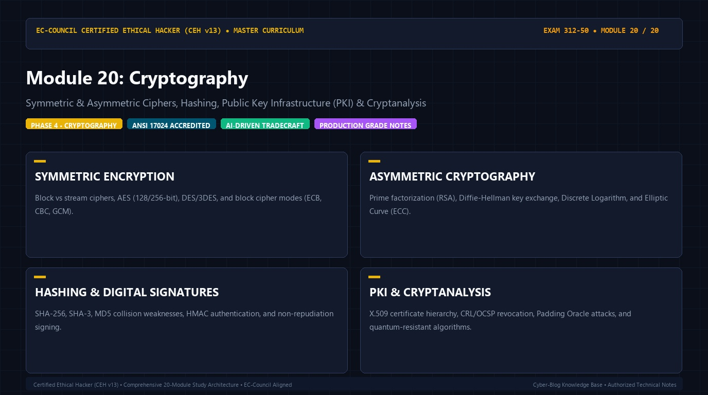

# 🛡️ CEH v13 — Module 20: Cryptography
### Certified Ethical Hacker (CEH v13) Exam Notes • Phase 4: Cloud & Cryptography • Technical Study Architecture

[-0078D4?style=for-the-badge&logo=shield)](https://www.eccouncil.org/programs/certified-ethical-hacker-ceh/)

  <b>Authoritative, exam-oriented study guide and reference architecture for CEH v13 Module 20: Cryptography. Covers symmetric & asymmetric ciphers, hashing, public key infrastructure (pki) & cryptanalysis, attack methodologies, automated tooling, MITRE ATT&CK alignment, and enterprise defensive engineering.</b>

[📖 Module Hub](../README.md) • [🗺️ Knowledge Base Index](../../README.md)

---

## 📋 Module Overview & Exam Objectives

In the **EC-Council Certified Ethical Hacker (CEH v13)** certification exam (Exam 312-50), **Module 20: Cryptography** represents a fundamental domain within **Phase 4: Cloud & Cryptography**. Candidates are tested on both theoretical protocol knowledge and hands-on operational commands used to discover, analyze, exploit, and remediate vulnerabilities across modern networked environments.

### Core Learning Domains:
* **SYMMETRIC ENCRYPTION:** Block vs stream ciphers, AES (128/256-bit), DES/3DES, and block cipher modes (ECB, CBC, GCM).
* **ASYMMETRIC CRYPTOGRAPHY:** Prime factorization (RSA), Diffie-Hellman key exchange, Discrete Logarithm, and Elliptic Curve (ECC).
* **HASHING & DIGITAL SIGNATURES:** SHA-256, SHA-3, MD5 collision weaknesses, HMAC authentication, and non-repudiation signing.
* **PKI & CRYPTANALYSIS:** X.509 certificate hierarchy, CRL/OCSP revocation, Padding Oracle attacks, and quantum-resistant algorithms.

---

## 🔬 In-Depth Technical Breakdown

### 1. SYMMETRIC ENCRYPTION

Block vs stream ciphers, AES (128/256-bit), DES/3DES, and block cipher modes (ECB, CBC, GCM).

* **Core Operational Theory:** Candidates must understand both how threat actors leverage these techniques during offensive operations and how enterprise defenders monitor and detect anomalous behavior.
* **Key Attack Artifacts:** Exam scenarios frequently present command-line strings, configuration files, packet captures, and network connection parameters requiring precise identification of adversary behavior.
* **Exam Relevance:** Directly tested across multiple-choice questions on CEH Exam 312-50.

### 2. ASYMMETRIC CRYPTOGRAPHY

Prime factorization (RSA), Diffie-Hellman key exchange, Discrete Logarithm, and Elliptic Curve (ECC).

* **Core Operational Theory:** Candidates must understand both how threat actors leverage these techniques during offensive operations and how enterprise defenders monitor and detect anomalous behavior.
* **Key Attack Artifacts:** Exam scenarios frequently present command-line strings, configuration files, packet captures, and network connection parameters requiring precise identification of adversary behavior.
* **Exam Relevance:** Directly tested across multiple-choice questions on CEH Exam 312-50.

### 3. HASHING & DIGITAL SIGNATURES

SHA-256, SHA-3, MD5 collision weaknesses, HMAC authentication, and non-repudiation signing.

* **Core Operational Theory:** Candidates must understand both how threat actors leverage these techniques during offensive operations and how enterprise defenders monitor and detect anomalous behavior.
* **Key Attack Artifacts:** Exam scenarios frequently present command-line strings, configuration files, packet captures, and network connection parameters requiring precise identification of adversary behavior.
* **Exam Relevance:** Directly tested across multiple-choice questions on CEH Exam 312-50.

### 4. PKI & CRYPTANALYSIS

X.509 certificate hierarchy, CRL/OCSP revocation, Padding Oracle attacks, and quantum-resistant algorithms.

* **Core Operational Theory:** Candidates must understand both how threat actors leverage these techniques during offensive operations and how enterprise defenders monitor and detect anomalous behavior.
* **Key Attack Artifacts:** Exam scenarios frequently present command-line strings, configuration files, packet captures, and network connection parameters requiring precise identification of adversary behavior.
* **Exam Relevance:** Directly tested across multiple-choice questions on CEH Exam 312-50.

---

## 🛠️ Tooling & Command Reference Matrix

| Tool / Technology | Category | Primary Function | Exam Utility / Key Syntax |
| :--- | :--- | :--- | :--- |
| **OpenSSL** | Cryptography Toolkit | Key generation, certificate management, hashing | ``openssl s_client -connect target.com:443`` |
| **CrypTool** | Cryptanalysis Lab | Educational cipher analysis & algorithm breaking | `Testing classical & modern cryptographic systems` |
| **GnuPG (GPG)** | Public Key Crypto | Encrypting files and creating digital signatures | ``gpg --encrypt --recipient user@target.com file`` |
| **HashID** | Hash Identifier | Identifying hash formats (MD5, SHA, NTLM) | ``hashid '$6$rounds=5000$...'`` |

---

## 🛡️ Enterprise Countermeasures & Hardening Guidelines

1. **Principle of Least Privilege:** Enforce strict role-based access control (RBAC) and minimize attack surfaces across network daemons.
2. **Defensive Telemetry & Logging:** Centralize event logging (SIEM) with real-time alerting on anomalous spikes, connection retries, and unauthorized protocol commands.
3. **Continuous Auditing & Patching:** Regularly scan infrastructure using automated vulnerability scanners and enforce strict SLA timelines for critical and high vulnerabilities.
4. **Network Segmentation & Zero Trust:** Isolate sensitive subnets, database tiers, and management interfaces behind stateful firewalls and intrusion prevention systems (IPS).

---

## 📚 Official References & Study Resources

* [EC-Council Official CEH v13 Program](https://www.eccouncil.org/programs/certified-ethical-hacker-ceh/)
* [CEH v13 Master Curriculum Index](../README.md)
* [National Vulnerability Database (NVD)](https://nvd.nist.gov/)
* [MITRE ATT&CK Framework](https://attack.mitre.org/)
