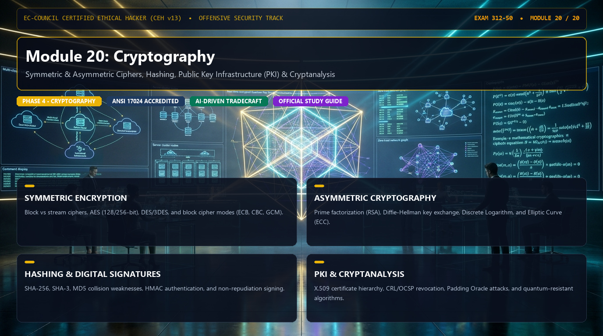
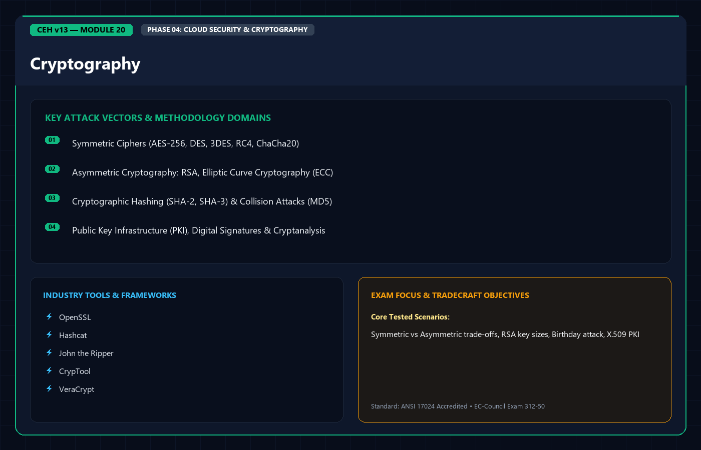
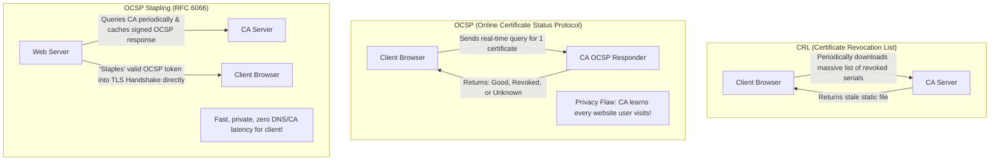

<div align="center">




# 🛡️ CEH v13 — Module 20: Cryptography
### Certified Ethical Hacker (CEH) Exam Notes • Symmetric vs Asymmetric • AES & RSA • Elliptic Curve (ECC) • Hash Functions & Collisions • PKI & X.509 • Cryptanalytic Attacks

[-0078D4?style=for-the-badge&logo=shield)](https://www.eccouncil.org/programs/certified-ethical-hacker-ceh/)
[](https://www.eccouncil.org/)
[](../README.md)
[](./README.md)

<p align="center">
  <b>Authoritative, exam-oriented study guide and reference architecture for CEH v13 Module 20: Cryptography. Covers fundamental mathematical foundations (Kerckhoffs's Principle, Shannon's Secrecy), symmetric block/stream ciphers (AES rounds, DES Feistel networks, cipher modes ECB vs. CBC vs. GCM), asymmetric public key cryptography (RSA prime factorization, Diffie-Hellman key exchange, Elliptic Curve Cryptography), cryptographic hashing and collision resistance (MD5, SHA-2, SHA-3, HMAC), Public Key Infrastructure (X.509 certificate chains, CRL, OCSP Stapling), and cryptanalytic attack vectors (Birthday Attack, Meet-in-the-Middle, Padding Oracle, Side-Channel analysis).</b>
</p>

[📖 Module Hub](../README.md) • [📋 PDF Reference Part 1](./CEHv13%20-%20Module%2020%20-%20Cryptography%20Part%201.pdf) • [📋 Part 2](./CEHv13%20-%20Module%2020%20-%20Cryptography%20Part%202.pdf) • [📋 Part 3](./CEHv13%20-%20Module%2020%20-%20Cryptography%20Part%203.pdf) • [🗺️ Knowledge Base Index](../../README.md)

</div>

---

## 📋 Table of Contents

- [1. Cryptography Foundations & Information Theory](#1-cryptography-foundations--information-theory)
  - [The Cryptographic Vocabulary](#the-cryptographic-vocabulary)
  - [Kerckhoffs's Principle & Shannon's Perfect Secrecy](#kerckhoffss-principle--shannons-perfect-secrecy)
  - [Symmetric vs. Asymmetric Architecture Comparison](#symmetric-vs-asymmetric-architecture-comparison)
- [2. Symmetric Cryptography (Block & Stream Ciphers)](#2-symmetric-cryptography-block--stream-ciphers)
  - [Stream Ciphers (RC4, ChaCha20)](#stream-ciphers-rc4-chacha20)
  - [Block Ciphers (DES, 3DES, AES, Blowfish, Twofish)](#block-ciphers-des-3des-aes-blowfish-twofish)
  - [AES (Advanced Encryption Standard) Internal Architecture](#aes-advanced-encryption-standard-internal-architecture)
  - [Block Cipher Modes: ECB vs. CBC vs. CTR vs. GCM](#block-cipher-modes-ecb-vs-cbc-vs-ctr-vs-gcm)
- [3. Asymmetric Cryptography (Public Key Cryptosystems)](#3-asymmetric-cryptography-public-key-cryptosystems)
  - [RSA Cryptosystem & Prime Factorization](#rsa-cryptosystem--prime-factorization)
  - [Diffie-Hellman Key Exchange (DH & ECDH)](#diffie-hellman-key-exchange-dh--ecdh)
  - [Elliptic Curve Cryptography (ECC) & Efficiency](#elliptic-curve-cryptography-ecc--efficiency)
- [4. Cryptographic Hashing & Message Integrity](#4-cryptographic-hashing--message-integrity)
  - [Properties of Secure Hash Functions](#properties-of-secure-hash-functions)
  - [MD5, SHA-1, SHA-2, and SHA-3 Keccak Sponge](#md5-sha-1-sha-2-and-sha-3-keccak-sponge)
  - [HMAC (Hash-Based Message Authentication Code)](#hmac-hash-based-message-authentication-code)
- [5. Public Key Infrastructure (PKI) & Digital Certificates](#5-public-key-infrastructure-pki--digital-certificates)
  - [X.509 Certificate Architecture](#x509-certificate-architecture)
  - [Certificate Authorities & Trust Chains](#certificate-authorities--trust-chains)
  - [Revocation: CRL vs. OCSP vs. OCSP Stapling](#revocation-crl-vs-ocsp-vs-ocsp-stapling)
- [6. Cryptanalytic Attacks & Exploit Methodologies](#6-cryptanalytic-attacks--exploit-methodologies)
  - [The Birthday Attack & The Birthday Paradox](#the-birthday-attack--the-birthday-paradox)
  - [Meet-in-the-Middle Attack (Breaking 2DES)](#meet-in-the-middle-attack-breaking-2des)
  - [Padding Oracle Attacks (CBC / POODLE)](#padding-oracle-attacks-cbc--poodle)
  - [Side-Channel Analysis (Timing, Power, Acoustic)](#side-channel-analysis-timing-power-acoustic)
- [7. Disk Encryption & Transport Layer Security](#7-disk-encryption--transport-layer-security)
  - [BitLocker, VeraCrypt, and LUKS](#bitlocker-veracrypt-and-luks)
  - [TLS 1.2 vs. TLS 1.3 Architectural Enhancements](#tls-12-vs-tls-13-architectural-enhancements)
- [8. Master Decision Tree & Flowchart](#8-master-decision-tree--flowchart)
- [9. CEH v13 Exam Essentials & Distinction Matrix](#9-ceh-v13-exam-essentials--distinction-matrix)

---

## 1. Cryptography Foundations & Information Theory

### The Cryptographic Vocabulary

```
+--------------------------------------------------------------------------+
|                       CORE CRYPTOGRAPHIC TERMS                           |
+--------------------------------------------------------------------------+
|  PLAINTEXT (P): The original unencrypted readable message or data.      |
|  CIPHERTEXT (C): The encrypted, unreadable output of an algorithm.       |
|  CIPHER: The mathematical algorithm used for encryption and decryption.  |
|  KEY (K): The secret numerical value/parameter input into the cipher.    |
|  KEYSPACE: The total number of all possible valid keys for an algorithm. |
|            (e.g., 128-bit key has a keyspace of 2^128).                 |
|  CRYPTOGRAPHY: The science of designing secret mathematical ciphers.     |
|  CRYPTANALYSIS: The science of breaking ciphers without knowing the key. |
|  CRYPTOLOGY: The overarching umbrella science (Cryptography + Cryptanalysis).|
+--------------------------------------------------------------------------+
```

---

### Kerckhoffs's Principle & Shannon's Perfect Secrecy

* **Kerckhoffs's Principle**: A cryptosystem must remain secure even if every internal mathematical detail and algorithm specification is completely public knowledge, provided only the **secret key ($K$) remains private**. "Security through obscurity" is fundamentally flawed.
* **Shannon's Perfect Secrecy (The One-Time Pad / Vernam Cipher)**:
  * Proved mathematically by Claude Shannon.
  * The **only** cipher that is mathematically **unbreakable**, even with infinite computing power!
  * **The 4 Rigid Rules of One-Time Pad**:
    1. Key must be **as long as the plaintext message**.
    2. Key must be generated using **truly random** physical entropy.
    3. Key must **never be reused** (reusing a key allows XOR cryptanalysis).
    4. Key must be kept **strictly secret** between sender and recipient.

---

### Symmetric vs. Asymmetric Architecture Comparison

| Dimension | Symmetric Cryptography | Asymmetric (Public Key) Cryptography |
| :--- | :--- | :--- |
| **Number of Keys** | **Single shared secret key** for both encryption and decryption. | **Key pair**: Public key (encrypt) and Private key (decrypt). |
| **Computational Speed**| **Extremely fast** (optimized for bulk data encryption). | **Slow** (high CPU overhead for modular math; used for key exchange). |
| **Key Distribution** | **High risk**: How to safely transmit the secret key to the remote party? | **Trivial**: Public key is shared openly; private key never leaves host. |
| **Key Scaling Formula**| Number of keys needed for $N$ participants: $\frac{N(N-1)}{2}$ | Number of key pairs needed for $N$ participants: $2N$ |
| **Primary Examples** | AES, DES, 3DES, RC4, Blowfish, ChaCha20. | RSA, Diffie-Hellman, ECC, DSA, ElGamal. |

---

## 2. Symmetric Cryptography (Block & Stream Ciphers)

### Block Ciphers: DES, 3DES, AES, Blowfish, Twofish

```
+--------------------------------------------------------------------------+
|                         SYMMETRIC CIPHER PROFILES                        |
+--------------------------------------------------------------------------+
|  1. DES (Data Encryption Standard):                                      |
|     - Block Size: 64 bits. Key Size: 56 bits (with 8 parity bits).       |
|     - Architecture: 16-round Feistel Network. Completely broken by brute |
|       force (keyspace of 2^56 cracked in under 24 hours).                |
+--------------------------------------------------------------------------+
|  2. 3DES (Triple DES):                                                   |
|     - Block Size: 64 bits. Encrypts using 3 sequential DES operations:   |
|       C = E(k3, D(k2, E(k1, P)))                                         |
|     - Key Size: 112 bits (2-key) or 168 bits (3-key). Deprecated.        |
+--------------------------------------------------------------------------+
|  3. AES (Advanced Encryption Standard - Rijndael):                       |
|     - Block Size: STRICTLY 128 bits across all variants!                 |
|     - Key Sizes & Rounds:                                                |
|       * AES-128: 128-bit key -> 10 rounds of transformation.             |
|       * AES-192: 192-bit key -> 12 rounds of transformation.             |
|       * AES-256: 256-bit key -> 14 rounds of transformation.             |
|     - Architecture: Substitution-Permutation Network (SPN).              |
|       (SubBytes, ShiftRows, MixColumns, AddRoundKey). Global standard.   |
+--------------------------------------------------------------------------+
|  4. BLOWFISH & TWOFISH:                                                  |
|     - Blowfish: 64-bit block size; variable key size (32 to 448 bits).   |
|     - Twofish: AES finalist; 128-bit block size; 128/192/256-bit key.   |
+--------------------------------------------------------------------------+
```

---

### Block Cipher Modes: ECB vs. CBC vs. CTR vs. GCM

Block ciphers encrypt fixed chunks of data (e.g., 128 bits). Modes of operation determine how multi-block messages are processed:

```
+--------------------------------------------------------------------------+
|                     BLOCK CIPHER MODES OF OPERATION                      |
+--------------------------------------------------------------------------+
|  ELECTRONIC CODEBOOK (ECB) -- HIGHLY INSECURE:                           |
|  - Each plaintext block is encrypted independently with the same key.    |
|  - FATAL FLAW: Identical plaintext blocks produce IDENTICAL ciphertext!  |
|  - Leaks image patterns (e.g., the infamous Linux Tux Penguin leak) and   |
|    enables block replay attacks. NEVER use in production!                |
+--------------------------------------------------------------------------+
|  CIPHER BLOCK CHAINING (CBC):                                            |
|  - Each plaintext block is XORed with the PREVIOUS ciphertext block      |
|    before encryption.                                                    |
|  - Uses an Initialization Vector (IV) for the first block.               |
|  - Flaw: Vulnerable to Padding Oracle attacks if padding errors leak.   |
+--------------------------------------------------------------------------+
|  COUNTER MODE (CTR):                                                     |
|  - Converts a block cipher into a stream cipher by encrypting sequential |
|    counter values and XORing with plaintext. Highly parallelizable.      |
+--------------------------------------------------------------------------+
|  GALOIS/COUNTER MODE (GCM) -- MODERN GOLD STANDARD:                      |
|  - Authenticated Encryption with Associated Data (AEAD).                 |
|  - Provides simultaneous Confidentiality (via CTR) and Data Integrity /   |
|    Authenticity (via GHASH authentication tag). Default in TLS 1.3!      |
+--------------------------------------------------------------------------+
```

---

## 3. Asymmetric Cryptography (Public Key Cryptosystems)

### RSA Cryptosystem & Prime Factorization

* **Inventors**: Ron Rivest, Adi Shamir, and Leonard Adleman (1977).
* **Trapdoor One-Way Function**: Based on the mathematical difficulty of **factoring the product of two very large prime numbers**:

$$n = p \times q$$
$$\phi(n) = (p - 1)(q - 1)$$
$$e \cdot d \equiv 1 \pmod{\phi(n)}$$

* **Public Key**: $(e, n)$ — Distributed openly to encrypt messages or verify signatures.
* **Private Key**: $(d, n)$ — Kept strictly secret by the owner to decrypt messages or generate signatures.

---

### Diffie-Hellman Key Exchange (DH)

Allows two parties (Alice and Bob) to establish a shared secret key across an insecure, sniffed communications channel without sending the secret itself:
* Based on the mathematical difficulty of the **Discrete Logarithm Problem**:
  $$\text{Shared Secret} = (g^b \bmod p)^a \bmod p = (g^a \bmod p)^b \bmod p = g^{ab} \bmod p$$
* **High-Yield Exam Trap**: Diffie-Hellman is a **Key Exchange algorithm ONLY**; it **cannot** encrypt data directly or generate digital signatures!
* **Vulnerability**: Vulnerable to **Man-in-the-Middle (MitM)** attacks if unauthenticated. Solved via digital certificates (ECDHE).

---

### Elliptic Curve Cryptography (ECC) & Efficiency

ECC relies on the algebraic structure of elliptic curves over finite fields:

$$y^2 = x^3 + ax + b$$

```
+--------------------------------------------------------------------------+
|                     ECC vs. RSA KEY LENGTH COMPARISON                    |
+--------------------------------------------------------------------------+
|  Symmetric Security Level  |  RSA Key Length Required |  ECC Key Length  |
+----------------------------+--------------------------+------------------+
|  80-bit                    |  1024 bits               |  160 bits        |
|  112-bit                   |  2048 bits               |  224 bits        |
|  128-bit (Standard)        |  3072 bits               |  256 bits        |
|  256-bit (Military/TopSec) |  15,360 bits             |  521 bits        |
+----------------------------+--------------------------+------------------+
```

* **Advantage**: Provides equivalent cryptographic security with **drastically smaller key lengths**, resulting in faster calculations, lower power consumption, and reduced bandwidth on mobile and IoT devices.

---

## 4. Cryptographic Hashing & Message Integrity

### Properties of Secure Hash Functions

1. **Fixed Output Length**: Arbitrary input length maps to an exact, fixed-size output (e.g., SHA-256 always produces 256 bits).
2. **Pre-Image Resistance (One-Way)**: Given hash $h$, it is computationally infeasible to find message $m$ such that $H(m) = h$.
3. **Second Pre-Image Resistance (Weak Collision Resistance)**: Given message $m_1$, it is infeasible to find a distinct message $m_2$ such that $H(m_1) = H(m_2)$.
4. **Collision Resistance (Strong Collision Resistance)**: It is computationally infeasible to find **any two arbitrary distinct messages** that produce the identical hash: $H(m_1) = H(m_2)$.
5. **Avalanche Effect**: Changing even a single bit in the input causes a drastic, unpredictable change in more than 50% of the output hash bits.

---

### Hash Algorithm Profiles

* **MD5**: Produces a **128-bit** digest. Completely broken; collisions can be generated in seconds.
* **SHA-1**: Produces a **160-bit** digest. Broken (Google SHAttered collision in 2017).
* **SHA-2**: Family consisting of SHA-224, **SHA-256**, SHA-384, and SHA-512. Secure and widely deployed.
* **SHA-3**: Based on the **Keccak sponge construction**; structurally distinct from the Merkle-Damgård architecture of SHA-1 and SHA-2.

---

## 5. Public Key Infrastructure (PKI) & Digital Certificates

### X.509 Certificate Architecture

Digital certificates bind a public key to an organization's identity:

```
+--------------------------------------------------------------------------+
|                     X.509 v3 CERTIFICATE ANATOMY                         |
+--------------------------------------------------------------------------+
|  Version: X.509 v3 (0x2)                                                 |
|  Serial Number: Unique integer assigned by the issuing CA                |
|  Signature Algorithm: e.g., sha256WithRSAEncryption                      |
|  Issuer: Distinguished Name (DN) of the Certificate Authority (CA)       |
|  Validity Period: Not Before & Not After UTC timestamps                  |
|  Subject: Distinguished Name (DN) of the certificate owner/domain        |
|  Subject Public Key Info: Public Key Algorithm (RSA 2048) & Public Key   |
|  Extensions: Subject Alternative Name (SAN), Key Usage, CRL Distribution |
+--------------------------------------------------------------------------+
```

---

### Revocation: CRL vs. OCSP vs. OCSP Stapling



---

## 6. Cryptanalytic Attacks & Exploit Methodologies

### The Birthday Attack & The Birthday Paradox

* **The Birthday Paradox**: In a room of only 23 people, there is a greater than 50% probability that at least two people share the exact same birthday!
* **Cryptanalytic Impact**: Finding a **collision** between two arbitrary messages requires evaluating only approximately $\mathbf{2^{n/2}}$ attempts, rather than the intuitive $2^n$ keyspace:
  * For a 64-bit hash, a collision occurs within only $2^{32} \approx 4.3 \text{ billion}$ operations!

---

### Meet-in-the-Middle Attack (Breaking 2DES)

Double-DES ($C = E_{K2}(E_{K1}(P))$) utilizes two 56-bit keys, giving an apparent keyspace of $2^{112}$. However, the **Meet-in-the-Middle** attack computes encryption from plaintext forward and decryption from ciphertext backward, storing intermediate results in a hash table:
$$\text{Intermediate State} = E_{K1}(P) = D_{K2}(C)$$
* Reduces the computational complexity from $2^{112}$ down to **$2^{57}$ operations**, rendering 2DES barely stronger than single DES!

---

### Padding Oracle Attacks (CBC / POODLE)

When an application decrypts ciphertext in CBC mode and leaks distinct error messages depending on whether the **PKCS#7 padding** is valid or invalid (e.g., HTTP 500 internal error vs. HTTP 200), an attacker can iteratively decrypt ciphertext byte-by-byte without knowing the decryption key!

---

## 7. Master Decision Tree & Flowchart

```
                          [ CRYPTOGRAPHIC SELECTION ]
                                       |
                   What is the cryptographic objective?
                     /                 |                 \
            [ CONFIDENTIALITY ]   [ INTEGRITY ]     [ AUTHENTICATION ]
                    |                  |                     |
         Bulk data or Key Exch?    Hash Functions:     Digital Signatures:
           /                \      SHA-256 / SHA-3     RSA / ECDSA
      [ BULK ]          [ KEY ]        |                     |
      Symmetric         Asymmetric  Message Auth:      Public Key
      AES-GCM (128/256) RSA / ECC   HMAC               Infrastructure (PKI)
                        ECDHE                          X.509 Certificates
```

---

## 8. CEH v13 Exam Essentials & Distinction Matrix

| Concept / Technique | Essential CEH Exam Distinction |
| :--- | :--- |
| **Shannon's Perfect Secrecy**| The **One-Time Pad** is the only mathematically unbreakable cipher (key must be truly random, as long as plaintext, and used once). |
| **Kerckhoffs's Principle** | A cipher must remain secure even if everything about the algorithm is publicly known, provided the **key** is secret. |
| **Diffie-Hellman Limitation**| DH is strictly a **Key Exchange** protocol; it cannot encrypt data or generate digital signatures! |
| **Birthday Attack** | Exploits the birthday paradox to locate hash collisions in **$2^{n/2}$** operations instead of $2^n$. |
| **ECB Mode Flaw** | Electronic Codebook encrypts identical plaintext blocks into **identical ciphertext blocks**, leaking structural patterns (Tux penguin). |
| **AES Block Size** | The AES block size is **strictly 128 bits** regardless of key size (128, 192, or 256 bits). |
| **OCSP Stapling** | Eliminates CA latency and client privacy leaks by having the **web server** query the CA and attach the signed status directly in the TLS handshake. |
| **Meet-in-the-Middle** | The specific attack that renders **Double DES (2DES)** vulnerable, breaking it in $2^{57}$ operations instead of $2^{112}$. |

---

<div align="center">

[⬅️ Previous: Module 19 — Cloud Computing](../Module%2019/README.md) • [Curriculum Hub: CEH v13 Overview ➡️](../README.md)

</div>
