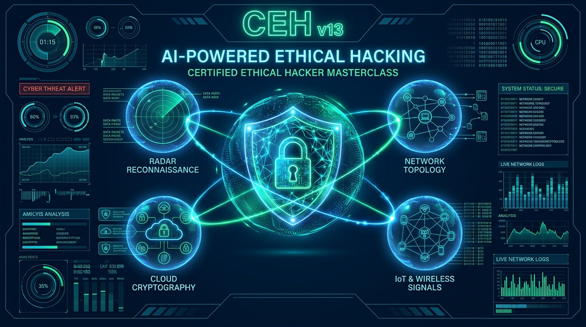
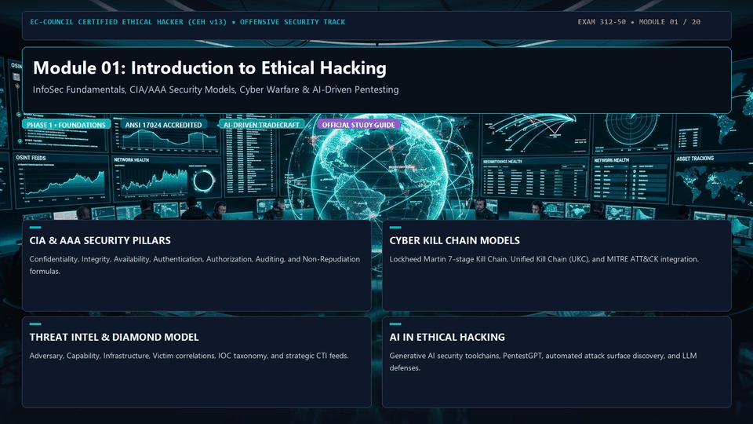
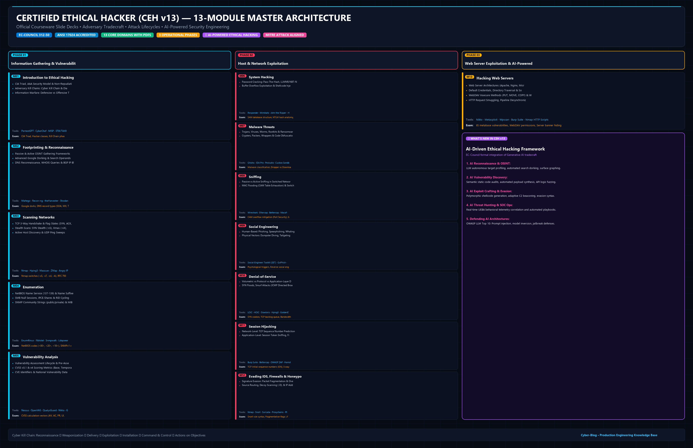
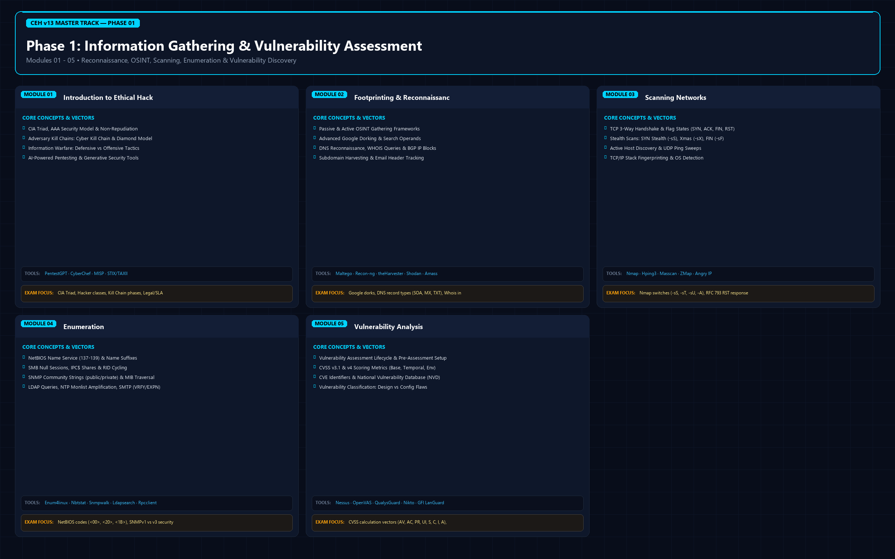
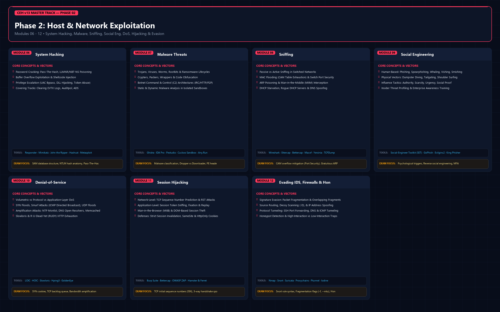
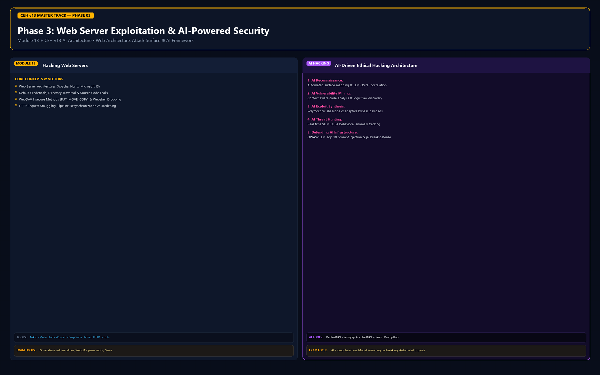
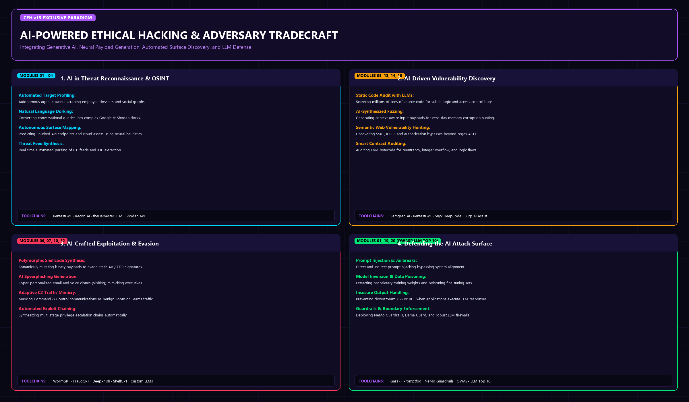

# 🛡️ Certified Ethical Hacker (CEH v13) Master Curriculum
### Complete 13-Module Exam Study Notes • Technical Architectures • Official Courseware Slide Decks • AI-Driven Operations

[-0078D4?style=for-the-badge&logo=shield)](https://www.eccouncil.org/programs/certified-ethical-hacker-ceh/)

[-success?style=for-the-badge&logo=git)](./README.md)

  <b>Comprehensive, exam-oriented study guide, deep-dive technical architectures, attack methodologies, official PDF slide decks, and defensive engineering playbooks for the EC-Council Certified Ethical Hacker (CEH v13) certification track.</b>

[🏠 Cyber-Blog Hub](../README.md) • [🚀 Module 01](./Module%2001/README.md) • [🚀 Module 02](./Module%2002/README.md) • [🚀 Module 03](./Module%2003/README.md) • [🤝 Contributing](../CONTRIBUTING.md)

---

### 💻 13-Module Interactive Curriculum Showcase

The animated showcase below highlights each of the 13 official CEH v13 modules across all 3 operational phases—from foundational reconnaissance and network scanning to host exploitation, malware, sniffing, DoS, evasion, and web server architectures:

---

## 🗺️ CEH v13 Master 13-Module Architecture & Attack Lifecycle Roadmap

The master architectural infographic below provides an end-to-end visual breakdown of all 13 official modules structured across the 3 core phases of the ethical hacking lifecycle—complete with primary attack vectors, industry toolchains, exam focus objectives, and AI-powered ethical hacking:

```mermaid
flowchart TD
    CEH["🛡️ CEH v13 Master Track\n(EC-Council 312-50)"]

    CEH --> P1["Phase 1: Information Gathering & Recon\n(Modules 01 - 05)"]
    CEH --> P2["Phase 2: Network & Host Exploitation\n(Modules 06 - 12)"]
    CEH --> P3["Phase 3: Web Server & AI Security\n(Module 13 + AI Framework)"]

    P1 --> M1["Module 01: Intro to Ethical Hacking\n(CIA, AAA, Kill Chains, CTI, AI)"]
    P1 --> M2["Module 02: Footprinting & Reconnaissance\n(OSINT, Whois, DNS, Google Dorking)"]
    P1 --> M3["Module 03: Scanning Networks\n(TCP Flags, SYN/Xmas Scans, Nmap)"]
    P1 --> M4["Module 04: Enumeration\n(NetBIOS, SMB, SNMP, LDAP, NTP, SMTP)"]
    P1 --> M5["Module 05: Vulnerability Analysis\n(CVSS v3/v4, CVE/NVD, Nessus, OpenVAS)"]

    P2 --> M6["Module 06: System Hacking\n(Pass-The-Hash, Buffer Overflows, PrivEsc)"]
    P2 --> M7["Module 07: Malware Threats\n(Trojans, Ransomware, Crypters, Droppers)"]
    P2 --> M8["Module 08: Sniffing\n(MAC Flooding, ARP Poisoning, Wireshark)"]
    P2 --> M9["Module 09: Social Engineering\n(Phishing, Vishing, SET, Human Vectors)"]
    P2 --> M10["Module 10: Denial-of-Service\n(SYN Floods, UDP Amplification, Slowloris)"]
    P2 --> M11["Module 11: Session Hijacking\n(TCP Hijacking, XSS, Session Replay)"]
    P2 --> M12["Module 12: Evading IDS, Firewalls & Honeypots\n(Fragmentation, Tunneling, Decoys)"]

    P3 --> M13["Module 13: Hacking Web Servers\n(Apache, Nginx, IIS, WebDAV, Smuggling)"]
    P3 --> AI["⚡ AI-Powered Ethical Hacking\n(GenAI Recon, Exploit Synthesis, LLM Security)"]

    style CEH fill:#0f172a,stroke:#3b82f6,stroke-width:2px,color:#fff
    style P1 fill:#1e293b,stroke:#00d4ff,color:#fff
    style P2 fill:#1e293b,stroke:#ff385c,color:#fff
    style P3 fill:#1e293b,stroke:#ffb300,color:#fff
    style M1 fill:#064e3b,stroke:#22c55e,stroke-width:2px,color:#fff
    style M2 fill:#064e3b,stroke:#22c55e,stroke-width:2px,color:#fff
    style M3 fill:#064e3b,stroke:#22c55e,stroke-width:2px,color:#fff
    style M4 fill:#064e3b,stroke:#22c55e,stroke-width:2px,color:#fff
    style M5 fill:#064e3b,stroke:#22c55e,stroke-width:2px,color:#fff
    style AI fill:#181238,stroke:#a855f7,stroke-width:2px,color:#fff
```

---

## 🔬 Three Operational Phases Deep-Dive Infographics

Each of the three operational phases has been diagrammed in high resolution, articulating the specific attack vectors, protocol mechanics, tools, and exam focus areas for each module:

### 🔍 Phase 1: Information Gathering & Vulnerability Assessment (Modules 01 - 05)

### ⚔️ Phase 2: Network, Endpoint & System Exploitation (Modules 06 - 12)

### 🌐 Phase 3: Web Server Exploitation & AI-Powered Security (Module 13 + AI Framework)

---

## 📑 13-Module Study Notes & Courseware Directory

Every module includes official courseware PDF slide decks, exam-oriented study notes, and an explanatory visual card:

| Module | Module Title | Primary Exam Focus & Key Concepts | Official Courseware PDF | Visual Card | Study Notes |
|:---:|:---|:---|:---:|:---:|:---:|
| **01** | **Introduction to Ethical Hacking** | InfoSec, CIA Triad, AAA, Attack Models, Kill Chains, Diamond Model, CTI, AI in Pentesting | [📄 View PDF](./Module%2001/CEHv13%20-%20Module%2001%20-%20Introduction%20to%20Ethical%20Hacking.pdf) | [🖼️ View Card](./images/modules/Module_01.png) | [View Notes](./Module%2001/README.md) |
| **02** | **Footprinting and Reconnaissance** | Passive/Active OSINT, Whois, DNS Recon, Google Dorking, Subdomain Harvesting, Email Tracking | [📄 View PDF](./Module%2002/CEHv13%20-%20Module%2002%20-%20Footprinting%20and%20Reconnaissance.pdf) | [🖼️ View Card](./images/modules/Module_02.png) | [View Notes](./Module%2002/README.md) |
| **03** | **Scanning Networks** | Ping Sweeps, TCP 3-Way Handshake, SYN/FIN/XMAS Scans, Nmap Timing, OS Fingerprinting | [📄 View PDF](./Module%2003/CEHv13%20-%20Module%2003%20-%20Scanning%20Networks.pdf) | [🖼️ View Card](./images/modules/Module_03.png) | [View Notes](./Module%2003/README.md) |
| **04** | **Enumeration** | NetBIOS, SMB, SNMP, LDAP, NTP, SMTP, DNS Zone Transfers, RPC Interrogation | [📄 View PDF](./Module%2004/CEHv13%20-%20Module%2004%20-%20Enumeration.pdf) | [🖼️ View Card](./images/modules/Module_04.png) | [View Notes](./Module%2004/README.md) |
| **05** | **Vulnerability Analysis** | Vulnerability Assessment Lifecycle, CVE, CVSS v3/v4 Metrics, Nessus, OpenVAS, Qualys | [📄 View PDF](./Module%2005/CEHv13%20-%20Module%2005%20-%20Vulnerability%20Analysis.pdf) | [🖼️ View Card](./images/modules/Module_05.png) | [View Notes](./Module%2005/README.md) |
| **06** | **System Hacking** | Password Cracking, Buffer Overflows, Privilege Escalation, Clearing Logs, Pivoting, Rootkits | [📄 Part 1](./Module%2006/CEHv13%20-%20Module%2006%20-%20System%20Hacking%20Part%201.pdf) [📄 Part 2](./Module%2006/CEHv13%20-%20Module%2006%20-%20System%20Hacking%20Part%202.pdf) [📄 Part 3](./Module%2006/CEHv13%20-%20Module%2006%20-%20System%20Hacking%20Part%203.pdf) | [🖼️ View Card](./images/modules/Module_06.png) | [View Notes](./Module%2006/README.md) |
| **07** | **Malware Threats** | Trojans, Viruses, Worms, Ransomware, Crypters, Code Obfuscation, Dynamic Sandboxing | [📄 Part 1](./Module%2007/CEHv13%20-%20Module%2007%20-%20Malware%20Threats%20Part%201.pdf) [📄 Part 2](./Module%2007/CEHv13%20-%20Module%2007%20-%20Malware%20Threats%20Part%202.pdf) | [🖼️ View Card](./images/modules/Module_07.png) | [View Notes](./Module%2007/README.md) |
| **08** | **Sniffing** | MAC Flooding, ARP Poisoning, DHCP Starvation, DNS Spoofing, Promiscuous Mode, Wireshark | [📄 View PDF](./Module%2008/CEHv13%20-%20Module%2008%20-%20Sniffing.pdf) | [🖼️ View Card](./images/modules/Module_08.png) | [View Notes](./Module%2008/README.md) |
| **09** | **Social Engineering** | Phishing, Spearphishing, Vishing, Smishing, Pretexting, Tailgating, Insider Threats | [📄 View PDF](./Module%2009/CEHv13%20-%20Module%2009%20-%20Social%20Engineering.pdf) | [🖼️ View Card](./images/modules/Module_09.png) | [View Notes](./Module%2009/README.md) |
| **10** | **Denial-of-Service** | SYN Floods, UDP Amplification, Slowloris, Smurf, Botnets, Cloudflare Mitigation | [📄 View PDF](./Module%2010/CEHv13%20-%20Module%2010%20-%20Denial-of-Service.pdf) | [🖼️ View Card](./images/modules/Module_10.png) | [View Notes](./Module%2010/README.md) |
| **11** | **Session Hijacking** | TCP Session Hijacking, Man-in-the-Browser, Cross-Site Scripting (XSS), Cookie Replay | [📄 View PDF](./Module%2011/CEHv13%20-%20Module%2011%20-%20Session%20Hijacking.pdf) | [🖼️ View Card](./images/modules/Module_11.png) | [View Notes](./Module%2011/README.md) |
| **12** | **Evading IDS, Firewalls, and Honeypots** | Packet Fragmentation, Decoys, IP Spoofing, Tunneling, Honeypot Detection | [📄 View PDF](./Module%2012/CEHv13%20-%20Module%2012%20-%20Evading%20IDS,%20Firewalls,%20and%20Honeypots.pdf) | [🖼️ View Card](./images/modules/Module_12.png) | [View Notes](./Module%2012/README.md) |
| **13** | **Hacking Web Servers** | Apache/Nginx Misconfigurations, Directory Traversal, WebDAV, HTTP Request Smuggling | [📄 View PDF](./Module%2013/CEHv13%20-%20Module%2013%20-%20Hacking%20Web%20Servers.pdf) | [🖼️ View Card](./images/modules/Module_13.png) | [View Notes](./Module%2013/README.md) |

---

## 🎯 What's New in CEH v13 (AI-Powered Ethical Hacking)

EC-Council CEH v13 represents a fundamental paradigm shift from legacy manual penetration testing by formally integrating **AI-driven adversary tradecraft and defensive orchestration**:

1. **AI-Assisted Attack Surface Mapping:** Utilizing LLMs and neural models for automated reconnaissance, asset discovery, and correlation.
2. **AI Vulnerability Analysis & Exploit Synthesis:** Harnessing code-reasoning AI tools (e.g., PentestGPT, ShellGPT, Semgrep AI) to uncover obscure logic bugs and draft proof-of-concept exploits.
3. **AI Defense & Anomaly Detection:** Real-time behavioral telemetry analysis using User and Entity Behavior Analytics (UEBA) and machine learning classifiers to flag evasive intrusion activity.
4. **Attacking AI Architectures:** Identifying prompt injection, model inversion, training data poisoning, and adversarial evasion attacks targeting enterprise LLMs.

---

<b>Explore Modules: [Module 01: Introduction](./Module%2001/README.md) • [Module 02: Footprinting](./Module%2002/README.md) • [Module 03: Scanning Networks](./Module%2003/README.md) • [Module 13: Web Servers](./Module%2013/README.md)</b>

