# 🛡️ Certified Ethical Hacker (CEH v13) Master Curriculum
### Complete 20-Module Exam Study Notes • Technical Architectures • Adversary Tradecraft • AI-Driven Operations

[-0078D4?style=for-the-badge&logo=shield)](https://www.eccouncil.org/programs/certified-ethical-hacker-ceh/)

  <b>Comprehensive, exam-oriented study guide, deep-dive technical architectures, attack methodologies, and defensive engineering playbooks for the EC-Council Certified Ethical Hacker (CEH v13) certification track.</b>

[🏠 Cyber-Blog Hub](../README.md) • [🚀 Module 01](./Module%2001/README.md) • [🚀 Module 02](./Module%2002/README.md) • [🚀 Module 03](./Module%2003/README.md) • [🤝 Contributing](../CONTRIBUTING.md)

---

## 🗺️ CEH v13 Curriculum Architecture

```mermaid
flowchart TD
    CEH["🛡️ CEH v13 Master Track\n(EC-Council 312-50)"]

    CEH --> P1["Phase 1: Foundations & Recon\n(Modules 01 - 05)"]
    CEH --> P2["Phase 2: Network & Host Hacking\n(Modules 06 - 12)"]
    CEH --> P3["Phase 3: Web, Wireless & Modern Tech\n(Modules 13 - 18)"]
    CEH --> P4["Phase 4: Cloud & Cryptography\n(Modules 19 - 20)"]

    P1 --> M1["Module 01: Intro to Ethical Hacking & InfoSec\n(CIA, AAA, Kill Chains, CTI, AI)"]
    P1 --> M2["Module 02: Footprinting & Reconnaissance"]
    P1 --> M3["Module 03: Scanning Networks"]
    P1 --> M4["Module 04: Enumeration"]
    P1 --> M5["Module 05: Vulnerability Analysis"]

    P2 --> M6["Module 06: System Hacking"]
    P2 --> M7["Module 07: Malware Threats"]
    P2 --> M8["Module 08: Sniffing"]
    P2 --> M9["Module 09: Social Engineering"]
    P2 --> M10["Module 10: Denial-of-Service"]
    P2 --> M11["Module 11: Session Hijacking"]
    P2 --> M12["Module 12: Evading IDS, Firewalls & Honeypots"]

    P3 --> M13["Module 13: Hacking Web Servers"]
    P3 --> M14["Module 14: Hacking Web Applications"]
    P3 --> M15["Module 15: SQL Injection"]
    P3 --> M16["Module 16: Hacking Wireless Networks"]
    P3 --> M17["Module 17: Hacking Mobile Platforms"]
    P3 --> M18["Module 18: IoT & OT Hacking"]

    P4 --> M19["Module 19: Cloud Computing"]
    P4 --> M20["Module 20: Cryptography"]

    style CEH fill:#0f172a,stroke:#3b82f6,stroke-width:2px,color:#fff
    style P1 fill:#1e293b,stroke:#06b6d4,color:#fff
    style P2 fill:#1e293b,stroke:#ef4444,color:#fff
    style P3 fill:#1e293b,stroke:#f59e0b,color:#fff
    style P4 fill:#1e293b,stroke:#10b981,color:#fff
    style M1 fill:#064e3b,stroke:#22c55e,stroke-width:2px,color:#fff
    style M2 fill:#064e3b,stroke:#22c55e,stroke-width:2px,color:#fff
    style M3 fill:#064e3b,stroke:#22c55e,stroke-width:2px,color:#fff
```

---

## 📑 20-Module Study Notes Index

| Module | Module Title | Primary Exam Focus & Key Concepts | Status | Study Notes |
|:---:|:---|:---|:---:|:---:|
| **01** | **Introduction to Ethical Hacking** | InfoSec, CIA Triad, AAA, Attack Models, Kill Chains, Diamond Model, CTI, AI in Pentesting | Complete | [View Notes](./Module%2001/README.md) |
| **02** | **Footprinting and Reconnaissance** | Passive/Active OSINT, Whois, DNS Recon, Google Dorking, Subdomain Harvesting, Email Tracking | Complete | [View Notes](./Module%2002/README.md) |
| **03** | **Scanning Networks** | Ping Sweeps, TCP 3-Way Handshake, SYN/FIN/XMAS Scans, Nmap Timing, OS Fingerprinting | Complete | [View Notes](./Module%2003/README.md) |
| **04** | **Enumeration** | NetBIOS, SMB, SNMP, LDAP, NTP, SMTP, DNS Zone Transfers, RPC Interrogation | Upcoming | Planned |
| **05** | **Vulnerability Analysis** | Vulnerability Assessment Lifecycle, CVE, CVSS v3/v4 Metrics, Nessus, OpenVAS, Qualys | Upcoming | Planned |
| **06** | **System Hacking** | Password Cracking, Buffer Overflows, Privilege Escalation, Clearing Logs, Pivoting, Rootkits | Upcoming | Planned |
| **07** | **Malware Threats** | Trojans, Viruses, Worms, Ransomware, Crypters, Code Obfuscation, Dynamic Sandboxing | Upcoming | Planned |
| **08** | **Sniffing** | MAC Flooding, ARP Poisoning, DHCP Starvation, DNS Spoofing, Promiscuous Mode, Wireshark | Upcoming | Planned |
| **09** | **Social Engineering** | Phishing, Spearphishing, Vishing, Smishing, Pretexting, Tailgating, Insider Threats | Upcoming | Planned |
| **10** | **Denial-of-Service** | SYN Floods, UDP Amplification, Slowloris, Smurf, Botnets, Cloudflare Mitigation | Upcoming | Planned |
| **11** | **Session Hijacking** | TCP Session Hijacking, Man-in-the-Browser, Cross-Site Scripting (XSS), Cookie Replay | Upcoming | Planned |
| **12** | **Evading IDS, Firewalls, and Honeypots** | Packet Fragmentation, Decoys, IP Spoofing, Tunneling, Honeypot Detection | Upcoming | Planned |
| **13** | **Hacking Web Servers** | Apache/Nginx Misconfigurations, Directory Traversal, WebDAV, HTTP Request Smuggling | Upcoming | Planned |
| **14** | **Hacking Web Applications** | OWASP Top 10, Injection, Broken Access Control, CSRF, SSRF, IDOR, Web API Attacks | Upcoming | Planned |
| **15** | **SQL Injection** | Classic In-Band (UNION), Blind (Boolean/Time-Based), Out-of-Band SQLi, SQLMap, Prepared Statements | Upcoming | Planned |
| **16** | **Hacking Wireless Networks** | 802.11 Protocols, WPA/WPA2 4-Way Handshake, WPA3 SAE, Rogue APs, Evil Twin, Aircrack-ng | Upcoming | Planned |
| **17** | **Hacking Mobile Platforms** | Android APK Reverse Engineering, JADX, MobSF, iOS Sandboxing, Mobile Device Management (MDM) | Upcoming | Planned |
| **18** | **IoT and OT Hacking** | MQTT, Zigbee, Modbus, SCADA/ICS Protocols, Hardware JTAG/UART Interfacing | Upcoming | Planned |
| **19** | **Cloud Computing** | AWS/Azure/GCP IAM Misconfigurations, S3 Bucket Leakage, Container Escapes, Serverless Security | Upcoming | Planned |
| **20** | **Cryptography** | Symmetric (AES), Asymmetric (RSA/ECC), Hashing (SHA-2/3), PKI, Digital Signatures, Cryptanalysis | Upcoming | Planned |

---

## 🎯 What's New in CEH v13 (AI-Powered Ethical Hacking)

EC-Council CEH v13 represents a fundamental paradigm shift from legacy manual penetration testing by formally integrating **AI-driven adversary tradecraft and defensive orchestration**:

1. **AI-Assisted Attack Surface Mapping:** Utilizing LLMs and neural models for automated reconnaissance, asset discovery, and correlation.
2. **AI Vulnerability Analysis & Exploit Synthesis:** Harnessing code-reasoning AI tools (e.g., PentestGPT, ShellGPT, Semgrep AI) to uncover obscure logic bugs and draft proof-of-concept exploits.
3. **AI Defense & Anomaly Detection:** Real-time behavioral telemetry analysis using User and Entity Behavior Analytics (UEBA) and machine learning classifiers to flag evasive intrusion activity.
4. **Attacking AI Architectures:** Identifying prompt injection, model inversion, training data poisoning, and adversarial evasion attacks targeting enterprise LLMs.

---

<b>Explore Modules: [Module 01: Introduction](./Module%2001/README.md) • [Module 02: Footprinting](./Module%2002/README.md) • [Module 03: Scanning Networks](./Module%2003/README.md)</b>

