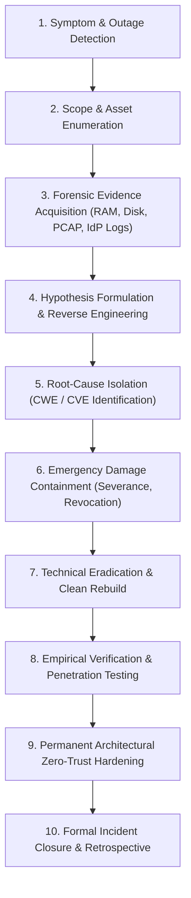

# 🔬 Cyber-Blog: Case Study Solutions & Technical Investigations

> **Authoritative Technical Investigations, Forensic Root-Cause Deconstructions & Engineering Resolution Blueprints**  
> **Engineering Disciplines:** Digital Forensics & Incident Response (DFIR), Security Operations Center (SOC) Detection Engineering, Vulnerability Analysis, Identity Architecture & Operational Technology (OT) Resilience.  
> **Repository Base:** [`Case Study/`](file:///c:/Users/putin/Downloads/Cyber-Blog/Case%20Study/README.md)  
> **Target Output Suite:** `Case Study Solutions/`

---

## 🎯 Executive Overview & Scope

Modern cybersecurity education frequently suffers from an over-reliance on high-level narrative summaries (*"a hacker used phishing," "a casino was hit with ransomware," "a facility was attacked by malware"*). Such descriptions obscure the actual failure modes, engineering bugs, forensic evidence trails, and technical mechanisms required to stop and remediate incidents.

This directory—**`Case Study Solutions/`**—delivers exhaustive, production-grade technical investigation and problem-resolution reports for every case study in the Cyber-Blog repository.

For each incident, this analysis provides definitive, evidence-backed answers to six fundamental technical questions:
1. **What exactly went wrong at the protocol, binary, or identity layer?**
2. **How was the anomaly detected and triaged by security personnel?**
3. **What specific forensic artifacts and logs established the verified root cause?**
4. **What exact commands, configurations, and emergency containment actions halted ongoing damage?**
5. **How was the remediation verified through authorized testing to guarantee the attack vector was closed?**
6. **What architectural and hardware controls prevent this entire class of incident from recurring?**

---

## 📊 Investigation Coverage & Analysis Status Matrix

| Case Study Identifier | Target Environment | Primary Incident Type | Root-Cause Weakness (CWE / CVE) | Investigation Status | Solution Report Link |
| :--- | :--- | :--- | :--- | :---: | :---: |
| **Genesis Market** | Cloud SaaS, E-Commerce, Consumer Endpoints | Identity-as-a-Service (IDaaS) / Infostealer Ecosystem / Session Cookie Hijacking | **CWE-312 / CWE-522**: Unprotected DPAPI Chromium Local State Decryption;<br>**CWE-287 / CWE-384**: Unbound Bearer Session Cookie Replay | 🟢 **Complete & Verified** | [**Read Solution Report**](./genesis-market-solution-report.md) |
| **MGM Resorts International** | Hybrid Cloud (Okta, Entra ID, VMware ESXi Clusters) | Social Engineering / Vishing / Identity Takeover / Mass Virtualization Ransomware | **CWE-303 / CWE-287**: Service Desk Knowledge-Based Authentication (KBA) Bypass;<br>**CWE-290**: Rogue Inbound SAML IdP Federation Backdoor;<br>**CWE-284**: Unrestricted ESXi Hypervisor Execution | 🟢 **Complete & Verified** | [**Read Solution Report**](./mgm-resorts-solution-report.md) |
| **STUXNET** | Nuclear Enrichment ICS/SCADA (Siemens S7 PLCs, VFDs) | Air-Gap Traversal / Microcode Injection / Cyber-Physical Sabotage | **CVE-2010-2568**: Shell Zero-Click `.LNK` Icon Parsing;<br>**CWE-427**: Siemens STEP 7 DLL Proxying (`s7otbxdx.dll`);<br>**CWE-306**: Unauthenticated S7comm PLC Microcode Injection | 🟢 **Complete & Verified** | [**Read Solution Report**](./stuxnet-solution-report.md) |

---

## 📂 Navigation & Report Index

The investigation suite is structured into specialized technical reports and cross-case reference documents:

```
Case Study Solutions/
├── README.md                              # This master index, coverage tracker & executive methodology
├── genesis-market-solution-report.md      # Deep forensic investigation, DPAPI deconstruction & DPoP/CAE solution
├── mgm-resorts-solution-report.md         # Deep forensic investigation, Vishing/IdP eviction & ESXi hardening solution
├── stuxnet-solution-report.md             # Deep forensic investigation, MC7 microcode disassembly & OT data diode solution
├── problem-solution-matrix.md             # Consolidated cross-case Problem-to-Solution matrix
├── common-security-failures.md            # Structural root causes: Identity, Bearer Tokens, Hypervisors & Air Gaps
├── incident-response-reference.md         # Reusable 6-phase DFIR, containment, verification & closure playbook
└── references.md                          # Primary sources: unsealed affidavits, court filings, CISA advisories & research
```

### 📑 Core Reports Breakdown

1. **[Genesis Market Solution Report (`genesis-market-solution-report.md`)](./genesis-market-solution-report.md):**
   * *The Problem:* Commodity infostealers harvesting Chromium SQLite cookies via Windows DPAPI `CryptUnprotectData()`, packaged into custom browser plugins to bypass MFA without credentials (e.g., 2021 Electronic Arts breach).
   * *The Solution:* Chrome 127+ App-Bound Encryption (SYSTEM elevation service binding), RFC 9449 DPoP hardware-bound tokens, Continuous Access Evaluation (CAE), and mandatory session revocation API execution during incident response.

2. **[MGM Resorts International Solution Report (`mgm-resorts-solution-report.md`)](./mgm-resorts-solution-report.md):**
   * *The Problem:* LinkedIn OSINT vishing of the IT Help Desk bypassing static Knowledge-Based Authentication (KBA), Okta Super Admin takeover, Inbound SAML federation backdoors, and ALPHV Rust ransomware encrypting 100+ VMware ESXi hypervisors.
   * *The Solution:* High-stakes emergency network severance ($0 ransom paid), rogue IdP eviction, clean-state ESXi rebuilding from immutable backups, strict help desk live video verification, FIDO2 hardware keys, and ESXi Strict Lockdown Mode.

3. **[STUXNET Industrial Sabotage Solution Report (`stuxnet-solution-report.md`)](./stuxnet-solution-report.md):**
   * *The Problem:* Supply-chain traversal across an air gap via contractor USBs, 4 Windows zero-days (CVE-2010-2568, CVE-2010-2729), stolen Realtek/JMicron certificates, STEP 7 DLL proxying (`s7otbxdx.dll`), and MC7 bytecode injecting overspeed ($1,410\text{ Hz}$) and resonance ($2\text{ Hz}$) routines while spoofing SCADA screens with a 21-second sensor replay loop.
   * *The Solution:* VirusBlokAda `.LNK` triage, Ralph Langner S7 MC7 disassembly, Symantec 15,000-function reverse engineering, facility clean-media re-imaging, physical PLC rotary switch locked to `RUN` (hardware write protection), unidirectional optical data diodes, and independent out-of-band analog Safety Instrumented Systems (SIS).

4. **[Cross-Case Problem-to-Solution Matrix (`problem-solution-matrix.md`)](./problem-solution-matrix.md):**
   * Direct structured comparison connecting every observed failure to its underlying root cause, forensic evidence trail, corrective action, verification test, and operational outcome.

5. **[Common Security Failures & Architectural Anti-Patterns (`common-security-failures.md`)](./common-security-failures.md):**
   * Deep technical synthesis of the systemic vulnerabilities repeated across enterprise and industrial attacks: the air-gap myth, bearer token fragility, KBA single point of failure, hypervisor visibility blind spots, and the dangerous assumption that display state reflects physical reality.

6. **[Reusable Incident Response & Verification Reference (`incident-response-reference.md`)](./incident-response-reference.md):**
   * Production-grade DFIR reference guide providing step-by-step triage commands, forensic preservation techniques, memory acquisition, containment protocols, regression verification plans, and incident closure criteria.

7. **[Primary Source Research & Evidence References (`references.md`)](./references.md):**
   * Exhaustive bibliography of primary court dockets (FBI seizure affidavit Case 2:23-mj-00365-SCD), SEC Form 8-K disclosures, IAEA Safeguards verification reports, CISA advisories, RFC standards, and academic engineering dissertations.

---

## 🛠️ DFIR Investigation Methodology Applied

Every solution report in this suite adheres to the standard 20-stage technical investigation framework:



---

*Part of the **Cyber-Blog** Threat Intelligence, Incident Response & Technical Forensics Architecture.*
