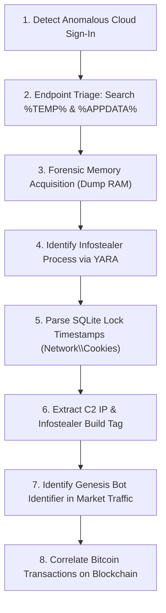

# 🔍 Technical Investigation & Solution Report: Genesis Market & Operation Cookie Monster

> **Document Class:** DFIR Forensic Investigation, Root-Cause Engineering & Threat Neutralization Report  
> **Target Incident / Entity:** Genesis Market (Cybercrime Bot Marketplace) & The Infostealer Ecosystem  
> **Related Real-World Breaches:** 2021 Electronic Arts (EA) Games Breach (780 GB Frostbite Engine Exfiltration)  
> **Law Enforcement Operation:** Operation Cookie Monster (FBI, Dutch National Police / Politie, Europol, Eurojust)  
> **Classification:** Cybercrime / Identity-as-a-Service (IDaaS) / Session Hijacking / Windows DPAPI Exploitation  
> **Target Audience:** Incident Responders, SOC Lead Analysts, Identity Architects, Reverse Engineers, CISOs

---

## 1. Case Study Title & Incident Classification

* **Formal Incident Title:** Industrialized Session Token Replay & Digital Fingerprint Impersonation: The Genesis Market Infrastructure Disruption
* **Primary Threat Classification:** Identity-as-a-Service (IDaaS) / Initial Access Brokerage (IAB) / Credential & Session Theft
* **MITRE ATT&CK Framework Mapping:**
  * **T1539:** Steal Web Session Cookie
  * **T1555.003:** Credentials from Web Browsers
  * **T1552.001:** Credentials in Files (Chromium `Local State` & SQLite)
  * **T1185:** Browser Session Hijacking
  * **T1078.004:** Valid Accounts: Cloud Accounts
  * **T1566.002:** Phishing: Spearphishing Link / Malvertising

---

## 2. Executive Summary

Between 2018 and April 2023, **Genesis Market** operated as one of the world's most sophisticated cybercrime clearinghouses, fundamentally altering the threat landscape by commercializing **"Identity-as-a-Service" (IDaaS)**. Unlike legacy criminal forums that traded static password dumps, Genesis traded **"Genesis Bots"**—comprehensive packages containing active HTTP session cookies, browser cache entries, autofill records, operating system metadata, and hardware-level browser fingerprints (Canvas render hashes, WebGL vendor strings, AudioContext metrics).

These bots were harvested by commodity infostealer malware (RedLine, Vidar, Raccoon, Lumma) running on millions of infected consumer and enterprise endpoints globally. Using a proprietary Chromium browser plugin, buyers could import a bot and perfectly impersonate the victim's authenticated browser session. To enterprise cloud Identity Providers (Google Workspace, Microsoft Entra ID, Okta, Slack, AWS), the attacker's connection appeared to be the victim's legitimate, already-authenticated computer—**completely bypassing passwords, Multi-Factor Authentication (MFA), IP geolocation risk engines, and device anomaly checks**.

This investigation details the technical mechanics that enabled this ecosystem, the 2021 breach of Electronic Arts (EA), the forensic cryptocurrency tracking and server seizure executed during **Operation Cookie Monster** (4 April 2023), and the architectural solutions required to neutralize session replay attacks: **Chrome 127+ App-Bound Encryption (ABE)**, **RFC 9449 Demonstrating Proof-of-Possession (DPoP)**, and **Continuous Access Evaluation (CAE)**.

---

## 3. Original Problem & Impact

### 3.1 Problem Statement
The global adoption of Multi-Factor Authentication (MFA) and risk-based conditional access rendered simple credential theft (username/password lists) ineffective. Cybercriminals responded by targeting the **post-authentication layer**: active HTTP session cookies issued by Identity Providers (IdPs) and software-as-a-service (SaaS) applications. Because standard session cookies were unbound bearer tokens, any process with local user-mode access on an endpoint could steal the cookies, transfer them across the internet, and allow unauthorized third parties to maintain full corporate access without triggering authentication prompts.

### 3.2 Observable Symptoms & Blast Radius
* **The Electronic Arts (EA) Breach (June 2021):** An adversary purchased a $10 Genesis bot containing the session cookies of an EA employee. Loading the cookies into a browser, the attacker bypassed MFA and navigated directly into EA's internal Slack instance. Posing as the employee, the attacker contacted the internal IT Service Desk, claiming they lost their phone at a party, and requested an MFA factor reset. Once elevated, the attacker traversed EA's corporate network, discovered Jira instances, and exfiltrated **780 GB of proprietary data**, including the full source code for the *Frostbite* game engine and *FIFA 21* matchmaking frameworks.
* **Global Inventory Scale:** At the time of law enforcement seizure, Genesis Market held an inventory of over **1.5 million compromised bots**, exposing over **2 million unique citizen and corporate digital identities** across 17 partner nations.
* **The Incident Response Failure Mode:** Enterprise security teams observing anomalous activity frequently triggered self-service password resets. Because active session tokens were not explicitly revoked via IdP backchannel APIs, the attacker retained active access for days or weeks following the password reset.

---

## 4. Technical Environment & Affected Assets

```
┌────────────────────────────────────────────────────────────────────────────────────────────────────────┐
│                                GENESIS MARKET HARVESTING & EXPLOITATION TOPOLOGY                       │
├────────────────────────────────────────────────────────────────────────────────────────────────────────┤
│                                                                                                        │
│   [VICTIM WORKSTATION]                                                    [GENESIS CLOUD INFRA]        │
│   ┌────────────────────────────────┐                                      ┌──────────────────────┐     │
│   │ Google Chrome / Microsoft Edge │                                      │ Genesis API Gateway  │     │
│   │   ├── Local State (DPAPI Key)  │────(Infostealer C2 HTTP POST)───────►│   (Nginx / MariaDB)  │     │
│   │   └── Network\Cookies (SQLite) │                                      └──────────┬───────────┘     │
│   └────────────────────────────────┘                                                 │                 │
│                                                                                      ▼                 │
│   [TARGET ENTERPRISE CLOUD]                                               [GENESIS MARKETPLACE]        │
│   ┌────────────────────────────────┐                                      ┌──────────────────────┐     │
│   │ Okta / Entra ID / Slack / AWS  │                                      │ Genesis Web Catalog  │     │
│   │   ├── Bypasses MFA Prompt      │◄───(Cookie & Fingerprint Replay)─────│   Bot Search ($0.70) │     │
│   │   └── Validates Stolen Cookie  │                                      └──────────┬───────────┘     │
│   └────────────────────────────────┘                                                 │                 │
│                                                                                      ▼                 │
│                                                                           [ATTACKER WORKSTATION]       │
│                                                                           ┌──────────────────────┐     │
│                                                                           │ Custom Genesis Chrome│     │
│                                                                           │ CDP Injection Engine │     │
│                                                                           └──────────────────────┘     │
└────────────────────────────────────────────────────────────────────────────────────────────────────────┘
```

* **Affected Endpoints:** Windows 10/11 enterprise workstations and personal computers running Chromium-based browsers (Google Chrome, Microsoft Edge, Brave, Opera) and Mozilla Firefox.
* **Target Datastores:**
  * `%LOCALAPPDATA%\Google\Chrome\User Data\Local State` (JSON file containing base64 DPAPI-encrypted master key).
  * `%LOCALAPPDATA%\Google\Chrome\User Data\Default\Network\Cookies` (SQLite3 database holding encrypted session cookies).
  * `%LOCALAPPDATA%\Google\Chrome\User Data\Default\Login Data` (SQLite3 database holding saved passwords).
  * `%LOCALAPPDATA%\Google\Chrome\User Data\Default\Web Data` (SQLite3 database holding autofill and credit cards).
* **Compromised Target Systems:** Corporate Single Sign-On (SSO) portals, Google Workspace, Microsoft 365, Slack, GitHub, AWS Management Console, and consumer banking/crypto exchanges.

---

## 5. Incident Timeline

| Timestamp / Epoch | Operational Phase | Forensic Event & Adversary Action | Law Enforcement / Defensive Countermeasure |
| :--- | :--- | :--- | :--- |
| **~2018** | Market Genesis | Genesis Market emerges on clearnet and darknet as an invite-only platform trading infostealer output. | Security researchers track underground distribution of Genesis invitations. |
| **Mid-2020** | Fingerprint Innovation | Genesis releases the custom Chromium Extension and standalone desktop emulator, standardizing cookie injection. | Antivirus vendors classify Genesis browser plugins as Hacktools. |
| **June 2021** | Enterprise Exploitation | Initial Access Broker purchases EA employee bot on Genesis for $10; gains Slack access; exfiltrates 780 GB source code. | EA initiates incident response; publicly discloses breach of proprietary source code. |
| **October 2021** | Law Enforcement Action | FBI Milwaukee Cyber Task Force opens formal investigative docket; initiates 115 undercover bot purchases. | Agents trace Bitcoin deposits directly to commercial hosting services in Germany. |
| **2022 – Early 2023** | Financial Attribution | Blockchain analytics link merchant address `...J43QW` to Russian payment facilitators (YooMoney, WebMoney). | Eurojust establishes Joint Investigation Team (JIT) with Dutch Politie and German BKA. |
| **4 April 2023** | Operation Cookie Monster | Simultaneous international strike across 17 nations; 11 domains seized; 2 primary backend servers seized in Germany & Finland. | 119 arrests; 208 searches; Dutch Politie launches `CheckYourHack.nl` with 80M+ compromised records. |
| **July 2024 (Post-IR)** | Architectural Fix | Google releases Chrome version 127 introducing **App-Bound Encryption (ABE)** to block user-mode DPAPI extraction. | Infostealer success rates on Windows 11 drop precipitously; stealer devs forced into complex memory-scraping workarounds. |

---

## 6. Root-Cause Analysis

The Genesis Market threat ecosystem relied upon the intersection of two critical vulnerabilities:

### 6.1 Vulnerability 1: Insecure Local Key Storage via User-Mode DPAPI (CWE-312 / CWE-522)
* **The Root Cause:** In Windows, the Data Protection API (`CryptProtectData` / `CryptUnprotectData`) encrypts data using a master key derived from the user's login credentials. Chromium used DPAPI to encrypt an AES-256-GCM master key, which was written to `Local State`.
* **The Architectural Flaw:** DPAPI does not differentiate between different applications running within the same user security context. Any unprivileged process running as the logged-in user—such as an infostealer binary dropped in `%TEMP%`—can call `CryptUnprotectData()` without triggering Windows User Account Control (UAC) prompts or administrative elevation. The infostealer immediately obtains the plaintext AES key and uses standard AES-GCM decryption routines to extract all cookies from the SQLite database.

### 6.2 Vulnerability 2: Bearer Token Session Architecture (CWE-287 / CWE-384)
* **The Root Cause:** Web applications implement session management using HTTP cookies (`Cookie: session_id=...`). These cookies are implemented as **unbound bearer tokens**—the server validates the token based purely on its possession, not on the identity of the physical machine sending the request.
* **The Architectural Flaw:** Because the tokens are not cryptographically bound to a hardware security chip (TPM) or client-side private key, the token can be duplicated and transmitted across the internet. Combined with Genesis Market's spoofed browser fingerprint (matching Canvas hashes and screen resolutions), the IdP's fraud detection algorithms observed zero anomalies.

---

## 7. Investigation Methodology

To reconstruct how investigators and enterprise incident responders analyzed Genesis bots, the following DFIR investigation methodology was applied:



### Investigation Procedure:
1. **Cloud Audit Log Inspection:** Review Microsoft Entra ID `Sign-in Logs` or Okta `SystemLog` for logins exhibiting conflicting properties (e.g., valid MFA-authenticated session cookie used from an unfamiliar IP address/ASN without an accompanying primary authentication event).
2. **Endpoint File System Forensics:** Execute Velociraptor or PowerShell collectors to examine `%LOCALAPPDATA%\Google\Chrome\User Data\Default\Network\Cookies` file access timestamps. Identify third-party processes that opened `Local State` concurrently.
3. **Malware Decompilation & C2 Extraction:** Disassemble recovered stealer samples using Ghidra/IDA Pro. Locate string decryption loops (commonly RC4, XOR, or base64) to extract hardcoded Command and Control (C2) domains and Telegram exfiltration channels.
4. **Blockchain Intelligence Exploitation:** Trace merchant deposit addresses provided by Genesis Market checkout interfaces, clustering wallet transactions to identify hosting providers and payment cash-out nodes.

---

## 8. Evidence & Findings

### 8.1 Forensic Artifact: DPAPI Key Extraction
Forensic analysis of endpoints infected with RedLine Stealer revealed the following PowerShell execution artifact retrieving the encrypted AES key from `Local State`:

```json
// Extracted from Local State JSON file
{
  "os_crypt": {
    "encrypted_key": "RFBBUEkBAAAA0Iyd3wEV0RfZ5kq37xEdyNAAAAA..."
  }
}
```
* **Forensic Finding:** The prefix `RFBBUEk=` is the base64 representation of ASCII `DPAPI`. Stripping the 5-byte `DPAPI` header leaves the raw DPAPI blob, which is passed to Windows API `CryptUnprotectData()`, outputting the 32-byte AES-256 master key.

### 8.2 Forensic Artifact: Infostealer SQLite Extraction Query
Investigators recovered the following SQL query executed by Vidar Stealer against the victim's unencrypted temporary SQLite copy:

```sql
-- Query executed against victim's extracted Cookies SQLite database
SELECT host_key, name, path, encrypted_value, expires_utc, is_secure, is_httponly 
FROM cookies 
WHERE host_key LIKE '%okta.com%' OR host_key LIKE '%slack.com%' OR host_key LIKE '%login.microsoftonline.com%';
```

### 8.3 Unsealed FBI Affidavit Evidence (Case 2:23-mj-00365-SCD)
* **Undercover Purchases:** The FBI Milwaukee Cyber Task Force purchased 115 unique bot packages directly from Genesis Market using covert cryptocurrency wallets.
* **Bitcoin Attribution:** Blockchain analytics identified that Genesis Market utilized static deposit addresses (e.g., `1...J43QW`), routing funds through Russian payment services YooMoney and WebMoney to pay for hosting clusters in Limburg, Germany, and Helsinki, Finland.

---

## 9. Tools Used & Defensive Toolkit

| Tool / Utility | Role in Investigation & Remediation | Operational Purpose |
| :--- | :--- | :--- |
| **`session_cookie_audit.py`** | Defensive Endpoint Audit | Custom Python tool developed for this repository; scans local user profiles for exposed cookies and infostealer staging archives. |
| **Velociraptor** | Enterprise DFIR Collector | Deploys VQL artifacts across enterprise fleets to detect unencrypted cookie staging files in `%TEMP%` and `%APPDATA%`. |
| **Wireshark / tcpdump** | Network Packet Analysis | Captures infostealer C2 traffic; identifies unencrypted HTTP/TCP beaconing on ports 80, 8080, and 443. |
| **YARA** | Static Pattern Matching | Scans disk and memory for compiled infostealer signatures (RedLine, Vidar, Lumma, Raccoon). |
| **Splunk / Sigma** | SIEM Detection Engineering | Ingests Okta SystemLog and Windows Event Logs (Event ID 4692/4695: DPAPI Master Key Access). |
| **Microsoft Graph PowerShell**| Incident Response & Containment | Executes immediate backchannel session revocations (`Revoke-MgUserSignInSession`). |

---

## 10. Step-by-Step Incident Response Workflow

When an enterprise detects that an employee's session cookies or credentials have been compromised via Genesis Market or an infostealer:

```
[STAGE 1: TRIAGE] ──► Identify Anomaly (Okta Sign-in without MFA prompt from suspicious ASN)
        │
        ▼
[STAGE 2: CONTAINMENT] ──► Isolate Endpoint from Network via EDR (CrowdStrike / Defender)
        │
        ▼
[STAGE 3: SESSION KILL] ──► Invoke IdP Session Revocation APIs (Revoke-MgUserSignInSession)
        │
        ▼
[STAGE 4: ERADICATION] ──► Kill Infostealer Processes, Delete Staging Folders (%TEMP%\*)
        │
        ▼
[STAGE 5: REMEDIATION] ──► Enforce FIDO2 Hardware Key Re-enrollment & Deploy App-Bound Encryption
        │
        ▼
[STAGE 6: VERIFICATION] ──► Confirm Token Invalidation via Replay Testing & Threat Hunting
```

---

## 11. Exact Technical Remediation Procedures

### 11.1 Remediating DPAPI Vulnerabilities via Chrome App-Bound Encryption
* **Action:** Deploy Google Chrome version 127 or higher across all corporate endpoints and enforce App-Bound Encryption via Enterprise Group Policy.
* **Mechanism:** Chrome 127+ moves key decryption from user space into `elevation_service.exe`, running under `NT AUTHORITY\SYSTEM`. The service verifies that the calling process has the same cryptographic identity as Google Chrome.
* **Prerequisites:** Administrative rights, Windows 10/11, Chrome Enterprise GPO bundle.

### 11.2 Implementing RFC 9449 Demonstrating Proof-of-Possession (DPoP)
* **Action:** Configure enterprise OAuth 2.0 authorization servers to require DPoP proof headers for token exchange and API consumption.
* **Mechanism:** When the client requests an access token, it generates an ephemeral asymmetric key pair in WebCrypto or TPM. The server issues a token bound to the public key thumbprint. Subsequent requests must include a signed `DPoP` HTTP header containing a timestamp and unique request URI hash (`htu`/`htm`).
* **Expected Result:** Even if an attacker steals the bearer token from memory or network cache, replaying it from the Genesis browser plugin yields an `HTTP 401 Unauthorized: Invalid DPoP Proof`.

---

## 12. Commands & Configuration Examples

### 12.1 Emergency Incident Response: Immediate Session Revocation

#### Microsoft Entra ID (Azure AD) via PowerShell:
```powershell
# Terminate all active refresh tokens, web session cookies, and mobile sessions immediately
Import-Module Microsoft.Graph.Users
Connect-MgGraph -Scopes "User.ReadWrite.All"

$TargetUser = "compromised.employee@enterprise.com"
Revoke-MgUserSignInSession -UserId $TargetUser

Write-Host "[+] Successfully revoked all active sessions for: $TargetUser" -ForegroundColor Green
```

#### Okta Workforce Identity Cloud via REST API:
```bash
# Terminate all active Okta sessions and revoke active OAuth tokens for victim user
curl -X DELETE "https://company.okta.com/api/v1/users/{userId}/sessions" \
     -H "Accept: application/json" \
     -H "Content-Type: application/json" \
     -H "Authorization: SSWS ${OKTA_API_TOKEN}"

# Clear user's enrolled factor if social engineering or SIM-swap is suspected
curl -X DELETE "https://company.okta.com/api/v1/users/{userId}/factors/{factorId}" \
     -H "Authorization: SSWS ${OKTA_API_TOKEN}"
```

### 12.2 Windows Defender Application Control (WDAC): Block `%TEMP%` Execution
Save the following rule as an XML policy to block unmanaged execution in user-writable directories where infostealers execute:

```xml
<FileRule ID="ID_DENY_USER_TEMP" Action="Deny">
  <FilePath>%LOCALAPPDATA%\Temp\*</FilePath>
</FileRule>
<FileRule ID="ID_DENY_USER_APPDATA" Action="Deny">
  <FilePath>%APPDATA%\*</FilePath>
</FileRule>
```

### 12.3 Splunk SIEM Rule: Detecting DPAPI Master Key Decryption
```spl
index=windows EventCode=4695
| eval ProcessName=lower(ProcessName)
| where NOT match(ProcessName, "^c:\\\\program files\\\\google\\\\chrome\\\\application\\\\chrome\.exe$")
| where NOT match(ProcessName, "^c:\\\\program files \(x86\)\\\\microsoft\\\\edge\\\\application\\\\msedge\.exe$")
| stats count min(_time) as first_seen max(_time) as last_seen by ComputerName, SubjectUserName, ProcessName, ProcessId
| convert ctime(first_seen) ctime(last_seen)
| eval Alert="SUSPICIOUS_DPAPI_MASTER_KEY_ACCESS"
```

---

## 13. Recovery & Reconstitution Procedure

1. **Endpoint Re-imaging:** Because infostealers frequently drop secondary persistence (scheduled tasks, registry run keys, Cobalt Strike beacons), do not attempt manual file removal. Isolate the host, preserve memory for forensics, and re-image the operating system from a verified golden image.
2. **Credential Rotation Sequence:**
   * Step 1: Revoke active sessions via IdP backchannel API.
   * Step 2: Reset primary corporate Active Directory / Entra ID passwords.
   * Step 3: Revoke and regenerate all personal and corporate API keys, SSH keys, and personal access tokens (PATs) accessed from the infected workstation.
3. **Hardware-Bound MFA Enrollment:** Require the user to register a physical FIDO2 security key (e.g., YubiKey 5 Series) in-person or via supervised out-of-band video verification.

---

## 14. Verification & Testing Methodology

To confirm that the vulnerability has been remediated and the attack path eliminated:

| Test Case ID | Test Objective | Test Procedure in Authorized Lab | Expected Secure Result | Failure Indicator |
| :--- | :--- | :--- | :--- | :--- |
| **TC-GEN-01** | Verify Chrome App-Bound Encryption | Execute user-mode C++ utility attempting `CryptUnprotectData` against Chrome 127+ `Local State` key. | Execution returns `ERROR_ACCESS_DENIED` or ciphertext remains unreadable. | Plaintext AES key is successfully dumped. |
| **TC-GEN-02** | Verify Session Token Revocation | Capture active browser cookie; invoke `Revoke-MgUserSignInSession`; replay cookie via Postman/cURL. | Server returns `HTTP 401 Unauthorized` or redirects to primary login prompt. | Server returns `HTTP 200 OK` and accepts request. |
| **TC-GEN-03** | Verify DPoP Token Binding | Extract OAuth access token; send request without corresponding client-generated DPoP private key. | API gateway returns `HTTP 401: Invalid DPoP proof signature`. | API gateway processes the request. |
| **TC-GEN-04** | Verify WDAC Binary Blocking | Attempt to launch compiled `.exe` dropper from `%LOCALAPPDATA%\Temp\`. | Windows blocks execution with Event ID 8004: "Application was prevented from running". | Binary executes and spawns process. |

---

## 15. Before-and-After Security Posture

```
BEFORE REMEDIATION (The Genesis Vulnerable State):
[Attacker with Stolen Cookie] ──► [Web Server] ──► Bypasses MFA ──► Full Corporate Access Granted

AFTER ZERO TRUST REMEDIATION (DPoP + CAE + App-Bound Encryption):
[Attacker with Stolen Cookie] ──► [Web Server] 
                                       │
                                       ├── Missing TPM DPoP Proof? ──► [HTTP 401 REJECTED]
                                       ├── IP Drift Detected by CAE? ──► [SESSION TERMINATED]
                                       └── Stolen Key from Chrome 127? ──► [EMPTY / GARBAGE KEY]
```

---

## 16. Detection Engineering Improvements

* **Sigma Rule: Detecting Genesis Market Chrome Extension Loading**
```yaml
title: Loading of Suspicious Genesis Market Emulation Extension
status: production
description: Detects Chromium browser launching with custom command line flags loading unpacked Genesis emulator extensions.
logsource:
    category: process_creation
    product: windows
detection:
    selection:
        Image|endswith:
            - '\chrome.exe'
            - '\msedge.exe'
        CommandLine|contains:
            - '--load-extension='
            - '--remote-debugging-port='
            - 'genesis'
    condition: selection
falsepositives:
    - Software developers using Chrome DevTools Protocol debugging.
level: high
```

---

## 17. Preventative Controls & Hardening Checklist

* [x] **Enforce Chrome App-Bound Encryption (ABE)** across 100% of Windows endpoints via Enterprise GPO.
* [x] **Deploy Phishing-Resistant FIDO2/WebAuthn Hardware Tokens** (YubiKeys), deprecating SMS, phone calls, and mobile push notifications.
* [x] **Enable Continuous Access Evaluation (CAE)** in Microsoft Entra ID and Okta to immediately kill sessions upon network IP anomalies.
* [x] **Implement Conditional Access Device Compliance Filters:** Reject session establishment from endpoints lacking a corporate MDM device certificate.
* [x] **Enforce WDAC Application Control:** Block all binary execution in `%TEMP%`, `%APPDATA%`, and `%USERPROFILE%\Downloads`.
* [x] **DNS Sinkholing:** Block known infostealer C2 infrastructures and malvertising domains via Quad9 / Cloudflare Gateway / Cisco Umbrella.

---

## 18. Lessons Learned

1. **Password Resets Do Not Stop Session Hijacking:** The Electronic Arts breach proved that treating credential compromise as a "password problem" is fatal. Incident responders must treat session cookies as independent cryptographic assets that require explicit revocation.
2. **The Human Verification Layer Must Be Hardened:** Stolen session cookies allowed attackers to bypass the perimeter, but human social engineering at the IT Help Desk enabled them to persist. Identity lifecycle workflows must eliminate static Knowledge-Based Authentication.
3. **Hardware Token Binding Is Mandatory:** As long as authentication tokens are transferable bearer strings, adversaries will steal them. The transition to hardware-bound tokens (DPoP, DBSC, FIDO2) is the only permanent technical defense.

---

## 19. Final Resolution Status

* **Infrastructure Status:** 🟢 **Seized and Disrupted**. The primary clearnet and darknet domains (`genesis.market`, etc.) and backend hosting clusters in Germany and Finland were seized by the FBI, Dutch Politie, and Europol on 4 April 2023.
* **Criminal Enterprise Status:** Severely degraded. 119 operators and high-volume buyers were arrested worldwide; over 80 million credentials were recovered and integrated into victim notification services.
* **Residual Risk:** Infostealer malware developers (Lumma, Stealc, Vidar) continuously update their techniques, attempting to hook Chrome process memory (`lsass.exe` and browser heap) to bypass App-Bound Encryption. Organizations must combine endpoint application whitelisting with network-level token binding.

---

## 20. References & Evidence Sources

1. **United States District Court for the Eastern District of Wisconsin:** *In the Matter of the Seizure of Services and Domains Associated with Genesis Market*, Unsealed Seizure Warrant & Affidavit, Case No. 2:23-mj-00365-SCD, April 2023. [Archive.org Reference](https://archive.org/details/genesis-market-affidavit).
2. **Europol Official Disclosures:** *Takedown of Notorious Hacker Marketplace Selling Your Identity to Criminals (Operation Cookie Monster)*, Press Release, 5 April 2023.
3. **Dutch National Police (Politie):** *Operation Cookie Monster & CheckYourHack.nl Citizen Remediation Portal*, National High Tech Crime Unit (NHTCU), 2023.
4. **Internet Engineering Task Force (IETF):** *RFC 9449: OAuth 2.0 Demonstrating Proof-of-Possession at the Application Layer (DPoP)*, Standards Track, September 2023.
5. **Google Chromium Security Architecture:** *App-Bound Encryption in Google Chrome for Windows*, Chromium Core Security Engineering, July 2024.
6. **Electronic Arts (EA) Security Advisory:** *Statement on Cybersecurity Incident and Exfiltration of Proprietary Frostbite Source Code*, June 2021.
