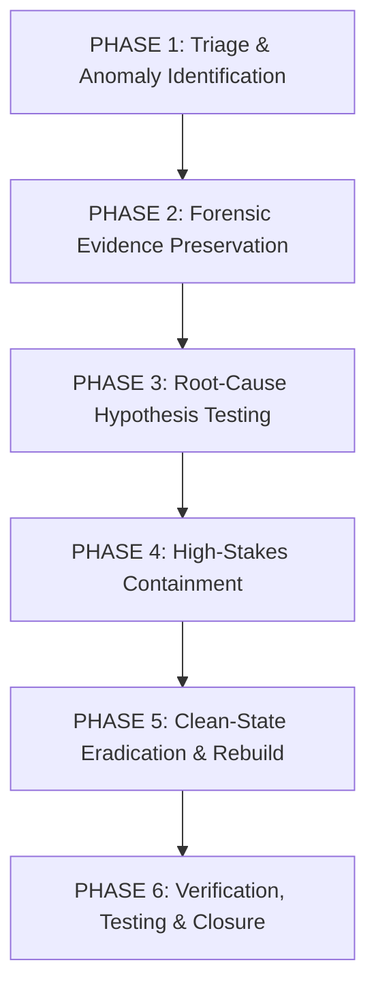

# 🛡️ Production Incident Response, Investigation & Verification Reference Guide

> **Reusable Enterprise DFIR & OT Containment Playbook**  
> **Repository:** [`Cyber-Blog/Case Study Solutions/`](file:///c:/Users/putin/Downloads/Cyber-Blog/Case%20Study%20Solutions/README.md)  
> **Target Audience:** Incident Responders, SOC Lead Analysts, Forensics Engineers, Cloud SecOps

---

## 🏛️ Executive Framework Overview

This guide provides a standardized, battle-tested 6-phase Digital Forensics and Incident Response (DFIR) workflow designed to investigate and resolve complex intrusions spanning **cloud identity providers (IdPs)**, **virtualization hypervisors**, and **air-gapped operational technology (OT)**.



---

## 📋 Phase 1: Rapid Triage & Scope Identification

### 1.1 Immediate Scoping Checklist
When an incident is declared, responders must determine the operational blast radius within 30 minutes:
1. **Identify the compromised trust boundary:** Is this an endpoint compromise (infostealer), an identity compromise (Okta/Entra ID takeover), a virtualization compromise (ESXi root shell), or a physical control compromise (PLC microcode)?
2. **Determine ongoing adversary access:** Are active session cookies valid? Has Inbound SAML federation been modified? Are hypervisors currently executing unvetted ELF binaries?
3. **Establish an out-of-band communication channel:** Assume internal corporate email, Slack, and Microsoft Teams are compromised. Shift all incident response communications to dedicated out-of-band Signal groups or an isolated tenant.

### 1.2 Initial Triage Commands
* **Windows Endpoint Process & DPAPI Triage:**
  ```powershell
  # Check for unapproved executables running in user-writable directories
  Get-Process | Where-Object { $_.Path -like "*\AppData\Local\Temp\*" -or $_.Path -like "*\AppData\Roaming\*" } | Select-Object Id, ProcessName, Path, StartTime

  # Audit recent DPAPI master key access events
  Get-WinEvent -FilterHashtable @{LogName='Security'; Id=4695} -MaxEvents 50 | Format-Table TimeCreated, Message -Wrap
  ```
* **Okta Identity Triage:**
  ```bash
  # Query factor deactivation and activation events within the last 24 hours
  curl -s -G "https://company.okta.com/api/v1/logs" \
       --data-urlencode 'filter=eventType eq "user.mfa.factor.deactivate" or eventType eq "user.mfa.factor.activate"' \
       -H "Authorization: SSWS ${OKTA_API_TOKEN}" | jq '.[] | {time: .published, actor: .actor.alternateId, event: .eventType, ip: .client.ipAddress}'
  ```
* **VMware ESXi Hypervisor Triage:**
  ```bash
  # Check active SSH sessions and running processes on ESXi console
  esxcli system process list | grep -E "locker|encrypt|python|bash|sh"
  esxcli vm process list
  ```

---

## 💾 Phase 2: Forensic Evidence Preservation

Responders must adhere to the **Order of Volatility** (RFC 3227). Never reboot or power-off a live machine without capturing volatile state first.

```
┌────────────────────────────────────────────────────────────────────────────────────────────────────────┐
│                                   FORENSIC EVIDENCE PRESERVATION CHECKLIST                             │
├─────────────────────┬──────────────────────────────────────────────────────────────────────────────────┤
│ EVIDENCE LAYER      │ MANDATORY PRESERVATION PROCEDURES & TOOLING                                      │
├─────────────────────┼──────────────────────────────────────────────────────────────────────────────────┤
│ 1. Volatile Memory  │ • Dump RAM before network disconnection using WinPmem, LiME, or FTK Imager CLI.  │
│    (RAM)            │ • Extract process tree, unencrypted cookies, and decrypted DPAPI keys from heap. │
├─────────────────────┼──────────────────────────────────────────────────────────────────────────────────┤
│ 2. Cloud Audit Logs │ • Export Okta SystemLog and Microsoft Entra ID Sign-in / Audit logs via API to   │
│    (IdP Telemetry)  │   immutable S3 / Blob storage with WORM compliance enabled.                      │
├─────────────────────┼──────────────────────────────────────────────────────────────────────────────────┤
│ 3. Non-Volatile Disk│ • Create bit-stream disk images (raw dd or E01) of infected engineering stations │
│    (Disk Images)    │   and unencrypted ESXi boot drives using write-blocking hardware.                │
├─────────────────────┼──────────────────────────────────────────────────────────────────────────────────┤
│ 4. Network PCAP     │ • Capture full-packet PCAP on industrial fieldbus networks (ISO-on-TCP port 102) │
│    (Network Traffic)│   and corporate perimeter ingress/egress firewalls.                              │
├─────────────────────┼──────────────────────────────────────────────────────────────────────────────────┤
│ 5. PLC Memory Blocks│ • Upload raw organization blocks (`OB1`, `OB35`, `DB89`) from PLCs directly over │
│    (OT Microcode)   │   isolated serial/MPI programming cables into an offline engineering station.    │
└─────────────────────┴──────────────────────────────────────────────────────────────────────────────────┘
```

---

## 🔬 Phase 3: Root-Cause Investigation & Hypothesis Testing

### 3.1 Establishing Root Cause vs. Contributing Factors
Investigators must construct a formal **Hypothesis Formulation Matrix**:

| Hypothesis | Required Supporting Evidence | Disproving Evidence | Verified Finding |
| :--- | :--- | :--- | :--- |
| **H1: Intrusion via Password Spray** | Hundreds of failed Event ID 4625 sign-ins followed by single success. | Zero failed sign-in attempts; immediate valid session establishment. | **Rejected**. Account was accessed via pre-authenticated session cookie. |
| **H2: Intrusion via Help Desk Vishing** | ServiceNow ticket showing technician factor reset; VoIP call audio; matching Okta log. | No help desk ticket exists; employee reset factor via self-service portal. | **Confirmed**. Threat actor tricked technician into clearing MFA. |
| **H3: Centrifuge Failure via Metallurgy** | Consistent rotor manufacturing flaws across different cascade batches. | Mechanical failures cease when S7-315 PLCs are disconnected from VFDs. | **Rejected**. Failures were induced by malicious VFD speed manipulation. |

---

## 🛑 Phase 4: High-Stakes Emergency Containment

### 4.1 The Incident Responder's Rule of Session Revocation
When identity compromise is confirmed, **never rely on a password change**. Execute immediate programmatic session revocations:

```powershell
# Microsoft Entra ID (Azure AD): Kill all active refresh tokens and browser sessions
Revoke-MgUserSignInSession -UserId "compromised.user@enterprise.com"

# Okta: Revoke all active sessions and delete registered push factors
curl -X DELETE "https://company.okta.com/api/v1/users/{userId}/sessions" -H "Authorization: SSWS ${OKTA_API_TOKEN}"
curl -X DELETE "https://company.okta.com/api/v1/users/{userId}/factors/{factorId}" -H "Authorization: SSWS ${OKTA_API_TOKEN}"
```

### 4.2 Hypervisor Network Isolation
If ransomware is executing on virtualization infrastructure:
1. **Sever Management Network:** Immediately disconnect the hypervisor management VMkernel port from the core switch.
2. **Block SSH Access:** Disable the ESXi SSH daemon via PowerCLI:
   ```powershell
   Get-VMHost | Get-VMHostService | Where-Object {$_.Key -eq "TSM-SSH"} | Stop-VMHostService -Confirm:$false
   ```

### 4.3 Industrial Control System (ICS) Emergency Lockout
If malicious microcode is suspected on industrial PLCs:
1. **Rotate Keyswitch to RUN:** Turn the physical rotary keyswitch on the PLC front panel to **`RUN`**. This physically disconnects the backplane bus write-lines, preventing any network-based block upload.
2. **Drop Drive Power:** Trip the manual Emergency Stop (ESD) push-button, dropping mains electrical power to the variable frequency drives via hardwired contactors.

---

## ♻️ Phase 5: Clean-State Eradication & Rebuild

Never attempt to "clean" or "disinfect" a compromised system that had root/administrator-level access. Rebuild from verified, trusted baselines:

```
┌────────────────────────────────────────────────────────────────────────────────────────────────────────┐
│                              CLEAN-STATE ERADICATION & REBUILD DISCIPLINE                              │
├─────────────────────┬──────────────────────────────────────────────────────────────────────────────────┤
│ ASSET CATEGORY      │ MANDATORY ERADICATION & RECONSTITUTION PROTOCOL                                  │
├─────────────────────┼──────────────────────────────────────────────────────────────────────────────────┤
│ Endpoints & Laptops │ • Wipe physical drives to bare metal (NVMe format / ATA Secure Erase).           │
│                     │ • Deploy clean operating system from verified enterprise golden image.           │
│                     │ • Enforce Chrome 127+ App-Bound Encryption and WDAC execution blocking.          │
├─────────────────────┼──────────────────────────────────────────────────────────────────────────────────┤
│ Cloud Identity (IdP)│ • Audit `/api/v1/idps`; delete all unverified Inbound SAML/OIDC federations.     │
│                     │ • Invalidate all service principal client secrets and OAuth application grants.  │
│                     │ • Re-issue administrative credentials under supervised live video verification.  │
├─────────────────────┼──────────────────────────────────────────────────────────────────────────────────┤
│ ESXi Hypervisors    │ • Wipe host boot media; re-install ESXi from certified ISO media.                │
│                     │ • Enable Strict Lockdown Mode; configure VMkernel on isolated out-of-band VLAN.  │
│                     │ • Restore virtual machines from immutable, air-gapped WORM backups.              │
├─────────────────────┼──────────────────────────────────────────────────────────────────────────────────┤
│ Industrial PLCs     │ • Turn rotary switch to `MRES` (Memory Reset) and execute cold memory purge.     │
│                     │ • Re-flash verified, cryptographically signed ladder logic over isolated MPI.    │
│                     │ • Lock keyswitch to `RUN` and remove physical key to a secure lockbox.           │
└─────────────────────┴──────────────────────────────────────────────────────────────────────────────────┘
```

---

## 🧪 Phase 6: Post-Incident Verification & Closure Criteria

An incident cannot be declared resolved until the defensive controls pass empirical verification:

```
┌────────────────────────────────────────────────────────────────────────────────────────────────────────┐
│                                VERIFICATION TEST SUITE & CLOSURE CHECKLIST                             │
├───────────────────┬─────────────────────────────────────────────────┬──────────────────────────────────┤
│ VERIFICATION TEST │ TESTING PROCEDURE IN AUTHORIZED ENVIRONMENT     │ PASS CRITERIA (INCIDENT CLOSED)  │
├───────────────────┼─────────────────────────────────────────────────┼──────────────────────────────────┤
│ 1. Session Replay │ Attempt to replay stolen session cookie via     │ Server returns HTTP 401          │
│    Immunity       │ Postman/cURL without client-bound private key.  │ Unauthorized / login prompt.     │
├───────────────────┼─────────────────────────────────────────────────┼──────────────────────────────────┤
│ 2. Help Desk KBA  │ Caller requests factor reset providing correct  │ Technician explicitly refuses;   │
│    Resistance     │ DOB, SSN, and Employee ID.                      │ directs caller to live video.    │
├───────────────────┼─────────────────────────────────────────────────┼──────────────────────────────────┤
│ 3. ESXi Lockdown  │ Attempt direct SSH connection to hypervisor     │ Connection refused (port 22      │
│    Enforcement    │ management IP using root credentials.           │ closed; DCUI disabled).          │
├───────────────────┼─────────────────────────────────────────────────┼──────────────────────────────────┤
│ 4. PLC Microcode  │ Attempt S7comm `0x1A` block download while PLC  │ CPU hardware rejects write;      │
│    Lockout        │ physical keyswitch is in "RUN" mode.            │ ladder logic remains unmodified. │
└───────────────────┴─────────────────────────────────────────────────┴──────────────────────────────────┘
```

---

*Part of the **Cyber-Blog** Technical Incident Investigation & Architectural Security Suite.*
