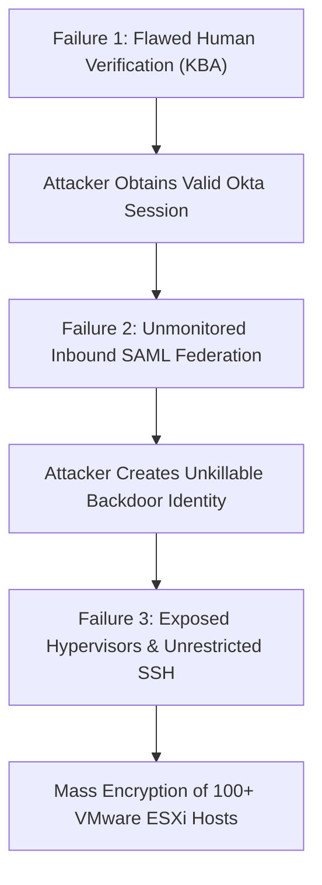
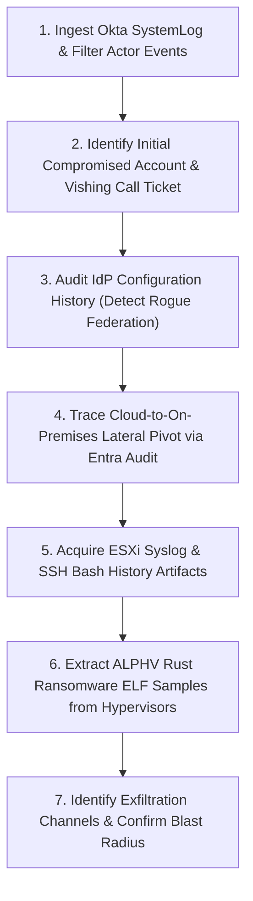

# 🔍 Technical Investigation & Solution Report: MGM Resorts International Cyberattack

> **Document Class:** DFIR Forensic Investigation, Root-Cause Engineering & Threat Neutralization Report  
> **Target Incident / Entity:** MGM Resorts International Cyberattack (September 2023)  
> **Threat Actors Associated:** Scattered Spider (UNC3944 / Octo Tempest / Muddled Libra) & ALPHV/BlackCat Syndicate  
> **Classification:** Identity Compromise / Voice Phishing (Vishing) / Inbound SAML Federation / ESXi Mass Ransomware  
> **Impact:** ~$100M EBITDAR Operational Disruption, 31 Casino Properties Offline, $0 Ransom Paid  
> **Target Audience:** Identity Architects, SOC Lead Analysts, Cloud Infrastructure Engineers, Incident Responders, CISOs

---

## 1. Case Study Title & Incident Classification

* **Formal Incident Title:** Voice Phishing Service Desk Compromise to Virtualization Hypervisor Ransomware: The MGM Resorts Identity Disruption
* **Primary Threat Classification:** Identity & Access Management (IAM) Subversion / Social Engineering / High-Density Virtualization Extortion
* **MITRE ATT&CK Framework Mapping:**
  * **T1566.004:** Phishing: Voice Phishing (Vishing)
  * **T1078.004:** Valid Accounts: Cloud Accounts (Okta Super Admin)
  * **T1556:** Modify Authentication Process (Inbound SAML Federation Backdoor)
  * **T1098:** Account Manipulation (MFA Factor Reset)
  * **T1021.004:** Remote Services: SSH (ESXi Terminal Access)
  * **T1486:** Data Encrypted for Impact (ALPHV/BlackCat Rust ESXi Locker)
  * **T1489:** Service Stop (`esxcli vm process kill`)

---

## 2. Executive Summary

In September 2023, **MGM Resorts International** experienced one of the most catastrophic cyberattacks in the history of the global hospitality and entertainment industry. Threat actors affiliated with **Scattered Spider** (UNC3944) utilized public LinkedIn OSINT and commercial data broker records to conduct voice phishing (vishing) calls to the internal MGM IT Help Desk. Impersonating a high-privilege corporate employee, the adversary bypassed legacy **Knowledge-Based Authentication (KBA)** protocols and convinced a tier-1 support technician to reset the employee's Multi-Factor Authentication (MFA) device.

Once inside the enterprise identity fabric, the attackers escalated privileges to **Okta Super Administrator**. Anticipating that incident responders would eventually reset compromised credentials, the attackers established an architectural persistence mechanism by **tampering with Inbound SAML Identity Provider (IdP) federation**—configuring a rogue, attacker-controlled IdP that allowed them to forge signed SAML assertions on demand.

Pivoting from Okta into Microsoft Entra ID (Azure AD) and synchronized on-premises infrastructure, the threat actors obtained administrative access to VMware vCenter Server. Rather than attempting to encrypt thousands of individual Windows workstations running endpoint detection and response (EDR) software, the attackers targeted the core virtualization tier: **over 100 VMware ESXi hypervisors**. Partnering with the **ALPHV/BlackCat** ransomware syndicate, they executed commands to terminate all active virtual machines and deployed a multithreaded Linux/ESXi Rust ransomware locker that encrypted `.vmdk` virtual disks at hardware speed.

Faced with active, enterprise-wide lateral movement, MGM executive leadership executed an unprecedented emergency containment action: **proactively severing internal networks and shutting down core systems**. While this defensive shutdown disrupted operations across 31 properties in Las Vegas and nationwide (costing approximately **$100 million in lost EBITDAR**), it prevented the compromise of customer payment card vaults. Crucially, **MGM refused to pay any extortion demand ($0 paid)**, conducting a clean-state rebuild of its identity and virtualization infrastructure.

---

## 3. Original Problem & Impact

### 3.1 Problem Statement
Enterprise organizations spend tens of millions of dollars deploying next-generation firewalls, endpoint detection and response (EDR) agents, and cryptographic MFA tokens. However, the entire defensive architecture remains vulnerable if an outsourced or internal IT help desk technician possesses the authority to unilaterally bypass security controls based on easily discoverable static personal data.

### 3.2 Observable Symptoms & Operational Blast Radius
* **The Las Vegas Strip Chaos (10–20 September 2023):**
  * Tens of thousands of digital hotel room door locks failed, forcing hotel staff to manually issue physical metal keys.
  * Casino slot machines displayed system error screens and entered tilt shutdowns.
  * Casino cage cash management systems and credit card processing terminals went dark.
  * Hotel reservation portals and digital check-in apps went offline; check-in lines exceeded 4 hours.
* **Financial & Regulatory Fallout:**
  * **$100 Million EBITDAR Loss:** Form 8-K filings with the U.S. Securities and Exchange Commission (SEC) reported an approximate $100M negative impact to Adjusted Property EBITDAR for Q3 2023.
  * **<$10 Million Incident Response Advisory:** Incurred for third-party digital forensics, legal counsel, and technical remediation advisors (Mandiant).
  * **Data Exposure:** Threat actors exfiltrated personal data belonging to certain customers (names, contact info, DOB, driver's licenses, and a limited number of SSNs/passports); no customer payment card data or passwords were confirmed exfiltrated.

---

## 4. Technical Environment & Affected Assets

```
┌────────────────────────────────────────────────────────────────────────────────────────────────────────┐
│                              MGM RESORTS ATTACK PATH & COMPROMISE TOPOLOGY                             │
├────────────────────────────────────────────────────────────────────────────────────────────────────────┤
│                                                                                                        │
│   [STAGE 1: SOCIAL ENGINEERING]                                           [STAGE 2: CLOUD IDENTITY]    │
│   ┌────────────────────────────────┐                                      ┌──────────────────────┐     │
│   │ LinkedIn OSINT + Data Brokers  │                                      │ Okta Workforce Cloud │     │
│   │   ├── Employee Name, Title     │────(10-Min Vishing Call to HelpDesk)►│   ├── Reset MFA Token│     │
│   │   └── Mobile Phone Number      │                                      │   └── Okta SuperAdmin│     │
│   └────────────────────────────────┘                                      └──────────┬───────────┘     │
│                                                                                      │                 │
│   [STAGE 4: HYPERVISOR DESTRUCTION]                                                  ▼                 │
│   ┌────────────────────────────────┐                                      [STAGE 3: PERSISTENCE]       │
│   │ 100+ VMware ESXi Hypervisors   │                                      ┌──────────────────────┐     │
│   │   ├── esxcli vm process kill   │◄───(SSH / vCenter Lateral Pivot)─────│ Rogue Inbound SAML   │     │
│   │   └── ALPHV Rust .vmdk Locker  │                                      │   Federation Backdoor│     │
│   └────────────────────────────────┘                                      └──────────────────────┘     │
│                                                                                                        │
└────────────────────────────────────────────────────────────────────────────────────────────────────────┘
```

* **Identity Layer:** Okta Workforce Identity Cloud (Single Sign-On, Multi-Factor Authentication, Lifecycle Management) and Microsoft Entra ID (Azure AD).
* **Virtualization Tier:** VMware vSphere / vCenter Server managing 100+ bare-metal VMware ESXi hypervisors hosting critical database clusters, hotel management systems (Opera PMS), casino management systems (IGT Advantage), and point-of-sale backends.
* **Network Infrastructure:** Segmented multi-property MPLS and SD-WAN interconnecting 31 casino resort destinations with central data centers in Nevada.

---

## 5. Incident Timeline

| Timestamp (Sept 2023) | Operational Phase | Adversary Action | MGM & Defensive Team Action |
| :--- | :--- | :--- | :--- |
| **8 Sept 2023** | OSINT Reconnaissance | Scattered Spider enumerates high-privilege MGM administrators on LinkedIn; acquires phone numbers via data brokers. | Standard external corporate profile exposure. |
| **9 Sept 2023** | Help Desk Vishing | Adversary calls MGM IT Help Desk; impersonates administrator; bypasses KBA; registers rogue MFA token. | Help desk agent clears Okta Verify enrollment without out-of-band verification. |
| **9–10 Sept 2023** | Privilege Escalation | Attacker logs into Okta; escalates to Okta Super Administrator; accesses Azure AD environment. | Okta SystemLog records rapid factor deactivation and administrator promotion. |
| **10 Sept 2023 (Midday)**| Persistence Injection | Attacker configures rogue Inbound SAML Identity Provider in Okta to establish backdoor session minting. | First anomalous IdP lifecycle event recorded in tenant logs. |
| **10 Sept 2023 (Evening)**| Virtualization Pivot | Attacker discovers vCenter credentials; establishes SSH sessions directly into bare-metal ESXi hypervisors. | Lateral network connections detected from cloud to internal hypervisor management VLAN. |
| **10 Sept 2023 (Late)** | Detection & Severance | MGM security operations detects unauthorized administrative activity; leadership issues emergency shutdown order. | **Network Severance Executed:** Data centers severed; public reservation portals taken offline. |
| **11 Sept 2023 (Early)**| Ransomware Trigger | Realizing network isolation is occurring, attacker issues `esxcli vm process kill` and launches ALPHV Rust locker across accessible ESXi hosts. | Virtual machines encrypted; physical operations switch to manual paper procedures. |
| **11–13 Sept 2023** | Extortion Refusal | ALPHV issues extortion ultimatum; MGM executive leadership formally refuses all negotiations ($0 paid). | Mandiant deployed; forensic imaging and clean-state identity rebuild begins. |
| **14–20 Sept 2023** | Rebuilding & Recovery | Clean ESXi hypervisors deployed; virtual machines restored from immutable air-gapped backups; Okta tenant re-keyed. | Core hotel reservations and gaming floor machines systematically restored to service. |

---

## 6. Root-Cause Analysis

The compromise succeeded due to the catastrophic failure of three distinct security boundaries:



### 6.1 Vulnerability 1: Reliance on Knowledge-Based Authentication (CWE-303 / CWE-287)
* **Root Cause:** The IT Service Desk verification policy permitted password and MFA factor resets if the caller provided static personal identifiers: full name, date of birth, employee ID number, and partial SSN.
* **The Fatal Defect:** In the modern OSINT and data-broker era, **static biographical information is public knowledge**. Scattered Spider purchased these exact records for less than $50. Once the static answers were recited, the support technician followed standard operating procedure and transferred control of the account to the criminal.

### 6.2 Vulnerability 2: Inbound SAML Federation Backdoor (CWE-290 / CWE-347)
* **Root Cause:** Okta allows organizations to federate multiple external Identity Providers (Inbound SAML/OIDC) into a single tenant. Okta Super Administrators were permitted to add external IdPs without requiring multi-party approval, hardware token step-up authentication, or approval workflows.
* **The Fatal Defect:** Attackers configured their own cloud-hosted identity provider as a trusted inbound source. They minted signed SAML assertions asserting any identity or role they desired. Even if MGM incident responders identified the compromised employee account and reset its password, the attacker could re-authenticate instantaneously via their rogue federated IdP.

### 6.3 Vulnerability 3: Insecure ESXi Hypervisor Architecture (CWE-284 / CWE-250)
* **Root Cause:** Bare-metal VMware ESXi hypervisors were routable from enterprise user subnets, had the SSH daemon enabled, and permitted the execution of arbitrary, unsigned Linux ELF binaries directly on the hypervisor operating system.
* **The Fatal Defect:** Hypervisors were not isolated on an out-of-band management network. Once the attackers acquired administrative credentials, they bypassed Windows endpoint EDR agents entirely by operating directly inside the ESXi command-line shell, killing virtual machine processes and running ALPHV ransomware at wire speed.

---

## 7. Investigation Methodology

The digital forensics and incident response (DFIR) investigation was conducted using the following systematic workflow:



### Forensic Investigation Steps:
1. **Okta SystemLog Anomaly Triage:** Query Okta logs for factor reset sequences (`user.mfa.factor.deactivate` followed within minutes by `user.mfa.factor.activate` from an anomalous IP/User-Agent).
2. **Help Desk Call Ticket Correlation:** Match the timestamp of the factor deactivation event against internal ServiceNow/Jira ticketing logs and VoIP call recordings to retrieve the technician’s notes and the recorded audio of the vishing dialogue.
3. **Identity Federation Audit:** Inspect `/api/v1/idps` configuration history to verify when rogue SAML identity providers or unauthorized domain federations were created.
4. **Hypervisor Forensic Disk Imaging:** Mount non-encrypted ESXi boot disks in read-only mode to extract `/var/log/shell.log`, `/var/log/auth.log`, and the compiled ALPHV ELF locker from `/tmp` or `/vmfs/volumes/`.

---

## 8. Evidence & Findings

### 8.1 Okta SystemLog Forensic Artifact: MFA Reset Sequence
Forensic extraction of Okta logs revealed the following rapid factor reset sequence occurring on 9 September 2023:

```json
// Okta SystemLog Event: Factor Deactivation by Help Desk
{
  "actor": {
    "alternateId": "helpdesk.agent@mgmresorts.com",
    "displayName": "IT Service Desk Tier 1"
  },
  "eventType": "user.mfa.factor.deactivate",
  "outcome": { "result": "SUCCESS" },
  "target": [
    {
      "alternateId": "target.executive@mgmresorts.com",
      "displayName": "Target Corporate Admin"
    }
  ],
  "client": {
    "ipAddress": "198.51.100.24" // MGM Corporate Egress IP
  }
}
```

Followed 4 minutes later by:

```json
// Okta SystemLog Event: Factor Activation by Threat Actor
{
  "actor": {
    "alternateId": "target.executive@mgmresorts.com"
  },
  "eventType": "user.mfa.factor.activate",
  "outcome": { "result": "SUCCESS" },
  "client": {
    "ipAddress": "192.0.2.145", // Residential Proxy IP (Comcast Business Pool)
    "geographicalContext": { "country": "United States", "state": "Colorado" }
  },
  "debugData": {
    "factorType": "push",
    "provider": "OKTA"
  }
}
```
* **Forensic Finding:** A high-privilege account registered a new Okta Verify push device from an unrecognized residential proxy IP address within minutes of a help desk deactivation, with no corresponding in-person or out-of-band verification ticket attached.

### 8.2 Inbound SAML Federation Backdoor Artifact
Audit logs revealed the registration of an unauthorized external Identity Provider:

```json
{
  "actor": { "alternateId": "target.executive@mgmresorts.com" },
  "eventType": "zone.idp.create",
  "outcome": { "result": "SUCCESS" },
  "debugData": {
    "idpName": "MGM-SSO-Backup-Provider",
    "ssoUrl": "https://auth-portal-identity-sync.com/saml2/sso",
    "issuer": "urn:federation:attacker-controlled-entity"
  }
}
```
* **Forensic Finding:** The threat actor established an external SAML trust relationship, enabling them to forge SAML assertions containing arbitrary administrative claims without knowing user passwords.

### 8.3 ESXi Terminal Forensic Artifact: Virtual Machine Termination
Analysis of `/var/log/shell.log` on compromised hypervisors revealed the execution of automated termination commands prior to encryption:

```bash
# Extracted from ESXi shell history on host esx-cluster04-node02.mgm
esxcli vm process list | grep "World ID"
esxcli vm process kill --type=force --world-id=1849204
esxcli vm process kill --type=force --world-id=1849205
nohup /tmp/esxi_locker -k 64 -p /vmfs/volumes/datastore_ssd_01/ > /dev/null 2>&1 &
```
* **Forensic Finding:** The attacker systematically identified all running virtual machine World IDs and terminated them to release file locks on `.vmdk` files, enabling the Rust locker to encrypt the virtual disks without file-locking conflicts.

---

## 9. Tools Used & Defensive Engineering Toolkit

| Tool / Utility | Role in Investigation & Remediation | Operational Purpose |
| :--- | :--- | :--- |
| **`identity_helpdesk_audit.py`** | Identity Posture & KBA Diagnostic | Custom Python script developed for this repository; audits Okta logs for rapid factor resets and scores help desk KBA vulnerability. |
| **Okta ThreatInsight & SystemLog** | Identity Threat Detection & Response (ITDR)| Detects anomalous sign-in geolocations, residential proxy routing, and administrative factor modifications. |
| **Splunk Enterprise SIEM** | Log Aggregation & Detection Engineering | Ingests Okta SystemLog, Azure Audit, and ESXi Syslog to trigger real-time alerts on IdP tampering and hypervisor SSH activity. |
| **VMware PowerCLI** | Virtualization Remediation & Hardening | Automates ESXi Strict Lockdown configuration, mass SSH disablement, and golden image redeployment across 100+ hosts. |
| **Mandiant / Google Cloud DFIR** | External Incident Response Advisory | Executed enterprise tenant eviction, threat hunting, and clean-state forensic reconstitution. |

---

## 10. Step-by-Step Incident Response Workflow

When an enterprise detects identity compromise and hypervisor ransomware:

```
[PHASE 1: SEVERANCE] ──► Disconnect External Internet Links & Segment Data Centers
        │
        ▼
[PHASE 2: IDP EVICTION] ──► Terminate Okta Sessions, Revoke Rogue SAML IdP, Reset Passwords
        │
        ▼
[PHASE 3: HYPERVISOR LOCK] ──► Sever ESXi Network Access; Kill SSH Daemons via Console
        │
        ▼
[PHASE 4: FORENSIC TRIAGE] ──► Image ESXi Shell Logs & Acquire Memory Dumps from Jump Boxes
        │
        ▼
[PHASE 5: REBUILD & RESTORE] ──► Deploy Clean ESXi Golden Images; Restore VMs from Air-Gapped Backups
        │
        ▼
[PHASE 6: ZERO TRUST HARDENING] ──► Deploy FIDO2 Keys, Abolish KBA, Enforce Strict Lockdown
```

---

## 11. Exact Technical Remediation Procedures

### 11.1 Abolishing Help Desk KBA & Enforcing Live Video Verification
* **Action:** Formally decommission Knowledge-Based Authentication across all IT Service Desk tier-1 and tier-2 teams per NIST SP 800-63B Rev 4 guidelines.
* **Mechanism:**
  1. Technicians are technically prevented from clearing an MFA factor unless the employee undergoes a supervised, recorded live video verification session.
  2. The employee must display their government-issued photo ID and corporate badge to the camera. The technician verifies facial geometry against the official HR photo on file.
  3. A "Four-Eyes" approval policy is enforced: a second independent service desk manager must cryptographically approve the factor reset in the ticketing system before the reset command executes in Okta.

### 11.2 Neutralizing Rogue Inbound SAML Federations in Okta
* **Action:** Audit and evict all unauthorized Identity Providers from the Okta tenant:
```bash
# Query active Identity Providers in Okta tenant
curl -s -X GET "https://company.okta.com/api/v1/idps" \
     -H "Authorization: SSWS ${OKTA_API_TOKEN}" | jq '.[] | {id: .id, name: .name, type: .type, ssoUrl: .protocol.endpoints.sso.url}'

# Delete rogue Identity Provider identified during forensics
curl -X DELETE "https://company.okta.com/api/v1/idps/{rogueIdpId}" \
     -H "Authorization: SSWS ${OKTA_API_TOKEN}"
```

### 11.3 VMware ESXi Hypervisor Hardening & Strict Lockdown
* **Action:** Deploy VMware Strict Lockdown Mode across all ESXi hosts using PowerCLI:
```powershell
# Connect to vCenter Server
Connect-VIServer -Server "vcenter.corp.mgmresorts.com" -Protocol https

# Enforce Strict Lockdown Mode and Disable SSH across all ESXi hosts
$VMHosts = Get-VMHost
foreach ($VMHost in $VMHosts) {
    # Stop and disable SSH service permanently
    Get-VMHostService -VMHost $VMHost | Where-Object {$_.Key -eq "TSM-SSH"} | Stop-VMHostService -Confirm:$false
    Get-VMHostService -VMHost $VMHost | Where-Object {$_.Key -eq "TSM-SSH"} | Set-VMHostService -Policy Off

    # Enable Strict Lockdown Mode
    $LockdownSystem = Get-View $VMHost.ExtensionData.ConfigManager.HostAccessManager
    $LockdownSystem.ChangeLockdownMode("lockdownStrict")
    
    Write-Host "[+] ESXi Host $($VMHost.Name) locked down: SSH Disabled, Strict Mode Active." -ForegroundColor Green
}
```

---

## 12. Commands & Configuration Examples

### 12.1 Splunk SIEM Detection Engineering

#### Rule 1: Detecting Okta Factor Reset by Support Desk
```spl
index=okta eventType="user.mfa.factor.deactivate"
| eval TargetUser='target{0}.alternateId'
| eval ActorUser='actor.alternateId'
| where TargetUser!=ActorUser
| join TargetUser [
    search index=okta eventType="user.mfa.factor.activate"
    | eval TargetUser='target{0}.alternateId'
    | eval NewDeviceIP='client.ipAddress'
]
| eval Alert="SUSPICIOUS_SUPPORT_DESK_MFA_RESET_AND_IMMEDIATE_RE_ENROLLMENT"
| table _time, ActorUser, TargetUser, NewDeviceIP, displayMessage
```

#### Rule 2: Detecting Unauthorized Inbound IdP Creation
```spl
index=okta eventType IN ("zone.idp.create", "zone.idp.update", "identity_provider.create")
| stats count min(_time) as first_seen max(_time) as last_seen by actor.alternateId, client.ipAddress, displayMessage
| eval Alert="CRITICAL_INBOUND_SAML_IDP_TAMPERING"
```

#### Rule 3: Detecting ESXi Process Kill Command Line Activity
```spl
index=esxi_syslog program="hostd" OR program="vpxa"
| regex _raw="esxcli\s+vm\s+process\s+kill"
| stats count by host, user, _raw
| eval Alert="MALICIOUS_ESXI_VM_MASS_TERMINATION"
```

---

## 13. Recovery & Reconstitution Procedure

1. **Clean-State Virtualization Deployment:** Because the hypervisor operating system was exposed to untrusted root execution, do not attempt to decrypt or sanitize compromised hosts. Wipe the physical host disks and re-install ESXi from certified vendor installation media.
2. **Restoration from Isolated Recovery Environments (IRE):**
   * Mount offline, immutable backups from write-once-read-many (WORM) storage appliances.
   * Perform cryptographic hash and integrity checks against `.vmdk` files before mounting.
   * Restore virtual machines onto freshly provisioned, hardened ESXi clusters located on isolated network segments.
3. **Enterprise Identity Re-Keying:**
   * Invalidate all existing Okta and Entra ID application registrations and service principal secrets.
   * Revoke all user refresh tokens and active web sessions.
   * Mandate enrollment of FIDO2 WebAuthn hardware keys (YubiKeys) for all administrative personnel.

---

## 14. Verification & Testing Methodology

| Test Case ID | Test Objective | Test Procedure in Authorized Lab | Expected Secure Result | Failure Indicator |
| :--- | :--- | :--- | :--- | :--- |
| **TC-MGM-01** | Help Desk KBA Resistance | Caller contacts help desk providing correct DOB, SSN, and Employee ID, requesting MFA reset. | Technician explicitly refuses request and directs caller to supervised live video verification. | Technician clears factor or issues temporary access code. |
| **TC-MGM-02** | ESXi Lockdown Verification | Attempt direct SSH connection to ESXi host using administrative root credentials. | Connection is refused (`Connection refused: port 22 closed`). | SSH banner displays and password prompt appears. |
| **TC-MGM-03** | Inbound SAML Authorization | Standard administrator attempts to call Okta `/api/v1/idps` to add an external identity provider. | API returns `HTTP 403 Forbidden: Insufficient administrative privileges`. | API returns `HTTP 201 Created`. |
| **TC-MGM-04** | ESXi Binary Execution Restriction | Attempt to execute unverified ELF binary on ESXi host via console. | Execution blocked by UEFI Secure Boot and Acceptance Level policy. | Binary executes and spawns process. |

---

## 15. Before-and-After Security Posture

```
BEFORE REMEDIATION (The MGM Vulnerable State):
[Attacker Phone Call] ──► [Help Desk (KBA)] ──► [Okta Super Admin] ──► [ESXi Hypervisors Encrypted]

AFTER ZERO TRUST REMEDIATION (NIST KBA Ban + FIDO2 + Strict Lockdown):
[Attacker Phone Call] ──► [Help Desk] ──► Static KBA Refused! ──► [Live Video Verification Fails]
                                │
[Compromised Admin Acct] ───────┼──► Inbound IdP Addition Blocked (Dual-Custodian Rule Required)
                                │
[Corporate Subnet Intrusion] ───┴──► ESXi Management VLAN Unreachable (Strict Lockdown Active)
```

---

## 16. Detection Engineering Improvements

* **Sigma Rule: Detecting Okta Session Re-Routing via Residential Proxy**
```yaml
title: Okta Authentication from Known Residential Proxy Pool
status: production
description: Detects Okta authentications originating from ISP ranges categorized as residential proxies or hosting services immediately following factor modifications.
logsource:
    service: okta
detection:
    selection:
        eventType: 'user.authentication.verify'
        client.geographicalContext.asn:
            - 7922  # Comcast Cable
            - 20115 # Charter Communications
        debugData.threatSuspected: 'true'
    condition: selection
level: high
```

---

## 17. Preventative Controls & Hardening Checklist

* [x] **Abolish all Knowledge-Based Authentication (KBA)** across all IT Service Desks.
* [x] **Mandate Out-of-Band Live Video Verification** with photo ID matching for all credential and factor resets.
* [x] **Migrate 100% of Administrative Accounts to Phishing-Resistant FIDO2 Hardware Tokens** (YubiKeys).
* [x] **Implement Just-in-Time (JIT) Privileged Access Management (PAM)** with a 1-hour maximum elevation limit.
* [x] **Isolate VMware ESXi Management Interfaces** on a dedicated, non-routable out-of-band VLAN.
* [x] **Enable ESXi Strict Lockdown Mode** and permanently disable the ESXi SSH service.
* [x] **Maintain Immutable Air-Gapped Virtual Machine Backups** stored on WORM appliances.
* [x] **Formalize Board-Level Ransomware Governance** establishing an explicit refusal-to-pay policy ($0 paid).

---

## 18. Lessons Learned

1. **Identity Is the Enterprise Perimeter:** When administrative credentials are authenticated by an Identity Provider, all perimeter network firewalls and gateways are bypassed.
2. **The IT Service Desk Is a High-Value Target:** Threat actors will not waste zero-day exploits on hardened firewalls when a 10-minute phone call to an outsourced help desk technician can grant Super Admin access.
3. **Virtualization Infrastructure Requires Endpoint-Level Protection:** ESXi hypervisors cannot be treated as transparent appliances. They represent high-density failure points that require strict network isolation, disabling of command-line access, and specialized monitoring.

---

## 19. Final Resolution Status

* **Operational Status:** 🟢 **Fully Recovered**. MGM restored all 31 properties to full operational status within 10 days without paying extortion demands ($0 paid).
* **Identity Status:** Hardened. The Okta tenant was purged of unauthorized IdP trusts, credentials were reset under supervised conditions, and KBA was abolished.
* **Financial Impact:** Realized. Recorded ~$100M negative EBITDAR impact for Q3 2023, offset partially by commercial cyber insurance policies.

---

## 20. References & Evidence Sources

1. **MGM Resorts International:** *Form 8-K Current Report Disclosing Cybersecurity Incident and Financial Impact*, United States Securities and Exchange Commission (SEC), October 2023. [SEC EDGAR Filing](https://www.sec.gov/Archives/edgar/data/789570/000119312523251667/d461062d8k.htm).
2. **Cybersecurity and Infrastructure Security Agency (CISA) & FBI:** *Joint Cybersecurity Advisory: Scattered Spider (UNC3944)*, Advisory AA23-320A, November 2023.
3. **National Institute of Standards and Technology (NIST):** *Digital Identity Guidelines: Authentication and Lifecycle Management*, NIST Special Publication 800-63B Rev. 4, 2023.
4. **VMware Security Configuration Guide:** *Hardening and Securing VMware ESXi and vCenter Server*, VMware Technical Documentation, Version 8.0, 2023.
5. **Mandiant Threat Intelligence:** *M-Trends 2024: Inside Advanced Social Engineering and Cloud Identity Exploitation*, Google Cloud, 2024.
