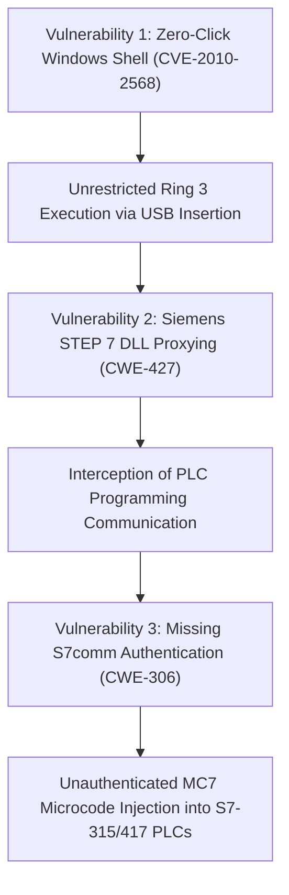
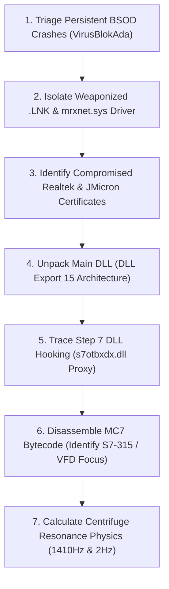

# 🔍 Technical Investigation & Solution Report: STUXNET Cyber-Physical Sabotage

> **Document Class:** DFIR Forensic Investigation, Root-Cause Engineering & Threat Neutralization Report  
> **Target Incident / Entity:** Natanz Fuel Enrichment Plant (FEP) / Atomic Energy Organization of Iran (AEOI)  
> **Strategic Operation Codename:** Operation Olympic Games (Publicly Attributed Joint US-Israeli Operation)  
> **Classification:** Cyber-Physical Attack / Industrial Control Systems (ICS) Sabotage / Advanced Persistent Threat (APT)  
> **Hardware / Software Affected:** Siemens SIMATIC S7-315/S7-417 PLCs, SIMATIC STEP 7, WinCC SCADA, Fararo Paya & Vacon VFDs  
> **Impact:** Physical Destruction of ~1,000 IR-1 Uranium Enrichment Centrifuges; 18-Month Iranian Nuclear Delay  
> **Target Audience:** Control Systems Engineers, OT/ICS Security Architects, Malware Reverse Engineers, SOC Lead Analysts, CISOs

---

## 1. Case Study Title & Incident Classification

* **Formal Incident Title:** Subversion of Industrial Programmable Logic Controllers via Microcode Injection & Sensor Replay Deception: The Stuxnet Operation
* **Primary Threat Classification:** Cyber-Physical Weapon / Industrial Control System (ICS) Sabotage / Supply-Chain Air-Gap Traversal
* **MITRE ATT&CK for ICS Framework Mapping:**
  * **T0847:** Replication Through Removable Media (Weaponized USB via CVE-2010-2568)
  * **T0873:** Project File Infection (Siemens STEP 7 Project Modification)
  * **T0839:** Module Firmware / Code Modification (S7 MC7 Bytecode Injection into `OB1`/`OB35`)
  * **T0836:** Modify Parameter (VFD Output Frequency: 1,410 Hz & 2 Hz)
  * **T0856:** Spoof Reporting Message (21-Second DB89 Sensor Replay)
  * **T0879:** Damage to Property (Centrifuge Rotor Centrifugal Overstress & Resonant Shattering)

---

## 2. Executive Summary

Discovered in June 2010 by **VirusBlokAda** in Belarus and decoded by German industrial security specialist **Ralph Langner** and the **Symantec Security Response Team**, **Stuxnet** was the world's first verified cyber-physical weapon. Unlike conventional malware designed for intellectual property theft, espionage, or financial extortion, Stuxnet was engineered to physically destroy uranium enrichment infrastructure while deceiving human plant operators and automated safety systems into believing the process was running smoothly.

Targeting the heavily fortified, underground, and air-gapped **Natanz Fuel Enrichment Plant (FEP)** in Iran, Stuxnet traversed physical network disconnections by weaponizing the supply chain of five Iranian industrial automation contractors. Infiltrating via USB flash drives leveraging four Windows zero-day vulnerabilities (including the zero-click `.lnk` shortcut flaw CVE-2010-2568) and stolen cryptographic certificates from **Realtek** and **JMicron**, Stuxnet silently embedded itself within Siemens SIMATIC engineering workstations.

Once inside, Stuxnet executed a **Man-in-the-Middle (MitM) DLL proxy attack on Siemens STEP 7** (`s7otbxdx.dll`). It verified precise industrial criteria—requiring the presence of Siemens S7-315 and S7-417 PLCs communicating over Profibus CP 342-5 modules with specific variable frequency drives (VFDs) from Fararo Paya (Iran) and Vacon (Finland). Once verified, Stuxnet injected compiled MC7 microcode directly into PLC memory. The malware manipulated drive frequencies from normal cruise ($1,064\text{ Hz}$) to dangerous overspeed ($1,410\text{ Hz}$, generating hoop stresses exceeding $450\text{ MPa}$) and destructive sub-synchronous resonance ($2\text{ Hz}$), shattering approximately **~1,000 IR-1 gas centrifuges**. To prevent operator intervention, Stuxnet recorded 21 seconds of normal telemetry in data block `DB89` and replayed it in an endless loop to supervisory SCADA screens.

This investigation reconstructs the forensic discovery of the MC7 bytecode, details the mathematical mechanics of rotor destruction, and establishes the definitive remediation suite required to protect critical operational technology: **locking PLC physical keyswitches to `RUN`**, installing **hardware-based optical data diodes**, and deploying **independent out-of-band analog Safety Instrumented Systems (SIS)**.

---

## 3. Original Problem & Impact

### 3.1 Problem Statement
Industrial automation environments operate on the fundamental assumption that Programmable Logic Controllers (PLCs) execute trusted ladder logic and that human supervisory screens accurately reflect the physical state of machinery. Stuxnet proved that an adversary could subvert the engineering software, execute malicious microcode below the operating system layer, inflict mechanical destruction on machinery, and feed false telemetry to operators, creating a complete disconnect between displayed reality and physical reality.

### 3.2 Observable Symptoms & Physical Impact
* **The Natanz Plant Mystery (2009–2010):**
  * Iranian nuclear technicians observed inexplicable, continuous mechanical failures in Cascade Hall 1.
  * Centrifuge aluminum rotor casings experienced bulging, unbalance, and explosive structural disintegration inside their outer vacuum jackets.
  * Iranian engineers initially suspected defective metallurgy, poor Iranian manufacturing tolerances, or covert sabotage of physical parts supplied by foreign black markets.
  * Supervisory WinCC SCADA computer terminals showed completely normal operating pressures ($0.23\text{ psi}$) and normal rotational speeds ($1,064\text{ Hz}$), showing zero alarms or trip alerts.
* **The Physical Toll:**
  * International Atomic Energy Agency (IAEA) Safeguards inspection reports documented that between late 2009 and early 2010, the number of active centrifuges at Natanz plummeted from approximately **4,700 to 3,900**, representing the loss of roughly **~1,000 centrifuges**.
  * The operation delayed Iran's nuclear enrichment timeline by an estimated 12 to 18 months without kinetic airstrikes.

---

## 4. Technical Environment & Affected Assets

```
┌────────────────────────────────────────────────────────────────────────────────────────────────────────┐
│                              PURDUE MODEL ICS ARCHITECTURE & STUXNET INTRUSION                         │
├────────────────────────────────────────────────────────────────────────────────────────────────────────┤
│                                                                                                        │
│   [LEVEL 4/5: ENTERPRISE & SUPPLY CHAIN]                                                               │
│   ┌────────────────────────────────┐                                                                   │
│   │ 5 Iranian Contractor Laptops   │────(Weaponized USB / CVE-2010-2568)────────┐                      │
│   │ (Behpajooh / Foolad Technic)   │                                            │ (Air-Gap Jump)       │
│   └────────────────────────────────┘                                            ▼                      │
│                                                                        [LEVEL 2/3: SCADA & STEP 7]     │
│                                                                        ┌───────────────────────────┐   │
│                                                                        │ Siemens SIMATIC WinCC     │   │
│                                                                        │ SIMATIC STEP 7 (s7otbxdx) │   │
│                                                                        └─────────────┬─────────────┘   │
│                                                                                      │ (ISO-on-TCP 102)│
│                                                                                      ▼                 │
│   [LEVEL 0/1: PHYSICAL SABOTAGE]                                       [LEVEL 1: CONTROLLERS]          │
│   ┌────────────────────────────────┐                                   ┌───────────────────────────┐   │
│   │ 164-Unit IR-1 Centrifuges      │◄──(Profibus DP / 1410Hz & 2Hz)────│ Siemens S7-315 / S7-417   │   │
│   │ Fararo Paya & Vacon VFD Drives │                                   │ Injected MC7 (OB1/OB35)   │   │
│   └────────────────────────────────┘                                   └───────────────────────────┘   │
│                                                                                                        │
└────────────────────────────────────────────────────────────────────────────────────────────────────────┘
```

* **Purdue Level 2/3 (Engineering Workstations & SCADA):**
  * Windows XP / Windows 2000 industrial programming terminals.
  * Siemens SIMATIC STEP 7 (programming suite for S7 controllers).
  * Siemens SIMATIC WinCC (Human-Machine Interface / SCADA supervisory system).
* **Purdue Level 1 (Control Hardware):**
  * **Siemens SIMATIC S7-315-2DP:** Modular PLCs controlling cascade rotational drive frequencies via Profibus CP 342-5 communication processors.
  * **Siemens SIMATIC S7-417:** High-end fault-tolerant PLCs controlling cascade isolation valves, $\text{UF}_6$ gas feed headers, and pressure manifolds.
* **Purdue Level 0 (Field Equipment & Actuators):**
  * **Fararo Paya (Iran) & Vacon (Finland) Variable Frequency Drives (VFDs):** Electronic power inverters driving synchronous three-phase electric motors.
  * **IR-1 Centrifuges:** Supercritical gas centrifuges with $1\text{ mm}$ thin-walled aluminum alloy rotors spinning inside high-vacuum casings.

---

## 5. Incident Timeline

| Epoch / Date | Operational Phase | Technical & Geopolitical Development | Forensic Milestone |
| :--- | :--- | :--- | :--- |
| **~2007** | Stuxnet 0.5 Creation | Stuxnet 0.5 compiles; targets Siemens S7-417 PLCs to manipulate gas valves, creating overpressurization in Natanz cascades. | Uncovered years later via Symantec code repository archaeology. |
| **2008 – 2009** | Stuxnet 1.x Evolution | Authors pivot to Stuxnet 1.x; introduce S7-315 frequency manipulation (1,410 Hz overspeed and 2 Hz harmonic crash). | Incorporates 4 Windows zero-days and stolen Realtek/JMicron certificates. |
| **June 2009** | Contractor Infiltration | Malware spreads via USB into contractor firms Behpajooh, Foolad Technic, and Neda Rayaneh in Tehran and Isfahan. | Air gap at Natanz bridged via infected maintenance laptops. |
| **Late 2009** | Centrifuge Decommissioning| Centrifuges at Natanz fail in large batches; IAEA inspectors observe unusual rate of scrap centrifuge replacement. | SCADA screens continue showing serene normal baseline. |
| **17 June 2010** | Public Discovery | Sergey Ulasen and Oleg Kupreev of **VirusBlokAda** (Minsk, Belarus) isolate malware causing BSOD crashes on customer PCs in Iran. | Identifies zero-click `.lnk` bug (CVE-2010-2568) and valid Realtek cert. |
| **July 2010** | Certificate Revocation | VeriSign and Microsoft revoke Realtek and JMicron signing keys; Microsoft issues emergency bulletin MS10-046. | Malware authors lose kernel driver signing vector. |
| **Sept 2010** | Ralph Langner Breakthrough| German ICS researcher Ralph Langner publicly announces that Stuxnet is not an espionage Trojan, but a **targeted industrial sabotage weapon**. | Langner disassembles MC7 bytecode hooking S7-315 PLCs. |
| **Nov 2010** | Symantec W32.Stuxnet Dossier| Symantec publishes definitive 15,000-function technical deconstruction, exposing the 21-second sensor replay and VFD target specs. | Global industry realizes air-gapped ICS is vulnerable to microcode malware. |

---

## 6. Root-Cause Analysis

Stuxnet succeeded due to structural vulnerabilities across three distinct operational layers:



### 6.1 Vulnerability 1: Windows Shell Zero-Click Shortcut Parsing (CVE-2010-2568 / CWE-20)
* **Root Cause:** `shell32.dll` in Microsoft Windows automatically rendered icon graphics for `.lnk` and `.pif` files. When parsing an icon located inside a dynamic link library (`.dll`), `shell32.dll` invoked `LoadLibraryW()` on the referenced file path.
* **The Technical Defect:** The function executed the library's `DllMain()` entry point in user mode before any user clicked the file or opened an application. The mere act of viewing an infected USB drive in Windows Explorer executed arbitrary code, bypassing Windows AutoRun/AutoPlay restrictions.

### 6.2 Vulnerability 2: STEP 7 Dynamic Link Library Proxying (CWE-427: DLL Hijacking)
* **Root Cause:** Siemens SIMATIC STEP 7 communicated with S7 PLCs using `s7otbxdx.dll`. The software did not verify the cryptographic signature or hash integrity of this DLL prior to execution.
* **The Technical Defect:** Stuxnet renamed the legitimate library to `s7otbxsx.dll` and placed its own malicious wrapper in the directory using the original name (`s7otbxdx.dll`). Whenever an engineer viewed PLC logic, Stuxnet intercepted `s7blk_read` and `s7blk_write` calls, concealing its malicious blocks and returning unmodified ladder logic to the engineer.

### 6.3 Vulnerability 3: S7comm Protocol Lack of Authentication (CWE-306 / CWE-284)
* **Root Cause:** The legacy Siemens S7comm protocol (running over ISO-on-TCP port 102) featured **zero cryptographic authentication, zero message integrity checking, and zero encryption**.
* **The Technical Defect:** Any workstation on the industrial network could issue an `s7blk_write` command (Function Code `0x1A`) to overwrite the CPU’s organization blocks (`OB1`, `OB35`). The PLC accepted the payload as valid code and began executing it immediately.

---

## 7. Investigation Methodology

The forensic reverse engineering of Stuxnet represented one of the most complex binary investigations in cybersecurity history:



### Forensic Investigation Steps:
1. **Crash Dump Analysis:** Examine kernel memory dumps (`MEMORY.DMP`) from industrial systems crashing with `DRIVER_UNLOADED_WITHOUT_CANCELLING_PENDING_OPERATIONS`.
2. **Binary De-obfuscation:** Disassemble the Stuxnet dropper. Unpack the multi-layered resource section containing two signed kernel rootkits (`mrxnet.sys`, `mrxcls.sys`), user-mode payloads, and embedded STEP 7 hooks.
3. **MC7 Bytecode Disassembly:** Reverse-engineer the specialized Siemens MC7 assembly code injected into PLCs. Analyze organization block `OB1` (cyclic program cycle) and `OB35` (100ms watchdog interrupt).
4. **Mechanical Physics Cross-Validation:** Correlate VFD frequency parameters ($1,064\text{ Hz}$, $1,410\text{ Hz}$, $2\text{ Hz}$) with gas centrifuge rotor dynamics to prove that the code was engineered for mechanical destruction rather than surveillance.

---

## 8. Evidence & Findings

### 8.1 Forensic Artifact: The Injected MC7 Microcode Block (`FC1865`)
Reverse engineering of the Siemens S7 memory dump revealed malicious Function Block `FC1865`, hooked directly from `OB1`:

```assembly
// Decompiled Siemens MC7 Assembly from Stuxnet-infected S7-315 PLC
// Hooked into cyclic execution loop OB1
L     DB89.DBW 0           // Load recorded 21-second telemetry buffer
T     PQW 256              // Spoof pristine pressure values to WinCC SCADA

// Sabotage Sequence Phase 1: High-Speed Overpressure
L     1410                 // Target frequency = 1,410 Hz (84,600 RPM)
T     QW 512               // Send frequency setpoint to Fararo Paya VFD via Profibus
CALL  FC1866               // Execute 15-minute overspeed countdown timer

// Sabotage Sequence Phase 2: Harmonic Resonance Crash
L     2                    // Target frequency = 2 Hz (120 RPM)
T     QW 512               // Crash frequency setpoint through critical flexural modes
```
* **Forensic Finding:** The code directly overwrites Profibus peripheral output words (`PQW 256`, `QW 512`) communicating with Fararo Paya and Vacon drives, alternating between supersonic overstress and harmonic resonance crash.

### 8.2 Mechanical Rotor Physics Breakdown
The physics of the IR-1 centrifuge rotor under Stuxnet manipulation:
* **Nominal Cruise (1,064 Hz / 63,840 RPM):** Peripheral speed $v = \omega r = (2\pi \times 1064) \times 0.0525\text{ m} \approx 350\text{ m/s}$. Safe operational hoop stress: $\sigma_h = \rho v^2 \approx 330\text{ MPa}$ (within aluminum 7075-T6 tensile limit of $500\text{ MPa}$).
* **Stuxnet Overspeed (1,410 Hz / 84,600 RPM):** Peripheral speed reaches $465\text{ m/s}$. Centrifugal hoop stress scales quadratically:
  $$\sigma_h = \rho v^2 \approx 2700\text{ kg/m}^3 \times (465\text{ m/s})^2 \approx 584\text{ MPa}$$
  This exceeds the ultimate tensile strength of the aluminum rotor ($500\text{ MPa}$), causing casing bulging and magnetic bearing failure.
* **Stuxnet Resonance Crash (2 Hz):** Centrifuges pass through critical sub-synchronous flexural bending frequencies ($200\text{ Hz} - 400\text{ Hz}$). Without dynamic electrical damping, lateral vibration amplitude amplifies $20\times$ to $50\times$, forcing the $1\text{ mm}$ thin rotor to scrape its vacuum casing and shatter.

### 8.3 The 21-Second Sensor Replay Artifact (`DB89`)
Analysis of data block `DB89` revealed a circular array of 512 telemetry words recorded from pressure sensor input words (`PIW 256`). During the sabotage cycle, Stuxnet froze live sensor reads and replayed this 21-second buffer in an infinite loop back to the SCADA system.

---

## 9. Tools Used & Defensive Toolkit

| Tool / Utility | Role in Investigation & Remediation | Operational Purpose |
| :--- | :--- | :--- |
| **`stuxnet_s7comm_audit.py`** | ICS Protocol & DLL Diagnostic | Custom Python tool developed for this repository; audits S7comm traffic for `0x1A` block downloads and inspects `s7otbxdx.dll` hashes. |
| **IDA Pro / Ghidra** | Binary Disassembly & Reverse Eng. | Decompiled 15,000 Stuxnet functions, unpacked driver resources, and analyzed kernel rootkits. |
| **Langner S7 MC7 Disassembler** | Industrial Microcode Analysis | Pioneered the decoding of Siemens MC7 bytecode from raw S7-315 and S7-417 memory blocks. |
| **Suricata / Zeek (with S7comm Plugin)** | Industrial Network DPI | Deep packet inspection rules detecting unauthorized S7comm block transfers on port 102. |
| **Tripwire / Wazuh FIM** | File Integrity Monitoring | Detects modification or renaming of STEP 7 native libraries (`s7otbxdx.dll` / `s7otbxsx.dll`). |

---

## 10. Step-by-Step Incident Response Workflow

When an industrial facility suspects cyber-physical malware:

```
[PHASE 1: MECHANICAL SAFETY] ──► Activate Physical Emergency Stop (ESD); Drop Drive Power
        │
        ▼
[PHASE 2: HARDWARE LOCKOUT] ──► Turn All PLC Rotary Keyswitches to "RUN" (Hardware Write Protect)
        │
        ▼
[PHASE 3: NETWORK ISOLATION] ──► Disconnect SCADA from Corporate LAN; Isolate Fieldbus Segments
        │
        ▼
[PHASE 4: MEMORY FORENSICS] ──► Pull Raw Memory Blocks (OB1, OB35, DB89) via Isolated MPI Cable
        │
        ▼
[PHASE 5: ERADICATION] ──► Wipe Engineering Workstations; Cold-Purge & Re-Flash PLC Memory
        │
        ▼
[PHASE 6: RESILIENCE OVERHAUL] ──► Deploy Unidirectional Data Diodes & Independent Analog SIS
```

---

## 11. Exact Technical Remediation Procedures

### 11.1 Patching Windows Zero-Days & Certificate Revocation
* **Action:** Apply Microsoft Security Bulletin **MS10-046** (patching `shell32.dll` CVE-2010-2568) and **MS10-061** (patching Print Spooler CVE-2010-2729).
* **Action:** Push revoked Realtek (Serial `19:B9:B8:...`) and JMicron (Serial `11:80:60:...`) certificates to the Windows `Untrusted Certificates` store via Group Policy.

### 11.2 Locking Siemens S7 PLC Hardware Keyswitches to "RUN"
* **Action:** Plant engineers must physically rotate the mechanical keyswitch on the front panel of every Siemens S7-315 and S7-417 PLC CPU from `RUN-P` (Run-Program) to **`RUN`**.
* **Mechanism:** In `RUN` mode, **the PLC CPU hardware physically disconnects the write-enable circuitry on the internal backplane bus**. Any network-based S7comm block transfer (`0x1A`) or memory write command is rejected at the silicon hardware level. The key must be physically removed and stored in a secure lockbox.

### 11.3 Siemens STEP 7 DLL Integrity & Code Signing Verification
* **Action:** Enforce strict file integrity monitoring (FIM) and digital signature validation across all Siemens engineering workstations.
* **Remediation Configuration:**
```powershell
# Verify digital signature of s7otbxdx.dll
Get-AuthenticodeSignature "C:\Program Files\Siemens\Step7\S7BIN\s7otbxdx.dll"

# Detect existence of malicious proxy renaming artifacts
if (Test-Path "C:\Program Files\Siemens\Step7\S7BIN\s7otbxsx.dll") {
    Write-Host "[!] CRITICAL: Stuxnet DLL Proxy artifact s7otbxsx.dll detected!" -ForegroundColor Red
}
```

---

## 12. Commands & Configuration Examples

### 12.1 Suricata Rule: Detecting S7comm Unauthorized Block Download
```yaml
# Suricata Deep Packet Inspection rule for S7comm Protocol (Port 102)
alert tcp any any -> any 102 (msg:"ICS-ALERT: Siemens S7comm Unauthorized Block Download (Stuxnet Vector)"; \
      content:"|02|"; offset:0; depth:1; \
      content:"|32 01|"; distance:3; within:2; \
      content:"|1a|"; distance:12; within:1; \
      metadata:service s7comm, flow established; \
      classtype:attempted-admin; sid:1000315; rev:1;)
```

### 12.2 Windows Group Policy (GPO): Complete Removable Storage Blocking
Save the following GPO settings to block weaponized USB drives on all industrial workstations:

```reg
[HKEY_LOCAL_MACHINE\SOFTWARE\Policies\Microsoft\Windows\RemovableStorageDevices]
"Deny_All"=dword:00000001

[HKEY_LOCAL_MACHINE\SOFTWARE\Microsoft\Windows\CurrentVersion\Policies\Explorer]
"NoDriveTypeAutoRun"=dword:000000ff
"NoAutorun"=dword:00000001
```

---

## 13. Recovery & Reconstitution Procedure

1. **Facility Decontamination:**
   * Wipe all engineering workstations and SCADA terminals to bare metal. Re-install Windows and Siemens STEP 7 from verified, authentic vendor media.
   * Prohibit all external USB flash drives; install air-gap data transit kiosks ("sheep-dip" stations) for media screening.
2. **PLC Memory Cold Purge:**
   * Switch PLC keyswitch to `MRES` (Memory Reset) and execute a cold restart to completely wipe RAM.
   * Re-flash verified, cryptographically signed ladder logic directly via an isolated MPI/Profibus cable.
3. **Physical Centrifuge Replacement:**
   * Dismantle damaged cascades; flush contaminated $\text{UF}_6$ gas headers; replace ~1,000 ruined centrifuges with newly manufactured IR-1 units.

---

## 14. Verification & Testing Methodology

| Test Case ID | Test Objective | Test Procedure in Authorized Lab | Expected Secure Result | Failure Indicator |
| :--- | :--- | :--- | :--- | :--- |
| **TC-STX-01** | Verify PLC Keyswitch Write Protection | While keyswitch is in `RUN`, attempt to download modified `OB1` block via S7comm over port 102. | Siemens STEP 7 returns error: `CPU is in RUN mode; write operation rejected by hardware`. | Injected block overwrites PLC memory. |
| **TC-STX-02** | Verify Shortcut Parsing Neutralization | Insert test USB containing simulated `.lnk` file referencing secondary DLL into patched Windows workstation. | Windows Explorer displays generic icon; no secondary DLL is loaded into memory. | `LoadLibraryW` executes DLL payload. |
| **TC-STX-03** | Verify Optical Data Diode | Send reverse packet from Level 4 business LAN toward Level 2 SCADA network across hardware data diode. | Physical disconnection prevents transmission; packet drops (0 bytes received). | Bidirectional communication established. |
| **TC-STX-04** | Verify Analog Safety Interlock | Artificially drive test motor frequency above $1,070\text{ Hz}$ on an isolated test bench. | Hardwired analog vibration relay trips circuit breaker; motor power cuts immediately. | Motor continues spinning at overspeed. |

---

## 15. Before-and-After Security Posture

```
BEFORE REMEDIATION (The Natanz Vulnerable State):
[Infected USB] ──► [STEP 7 Proxy] ──► [PLC Memory Hijacked] ──► [Centrifuges Shatter] + [SCADA Blinded]

AFTER ZERO TRUST ICS REMEDIATION (Hardware Keyswitch + Data Diode + Analog SIS):
[Infected USB] ──► Blocked by GPO / Air-Gap Sheep-Dip Kiosk
                         │
[Network Intrusion] ─────┼──► Hardware Keyswitch in "RUN": S7comm Write Rejected by Silicon!
                         │
[Rotor Speed Anomaly] ───┴──► Independent Analog SIS Relay: Drops Drive Power at 1,070 Hz!
```

---

## 16. Detection Engineering Improvements

* **YARA Rule: Detecting Stuxnet Injected MC7 Microcode Blocks**
```yara
rule Stuxnet_MC7_Payload_Injection {
    meta:
        description = "Detects compiled MC7 bytecode sequences targeting Siemens S7-315 and Fararo Paya VFDs"
        author = "Cyber-Blog DFIR Engineering"
        reference = "Symantec W32.Stuxnet Dossier"
    strings:
        // MC7 sequence loading frequency 1410 Hz (0x0582) and 2 Hz (0x0002)
        $freq_overspeed = { 30 05 82 }
        $freq_resonance = { 30 00 02 }
        // Call to Siemens Profibus DP_SEND block
        $profibus_send  = { FB 65 07 49 }
    condition:
        all of them
}
```

---

## 17. Preventative Controls & Hardening Checklist

* [x] **Lock All Siemens S7 PLC Rotary Keyswitches to "RUN" Mode** and store physical keys in dual-custody lockboxes.
* [x] **Deploy Hardware-Based Optical Data Diodes** between Level 2/3 SCADA networks and Level 4 business networks.
* [x] **Install Independent Out-of-Band Analog Safety Instrumented Systems (SIS)** with hardwired vibration and overspeed trip relays.
* [x] **Enforce Complete USB Mass Storage Disablement** across all engineering workstations via Active Directory GPO.
* [x] **Establish Air-Gap Media Sanitization Kiosks ("Sheep-Dip" Stations)** for all vendor software updates.
* [x] **Implement Deep Packet Inspection on S7comm Traffic** (alerting on Function Code `0x1A` block downloads).

---

## 18. Lessons Learned

1. **Air Gaps Are an Architectural Illusion:** Removable media, vendor laptops, and human maintenance supply chains will always bridge physical network disconnections. True defense requires internal cryptographic and hardware controls.
2. **Never Trust Software to Guard Itself:** When malware can hook engineering libraries and falsify supervisory displays, **digital verification is meaningless**. Critical physical processes must be protected by out-of-band analog safety systems that operate independently of software.
3. **Hardware Keyswitches Are the Ultimate Write Blocker:** In a world of sophisticated microcode exploits, a physical rotary switch that cuts power to the memory write-bus remains the most effective defense in industrial automation.

---

## 19. Final Resolution Status

* **Facility Status:** 🟢 **Remediated and Re-Engineered**. Following international discovery, the Natanz facility executed memory purges, re-imaged workstations, replaced ~1,000 ruined centrifuges, and hardened physical keyswitch controls.
* **Malware Status:** Disarmed globally. Microsoft patched the four zero-days; VeriSign revoked the stolen certificates; and industrial antivirus engines incorporated S7comm inspection rules.
* **Historical Impact:** Permanently transformed critical infrastructure defense, prompting nations worldwide to establish dedicated Operational Technology (OT) cybersecurity commands.

---

## 20. References & Evidence Sources

1. **Symantec Security Response:** *W32.Stuxnet Dossier: Comprehensive Analysis of the First Cyber-Physical Weapon*, Nicolas Falliere, Liam O'Murchu, and Eric Chien, Version 1.4, February 2011.
2. **The Langner Group:** *To Kill a Centrifuge: A Technical Analysis of What Stuxnet's Creators Tried to Achieve*, Ralph Langner, November 2013.
3. **International Atomic Energy Agency (IAEA):** *Implementation of the NPT Safeguards Agreement and Relevant Provisions of Security Council Resolutions in the Islamic Republic of Iran*, Board of Governors Report GOV/2010/62, November 2010.
4. **Cybersecurity and Infrastructure Security Agency (CISA):** *ICS Advisory ICSA-10-272-01: Siemens SIMATIC STEP 7 and WinCC Vulnerabilities Associated with Stuxnet*, October 2010.
5. **Microsoft Security Bulletins:** *MS10-046: Vulnerability in Windows Shell Could Allow Remote Code Execution (CVE-2010-2568)*; *MS10-061: Vulnerability in Print Spooler Service (CVE-2010-2729)*, 2010.
